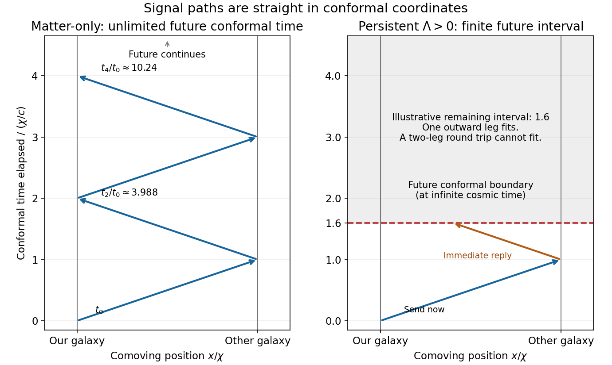

<h1 id="3/d/solution">Solution</h1>

↑ **Parent:** [D](../d.md)

In an [Einstein-de Sitter universe](../../../../einstein-de-sitter-universe.md), take $a(t)=(t/t_0)^{2/3}$ and $t_0=2/(3H_0)$. The galaxy seen today at $z=1$ emitted the light now reaching us when $a(t_e)=1/2$, so $t_e/t_0=2^{-3/2}$. Its fixed [comoving radial distance](../../../../comoving-radial-distance.md) is

$$
\chi=c\int_{t_e}^{t_0}\frac{dt}{a(t)}
=3ct_0\left(1-\frac1{\sqrt2}\right).
$$

Put $b=1-1/\sqrt2$. A new message sent now reaches the galaxy at $t_1$, where

$$
\chi=3ct_0[(t_1/t_0)^{1/3}-1],\qquad
\frac{t_1}{t_0}=(1+b)^3.
$$

Assume an immediate reply and negligible local handling delays. The return consumes the same additional [conformal time](../../../../conformal-time.md), giving the [Einstein-de Sitter round-trip message time](../../../../einstein-de-sitter-round-trip-message-time.md)

$$
\boxed{\frac{t_2}{t_0}=(1+2b)^3=(3-\sqrt2)^3\simeq3.98781,\qquad
\Delta t=t_2-t_0\simeq2.98781t_0=\frac{1.99187}{H_0}.}
$$

For the numerical value $H_0=72\,\mathrm{km\,s^{-1}\,Mpc^{-1}}$ supplied later in the paper, $H_0^{-1}=13.58\,\mathrm{Gyr}$ and the waiting time is about $27.1\,\mathrm{Gyr}$. The age $t_0=9.05\,\mathrm{Gyr}$ here belongs to the stipulated matter-only model, not a claim about the actual measured cosmic age.

After $n$ one-way legs, $t_n=t_0(1+nb)^3$. Since $\int_{t_0}^{\infty}dt/a(t)=\infty$, every finite number of messages is possible and there is no finite fundamental upper count. The exchange takes arbitrarily long, with successively longer intervals; infinitely many messages are not completed in finite cosmic time.

**[Figure 2](#3/d/image-message-exchange-depends-on-the-remaining-conformal-time-not-just-the-present-expansion-rate). Message exchange depends on the remaining conformal time, not just the present expansion rate**. The left conformal spacetime diagram shows repeated light-signal legs between two comoving galaxies in an Einstein-de Sitter model. The right diagram illustrates a finite future conformal interval: one outward leg fits but a complete round trip does not. The right interval is a schematic example, not a parameter estimate for our Universe.

## ↑ Ancestors (12)

1. [D](../d.md)
2. [3](../../3.md)
3. [2018](../../../2018-split.md)
4. [Past exam of the general relativity and cosmology course of the University of Oxford](../../../split.md)
5. [General relativity and cosmology course of the University of Oxford](../../../../general-relativity-and-cosmology-course-of-the-university-of-oxford.md)
6. [Year 3 of the physics course of the University of Oxford](../../../../year-3-of-the-physics-course-of-the-university-of-oxford.md)
7. [Physics course of the University of Oxford](../../../../physics-course-of-the-university-of-oxford.md)
8. [Undergraduate course of the University of Oxford](../../../../undergraduate-course-of-the-university-of-oxford.md)
9. [Course of the University of Oxford](../../../../course-of-the-university-of-oxford.md)
10. [University of Oxford](../../../../university-of-oxford-split.md)
11. [List of universities](../../../../list-of-universities.md)
12. [Codex Wiki](../../../../split.md)
