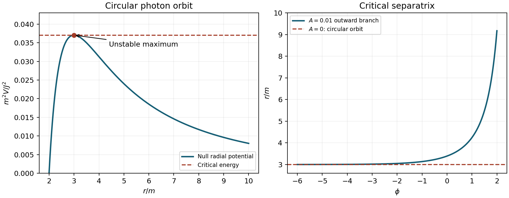

<h1 id="3/solution">Solution</h1>

↑ **Parent:** [3](../3.md)

Let $f(r)=1-2m/r$ and work in the exterior $r>2m$, with $G=c=1$. The affinely parametrized [geodesic Lagrangian](../../../geodesic-lagrangian.md) is

$$
L=\tfrac12\left[f\dot t^2-f^{-1}\dot r^2-r^2\dot\theta^2-r^2\sin^2\theta\,\dot\phi^2\right].
$$

Its polar-angle equation is

$$
\ddot\theta+2\frac{\dot r}{r}\dot\theta-\sin\theta\cos\theta\,\dot\phi^2=0.
$$

The initial data $\theta=\pi/2$, $\dot\theta=0$ therefore remain in that plane. [Rotational symmetry](../../../rotational-symmetry.md) allows the axes to be chosen so that any nonradial initial trajectory has those data: its conserved angular-[momentum](../../../momentum-split.md) direction fixes an orbital plane through the centre. Radial trajectories can also be placed in an equatorial plane.

The coordinates $t,\phi$ are cyclic in $L$, so their canonical momenta are constant:

$$
p_t=f\dot t=E,\qquad p_\phi=-r^2\sin^2\theta\,\dot\phi=-J.
$$

The corresponding [Killing vector fields](../../../killing-vector-field-split.md) are $\partial_t$ and $\partial_\phi$. With the displayed signature, $g(\partial_t,\dot x)=E$ and $g(\partial_\phi,\dot x)=-J$, explaining the sign in the second [canonical momentum](../../../canonical-momentum.md). Thus $E$ is conserved [energy](../../../energy-split.md) per unit [rest mass](../../../invariant-mass.md) for a massive particle parametrized by [proper time](../../../proper-time.md), and $J$ is its axial [angular momentum](../../../angular-momentum.md) per unit [rest mass](../../../invariant-mass.md). For a [photon](../../../photon.md), affine rescaling rescales both constants; after the tangent is normalized to the physical [four-momentum](../../../four-momentum.md) they represent its [energy](../../../energy-split.md) at infinity and axial [angular momentum](../../../angular-momentum.md). Their ratio $b=J/E$ is the signed [impact parameter](../../../impact-parameter.md).

In the equatorial plane, the [photon](../../../photon.md) satisfies the [null geodesic](../../../null-geodesic.md) constraint

$$
0=f\dot t^2-f^{-1}\dot r^2-r^2\dot\phi^2,
$$

which gives

$$
\dot r^2=E^2-\frac{J^2}{r^2}\left(1-\frac{2m}{r}\right).
$$

For $J\ne0$, put $u=m/r$ and $\alpha=Em/J$. Then

$$
\frac{du}{d\phi}=-\frac mJ\dot r,
$$

and consequently

$$
\boxed{(u')^2=\alpha^2+2u^3-u^2.}
$$

The $J=0$ radial case is not represented by $\phi$ as an orbit parameter.

There is a circular [photon](../../../photon.md) orbit at $r=3m$, but **it is unstable**. The radial [effective potential](../../../effective-potential.md) is

$$
V(r)=\frac{J^2}{r^2}\left(1-\frac{2m}{r}\right),\qquad
V'(r)=\frac{2J^2(3m-r)}{r^4}.
$$

A circular orbit requires $V'(r)=0$ and $E^2=V(r)$, giving

$$
\boxed{r_c=3m,\qquad \alpha^2=\frac1{27},\qquad |b_c|=3\sqrt3\,m.}
$$

Its second derivative is

$$
V''(3m)=-\frac{2J^2}{81m^4}<0.
$$

It is a maximum, rather than a minimum, so radial perturbations depart from the orbit. Equivalently the second-order orbit equation is $u''=3u^2-u$. Linearizing about $u_c=1/3$ gives $\delta u''=\delta u$, with modes $e^{\phi}$ and $e^{-\phi}$. The existence of a growing mode directly contradicts the printed stability claim. Exact initial data can remain circular, but that does not make the orbit stable.

The supplied implicit expression describes the critical-[energy](../../../energy-split.md) family with $\alpha^2=1/27$, as fixed by the circular orbit. Define

$$
F(u)=\frac{1-3u}{(\sqrt3+\sqrt{1+6u})^2},\qquad s=\sqrt{1+6u}.
$$

Rationalizing once gives $F=(\sqrt3-s)/(2(\sqrt3+s))$ and

$$
F'(u)=-\frac{3\sqrt3}{s(\sqrt3+s)^2}.
$$

Differentiating $F(u)=Ae^\phi$ gives $F'u'=F$, so

$$
u'=-\frac{s(1-3u)}{3\sqrt3},\qquad
(u')^2=\frac{(1+6u)(1-3u)^2}{27}
=\frac1{27}+2u^3-u^2.
$$

This verifies the first-order equation for every allowed integration constant $A$ on its real branch. For $A=0$ the derivative argument is replaced by direct substitution: $u=1/3$ is constant and solves the critical equation. The displayed family does not solve the equation at an independently arbitrary value of $\alpha$.

For $A>0$, write $q=Ae^\phi$. On the physical exterior branch,

$$
u=\frac{1-8q+4q^2}{3(1+2q)^2},\qquad
0<q<1-\frac{\sqrt3}{2}.
$$

As $\phi\to-\infty$, $q\to0^+$ and

$$
u=\frac13-4Ae^\phi+O(e^{2\phi}),\qquad
r=3m+36mAe^\phi+O(e^{2\phi}).
$$

Thus for $A=0$ the [photon](../../../photon.md) remains exactly on the circular orbit. For $A>0$ it approaches $r=3m$ from outside through indefinitely many revolutions in the negative-$\phi$ limit. With increasing $\phi$, this same branch peels away outward and reaches infinity when $q=1-\sqrt3/2$. Reversing the direction of motion gives an incoming critical ray asymptotically approaching the [photon](../../../photon.md) circle. These are [separatrix](../../../separatrix.md) trajectories, not evidence of stability.

**[Figure 1](#3/image-critical-schwarzschild-photon-orbit-and-an-outward-separatrix). Critical Schwarzschild photon orbit and an outward separatrix**.

The potential maximum and the outward-growing radial separation display the same instability in two complementary descriptions.

## ↑ Ancestors (11)

1. [3](../3.md)
2. [2011](../../2011-split.md)
3. [Past exam of the general relativity course of the University of Oxford](../../split.md)
4. [General relativity course of the University of Oxford](../../../general-relativity-course-of-the-university-of-oxford.md)
5. [Year 3 of the physics course of the University of Oxford](../../../year-3-of-the-physics-course-of-the-university-of-oxford.md)
6. [Physics course of the University of Oxford](../../../physics-course-of-the-university-of-oxford.md)
7. [Undergraduate course of the University of Oxford](../../../undergraduate-course-of-the-university-of-oxford.md)
8. [Course of the University of Oxford](../../../course-of-the-university-of-oxford.md)
9. [University of Oxford](../../../university-of-oxford-split.md)
10. [List of universities](../../../list-of-universities.md)
11. [Codex Wiki](../../../split.md)
