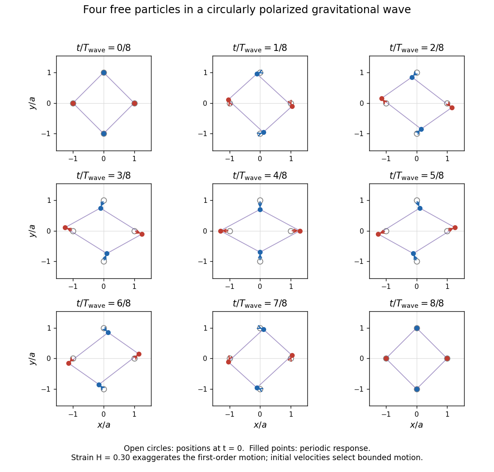

<h1 id="2/c/solution">Solution</h1>

↑ **Parent:** [C](../c.md)

Displacement must be specified relative to an observer. In [transverse-traceless gauge](../../../../transverse-traceless-gauge.md) the free particles can have fixed coordinates, while their measured [proper lengths](../../../../proper-length.md) oscillate. In a local, freely falling [orthonormal frame](../../../../orthonormal-frame-in-spacetime.md), the [geodesic deviation](../../../../geodesic-deviation.md) equation for an initial separation $\mathbf X=(X,Y,0)$ is, to first order in $H$,

$$
\ddot\xi_i=\frac12\ddot h_{ij}(t,0)X^j,\qquad \ddot\xi_z=0.
$$

Its general solution with physical displacement $\boldsymbol\xi(0)=0$ and initial physical [velocity](../../../../velocity.md) $\mathbf V$ is

$$
\boxed{\xi_i(t)=\frac12[h_{ij}(t,0)-h_{ij}(0,0)]X^j
+\left[V_i-\frac12\dot h_{ij}(0,0)X^j\right]t.}
$$

The source has been running indefinitely, so there is no wave-free initial state. Its [initial conditions for an eternal monochromatic gravitational wave](../../../../initial-conditions-for-an-eternal-monochromatic-gravitational-wave.md) need more than positions to fix $\mathbf V$. The usual bounded, periodic response selects $V_i=\dot h_{ij}(0,0)X^j/2$; if the particles instead start at physical rest at $t=0$, set $V_i=0$ and retain the linear term. Both solve the same linear [geodesic deviation](../../../../geodesic-deviation.md) problem. The distinction between fixed TT coordinates and measured separation is explained in [Section 5.2.2, response of free particles to a wave](../../../../general-relativity-by-david-tong.md).

Choose $\beta$ so the wave phase at the detector is $\Phi(t,0)=2\omega t$. For the bounded response the four initial placements then give

$$
\begin{array}{c|ccc}
\mathbf X&\xi_x&\xi_y&\xi_z\\ \hline
(\sigma a,0,0)&\dfrac{\sigma aH}{2}(1-\cos2\omega t)&-\dfrac{\sigma aH}{2}\sin2\omega t&0\\[2pt]
(0,\sigma a,0)&-\dfrac{\sigma aH}{2}\sin2\omega t&\dfrac{\sigma aH}{2}(\cos2\omega t-1)&0
\end{array}\qquad (\sigma=\pm1).
$$

These are displacements from the specified positions at $t=0$; positions are $\mathbf X+\boldsymbol\xi$. Equivalently, relative to mean positions the usual oscillatory displacement is $\boldsymbol\xi_{\rm osc}=h\mathbf X/2$ to first order. The response repeats after $\pi/\omega$.

Both [plus polarization](../../../../plus-polarization.md) and [cross polarization](../../../../cross-polarization.md) occur with equal amplitude and a quarter-cycle phase difference. Their superposition is [circular gravitational-wave polarization](../../../../circular-gravitational-wave-polarization.md), with handedness reversed when the viewing direction or source rotation is reversed. The principal stretching axis turns through half the wave phase. There is no leading longitudinal motion.

**[Figure 1](#2/c/image-one-full-circularly-polarized-gravitational-wave-cycle-with-the-four-particles-at-their-specified-initial-positions-at-phase-zero). One full circularly polarized gravitational-wave cycle, with the four particles at their specified initial positions at phase zero**.

## ↑ Ancestors (12)

1. [C](../c.md)
2. [2](../../2.md)
3. [2021](../../../2021-split.md)
4. [Past exam of the general relativity course of the University of Oxford](../../../split.md)
5. [General relativity course of the University of Oxford](../../../../general-relativity-course-of-the-university-of-oxford.md)
6. [Year 3 of the physics course of the University of Oxford](../../../../year-3-of-the-physics-course-of-the-university-of-oxford.md)
7. [Physics course of the University of Oxford](../../../../physics-course-of-the-university-of-oxford.md)
8. [Undergraduate course of the University of Oxford](../../../../undergraduate-course-of-the-university-of-oxford.md)
9. [Course of the University of Oxford](../../../../course-of-the-university-of-oxford.md)
10. [University of Oxford](../../../../university-of-oxford-split.md)
11. [List of universities](../../../../list-of-universities.md)
12. [Codex Wiki](../../../../split.md)
