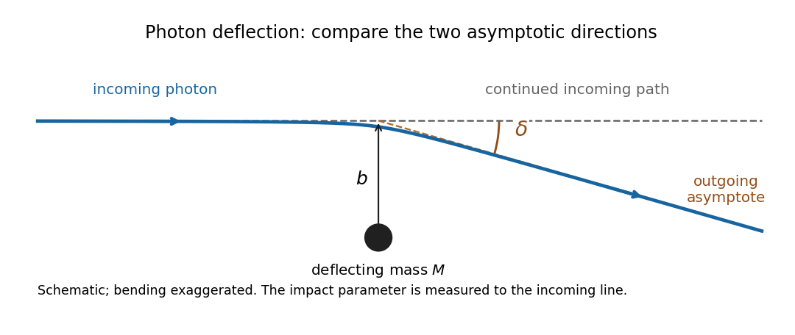

# 2022

↑ **Parent:** [Past exam of the general relativity course of the University of Oxford](../past-exam-of-the-general-relativity-course-of-the-university-of-oxford.md)

Source: [https://www.whatdotheyknow.com/request/oxford_physics_past_papers_2/response/2340696/attach/10/Physics%20Papers%202021.pdf?cookie_passthrough=1](https://www.whatdotheyknow.com/request/oxford_physics_past_papers_2/response/2340696/attach/10/Physics%20Papers%202021.pdf?cookie_passthrough=1)

Source bundle pages 139–144. The paper cover establishes 2022; the attachment filename uses 2021.

**Table of contents**

- [1](#1)
  - [a](#1/a)
    - [Solution](#1/a/solution)
  - [b](#1/b)
    - [Solution](#1/b/solution)
  - [c](#1/c)
    - [Solution](#1/c/solution)
  - [d](#1/d)
    - [Solution](#1/d/solution)
  - [e](#1/e)
    - [Solution](#1/e/solution)
- [2](#2)
  - [a](#2/a)
    - [Solution](#2/a/solution)
  - [b](#2/b)
    - [Solution](#2/b/solution)
  - [c](#2/c)
    - [Solution](#2/c/solution)
  - [d](#2/d)
    - [Solution](#2/d/solution)
  - [e](#2/e)
    - [Solution](#2/e/solution)
  - [f](#2/f)
    - [Solution](#2/f/solution)
- [3](#3)
  - [a](#3/a)
    - [Solution](#3/a/solution)
  - [b](#3/b)
    - [Solution](#3/b/solution)
  - [c](#3/c)
    - [Solution](#3/c/solution)
  - [d](#3/d)
    - [Solution](#3/d/solution)
- [4](#4)
  - [a](#4/a)
    - [Solution](#4/a/solution)
  - [b](#4/b)
    - [Solution](#4/b/solution)
  - [c](#4/c)
    - [Solution](#4/c/solution)
  - [d](#4/d)
    - [Solution](#4/d/solution)
  - [e](#4/e)
    - [Solution](#4/e/solution)

## 1

↑ **Parent:** [2022](2022.md)

<h3 id="1/a">a</h3>

↑ **Parent:** [1](#1)

<h4 id="1/a/solution">Solution</h4>

↑ **Parent:** [A](#1/a)

For the [Levi-Civita connection](../general-relativity.md#levi-civita-connection), the all-lowered [Riemann curvature tensor](../riemann-curvature-tensor.md) has the algebraic symmetries

$$
\boxed{R_{\lambda\mu\nu\kappa}=-R_{\mu\lambda\nu\kappa}
=-R_{\lambda\mu\kappa\nu},\qquad
R_{\lambda\mu\nu\kappa}=R_{\nu\kappa\lambda\mu}.}
$$

The [first Bianchi identity](../riemann-curvature-tensor.md#first-bianchi-identity) is the cyclic identity

$$
\boxed{R_{\lambda\mu\nu\kappa}+R_{\lambda\nu\kappa\mu}+R_{\lambda\kappa\mu\nu}=0.}
$$

These statements concern the [Riemann curvature tensor](../riemann-curvature-tensor.md) at each point and are unchanged by reversing its overall [curvature sign convention](../riemann-curvature-tensor.md#curvature-sign-convention).

<h3 id="1/b">b</h3>

↑ **Parent:** [1](#1)

<h4 id="1/b/solution">Solution</h4>

↑ **Parent:** [B](#1/b)

A semicolon denotes the [covariant derivative](../general-relativity.md#covariant-derivative) for the [Levi-Civita connection](../general-relativity.md#levi-civita-connection). For example, the four lower indices of the [Riemann curvature tensor](../riemann-curvature-tensor.md) contribute four connection terms:

$$
\begin{aligned}
R_{\lambda\mu\nu\kappa;\eta}
={}&\partial_\eta R_{\lambda\mu\nu\kappa}
-\Gamma^a_{\lambda\eta}R_{a\mu\nu\kappa}
-\Gamma^a_{\mu\eta}R_{\lambda a\nu\kappa}\\
&-\Gamma^a_{\nu\eta}R_{\lambda\mu a\kappa}
-\Gamma^a_{\kappa\eta}R_{\lambda\mu\nu a}.
\end{aligned}
$$

Here $\partial_\eta=\partial/\partial x^\eta$ is a [partial derivative](../multivariable-calculus.md#partial-derivative), $\Gamma^a_{b\eta}$ are [Christoffel symbols](../riemannian-geometry.md#christoffel-symbol), and repeated indices are summed from $0$ to $3$. Write $g_{\mu\nu}$ for the [metric tensor](../general-relativity.md#metric-tensor), $g^{\mu\nu}$ for its [inverse metric](../general-relativity.md#inverse-metric), $R_{\mu\nu}=g^{\lambda\nu'}R_{\lambda\mu\nu'\nu}$ for the [Ricci tensor](../riemann-curvature-tensor.md#ricci-tensor), and $R=g^{\mu\nu}R_{\mu\nu}$ for the [Ricci scalar](../general-relativity.md#ricci-scalar). This [tensor contraction](../multilinear-algebra.md#tensor-contraction) agrees with the paper's $R_{\mu\nu}=-R^a{}_{\mu\nu a}$.

By [metric compatibility](../vector-bundle.md#metric-compatibility), the [inverse metric](../general-relativity.md#inverse-metric) may pass through each [covariant derivative](../general-relativity.md#covariant-derivative). Contracting the [second Bianchi identity](../riemann-curvature-tensor.md#second-bianchi-identity) with $g^{\lambda\nu}$ gives

$$
\nabla_\eta R_{\mu\kappa}-\nabla_\kappa R_{\mu\eta}
+\nabla^\lambda R_{\lambda\mu\kappa\eta}=0,
$$

where $\nabla_\eta$ is the same [covariant derivative](../general-relativity.md#covariant-derivative) as the semicolon. Next contract with $g^{\mu\kappa}$. Antisymmetry of the first pair gives $g^{\mu\kappa}R_{\lambda\mu\kappa\eta}=-R_{\lambda\eta}$, so

$$
\partial_\eta R-\nabla^\mu R_{\mu\eta}-\nabla^\lambda R_{\lambda\eta}=0.
$$

Thus the [contracted Bianchi identity](../riemann-curvature-tensor.md#contracted-bianchi-identity) is $\nabla^\mu R_{\mu\eta}=\tfrac12\partial_\eta R$. Raising the remaining index and using [metric compatibility](../vector-bundle.md#metric-compatibility) proves

$$
\boxed{\nabla_\mu G^{\mu\nu}=0,\qquad
G^{\mu\nu}=R^{\mu\nu}-\tfrac12g^{\mu\nu}R.}
$$

The [Einstein tensor](../riemann-curvature-tensor.md#einstein-tensor) $G^{\mu\nu}$ therefore has identically zero [covariant divergence](../general-relativity.md#covariant-divergence), without imposing any field equation. This makes the [Einstein field equations](../einstein-field-equations.md) compatible with [stress-energy conservation](../stress-energy-tensor.md#stress-energy-conservation), $\nabla_\mu T^{\mu\nu}=0$, where $T^{\mu\nu}$ is the [stress-energy tensor](../stress-energy-tensor.md). The connection terms describe how [energy](../energy.md) and [momentum](../momentum.md) are compared at neighboring points; ordinary componentwise [partial derivatives](../multivariable-calculus.md#partial-derivative) would not give a coordinate-independent conservation law in curved [spacetime](../special-relativity.md#spacetime).

<h3 id="1/c">c</h3>

↑ **Parent:** [1](#1)

<h4 id="1/c/solution">Solution</h4>

↑ **Parent:** [C](#1/c)

Take the [tensor contraction](../multilinear-algebra.md#tensor-contraction) of the [Einstein field equations](../einstein-field-equations.md) with the [inverse metric](../general-relativity.md#inverse-metric) $g^{\mu\nu}$. In four-dimensional [spacetime](../special-relativity.md#spacetime), $g^{\mu\nu}g_{\mu\nu}=4$, hence

$$
R-\frac12(4)R=CT,\qquad T=g^{\mu\nu}T_{\mu\nu},\qquad R=-CT.
$$

Here $T$ is the [tensor contraction](../multilinear-algebra.md#tensor-contraction) of the [stress-energy tensor](../stress-energy-tensor.md). Substituting this result back into the [Einstein field equations](../einstein-field-equations.md), while keeping both free indices lowered, gives the [trace-reversed stress-energy tensor](../stress-energy-tensor.md#trace-reversed-stress-energy-tensor):

$$
\boxed{R_{\mu\nu}=C\left(T_{\mu\nu}-\frac12g_{\mu\nu}T\right)
=CS_{\mu\nu}.}
$$

The factor $1/2$ uses the dimension four: in dimension $n>2$, the [Trace-reversed Einstein field equations in D dimensions](../einstein-field-equations.md#trace-reversed-einstein-field-equations-in-d-dimensions) have $1/(n-2)$ in place of $1/2$.

<h3 id="1/d">d</h3>

↑ **Parent:** [1](#1)

<h4 id="1/d/solution">Solution</h4>

↑ **Parent:** [D](#1/d)

Use $x^0=ct$ and [metric signature](../topological-manifold.md#metric-signature) $(-,+,+,+)$. With the source's [curvature sign convention](../riemann-curvature-tensor.md#curvature-sign-convention), the [Ricci tensor](../riemann-curvature-tensor.md#ricci-tensor) is

$$
\begin{aligned}
R_{\mu\nu}&=-R^\lambda{}_{\mu\nu\lambda}\\
&=\partial_\nu\Gamma^\lambda_{\mu\lambda}
-\partial_\lambda\Gamma^\lambda_{\mu\nu}
+\Gamma^\sigma_{\mu\lambda}\Gamma^\lambda_{\nu\sigma}
-\Gamma^\sigma_{\mu\nu}\Gamma^\lambda_{\sigma\lambda}.
\end{aligned}
$$

Its time-time component is therefore

$$
R_{00}=\partial_0\Gamma^\lambda_{0\lambda}
-\partial_\lambda\Gamma^\lambda_{00}
+\Gamma^\sigma_{0\lambda}\Gamma^\lambda_{0\sigma}
-\Gamma^\sigma_{00}\Gamma^\lambda_{\sigma\lambda}.
$$

For a slowly moving, pressure-negligible source, the [stress-energy tensor](../stress-energy-tensor.md) is approximated by [relativistic dust](../stress-energy-tensor.md#relativistic-dust): $T^{\mu\nu}=\rho U^\mu U^\nu$, where $\rho$ is [mass density](../fluid-mechanics.md#density) and $U^\mu$ is the [four-velocity](../special-relativity.md#four-velocity). In its approximate rest [local inertial frame](../mathematical-physics.md#local-inertial-frame), $U^\mu\simeq(c,0,0,0)$ and $U_0\simeq-c$. Thus

$$
T_{00}\simeq\rho c^2,\qquad T_{ij}\ll T_{00},\qquad
T\simeq-\rho c^2,
$$

and the [trace-reversed stress-energy tensor](../stress-energy-tensor.md#trace-reversed-stress-energy-tensor) satisfies

$$
S_{00}=T_{00}-\frac12g_{00}T\simeq\frac12\rho c^2.
\qquad\boxed{R_{00}\simeq\frac12C\rho c^2.}
$$

Independently, introduce the [metric perturbation](../linearized-gravity.md) $g_{\mu\nu}=\eta_{\mu\nu}+h_{\mu\nu}$, with $|h_{\mu\nu}|\ll1$ and constant [Minkowski metric](../special-relativity.md#minkowski-metric) $\eta_{\mu\nu}$. The [Christoffel symbols](../riemannian-geometry.md#christoffel-symbol) are first order in $h$, so their products are discarded in the [weak-field approximation](../linearized-gravity.md#weak-field-approximation). With a comma denoting a [partial derivative](../multivariable-calculus.md#partial-derivative), the linearized [Riemann curvature tensor](../riemann-curvature-tensor.md) is

$$
R_{\lambda\mu\nu\kappa}
=\frac12\left(h_{\lambda\nu,\kappa\mu}
-h_{\mu\nu,\kappa\lambda}
-h_{\lambda\kappa,\nu\mu}
+h_{\mu\kappa,\nu\lambda}\right)+O(h^2).
$$

Taking the [tensor contraction](../multilinear-algebra.md#tensor-contraction) gives, to this order,

$$
R_{00}=\sum_{i=1}^3R_{i0i0}
=\frac12\sum_{i=1}^3\left(\partial_0^2h_{ii}
-2\partial_0\partial_i h_{0i}+\partial_i^2h_{00}\right).
$$

In the static [Newtonian limit](../linearized-gravity.md#newtonian-limit), all time [partial derivatives](../multivariable-calculus.md#partial-derivative) vanish. The constant $\eta_{00}$ also has zero [partial derivatives](../multivariable-calculus.md#partial-derivative), leaving

$$
\boxed{R_{00}\simeq\frac12\nabla^2h_{00}
=\frac12\nabla^2g_{00}.}
$$

Here $\nabla^2=\sum_i\partial_i^2$ is the spatial [Laplace operator](../partial-differential-equation.md#laplace-operator) in the approximately Cartesian background coordinates. This sign follows the paper's [curvature sign convention](../riemann-curvature-tensor.md#curvature-sign-convention).

<h3 id="1/e">e</h3>

↑ **Parent:** [1](#1)

<h4 id="1/e/solution">Solution</h4>

↑ **Parent:** [E](#1/e)

For the [Newtonian gravitational potential](../newton-s-law-of-universal-gravitation.md#newtonian-gravitational-potential) $\Phi$, the weak static [metric tensor](../general-relativity.md#metric-tensor) has $g_{00}\simeq-1-2\Phi/c^2$. The [Newtonian limit](../linearized-gravity.md#newtonian-limit) derived above consequently gives

$$
R_{00}\simeq-\frac1{c^2}\nabla^2\Phi
=\frac12C\rho c^2,
\qquad
\nabla^2\Phi=-\frac12C c^4\rho.
$$

Matching the [Poisson equation for Newtonian gravity](../newton-s-law-of-universal-gravitation.md#poisson-equation-for-newtonian-gravity), $\nabla^2\Phi=4\pi G\rho$, fixes

$$
\boxed{C=-\frac{8\pi G}{c^4}.}
$$

Here $G$ is the [gravitational constant](../newton-s-law-of-universal-gravitation.md#gravitational-constant) and $c$ is the [speed of light](../special-relativity.md#speed-of-light). This negative coupling agrees with the source formula sheet. The familiar positive coupling uses the opposite [curvature sign convention](../riemann-curvature-tensor.md#curvature-sign-convention) for the [Ricci tensor](../riemann-curvature-tensor.md#ricci-tensor); the physical [Poisson equation for Newtonian gravity](../newton-s-law-of-universal-gravitation.md#poisson-equation-for-newtonian-gravity) is the same.

## 2

↑ **Parent:** [2022](2022.md)

<h3 id="2/a">a</h3>

↑ **Parent:** [2](#2)

<h4 id="2/a/solution">Solution</h4>

↑ **Parent:** [A](#2/a)

Choose [normal coordinates](../general-relativity.md#normal-coordinates) $\xi^\alpha$ centered at an event $p$. At $p$, the [metric tensor](../general-relativity.md#metric-tensor) in these coordinates is the constant [Minkowski metric](../special-relativity.md#minkowski-metric) $\eta_{\alpha\beta}=\operatorname{diag}(-1,1,1,1)$, with $\xi^0$ measured in length units, and its first [partial derivatives](../multivariable-calculus.md#partial-derivative) vanish. In arbitrary coordinates $x^\mu$, the [chain rule](../calculus.md#chain-rule) for the [line element](../riemannian-metric.md#line-element) gives

$$
ds^2\big|_p=\eta_{\alpha\beta}\,d\xi^\alpha d\xi^\beta
=g_{\mu\nu}(p)\,dx^\mu dx^\nu,
$$

so

$$
\boxed{g_{\mu\nu}(p)=\left.
\eta_{\alpha\beta}\frac{\partial\xi^\alpha}{\partial x^\mu}
\frac{\partial\xi^\beta}{\partial x^\nu}\right|_p.}
$$

This construction is pointwise. At nearby events, the [metric tensor](../general-relativity.md#metric-tensor) in the chosen [normal coordinates](../general-relativity.md#normal-coordinates) is $g^{(\xi)}_{\alpha\beta}(\xi)=\eta_{\alpha\beta}+O(|\xi|^2)$, with the quadratic corrections determined by the [Riemann curvature tensor](../riemann-curvature-tensor.md). Replacing $g^{(\xi)}$ by one constant [Minkowski metric](../special-relativity.md#minkowski-metric) throughout an open region would make that region flat, so it cannot describe general curved [spacetime](../special-relativity.md#spacetime) exactly.

<h3 id="2/b">b</h3>

↑ **Parent:** [2](#2)

<h4 id="2/b/solution">Solution</h4>

↑ **Parent:** [B](#2/b)

For a contravariant [vector field](../multivariable-calculus.md#vector-field) $A^\lambda$, the [covariant derivative](../general-relativity.md#covariant-derivative) is

$$
\boxed{\nabla_\nu A^\lambda=A^\lambda{}_{;\nu}
=\partial_\nu A^\lambda+\Gamma^\lambda_{\mu\nu}A^\mu.}
$$

The [Levi-Civita connection](../general-relativity.md#levi-civita-connection) is the unique [torsion-free connection](../vector-bundle.md#torsion-free-connection) satisfying [metric compatibility](../vector-bundle.md#metric-compatibility). Its [Christoffel symbols](../riemannian-geometry.md#christoffel-symbol) in a [coordinate basis](../tangent-vector.md#coordinate-basis) are

$$
\boxed{\Gamma^\lambda_{\mu\nu}
=\frac12g^{\lambda\sigma}
\left(\partial_\mu g_{\sigma\nu}
+\partial_\nu g_{\sigma\mu}-\partial_\sigma g_{\mu\nu}\right),
\qquad\Gamma^\lambda_{\mu\nu}=\Gamma^\lambda_{\nu\mu}.}
$$

There is generally no symmetry interchanging the upper index with a lower one. The [Christoffel symbols](../riemannian-geometry.md#christoffel-symbol) themselves are not the components of a [tensor](../multilinear-algebra.md#tensor).

An ordinary [partial derivative](../multivariable-calculus.md#partial-derivative) of the components of a [vector field](../multivariable-calculus.md#vector-field) includes the apparent change caused by the varying [coordinate basis](../tangent-vector.md#coordinate-basis). The connection term corrects for that change, so $\nabla_\nu A^\lambda$ obeys the [tensor component transformation law](../general-relativity.md#tensor-component-transformation-law). It gives coordinate-independent ways to express [parallel transport](../vector-bundle.md#parallel-transport), [geodesics](../riemannian-geometry.md#geodesic) and [stress-energy conservation](../stress-energy-tensor.md#stress-energy-conservation) in curved [spacetime](../special-relativity.md#spacetime).

<h3 id="2/c">c</h3>

↑ **Parent:** [2](#2)

<h4 id="2/c/solution">Solution</h4>

↑ **Parent:** [C](#2/c)

Each lower index contributes a minus connection term to the [covariant derivative](../general-relativity.md#covariant-derivative) of the [metric tensor](../general-relativity.md#metric-tensor):

$$
\nabla_\lambda g_{\mu\nu}
=\partial_\lambda g_{\mu\nu}
-\Gamma^\rho_{\mu\lambda}g_{\rho\nu}
-\Gamma^\rho_{\nu\lambda}g_{\mu\rho}.
$$

Substitute the [Christoffel symbols](../riemannian-geometry.md#christoffel-symbol) of the [Levi-Civita connection](../general-relativity.md#levi-civita-connection) and use the [inverse metric](../general-relativity.md#inverse-metric) identity $g_{\rho\nu}g^{\rho\sigma}=\delta^\sigma_\nu$:

$$
\begin{aligned}
g_{\rho\nu}\Gamma^\rho_{\mu\lambda}
&=\tfrac12(\partial_\mu g_{\nu\lambda}
+\partial_\lambda g_{\nu\mu}-\partial_\nu g_{\mu\lambda}),\\
g_{\mu\rho}\Gamma^\rho_{\nu\lambda}
&=\tfrac12(\partial_\nu g_{\mu\lambda}
+\partial_\lambda g_{\mu\nu}-\partial_\mu g_{\nu\lambda}).
\end{aligned}
$$

Adding cancels the first and third terms and leaves exactly $\partial_\lambda g_{\mu\nu}$. Hence

$$
\boxed{\nabla_\lambda g_{\mu\nu}=0.}
$$

This is [metric compatibility](../vector-bundle.md#metric-compatibility): the [Levi-Civita connection](../general-relativity.md#levi-civita-connection) preserves the [inner product](../inner-product.md) under [parallel transport](../vector-bundle.md#parallel-transport).

<h3 id="2/d">d</h3>

↑ **Parent:** [2](#2)

<h4 id="2/d/solution">Solution</h4>

↑ **Parent:** [D](#2/d)

The [metric tensor](../general-relativity.md#metric-tensor) in a basis $\mathbf e_a$ is $g_{ab}=\mathbf e_a\cdot\mathbf e_b$. Differentiating this [inner product](../inner-product.md) with the [product rule](../calculus.md#product-rule) and using the assumed basis-derivative relation yields

$$
\begin{aligned}
\partial_c g_{ab}
&=(\partial_c\mathbf e_a)\cdot\mathbf e_b
+\mathbf e_a\cdot(\partial_c\mathbf e_b)\\
&=\Gamma^d_{ac}\,\mathbf e_d\cdot\mathbf e_b
+\Gamma^d_{bc}\,\mathbf e_a\cdot\mathbf e_d\\
&=\boxed{\Gamma^d_{ac}g_{db}+\Gamma^d_{bc}g_{ad}.}
\end{aligned}
$$

Thus the coefficients satisfy [metric compatibility](../vector-bundle.md#metric-compatibility). For a [coordinate basis](../tangent-vector.md#coordinate-basis) with zero [torsion tensor](../vector-bundle.md#torsion-tensor), symmetrizing this relation in $a,c$, adding the corresponding two equations and subtracting the third gives

$$
\Gamma^b_{ac}=\frac12g^{bd}
(\partial_a g_{dc}+\partial_c g_{da}-\partial_d g_{ac}).
$$

They are therefore the [Christoffel symbols](../riemannian-geometry.md#christoffel-symbol) of the [Levi-Civita connection](../general-relativity.md#levi-civita-connection). [Metric compatibility](../vector-bundle.md#metric-compatibility) by itself does not establish zero [torsion tensor](../vector-bundle.md#torsion-tensor); that also uses the [coordinate basis](../tangent-vector.md#coordinate-basis) and its commuting coordinate derivatives.

For an embedded curved surface, the stated ambient basis-derivative relation needs a qualification: the [Gauss formula](../second-fundamental-form.md#gauss-formula) is $\partial_c\mathbf e_a=\Gamma^b_{ac}\mathbf e_b+h_{ac}\mathbf n$, where $\mathbf n$ is a [unit normal](../differential-geometry.md#unit-normal) and $h_{ac}$ is the [second fundamental form](../second-fundamental-form.md). The normal term has zero [inner product](../inner-product.md) with each tangent basis vector, so the displayed identity for $\partial_c g_{ab}$ still holds. For a concrete counterexample to dropping that term, on a [two-sphere](../euclidean-geometry.md#two-sphere) one has $\partial_\theta\mathbf e_\theta=-R\mathbf n$, whereas every $\Gamma^b_{\theta\theta}$ is zero. Thus the intrinsic connection describes the tangential projection of the ambient derivative.

<h3 id="2/e">e</h3>

↑ **Parent:** [2](#2)

<h4 id="2/e/solution">Solution</h4>

↑ **Parent:** [E](#2/e)

In standard [spherical coordinates](../multivariable-calculus.md#spherical-coordinate-system), parametrize the [two-sphere](../euclidean-geometry.md#two-sphere) by

$$
\mathbf x(\theta,\phi)=R(\sin\theta\cos\phi,\sin\theta\sin\phi,\cos\theta).
$$

The [coordinate basis](../tangent-vector.md#coordinate-basis) transforms from the fixed Cartesian basis according to $\mathbf e_a=(\partial x^i/\partial q^a)\mathbf e_i$. Therefore

$$
\begin{aligned}
\mathbf e_\theta&=\partial_\theta\mathbf x
=R(\cos\theta\cos\phi,\cos\theta\sin\phi,-\sin\theta),\\
\mathbf e_\phi&=\partial_\phi\mathbf x
=R(-\sin\theta\sin\phi,\sin\theta\cos\phi,0).
\end{aligned}
$$

Their [inner products](../inner-product.md) are $\mathbf e_\theta^2=R^2$, $\mathbf e_\theta\cdot\mathbf e_\phi=0$ and $\mathbf e_\phi^2=R^2\sin^2\theta$. Thus the [induced metric](../riemannian-geometry.md#induced-metric) is

$$
\boxed{(g_{ij})=R^2\begin{pmatrix}1&0\\0&\sin^2\theta\end{pmatrix},\qquad
ds^2=R^2(d\theta^2+\sin^2\theta\,d\phi^2).}
$$

The source's intermediate display places an extra $R^2$ outside entries already labelled $g_{\theta\theta},\ldots$. Interpreting those entries as the actual [metric tensor](../general-relativity.md#metric-tensor) components would double-count the factor: for example, $R=2$ gives $g_{\theta\theta}=4$ directly from $\mathbf e_\theta^2$, not $16$. Its final matrix is the correct [induced metric](../riemannian-geometry.md#induced-metric); the entries of its intermediate matrix must instead denote dimensionless coefficients.

<h3 id="2/f">f</h3>

↑ **Parent:** [2](#2)

<h4 id="2/f/solution">Solution</h4>

↑ **Parent:** [F](#2/f)

The only nonconstant entry of the [metric tensor](../general-relativity.md#metric-tensor) is $g_{\phi\phi}=R^2\sin^2\theta$, whose [partial derivative](../multivariable-calculus.md#partial-derivative) is $\partial_\theta g_{\phi\phi}=2R^2\sin\theta\cos\theta$. The nonzero [Christoffel symbols](../riemannian-geometry.md#christoffel-symbol) are

$$
\boxed{\Gamma^\theta_{\phi\phi}=-\sin\theta\cos\theta,\qquad
\Gamma^\phi_{\theta\phi}=\Gamma^\phi_{\phi\theta}=\cot\theta.}
$$

Along a fixed latitude with $0<\theta<\pi$, [parallel transport](../vector-bundle.md#parallel-transport) gives

$$
\frac{dV^\theta}{d\phi}=\sin\theta\cos\theta\,V^\phi,
\qquad
\frac{dV^\phi}{d\phi}=-\cot\theta\,V^\theta.
$$

Set $X=V^\theta$ and $Y=\sin\theta\,V^\phi$. Since $\theta$ is fixed, this [linear ordinary differential equation](../linear-ordinary-differential-equation.md) becomes

$$
X'=\cos\theta\,Y,\qquad Y'=-\cos\theta\,X.
$$

It is a rotation at constant rate $-\cos\theta$. Its general solution, also valid at the equator where the rate is zero, is

$$
\boxed{\begin{aligned}
V^\theta&=A\cos(\phi\cos\theta)+B\sin(\phi\cos\theta),\\
V^\phi&=\frac{-A\sin(\phi\cos\theta)+B\cos(\phi\cos\theta)}{\sin\theta}.
\end{aligned}}
$$

The initial data give $A=1$ and $B=0$. At $\theta=\pi/3$, a complete circuit has $\phi\cos\theta=\pi$, so

$$
\boxed{(V^\theta,V^\phi)_{\phi=2\pi}=(-1,0).}
$$

The physical squared length uses the [metric tensor](../general-relativity.md#metric-tensor), rather than the Euclidean sum of coordinate components:

$$
\boxed{|\mathbf V|^2=R^2\bigl[(V^\theta)^2+\sin^2\theta(V^\phi)^2\bigr]
=R^2(A^2+B^2).}
$$

It is constant and equals $R^2$ for these data. More generally, [metric compatibility](../vector-bundle.md#metric-compatibility) gives $d\,g(V,V)/d\phi=(\nabla_{\partial_\phi}g)(V,V)+2g(\nabla_{\partial_\phi}V,V)=0$. The final change of direction is [holonomy](../fiber-bundle.md#holonomy), exemplified by [parallel transport around a latitude of the unit sphere](../vector-bundle.md#parallel-transport-around-a-latitude-of-the-unit-sphere); [parallel transport](../vector-bundle.md#parallel-transport) preserves length without requiring the direction to return unchanged.

## 3

↑ **Parent:** [2022](2022.md)

<h3 id="3/a">a</h3>

↑ **Parent:** [3](#3)

<h4 id="3/a/solution">Solution</h4>

↑ **Parent:** [A](#3/a)

A [photon](../quantum-mechanics.md#photon) follows a [null geodesic](../special-relativity.md#null-geodesic), whose spatial path approaches straight lines far from the deflecting [mass](../classical-mechanics.md#mass). Extend the incoming asymptote forward: this is the reference path the [photon](../quantum-mechanics.md#photon) would follow if the [mass](../classical-mechanics.md#mass) were removed while its incoming direction and transverse offset were held fixed. The [impact parameter](../classical-mechanics.md#impact-parameter) $b$ is the perpendicular distance from the [mass](../classical-mechanics.md#mass) to that incoming asymptote. It is not, in general, the distance of closest approach.

**[Figure 1](#3/a/image-impact-parameter-and-deflection-relative-to-the-continued-incoming-photon-path). Impact parameter and deflection relative to the continued incoming photon path**. Original schematic, with bending exaggerated. The dashed horizontal line is the undeflected reference path. The outgoing dashed asymptote makes angle delta with it; b is measured to the incoming asymptote, not to the bent ray.

The positive deflection angle $\delta$ is the angle between the outgoing propagation direction and the continued incoming direction. The [photon](../quantum-mechanics.md#photon) bends toward the [mass](../classical-mechanics.md#mass), so a ray passing above it has a downward outgoing slope in the figure. In the [weak-field approximation](../linearized-gravity.md#weak-field-approximation) for an isolated spherical [mass](../classical-mechanics.md#mass), [Schwarzschild light deflection](../schwarzschild-spacetime.md#schwarzschild-light-deflection) gives $\delta\simeq4GM/(bc^2)$ for distant endpoints. This angle differs from the apparent image angle measured from the observer's line of sight to the [mass](../classical-mechanics.md#mass).

<h3 id="3/b">b</h3>

↑ **Parent:** [3](#3)

<h4 id="3/b/solution">Solution</h4>

↑ **Parent:** [B](#3/b)

By spherical symmetry, choose the orbital plane to be $\theta=\pi/2$. The [geodesic Lagrangian](../riemannian-geometry.md#geodesic-lagrangian) of the [Schwarzschild metric](../schwarzschild-spacetime.md) is

$$
\mathcal L=\frac12\left(-Bc^2\dot t^2+B^{-1}\dot r^2+r^2\dot\phi^2\right),
\qquad B=1-\frac{2GM}{rc^2}.
$$

For a massive [test particle](../classical-mechanics.md#test-particle), dots denote [proper time](../special-relativity.md#proper-time) derivatives and $2\mathcal L=-c^2$. The [cyclic coordinates](../lagrangian-mechanics.md#cyclic-coordinate) $t$ and $\phi$ give, through the [Euler-Lagrange equations](../analysis.md#euler-lagrange-equation), two constants:

$$
B\dot t=\mathcal E,\qquad r^2\dot\phi=\ell.
$$

At infinity, $\mathcal E=\gamma_\infty=1/\sqrt{1-v_\infty^2/c^2}$ is the [Lorentz factor](../special-relativity.md#lorentz-factor). The constant $\ell$ is the [specific angular momentum](../celestial-mechanics.md#specific-angular-momentum), and the energy per unit [rest mass](../special-relativity.md#invariant-mass) is $E_\infty/m=c^2\gamma_\infty$. The normalization of the [four-velocity](../special-relativity.md#four-velocity) gives

$$
-c^2=-\frac{c^2\gamma_\infty^2}{B}
+\frac{\dot r^2}{B}+\frac{\ell^2}{r^2},
\qquad
\dot r^2=c^2\gamma_\infty^2-B\left(c^2+\frac{\ell^2}{r^2}\right).
$$

Use $dr/d\phi=\dot r\,r^2/\ell$ and define the [energy-normalized angular momentum for a Schwarzschild geodesic](../schwarzschild-spacetime.md#energy-normalized-angular-momentum-for-a-schwarzschild-geodesic)

$$
J=\frac{\ell}{\gamma_\infty}=\frac{c^2L_\infty}{E_\infty}.
$$

Then

$$
\boxed{\left(\frac{dr}{d\phi}\right)^2
+r^2B\left(1+\frac{c^2r^2}{\gamma_\infty^2J^2}\right)
=\frac{c^2r^4}{J^2}.}
$$

For an incoming massive [test particle](../classical-mechanics.md#test-particle) with [impact parameter](../classical-mechanics.md#impact-parameter) $b$, $L_\infty=m\gamma_\infty v_\infty b$, so $J=bv_\infty$. In particular, $J$ is not the same as the [specific angular momentum](../celestial-mechanics.md#specific-angular-momentum) $\ell$ unless $\gamma_\infty=1$.

A [photon](../quantum-mechanics.md#photon) has no [proper time](../special-relativity.md#proper-time) parametrization and no finite [Lorentz factor](../special-relativity.md#lorentz-factor). For it, use an [affine parameter](../riemannian-geometry.md#affine-parameter) in the same [geodesic Lagrangian](../riemannian-geometry.md#geodesic-lagrangian) and impose $2\mathcal L=0$. The ratio $J=c^2L_\infty/E_\infty=bc$ remains well defined, and the null result is

$$
\boxed{\left(\frac{dr}{d\phi}\right)^2+r^2B=\frac{r^4}{b^2}.}
$$

Equivalently this is the ultrarelativistic limit of the massive formula at fixed $J$, with $1/\gamma_\infty^2\to0$. The printed massive formula needs this interpretation before it is applied to a [photon](../quantum-mechanics.md#photon).

<h3 id="3/c">c</h3>

↑ **Parent:** [3](#3)

<h4 id="3/c/solution">Solution</h4>

↑ **Parent:** [C](#3/c)

Let $m_g=GM/c^2$, $u=1/r$, and use a prime for $d/d\phi$. The [null geodesic](../special-relativity.md#null-geodesic) first integral obtained above becomes

$$
(u')^2+u^2-2m_g u^3=\frac1{b^2}.
$$

Differentiating with respect to $\phi$ and dividing by $2u'$ away from a turning point gives

$$
\boxed{u''+u=3m_g u^2=\frac{3GM}{c^2}u^2.}
$$

The same [differential equation](../differential-equation.md) holds at the turning point by continuity. When $m_g=0$, the general solution is $u_0=C_1\cos\phi+C_2\sin\phi$. Choose the angular origin so that the incoming asymptote has $\phi=0$ and the unperturbed closest approach has $\phi=\pi/2$. The [impact parameter](../classical-mechanics.md#impact-parameter) then fixes

$$
\boxed{u_0=\frac{\sin\phi}{b},\qquad r\sin\phi=b.}
$$

This is the straight reference path, not a curved orbit.

For [perturbation theory](../asymptotic-expansion.md#perturbation-theory) with $m_g/b\ll1$, write $u=u_0+u_1+O(m_g^2/b^3)$, where $u_1=O(m_g/b^2)$. Inserting this into the [differential equation](../differential-equation.md) and discarding second-order terms gives

$$
u_1''+u_1=3m_g u_0^2
=\boxed{\frac{3GM}{c^2}\frac{1-\cos2\phi}{2b^2}.}
$$

A particular solution and the complementary solution are

$$
u_1=\frac{m_g}{2b^2}(3+\cos2\phi)+A_1\cos\phi+B_1\sin\phi.
$$

Choosing $A_1=B_1=0$ retains reflection symmetry about $\phi=\pi/2$ and the specified [impact parameter](../classical-mechanics.md#impact-parameter) to first order. The two distant zeros of $u$ then occur at $\phi_{\rm in}\simeq-2m_g/b$ and $\phi_{\rm out}\simeq\pi+2m_g/b$. Their separation exceeds $\pi$ by $4m_g/b$, consistently giving the [Schwarzschild light deflection](../schwarzschild-spacetime.md#schwarzschild-light-deflection) $\delta\simeq4GM/(bc^2)$.

<h3 id="3/d">d</h3>

↑ **Parent:** [3](#3)

<h4 id="3/d/solution">Solution</h4>

↑ **Parent:** [D](#3/d)

In the [thin-lens approximation for gravitational lensing](../gravitational-lensing.md#thin-lens-approximation-for-gravitational-lensing), consider a ray crossing the lens plane at transverse distance $b$ above the aligned source-observer axis. With the observer at axial position $0$, the [black hole](../black-hole.md) at $L$ and the source at $D$, the segment joining the lens plane to the source has slope $-b/(D-L)$, while the segment joining the observer to the lens plane has slope $b/L$. The observer sees the ray at apparent angle $\theta\simeq b/L$ to the axis. When following the [photon](../quantum-mechanics.md#photon) toward the observer, the two small angles to the axis have magnitudes $b/(D-L)$ and $b/L$. The physical bend is their sum:

$$
\delta\simeq\frac bL+\frac b{D-L}
=\frac{bD}{L(D-L)}.
$$

Substitute the [Schwarzschild light deflection](../schwarzschild-spacetime.md#schwarzschild-light-deflection), $\delta\simeq4GM/(bc^2)$, and use $b\simeq L\theta$:

$$
b^2\simeq\frac{4GM}{c^2}\frac{L(D-L)}D,
\qquad
\boxed{2\theta\simeq2\sqrt{\frac{4GM}{c^2}\frac{D-L}{LD}}.}
$$

Every azimuth around the axis is equivalent by rotational symmetry. Isotropic emission therefore supplies rays at all these azimuths, and the ideal image is an [Einstein ring](../gravitational-lensing.md#einstein-ring) centered on the [black hole](../black-hole.md), with [Einstein angular radius](../gravitational-lensing.md#einstein-angular-radius) $\theta$ and angular diameter $2\theta$. A finite source size or imperfect alignment broadens or breaks the ideal ring.

The stated expression uses small angles, distant endpoints and [weak-field approximation](../linearized-gravity.md#weak-field-approximation) $b\gg2GM/c^2$, with ordinary Euclidean distances. For cosmological [gravitational lensing](../gravitational-lensing.md), use [angular diameter distances](../cosmology.md#angular-diameter-distance) $D_l,D_s,D_{ls}$ in $\theta^2=4GM D_{ls}/(c^2D_lD_s)$; generally $D_{ls}\ne D_s-D_l$.

## 4

↑ **Parent:** [2022](2022.md)

<h3 id="4/a">a</h3>

↑ **Parent:** [4](#4)

<h4 id="4/a/solution">Solution</h4>

↑ **Parent:** [A](#4/a)

For the hypothetical [Hubble flow](../cosmology.md#hubble-flow), [Hubble's law](../cosmology.md#hubble-s-law) gives $v=H_0d$, where $d=4\times10^5\,\mathrm{km}$ and $H_0$ is the [Hubble constant](../cosmology.md#hubble-constant). The accompanying constants sheet is not present in the supplied PDF, so retain its dependence explicitly. Taking $H_0=70\,\mathrm{km\,s^{-1}\,Mpc^{-1}}$ as an illustrative input, and using one million [parsecs](../astrophysics.md#parsec) equal to $3.08568\times10^{19}\,\mathrm{km}$,

$$
v=70\frac{4\times10^5}{3.08568\times10^{19}}\,\mathrm{km\,s^{-1}}
=9.074\times10^{-8}\,\mathrm{cm\,s^{-1}}.
$$

A year of $365.25$ days contains $3.15576\times10^7\,\mathrm s$. Therefore

$$
\boxed{v=2.86\left(\frac{H_0}{70\,\mathrm{km\,s^{-1}\,Mpc^{-1}}}\right)
\mathrm{cm\,yr^{-1}}.}
$$

Equivalently, $H_0=100h\,\mathrm{km\,s^{-1}\,Mpc^{-1}}$ gives $v=4.09h\,\mathrm{cm\,yr^{-1}}$. This is a counterfactual recession rate for independently comoving bodies, rather than a prediction for the actual [Earth](../planetary-science.md#earth)-[Moon](../planetary-science.md#moon) orbit.

<h3 id="4/b">b</h3>

↑ **Parent:** [4](#4)

<h4 id="4/b/solution">Solution</h4>

↑ **Parent:** [B](#4/b)

The [Earth](../planetary-science.md#earth)-[Moon](../planetary-science.md#moon) pair is a [gravitationally bound system](../celestial-mechanics.md#gravitationally-bound-system), so its separation does not obey $\dot r=H_0r$. The [Hubble flow](../cosmology.md#hubble-flow) describes the motion of the approximately homogeneous cosmological matter distribution; it is not a compulsory extra velocity assigned to the members of every local orbit. Thus the numerical proximity of the counterfactual rate to $3.8\,\mathrm{cm\,yr^{-1}}$ is not evidence for that explanation.

The observed recession arises principally from [tidal dissipation](../planetary-science.md#tidal-dissipation). The [Earth](../planetary-science.md#earth) rotates faster than the [Moon](../planetary-science.md#moon) orbits, so the displaced tidal response transfers [angular momentum](../momentum.md#angular-momentum) from the [Earth](../planetary-science.md#earth)'s spin into the lunar orbit. For a nearly circular orbit, increasing orbital [angular momentum](../momentum.md#angular-momentum) increases its size. A model of this effect must include the appropriate tidal response, rather than add a universal [Hubble flow](../cosmology.md#hubble-flow) recession.

A residual [local cosmological tidal acceleration](../cosmology.md#local-cosmological-tidal-acceleration) can exist, but its background scale is $|(\ddot a/a)r|\sim H_0^2r$, not an imposed first-order secular drift $H_0r$. At $r=4\times10^8\,\mathrm m$,

$$
H_0^2r\sim2\times10^{-27}\,\mathrm{m\,s^{-2}},
\qquad
\frac{G(M_E+M_M)}{r^2}\sim2.5\times10^{-3}\,\mathrm{m\,s^{-2}},
$$

using $G(M_E+M_M)\simeq4\times10^{14}\,\mathrm{m^3\,s^{-2}}$. The cosmological scale is about $10^{-24}$ of the mutual [gravitational acceleration](../newton-s-law-of-universal-gravitation.md#gravitational-acceleration). Its detailed coefficient depends on how the local system is embedded in the cosmological background. **Cosmological expansion can be neglected for the lunar recession calculation at the stated precision**; this conclusion follows from binding and the tiny residual [local cosmological tidal acceleration](../cosmology.md#local-cosmological-tidal-acceleration), rather than from comparing two recession speeds.

<h3 id="4/c">c</h3>

↑ **Parent:** [4](#4)

<h4 id="4/c/solution">Solution</h4>

↑ **Parent:** [C](#4/c)

Let $t_0$ be the initial epoch, let $r(t)$ be the physical radius of the outer matter shell, and put $r(t_0)=r_0$. The background [Einstein-de Sitter universe](../large-scale-structure-of-the-universe.md#einstein-de-sitter-universe) has [critical density](../cosmology.md#critical-density) $\rho_b=3H_i^2/(8\pi G)$ at that epoch. Its mass inside $r_0$ is $M_b=M-\delta M$, where $M$ is the actual conserved mass. Hence the background [Friedmann equation](../cosmology.md#friedmann-equations) implies

$$
H_i^2=\frac{2G(M-\delta M)}{r_0^3},\qquad
\dot r_0^2=H_i^2r_0^2=\frac{2G(M-\delta M)}{r_0}.
$$

For [spherical collapse](../large-scale-structure-of-the-universe.md#spherical-collapse-model) of pressureless matter, with no [shell crossing](../large-scale-structure-of-the-universe.md#shell-crossing), the [shell theorem](../mathematical-physics.md#spherical-shell-theorem) gives $\ddot r=-GM/r^2$. Its [conservation of energy](../mathematical-physics.md#conservation-of-energy) first integral is

$$
\frac12\dot r^2-\frac{GM}{r}
=\frac12\dot r_0^2-\frac{GM}{r_0}
=-\frac{G\delta M}{r_0}.
$$

Consequently

$$
\dot r^2=\frac Ar-B,\qquad
\boxed{A=2GM,\qquad B=\frac{2G\delta M}{r_0}.}
$$

For $\delta M>0$, the initially expanding branch reaches [cosmological turnaround](../large-scale-structure-of-the-universe.md#cosmological-turnaround) at $r_{\rm ta}=A/B=Mr_0/\delta M$. Since $dt=dr/\dot r$ on that branch, the elapsed [cosmic time](../cosmology.md#cosmic-time) is

$$
\boxed{\tau=t_{\rm ta}-t_0
=\int_{r_0}^{A/B}\sqrt{\frac r{A-Br}}\,dr.}
$$

This is [spherical turnaround from an unperturbed Hubble velocity](../large-scale-structure-of-the-universe.md#spherical-turnaround-from-an-unperturbed-hubble-velocity). The integral measures the comoving matter observers' time interval in the pressureless model. The integration variable is the physical radius, not the radius divided by the background [scale factor](../cosmology.md#scale-factor-cosmology). If an absolute [cosmic time](../cosmology.md#cosmic-time) is wanted, add $t_0$ to the displayed interval.

<h3 id="4/d">d</h3>

↑ **Parent:** [4](#4)

<h4 id="4/d/solution">Solution</h4>

↑ **Parent:** [D](#4/d)

Set $u=Br/A$, retaining $r_0$ in $B$. Replacing only the lower integration limit by zero gives

$$
\tau\simeq\frac{A}{B^{3/2}}\int_0^1\sqrt{\frac u{1-u}}\,du
=\frac{\pi A}{2B^{3/2}}.
$$

Substitution of the constants yields

$$
\boxed{\tau\simeq\frac{\pi GM}{(2G\delta M/r_0)^{3/2}}
=\frac{\pi M r_0^{3/2}}{2\sqrt{2G}\,(\delta M)^{3/2}}.}
$$

To quantify the approximation, write $\epsilon=\delta M/M\ll1$. The true lower limit is $u_0=Br_0/A=\epsilon$, and an elementary [integration by substitution](../integral.md#integration-by-substitution), $u=\sin^2\chi$, gives

$$
\tau_{\rm exact}=\frac{A}{B^{3/2}}
\left[\frac\pi2-\arcsin\sqrt\epsilon+\sqrt{\epsilon(1-\epsilon)}\right].
$$

Since $\arcsin\sqrt\epsilon-\sqrt{\epsilon(1-\epsilon)}=\tfrac23\epsilon^{3/2}+O(\epsilon^{5/2})$, the approximate time is too large by a relative fraction $\tfrac4{3\pi}\epsilon^{3/2}+O(\epsilon^{5/2})$. This explains why changing the lower limit introduces little error for a small excess mass. The [cosmological turnaround](../large-scale-structure-of-the-universe.md#cosmological-turnaround) time diverges as $\delta M\to0^+$, consistently with the absence of finite [cosmological turnaround](../large-scale-structure-of-the-universe.md#cosmological-turnaround) in an exactly critical [Einstein-de Sitter universe](../large-scale-structure-of-the-universe.md#einstein-de-sitter-universe).

<h3 id="4/e">e</h3>

↑ **Parent:** [4](#4)

<h4 id="4/e/solution">Solution</h4>

↑ **Parent:** [E](#4/e)

There are two first-order effects: an intrinsic [temperature](../temperature.md) change from [adiabatic compression](../first-law-of-thermodynamics.md#adiabatic-compression), and the [gravitational redshift](../general-relativity.md#gravitational-redshift) of the emerging [photons](../quantum-mechanics.md#photon). Evaluate the excess [Newtonian gravitational potential](../newton-s-law-of-universal-gravitation.md#newtonian-gravitational-potential) at the boundary of the spherical fluctuation, with the exterior reference potential subtracted:

$$
\delta\Phi=-\frac{G\delta M}{r_0}.
$$

In the [weak-field approximation](../linearized-gravity.md#weak-field-approximation), [gravitational time dilation](../general-relativity.md#gravitational-time-dilation) gives $d\tau_{\rm local}/dt\simeq1+\delta\Phi/c^2$. A local emitter's successive wave crests therefore arrive farther apart at a reference observer outside the potential well. Their [frequency](../wave.md#frequency) changes by $\delta\nu/\nu=\delta\Phi/c^2<0$. Since a redshifted [black-body radiation](../statistical-physics.md#black-body-radiation) spectrum has its [temperature](../temperature.md) scaled by the same factor as its [frequency](../wave.md#frequency), the gravitational contribution is

$$
\left(\frac{\Delta T}{T}\right)_{\rm grav}
=\frac{\delta\Phi}{c^2}=-\frac{G\delta M}{r_0c^2}.
$$

For the intrinsic effect, compare the local [scale factor](../cosmology.md#scale-factor-cosmology) $R+\Delta R$ with the unperturbed value $R$ at the reference epoch. An equilibrium [photon gas](../statistical-physics.md#photon-gas) has [energy density](../statistical-physics.md#energy-density) $u=a_{\rm rad}T^4$ and [pressure](../pressure.md) $p=u/3$. For [adiabatic compression](../first-law-of-thermodynamics.md#adiabatic-compression), the [first law of thermodynamics](../first-law-of-thermodynamics.md) applied to a comoving volume $V\propto R^3$ gives

$$
d(uV)=-p\,dV
\quad\Longrightarrow\quad
4\frac{dT}{T}=-\frac43\frac{dV}{V}
\quad\Longrightarrow\quad
\frac{dT}{T}=-\frac{dR}{R}.
$$

Thus $TR$ is constant along this [adiabatic process](../first-law-of-thermodynamics.md#adiabatic-process), and the initial intrinsic contribution is $\Delta T/T=-\Delta R/R$. The smaller local expansion associated with the fluctuation leaves its radiation hotter; this is the compression or local expansion-history contribution, distinct from the clock-rate effect on the escaping radiation.

Multiplying the two first-order factors, and cancelling the common subsequent background redshift, gives

$$
\frac{T_{\rm obs}}{\bar T_{\rm obs}}
\simeq\left(1-\frac{\Delta R}{R}\right)
\left(1+\frac{\delta\Phi}{c^2}\right),
\qquad
\boxed{\frac{\Delta T}{T}=-\frac{G\delta M}{r_0c^2}-\frac{\Delta R}{R}.}
$$

For the overdense region produced by [adiabatic compression](../first-law-of-thermodynamics.md#adiabatic-compression), $\Delta R<0$, so **the final term is positive**. It competes with the negative [gravitational redshift](../general-relativity.md#gravitational-redshift) term. Their sum is the intrinsic-plus-endpoint part of the [Sachs-Wolfe combination](../cosmic-microwave-background-anisotropy.md#sachs-wolfe-combination); computing a full observed [Cosmic microwave background anisotropy](../cosmic-microwave-background-anisotropy.md) can also require [Doppler CMB anisotropy](../cosmic-microwave-background-anisotropy.md#doppler-cmb-anisotropy) and the [Integrated Sachs-Wolfe effect](../cosmic-microwave-background-anisotropy.md#integrated-sachs-wolfe-effect).[Sections 3.4 and 3.4.1, equations (3.210)–(3.212): adiabatic temperature perturbations and gravitational redshift contributions](../physics-bibliography.md#cosmology-by-david-tong)

## ↑ Ancestors (9)

1. [Past exam of the general relativity course of the University of Oxford](../past-exam-of-the-general-relativity-course-of-the-university-of-oxford.md)
2. [General relativity course of the University of Oxford](../university-of-oxford.md#general-relativity-course-of-the-university-of-oxford)
3. [Year 3 of the physics course of the University of Oxford](../university-of-oxford.md#year-3-of-the-physics-course-of-the-university-of-oxford)
4. [Physics course of the University of Oxford](../university-of-oxford.md#physics-course-of-the-university-of-oxford)
5. [Undergraduate course of the University of Oxford](../university-of-oxford.md#undergraduate-course-of-the-university-of-oxford)
6. [Course of the University of Oxford](../university-of-oxford.md#course-of-the-university-of-oxford)
7. [University of Oxford](../university-of-oxford.md)
8. [List of universities](../README.md#list-of-universities)
9. [Codex Wiki](../README.md)
