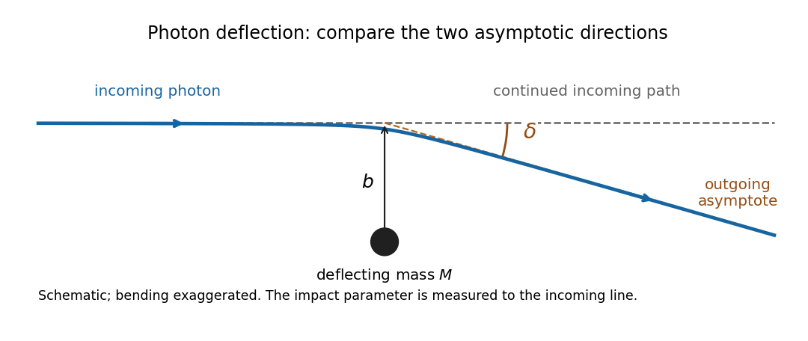

<h1 id="3/a/solution">Solution</h1>

↑ **Parent:** [A](../a.md)

A [photon](../../../../photon.md) follows a [null geodesic](../../../../null-geodesic.md), whose spatial path approaches straight lines far from the deflecting [mass](../../../../mass.md). Extend the incoming asymptote forward: this is the reference path the [photon](../../../../photon.md) would follow if the [mass](../../../../mass.md) were removed while its incoming direction and transverse offset were held fixed. The [impact parameter](../../../../impact-parameter.md) $b$ is the perpendicular distance from the [mass](../../../../mass.md) to that incoming asymptote. It is not, in general, the distance of closest approach.

**[Figure 1](#3/a/image-impact-parameter-and-deflection-relative-to-the-continued-incoming-photon-path). Impact parameter and deflection relative to the continued incoming photon path**. Original schematic, with bending exaggerated. The dashed horizontal line is the undeflected reference path. The outgoing dashed asymptote makes angle delta with it; b is measured to the incoming asymptote, not to the bent ray.

The positive deflection angle $\delta$ is the angle between the outgoing propagation direction and the continued incoming direction. The [photon](../../../../photon.md) bends toward the [mass](../../../../mass.md), so a ray passing above it has a downward outgoing slope in the figure. In the [weak-field approximation](../../../../weak-field-approximation.md) for an isolated spherical [mass](../../../../mass.md), [Schwarzschild light deflection](../../../../schwarzschild-light-deflection.md) gives $\delta\simeq4GM/(bc^2)$ for distant endpoints. This angle differs from the apparent image angle measured from the observer's line of sight to the [mass](../../../../mass.md).

## ↑ Ancestors (12)

1. [A](../a.md)
2. [3](../../3.md)
3. [2022](../../../2022-split.md)
4. [Past exam of the general relativity course of the University of Oxford](../../../split.md)
5. [General relativity course of the University of Oxford](../../../../general-relativity-course-of-the-university-of-oxford.md)
6. [Year 3 of the physics course of the University of Oxford](../../../../year-3-of-the-physics-course-of-the-university-of-oxford.md)
7. [Physics course of the University of Oxford](../../../../physics-course-of-the-university-of-oxford.md)
8. [Undergraduate course of the University of Oxford](../../../../undergraduate-course-of-the-university-of-oxford.md)
9. [Course of the University of Oxford](../../../../course-of-the-university-of-oxford.md)
10. [University of Oxford](../../../../university-of-oxford-split.md)
11. [List of universities](../../../../list-of-universities.md)
12. [Codex Wiki](../../../../split.md)
