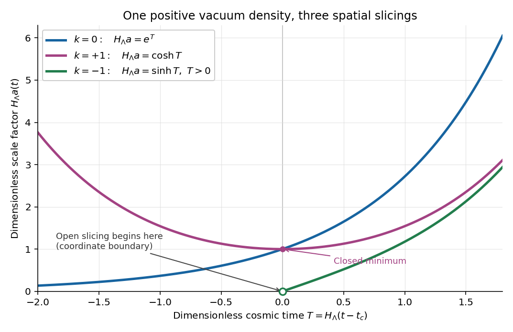

# 2015

↑ **Parent:** [Past exam of the general relativity II course of the University of Oxford](../past-exam-of-the-general-relativity-ii-course-of-the-university-of-oxford.md)

Source: [released examination PDF, bundle pages 92–95](https://www.whatdotheyknow.com/request/oxford_physics_past_papers_2/response/2340696/attach/3/Physics%20Papers%202014.pdf?cookie_passthrough=1#page=92).

We use [metric signature](../topological-manifold.md#metric-signature) $(-,+,+,+)$ and set the [speed of light](../special-relativity.md#speed-of-light) to one. In question 2, $M$ and $Q$ have the geometric normalization of the [Reissner-Nordstrom metric](../black-hole.md#reissner-nordstrom-spacetime), with $M>0$ and $r>0$. Every numbered part is treated, including all three cases in question 2(b).

**Table of contents**

- [1](#1)
  - [a](#1/a)
    - [Solution](#1/a/solution)
  - [b](#1/b)
    - [i](#1/b/i)
      - [Solution](#1/b/i/solution)
    - [ii](#1/b/ii)
      - [Solution](#1/b/ii/solution)
    - [iii](#1/b/iii)
      - [Solution](#1/b/iii/solution)
    - [iv](#1/b/iv)
      - [Solution](#1/b/iv/solution)
- [2](#2)
  - [a](#2/a)
    - [Solution](#2/a/solution)
  - [b](#2/b)
    - [i](#2/b/i)
      - [Solution](#2/b/i/solution)
    - [ii](#2/b/ii)
      - [Solution](#2/b/ii/solution)
    - [iii](#2/b/iii)
      - [Solution](#2/b/iii/solution)
  - [c](#2/c)
    - [Solution](#2/c/solution)
  - [d](#2/d)
    - [Solution](#2/d/solution)
  - [e](#2/e)
    - [i](#2/e/i)
      - [Solution](#2/e/i/solution)
    - [ii](#2/e/ii)
      - [Solution](#2/e/ii/solution)
- [3](#3)
  - [a](#3/a)
    - [Solution](#3/a/solution)
  - [b](#3/b)
    - [Solution](#3/b/solution)
  - [c](#3/c)
    - [Solution](#3/c/solution)
  - [d](#3/d)
    - [Solution](#3/d/solution)
  - [e](#3/e)
    - [i](#3/e/i)
      - [Solution](#3/e/i/solution)
    - [ii](#3/e/ii)
      - [Solution](#3/e/ii/solution)

## 1

↑ **Parent:** [2015](2015.md)

<h3 id="1/a">a</h3>

↑ **Parent:** [1](#1)

<h4 id="1/a/solution">Solution</h4>

↑ **Parent:** [A](#1/a)

A [Killing vector field](../killing-vector-field.md) $K$ generates local [isometries](../riemannian-geometry.md#isometry): its [flow of a vector field](../multivariable-calculus.md#flow-of-a-vector-field) $\Phi_s$ satisfies $\Phi_s^*g=g$. Equivalently, the [Lie derivative](../differential-form.md#lie-derivative-of-a-differential-form) of the [metric tensor](../general-relativity.md#metric-tensor) vanishes. For the [Levi-Civita connection](../general-relativity.md#levi-civita-connection), [metric compatibility](../vector-bundle.md#metric-compatibility) converts the coordinate expression into the [Killing equation](../killing-vector-field.md#killing-equation):

$$
\boxed{\mathcal L_Kg=0,\qquad \nabla_\mu K_\nu+\nabla_\nu K_\mu=0.}
$$

**The [Levi-Civita connection](../general-relativity.md#levi-civita-connection) is an implicit extra assumption in this question.** The printed assumption of vanishing [torsion tensor](../vector-bundle.md#torsion-tensor) alone does not imply [metric compatibility](../vector-bundle.md#metric-compatibility). For example, on [Minkowski spacetime](../special-relativity.md#minkowski-spacetime), take the [affine connection](../vector-bundle.md#affine-connection) whose only nonzero [Christoffel symbol](../riemannian-geometry.md#christoffel-symbol) is $\Gamma^0{}_{00}=1$. The [vector field](../multivariable-calculus.md#vector-field) $K=\partial_0$ preserves the [Minkowski metric](../special-relativity.md#minkowski-metric), but $K_0=-1$ gives $\nabla_0K_0=1$, contradicting the [Killing equation](../killing-vector-field.md#killing-equation). The following calculation, and the covariant formulas in part (b), use the [Levi-Civita connection](../general-relativity.md#levi-civita-connection); this is the role of [metric compatibility in Killing identities](../killing-vector-field.md#metric-compatibility-in-killing-identities).

For the stated [curvature sign convention](../riemann-curvature-tensor.md#curvature-sign-convention), the [Ricci identity](../riemann-curvature-tensor.md#curvature-commutator-on-a-covariant-tensor) on a [covector](../dual-space.md#covector) has a minus sign:

$$
[\nabla_\mu,\nabla_\nu]K_\rho=-R^\sigma{}_{\rho\mu\nu}K_\sigma.
$$

Write $A_{\mu\nu\rho}=\nabla_\mu\nabla_\nu K_\rho$. Differentiating the [Killing equation](../killing-vector-field.md#killing-equation) gives $A_{\mu\nu\rho}=-A_{\mu\rho\nu}$. Alternately using this relation and the [Ricci identity](../riemann-curvature-tensor.md#curvature-commutator-on-a-covariant-tensor) gives

$$
\begin{aligned}
A_{\mu\nu\rho}
&=-A_{\mu\rho\nu}
=-A_{\rho\mu\nu}+R^\sigma{}_{\nu\mu\rho}K_\sigma\\
&=A_{\rho\nu\mu}+R^\sigma{}_{\nu\mu\rho}K_\sigma\\
&=A_{\nu\rho\mu}-R^\sigma{}_{\mu\rho\nu}K_\sigma+R^\sigma{}_{\nu\mu\rho}K_\sigma\\
&=-A_{\mu\nu\rho}-R^\sigma{}_{\rho\mu\nu}K_\sigma-R^\sigma{}_{\mu\rho\nu}K_\sigma+R^\sigma{}_{\nu\mu\rho}K_\sigma.
\end{aligned}
$$

The [first Bianchi identity](../riemann-curvature-tensor.md#first-bianchi-identity) and antisymmetry of the last two indices of the [Riemann curvature tensor](../riemann-curvature-tensor.md) reduce the three curvature terms to $2R^\sigma{}_{\mu\nu\rho}K_\sigma$. Consequently the [second covariant derivative of a Killing vector](../killing-vector-field.md#second-covariant-derivative-of-a-killing-vector) is

$$
\boxed{\nabla_\mu\nabla_\nu K_\rho=R^\sigma{}_{\mu\nu\rho}K_\sigma.}
$$

<h3 id="1/b">b</h3>

↑ **Parent:** [1](#1)

<h4 id="1/b/i">i</h4>

↑ **Parent:** [B](#1/b)

<h5 id="1/b/i/solution">Solution</h5>

↑ **Parent:** [I](#1/b/i)

For a [Conformal Killing vector field](../general-relativity.md#conformal-killing-vector-field), the same [metric compatibility](../vector-bundle.md#metric-compatibility) calculation gives

$$
\mathcal L_Xg_{\mu\nu}=\nabla_\mu X_\nu+\nabla_\nu X_\mu=2\lambda g_{\mu\nu}.
$$

Thus its [Conformal Killing equation](../general-relativity.md#conformal-killing-equation) is $\nabla_{(\mu}X_{\nu)}=\lambda g_{\mu\nu}$. Taking the [tensor contraction](../multilinear-algebra.md#tensor-contraction) with the [inverse metric](../general-relativity.md#inverse-metric), and using $g^{\mu\nu}g_{\mu\nu}=4$, determines the [conformal Killing factor](../general-relativity.md#conformal-killing-factor):

$$
\boxed{\nabla_{(\mu}X_{\nu)}=\lambda g_{\mu\nu},\qquad \lambda=\frac14\nabla_\mu X^\mu.}
$$

Parentheses include the factor $1/2$ in [tensor index symmetrization](../multilinear-algebra.md#tensor-index-symmetrization).

<h4 id="1/b/ii">ii</h4>

↑ **Parent:** [B](#1/b)

<h5 id="1/b/ii/solution">Solution</h5>

↑ **Parent:** [Ii](#1/b/ii)

Use an [affine parameter](../riemannian-geometry.md#affine-parameter) $s$ on the [geodesic](../riemannian-geometry.md#geodesic), so its [tangent vector](../tangent-vector.md) $U$ obeys $\nabla_UU=0$. The [product rule](../calculus.md#product-rule), [metric compatibility](../vector-bundle.md#metric-compatibility), and the [Conformal Killing equation](../general-relativity.md#conformal-killing-equation) give

$$
\begin{aligned}
\frac{d}{ds}(X_\mu U^\mu)
&=U^\nu U^\mu\nabla_\nu X_\mu+X_\mu(\nabla_UU)^\mu\\
&=U^\nu U^\mu\nabla_{(\nu}X_{\mu)}
=\lambda g_{\mu\nu}U^\mu U^\nu.
\end{aligned}
$$

Hence

$$
\boxed{\frac{d}{ds}(X\cdot U)=\lambda\,g(U,U).}
$$

**It is conserved on every [null geodesic](../special-relativity.md#null-geodesic) with an [affine parameter](../riemannian-geometry.md#affine-parameter), but generally not on other [geodesics](../riemannian-geometry.md#geodesic).** On a [timelike geodesic](../general-relativity.md#timelike-geodesic) parametrized by [proper time](../special-relativity.md#proper-time), $g(U,U)=-1$, so the derivative is $-\lambda$. A [Killing vector field](../killing-vector-field.md), or a [geodesic](../riemannian-geometry.md#geodesic) on which $\lambda$ vanishes, supplies the exceptional conservation. This is the [conformal Killing geodesic identity](../general-relativity.md#conformal-killing-geodesic-identity).

For an arbitrary parameter with $\nabla_UU=fU$, the right-hand side acquires $f(X\cdot U)$. Thus even for a [null geodesic](../special-relativity.md#null-geodesic), the simple conserved expression presupposes an [affine parameter](../riemannian-geometry.md#affine-parameter).

<h4 id="1/b/iii">iii</h4>

↑ **Parent:** [B](#1/b)

<h5 id="1/b/iii/solution">Solution</h5>

↑ **Parent:** [Iii](#1/b/iii)

In [Cartesian coordinates](../linear-algebra.md#cartesian-coordinate-system) on [Minkowski spacetime](../special-relativity.md#minkowski-spacetime), the [Conformal Killing equation](../general-relativity.md#conformal-killing-equation) becomes

$$
\partial_\mu X_\nu+\partial_\nu X_\mu=2\lambda\eta_{\mu\nu}.
$$

Differentiate the equations with index pairs $(\nu,\rho)$, $(\mu,\rho)$ and $(\mu,\nu)$ by $\partial_\mu$, $\partial_\nu$ and $\partial_\rho$, respectively. Adding the first two and subtracting the third, [Clairaut's theorem](../multivariable-calculus.md#symmetry-of-second-derivatives) yields the [flat conformal Killing integrability](../general-relativity.md#flat-conformal-killing-integrability) formula

$$
\partial_\mu\partial_\nu X_\rho
=\eta_{\nu\rho}\partial_\mu\lambda
+\eta_{\mu\rho}\partial_\nu\lambda
-\eta_{\mu\nu}\partial_\rho\lambda.
$$

Apply $\partial^\rho$ and use $\partial^\rho X_\rho=4\lambda$. With the [d'Alembert operator](../wave-equation.md#d-alembert-operator) $\Box=\eta^{\alpha\beta}\partial_\alpha\partial_\beta$, this gives

$$
4\partial_\mu\partial_\nu\lambda
=2\partial_\mu\partial_\nu\lambda-\eta_{\mu\nu}\Box\lambda,
\qquad
2\partial_\mu\partial_\nu\lambda=-\eta_{\mu\nu}\Box\lambda.
$$

A [tensor contraction](../multilinear-algebra.md#tensor-contraction) with $\eta^{\mu\nu}$ gives $2\Box\lambda=-4\Box\lambda$, so $\Box\lambda=0$. Returning to the preceding equation proves the stronger statement

$$
\boxed{\partial_\mu\partial_\nu\lambda=0.}
$$

Thus the [conformal Killing factor](../general-relativity.md#conformal-killing-factor) is an [affine function](../vector-space.md#affine-function), not an arbitrary solution of the [wave equation](../wave-equation.md).

<h4 id="1/b/iv">iv</h4>

↑ **Parent:** [B](#1/b)

<h5 id="1/b/iv/solution">Solution</h5>

↑ **Parent:** [Iv](#1/b/iv)

Write the [affine function](../vector-space.md#affine-function) obtained in part (iii) as $\lambda=c+2b_\mu x^\mu$, with constant $c$ and $b_\mu$. A [Conformal Killing vector field](../general-relativity.md#conformal-killing-vector-field) with precisely this [conformal Killing factor](../general-relativity.md#conformal-killing-factor) is

$$
X_{\mathrm{part}}^\mu=cx^\mu+2(b\cdot x)x^\mu-x^2b^\mu,
\qquad x^2=\eta_{\alpha\beta}x^\alpha x^\beta.
$$

Direct [partial differentiation](../multivariable-calculus.md#partial-derivative) verifies its [Conformal Killing equation](../general-relativity.md#conformal-killing-equation). Subtracting it from any other solution leaves a [Killing vector field](../killing-vector-field.md) $Y$. The formula in part (iii), now with $\lambda=0$, says $\partial_\mu\partial_\nu Y_\rho=0$. Therefore $Y$ is affine, and the [Killing equation](../killing-vector-field.md#killing-equation) makes its linear coefficient antisymmetric after lowering an index. Every solution is consequently

$$
\boxed{X^\mu=a^\mu+\omega^\mu{}_{\nu}x^\nu+cx^\mu+2(b\cdot x)x^\mu-x^2b^\mu,
\qquad \omega_{\mu\nu}=-\omega_{\nu\mu}.}
$$

The four constant $a^\mu$ generate [translations](../geometry-and-topology.md#translation-geometry), the six independent $\omega_{\mu\nu}$ generate [Lorentz transformations](../special-relativity.md#lorentz-transformation), $c$ generates a [dilation](../vector-space.md#uniform-dilation), and the four $b^\mu$ generate [special conformal transformations](../general-relativity.md#special-conformal-transformation). Their constant, linear and quadratic terms are independent; within the linear terms, the antisymmetric coefficient cannot equal a nonzero multiple of the identity. Hence the [conformal Killing algebra of Minkowski spacetime](../general-relativity.md#conformal-killing-algebra-of-minkowski-spacetime) has

$$
\boxed{\dim\mathfrak{conf}(\mathbb R^{1,3})=4+6+1+4=15.}
$$

For $\lambda=1$, the canonical choice is the [dilation](../vector-space.md#uniform-dilation) generator $D=x^\mu\partial_\mu$. Its [flow of a vector field](../multivariable-calculus.md#flow-of-a-vector-field) solves $dx^\mu/ds=x^\mu$, giving

$$
\boxed{\Phi_s(x)=e^s x,\qquad \Phi_s^*\eta=e^{2s}\eta,\qquad \Phi_s\circ\Phi_t=\Phi_{s+t}.}
$$

One may add any [Killing vector field](../killing-vector-field.md) without changing $\lambda=1$, so this choice is not unique. The displayed [dilation](../vector-space.md#uniform-dilation) gives a global [one-parameter group](../lie-theory.md#one-parameter-subgroup) of [diffeomorphisms](../geometry-and-topology.md#diffeomorphism). The count of fifteen concerns independent [Conformal Killing vector fields](../general-relativity.md#conformal-killing-vector-field); some [special conformal transformations](../general-relativity.md#special-conformal-transformation) have only local flows on all of affine [Minkowski spacetime](../special-relativity.md#minkowski-spacetime).

## 2

↑ **Parent:** [2015](2015.md)

<h3 id="2/a">a</h3>

↑ **Parent:** [2](#2)

<h4 id="2/a/solution">Solution</h4>

↑ **Parent:** [A](#2/a)

A nonzero [vector field](../multivariable-calculus.md#vector-field) has [hypersurface orthogonality](../differential-geometry.md#hypersurface-orthogonality) when it is locally normal to a family of [hypersurfaces](../smooth-manifold.md#hypersurface). In terms of its associated [differential one-form](../differential-form.md#one-form) $K^\flat=g_{\mu\nu}K^\nu dx^\mu$, the [Frobenius theorem](../differential-geometry.md#frobenius-theorem) gives the equivalent conditions

$$
K^\flat=f\,dh,\qquad K^\flat\wedge dK^\flat=0,
\qquad K_{[\mu}\nabla_\nu K_{\rho]}=0,
$$

locally with nonzero $f$ and $dh$; square brackets denote [tensor index antisymmetrization](../multilinear-algebra.md#tensor-index-antisymmetrization).

All coefficients of the [Reissner-Nordstrom metric](../black-hole.md#reissner-nordstrom-spacetime) are independent of $t$, and $K=\partial_t$ has constant coordinate components. Thus the [Lie derivative](../differential-form.md#lie-derivative-of-a-differential-form) obeys $\mathcal L_Kg=\partial_tg=0$: $K$ is a [Killing vector field](../killing-vector-field.md). Moreover,

$$
K^\flat=-F(r)\,dt,\qquad dK^\flat=-F'(r)\,dr\wedge dt,
\qquad \boxed{K^\flat\wedge dK^\flat=0.}
$$

Thus $K$ has [hypersurface orthogonality](../differential-geometry.md#hypersurface-orthogonality), with the $t=\text{constant}$ [hypersurfaces](../smooth-manifold.md#hypersurface) providing the orthogonal family wherever this chart is regular. It is timelike where $F>0$, since $g(K,K)=-F$. Its [hypersurface orthogonality](../differential-geometry.md#hypersurface-orthogonality) also holds in a regular extension across a horizon; singular static [coordinates](../vector-space.md#coordinate-linear-algebra) do not invalidate the [Frobenius theorem](../differential-geometry.md#frobenius-theorem) test.

<h3 id="2/b">b</h3>

↑ **Parent:** [2](#2)

For the three cases, distinguish a [curvature singularity](../general-relativity.md#curvature-singularity) from a [coordinate singularity](../general-relativity.md#coordinate-singularity). The [Reissner-Nordstrom Kretschmann scalar](../black-hole.md#reissner-nordstrom-kretschmann-scalar) is

$$
\mathcal K=R_{\alpha\beta\gamma\delta}R^{\alpha\beta\gamma\delta}
=\frac{48M^2}{r^6}-\frac{96MQ^2}{r^7}+\frac{56Q^4}{r^8}.
$$

It diverges at $r=0$ when either $M$ or $Q$ is nonzero. Any positive root of $F$ instead admits [Eddington-Finkelstein coordinates](../general-relativity.md#eddington-finkelstein-coordinates): set $v=t+\int dr/F$ to obtain

$$
ds^2=-F\,dv^2+2\,dv\,dr+r^2(d\theta^2+\sin^2\theta\,d\phi^2).
$$

The [determinant](../multilinear-algebra.md#determinant) of its $(v,r)$ block is $-1$, including at $F=0$. Hence positive roots of $F$ are removable [coordinate singularities](../general-relativity.md#coordinate-singularity) of the static chart. The apparent degeneracy at the poles of the angular chart is also a [coordinate singularity](../general-relativity.md#coordinate-singularity).

<h4 id="2/b/i">i</h4>

↑ **Parent:** [B](#2/b)

<h5 id="2/b/i/solution">Solution</h5>

↑ **Parent:** [I](#2/b/i)

If $M^2<Q^2$, then

$$
r^2F=(r-M)^2+(Q^2-M^2)>0.
$$

There is no positive root and no horizon hiding $r=0$ in the extended [Reissner-Nordstrom spacetime](../black-hole.md#reissner-nordstrom-spacetime). Its [Kretschmann scalar](../riemann-curvature-tensor.md#kretschmann-scalar) diverges there, so **$r=0$ is a [naked singularity](../black-hole.md#naked-singularity)**. It is a timelike [curvature singularity](../general-relativity.md#curvature-singularity), as the normal to nearby $r=\text{constant}$ [hypersurfaces](../smooth-manifold.md#hypersurface) has positive squared norm $g^{rr}=F$.

<h4 id="2/b/ii">ii</h4>

↑ **Parent:** [B](#2/b)

<h5 id="2/b/ii/solution">Solution</h5>

↑ **Parent:** [Ii](#2/b/ii)

If $M^2=Q^2$ with $M>0$, then

$$
\boxed{F=(1-M/r)^2,\qquad r_+=r_-=M.}
$$

The [curvature singularity](../general-relativity.md#curvature-singularity) remains at $r=0$. At $r=M$ the static chart has a [coordinate singularity](../general-relativity.md#coordinate-singularity), removed by the [Eddington-Finkelstein coordinates](../general-relativity.md#eddington-finkelstein-coordinates) above. The [Kretschmann scalar](../riemann-curvature-tensor.md#kretschmann-scalar) there equals $8/M^4$, which is finite. The coincident horizons form a [degenerate Killing horizon](../general-relativity.md#degenerate-killing-horizon), and its future outer branch is the [event horizon](../black-hole.md#event-horizon) of the [extremal black hole](../black-hole.md#extremal-black-hole). A double zero of $F$ does not remove the horizon.

<h4 id="2/b/iii">iii</h4>

↑ **Parent:** [B](#2/b)

<h5 id="2/b/iii/solution">Solution</h5>

↑ **Parent:** [Iii](#2/b/iii)

For $0<Q^2<M^2$ there are two distinct positive roots:

$$
\boxed{r_\pm=M\pm\sqrt{M^2-Q^2},\qquad F=\frac{(r-r_+)(r-r_-)}{r^2}.}
$$

Both roots are [coordinate singularities](../general-relativity.md#coordinate-singularity) of the static chart. In the standard extension, $r_+$ is the outer [event horizon](../black-hole.md#event-horizon) and $r_-$ is an inner [Cauchy horizon](../general-relativity.md#cauchy-horizon). The [curvature singularity](../general-relativity.md#curvature-singularity) is $r=0$. Between the horizons $F<0$, so the radial direction is timelike; for $0<r<r_-$, $F>0$ again and the central [curvature singularity](../general-relativity.md#curvature-singularity) is timelike. These are the three radial regions of the [global structure of a charged spherical black hole](../black-hole.md#global-structure-of-a-charged-spherical-black-hole).[Sections 6.2.2–6.2.5, printed pages 260–268](../physics-bibliography.md#general-relativity-by-david-tong)

For completeness, if $Q=0$ and $M>0$, the [Schwarzschild spacetime](../schwarzschild-spacetime.md) limit has just the positive horizon $r=2M$ and a spacelike [curvature singularity](../general-relativity.md#curvature-singularity) at $r=0$; the formal root $r_-=0$ of $r^2F$ is not a regular inner horizon. If $M=Q=0$, the [metric tensor](../general-relativity.md#metric-tensor) is flat and the radial origin is regular in [Cartesian coordinates](../linear-algebra.md#cartesian-coordinate-system).

<h3 id="2/c">c</h3>

↑ **Parent:** [2](#2)

<h4 id="2/c/solution">Solution</h4>

↑ **Parent:** [C](#2/c)

A regular [hypersurface](../smooth-manifold.md#hypersurface) $h=0$, with $dh\ne0$, is a [null hypersurface](../general-relativity.md#null-hypersurface) if its normal is null:

$$
\boxed{g^{\mu\nu}\partial_\mu h\,\partial_\nu h=0\quad\text{on }h=0.}
$$

The raised normal is then also tangent to the [hypersurface](../smooth-manifold.md#hypersurface), and its [induced metric](../riemannian-geometry.md#induced-metric) is degenerate. This is a local geometric property.

In an [asymptotically flat spacetime](../general-relativity.md#asymptotically-flat-spacetime), choose its [future null infinity](../general-relativity.md#future-null-infinity) $\mathcal I^+$. The [black hole](../black-hole.md) region and future [event horizon](../black-hole.md#event-horizon) are

$$
\boxed{\mathcal B=\mathcal M\setminus J^-(\mathcal I^+),\qquad \mathcal H^+=\partial J^-(\mathcal I^+).}
$$

Here $J^-(\mathcal I^+)$ is the [causal past](../general-relativity.md#causal-past) of [future null infinity](../general-relativity.md#future-null-infinity): the region from which a future-directed [causal curve](../general-relativity.md#causal-curve) can escape to arbitrarily distant observers. An [event horizon](../black-hole.md#event-horizon) therefore depends on the global future [causal structure](../general-relativity.md#causal-structure), and an arbitrary [null hypersurface](../general-relativity.md#null-hypersurface) need not be an [event horizon](../black-hole.md#event-horizon).

<h3 id="2/d">d</h3>

↑ **Parent:** [2](#2)

<h4 id="2/d/solution">Solution</h4>

↑ **Parent:** [D](#2/d)

In the extremal case, the squared norm of the [Killing vector field](../killing-vector-field.md) is

$$
g(K,K)=-\left(1-\frac Mr\right)^2.
$$

For $M=|Q|>0$, it is negative for every regular $r\ne M$ and vanishes precisely at $r=M$ in the extended [spacetime](../special-relativity.md#spacetime). Thus

$$
\boxed{K\text{ is null exactly on }r=M.}
$$

The static chart cannot itself test the geometry at its horizon. In the regular [Eddington-Finkelstein coordinates](../general-relativity.md#eddington-finkelstein-coordinates), the normal to $h=r-M=0$ is $n=dr$, and

$$
g^{-1}(n,n)=g^{rr}=F,\qquad n^\sharp=\partial_v+F\partial_r.
$$

At $r=M$ this gives $n^\sharp=\partial_v=K$, a nonzero [null vector](../special-relativity.md#null-vector) tangent to the surface. Therefore **$r=M$ is a [null hypersurface](../general-relativity.md#null-hypersurface)**, even though $F$ has the same sign on its two sides.

<h3 id="2/e">e</h3>

↑ **Parent:** [2](#2)

<h4 id="2/e/i">i</h4>

↑ **Parent:** [E](#2/e)

<h5 id="2/e/i/solution">Solution</h5>

↑ **Parent:** [I](#2/e/i)

On the equatorial path, the [Lagrangian](../calculus-of-variations.md#lagrangian) per unit [mass](../classical-mechanics.md#mass) is

$$
L=\frac12\left(-F\dot t^2+F^{-1}\dot r^2+r^2\dot\phi^2\right)-\frac{eQ}{mr}\dot t.
$$

Both $t$ and $\phi$ are [cyclic coordinates](../lagrangian-mechanics.md#cyclic-coordinate). The [Euler-Lagrange equations](../analysis.md#euler-lagrange-equation) therefore conserve their [canonical momenta](../hamiltonian-mechanics.md#canonical-momentum):

$$
p_t=\frac{\partial L}{\partial\dot t}=-F\dot t-\frac{eQ}{mr},\qquad
p_\phi=\frac{\partial L}{\partial\dot\phi}=r^2\dot\phi.
$$

Consequently

$$
\boxed{E=-mp_t=mF\dot t+\frac{eQ}{r},\qquad l=p_\phi=r^2\dot\phi,\qquad \dot E=\dot l=0.}
$$

Here $E$ is the total conserved [energy](../energy.md) in the specified gauge of the [electromagnetic four-potential](../relativistic-electromagnetism.md#electromagnetic-four-potential). The paper's $l$ is the [angular momentum](../momentum.md#angular-momentum) per unit [mass](../classical-mechanics.md#mass); the physical [angular momentum](../momentum.md#angular-momentum) is $ml$. The equatorial choice is consistent with the $\theta$ [Euler-Lagrange equation](../analysis.md#euler-lagrange-equation), since its angular force term contains $\sin\theta\cos\theta=0$ at $\theta=\pi/2$ and the [electromagnetic four-potential](../relativistic-electromagnetism.md#electromagnetic-four-potential) has no angular component.

<h4 id="2/e/ii">ii</h4>

↑ **Parent:** [E](#2/e)

<h5 id="2/e/ii/solution">Solution</h5>

↑ **Parent:** [Ii](#2/e/ii)

With $\tau$ the [proper time](../special-relativity.md#proper-time) of the massive [test particle](../classical-mechanics.md#test-particle), the [four-velocity](../special-relativity.md#four-velocity) has squared norm $-1$:

$$
-1=-F\dot t^2+F^{-1}\dot r^2+r^2\dot\phi^2.
$$

The [conserved quantities](../hamiltonian-mechanics.md#conserved-quantity) in part (i) give

$$
F\dot t=\frac1m\left(E-\frac{eQ}{r}\right),\qquad \dot\phi=\frac l{r^2}.
$$

Multiplying the normalization by $F$ and substituting gives the [charged-particle radial equation in Reissner-Nordstrom spacetime](../black-hole.md#charged-particle-radial-equation-in-reissner-nordstrom-spacetime):

$$
\boxed{\dot r^2=\frac1{m^2}\left(E-\frac{eQ}{r}\right)^2-F(r)\left(1+\frac{l^2}{r^2}\right).}
$$

At a radial [turning point](../energy.md#turning-point) $r_*>0$, the left side is zero, so

$$
F(r_*)\left(1+\frac{l^2}{r_*^2}\right)
=\frac1{m^2}\left(E-\frac{eQ}{r_*}\right)^2\ge0.
$$

The parenthesis on the left is strictly positive. Hence $F(r_*)\ge0$. The factorization in part (b) now yields

$$
\boxed{r_*\ge r_+\quad\text{or}\quad 0<r_*\le r_-.}
$$

**There is no radial [turning point](../energy.md#turning-point) between the horizons.** Indeed, for $r_-<r<r_+$, the right-hand side of the radial equation is strictly positive, independently of the [electric charge](../electric-charge.md) $e$ of the [test particle](../classical-mechanics.md#test-particle). This is the [charged-particle turning-point exclusion in Reissner-Nordstrom spacetime](../black-hole.md#charged-particle-turning-point-exclusion-in-reissner-nordstrom-spacetime).

The inequalities are necessary, not a claim that a radial [turning point](../energy.md#turning-point) exists for every $E,l,e$. At a regular horizon crossing a [timelike vector](../general-relativity.md#timelike-vector) cannot be tangent to a [null hypersurface](../general-relativity.md#null-hypersurface), so a massive [test particle](../classical-mechanics.md#test-particle) actually has $\dot r\ne0$ there. Algebraic equality at $r_\pm$ would require $E=eQ/r_\pm$ and does not describe a regular finite-[proper time](../special-relativity.md#proper-time) radial [turning point](../energy.md#turning-point) on the horizon. In the [Schwarzschild spacetime](../schwarzschild-spacetime.md) limit $Q=0$, the positive-radius inner alternative disappears.

## 3

↑ **Parent:** [2015](2015.md)

<h3 id="3/a">a</h3>

↑ **Parent:** [3](#3)

<h4 id="3/a/solution">Solution</h4>

↑ **Parent:** [A](#3/a)

The [scale factor](../cosmology.md#scale-factor-cosmology) $a(t)>0$ specifies the common time dependence of [proper distance in cosmology](../cosmology.md#proper-distance-in-cosmology) between [comoving observers](../cosmology.md#comoving-observer). Their [comoving coordinates](../cosmology.md#comoving-coordinate) remain fixed, while their separation is multiplied by $a(t)$. Thus $\dot a>0$ means expansion and $\dot a<0$ means contraction. The coordinate $t$ is [cosmic time](../cosmology.md#cosmic-time), measured by the [proper time](../special-relativity.md#proper-time) of a [comoving observer](../cosmology.md#comoving-observer).

The parameter $k$ fixes the sign of the [spatial curvature of an FLRW universe](../cosmology.md#spatial-curvature-of-an-flrw-universe). More precisely, the spatial [sectional curvature](../second-fundamental-form.md#sectional-curvature) and three-dimensional [scalar curvature](../second-fundamental-form.md#scalar-curvature) are

$$
\boxed{K_{\mathrm{spatial}}=\frac{k}{a^2},\qquad {}^{(3)}R=\frac{6k}{a^2}.}
$$

The cases $k=1,0,-1$ have locally [spherical geometry](../geometry-and-topology.md#spherical-geometry), [Euclidean geometry](../euclidean-geometry.md), and [hyperbolic geometry](../hyperbolic-geometry.md), respectively. For $k=\pm1$, $a$ is the [curvature radius of a constant-curvature space](../second-fundamental-form.md#curvature-radius-of-a-constant-curvature-space) in the displayed normalization. Local [curvature](../differential-geometry.md#curvature) alone does not fix the global [topology](../topology.md).

<h3 id="3/b">b</h3>

↑ **Parent:** [3](#3)

<h4 id="3/b/solution">Solution</h4>

↑ **Parent:** [B](#3/b)

The [Friedmann-Lemaître-Robertson-Walker metric](../cosmology.md#friedmann-lemaitre-robertson-walker-metric) implements the [cosmological principle](../cosmology.md#cosmological-principle): on the scales being modelled, the spatial slices have [spatial homogeneity](../cosmology.md#spatial-homogeneity) and [cosmological isotropy](../cosmology.md#cosmological-isotropy). There is a family of [comoving observers](../cosmology.md#comoving-observer) whose orthogonal slices share one [cosmic time](../cosmology.md#cosmic-time) and one [scale factor](../cosmology.md#scale-factor-cosmology). Each spatial slice is a [locally maximally symmetric space](../second-fundamental-form.md#locally-maximally-symmetric-space), with time-independent normalized $k$.

The matter is represented by a [perfect fluid in general relativity](../stress-energy-tensor.md#perfect-fluid-in-general-relativity), at rest relative to the [comoving observers](../cosmology.md#comoving-observer), with [energy density](../statistical-physics.md#energy-density) $\varrho(t)$ and [pressure](../pressure.md) $p(t)$ depending only on [cosmic time](../cosmology.md#cosmic-time). Its [stress-energy tensor](../stress-energy-tensor.md) is

$$
\boxed{T_{\mu\nu}=(\varrho+p)u_\mu u_\nu+p g_{\mu\nu},\qquad u=\partial_t.}
$$

There is no preferred spatial direction, so there is no [anisotropic stress](../stress-energy-tensor.md#anisotropic-stress) or spatial [heat flux](../heat.md#heat-flux-density) in that rest frame. Gravity obeys the [Einstein field equations](../einstein-field-equations.md); the equations in this paper contain no separate [cosmological constant](../cosmology.md#cosmological-constant), although a component with $p=-\varrho$ can represent one. An [equation of state](../pressure.md#equation-of-state) relating $p$ and $\varrho$ closes the evolution equations. [Spatial homogeneity](../cosmology.md#spatial-homogeneity) and [cosmological isotropy](../cosmology.md#cosmological-isotropy) are idealizations of the cosmological background; they do not assert that individual local structures are uniform.

<h3 id="3/c">c</h3>

↑ **Parent:** [3](#3)

<h4 id="3/c/solution">Solution</h4>

↑ **Parent:** [C](#3/c)

Set $H=\dot a/a$, the [Hubble parameter](../cosmology.md#hubble-parameter). The first supplied component of the [Einstein field equations](../einstein-field-equations.md) gives the [Friedmann acceleration equation](../cosmology.md#friedmann-acceleration-equation)

$$
\frac{\ddot a}{a}=-\frac{4\pi G}{3}(\varrho+3p).
$$

Substitution into the second supplied equation gives

$$
2\left(H^2+\frac{k}{a^2}\right)
=4\pi G(\varrho-p)+\frac{4\pi G}{3}(\varrho+3p)
=\frac{16\pi G}{3}\varrho.
$$

Therefore the first [Friedmann equation](../cosmology.md#friedmann-equations) is

$$
\boxed{\dot a^2+k=\frac{8\pi G}{3}\varrho a^2.}
$$

Differentiate this equation with respect to [cosmic time](../cosmology.md#cosmic-time):

$$
2\dot a\ddot a=\frac{8\pi G}{3}\left(a^2\dot\varrho+2a\varrho\dot a\right).
$$

Insert the [Friedmann acceleration equation](../cosmology.md#friedmann-acceleration-equation) on the left and cancel $8\pi Ga/3$, which is nonzero for $a>0$. This gives

$$
-\dot a(\varrho+3p)=a\dot\varrho+2\varrho\dot a,
\qquad
\boxed{a\dot\varrho+3(\varrho+p)\dot a=0.}
$$

This is the [cosmological continuity equation](../cosmology.md#cosmological-continuity-equation), expressing [stress-energy conservation](../stress-energy-tensor.md#stress-energy-conservation) for the [perfect fluid in general relativity](../stress-energy-tensor.md#perfect-fluid-in-general-relativity). No division by $\dot a$ was made, so the derivation remains valid at a [cosmological bounce](../cosmology.md#cosmological-bounce) or an instant of maximum expansion.

<h3 id="3/d">d</h3>

↑ **Parent:** [3](#3)

<h4 id="3/d/solution">Solution</h4>

↑ **Parent:** [D](#3/d)

For $a>0$, the assumed inequality and the [Friedmann acceleration equation](../cosmology.md#friedmann-acceleration-equation) imply $\ddot a\le0$. Thus $a$ is a [concave function](../real-analysis.md#concave-function). Let $a_0=a(t_0)>0$ and $v_0=\dot a(t_0)>0$. At every earlier time in the same regular expanding interval, $\dot a(t)\ge v_0$. Integration gives the [concavity bound on past FLRW evolution](../cosmology.md#concavity-bound-on-past-flrw-evolution):

$$
a_0-a(t)=\int_t^{t_0}\dot a(s)\,ds\ge v_0(t_0-t),
\qquad
\boxed{a(t)\le a_0-v_0(t_0-t).}
$$

The right-hand side reaches zero at $t=t_0-a_0/v_0$. Hence an everywhere regular positive [scale factor](../cosmology.md#scale-factor-cosmology) cannot extend arbitrarily far into the past. With the usual implicit continuation assumption that the cosmological solution remains regular while $a>0$, it reaches $a(t_B)=0$ at a finite past boundary satisfying

$$
\boxed{0<t_0-t_B\le\frac{a_0}{v_0}=\frac1{H(t_0)}.}
$$

**Past expansion lasts at most the present inverse [Hubble parameter](../cosmology.md#hubble-parameter).** The inequality is the essential argument, and equality is attained by a linearly growing [scale factor](../cosmology.md#scale-factor-cosmology).

There is a literal qualification to the claim that $a$ must reach zero: the printed hypothesis alone does not exclude an earlier [curvature singularity](../general-relativity.md#curvature-singularity) with positive limiting $a$. In arbitrary fixed units, take $k=0$ and $a(t)=1+\sqrt t$ for $t>0$, and define $\varrho,p$ using the two [Friedmann equations](../cosmology.md#friedmann-equations) and the [Friedmann acceleration equation](../cosmology.md#friedmann-acceleration-equation). Then $\dot a>0$, $\ddot a<0$, and $\varrho+3p=-3\ddot a/(4\pi Ga)>0$, but $a\to1$ while the [energy density](../statistical-physics.md#energy-density) and [pressure](../pressure.md) diverge as $t\downarrow0$. Thus the rigorous unconditional conclusion is the finite bound on a regular past interval; reaching zero additionally requires the stated continuation assumption. Nor does a zero of $a$ alone prove a [curvature singularity](../general-relativity.md#curvature-singularity), as the [Milne model](../cosmology.md#milne-model) illustrates.

<h3 id="3/e">e</h3>

↑ **Parent:** [3](#3)

<h4 id="3/e/i">i</h4>

↑ **Parent:** [E](#3/e)

<h5 id="3/e/i/solution">Solution</h5>

↑ **Parent:** [I](#3/e/i)

For the [equation of state](../pressure.md#equation-of-state) $p=-\varrho$, the [cosmological continuity equation](../cosmology.md#cosmological-continuity-equation) gives $a\dot\varrho=0$. Hence $\varrho=\varrho_0$ is constant. First take the physically intended positive [energy density](../statistical-physics.md#energy-density) and define

$$
H_\Lambda=\sqrt{\frac{8\pi G\varrho_0}{3}}>0.
$$

The [Friedmann equation](../cosmology.md#friedmann-equations) and the original [Friedmann acceleration equation](../cosmology.md#friedmann-acceleration-equation) become

$$
\dot a^2+k=H_\Lambda^2a^2,\qquad \ddot a=H_\Lambda^2a.
$$

Solve the second equation as $a=Ae^{H_\Lambda t}+Be^{-H_\Lambda t}$. The first equation then requires $4H_\Lambda^2AB=k$. Choosing the time origin separately in each solution gives all positive branches:

$$
\boxed{
\begin{array}{c|c|c}
k&a(t)&\text{domain and finite past zero on the expanding branch}\\ \hline
0&A_0e^{\pm H_\Lambda(t-t_c)},\ A_0>0&-\infty<t<\infty;\ \text{none}\\
+1&H_\Lambda^{-1}\cosh[H_\Lambda(t-t_b)]&-\infty<t<\infty;\ \text{none}\\
-1&H_\Lambda^{-1}\sinh[H_\Lambda(t-t_B)]&t>t_B;\ a\to0\text{ at }t_B
\end{array}}
$$

For $k=-1$, there is also the time reverse $a=H_\Lambda^{-1}\sinh[H_\Lambda(t_B-t)]$ on $t<t_B$, which contracts to a future zero. For $k=+1$, the [cosmological bounce](../cosmology.md#cosmological-bounce) joins contraction to expansion at the positive minimum $a(t_b)=H_\Lambda^{-1}$. Retaining $\ddot a=H_\Lambda^2a$ at the minimum excludes a spurious permanently static solution that would satisfy the first-order constraint alone.

These are [vacuum-energy FLRW solutions](../cosmology.md#vacuum-energy-flrw-solution): the expanding flat branch, [closed slicing of de Sitter spacetime](../general-relativity.md#closed-slicing-of-de-sitter-spacetime), and [open slicing of de Sitter spacetime](../general-relativity.md#open-slicing-of-de-sitter-spacetime). To compare them at the same [energy density](../statistical-physics.md#energy-density), the figure sets $T=H_\Lambda(t-t_c)$, takes $A_0=H_\Lambda^{-1}$, and aligns the open boundary and closed minimum at $T=0$. Thus the three plotted functions are $H_\Lambda a=e^T$, $\cosh T$, and $\sinh T$, the last only for $T>0$.

**[Figure 1](#3/e/i/image-scale-factors-for-positive-vacuum-energy-exponential-flat-expansion-a-closed-bounce-and-open-expansion-from-a-finite-time-coordinate-boundary). Scale factors for positive vacuum energy: exponential flat expansion, a closed bounce, and open expansion from a finite-time coordinate boundary**.

Only the expanding $k=-1$ branch has a finite past zero. The expanding $k=0$ branch tends to zero only as $t\to-\infty$, and the $k=+1$ branch is bounded below. All three describe portions of [de Sitter spacetime](../general-relativity.md#de-sitter-spacetime), with [Ricci scalar](../general-relativity.md#ricci-scalar) $R=12H_\Lambda^2$ and [Kretschmann scalar](../riemann-curvature-tensor.md#kretschmann-scalar) $24H_\Lambda^4$. In particular the $k=-1$ zero is a boundary of that slicing, not a [curvature singularity](../general-relativity.md#curvature-singularity). The inequality in part (d) does not apply, because $\varrho+3p=-2\varrho_0<0$.

For zero [energy density](../statistical-physics.md#energy-density), the remaining solutions are $a=A_0>0$ for $k=0$, and the expanding or contracting [Milne model](../cosmology.md#milne-model) $a=\pm(t-t_B)>0$ for $k=-1$; no positive real solution exists for $k=+1$. If negative [energy density](../statistical-physics.md#energy-density) is admitted mathematically, write $\alpha^2=-8\pi G\varrho_0/3>0$. Only $k=-1$ is possible, with $a=\alpha^{-1}\sin[\alpha(t-t_B)]$ for $0<\alpha(t-t_B)<\pi$, an [open slicing of anti-de Sitter spacetime](../general-relativity.md#open-slicing-of-anti-de-sitter-spacetime). These limiting and negative-density cases do not alter the positive-density comparison above.

<h4 id="3/e/ii">ii</h4>

↑ **Parent:** [E](#3/e)

<h5 id="3/e/ii/solution">Solution</h5>

↑ **Parent:** [Ii](#3/e/ii)

Take the expanding flat branch $a(t)=Ae^{H_\Lambda t}$, with $A>0$. A [radial null geodesic in FLRW spacetime](../cosmology.md#radial-null-geodesic-in-flrw-spacetime) satisfies $d\rho/dt=\pm1/a(t)$. For the incoming [past light cone](../special-relativity.md#past-light-cone) of the [spacetime event](../special-relativity.md#event-relativity) $(t_0,\rho=0)$, integration gives

$$
\boxed{\rho(t;t_0)=\int_t^{t_0}\frac{ds}{a(s)}
=\frac1{H_\Lambda}\left(\frac1{a(t)}-\frac1{a(t_0)}\right),\qquad t\le t_0,}
$$

with arbitrary angular direction. Equivalently, [conformal time](../cosmology.md#conformal-time) $\eta=-1/(H_\Lambda a)$ gives $\rho=\eta_0-\eta$.

Let the reception time tend to infinity. The largest [comoving radial distance](../cosmology.md#comoving-radial-distance) from which a signal emitted at time $t$ can reach the central [comoving observer](../cosmology.md#comoving-observer) is

$$
\rho_{\mathrm h}(t)=\int_t^\infty\frac{ds}{a(s)}=\frac1{H_\Lambda a(t)}.
$$

Thus the [cosmological event horizon](../general-relativity.md#cosmological-event-horizon) has constant [proper distance in cosmology](../cosmology.md#proper-distance-in-cosmology):

$$
\boxed{\rho=\frac1{H_\Lambda a(t)},\qquad D_{\mathrm h}=a(t)\rho_{\mathrm h}=H_\Lambda^{-1}.}
$$

An emitted [spacetime event](../special-relativity.md#event-relativity) is seen at a finite time if and only if $a(t)\rho<H_\Lambda^{-1}$. Equality would require $t_0=\infty$, while an event with $a(t)\rho>H_\Lambda^{-1}$ never reaches the observer. This is a bound on events at their emission time; a fixed [comoving observer](../cosmology.md#comoving-observer) can have earlier visible events and later invisible ones.

The boundary really is a [null hypersurface](../general-relativity.md#null-hypersurface). For $f(t,\rho)=\rho-[H_\Lambda a(t)]^{-1}$, its normal has components $\partial_tf=1/a$ and $\partial_\rho f=1$, so

$$
g^{\mu\nu}\partial_\mu f\partial_\nu f=-\frac1{a^2}+\frac1{a^2}=0.
$$

The finite future integral, and hence this [observer event horizon](../general-relativity.md#observer-event-horizon), uses the expanding branch. For the contracting flat solution $a=Ae^{-H_\Lambda t}$, the same integral diverges and there is no future [observer event horizon](../general-relativity.md#observer-event-horizon) of this kind; the static zero-density solution likewise has none.

## ↑ Ancestors (9)

1. [Past exam of the general relativity II course of the University of Oxford](../past-exam-of-the-general-relativity-ii-course-of-the-university-of-oxford.md)
2. [General relativity II course of the University of Oxford](../university-of-oxford.md#general-relativity-ii-course-of-the-university-of-oxford)
3. [Year 4 of the mathematics course of the University of Oxford](../university-of-oxford.md#year-4-of-the-mathematics-course-of-the-university-of-oxford)
4. [Mathematics course of the University of Oxford](../university-of-oxford.md#mathematics-course-of-the-university-of-oxford)
5. [Undergraduate course of the University of Oxford](../university-of-oxford.md#undergraduate-course-of-the-university-of-oxford)
6. [Course of the University of Oxford](../university-of-oxford.md#course-of-the-university-of-oxford)
7. [University of Oxford](../university-of-oxford.md)
8. [List of universities](../README.md#list-of-universities)
9. [Codex Wiki](../README.md)
