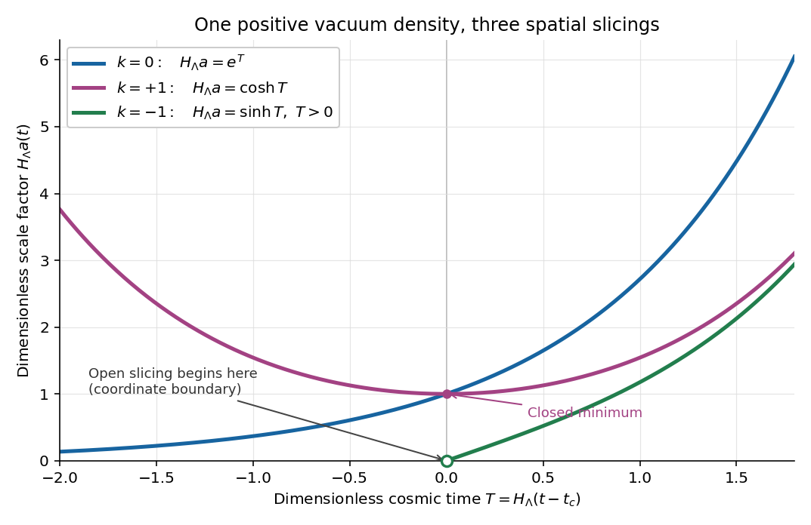

<h1 id="3/e/i/solution">Solution</h1>

↑ **Parent:** [I](../i.md)

For the [equation of state](../../../../../equation-of-state.md) $p=-\varrho$, the [cosmological continuity equation](../../../../../cosmological-continuity-equation.md) gives $a\dot\varrho=0$. Hence $\varrho=\varrho_0$ is constant. First take the physically intended positive [energy density](../../../../../energy-density.md) and define

$$
H_\Lambda=\sqrt{\frac{8\pi G\varrho_0}{3}}>0.
$$

The [Friedmann equation](../../../../../friedmann-equations.md) and the original [Friedmann acceleration equation](../../../../../friedmann-acceleration-equation.md) become

$$
\dot a^2+k=H_\Lambda^2a^2,\qquad \ddot a=H_\Lambda^2a.
$$

Solve the second equation as $a=Ae^{H_\Lambda t}+Be^{-H_\Lambda t}$. The first equation then requires $4H_\Lambda^2AB=k$. Choosing the time origin separately in each solution gives all positive branches:

$$
\boxed{
\begin{array}{c|c|c}
k&a(t)&\text{domain and finite past zero on the expanding branch}\\ \hline
0&A_0e^{\pm H_\Lambda(t-t_c)},\ A_0>0&-\infty<t<\infty;\ \text{none}\\
+1&H_\Lambda^{-1}\cosh[H_\Lambda(t-t_b)]&-\infty<t<\infty;\ \text{none}\\
-1&H_\Lambda^{-1}\sinh[H_\Lambda(t-t_B)]&t>t_B;\ a\to0\text{ at }t_B
\end{array}}
$$

For $k=-1$, there is also the time reverse $a=H_\Lambda^{-1}\sinh[H_\Lambda(t_B-t)]$ on $t<t_B$, which contracts to a future zero. For $k=+1$, the [cosmological bounce](../../../../../cosmological-bounce.md) joins contraction to expansion at the positive minimum $a(t_b)=H_\Lambda^{-1}$. Retaining $\ddot a=H_\Lambda^2a$ at the minimum excludes a spurious permanently static solution that would satisfy the first-order constraint alone.

These are [vacuum-energy FLRW solutions](../../../../../vacuum-energy-flrw-solution.md): the expanding flat branch, [closed slicing of de Sitter spacetime](../../../../../closed-slicing-of-de-sitter-spacetime.md), and [open slicing of de Sitter spacetime](../../../../../open-slicing-of-de-sitter-spacetime.md). To compare them at the same [energy density](../../../../../energy-density.md), the figure sets $T=H_\Lambda(t-t_c)$, takes $A_0=H_\Lambda^{-1}$, and aligns the open boundary and closed minimum at $T=0$. Thus the three plotted functions are $H_\Lambda a=e^T$, $\cosh T$, and $\sinh T$, the last only for $T>0$.

**[Figure 1](#3/e/i/image-scale-factors-for-positive-vacuum-energy-exponential-flat-expansion-a-closed-bounce-and-open-expansion-from-a-finite-time-coordinate-boundary). Scale factors for positive vacuum energy: exponential flat expansion, a closed bounce, and open expansion from a finite-time coordinate boundary**.

Only the expanding $k=-1$ branch has a finite past zero. The expanding $k=0$ branch tends to zero only as $t\to-\infty$, and the $k=+1$ branch is bounded below. All three describe portions of [de Sitter spacetime](../../../../../de-sitter-spacetime.md), with [Ricci scalar](../../../../../ricci-scalar.md) $R=12H_\Lambda^2$ and [Kretschmann scalar](../../../../../kretschmann-scalar.md) $24H_\Lambda^4$. In particular the $k=-1$ zero is a boundary of that slicing, not a [curvature singularity](../../../../../curvature-singularity.md). The inequality in part (d) does not apply, because $\varrho+3p=-2\varrho_0<0$.

For zero [energy density](../../../../../energy-density.md), the remaining solutions are $a=A_0>0$ for $k=0$, and the expanding or contracting [Milne model](../../../../../milne-model.md) $a=\pm(t-t_B)>0$ for $k=-1$; no positive real solution exists for $k=+1$. If negative [energy density](../../../../../energy-density.md) is admitted mathematically, write $\alpha^2=-8\pi G\varrho_0/3>0$. Only $k=-1$ is possible, with $a=\alpha^{-1}\sin[\alpha(t-t_B)]$ for $0<\alpha(t-t_B)<\pi$, an [open slicing of anti-de Sitter spacetime](../../../../../open-slicing-of-anti-de-sitter-spacetime.md). These limiting and negative-density cases do not alter the positive-density comparison above.

## ↑ Ancestors (13)

1. [I](../i.md)
2. [E](../../e.md)
3. [3](../../../3.md)
4. [2015](../../../../2015-split.md)
5. [Past exam of the general relativity II course of the University of Oxford](../../../../split.md)
6. [General relativity II course of the University of Oxford](../../../../../general-relativity-ii-course-of-the-university-of-oxford.md)
7. [Year 4 of the mathematics course of the University of Oxford](../../../../../year-4-of-the-mathematics-course-of-the-university-of-oxford.md)
8. [Mathematics course of the University of Oxford](../../../../../mathematics-course-of-the-university-of-oxford.md)
9. [Undergraduate course of the University of Oxford](../../../../../undergraduate-course-of-the-university-of-oxford.md)
10. [Course of the University of Oxford](../../../../../course-of-the-university-of-oxford.md)
11. [University of Oxford](../../../../../university-of-oxford-split.md)
12. [List of universities](../../../../../list-of-universities.md)
13. [Codex Wiki](../../../../../split.md)
