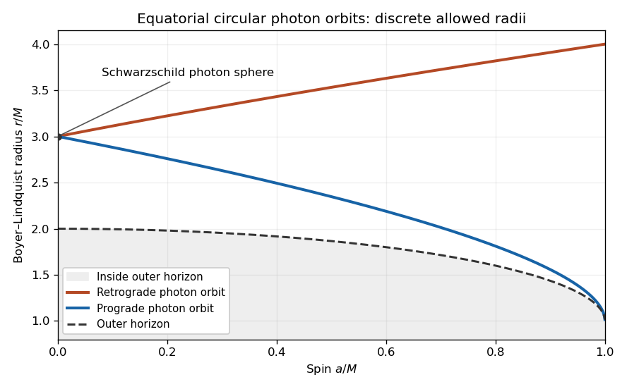

# 2017

↑ **Parent:** [Past exam of the general relativity II course of the University of Oxford](../past-exam-of-the-general-relativity-ii-course-of-the-university-of-oxford.md)

Source paper: [https://www.whatdotheyknow.com/request/oxford_physics_past_papers_2/response/2340696/attach/5/Physics%20Papers%202016.pdf?cookie_passthrough=1](https://www.whatdotheyknow.com/request/oxford_physics_past_papers_2/response/2340696/attach/5/Physics%20Papers%202016.pdf?cookie_passthrough=1)

**Table of contents**

- [1](#1)
  - [a](#1/a)
    - [Solution](#1/a/solution)
  - [b](#1/b)
    - [Solution](#1/b/solution)
  - [c](#1/c)
    - [Solution](#1/c/solution)
- [2](#2)
  - [a](#2/a)
    - [i](#2/a/i)
      - [Solution](#2/a/i/solution)
    - [ii](#2/a/ii)
      - [Solution](#2/a/ii/solution)
    - [iii](#2/a/iii)
      - [Solution](#2/a/iii/solution)
  - [b](#2/b)
    - [i](#2/b/i)
      - [Solution](#2/b/i/solution)
    - [ii](#2/b/ii)
      - [Solution](#2/b/ii/solution)
    - [iii](#2/b/iii)
      - [Solution](#2/b/iii/solution)
- [3](#3)
  - [a](#3/a)
    - [Solution](#3/a/solution)
  - [b](#3/b)
    - [Solution](#3/b/solution)
  - [c](#3/c)
    - [Solution](#3/c/solution)
  - [d](#3/d)
    - [Solution](#3/d/solution)

## 1

↑ **Parent:** [2017](2017.md)

<h3 id="1/a">a</h3>

↑ **Parent:** [1](#1)

<h4 id="1/a/solution">Solution</h4>

↑ **Parent:** [A](#1/a)

The [coordinate basis](../tangent-vector.md#coordinate-basis) vector $K=\partial_v$ has constant components $K^a=\delta^a_v$. Its [norm](../normed-vector-space.md#norm) is

$$
g_{ab}K^aK^b=g_{vv}=0,
$$

so it is a nonzero [null vector](../special-relativity.md#null-vector) everywhere. The [Lie derivative](../differential-form.md#lie-derivative-of-a-differential-form) of the [metric tensor](../general-relativity.md#metric-tensor) is

$$
(\mathcal L_Kg)_{ab}
=K^c\partial_cg_{ab}+g_{cb}\partial_aK^c+g_{ac}\partial_bK^c
=\partial_vg_{ab}=0.
$$

Thus $\boxed{K=\partial_v\text{ is a null Killing vector field}.}$ In fact it is a [parallel vector field](../vector-bundle.md#parallel-vector-field): $K_b=g_{bv}=\delta_b^u$ and the [Christoffel symbols](../riemannian-geometry.md#christoffel-symbol) found below give $\nabla_aK_b=-\Gamma^u{}_{ab}=0$. This stronger property is characteristic of this [plane-fronted gravitational wave](../gravitational-wave.md#plane-fronted-gravitational-wave).

<h3 id="1/b">b</h3>

↑ **Parent:** [1](#1)

<h4 id="1/b/solution">Solution</h4>

↑ **Parent:** [B](#1/b)

In the order $(u,v,x,y)$ the [metric tensor](../general-relativity.md#metric-tensor) and [inverse metric](../general-relativity.md#inverse-metric) are

$$
(g_{ab})=
\begin{pmatrix}
F&1&0&0\\
1&0&0&0\\
0&0&1&0\\
0&0&0&1
\end{pmatrix},
\qquad
(g^{ab})=
\begin{pmatrix}
0&1&0&0\\
1&-F&0&0\\
0&0&1&0\\
0&0&0&1
\end{pmatrix}.
$$

Only $g_{uu}$ has nonzero [partial derivatives](../multivariable-calculus.md#partial-derivative). Substitution into the formula for the [Levi-Civita connection](../general-relativity.md#levi-civita-connection),

$$
\Gamma^a{}_{bc}
=\frac12g^{ad}
(\partial_bg_{dc}+\partial_cg_{db}-\partial_dg_{bc}),
$$

therefore gives

$$
\boxed{
\Gamma^v{}_{uu}=\frac12F_{,u},\qquad
\Gamma^v{}_{ui}=\Gamma^v{}_{iu}=\frac12F_{,i},\qquad
\Gamma^i{}_{uu}=-\frac12F_{,i}.
}
$$

Every other [Christoffel symbol](../riemannian-geometry.md#christoffel-symbol) vanishes. For example $g^{ud}$ selects $d=v$, and the [metric tensor](../general-relativity.md#metric-tensor) is independent of $v$ with constant $g_{av}$; hence $\Gamma^u{}_{bc}=0$.

Use the paper's [Riemann curvature tensor](../riemann-curvature-tensor.md) convention

$$
R^d{}_{cab}
=\partial_a\Gamma^d{}_{bc}-\partial_b\Gamma^d{}_{ac}
+\Gamma^d{}_{ae}\Gamma^e{}_{bc}
-\Gamma^d{}_{be}\Gamma^e{}_{ac},
\qquad
R_{abcd}=g_{ae}R^e{}_{bcd}.
$$

For the independent components,

$$
R^v{}_{iuj}
=-\partial_j\Gamma^v{}_{ui}
=-\frac12F_{,ij}.
$$

The quadratic [Christoffel symbol](../riemannian-geometry.md#christoffel-symbol) terms vanish here: any potentially contributing intermediate $u$ index gives a factor $\Gamma^u{}_{ab}=0$, and the remaining possible products have a lower $v$ index and vanish. Since the [symmetric matrix](../linear-algebra.md#symmetric-matrix) $M$ gives $F_{,ij}=2M_{ij}$, lowering the first index gives

$$
\boxed{R_{uiuj}=R^v{}_{iuj}=-M_{ij}(u).}
$$

All remaining nonzero components follow from the [Riemann curvature tensor](../riemann-curvature-tensor.md) symmetries

$$
R_{abcd}=-R_{bacd}=-R_{abdc}=R_{cdab}.
$$

There are no other independent components: terms involving a $v$ index vanish, while nonzero terms require one $u$ in each antisymmetric pair.

The [Ricci tensor](../riemann-curvature-tensor.md#ricci-tensor) is consequently

$$
R_{uu}=\delta^{ij}R_{iuju}=-\operatorname{tr}M,\qquad
R_{ab}=0\quad\text{otherwise}.
$$

The [Ricci scalar](../general-relativity.md#ricci-scalar) vanishes even when the [trace](../linear-algebra.md#matrix-trace) is nonzero, since $g^{uu}=0$. With zero [cosmological constant](../cosmology.md#cosmological-constant), the vacuum [Einstein field equations](../einstein-field-equations.md) reduce to $R_{ab}=0$. Therefore the necessary and sufficient condition is

$$
\boxed{\operatorname{tr}M(u)=0\quad\text{for every }u.}
$$

This is the [Ricci tensor of a Brinkmann plane wave](../gravitational-wave.md#ricci-tensor-of-a-brinkmann-plane-wave): a nonzero, trace-free profile can have nonzero [Riemann curvature tensor](../riemann-curvature-tensor.md) despite vanishing [Ricci tensor](../riemann-curvature-tensor.md#ricci-tensor).

<h3 id="1/c">c</h3>

↑ **Parent:** [1](#1)

<h4 id="1/c/solution">Solution</h4>

↑ **Parent:** [C](#1/c)

The [geodesic deviation](../riemann-curvature-tensor.md#geodesic-deviation) equation compares neighboring [geodesics](../riemannian-geometry.md#geodesic) by [covariant derivatives](../general-relativity.md#covariant-derivative). Replacing those derivatives by ordinary derivatives of coordinate components requires a [parallel transport](../vector-bundle.md#parallel-transport) frame along the reference [geodesic](../riemannian-geometry.md#geodesic). There is also an [affine parameter](../riemannian-geometry.md#affine-parameter) normalization to specify: the argument of $M$ is $u$, and it becomes $\tau$ only after choosing $u=\tau$.

For the intended local tidal calculation, take the reference [timelike geodesic](../general-relativity.md#timelike-geodesic)

$$
\gamma(\tau)=(u,v,x,y)=(\tau,-\tau/2,0,0),
\qquad
V=\partial_u-\frac12\partial_v.
$$

Here $g(V,V)=-1$, so $\tau$ is [proper time](../special-relativity.md#proper-time). Both $F$ and its first [partial derivatives](../multivariable-calculus.md#partial-derivative) vanish on $\gamma$. All [Christoffel symbols](../riemannian-geometry.md#christoffel-symbol) therefore vanish along this curve, and its [coordinate basis](../tangent-vector.md#coordinate-basis) is [parallel transport](../vector-bundle.md#parallel-transport) along it. With the [Riemann curvature tensor](../riemann-curvature-tensor.md) from part (b),

$$
R^i{}_{uju}=-M_{ij},\qquad
R^u{}_{bcd}=0,\qquad
R^v{}_{uju}=0\quad\text{on }\gamma.
$$

The [Jacobi field](../riemann-curvature-tensor.md#jacobi-field) equation thus becomes, in this adapted frame,

$$
\boxed{
\ddot\sigma^u=0,\qquad
\ddot\sigma^v=0,\qquad
\ddot\sigma^i=M_{ij}(\tau)\sigma^j.
}
$$

A purely transverse initial [Jacobi field](../riemann-curvature-tensor.md#jacobi-field), with $\sigma^u=\sigma^v=\dot\sigma^u=\dot\sigma^v=0$ initially, remains transverse. This [transverse tidal equation of a Brinkmann plane wave](../gravitational-wave.md#transverse-tidal-equation-of-a-brinkmann-plane-wave) describes the relative [tidal acceleration](../riemann-curvature-tensor.md#tidal-acceleration) of the freely falling bodies.

In vacuum write the [symmetric matrix](../linear-algebra.md#symmetric-matrix) as

$$
M(u)=
\begin{pmatrix}
A(u)&B(u)\\ B(u)&-A(u)
\end{pmatrix}.
$$

Its instantaneous [eigenvalues](../linear-operator-theory.md#eigenvalue) are $\pm\sqrt{A^2+B^2}$. The [tidal acceleration](../riemann-curvature-tensor.md#tidal-acceleration) stretches along one principal axis and squeezes along the perpendicular axis, with the axes allowed to vary with $u$. This describes accelerations; it does not imply monotonically growing and shrinking separations for arbitrary initial velocities. For the simple constant profile $A=\omega^2$, $B=0$,

$$
\sigma^x=C\cosh(\omega\tau)+D\sinh(\omega\tau),
\qquad
\sigma^y=P\cos(\omega\tau)+Q\sin(\omega\tau).
$$

Thus the [geodesic deviation](../riemann-curvature-tensor.md#geodesic-deviation) can be defocusing in one direction and oscillatory in the other. For a varying profile, diagonalizing at each instant does not decouple the [ordinary differential equations](../differential-equation.md#ordinary-differential-equation) without also including derivatives of the rotating [eigenvectors](../linear-operator-theory.md#eigenvector).

**Qualification of the coordinate claim.** The displayed equation for $\sigma^v$ is not true for arbitrary coordinate displacements along arbitrary reference [geodesics](../riemannian-geometry.md#geodesic). For synchronized neighboring curves with $u=\tau$ and $\sigma^u=0$, the exact [geodesic equations](../riemannian-geometry.md#geodesic-equation) are

$$
\ddot{\mathbf x}=M\mathbf x,\qquad
\ddot v=-\frac12\mathbf x^{T}M'\mathbf x
-2\dot{\mathbf x}^{T}M\mathbf x.
$$

Their variation gives

$$
\ddot{\boldsymbol\sigma}_{\perp}=M\boldsymbol\sigma_{\perp},\qquad
\ddot\sigma^v
=-\mathbf x^{T}M'\boldsymbol\sigma_{\perp}
-2\dot{\mathbf x}^{T}M\boldsymbol\sigma_{\perp}
-2\mathbf x^{T}M\dot{\boldsymbol\sigma}_{\perp}.
$$

The second expression need not vanish. A concrete vacuum counterexample is $M=\operatorname{diag}(1,-1)$ and the one-parameter family of [timelike geodesics](../general-relativity.md#timelike-geodesic)

$$
u=\tau,\qquad
x=Ae^\tau,\qquad
y=0,\qquad
v=-\frac{\tau}{2}-\frac{A^2}{2}e^{2\tau}.
$$

Each has $g(V,V)=-1$. Differentiating with respect to $A$ produces a [Jacobi field](../riemann-curvature-tensor.md#jacobi-field)

$$
\sigma^u=0,\qquad
\sigma^x=e^\tau,\qquad
\sigma^y=0,\qquad
\sigma^v=-Ae^{2\tau},
\qquad
\ddot\sigma^v=-4Ae^{2\tau}.
$$

This even has $g(V,\sigma)=0$, so it is a physical orthogonal separation. The [covariant derivative](../general-relativity.md#covariant-derivative) form of [geodesic deviation](../riemann-curvature-tensor.md#geodesic-deviation) remains correct; the unrestricted assertion about ordinary coordinate derivatives needs the adapted reference and frame used above. If instead $\dot u=c$ is a constant [affine parameter](../riemannian-geometry.md#affine-parameter) normalization, the transverse tidal coefficient is $c^2M(u)$.

## 2

↑ **Parent:** [2017](2017.md)

<h3 id="2/a">a</h3>

↑ **Parent:** [2](#2)

<h4 id="2/a/i">i</h4>

↑ **Parent:** [A](#2/a)

<h5 id="2/a/i/solution">Solution</h5>

↑ **Parent:** [I](#2/a/i)

Since the real [conformal factor](../general-relativity.md#conformal-factor) $\Lambda$ is nowhere zero, $\Lambda^2>0$ at every point. For any [tangent vector](../tangent-vector.md),

$$
\widetilde g(V,V)=\Lambda^2g(V,V).
$$

The sign is unchanged. With [metric signature](../topological-manifold.md#metric-signature) $(-,+,+,+)$, negative, zero and positive values therefore describe the same [timelike vectors](../general-relativity.md#timelike-vector), [null vectors](../special-relativity.md#null-vector) and [spacelike vectors](../general-relativity.md#spacelike-vector) for both [metric tensors](../general-relativity.md#metric-tensor). In particular the two [null cones](../special-relativity.md#light-cone) coincide.

Choose the same [time orientation](../general-relativity.md#time-orientation) for the two [Lorentzian metrics](../general-relativity.md#lorentzian-metric). A future-directed [causal curve](../general-relativity.md#causal-curve) or [timelike curve](../special-relativity.md#timelike-curve) for one has the same character for the other. Hence the [causal future](../general-relativity.md#causal-future), [causal past](../general-relativity.md#causal-past) and [chronological future](../general-relativity.md#chronological-future) of every point agree:

$$
\boxed{
J^\pm_{\widetilde g}(p)=J^\pm_g(p),\qquad
I^\pm_{\widetilde g}(p)=I^\pm_g(p).
}
$$

This is the preservation of [causal structure](../general-relativity.md#causal-structure) by a smooth, nonvanishing [conformal transformation](../geometry-and-topology.md#conformal-map). It does not assert preservation of [proper time](../special-relativity.md#proper-time) or of [affine parameter](../riemannian-geometry.md#affine-parameter) lengths.

<h4 id="2/a/ii">ii</h4>

↑ **Parent:** [A](#2/a)

<h5 id="2/a/ii/solution">Solution</h5>

↑ **Parent:** [Ii](#2/a/ii)

Put $\omega=\log|\Lambda|$, which is smooth because $\Lambda$ is nowhere zero. The [conformal change of the Levi-Civita connection](../general-relativity.md#conformal-change-of-the-levi-civita-connection) is

$$
\widetilde\Gamma^a{}_{bc}-\Gamma^a{}_{bc}
=C^a{}_{bc}
=\delta^a_b\partial_c\omega+\delta^a_c\partial_b\omega
-g_{bc}g^{ad}\partial_d\omega.
$$

This follows directly by differentiating $\widetilde g_{ab}=e^{2\omega}g_{ab}$ and using $\widetilde g^{ab}=e^{-2\omega}g^{ab}$ in the [Christoffel symbol](../riemannian-geometry.md#christoffel-symbol) formula.

Let $V=dx/d\tau$ be a [geodesic](../riemannian-geometry.md#geodesic) tangent for $g$, with $\tau$ an [affine parameter](../riemannian-geometry.md#affine-parameter). Since $\nabla_VV=0$,

$$
\boxed{
\widetilde\nabla_VV
=2V(\omega)V-g(V,V)\operatorname{grad}_g\omega.
}
$$

For a [null geodesic](../special-relativity.md#null-geodesic) the second term vanishes. The remaining acceleration is tangent to the same curve and can be removed by changing its parameter. Explicitly set $\widetilde V=fV$, with $f=d\tau/d\widetilde\tau$. Then

$$
\widetilde\nabla_{\widetilde V}\widetilde V
=f^2\left(2\frac{d\omega}{d\tau}+\frac{d\log f}{d\tau}\right)V.
$$

It vanishes when $f=C^{-1}\Lambda^{-2}$, or

$$
\boxed{\frac{d\widetilde\tau}{d\tau}=C\Lambda^2,\qquad C>0.}
$$

This [affine parameter change under conformal rescaling](../general-relativity.md#affine-parameter-change-under-conformal-rescaling) shows that [conformal preservation of null geodesic paths](../general-relativity.md#conformal-preservation-of-null-geodesic-paths) means preservation of unparametrized curves; the original [affine parameter](../riemannian-geometry.md#affine-parameter) usually changes.

For a non-null [geodesic](../riemannian-geometry.md#geodesic), the component of $\operatorname{grad}_g\omega$ orthogonal to $V$ generally survives. A change of parameter can remove only the tangential component of acceleration. As a concrete example use [Minkowski spacetime](../special-relativity.md#minkowski-spacetime),

$$
g=-dt^2+dx^2+dy^2+dz^2,\qquad
\Lambda=e^{kx},\quad k\ne0.
$$

The curve $(t,x,y,z)=(\tau,0,0,0)$ is a [timelike geodesic](../general-relativity.md#timelike-geodesic) for $g$, but along it

$$
\widetilde\nabla_{\partial_t}\partial_t=k\partial_x.
$$

This acceleration is not parallel to $\partial_t$, so the curve is not a [geodesic](../riemannian-geometry.md#geodesic) of $\widetilde g$ under any reparametrization. Special non-null curves may still be preserved, for example when $\Lambda$ is constant; nullness is the general guarantee.

<h4 id="2/a/iii">iii</h4>

↑ **Parent:** [A](#2/a)

<h5 id="2/a/iii/solution">Solution</h5>

↑ **Parent:** [Iii](#2/a/iii)

The product rule for the [Lie derivative](../differential-form.md#lie-derivative-of-a-differential-form) and the [Killing equation](../killing-vector-field.md#killing-equation) give

$$
\mathcal L_K\widetilde g
=\mathcal L_K(\Lambda^2g)
=K(\Lambda^2)g+\Lambda^2\mathcal L_Kg
=2\frac{K(\Lambda)}{\Lambda}\widetilde g.
$$

Consequently $K$ is a [Conformal Killing vector field](../general-relativity.md#conformal-killing-vector-field) for the rescaled [metric tensor](../general-relativity.md#metric-tensor), with smooth [conformal Killing factor](../general-relativity.md#conformal-killing-factor)

$$
\boxed{\sigma=K(\log|\Lambda|)=\frac{K^a\partial_a\Lambda}{\Lambda}.}
$$

It remains an actual [Killing vector field](../killing-vector-field.md) precisely when $K(\Lambda)=0$: the [conformal factor](../general-relativity.md#conformal-factor) must be constant along its [integral curves of a vector field](../multivariable-calculus.md#integral-curve-of-a-vector-field).

<h3 id="2/b">b</h3>

↑ **Parent:** [2](#2)

<h4 id="2/b/i">i</h4>

↑ **Parent:** [B](#2/b)

<h5 id="2/b/i/solution">Solution</h5>

↑ **Parent:** [I](#2/b/i)

A nondegenerate [Lorentzian metric](../general-relativity.md#lorentzian-metric) requires $M\ne0$; take $M>0$ as the radius convention. The original coordinates describe $\lambda>0$, with $\lambda=0$ a candidate boundary rather than an ordinary point of that chart. The change of coordinate gives

$$
dt=dv+\frac{M}{\lambda^2}d\lambda.
$$

Substituting and cancelling the two terms proportional to $d\lambda^2/\lambda^2$ produces

$$
\boxed{
ds^2=-\lambda^2dv^2-2M\,dv\,d\lambda+M^2d\Omega^2.
}
$$

The $(v,\lambda)$ block of this [metric tensor](../general-relativity.md#metric-tensor) has [determinant](../multilinear-algebra.md#determinant) $-M^2$ and [inverse metric](../general-relativity.md#inverse-metric)

$$
\begin{pmatrix}
g^{vv}&g^{v\lambda}\\
g^{\lambda v}&g^{\lambda\lambda}
\end{pmatrix}
=
\begin{pmatrix}
0&-1/M\\
-1/M&\lambda^2/M^2
\end{pmatrix}.
$$

All coefficients are smooth through $\lambda=0$, and the block has one negative and one positive [eigenvalue](../linear-operator-theory.md#eigenvalue). Together with the positive round [two-sphere](../euclidean-geometry.md#two-sphere) factor this is a regular [Lorentzian metric](../general-relativity.md#lorentzian-metric). It extends to a neighborhood with either sign of $\lambda$. The usual polar-coordinate problem at the poles of the [two-sphere](../euclidean-geometry.md#two-sphere) is removed by separate angular charts. Therefore $\lambda=0$ is only a [coordinate singularity](../general-relativity.md#coordinate-singularity) of the original chart. This is the degenerate-horizon patch of [Bertotti-Robinson spacetime](../general-relativity.md#bertotti-robinson-spacetime).

<h4 id="2/b/ii">ii</h4>

↑ **Parent:** [B](#2/b)

<h5 id="2/b/ii/solution">Solution</h5>

↑ **Parent:** [Ii](#2/b/ii)

On the extension in part (i), the [hypersurface](../smooth-manifold.md#hypersurface) $\mathcal N$ has nonzero normal [covector](../dual-space.md#covector) $n_a=\partial_a\lambda$. Its squared [norm](../normed-vector-space.md#norm) is

$$
g^{ab}n_an_b=g^{\lambda\lambda}=\frac{\lambda^2}{M^2}.
$$

This vanishes on $\mathcal N$, which is therefore a [null hypersurface](../general-relativity.md#null-hypersurface). Raising the index gives

$$
n^a=-\frac1M(\partial_v)^a+\frac{\lambda^2}{M^2}(\partial_\lambda)^a.
$$

Since $\partial_t=\partial_v$ at fixed $\lambda$, the original [Killing vector field](../killing-vector-field.md) becomes the smooth nonzero field $K=\partial_v$. The transformed [metric tensor](../general-relativity.md#metric-tensor) is independent of $v$, so $K$ remains a [Killing vector field](../killing-vector-field.md), and

$$
\left.n^a\right|_{\mathcal N}=-\frac1M K^a,\qquad
\left.g(K,K)\right|_{\mathcal N}=0.
$$

Thus $K$ is both tangent and normal to $\mathcal N$. This is exactly a [Killing horizon](../general-relativity.md#killing-horizon):

$$
\boxed{\mathcal N=\{\lambda=0\}\text{ is a Killing horizon of }\partial_t=\partial_v.}
$$

The [Killing vector field](../killing-vector-field.md) itself does not vanish there; a vanishing squared [norm](../normed-vector-space.md#norm) means nullness, not a zero vector.

<h4 id="2/b/iii">iii</h4>

↑ **Parent:** [B](#2/b)

<h5 id="2/b/iii/solution">Solution</h5>

↑ **Parent:** [Iii](#2/b/iii)

The [Killing equation](../killing-vector-field.md#killing-equation) implies

$$
K^a\nabla_aK^b=-\frac12\nabla^b(K^aK_a).
$$

Here $K^2=-\lambda^2$, so in the regular coordinates

$$
K^a\nabla_aK^b
=\lambda\,g^{b\lambda}
=-\frac{\lambda}{M}(\partial_v)^b
+\frac{\lambda^3}{M^2}(\partial_\lambda)^b.
$$

This vector vanishes at $\lambda=0$. The [Killing vector field](../killing-vector-field.md) $K=\partial_v$ is nonzero there, so comparison with the definition of [surface gravity](../general-relativity.md#surface-gravity) yields

$$
\boxed{\kappa=0.}
$$

Hence this is a [degenerate Killing horizon](../general-relativity.md#degenerate-killing-horizon). The argument uses the vanishing gradient of $K^2$ on the horizon; the condition $K^2=0$ by itself would not force zero [surface gravity](../general-relativity.md#surface-gravity).

## 3

↑ **Parent:** [2017](2017.md)

<h3 id="3/a">a</h3>

↑ **Parent:** [3](#3)

<h4 id="3/a/solution">Solution</h4>

↑ **Parent:** [A](#3/a)

A regular [hypersurface](../smooth-manifold.md#hypersurface) $f=0$, with $df\ne0$, is a [null hypersurface](../general-relativity.md#null-hypersurface) if its normal [covector](../dual-space.md#covector) has zero squared [norm](../normed-vector-space.md#norm):

$$
g^{ab}(\partial_af)(\partial_bf)=0\quad\text{on }f=0.
$$

Its normal [vector](../vector-space.md#vector) is then also tangent to the [hypersurface](../smooth-manifold.md#hypersurface); the induced [metric tensor](../general-relativity.md#metric-tensor) is degenerate.

For the [Kerr metric](../general-relativity.md#kerr-metric) the normal to a constant-$r$ surface has squared [norm](../normed-vector-space.md#norm)

$$
g^{rr}=\frac{\Delta}{\Sigma},\qquad
\Delta=(r-r_+)(r-r_-),\qquad
r_\pm=M\pm\sqrt{M^2-a^2}.
$$

For $0<a<M$ the two roots are positive and distinct. To verify that they are genuine regular [null hypersurfaces](../general-relativity.md#null-hypersurface), rather than trusting singular [Boyer-Lindquist coordinates](../black-hole.md#boyer-lindquist-coordinates), introduce [ingoing Kerr coordinates](../black-hole.md#ingoing-kerr-coordinates)

$$
dv=dt+\frac{r^2+a^2}{\Delta}\,dr,\qquad
d\psi=d\phi+\frac a\Delta\,dr.
$$

Substitution gives

$$
\begin{aligned}
ds^2={}&-\left(1-\frac{2Mr}{\Sigma}\right)dv^2
+2\,dv\,dr+\Sigma\,d\theta^2
-2a\sin^2\theta\,dr\,d\psi\\
&-\frac{4Mar\sin^2\theta}{\Sigma}\,dv\,d\psi
+\sin^2\theta\left(r^2+a^2+
\frac{2Ma^2r\sin^2\theta}{\Sigma}\right)d\psi^2.
\end{aligned}
$$

There are no $\Delta^{-1}$ terms. At either root $\Sigma>0$, and the [determinant](../multilinear-algebra.md#determinant) is $-\Sigma^2\sin^2\theta$ away from the angular coordinate poles. Thus the [metric tensor](../general-relativity.md#metric-tensor) extends smoothly across each root. The raised normal on either surface is

$$
\left.(d r)^\sharp\right|_{r_\pm}
=\frac{r_\pm^2+a^2}{\Sigma}
\left(\partial_v+\Omega_\pm\partial_\psi\right),
\qquad
\Omega_\pm=\frac{a}{r_\pm^2+a^2}.
$$

This is a nonzero null [Killing vector field](../killing-vector-field.md) normal to the surface. Both surfaces are [Killing horizons](../general-relativity.md#killing-horizon), with [horizon angular velocities](../general-relativity.md#horizon-angular-velocity) $\Omega_\pm$.

**The event-horizon terminology in the paper needs qualification.** In the usual asymptotically flat [Kerr black hole](../black-hole.md#kerr-black-hole) extension, relative to a chosen exterior's [future null infinity](../general-relativity.md#future-null-infinity), the future branch of $r=r_+$ is the [event horizon](../black-hole.md#event-horizon), the boundary $\partial J^-(\mathscr I^+)$. In the intervening black-hole region $\Delta<0$, the coordinate $r$ has timelike gradient and future-directed curves move toward smaller $r$; they cannot return across the outer boundary to that exterior. The inner surface $r=r_-$ is a [Cauchy horizon](../general-relativity.md#cauchy-horizon), not a second [event horizon](../black-hole.md#event-horizon) for the same asymptotic end. Nullness is a local property; identifying an [event horizon](../black-hole.md#event-horizon) additionally requires this global [causal structure](../general-relativity.md#causal-structure).[Sections 6.3.2 and 6.2.4: regular extension across the two Kerr roots, global diagram and the inner Cauchy horizon](../physics-bibliography.md#general-relativity-by-david-tong)

The allowed endpoint $a=0$ provides an especially concrete counterexample to the unrestricted description of both roots. The [Kerr metric](../general-relativity.md#kerr-metric) then becomes [Schwarzschild spacetime](../schwarzschild-spacetime.md), $r_+=2M$ is its regular [event horizon](../black-hole.md#event-horizon), but $r_-=0$ is a [curvature singularity](../general-relativity.md#curvature-singularity):

$$
R_{abcd}R^{abcd}=\frac{48M^2}{r^6}\longrightarrow\infty.
$$

It is not a regular inner [null hypersurface](../general-relativity.md#null-hypersurface). Thus the two-horizon calculation above assumes $0<a<M$.

<h3 id="3/b">b</h3>

↑ **Parent:** [3](#3)

<h4 id="3/b/solution">Solution</h4>

↑ **Parent:** [B](#3/b)

The [metric tensor](../general-relativity.md#metric-tensor) is independent of $t$ and $\phi$, so

$$
\boxed{T=\partial_t,\qquad \Phi=\partial_\phi}
$$

are commuting [Killing vector fields](../killing-vector-field.md). For $0<a<M$ they span the continuous [Killing vector field](../killing-vector-field.md) algebra; every constant linear combination is also a [Killing vector field](../killing-vector-field.md). They express [stationary spacetime](../general-relativity.md#stationary-spacetime) and axial [symmetry](../physics.md#symmetry-physics), respectively. At the allowed endpoint $a=0$ the [spherical symmetry](../geometry-and-topology.md#spherical-symmetry) of [Schwarzschild spacetime](../schwarzschild-spacetime.md) enlarges the algebra: in addition to $T$, a basis of rotational [Killing vector fields](../killing-vector-field.md) is

$$
J_x=-\sin\phi\,\partial_\theta-\cot\theta\cos\phi\,\partial_\phi,
\qquad
J_y=\cos\phi\,\partial_\theta-\cot\theta\sin\phi\,\partial_\phi,
\qquad
J_z=\partial_\phi.
$$

Their polar-coordinate expressions are singular at the axis, but the rotational fields are smooth there.

Let $U^a=dx^a/ds$ be the tangent to any affinely parametrized [geodesic](../riemannian-geometry.md#geodesic). For a [Killing vector field](../killing-vector-field.md) $X$,

$$
\frac{d}{ds}(X_aU^a)
=U^aU^b\nabla_aX_b+X_bU^a\nabla_aU^b
=U^aU^b\nabla_{(a}X_{b)}=0.
$$

This is the [geodesic conserved quantity from a Killing vector](../killing-vector-field.md#geodesic-conserved-quantity-from-a-killing-vector). With $p_a=g_{ab}U^b$, choose the [energy](../energy.md) and axial [angular momentum](../momentum.md#angular-momentum) conventions

$$
\boxed{E=-p_t=-g(T,U),\qquad L=p_\phi=g(\Phi,U).}
$$

For a massive particle with [proper time](../special-relativity.md#proper-time) parameter these are per unit rest mass; for a [null geodesic](../special-relativity.md#null-geodesic) their common scale depends on the [affine parameter](../riemannian-geometry.md#affine-parameter) normalization. Expanding in the supplied [Boyer-Lindquist coordinates](../black-hole.md#boyer-lindquist-coordinates) gives

$$
\begin{aligned}
E&=\left(1-\frac{2Mr}{\Sigma}\right)\dot t
+\frac{2Mar\sin^2\theta}{\Sigma}\dot\phi,\\
L&=-\frac{2Mar\sin^2\theta}{\Sigma}\dot t
+\frac{\sin^2\theta}{\Sigma}
\left[(r^2+a^2)^2-a^2\Delta\sin^2\theta\right]\dot\phi.
\end{aligned}
$$

The factor of two between $g_{t\phi}$ and the coefficient of $dt\,d\phi$ is essential for these signs and coefficients.

<h3 id="3/c">c</h3>

↑ **Parent:** [3](#3)

<h4 id="3/c/solution">Solution</h4>

↑ **Parent:** [C](#3/c)

Reflection across $\theta=\pi/2$ is an [isometry](../riemannian-geometry.md#isometry); a [geodesic](../riemannian-geometry.md#geodesic) initially tangent to its fixed equatorial plane remains in that plane by uniqueness of the [geodesic equation](../riemannian-geometry.md#geodesic-equation). Thus take $\theta=\pi/2$, $\dot\theta=0$, and $\Sigma=r^2$. Define the algebraic abbreviations

$$
A=1-\frac{2M}{r},\qquad
B=\frac{2Ma}{r},\qquad
C=r^2+a^2+\frac{2Ma^2}{r}.
$$

The [conserved quantities](../hamiltonian-mechanics.md#conserved-quantity) of part (b) become

$$
E=A\dot t+B\dot\phi,\qquad
L=-B\dot t+C\dot\phi,
\qquad
AC+B^2=\Delta.
$$

For $\Delta\ne0$, inversion gives

$$
\dot t=\frac{CE-BL}{\Delta},\qquad
\dot\phi=\frac{BE+AL}{\Delta}.
$$

The [null condition](../special-relativity.md#null-condition) can be written without expanding a quadratic square:

$$
0=-E\dot t+L\dot\phi+\frac{r^2}{\Delta}\dot r^2.
$$

Substituting the preceding expressions yields the [equatorial Kerr null geodesic radial equation](../general-relativity.md#equatorial-kerr-null-geodesic-radial-equation)

$$
\boxed{
\dot r^2
=E^2+\frac{a^2E^2-L^2}{r^2}
+\frac{2M(L-aE)^2}{r^3}.
}
$$

An equivalent useful polynomial form is

$$
\boxed{
r^4\dot r^2=\mathcal R(r),\qquad
\mathcal R(r)=\left[E(r^2+a^2)-aL\right]^2
-\Delta(L-aE)^2.
}
$$

These expressions use an [affine parameter](../riemannian-geometry.md#affine-parameter) $s$; a common rescaling of $E$ and $L$ accompanies its rescaling. The inversion was performed in the exterior $r>r_+$, where [Boyer-Lindquist coordinates](../black-hole.md#boyer-lindquist-coordinates) are regular. The polynomial radial identity has a smooth continuation to a horizon, but the formulas for $\dot t$ and $\dot\phi$ there must be replaced by regular-coordinate expressions. In the limit $a=0$, the result reduces to the [Schwarzschild spacetime](../schwarzschild-spacetime.md) equation $\dot r^2=E^2-(1-2M/r)L^2/r^2$.

<h3 id="3/d">d</h3>

↑ **Parent:** [3](#3)

<h4 id="3/d/solution">Solution</h4>

↑ **Parent:** [D](#3/d)

**The assertion about every exterior radius is false for geodesics.** A [circular orbit](../classical-mechanics.md#circular-orbit) here means an equatorial [null geodesic](../special-relativity.md#null-geodesic) at constant $r$, rather than a genuinely radial trajectory. A zero of the radial [effective potential](../mathematical-physics.md#effective-potential) alone gives a turning point, not necessarily a [circular orbit](../classical-mechanics.md#circular-orbit). The radial [geodesic equation](../riemannian-geometry.md#geodesic-equation) must hold as well.

Write $q=L-aE$ and

$$
f(r)=\dot r^2=E^2-\frac{q^2+2aEq}{r^2}+\frac{2Mq^2}{r^3}.
$$

For an exterior [circular null geodesic](../schwarzschild-spacetime.md#circular-null-geodesic), the two conditions are $f(r)=f'(r)=0$, equivalently $\mathcal R(r)=\mathcal R'(r)=0$ with $E,L$ fixed. One way to justify the derivative condition without dividing by $\dot r=0$ is to use the radial [Euler-Lagrange equation](../analysis.md#euler-lagrange-equation). At constant $r$ it gives

$$
\partial_rg_{AB}\dot x^A\dot x^B=0,\qquad A,B\in\{t,\phi\}.
$$

Together with $g_{AB}\dot x^A\dot x^B=0$, and the fixed conserved $p_A$, this is precisely the double-root condition for $\mathcal R$.

Now

$$
f'(r)=\frac{2(q^2+2aEq)}{r^3}-\frac{6Mq^2}{r^4}.
$$

Setting this to zero and using $f=0$ gives

$$
q^2+2aEq=\frac{3Mq^2}{r},\qquad
E^2=\frac{Mq^2}{r^3}.
$$

A nontrivial exterior [null geodesic](../special-relativity.md#null-geodesic) cannot have $E=0$ here: the second equation would force $q=L=0$, and then every tangent component would vanish. Therefore

$$
\boxed{
r^2=\frac{L^2-a^2E^2}{3E^2},\qquad
r^3=\frac{M(L-aE)^2}{E^2}.
}
$$

Both equations, with the same constants $E,L$, are required. They give the requested radius relations in terms of the [conserved quantities](../hamiltonian-mechanics.md#conserved-quantity), while showing why an arbitrary exterior radius is not permitted.

For a more explicit classification let $b=L/E$ be the [impact parameter](../classical-mechanics.md#impact-parameter). The second relation gives $b-a=s\,r^{3/2}/\sqrt M$ with $s=\pm1$. Substituting into the first relation yields

$$
\boxed{r^2-3Mr+2s\,a\sqrt{Mr}=0.}
$$

For $0<a<M$, $s=+1$ gives the prograde [equatorial circular Kerr photon orbit](../schwarzschild-spacetime.md#equatorial-circular-kerr-photon-orbit) and $s=-1$ the retrograde one. The two allowed exterior radii are

$$
\boxed{
\begin{aligned}
r_{\mathrm{pro}}
&=2M\left[1+\cos\left(\frac23\arccos(-a/M)\right)\right],\\
r_{\mathrm{retro}}
&=2M\left[1+\cos\left(\frac23\arccos(a/M)\right)\right].
\end{aligned}
}
$$

Both are strictly greater than $r_+$ in the subextremal range. Squaring the signed radius equation gives $r(r-3M)^2=4Ma^2$, but introduces an additional inner root and loses the sign distinguishing the two senses of rotation. At $a=0$ the two exterior radii coincide at the [photon sphere](../schwarzschild-spacetime.md#photon-sphere) $r=3M$, with $b=\pm3\sqrt3M$.

**[Figure 1](#3/d/image-the-two-equatorial-circular-photon-orbit-radii-and-the-outer-kerr-horizon-as-functions-of-spin). The two equatorial circular photon-orbit radii and the outer Kerr horizon as functions of spin**.

For a direct counterexample to the all-radii claim take $a=0$ and $r_0=4M>r_+=2M$. Choose $E=1$ and $L=4\sqrt2M$ so that $f(r_0)=0$. The radial [geodesic equation](../riemannian-geometry.md#geodesic-equation) nevertheless gives

$$
\ddot r=\frac12f'(r)
=\frac{L^2(r-3M)}{r^4},
\qquad
\left.\ddot r\right|_{r=4M}=\frac1{8M}\ne0.
$$

It is a turning point, not a [circular orbit](../classical-mechanics.md#circular-orbit). Alternatively, constant-$r$ null directions exist throughout the exterior because the two angular-velocity roots of $g_{tt}+2\Omega g_{t\phi}+\Omega^2g_{\phi\phi}=0$ are real; almost all of their integral curves require acceleration and fail the radial [geodesic equation](../riemannian-geometry.md#geodesic-equation). This distinction explains how an all-radii assertion can arise.

Finally, $r=r_+$ itself has the [null geodesic](../special-relativity.md#null-geodesic) generators of its [Killing horizon](../general-relativity.md#killing-horizon), proportional to $\chi_+=\partial_v+\Omega_+\partial_\psi$. They are a separate horizon case. On the horizon $\chi_+$ is normal to every tangent, so its contractions with $\partial_v$ and $\partial_\psi$ both vanish: $E=L=0$ for a generator tangent. Its [affine parameter](../riemannian-geometry.md#affine-parameter) can be chosen by rescaling that tangent. The exterior calculation dividing by $E$ does not include it. The presence of these generators does not supply [circular null geodesics](../schwarzschild-spacetime.md#circular-null-geodesic) at the intervening arbitrary exterior radii.

## ↑ Ancestors (9)

1. [Past exam of the general relativity II course of the University of Oxford](../past-exam-of-the-general-relativity-ii-course-of-the-university-of-oxford.md)
2. [General relativity II course of the University of Oxford](../university-of-oxford.md#general-relativity-ii-course-of-the-university-of-oxford)
3. [Year 4 of the mathematics course of the University of Oxford](../university-of-oxford.md#year-4-of-the-mathematics-course-of-the-university-of-oxford)
4. [Mathematics course of the University of Oxford](../university-of-oxford.md#mathematics-course-of-the-university-of-oxford)
5. [Undergraduate course of the University of Oxford](../university-of-oxford.md#undergraduate-course-of-the-university-of-oxford)
6. [Course of the University of Oxford](../university-of-oxford.md#course-of-the-university-of-oxford)
7. [University of Oxford](../university-of-oxford.md)
8. [List of universities](../README.md#list-of-universities)
9. [Codex Wiki](../README.md)
