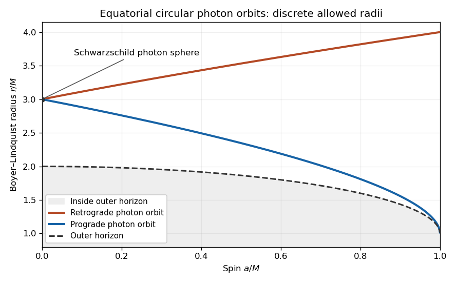

<h1 id="3/d/solution">Solution</h1>

↑ **Parent:** [D](../d.md)

**The assertion about every exterior radius is false for geodesics.** A [circular orbit](../../../../circular-orbit.md) here means an equatorial [null geodesic](../../../../null-geodesic.md) at constant $r$, rather than a genuinely radial trajectory. A zero of the radial [effective potential](../../../../effective-potential.md) alone gives a turning point, not necessarily a [circular orbit](../../../../circular-orbit.md). The radial [geodesic equation](../../../../geodesic-equation.md) must hold as well.

Write $q=L-aE$ and

$$
f(r)=\dot r^2=E^2-\frac{q^2+2aEq}{r^2}+\frac{2Mq^2}{r^3}.
$$

For an exterior [circular null geodesic](../../../../circular-null-geodesic.md), the two conditions are $f(r)=f'(r)=0$, equivalently $\mathcal R(r)=\mathcal R'(r)=0$ with $E,L$ fixed. One way to justify the derivative condition without dividing by $\dot r=0$ is to use the radial [Euler-Lagrange equation](../../../../euler-lagrange-equation.md). At constant $r$ it gives

$$
\partial_rg_{AB}\dot x^A\dot x^B=0,\qquad A,B\in\{t,\phi\}.
$$

Together with $g_{AB}\dot x^A\dot x^B=0$, and the fixed conserved $p_A$, this is precisely the double-root condition for $\mathcal R$.

Now

$$
f'(r)=\frac{2(q^2+2aEq)}{r^3}-\frac{6Mq^2}{r^4}.
$$

Setting this to zero and using $f=0$ gives

$$
q^2+2aEq=\frac{3Mq^2}{r},\qquad
E^2=\frac{Mq^2}{r^3}.
$$

A nontrivial exterior [null geodesic](../../../../null-geodesic.md) cannot have $E=0$ here: the second equation would force $q=L=0$, and then every tangent component would vanish. Therefore

$$
\boxed{
r^2=\frac{L^2-a^2E^2}{3E^2},\qquad
r^3=\frac{M(L-aE)^2}{E^2}.
}
$$

Both equations, with the same constants $E,L$, are required. They give the requested radius relations in terms of the [conserved quantities](../../../../conserved-quantity.md), while showing why an arbitrary exterior radius is not permitted.

For a more explicit classification let $b=L/E$ be the [impact parameter](../../../../impact-parameter.md). The second relation gives $b-a=s\,r^{3/2}/\sqrt M$ with $s=\pm1$. Substituting into the first relation yields

$$
\boxed{r^2-3Mr+2s\,a\sqrt{Mr}=0.}
$$

For $0<a<M$, $s=+1$ gives the prograde [equatorial circular Kerr photon orbit](../../../../equatorial-circular-kerr-photon-orbit.md) and $s=-1$ the retrograde one. The two allowed exterior radii are

$$
\boxed{
\begin{aligned}
r_{\mathrm{pro}}
&=2M\left[1+\cos\left(\frac23\arccos(-a/M)\right)\right],\\
r_{\mathrm{retro}}
&=2M\left[1+\cos\left(\frac23\arccos(a/M)\right)\right].
\end{aligned}
}
$$

Both are strictly greater than $r_+$ in the subextremal range. Squaring the signed radius equation gives $r(r-3M)^2=4Ma^2$, but introduces an additional inner root and loses the sign distinguishing the two senses of rotation. At $a=0$ the two exterior radii coincide at the [photon sphere](../../../../photon-sphere.md) $r=3M$, with $b=\pm3\sqrt3M$.

**[Figure 1](#3/d/image-the-two-equatorial-circular-photon-orbit-radii-and-the-outer-kerr-horizon-as-functions-of-spin). The two equatorial circular photon-orbit radii and the outer Kerr horizon as functions of spin**.

For a direct counterexample to the all-radii claim take $a=0$ and $r_0=4M>r_+=2M$. Choose $E=1$ and $L=4\sqrt2M$ so that $f(r_0)=0$. The radial [geodesic equation](../../../../geodesic-equation.md) nevertheless gives

$$
\ddot r=\frac12f'(r)
=\frac{L^2(r-3M)}{r^4},
\qquad
\left.\ddot r\right|_{r=4M}=\frac1{8M}\ne0.
$$

It is a turning point, not a [circular orbit](../../../../circular-orbit.md). Alternatively, constant-$r$ null directions exist throughout the exterior because the two angular-velocity roots of $g_{tt}+2\Omega g_{t\phi}+\Omega^2g_{\phi\phi}=0$ are real; almost all of their integral curves require acceleration and fail the radial [geodesic equation](../../../../geodesic-equation.md). This distinction explains how an all-radii assertion can arise.

Finally, $r=r_+$ itself has the [null geodesic](../../../../null-geodesic.md) generators of its [Killing horizon](../../../../killing-horizon.md), proportional to $\chi_+=\partial_v+\Omega_+\partial_\psi$. They are a separate horizon case. On the horizon $\chi_+$ is normal to every tangent, so its contractions with $\partial_v$ and $\partial_\psi$ both vanish: $E=L=0$ for a generator tangent. Its [affine parameter](../../../../affine-parameter.md) can be chosen by rescaling that tangent. The exterior calculation dividing by $E$ does not include it. The presence of these generators does not supply [circular null geodesics](../../../../circular-null-geodesic.md) at the intervening arbitrary exterior radii.

## ↑ Ancestors (12)

1. [D](../d.md)
2. [3](../../3.md)
3. [2017](../../../2017-split.md)
4. [Past exam of the general relativity II course of the University of Oxford](../../../split.md)
5. [General relativity II course of the University of Oxford](../../../../general-relativity-ii-course-of-the-university-of-oxford.md)
6. [Year 4 of the mathematics course of the University of Oxford](../../../../year-4-of-the-mathematics-course-of-the-university-of-oxford.md)
7. [Mathematics course of the University of Oxford](../../../../mathematics-course-of-the-university-of-oxford.md)
8. [Undergraduate course of the University of Oxford](../../../../undergraduate-course-of-the-university-of-oxford.md)
9. [Course of the University of Oxford](../../../../course-of-the-university-of-oxford.md)
10. [University of Oxford](../../../../university-of-oxford-split.md)
11. [List of universities](../../../../list-of-universities.md)
12. [Codex Wiki](../../../../split.md)
