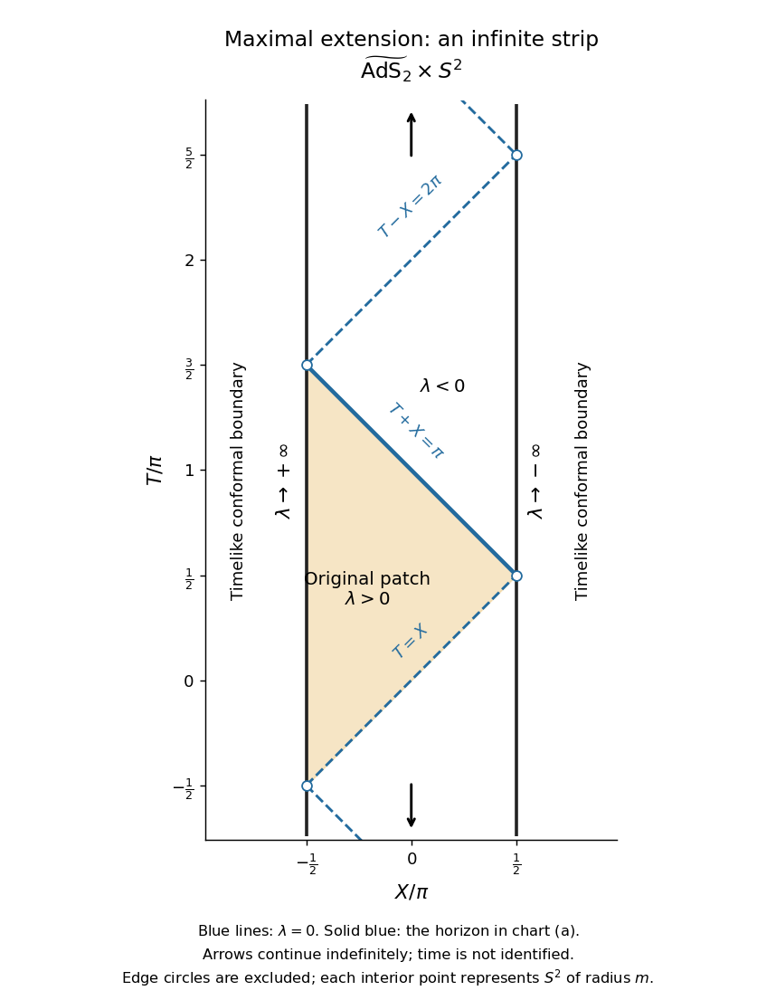

# 2021

↑ **Parent:** [Past exam of the general relativity II course of the University of Oxford](../past-exam-of-the-general-relativity-ii-course-of-the-university-of-oxford.md)

Complete solutions to the three questions of the Part C [General relativity II course of the University of Oxford](../university-of-oxford.md#general-relativity-ii-course-of-the-university-of-oxford) paper, sat on 1 June 2021. [Original released PDF, bundle pages 63–65; paper pages 1–3](https://www.whatdotheyknow.com/request/oxford_physics_past_papers_2/response/2340696/attach/9/Physics%20Papers%202020.pdf?cookie_passthrough=1#page=63). The bundle filename says 2020, but the paper's cover explicitly says Trinity Term 2021. The [metric signature](../topological-manifold.md#metric-signature) is $(-,+,+,+)$ and the [speed of light](../special-relativity.md#speed-of-light) is set to one. All questions and both Roman-numbered parts of question 1(d) are covered.

**Table of contents**

- [1](#1)
  - [a](#1/a)
    - [Solution](#1/a/solution)
  - [b](#1/b)
    - [Solution](#1/b/solution)
  - [c](#1/c)
    - [Solution](#1/c/solution)
  - [d](#1/d)
    - [i](#1/d/i)
      - [Solution](#1/d/i/solution)
    - [ii](#1/d/ii)
      - [Solution](#1/d/ii/solution)
- [2](#2)
  - [a](#2/a)
    - [Solution](#2/a/solution)
  - [b](#2/b)
    - [Solution](#2/b/solution)
  - [c](#2/c)
    - [Solution](#2/c/solution)
  - [d](#2/d)
    - [Solution](#2/d/solution)
- [3](#3)
  - [a](#3/a)
    - [Solution](#3/a/solution)
  - [b](#3/b)
    - [Solution](#3/b/solution)
  - [c](#3/c)
    - [Solution](#3/c/solution)

## 1

↑ **Parent:** [2021](2021.md)

<h3 id="1/a">a</h3>

↑ **Parent:** [1](#1)

<h4 id="1/a/solution">Solution</h4>

↑ **Parent:** [A](#1/a)

Write $D=u^a\nabla_a$, $\theta=\nabla_a u^a$ for the [expansion scalar](../geodesic-congruence.md#expansion-scalar), $a_b=u^a\nabla_a u_b$ for the [four-acceleration](../special-relativity.md#four-acceleration), and $P_b{}^c=\delta_b{}^c+u_bu^c$ for the [spatial projector of a timelike congruence](../geodesic-congruence.md#spatial-projector-of-a-timelike-congruence). The normalization of the [four-velocity](../special-relativity.md#four-velocity) gives $u^ba_b=0$ and $u^b\nabla_a u_b=0$. The [product rule](../calculus.md#product-rule) and [metric compatibility](../vector-bundle.md#metric-compatibility) give the [covariant derivative](../general-relativity.md#covariant-derivative) of the [perfect fluid in general relativity](../stress-energy-tensor.md#perfect-fluid-in-general-relativity) [stress-energy tensor](../stress-energy-tensor.md):

$$
F_b:=\nabla^aT_{ab}
=u_b\bigl[D(\rho+p)+(\rho+p)\theta\bigr]+(\rho+p)a_b+\nabla_b p.
$$

Its [tensor contraction](../multilinear-algebra.md#tensor-contraction) with the [four-velocity](../special-relativity.md#four-velocity) is

$$
u^bF_b=-D\rho-(\rho+p)\theta,
$$

and its projection with the [spatial projector of a timelike congruence](../geodesic-congruence.md#spatial-projector-of-a-timelike-congruence) is

$$
P_b{}^cF_c=(\rho+p)a_b+P_b{}^c\nabla_c p.
$$

Thus [stress-energy conservation](../stress-energy-tensor.md#stress-energy-conservation) implies the [relativistic perfect-fluid energy equation](../stress-energy-tensor.md#relativistic-perfect-fluid-energy-equation) and the [relativistic Euler equation](../stress-energy-tensor.md#relativistic-euler-equation):

$$
\boxed{u^a\nabla_a\rho+(\rho+p)\nabla_a u^a=0,\qquad
(\rho+p)u^a\nabla_a u_b+(g_{ab}+u_au_b)\nabla^a p=0.}
$$

Conversely, the two displayed equations set both projections of $F_b$ to zero. Since $F_b=P_b{}^cF_c-u_bu^cF_c$, they imply $F_b=0$. This establishes equivalence, including points where $\rho+p=0$, without dividing by that quantity.

<h3 id="1/b">b</h3>

↑ **Parent:** [1](#1)

<h4 id="1/b/solution">Solution</h4>

↑ **Parent:** [B](#1/b)

Use [stress-energy conservation](../stress-energy-tensor.md#stress-energy-conservation) and symmetry of the [stress-energy tensor](../stress-energy-tensor.md). The [Killing equation](../killing-vector-field.md#killing-equation) for the [Killing vector field](../killing-vector-field.md) $V$ then gives the [stress-energy current from a Killing vector](../killing-vector-field.md#stress-energy-current-from-a-killing-vector):

$$
\nabla^aJ_a=(\nabla^aT_{ab})V^b+T_{ab}\nabla^aV^b
=\frac12T^{ab}(\nabla_aV_b+\nabla_bV_a)=0.
$$

Hence $\boxed{\nabla^aJ_a=0}$. The assumption of [stress-energy conservation](../stress-energy-tensor.md#stress-energy-conservation), supplied by the equations of motion in part (a), is essential; the [Killing equation](../killing-vector-field.md#killing-equation) alone only eliminates the second term.

<h3 id="1/c">c</h3>

↑ **Parent:** [1](#1)

<h4 id="1/c/solution">Solution</h4>

↑ **Parent:** [C](#1/c)

The sign of $T_{ab}X^aX^b$ is unchanged by a nonzero rescaling of the [timelike vector](../general-relativity.md#timelike-vector) $X$. Normalize it to a [four-velocity](../special-relativity.md#four-velocity) $W$ and, after reversing its direction if necessary, write $W=\gamma(u+w)$, where $u\cdot w=0$, $w\cdot w=s\in[0,1)$ and $\gamma=(1-s)^{-1/2}$ is the [Lorentz factor](../special-relativity.md#lorentz-factor). For the [perfect fluid in general relativity](../stress-energy-tensor.md#perfect-fluid-in-general-relativity),

$$
T_{ab}W^aW^b=(\rho+p)\gamma^2-p
=\rho+(\rho+p)(\gamma^2-1).
$$

Taking $W=u$ requires $\rho\ge0$. Allowing the [Lorentz factor](../special-relativity.md#lorentz-factor) to become arbitrarily large requires $\rho+p\ge0$; otherwise sufficiently fast observers measure a negative value. Conversely, these two inequalities make both terms in the last expression nonnegative. Therefore the [weak energy condition for a perfect fluid](../stress-energy-tensor.md#weak-energy-condition-for-a-perfect-fluid) is exactly

$$
\boxed{\rho\ge0,\qquad \rho+p\ge0.}
$$

Property (1) is the [weak energy condition](../stress-energy-tensor.md#weak-energy-condition): **every physical observer measures nonnegative local [energy density](../statistical-physics.md#energy-density)**, namely $T_{ab}W^aW^b$ for their normalized [four-velocity](../special-relativity.md#four-velocity) $W$. It allows negative [pressure](../pressure.md) down to $p=-\rho$.

<h3 id="1/d">d</h3>

↑ **Parent:** [1](#1)

<h4 id="1/d/i">i</h4>

↑ **Parent:** [D](#1/d)

<h5 id="1/d/i/solution">Solution</h5>

↑ **Parent:** [I](#1/d/i)

For [relativistic dust](../stress-energy-tensor.md#relativistic-dust), $p=0$, the [relativistic Euler equation](../stress-energy-tensor.md#relativistic-euler-equation) gives $\rho a_b=0$. The nowhere-vanishing [density](../fluid-mechanics.md#density) therefore makes the [four-acceleration](../special-relativity.md#four-acceleration) zero: $u$ is a [timelike geodesic vector field](../geodesic-congruence.md#timelike-geodesic-vector-field). Let $\alpha=u^\flat$ be the [differential one-form](../differential-form.md#one-form) obtained by the [musical isomorphism](../riemannian-metric.md#musical-isomorphism). Its [exterior derivative](../differential-form.md#exterior-derivative) satisfies

$$
(\iota_u d\alpha)_b=u^a(\nabla_a u_b-\nabla_bu_a)
=a_b-\frac12\nabla_b(u^au_a)=0.
$$

Here $\iota_u$ is the [interior product](../differential-form.md#interior-product). By [hypersurface orthogonality](../differential-geometry.md#hypersurface-orthogonality) and the [Frobenius theorem](../differential-geometry.md#frobenius-theorem), $\alpha\wedge d\alpha=0$. Taking the [interior product](../differential-form.md#interior-product) and using $\alpha(u)=-1$ gives

$$
0=\iota_u(\alpha\wedge d\alpha)
=-d\alpha-\alpha\wedge\iota_u d\alpha=-d\alpha.
$$

Thus $\boxed{du^\flat=0}$. By the [Poincaré lemma](../differential-form.md#poincare-lemma), locally $\alpha=-dt$, and then $u(t)=-\alpha(u)=1$. Choose spatial [coordinate functions](../geometry-and-topology.md#coordinate-function) $x^i$ on one level set of $t$ and extend them constantly along the [integral curves of a vector field](../multivariable-calculus.md#integral-curve-of-a-vector-field) $u$, using its [smooth flow](../dynamical-systems.md#smooth-flow). This constructs $u=\partial_t$. Since $dt(\partial_i)=0$,

$$
g_{tt}=g(u,u)=-1,\qquad g_{ti}=\alpha(\partial_i)=-dt(\partial_i)=0.
$$

The metric on the orthogonal complement of a [timelike vector](../general-relativity.md#timelike-vector) is [positive-definite](../bilinear-form.md#positive-definite-bilinear-form), so the [synchronous coordinates for irrotational dust](../general-relativity.md#synchronous-coordinates-for-irrotational-dust) have

$$
\boxed{u=\partial_t,\qquad g=-dt^2+g_{ij}(t,\mathbf x)\,dx^i\otimes dx^j.}
$$

This construction is local; crossing [geodesics](../riemannian-geometry.md#geodesic) can prevent these [synchronous coordinates](../general-relativity.md#synchronous-coordinates) from covering a larger region.

<h4 id="1/d/ii">ii</h4>

↑ **Parent:** [D](#1/d)

<h5 id="1/d/ii/solution">Solution</h5>

↑ **Parent:** [Ii](#1/d/ii)

In the prescribed [synchronous coordinates](../general-relativity.md#synchronous-coordinates), the [Christoffel symbols](../riemannian-geometry.md#christoffel-symbol) satisfy

$$
\Gamma^a{}_{tt}=\frac12g^{ab}(2\partial_tg_{bt}-\partial_b g_{tt})=0.
$$

Consequently the [four-acceleration](../special-relativity.md#four-acceleration) of $u=\partial_t$ vanishes. For a spatial index $i$, $u_i=0$, so the spatial component of the [relativistic Euler equation](../stress-energy-tensor.md#relativistic-euler-equation) becomes

$$
0=(\rho+p)a_i+(\delta_i{}^a+u_i u^a)\partial_a p=\partial_i p.
$$

On a connected coordinate neighbourhood,

$$
\boxed{p=p(t).}
$$

A nonzero [pressure](../pressure.md) is allowed, but its spatial [gradient](../multivariable-calculus.md#gradient) must vanish if the fluid's [four-velocity](../special-relativity.md#four-velocity) follows these freely falling coordinate lines. No division by $p$ or $\rho+p$ is needed.

## 2

↑ **Parent:** [2021](2021.md)

<h3 id="2/a">a</h3>

↑ **Parent:** [2](#2)

<h4 id="2/a/solution">Solution</h4>

↑ **Parent:** [A](#2/a)

For the [plane gravitational wave in linearized gravity](../linearized-gravity.md#plane-gravitational-wave-in-linearized-gravity), the [chain rule](../calculus.md#chain-rule) gives $\partial_\kappa\tilde h_{\mu\nu}=n_\kappa\tilde h'_{\mu\nu}$. The [Lorenz gauge in linearized gravity](../linearized-gravity.md#lorenz-gauge-in-linearized-gravity), called wave gauge in the paper, imposes zero [divergence](../multivariable-calculus.md#divergence) of the [trace-reversed metric perturbation](../linearized-gravity.md#trace-reversed-metric-perturbation). Hence

$$
0=\partial^\mu\overline{\tilde h}_{\mu\nu}
=n^\mu\tilde h'_{\mu\nu}-\frac12n_\nu\tilde h',
\qquad
\boxed{n^\mu\tilde h'_{\mu\nu}=\frac12\tilde h'n_\nu.}
$$

The [wave equation](../wave-equation.md) itself holds for any smooth profile of $u$, because $\Box\tilde h_{\mu\nu}=(n^\kappa n_\kappa)\tilde h''_{\mu\nu}=0$ for the constant [null vector](../special-relativity.md#null-vector) $n$.

<h3 id="2/b">b</h3>

↑ **Parent:** [2](#2)

<h4 id="2/b/solution">Solution</h4>

↑ **Parent:** [B](#2/b)

Use the active sign convention for the [linearized coordinate gauge transformation](../linearized-gravity.md#linearized-coordinate-gauge-transformation), $h_{\mu\nu}\mapsto h_{\mu\nu}+\partial_\mu\xi_\nu+\partial_\nu\xi_\mu$. The paper's prescribed generator has precisely this sign; using the passive convention would require its negative. Direct [partial differentiation](../multivariable-calculus.md#partial-derivative) gives

$$
\partial_\nu\xi_\mu=\frac14\left[
\tilde h''_{\kappa\sigma}x^\kappa x^\sigma n_\mu n_\nu
+2\tilde h'_{\nu\kappa}x^\kappa n_\mu
-2\tilde h'_{\mu\kappa}x^\kappa n_\nu-2\tilde h_{\mu\nu}\right].
$$

The middle terms cancel when the indices are symmetrized. Therefore

$$
\partial_\mu\xi_\nu+\partial_\nu\xi_\mu
=\frac12\tilde h''_{\kappa\sigma}x^\kappa x^\sigma n_\mu n_\nu-\tilde h_{\mu\nu},
\qquad
\boxed{\hat h_{\mu\nu}=\phi n_\mu n_\nu,\quad
\phi=\frac12\tilde h''_{\kappa\sigma}x^\kappa x^\sigma.}
$$

To test both equations (3), put $H(u)=\tilde h(u)=\eta^{\kappa\sigma}\tilde h_{\kappa\sigma}(u)$, the [trace](../linear-algebra.md#matrix-trace) of the original [metric perturbation](../linearized-gravity.md). Since $n$ is a [null vector](../special-relativity.md#null-vector), $\hat h=0$ and its [trace-reversed metric perturbation](../linearized-gravity.md#trace-reversed-metric-perturbation) equals $\hat h$. Differentiating the result of part (a) gives

$$
n\cdot\partial\phi=n^\kappa\tilde h''_{\kappa\sigma}x^\sigma
=\frac12uH'',
\qquad
\Box\phi=H''+2n^\kappa\tilde h'''_{\kappa\sigma}x^\sigma
=H''+uH'''.
$$

In the second identity, the term with $n^2$ is zero. Thus

$$
\boxed{\partial^\mu\overline{\hat h}_{\mu\nu}=\frac12uH''n_\nu,\qquad
\Box\hat h_{\mu\nu}=(H''+uH''')n_\mu n_\nu.}
$$

**In general $\hat h$ does not satisfy (3).** On an open interval of $u$, both equations hold exactly when $H''=0$ there: the first equation forces this for $u\ne0$, and smoothness gives it at $u=0$ as well. A [linearized coordinate gauge transformation](../linearized-gravity.md#linearized-coordinate-gauge-transformation) preserves the [linearized vacuum Einstein equations](../linearized-gravity.md#linearized-vacuum-einstein-equations), but only a [residual gauge symmetry of linearized gravity](../linearized-gravity.md#residual-gauge-symmetry-of-linearized-gravity) preserves the imposed [Lorenz gauge in linearized gravity](../linearized-gravity.md#lorenz-gauge-in-linearized-gravity).

For an explicit failure, use the [null coordinates](../general-relativity.md#null-coordinate) of part (c) and take only $\tilde h_{uv}=\tilde h_{vu}=u^2/4$ nonzero. Then $H=u^2$, the original field obeys (3), but $\phi=uv/2$ gives $\partial^\mu\overline{\hat h}_{\mu u}=u$ and $\Box\hat h_{uu}=2$.

<h3 id="2/c">c</h3>

↑ **Parent:** [2](#2)

<h4 id="2/c/solution">Solution</h4>

↑ **Parent:** [C](#2/c)

With $u=-t+z$ and $v=t+z$, the [Minkowski metric](../special-relativity.md#minkowski-metric) and the specified [null vector](../special-relativity.md#null-vector) become

$$
\eta=du\,dv+dx^2+dy^2,\qquad
\eta_{uv}=\eta_{vu}=\frac12,\qquad
n=2\partial_v,\qquad n^\flat=du.
$$

The [Minkowski wave operator in null coordinates](../special-relativity.md#minkowski-wave-operator-in-null-coordinates) is $\Box=4\partial_u\partial_v+\partial_x^2+\partial_y^2$. All components of the original [metric perturbation](../linearized-gravity.md) still depend only on $u$, since this coordinate change is linear. The result of part (a), differentiated once, reads

$$
2\tilde h''_{v\nu}=\frac12H''\delta_\nu{}^u.
$$

It follows that $\tilde h''_{vv}=\tilde h''_{vx}=\tilde h''_{vy}=0$ and $\tilde h''_{uv}=H''/4$. Taking the [trace](../linear-algebra.md#matrix-trace) gives

$$
H''=4\tilde h''_{uv}+\tilde h''_{xx}+\tilde h''_{yy},
\qquad \tilde h''_{xx}+\tilde h''_{yy}=0.
$$

Expanding the scalar $\phi=\tilde h''_{AB}x^Ax^B/2$ in these [null coordinates](../general-relativity.md#null-coordinate) therefore yields

$$
\boxed{\phi=a(u)(x^2-y^2)+b(u)xy+c(u)v+d(u)x+e(u)y+f(u),}
$$

where the coefficients are explicitly

$$
\boxed{a=\frac12\tilde h''_{xx},\quad b=\tilde h''_{xy},\quad
c=\frac14uH'',\quad d=u\tilde h''_{ux},\quad
e=u\tilde h''_{uy},\quad f=\frac12u^2\tilde h''_{uu}.}
$$

The quadratic transverse term is a [harmonic quadratic plane-wave profile](../gravitational-wave.md#harmonic-quadratic-plane-wave-profile). In particular $\partial_v\phi=c$, $\partial^\mu\overline{\hat h}_{\mu\nu}=2c\,n_\nu$ and $\Box\phi=4c'$, consistently reproducing the failure of wave gauge in part (b).

<h3 id="2/d">d</h3>

↑ **Parent:** [2](#2)

<h4 id="2/d/solution">Solution</h4>

↑ **Parent:** [D](#2/d)

Continue with the active sign convention for the [linearized coordinate gauge transformation](../linearized-gravity.md#linearized-coordinate-gauge-transformation). Choose local [functions](../function.md) $A,B,C,F$ of $u$ by [integration](../integral.md) so that

$$
A''=\frac c2,\qquad B''=\frac d2,\qquad C''=\frac e2,\qquad F'=-\frac f2.
$$

For example, for any fixed $u_0$ one may take

$$
A(u)=\frac12\int_{u_0}^u(u-s)c(s)\,ds,\quad
B(u)=\frac12\int_{u_0}^u(u-s)d(s)\,ds,\quad
C(u)=\frac12\int_{u_0}^u(u-s)e(s)\,ds,\quad
F(u)=-\frac12\int_{u_0}^u f(s)\,ds.
$$

A generator, specified as a [covector](../dual-space.md#covector) with components in the [null coordinates](../general-relativity.md#null-coordinate) $(u,v,x,y)$, is

$$
\boxed{\chi=A\,dv+B\,dx+C\,dy+
\bigl(-A'v-B'x-C'y+F\bigr)\,du.}
$$

Indeed, with $\delta h_{AB}=\partial_A\chi_B+\partial_B\chi_A$, the mixed components cancel:

$$
\delta h_{uv}=A'-A'=0,\qquad
\delta h_{ux}=B'-B'=0,\qquad
\delta h_{uy}=C'-C'=0.
$$

All components without a $u$ index vanish as well, and

$$
\delta h_{uu}=-2A''v-2B''x-2C''y+2F'
=-cv-dx-ey-f.
$$

Since $n^\flat=du$, only the $uu$ component needs changing. Thus

$$
\boxed{\mathring h=\psi\,du^2,\qquad
\psi=a(u)(x^2-y^2)+b(u)xy.}
$$

**Yes, $\mathring h$ satisfies both equations (3).** Its [trace](../linear-algebra.md#matrix-trace) is zero, $\partial_v\psi=0$ gives zero [divergence](../multivariable-calculus.md#divergence), and the [harmonic quadratic plane-wave profile](../gravitational-wave.md#harmonic-quadratic-plane-wave-profile) gives

$$
\partial^A\overline{\mathring h}_{AB}=2\partial_v\psi\,\delta_B{}^u=0,
\qquad
\Box\psi=4\partial_u\partial_v\psi+\partial_x^2\psi+\partial_y^2\psi=2a-2a=0.
$$

The two surviving [functions](../function.md) encode the two [gravitational wave polarizations](../linearized-gravity.md#gravitational-wave-polarization); constant and linear transverse terms have been removed by the explicit [linearized coordinate gauge transformation](../linearized-gravity.md#linearized-coordinate-gauge-transformation).

## 3

↑ **Parent:** [2021](2021.md)

<h3 id="3/a">a</h3>

↑ **Parent:** [3](#3)

<h4 id="3/a/solution">Solution</h4>

↑ **Parent:** [A](#3/a)

Put $d\Omega_2^2=d\theta^2+\sin^2\theta\,d\varphi^2$, the standard [metric tensor](../general-relativity.md#metric-tensor) on the [unit sphere](../topology.md#unit-sphere). From $t=v+m/\lambda$ one has $dt=dv-m\lambda^{-2}d\lambda$. The apparently divergent terms cancel:

$$
\boxed{g=-\lambda^2dv^2+2m\,dv\,d\lambda+m^2d\Omega_2^2.}
$$

The $(v,\lambda)$ [metric tensor](../general-relativity.md#metric-tensor) block has [determinant](../multilinear-algebra.md#determinant) $-m^2\ne0$, independently of $\lambda$. Its coefficients are [real analytic](../analysis.md#real-analytic-function), so this formula defines a regular [Lorentzian metric](../general-relativity.md#lorentzian-metric) on

$$
\boxed{M_1=\mathbb R_v\times\mathbb R_\lambda\times S^2.}
$$

The polar-coordinate degeneracies at the poles are handled by ordinary [two-sphere](../euclidean-geometry.md#two-sphere) charts. Thus $\lambda=0$ is a [coordinate singularity](../general-relativity.md#coordinate-singularity) of the original chart and is crossed by this [spacetime extension](../special-relativity.md#spacetime-extension).

<h3 id="3/b">b</h3>

↑ **Parent:** [3](#3)

<h4 id="3/b/solution">Solution</h4>

↑ **Parent:** [B](#3/b)

The inverse of the $(v,\lambda)$ [metric tensor](../general-relativity.md#metric-tensor) block is

$$
(g^{AB})=\begin{pmatrix}0&1/m\\1/m&\lambda^2/m^2\end{pmatrix}.
$$

The normal [covector](../dual-space.md#covector) $d\lambda$ has squared norm $\lambda^2/m^2$. Therefore

$$
\boxed{\{\lambda=\lambda_0\}\text{ is timelike for }\lambda_0\ne0,
\quad\{\lambda=0\}\text{ is null}.}
$$

More explicitly, the induced [metric tensor](../general-relativity.md#metric-tensor) is $-\lambda_0^2dv^2+m^2d\Omega_2^2$; at zero its sole zero direction is $\partial_v$. The coefficients are independent of $v$, so $K=\partial_v$ is a [Killing vector field](../killing-vector-field.md). On $\lambda=0$,

$$
K^2=-\lambda^2=0,\qquad
K^\flat=-\lambda^2dv+m\,d\lambda=m\,d\lambda.
$$

Hence $K$ is both tangent and normal to this [null hypersurface](../general-relativity.md#null-hypersurface), proving it is a [Killing horizon](../general-relativity.md#killing-horizon). The definition of [surface gravity](../general-relativity.md#surface-gravity) is $\nabla_KK=\kappa K$ on the [Killing horizon](../general-relativity.md#killing-horizon), or equivalently $d(K^2)=-2\kappa K^\flat$. Since $d(K^2)=-2\lambda\,d\lambda$ vanishes there while $K^\flat\ne0$,

$$
\boxed{\kappa=0.}
$$

Thus this is a [degenerate Killing horizon](../general-relativity.md#degenerate-killing-horizon), and $v$ is an [affine parameter](../riemannian-geometry.md#affine-parameter) on each of its [null geodesics](../special-relativity.md#null-geodesic).

For a concrete [horizon frequency comparison](../general-relativity.md#horizon-frequency-comparison), fix the same angular position for a narrow high-[frequency](../wave.md#frequency) [light](../optics.md#light) beam and two freely falling radial observers. Work in [geometric optics](../geometrical-optics.md), with the beam's affinely transported [wavevector](../elasticity-physics.md#wavevector) tangent to the [Killing horizon](../general-relativity.md#killing-horizon), $k=qK$. Here $q>0$ is constant because $\nabla_KK=0$. Choose the observers as translates of one [timelike geodesic](../general-relativity.md#timelike-geodesic) by the [isometry](../riemannian-geometry.md#isometry) generated by $K$, crossing at $v_1$ and $v_2$. Give them the same positive [Killing energy](../killing-vector-field.md#killing-energy) per unit [rest mass](../special-relativity.md#invariant-mass), $E=-K\cdot W$. At their crossings their normalized [four-velocities](../special-relativity.md#four-velocity) have

$$
W^\lambda=-\frac Em,\qquad W^v=\frac1{2E},\qquad
W^\theta=W^\varphi=0,
$$

which satisfy $g(W,W)=2mW^vW^\lambda=-1$. They can be realized by local [geodesics](../riemannian-geometry.md#geodesic) with precisely these initial data. The measured [angular frequency](../lagrangian-mechanics.md#angular-frequency) is

$$
\omega=-k\cdot W=qE,\qquad
\boxed{\frac{\omega_2}{\omega_1}=1.}
$$

To connect this measurement to [surface gravity](../general-relativity.md#surface-gravity), if $\nabla_KK=\kappa K$ with constant $\kappa$, affine transport of $k=q(v)K$ would give $dq/dv=-\kappa q$. For observers related by the same [Killing vector field](../killing-vector-field.md) translation, $-K\cdot W$ agrees at the crossings, giving $\omega_2/\omega_1=e^{-\kappa(v_2-v_1)}$. Here there is **no accumulated [redshift](../optics.md#redshift) along the [Killing horizon](../general-relativity.md#killing-horizon)** for these equally prepared observers. Arbitrary observers with different [four-velocities](../special-relativity.md#four-velocity) can still measure different [frequencies](../wave.md#frequency) through their different [Killing energies](../killing-vector-field.md#killing-energy).

<h3 id="3/c">c</h3>

↑ **Parent:** [3](#3)

<h4 id="3/c/solution">Solution</h4>

↑ **Parent:** [C](#3/c)

First use the original [null coordinates](../general-relativity.md#null-coordinate) $u=t+m/\lambda$, $v=t-m/\lambda$. They obey $u-v=2m/\lambda$, and the radial [metric tensor](../general-relativity.md#metric-tensor) becomes

$$
g_{(2)}=-\frac{4m^2}{(u-v)^2}\,du\,dv.
$$

Apply the given substitutions $u=\tan(U/2)$ and $v=-\cot(V/2)$. The identities

$$
u-v=\frac{\cos((U-V)/2)}{\cos(U/2)\sin(V/2)},\qquad
du=\frac{dU}{2\cos^2(U/2)},\qquad
dv=\frac{dV}{2\sin^2(V/2)}
$$

give the [analytic extension of a spacetime](../general-relativity.md#analytic-extension-of-a-spacetime)

$$
g=-\frac{m^2}{\cos^2((U-V)/2)}\,dU\,dV+m^2d\Omega_2^2.
$$

The poles of the individual tangent and cotangent substitutions are now ordinary coordinate lines wherever $\cos((U-V)/2)\ne0$. Set $T=(U+V)/2$ and $X=(U-V)/2$. Allowing these [coordinate functions](../geometry-and-topology.md#coordinate-function) to continue across every such line gives

$$
\boxed{\widetilde M=\mathbb R_T\times(-\pi/2,\pi/2)_X\times S^2,\qquad
\widetilde g=m^2\sec^2X(-dT^2+dX^2)+m^2d\Omega_2^2.}
$$

This is the [universal cover](../algebraic-topology.md#universal-cover) of [two-dimensional anti-de Sitter spacetime](../general-relativity.md#two-dimensional-anti-de-sitter-spacetime) of [radius](../topology.md#radius) $m$, times a [two-sphere](../euclidean-geometry.md#two-sphere) of [radius](../topology.md#radius) $m$: the simply connected [Bertotti-Robinson spacetime](../general-relativity.md#bertotti-robinson-spacetime). In defining this [maximal analytic extension](../special-relativity.md#maximal-analytic-extension), **$T$ ranges over the whole real line without periodic identification**. A periodic identification would instead create [closed timelike curves](../general-relativity.md#closed-timelike-curve) and would be an additional global choice.

For clarity, the original patch is embedded by the branches $-\pi<U<\pi$ and $0<V<2\pi$. The inequality $u>v$ is equivalent on these branches to $|U-V|<\pi$, so the original patch occupies

$$
-\frac\pi2<X<\frac\pi2,\qquad X<T<\pi-X.
$$

The first [spacetime extension](../special-relativity.md#spacetime-extension) in part (a) occupies the larger band $0<T-X<2\pi$, with $|X|<\pi/2$. Its finite-$v$ [Killing horizon](../general-relativity.md#killing-horizon) is the interior line $T+X=\pi$. The edges $T-X=0,2\pi$ of that band are further regular [Poincaré horizons](../general-relativity.md#poincare-horizon); continuing through them produces the full [conformal strip of two-dimensional anti-de Sitter spacetime](../general-relativity.md#conformal-strip-of-two-dimensional-anti-de-sitter-spacetime).

The original coordinate $\lambda$ has a smooth continuation throughout the strip:

$$
\boxed{\lambda=\frac{2m\cos(U/2)\sin(V/2)}{\cos X}
=m\frac{\sin T-\sin X}{\cos X}.}
$$

Consequently the complete set of zero-level [Killing horizons](../general-relativity.md#killing-horizon) is

$$
\boxed{T=X+2\pi j\quad\text{or}\quad T=\pi-X+2\pi j,\qquad j\in\mathbb Z.}
$$

These are two alternating families of parallel [null lines](../special-relativity.md#null-line); different families meet only at the excluded [conformal boundaries](../geometry-and-topology.md#conformal-boundary), never inside the [spacetime](../special-relativity.md#spacetime). The continuation of the original [Killing vector field](../killing-vector-field.md) is

$$
K=(1-\sin T\sin X)\partial_T+\cos T\cos X\,\partial_X,
\qquad K^2=-\lambda^2.
$$

The field never vanishes in the interior, including on the [Killing horizons](../general-relativity.md#killing-horizon).

To obtain the [Penrose diagram](../black-hole.md#penrose-diagram), suppress the [two-sphere](../euclidean-geometry.md#two-sphere) and multiply by the [conformal factor](../general-relativity.md#conformal-factor) $\cos^2X/m^2$. The resulting radial [metric tensor](../general-relativity.md#metric-tensor) is $-dT^2+dX^2$, so the diagram is an infinitely tall strip of width $\pi$, with [null lines](../special-relativity.md#null-line) at 45 degrees and timelike edges $X=\pm\pi/2$. Generically,

$$
\boxed{X\to-\pi/2:\ \lambda\to+\infty,\qquad
X\to+\pi/2:\ \lambda\to-\infty.}
$$

At the special edge points where the two families of [Killing horizons](../general-relativity.md#killing-horizon) end, the displayed formula is a $0/0$ limit and $\lambda$ has no unique limiting value. Thus the infinity labels on the diagram refer to the open edge segments, not those vertices. Each interior point of the diagram represents a [two-sphere](../euclidean-geometry.md#two-sphere) of fixed [radius](../topology.md#radius) $m$; neither edge is a centre where that [two-sphere](../euclidean-geometry.md#two-sphere) shrinks.

**[Figure 1](#3/c/image-penrose-diagram-of-the-maximal-bertotti-robinson-spacetime-extension-with-the-original-patch-and-all-zero-level-killing-horizons). Penrose diagram of the maximal Bertotti-Robinson spacetime extension, with the original patch and all zero-level Killing horizons**.

Finally, these timelike edges are [conformal boundaries](../geometry-and-topology.md#conformal-boundary), not omitted regular points of a further [spacetime extension](../special-relativity.md#spacetime-extension). One way to establish maximality is [geodesic completeness](../riemannian-geometry.md#geodesic-completeness). The [two-dimensional anti-de Sitter spacetime](../general-relativity.md#two-dimensional-anti-de-sitter-spacetime) factor embeds locally as $Z\cdot Z=-m^2$ in a flat space with [metric signature](../topological-manifold.md#metric-signature) $(-,-,+)$. Along an affinely parametrized [geodesic](../riemannian-geometry.md#geodesic) with constant $\epsilon=\dot Z\cdot\dot Z$, the ambient equation is

$$
\ddot Z=\frac{\epsilon}{m^2}Z.
$$

Its oscillatory, linear or hyperbolic solutions for negative, zero or positive $\epsilon$ exist for all real [affine parameters](../riemannian-geometry.md#affine-parameter) and lift to the [universal cover](../algebraic-topology.md#universal-cover). The [two-sphere](../euclidean-geometry.md#two-sphere) is also [geodesically complete](../riemannian-geometry.md#geodesic-completeness), and [geodesics](../riemannian-geometry.md#geodesic) of the product split into [geodesics](../riemannian-geometry.md#geodesic) of its factors. Hence $\widetilde g$ is [geodesically complete](../riemannian-geometry.md#geodesic-completeness). A proper regular [spacetime extension](../special-relativity.md#spacetime-extension) would furnish a [geodesic](../riemannian-geometry.md#geodesic) reaching its boundary in finite [affine parameter](../riemannian-geometry.md#affine-parameter), contradicting that completeness. This proves that the displayed simply connected analytic [spacetime](../special-relativity.md#spacetime) is maximal.

## ↑ Ancestors (9)

1. [Past exam of the general relativity II course of the University of Oxford](../past-exam-of-the-general-relativity-ii-course-of-the-university-of-oxford.md)
2. [General relativity II course of the University of Oxford](../university-of-oxford.md#general-relativity-ii-course-of-the-university-of-oxford)
3. [Year 4 of the mathematics course of the University of Oxford](../university-of-oxford.md#year-4-of-the-mathematics-course-of-the-university-of-oxford)
4. [Mathematics course of the University of Oxford](../university-of-oxford.md#mathematics-course-of-the-university-of-oxford)
5. [Undergraduate course of the University of Oxford](../university-of-oxford.md#undergraduate-course-of-the-university-of-oxford)
6. [Course of the University of Oxford](../university-of-oxford.md#course-of-the-university-of-oxford)
7. [University of Oxford](../university-of-oxford.md)
8. [List of universities](../README.md#list-of-universities)
9. [Codex Wiki](../README.md)
