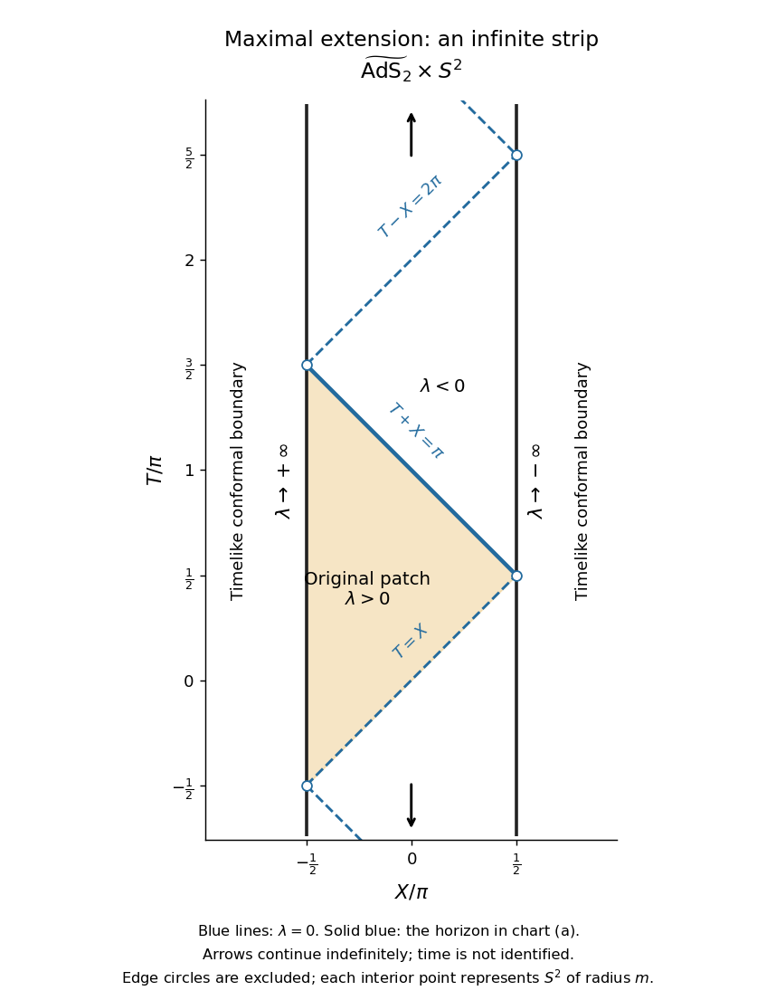

<h1 id="3/c/solution">Solution</h1>

↑ **Parent:** [C](../c.md)

First use the original [null coordinates](../../../../null-coordinate.md) $u=t+m/\lambda$, $v=t-m/\lambda$. They obey $u-v=2m/\lambda$, and the radial [metric tensor](../../../../metric-tensor.md) becomes

$$
g_{(2)}=-\frac{4m^2}{(u-v)^2}\,du\,dv.
$$

Apply the given substitutions $u=\tan(U/2)$ and $v=-\cot(V/2)$. The identities

$$
u-v=\frac{\cos((U-V)/2)}{\cos(U/2)\sin(V/2)},\qquad
du=\frac{dU}{2\cos^2(U/2)},\qquad
dv=\frac{dV}{2\sin^2(V/2)}
$$

give the [analytic extension of a spacetime](../../../../analytic-extension-of-a-spacetime.md)

$$
g=-\frac{m^2}{\cos^2((U-V)/2)}\,dU\,dV+m^2d\Omega_2^2.
$$

The poles of the individual tangent and cotangent substitutions are now ordinary coordinate lines wherever $\cos((U-V)/2)\ne0$. Set $T=(U+V)/2$ and $X=(U-V)/2$. Allowing these [coordinate functions](../../../../coordinate-function.md) to continue across every such line gives

$$
\boxed{\widetilde M=\mathbb R_T\times(-\pi/2,\pi/2)_X\times S^2,\qquad
\widetilde g=m^2\sec^2X(-dT^2+dX^2)+m^2d\Omega_2^2.}
$$

This is the [universal cover](../../../../universal-cover.md) of [two-dimensional anti-de Sitter spacetime](../../../../two-dimensional-anti-de-sitter-spacetime.md) of [radius](../../../../radius.md) $m$, times a [two-sphere](../../../../two-sphere.md) of [radius](../../../../radius.md) $m$: the simply connected [Bertotti-Robinson spacetime](../../../../bertotti-robinson-spacetime.md). In defining this [maximal analytic extension](../../../../maximal-analytic-extension.md), **$T$ ranges over the whole real line without periodic identification**. A periodic identification would instead create [closed timelike curves](../../../../closed-timelike-curve.md) and would be an additional global choice.

For clarity, the original patch is embedded by the branches $-\pi<U<\pi$ and $0<V<2\pi$. The inequality $u>v$ is equivalent on these branches to $|U-V|<\pi$, so the original patch occupies

$$
-\frac\pi2<X<\frac\pi2,\qquad X<T<\pi-X.
$$

The first [spacetime extension](../../../../spacetime-extension.md) in part (a) occupies the larger band $0<T-X<2\pi$, with $|X|<\pi/2$. Its finite-$v$ [Killing horizon](../../../../killing-horizon.md) is the interior line $T+X=\pi$. The edges $T-X=0,2\pi$ of that band are further regular [Poincaré horizons](../../../../poincare-horizon.md); continuing through them produces the full [conformal strip of two-dimensional anti-de Sitter spacetime](../../../../conformal-strip-of-two-dimensional-anti-de-sitter-spacetime.md).

The original coordinate $\lambda$ has a smooth continuation throughout the strip:

$$
\boxed{\lambda=\frac{2m\cos(U/2)\sin(V/2)}{\cos X}
=m\frac{\sin T-\sin X}{\cos X}.}
$$

Consequently the complete set of zero-level [Killing horizons](../../../../killing-horizon.md) is

$$
\boxed{T=X+2\pi j\quad\text{or}\quad T=\pi-X+2\pi j,\qquad j\in\mathbb Z.}
$$

These are two alternating families of parallel [null lines](../../../../null-line.md); different families meet only at the excluded [conformal boundaries](../../../../conformal-boundary.md), never inside the [spacetime](../../../../spacetime.md). The continuation of the original [Killing vector field](../../../../killing-vector-field-split.md) is

$$
K=(1-\sin T\sin X)\partial_T+\cos T\cos X\,\partial_X,
\qquad K^2=-\lambda^2.
$$

The field never vanishes in the interior, including on the [Killing horizons](../../../../killing-horizon.md).

To obtain the [Penrose diagram](../../../../penrose-diagram.md), suppress the [two-sphere](../../../../two-sphere.md) and multiply by the [conformal factor](../../../../conformal-factor.md) $\cos^2X/m^2$. The resulting radial [metric tensor](../../../../metric-tensor.md) is $-dT^2+dX^2$, so the diagram is an infinitely tall strip of width $\pi$, with [null lines](../../../../null-line.md) at 45 degrees and timelike edges $X=\pm\pi/2$. Generically,

$$
\boxed{X\to-\pi/2:\ \lambda\to+\infty,\qquad
X\to+\pi/2:\ \lambda\to-\infty.}
$$

At the special edge points where the two families of [Killing horizons](../../../../killing-horizon.md) end, the displayed formula is a $0/0$ limit and $\lambda$ has no unique limiting value. Thus the infinity labels on the diagram refer to the open edge segments, not those vertices. Each interior point of the diagram represents a [two-sphere](../../../../two-sphere.md) of fixed [radius](../../../../radius.md) $m$; neither edge is a centre where that [two-sphere](../../../../two-sphere.md) shrinks.

**[Figure 1](#3/c/image-penrose-diagram-of-the-maximal-bertotti-robinson-spacetime-extension-with-the-original-patch-and-all-zero-level-killing-horizons). Penrose diagram of the maximal Bertotti-Robinson spacetime extension, with the original patch and all zero-level Killing horizons**.

Finally, these timelike edges are [conformal boundaries](../../../../conformal-boundary.md), not omitted regular points of a further [spacetime extension](../../../../spacetime-extension.md). One way to establish maximality is [geodesic completeness](../../../../geodesic-completeness.md). The [two-dimensional anti-de Sitter spacetime](../../../../two-dimensional-anti-de-sitter-spacetime.md) factor embeds locally as $Z\cdot Z=-m^2$ in a flat space with [metric signature](../../../../metric-signature.md) $(-,-,+)$. Along an affinely parametrized [geodesic](../../../../geodesic.md) with constant $\epsilon=\dot Z\cdot\dot Z$, the ambient equation is

$$
\ddot Z=\frac{\epsilon}{m^2}Z.
$$

Its oscillatory, linear or hyperbolic solutions for negative, zero or positive $\epsilon$ exist for all real [affine parameters](../../../../affine-parameter.md) and lift to the [universal cover](../../../../universal-cover.md). The [two-sphere](../../../../two-sphere.md) is also [geodesically complete](../../../../geodesic-completeness.md), and [geodesics](../../../../geodesic.md) of the product split into [geodesics](../../../../geodesic.md) of its factors. Hence $\widetilde g$ is [geodesically complete](../../../../geodesic-completeness.md). A proper regular [spacetime extension](../../../../spacetime-extension.md) would furnish a [geodesic](../../../../geodesic.md) reaching its boundary in finite [affine parameter](../../../../affine-parameter.md), contradicting that completeness. This proves that the displayed simply connected analytic [spacetime](../../../../spacetime.md) is maximal.

## ↑ Ancestors (12)

1. [C](../c.md)
2. [3](../../3.md)
3. [2021](../../../2021-split.md)
4. [Past exam of the general relativity II course of the University of Oxford](../../../split.md)
5. [General relativity II course of the University of Oxford](../../../../general-relativity-ii-course-of-the-university-of-oxford.md)
6. [Year 4 of the mathematics course of the University of Oxford](../../../../year-4-of-the-mathematics-course-of-the-university-of-oxford.md)
7. [Mathematics course of the University of Oxford](../../../../mathematics-course-of-the-university-of-oxford.md)
8. [Undergraduate course of the University of Oxford](../../../../undergraduate-course-of-the-university-of-oxford.md)
9. [Course of the University of Oxford](../../../../course-of-the-university-of-oxford.md)
10. [University of Oxford](../../../../university-of-oxford-split.md)
11. [List of universities](../../../../list-of-universities.md)
12. [Codex Wiki](../../../../split.md)
