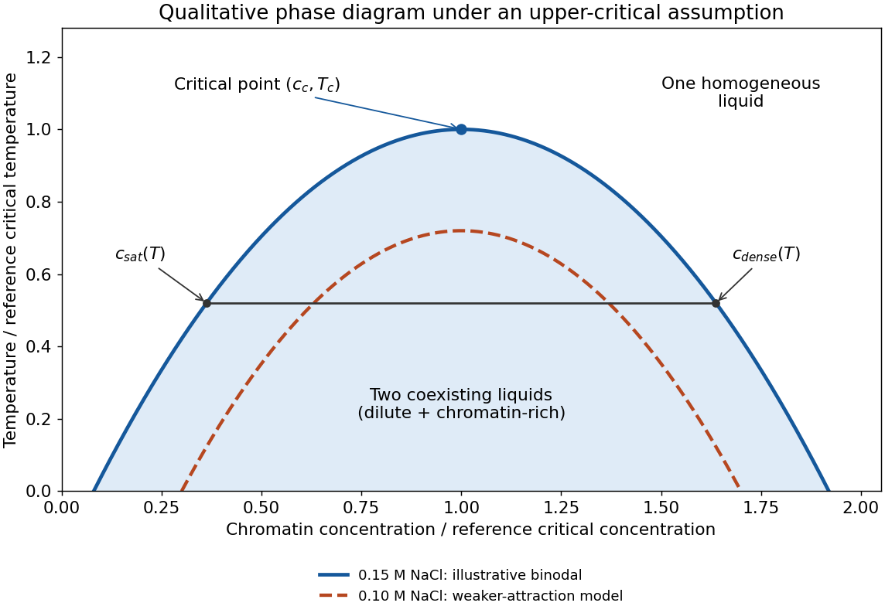

# Paper 1

↑ **Parent:** [2024](../2024.md)

[Original paper, released PDF pages 7–9](https://www.whatdotheyknow.com/request/natural_science_tripos_part_ii_p_2/response/3113356/attach/4/FOI%202025%20634%20Vongtanakiat%20materials.pdf?cookie_passthrough=1#page=7)

**Table of contents**

- [1](#1)
  - [Solution](#1/solution)
- [2](#2)
  - [Solution](#2/solution)
- [3](#3)
  - [Solution](#3/solution)
- [4](#4)
  - [Solution](#4/solution)
- [5](#5)
  - [Solution](#5/solution)
- [6](#6)
  - [Solution](#6/solution)
- [7](#7)
  - [a](#7/a)
    - [Solution](#7/a/solution)
  - [b](#7/b)
    - [Solution](#7/b/solution)
  - [c](#7/c)
    - [Solution](#7/c/solution)
  - [d](#7/d)
    - [Solution](#7/d/solution)
  - [e](#7/e)
    - [Solution](#7/e/solution)
  - [f](#7/f)
    - [Solution](#7/f/solution)
  - [g](#7/g)
    - [Solution](#7/g/solution)

## 1

↑ **Parent:** [Paper 1](paper-1.md)

<h3 id="1/solution">Solution</h3>

↑ **Parent:** [1](#1)

Bacterial DNA-recognition and DNA-modifying systems provide ways to mark, map and perturb [eukaryotic](../../organism.md#eukaryote) [chromosomes](../../genetics.md#chromosome). Their value comes from separating the targeting module from the reporter or effector, so a [chromosome](../../genetics.md#chromosome) becomes experimentally observable without assuming that its sequence alone specifies its behaviour.

For [fluorescent operator-repressor chromosome labelling](../../molecular-genetics.md#fluorescent-operator-repressor-chromosome-labelling), an integrated array of bacterial operator sequences is bound by a fluorescent repressor fusion. A [LacI](../../molecular-genetics.md#laci) fusion bound to a [lac operator](../../molecular-genetics.md#lac-operator) array makes a selected [genetic locus](../../genetics.md#genetic-locus) visible in a living nucleus. Two differently labelled loci can report separation of [sister chromatids](../../genetics.md#sister-chromatids), movement relative to the nuclear periphery, or distributions of distances between [chromosome](../../genetics.md#chromosome) regions. [Carmen C. Robinett](../../biology.md#carmen-c-robinett) and colleagues demonstrated operator-based imaging in mammalian cells and yeast. The tag reports the marked locus, not every part of the [chromosome](../../genetics.md#chromosome), and repeated operators or excessive bound repressor can perturb [DNA replication](../../molecular-genetics.md#dna-replication) and [chromatin](../../molecular-genetics.md#chromatin) structure.[Live GFP-repressor imaging and targeted yeast insertion](../../biology-bibliography.md#in-vivo-localization-of-dna-sequences-and-visualization-of-large-scale-chromatin-organization-using-lac-operator-repressor-recognition-by-carmen-c-robinett-and-others)

The bacterial [CRISPR-Cas9](../../molecular-genetics.md#crispr-cas9) recognition mechanism makes targeting programmable. A fluorescent [dCas9](../../molecular-genetics.md#dcas9) fusion and a [guide RNA](../../molecular-genetics.md#guide-rna) can visualize native repeated sequences; multiple guides can improve detection of a nonrepetitive locus. [Baohui Chen](../../biology.md#baohui-chen) and colleagues used this approach to follow human [genetic loci](../../genetics.md#genetic-locus). Catalytically inactive targeting avoids making the [DNA double-strand break](../../molecular-genetics.md#dna-double-strand-break) that would itself alter [chromosome](../../genetics.md#chromosome) behaviour. Appropriate controls include guide specificity, signal from an unlabelled locus, and whether tagging changes growth or the measured dynamics.[Live imaging of endogenous human loci](../../biology-bibliography.md#dynamic-imaging-of-genomic-loci-in-living-human-cells-by-an-optimized-crispr-cas-system-by-baohui-chen-and-others)

For [DamID](../../biology.md#damid), bacterial Dam methyltransferase is fused to a nuclear [protein](../../protein.md). Methylated GATC sites record neighbourhoods visited by the fusion. A fusion to a nuclear-envelope component can identify [lamina-associated domains](../../biological-cell.md#lamina-associated-domain), whereas one to a chromatin-binding [protein](../../protein.md) maps its genomic neighbourhoods. Comparing with untethered Dam helps control accessibility-dependent background. The accumulated methylation signal is a time-integrated proximity record: it need not establish direct binding to every recovered sequence, and resolution depends on GATC distribution and local spreading.[Principle of targeted methylation and chromatin-protein mapping](../../biology-bibliography.md#identification-of-in-vivo-dna-targets-of-chromatin-proteins-using-tethered-dam-methyltransferase-by-bas-van-steensel-and-steven-henikoff)

Bacterial enzymes also make structural measurements possible. In [Hi-C](../../molecular-genetics.md#hi-c), [restriction enzymes](../../enzyme.md#restriction-enzyme) generate [DNA](../../polymer.md#deoxyribonucleic-acid) fragments whose proximity-dependent ligation junctions can be sequenced. In [ATAC-seq](../../molecular-genetics.md#atac-seq), a modified bacterial [Tn5 transposase](../../biology.md#tn5-transposase) inserts sequencing adapters preferentially into accessible [DNA](../../polymer.md#deoxyribonucleic-acid). Neither assay directly photographs a fixed [chromosome](../../genetics.md#chromosome) structure: contact frequency and accessibility are different observables. Enzyme sequence preferences, fixation, and cell-to-cell heterogeneity must be controlled. Together, live labelling, proximity recording and sequencing-based assays connect [chromosome](../../genetics.md#chromosome) movement, nuclear neighbourhood and [chromatin accessibility](../../molecular-genetics.md#chromatin-accessibility), rather than substituting one measurement for all three.

## 2

↑ **Parent:** [Paper 1](paper-1.md)

<h3 id="2/solution">Solution</h3>

↑ **Parent:** [2](#2)

The first task is to map the [DNA](../../polymer.md#deoxyribonucleic-acid) associated with the centromeric [histone](../../protein.md#histone) variant [CENP-A](../../protein.md#cenp-a); the second is to determine how that occupancy is maintained. These require different evidence. A shared [DNA](../../polymer.md#deoxyribonucleic-acid) sequence is not sufficient evidence for an inherited centromeric state.

Use validated anti-[CENP-A](../../protein.md#cenp-a) [chromatin immunoprecipitation sequencing](../../biology.md#chromatin-immunoprecipitation-sequencing) with input [DNA](../../polymer.md#deoxyribonucleic-acid) and an appropriate negative immunoprecipitation control. Check antibody recognition separately in human, horse and chicken; an endogenous epitope-tagged allele can provide an orthogonal control if its chromosome-segregation function is retained. Native digestion can recover CENP-A-containing [nucleosomes](../../molecular-genetics.md#nucleosome), whereas crosslinking can retain indirect associations. [CUT&RUN](../../biology.md#cut-and-run) provides a complementary occupancy assay with different recovery biases. Establish centromeric function by colocalization with [kinetochore](../../genetics.md#kinetochore) [proteins](../../protein.md) and by normal [chromosome segregation](../../genetics.md#chromosome-segregation), not merely by calling a sequencing peak.

Mapping repetitive [DNA](../../polymer.md#deoxyribonucleic-acid) is the main analytical obstacle. Use centromere-resolved assemblies where possible, retain information from multimapping reads, and analyse satellite-family enrichment as well as uniquely mappable sequence. Absence of a peak in an incomplete reference is not evidence of absent [CENP-A](../../protein.md#cenp-a). Long-read sequence assemblies, informative [single-nucleotide polymorphisms](../../genetics.md#single-nucleotide-polymorphism), and [DNA fluorescence in situ hybridization](../../biology.md#dna-fluorescence-in-situ-hybridization) can connect a recovered sequence to a particular [chromosome](../../genetics.md#chromosome) and distinguish homologues.

For precise positioning, compare enriched domains with input-normalized background at several resolutions. Map nucleosome-protected fragments and use fibre immunofluorescence or sequence probes to check domain extent and heterogeneity. A broad population peak may represent alternative positions in different cells or homologues, rather than one broad [CENP-A](../../protein.md#cenp-a) domain on every [chromosome](../../genetics.md#chromosome).

The expected outcome is **a common centromeric function without a universal centromeric [DNA](../../polymer.md#deoxyribonucleic-acid) sequence**. Human [CENP-A](../../protein.md#cenp-a) commonly occupies selected portions of alpha-satellite arrays, but human [neocentromeres](../../genetics.md#neocentromere) show that such arrays are not obligatory. Horse [chromosome](../../genetics.md#chromosome) 11 provides a normal satellite-free [centromere](../../genetics.md#centromere). Chicken [chromosomes](../../genetics.md#chromosome) include both repeat-rich [centromeres](../../genetics.md#centromere) and comparatively short non-tandem-repetitive centromeric regions.[Comparative chicken centromere mapping](../../biology-bibliography.md#chickens-possess-centromeres-with-both-extended-tandem-repeats-and-short-non-tandem-repetitive-sequences-by-wei-hao-shang-and-others)[Satellite-free mammalian centromeres and inherited positional variation](../../biology-bibliography.md#birth-evolution-and-transmission-of-satellite-free-mammalian-centromeric-domains-by-solomon-g-nergadze-and-others)

To test mitotic stability, start from single-cell clones and remap [CENP-A](../../protein.md#cenp-a) on the same haplotype after successive divisions, while checking that the underlying [DNA](../../polymer.md#deoxyribonucleic-acid) has not changed. Pulse labelling of old versus newly incorporated [CENP-A](../../protein.md#cenp-a) can distinguish retention from replenishment. Follow both [chromosome](../../genetics.md#chromosome) identity and domain position: stable centromeric function does not require an invariant nucleotide boundary. To test meiotic transmission, use informative pedigrees or gamete-and-offspring material and allele-resolved mapping, with matched cell types where possible. An inherited positional state, or bounded movement of that state on unchanged [DNA](../../polymer.md#deoxyribonucleic-acid), supports [epigenetic centromere inheritance](../../genetics.md#epigenetic-centromere-inheritance). Artificial [centromere](../../genetics.md#centromere) deletion and neocentromere recovery provide an additional perturbation test, but establishment after deletion is different from ordinary meiotic inheritance.[Chicken neocentromere formation and CENP-A domain mapping](../../biology-bibliography.md#chromosome-engineering-allows-the-efficient-isolation-of-vertebrate-neocentromeres-by-wei-hao-shang-and-others)

## 3

↑ **Parent:** [Paper 1](paper-1.md)

<h3 id="3/solution">Solution</h3>

↑ **Parent:** [3](#3)

Essential [cell cycle](../../cell-cycle.md) genes cannot generally be discovered by selecting viable complete deletions alone. A [temperature-sensitive mutation](../../genetics.md#temperature-sensitive-mutation) solves this problem: its product supports growth under permissive conditions but fails under restrictive conditions. Screen conditional mutants for a reproducible division defect, then distinguish a specific cycle block from nonspecific loss of viability. A [cdc mutant](../../cell-cycle.md#cdc-mutant) is defined by its cycle [phenotype](../../genetics.md#phenotype), not simply by poor growth at high temperature.

In [Saccharomyces cerevisiae](../../organism.md#saccharomyces-cerevisiae), bud size and nuclear morphology provide convenient stage markers. After shifting an asynchronous culture, mutants defective at a particular step tend to accumulate with a characteristic morphology. [Leland H. Hartwell](../../biology.md#leland-h-hartwell) and colleagues used time-lapse observations to distinguish the time a function must act from the stage at which its absence becomes visible. Temperature-shift timing, DNA-content measurements and recovery after return to permissive conditions strengthen the interpretation. A delayed terminal [phenotype](../../genetics.md#phenotype) need not identify the moment of the original molecular defect.[Conditional mutants, execution points and termination phenotypes](../../biology-bibliography.md#genetic-control-of-the-cell-division-cycle-in-yeast-i-detection-of-mutants-by-leland-h-hartwell-and-others)

In [Schizosaccharomyces pombe](../../organism.md#schizosaccharomyces-pombe), elongated cells that continue growing without dividing are especially useful candidates; nuclear number, septum formation and [DNA](../../polymer.md#deoxyribonucleic-acid) content separate blocks in replication, mitosis and division. [Paul Nurse](../../biology.md#paul-nurse), [Pierre Thuriaux](../../biology.md#pierre-thuriaux) and [Kim Nasmyth](../../biology.md#kim-nasmyth) isolated conditional mutants defining multiple essential functions. [Complementation testing](../../genetics.md#complementation-testing) groups recessive [mutations](../../genetics.md#mutation) affecting the same function, and segregation analysis distinguishes linked from independent loci. Molecular identification, rescue and biochemical tests then establish what the affected products do.[Conditional mutants affecting DNA synthesis, nuclear division and septation](../../biology-bibliography.md#genetic-control-of-the-cell-division-cycle-in-the-fission-yeast-schizosaccharomyces-pombe-by-paul-nurse-and-others)

Three contrasting examples explain why similar-looking division blocks need not have the same cause. In fission yeast, [Cdc2](../../signal-transduction.md#cyclin-dependent-kinase-1), the [cyclin-dependent kinase 1](../../signal-transduction.md#cyclin-dependent-kinase-1) catalytic subunit, is required for key cycle transitions. A restrictive loss-of-function allele can leave cells growing without entering mitosis; some alleles also reveal the earlier requirement at Start. [Cdc25](../../signal-transduction.md#cdc25) is an activating [protein phosphatase](../../enzyme.md#protein-phosphatase) that removes inhibitory phosphorylation from [Cdc2](../../signal-transduction.md#cyclin-dependent-kinase-1). Loss of [Cdc25](../../signal-transduction.md#cdc25) therefore leaves the mitotic kinase inadequately activated and commonly produces an elongated G2-arrested [phenotype](../../genetics.md#phenotype). In budding yeast, [Cdc6](../../molecular-genetics.md#cdc6) participates in [DNA replication licensing](../../molecular-genetics.md#replication-licensing): failure to establish competent origins prevents successful genome duplication and hence normal division. Species and allele must be stated: identically numbered CDC names in different yeasts are not automatically homologous [proteins](../../protein.md).

The importance for [cancer](../../biology.md#cancer) is that an unbiased genetic screen exposed conserved mechanisms connecting growth, [DNA](../../polymer.md#deoxyribonucleic-acid) duplication and division. The [yeast cross-species complementation experiment](../../biology.md#yeast-cross-species-complementation-experiment) showed that central regulatory functions could be conserved across large evolutionary distances. Human cancers can alter cyclin-CDK regulation, DNA-replication control and checkpoint responses, providing a mechanistic connection to uncontrolled proliferation and [genomic instability](../../genetics.md#genomic-instability). This does not mean that every yeast cdc gene is a human oncogene, nor that any observed arrest is necessarily a checkpoint response: direct loss of an essential activity can itself stop progression.

## 4

↑ **Parent:** [Paper 1](paper-1.md)

<h3 id="4/solution">Solution</h3>

↑ **Parent:** [4](#4)

Both checkpoints couple cell-cycle timing to spatial organization, but they act at different transitions. The budding-yeast [spindle position checkpoint](../../cell-cycle.md#spindle-position-checkpoint) prevents premature mitotic exit when the anaphase spindle has not been appropriately placed across the mother-bud axis. The fly [centrosome orientation checkpoint](../../cell-cycle.md#centrosome-orientation-checkpoint) delays entry into mitosis until interphase [centrosomes](../../biological-cell.md#centrosome) have the orientation needed for a properly oriented division.

In [Saccharomyces cerevisiae](../../organism.md#saccharomyces-cerevisiae), one product of division must enter the bud. If both spindle poles and [chromosome](../../genetics.md#chromosome) masses remain in the mother, cytokinesis would generate the wrong nuclear distribution. The [mitotic exit network](../../cell-cycle.md#mitotic-exit-network) promotes sustained activation of [Cdc14](../../enzyme.md#cdc14) and the decline of mitotic CDK activity. Its upstream [GTPase](../../enzyme.md#gtpase) [Tem1](../../enzyme.md#tem1) is restrained by the [Bub2-Bfa1 complex](../../cell-cycle.md#bub2-bfa1-complex). When the spindle is mispositioned, [Kin4](../../enzyme.md#kin4) helps preserve that inhibition and opposes the checkpoint-inactivating action of [Cdc5](../../enzyme.md#cdc5) on Bfa1. Thus spindle mispositioning is connected to continued mitotic arrest rather than simply to an attempt to pull harder on [chromosomes](../../genetics.md#chromosome).[Kin4-dependent inhibition of mitotic exit](../../biology-bibliography.md#the-protein-kinase-kin4-inhibits-exit-from-mitosis-in-response-to-spindle-position-defects-by-katharine-e-d-aquino-and-others)

Spatial regulation makes this pathway sensitive to which compartment a spindle pole occupies. [Kin4](../../enzyme.md#kin4) activity is associated with the mother-cell side, whereas the bud environment favours release of the inhibitory state when a pole enters appropriately. [Elm1](../../enzyme.md#elm1) contributes to activation of [Kin4](../../enzyme.md#kin4). This is a regulated network involving localization and phosphorylation, rather than an infallible single switch at the bud neck. It is also distinct from the [spindle checkpoint](../../cell-cycle.md#spindle-checkpoint), which monitors [kinetochore](../../genetics.md#kinetochore) attachment and restrains anaphase; a spindle can have attached [chromosomes](../../genetics.md#chromosome) yet be in the wrong position.[Kin4 activation and regulation of Bub2-Bfa1](../../biology-bibliography.md#elm1-kinase-activates-the-spindle-position-checkpoint-kinase-kin4-by-ayse-koca-caydasi-and-others)

In male [Drosophila melanogaster](../../organism.md#drosophila-melanogaster) [germline stem cells](../../biological-cell.md#germline-stem-cell), contact with the hub defines the [stem-cell niche](../../biological-cell.md#stem-cell-niche). Normally one [centrosome](../../biological-cell.md#centrosome) is retained toward the hub and the other moves away, preparing a division in which one daughter retains niche contact. Live imaging showed that misoriented [centrosomes](../../biological-cell.md#centrosome) can delay division until orientation is restored, including in aged or dedifferentiated cells. Counting misoriented interphase [centrosomes](../../biological-cell.md#centrosome) alone therefore overestimates the frequency of misoriented mitoses.[Interphase misorientation, delayed cycling and reorientation before mitosis](../../biology-bibliography.md#centrosome-misorientation-reduces-stem-cell-division-during-aging-by-jun-cheng-and-others)

The fly checkpoint involves [Centrosomin](../../protein.md#centrosomin), [Par-1](../../enzyme.md#par-1), and regulation of [cyclin A](../../protein.md#cyclin-a) localization. [Par-1](../../enzyme.md#par-1) and the germline [spectrosome](../../biological-cell.md#spectrosome) help restrain the mitotic programme; perturbing this organization can uncouple orientation from mitotic entry. [Bazooka](../../protein.md#bazooka) provides a cortical platform associated with [centrosome](../../biological-cell.md#centrosome) anchoring. These observations support spatial control of mitotic competence, not identity of the molecular pathway with yeast [Tem1](../../enzyme.md#tem1) signalling.[Par-1, spectrosome-associated cyclin A and checkpoint defects](../../biology-bibliography.md#regulation-of-cyclin-a-localization-downstream-of-par-1-function-is-critical-for-the-centrosome-orientation-checkpoint-in-drosophila-male-germline-stem-cells-by-hebao-yuan-and-others)[Baz-centrosome association and Par-1-dependent regulation](../../biology-bibliography.md#the-polarity-protein-baz-forms-a-platform-for-the-centrosome-orientation-during-asymmetric-stem-cell-division-in-the-drosophila-male-germline-by-mayu-inaba-and-others)

A decisive experimental comparison measures both position and transition timing in live cells. A pure orientation defect raises misorientation and prolongs the relevant pause; loss of the checkpoint permits the transition despite misorientation. Rescue with an appropriate wild-type component helps establish specificity. In yeast, score mitotic exit and nuclear inheritance; in fly [stem cells](../../biological-cell.md#stem-cell), score entry into mitosis and daughter contact with the niche. This separates the mechanism that constructs the correct geometry from the mechanism that waits for it.

## 5

↑ **Parent:** [Paper 1](paper-1.md)

<h3 id="5/solution">Solution</h3>

↑ **Parent:** [5](#5)

[Genomic instability](../../genetics.md#genomic-instability) means an elevated propensity to acquire genetic alterations. It includes changes in nucleotide sequence, repeat length, [chromosome](../../genetics.md#chromosome) structure and [chromosome](../../genetics.md#chromosome) number. A genome carrying one fixed alteration is not, by that fact alone, genomically unstable: instability concerns the process that generates further alterations.

At the sequence level, [DNA replication](../../molecular-genetics.md#dna-replication) introduces mismatches and small insertion-deletion errors. Polymerase proofreading and [DNA mismatch repair](../../molecular-genetics.md#dna-mismatch-repair) normally suppress their fixation. Failure of mismatch repair is particularly evident as [microsatellite instability](../../genetics.md#microsatellite-instability). Damaged bases, stalled replication forks and collisions with [transcription](../../molecular-genetics.md#transcription-biology) can increase [replication stress](../../molecular-genetics.md#replication-stress); unrepaired or improperly repaired lesions can produce substitutions and rearrangements. [Homologous recombination](../../genetics.md#homologous-recombination) and [non-homologous end joining](../../molecular-genetics.md#non-homologous-end-joining) solve different repair problems, and inappropriate use or incomplete repair can alter genome structure.

At the [chromosome](../../genetics.md#chromosome) level, failed chromosome-end protection can allow end fusion. Subsequent separation of fused [chromosomes](../../genetics.md#chromosome) can initiate [breakage-fusion-bridge cycles](../../genetics.md#breakage-fusion-bridge-cycle), producing repeated rearrangement and copy-number change. Faulty [kinetochore](../../genetics.md#kinetochore) attachment, weakened [sister chromatid cohesion](../../genetics.md#sister-chromatid-cohesion) or abnormal spindle organization can cause [chromosome](../../genetics.md#chromosome) missegregation and [aneuploidy](../../genetics.md#aneuploidy). The resulting imbalances may themselves disturb cell physiology and [DNA replication](../../molecular-genetics.md#dna-replication). [DNA](../../polymer.md#deoxyribonucleic-acid) confined in an aberrant micronucleus can experience defective replication and fragmentation; repair of clustered fragments is one route to [chromothripsis](../../genetics.md#chromothripsis), rather than every rearrangement arising through that mechanism.[Live-cell tracking linked to sequencing of descendants](../../biology-bibliography.md#chromothripsis-from-dna-damage-in-micronuclei-by-cheng-zhong-zhang-and-others)

The experimental signatures distinguish mechanisms. [Mutation](../../genetics.md#mutation) spectra and mismatch-repair status address sequence errors; repeat-length distributions address [microsatellite instability](../../genetics.md#microsatellite-instability); [karyotyping](../../genetics.md#karyotyping), copy-number profiles and live [chromosome](../../genetics.md#chromosome) imaging address numerical or structural [chromosome](../../genetics.md#chromosome) instability. Single-cell or lineage-resolved measurements can show ongoing production of new states. A mixed endpoint population alone cannot establish whether variation arose rapidly during the experiment or was selected from pre-existing diversity.

In [cancer](../../biology.md#cancer), instability can generate selectable combinations that promote growth, escape from controls or resistance to treatment. It is neither automatically beneficial to the tumour nor sufficient for malignant transformation: excessive instability can impair proliferation or trigger [apoptosis](../../biological-cell.md#apoptosis) and [cellular senescence](../../cell-cycle.md#cellular-senescence). Examples of mechanistic connections include mismatch-repair deficiency in [Lynch syndrome](../../genetics.md#lynch-syndrome), homologous-recombination defects involving [BRCA1](../../molecular-genetics.md#brca1) or [BRCA2](../../molecular-genetics.md#brca2), and inherited replication or repair disorders. [Chromosome](../../genetics.md#chromosome) missegregation can also contribute to developmental disease, pregnancy loss and infertility; instability in long-lived somatic tissues can impair function without producing a tumour.

A useful causal analysis asks what fails first, what alterations it produces, and which cellular responses restrain or select the affected cells. Restoring a repair factor or correcting a segregation defect should reduce the appropriate new-error rate, not merely change which clone grows best. The same reasoning explains why a genomic-instability [phenotype](../../genetics.md#phenotype) can be informative in disease while remaining insufficient to diagnose a particular condition from morphology alone.

## 6

↑ **Parent:** [Paper 1](paper-1.md)

<h3 id="6/solution">Solution</h3>

↑ **Parent:** [6](#6)

**Susceptibility of an isolated bacterium and failure to clear an infection measure different things.** The scenario does not establish a particular resistance gene or a real species-specific mechanism. First distinguish [antibiotic resistance](../../biology.md#antibiotic-resistance), an increased ability to grow at inhibitory drug [concentrations](../../mathematical-physics.md#concentration), from [antibiotic tolerance](../../biology.md#antibiotic-tolerance), slower killing without the corresponding increase in the growth-inhibiting [concentration](../../mathematical-physics.md#concentration), and [bacterial persistence](../../biology.md#bacterial-persistence), survival of a subpopulation in an otherwise susceptible population.

One explanation is a reversible physiological state. Slowly growing or metabolically altered [bacteria](../../organism.md#bacteria) can survive an [antibiotic](../../biology.md#antibiotic) whose lethal action depends on the active process it targets. Regrown survivors can then recover the original susceptibility. [Nathalie Q. Balaban](../../biology.md#nathalie-q-balaban) and colleagues directly followed individual [bacteria](../../organism.md#bacteria) and showed switching between growth states associated with persistence. The important inference is phenotypic heterogeneity, not that all survivors must share one dormant state or one toxin-antitoxin pathway.[Single-cell observations and susceptibility after regrowth](../../biology-bibliography.md#bacterial-persistence-as-a-phenotypic-switch-by-nathalie-q-balaban-and-others)

A second explanation is the local infection environment. [Biofilms](../../organism.md#biofilm) can generate heterogeneous growth conditions, altered penetration and protected reservoirs; intracellular localization can separate [bacteria](../../organism.md#bacteria) from otherwise adequate extracellular drug exposure. Nutrient limitation, oxygen conditions, pH and host stress can change physiology or drug activity. Conversely, a laboratory sample may miss a resistant minority, mixed infection or an inducible [phenotype](../../genetics.md#phenotype), so apparent susceptibility should not be treated as proof that every bacterium at every site has the same response.

Triggers can include changes imposed by the host environment, entry into a slow-growth state, or stress associated with prior exposure. These are alternative hypotheses: the question supplies no data selecting one. [Bacteria](../../organism.md#bacteria) surviving because exposure never reached an effective level are also different from [bacteria](../../organism.md#bacteria) surviving an adequately delivered exposure. Persistence may pre-exist exposure rather than being induced by it.

At the level of investigation, compare inhibition of growth with survival over time, examine whether the [phenotype](../../genetics.md#phenotype) persists after regrowth, and assess population heterogeneity and protected infection sites. A high-level response to treatment failure is to identify the reservoir and exposure problem, establish which organism and [phenotype](../../genetics.md#phenotype) are actually present, and consider approaches addressing that mechanism rather than assuming that simply increasing the same drug will solve it. Removal of a colonized foreign-body reservoir, where relevant, addresses a different cause from a change in antimicrobial choice. The information supplied is insufficient to name an effective drug regimen or infer a single molecular trigger.

## 7

↑ **Parent:** [Paper 1](paper-1.md)

<h3 id="7/a">a</h3>

↑ **Parent:** [7](#7)

<h4 id="7/a/solution">Solution</h4>

↑ **Parent:** [A](#7/a)

A useful schematic is the [upper critical solution temperature](../../thermodynamic-potential.md#upper-critical-solution-temperature) form of a [binodal](../../critical-phenomenon.md#binodal): a dome in temperature versus [chromatin](../../molecular-genetics.md#chromatin) [concentration](../../mathematical-physics.md#concentration). Below the dome, an intermediate overall [concentration](../../mathematical-physics.md#concentration) separates into a dilute phase and a chromatin-rich phase; above it the liquid is homogeneous. At a fixed temperature, the two intersections of a horizontal tie line give the compositions of the coexisting phases, not the [concentrations](../../mathematical-physics.md#concentration) of two different initial samples.

**[Figure 1](#7/a/image-schematic-upper-critical-solution-temperature-model-for-chromatin-demixing-and-weaker-attraction-at-lower-salt). Schematic upper-critical-solution-temperature model for chromatin demixing and weaker attraction at lower salt**.

The diagram is a **model, not measured phase-boundary data**. The stated observation at one salt [concentration](../../mathematical-physics.md#concentration) does not by itself establish whether heating suppresses or promotes demixing. A [lower critical solution temperature](../../thermodynamic-potential.md#lower-critical-solution-temperature) system would instead demix on heating, and would need the corresponding inverted geometry. The following answers make the usual enthalpically favourable-demixing assumption explicit.

<h3 id="7/b">b</h3>

↑ **Parent:** [7](#7)

<h4 id="7/b/solution">Solution</h4>

↑ **Parent:** [B](#7/b)

The [saturation concentration](../../critical-phenomenon.md#saturation-concentration) $c_{\rm sat}(T)$ is the dilute-phase coexistence [concentration](../../mathematical-physics.md#concentration) at the specified temperature and solution conditions. On increasing the overall [concentration](../../mathematical-physics.md#concentration) through this boundary, a macroscopic condensed phase can first coexist with the dilute phase. The other branch gives the dense-phase [concentration](../../mathematical-physics.md#concentration) $c_{\rm dense}(T)$.

At the [thermodynamic critical point](../../critical-phenomenon.md#thermodynamic-critical-point), the two branches meet: their [concentration](../../mathematical-physics.md#concentration) difference vanishes. Its coordinates define the [critical concentration](../../critical-phenomenon.md#critical-concentration) $c_c$ and critical temperature $T_c$. In the upper-critical model, $T>T_c$ admits no two-liquid coexistence. Thus **$c_{\rm sat}$ is a temperature-dependent branch, whereas $c_c$ is the [concentration](../../mathematical-physics.md#concentration) at the endpoint**.

Between coexistence [concentrations](../../mathematical-physics.md#concentration), the [lever rule](../../thermodynamic-potential.md#lever-rule) gives the dense-phase [volume fraction](../../continuum-mechanics.md#volume-fraction) $v=(\bar c-c_{\rm sat})/(c_{\rm dense}-c_{\rm sat})$, assuming consistent [concentration](../../mathematical-physics.md#concentration) and volume definitions. Increasing total [chromatin](../../molecular-genetics.md#chromatin) then primarily changes phase amounts rather than allowing the dilute phase to increase without bound.

<h3 id="7/c">c</h3>

↑ **Parent:** [7](#7)

<h4 id="7/c/solution">Solution</h4>

↑ **Parent:** [C](#7/c)

At fixed volume and temperature, equilibrium minimizes the [Helmholtz free energy](../../thermodynamic-potential.md#helmholtz-free-energy) $F=U-TS$. Mixing increases translational [entropy](../../entropy.md), whereas favourable contacts between [chromatin](../../molecular-genetics.md#chromatin) segments can lower the interaction contribution to [internal energy](../../internal-energy.md). At low enough temperature, favourable contacts can compensate the [entropy](../../entropy.md) lost on concentrating the arrays; at higher temperature, the mixing contribution can dominate. This gives the upper-critical dome assumed in (a).

A simple illustrative [Flory–Huggins solution theory](../../mixture.md#flory-huggins-solution-theory) writes the dimensionless mixing free energy per site as

$$
g(\phi)=\frac{\phi}{N}\ln\phi+(1-\phi)\ln(1-\phi)+\chi(T)\phi(1-\phi),\qquad \chi(T)=A/T.
$$

Here $N$ is an effective polymer size, not automatically the number 12, and $A>0$ represents an effective energetic incompatibility of polymer and solvent. The [common-tangent construction](../../critical-phenomenon.md#common-tangent-construction) determines coexisting compositions. Solving $g''=g^{(3)}=0$ gives

$$
\boxed{\phi_c=\frac{1}{1+\sqrt N},\qquad \chi_c=\frac12(1+N^{-1/2})^2.}
$$

Since $\chi$ decreases on heating, the coexistence interval narrows and closes at $T_c=A/\chi_c$. For fixed pressure the corresponding potential is [Gibbs free energy](../../thermodynamic-potential.md#gibbs-free-energy), with the enthalpic term in $G=H-TS$; enthalpy and [internal energy](../../internal-energy.md) should not be interchanged without stating the mechanical constraint. Hydration, ion release or temperature-dependent effective interactions can change this simple temperature trend.

<h3 id="7/d">d</h3>

↑ **Parent:** [7](#7)

<h4 id="7/d/solution">Solution</h4>

↑ **Parent:** [D](#7/d)

In the regime where salt promotes [chromatin](../../molecular-genetics.md#chromatin) condensation by screening repulsion between DNA-rich surfaces, reducing salt from 0.15 M to 0.1 M weakens the effective attraction. In the schematic upper-critical model this means a lower critical temperature and a smaller coexistence region; at a fixed suitable temperature the dilute-phase [saturation concentration](../../critical-phenomenon.md#saturation-concentration) rises. The second curve is therefore drawn inside and below the first. The magnitude of the shift is not specified by the question.

This direction has a microscopic basis: reducing ionic strength increases the range of electrostatic repulsion between negatively charged [DNA](../../polymer.md#deoxyribonucleic-acid) segments. Modelling of interacting arrays supports a role for screening and [nucleosome](../../molecular-genetics.md#nucleosome) contacts in stabilizing chromatin-rich phases.[Salt-dependent coexistence and the role of nucleosome breathing](../../biology-bibliography.md#nucleosome-plasticity-is-a-critical-element-of-chromatin-liquid-liquid-phase-separation-and-multivalent-nucleosome-interactions-by-stephen-e-farr-and-others)

In the idealized limit of unscreened DNA-DNA repulsion, the ordinary condensed phase can disappear, rather than simply acquiring an arbitrarily small positive critical temperature. However, **zero added NaCl is not literally zero counterions**: charged [chromatin](../../molecular-genetics.md#chromatin) requires charge compensation, and buffer ions and counterions associated with the preparation remain. Salt also screens attractive interactions, and very high salt can alter [nucleosome](../../molecular-genetics.md#nucleosome) stability. The proposed shift applies to the stated low-salt screening regime, not a universal monotonic law at every salt [concentration](../../mathematical-physics.md#concentration).

<h3 id="7/e">e</h3>

↑ **Parent:** [7](#7)

<h4 id="7/e/solution">Solution</h4>

↑ **Parent:** [E](#7/e)

[Chromatin](../../molecular-genetics.md#chromatin) is a composite of charged [DNA](../../polymer.md#deoxyribonucleic-acid), folded [histone](../../protein.md#histone) cores, flexible [histone](../../protein.md#histone) tails and associated [proteins](../../protein.md). These parts differ in charge, hydrophobicity, flexibility, interaction partners and chemical modifications. It is therefore not a chemically uniform chain with one identical contact energy at every position.

Diversity also occurs along a [chromosome](../../genetics.md#chromosome): [nucleosome](../../molecular-genetics.md#nucleosome) occupancy, [linker DNA](../../molecular-genetics.md#linker-dna) length, [histone variants](../../protein.md#histone-variant), [histone acetylation](../../molecular-genetics.md#histone-acetylation) and other [histone modifications](../../protein.md#histone-modification) change the local interaction pattern. Positively charged tails can contact [DNA](../../polymer.md#deoxyribonucleic-acid) or neighbouring [nucleosome](../../molecular-genetics.md#nucleosome) surfaces; an acetylated lysine has different electrostatic properties and can recruit a modification-reading [protein](../../protein.md). The number, arrangement and lifetime of contacts matter as well as their average strength. A coarse-grained interaction parameter can summarize one preparation but should not be mistaken for a universal chemical constant of all [chromatin](../../molecular-genetics.md#chromatin).

<h3 id="7/f">f</h3>

↑ **Parent:** [7](#7)

<h4 id="7/f/solution">Solution</h4>

↑ **Parent:** [F](#7/f)

The structural implication is a spectrum of arrangements, not a universal regular fibre. Local [nucleosome](../../molecular-genetics.md#nucleosome) packing, irregular accessible chains, compact domains and interactions between differently modified regions can coexist, and their balance depends on preparation and cellular context. [Nucleosome breathing](../../molecular-genetics.md#nucleosome-breathing) changes the sites available for intermolecular contacts and hence the connectivity of an array assembly; it is not merely a uniform change in the size of a rigid bead.[Comparison of breathing and artificially constrained nucleosomes](../../biology-bibliography.md#nucleosome-plasticity-is-a-critical-element-of-chromatin-liquid-liquid-phase-separation-and-multivalent-nucleosome-interactions-by-stephen-e-farr-and-others)

Reconstituted-array experiments separate contributions that are difficult to disentangle in nuclei. Fluorescent arrays, microscopy, droplet fusion and molecular exchange measurements test condensation and dynamics; changing tails, linker organization or acetylation tests the interaction mechanism. [Bryan A. Gibson](../../biology.md#bryan-a-gibson) and colleagues found that [histone H1](../../signal-transduction.md#histone-h1) and [nucleosome](../../molecular-genetics.md#nucleosome) spacing modulate condensation, while acetylation and reader [proteins](../../protein.md) can produce different condensed states.[Reconstituted arrays and regulation of condensate properties](../../biology-bibliography.md#organization-of-chromatin-by-intrinsic-and-regulated-phase-separation-by-bryan-a-gibson-and-others)

In cells, combine imaging with contact maps and accessibility assays. [Hi-C](../../molecular-genetics.md#hi-c) can reveal preferential contacts and [chromatin compartments](../../molecular-genetics.md#chromatin-compartment), but does not establish liquid behaviour. [Fluorescence recovery after photobleaching](../../fluorescence.md#fluorescence-recovery-after-photobleaching) measures recovery kinetics, but recovery alone does not prove equilibrium liquid-liquid demixing. Conversely, an in-vitro droplet is not proof that every nuclear domain forms by the same mechanism. The strongest case combines material behaviour with controlled molecular perturbations and measurements of the resulting organization.

<h3 id="7/g">g</h3>

↑ **Parent:** [7](#7)

<h4 id="7/g/solution">Solution</h4>

↑ **Parent:** [G](#7/g)

Physicochemical diversity provides ways to regulate the same [DNA](../../polymer.md#deoxyribonucleic-acid) without changing its sequence. [Histone modifications](../../protein.md#histone-modification), variants and recruited [proteins](../../protein.md) can alter local contacts, accessibility and the partitioning of regulatory factors. This can couple [chromatin organization](../../molecular-genetics.md#chromatin-organization) to [transcription](../../molecular-genetics.md#transcription-biology), [DNA replication](../../molecular-genetics.md#dna-replication) and [DNA repair](../../molecular-genetics.md#dna-repair), while allowing distinct genomic regions to behave differently in one nucleus.

For example, changing [histone acetylation](../../molecular-genetics.md#histone-acetylation) can weaken some intrinsic contacts while favouring binding of specific acetylation readers. A local state can therefore change both how strongly a region associates with itself and which partners it recruits. Reversible, multivalent interactions allow organization to respond to signals without requiring an irreversible solid assembly.

These mechanisms also allow memory: feedback between a chromatin-associated mark, its reader and modifying machinery can help restore a local state after replication. Such [epigenetic inheritance](../../genetics.md#epigenetic-inheritance) still needs evidence for maintenance and re-establishment; a stable-looking condensed region alone does not establish it. Likewise, correlations between compaction and reduced [transcription](../../molecular-genetics.md#transcription-biology) do not prove that condensation is always the cause of repression. Perturbations must separate altered material properties from direct effects on transcriptional machinery.

## ↑ Ancestors (10)

1. [2024](../2024.md)
2. [Past exam of the genetics course of the University of Cambridge](../../past-exam-of-the-genetics-course-of-the-university-of-cambridge.md)
3. [Genetics course of the University of Cambridge](../../university-of-cambridge.md#genetics-course-of-the-university-of-cambridge)
4. [Year 3 of the natural sciences course of the University of Cambridge](../../university-of-cambridge.md#year-3-of-the-natural-sciences-course-of-the-university-of-cambridge)
5. [Year of the natural sciences course of the University of Cambridge](../../university-of-cambridge.md#year-of-the-natural-sciences-course-of-the-university-of-cambridge)
6. [Natural sciences course of the University of Cambridge](../../university-of-cambridge.md#natural-sciences-course-of-the-university-of-cambridge)
7. [Course of the University of Cambridge](../../university-of-cambridge.md#course-of-the-university-of-cambridge)
8. [University of Cambridge](../../university-of-cambridge.md)
9. [List of universities](../../README.md#list-of-universities)
10. [Codex Wiki](../../README.md)
