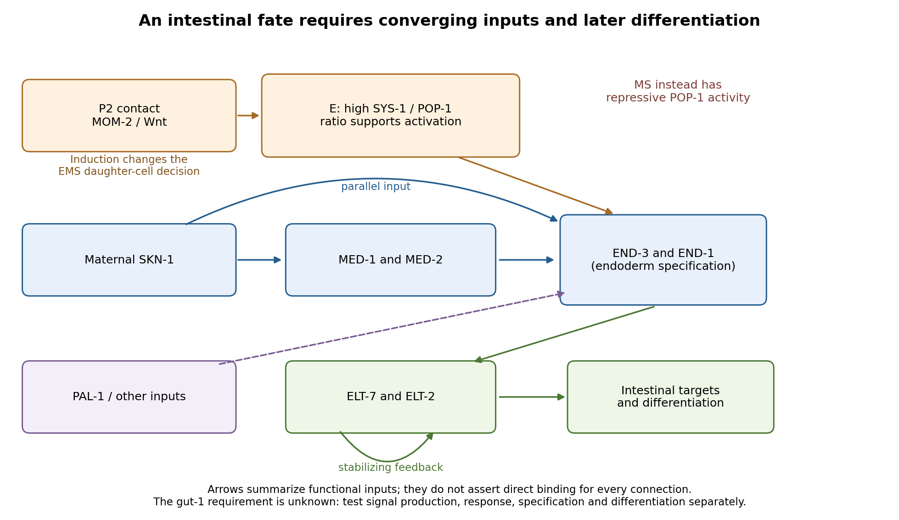

<h1 id="1/solution">Solution</h1>

↑ **Parent:** [1](../1.md)

**The intestine comes from the [E blastomere](../../../../e-blastomere.md), but its identity is established by a network combining inherited regulators with induction from a neighbour.** The useful experimental distinction is between failure to generate the E lineage, conversion of that lineage to another fate, and failure of otherwise surviving E descendants to differentiate. The hypothetical _gut-1_ [mutation](../../../../mutation.md) cannot be placed in that network from the gutless endpoint alone.

At the four-[cell](../../../../biological-cell-split.md) stage, maternal [SKN-1](../../../../skn-1.md) gives the [EMS blastomere](../../../../ems-blastomere.md) endomesodermal competence. EMS divides into anterior MS and posterior E. MS normally produces predominantly mesodermal derivatives, including [muscle](../../../../muscle.md) and part of the pharynx; E generates the intestinal lineage, normally twenty [cells](../../../../biological-cell-split.md) by the end of embryogenesis. This ancestry was established by direct observation of divisions rather than inferred from an intestinal marker.[1983, pp. 64–119, embryonic lineage and E descendants](../../../../the-embryonic-cell-lineage-of-the-nematode-caenorhabditis-elegans-by-john-e-sulston-and-others.md) The distinction matters because a missing differentiation marker need not mean that the corresponding ancestors never existed.

The adjacent [P2 blastomere](../../../../p2-blastomere.md) supplies an inductive input to EMS, including [MOM-2](../../../../mom-2.md)-dependent [Wnt signalling](../../../../wnt-signalling.md). This polarizes the subsequent decision through the [Wnt-beta-catenin asymmetry pathway](../../../../wnt-beta-catenin-asymmetry-pathway.md). In MS, relatively high nuclear [POP-1](../../../../pop-1.md) supports repression of endodermal targets. In E, reduced nuclear [POP-1](../../../../pop-1.md) together with increased availability of its coactivator [SYS-1](../../../../sys-1.md) gives a higher [SYS-1](../../../../sys-1.md)-to-[POP-1](../../../../pop-1.md) ratio and permits activation. Thus E specification does not require complete elimination of [POP-1](../../../../pop-1.md): some [POP-1](../../../../pop-1.md) is needed for the activating complex. Functional rescue, physical association and transcriptional assays established the coactivator role of [SYS-1](../../../../sys-1.md).[2005, pp. 761–772, SYS-1 rescue, POP-1 binding and coactivation](../../../../a-beta-catenin-identified-by-functional-rather-than-sequence-criteria-and-its-role-in-wnt-mapk-signaling-by-ambrose-r-kidd-iii-and-others.md)

[SKN-1](../../../../skn-1.md) activates the divergent [GATA transcription factors](../../../../gata-transcription-factor.md) [MED-1](../../../../med-1.md) and [MED-2](../../../../med-2.md), and supplies additional input toward the transient [endoderm](../../../../endoderm.md) regulators [END-3](../../../../end-3.md) and [END-1](../../../../end-1.md). MED factors, the Wnt-dependent [POP-1](../../../../pop-1.md)/[SYS-1](../../../../sys-1.md) input and other regulators, including [PAL-1](../../../../pal-1.md), converge rather than forming one obligatory unbranched chain. [END-3](../../../../end-3.md) helps activate [END-1](../../../../end-1.md), and the two have overlapping specification functions. Their output includes [ELT-7](../../../../elt-7.md) and [ELT-2](../../../../elt-2.md), which stabilize and execute an intestinal differentiation programme through feedback and activation of differentiated targets. Perturbing MED-binding sites in the end [genes](../../../../gene.md) produces graded, variable gut defects, demonstrating why a binary gut/no-gut score can conceal network robustness.[2015, pp. 66–79, end-gene binding-site perturbations and quantitative intestinal phenotypes](../../../../med-gata-factors-promote-robust-development-of-the-c-elegans-endoderm-by-morris-f-maduro-and-others.md) Combined ELT-factor defects further show that specification and differentiated [morphology](../../../../morphology-biology.md) must be assessed separately.[2010, pp. 154–166, ELT-2/ELT-7 interaction and differentiation assays](../../../../endoderm-development-in-caenorhabditis-elegans-the-synergistic-action-of-elt-2-and-7-mediates-the-specification%E2%86%92differentiation-transition-by-erica-m-sommermann-and-others.md)

**[Figure 1](#1/image-parallel-inputs-and-successive-regulators-in-intestinal-specification-with-experimental-entry-points). Parallel inputs and successive regulators in intestinal specification, with experimental entry points**.

**First establish what the [mutant](../../../../mutant.md) actually loses.** I would backcross the temperature-sensitive [allele](../../../../allele.md), measure [penetrance](../../../../penetrance.md) at permissive and restrictive temperatures, and compare [mutant](../../../../mutant.md) [embryos](../../../../embryo.md) with wild-type siblings exposed to the same temperatures. Differential-interference-contrast imaging combined with a nuclear lineage label would follow EMS, its division orientation, E-[cell](../../../../biological-cell-split.md) birth, subsequent divisions, internalization and survival. I would score [cell death](../../../../cell-death.md) and [cell](../../../../biological-cell-split.md)-cycle delay, not simply missing [gut granules](../../../../gut-granule.md). Independent readouts would include endogenous transcripts encoding [END-1](../../../../end-1.md) and [END-3](../../../../end-3.md), [ELT-2](../../../../elt-2.md)/[ELT-7](../../../../elt-7.md) expression, an intestinal structural marker and later intestinal [morphology](../../../../morphology-biology.md) or [lumen formation](../../../../lumen-formation.md). Endogenous transcript detection controls for a transgene being selectively silenced or delayed. Stage matching by division history prevents temperature-dependent developmental rate from masquerading as altered expression timing. Loss of E-specific expression with ectopic MS-like descendants would support a fate transformation; normal early E identity with later degeneration or failed [lumen formation](../../../../lumen-formation.md) would support a maintenance or differentiation defect.

**Reciprocal [temperature-shift experiments](../../../../temperature-shift-experiment.md) locate a functional interval.** [embryos](../../../../embryo.md) maintained permissively would be shifted up at successive lineage-defined stages; a second series would start restrictively and be shifted down. Short restrictive pulses would refine any interval around the EMS division, early E divisions or later differentiation. An early upshift that causes gutlessness, a later upshift that does not, and rescue by a sufficiently early downshift would identify a temperature-sensitive period. If late shifts still damage an already marked intestine, an additional maintenance role is likely. I would measure recovery of a functional tagged GUT-1 [protein](../../../../protein-split.md), if available, because inactivation, refolding and [protein perdurance](../../../../protein-perdurance.md) broaden the observed interval. These experiments estimate when function is required, not necessarily when the [gene](../../../../gene.md) is first transcribed. Wild-type pulse controls, matched handling and multiple clutches distinguish conditional loss of function from heat damage. Reciprocal crosses and separate shifts of mothers during [oogenesis](../../../../oogenesis.md) versus [embryos](../../../../embryo.md) would test maternal contribution and distinguish maternal-effect from zygotic requirements.

**The site of expression and the site of requirement need separate tests.** A rescuing endogenous knock-in could reveal whether GUT-1 is present in P2, EMS/E or surrounding tissue, but expression is not proof of [cell](../../../../biological-cell-split.md) autonomy. I would test rescue restricted to the signalling lineage versus EMS/E using [promoters](../../../../promoter-genetics.md) active before the inferred requirement; each construct must demonstrably produce functional [protein](../../../../protein-split.md) at the relevant time. Late intestinal [promoters](../../../../promoter-genetics.md) cannot exclude an early E-lineage requirement if they fail to rescue. Marked [genetic mosaics](../../../../genetic-mosaic.md) provide an independent test, provided loss of the rescuing element occurs before the sensitive interval and residual maternal [protein](../../../../protein-split.md) is considered. With a suitable conditional system, local inactivation in P2 versus EMS would complement these experiments. Systemic [RNA interference](../../../../rna-interference.md) alone would not establish which [cell](../../../../biological-cell-split.md) requires the [gene](../../../../gene.md).

The most direct induction experiment would isolate EMS and recombine it with P2 in four [genotype](../../../../genotype.md) combinations. With otherwise viable [blastomeres](../../../../blastomere.md), **[mutant](../../../../mutant.md) P2 failing to induce wild-type EMS suggests a signalling defect; wild-type P2 failing to induce [mutant](../../../../mutant.md) EMS suggests a responding-[cell](../../../../biological-cell-split.md) or downstream defect**. Wild-type P2 plus wild-type EMS is the [positive control](../../../../positive-control.md); isolated EMS and EMS recombined with an irrelevant [blastomere](../../../../blastomere.md) are negative controls. Contacts must be established at equivalent stages and orientations, with cleavage and survival recorded. The classic observation that P2, but not the other early neighbours, restores gut differentiation to isolated EMS establishes the logic of this assay.[1992, pp. 255–257, blastomere isolation and recombination](../../../../induction-of-gut-in-caenorhabditis-elegans-embryos-by-bob-goldstein.md) A [mutant](../../../../mutant.md) defect in division orientation or physical contact could abolish induction without changing synthesis of the signal itself.

Finally, I would combine temporal readouts with [epistasis](../../../../epistasis.md) and controlled [genetic bypass experiments](../../../../genetic-bypass-experiment.md). Compare [POP-1](../../../../pop-1.md)/[SYS-1](../../../../sys-1.md) asymmetry, MED activity, [END-1](../../../../end-1.md)/[END-3](../../../../end-3.md) activation and ELT output in _gut-1_ [embryos](../../../../embryo.md). Then express an END factor transiently in the correct early lineage, or an ELT factor at an appropriate later stage, while keeping endogenous controls and matched expression levels. Rescue by [END-1](../../../../end-1.md) of missing end-[gene](../../../../gene.md) activation would place the defective function upstream of, or parallel to an input bypassed by, [END-1](../../../../end-1.md). Normal end-[gene](../../../../gene.md) activation with failure of ELT induction would point later; persistence of early regulators with loss only of structural targets would point later still. Lack of rescue is interpretable only if the transgene is functional and the [cells](../../../../biological-cell-split.md) retain [developmental competence](../../../../developmental-competence.md). Because [POP-1](../../../../pop-1.md) can both repress and activate, simple [POP-1](../../../../pop-1.md) removal can produce misleading suppression or enhancement; its molecular output must be measured. Double-[mutant](../../../../mutant.md) enhancement could reveal parallel inputs rather than a linear order. Mapping, sequence identification, independent [alleles](../../../../allele.md) and rescue by a wild-type genomic copy would establish the responsible locus. Direct [promoter](../../../../promoter-genetics.md) occupancy, a rapid transcriptional response and endogenous binding-site [mutation](../../../../mutation.md) would be needed before claiming direct regulation of a known target. **The outcome should be a tested temporal and cellular requirement with constrained network relationships, not a position assigned from a single rescue.**

## ↑ Ancestors (12)

1. [1](../1.md)
2. [Paper 2](../../paper-2-split.md)
3. [2024](../../split.md)
4. [Past exam of the genetics course of the University of Cambridge](../../../split.md)
5. [Genetics course of the University of Cambridge](../../../../genetics-course-of-the-university-of-cambridge.md)
6. [Year 3 of the natural sciences course of the University of Cambridge](../../../../year-3-of-the-natural-sciences-course-of-the-university-of-cambridge.md)
7. [Year of the natural sciences course of the University of Cambridge](../../../../year-of-the-natural-sciences-course-of-the-university-of-cambridge.md)
8. [Natural sciences course of the University of Cambridge](../../../../natural-sciences-course-of-the-university-of-cambridge.md)
9. [Course of the University of Cambridge](../../../../course-of-the-university-of-cambridge.md)
10. [University of Cambridge](../../../../university-of-cambridge-split.md)
11. [List of universities](../../../../list-of-universities.md)
12. [Codex Wiki](../../../../split.md)
