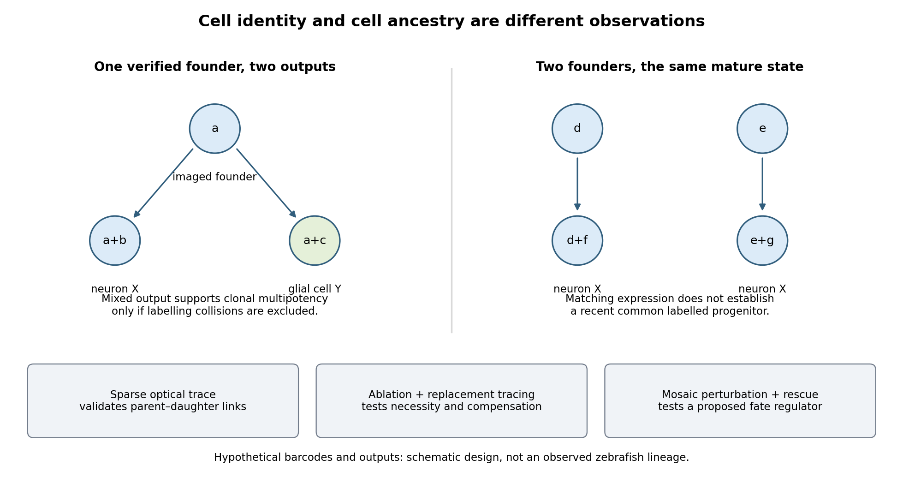

<h1 id="2/solution">Solution</h1>

↑ **Parent:** [2](../2.md)

**I would use [zebrafish](../../../../zebrafish.md) and combine a physical record of divisions, an inherited [DNA](../../../../deoxyribonucleic-acid.md) record, and independent tests of predicted progenitor outputs.** The intended result is a set of lineage trees for individual [animals](../../../../animal.md), registered to [brain](../../../../brain.md) regions and mature [cell](../../../../biological-cell-split.md) identities, with confidence limits. Expression-based [developmental pseudotime](../../../../developmental-pseudotime.md) orders molecular states; neither it nor a patch of [cells](../../../../biological-cell-split.md) sharing a colour is sufficient on its own to establish ancestry.

I would begin by defining the sampled interval and outputs: neural-plate progenitors, their expansion into forebrain, midbrain and hindbrain, and later neuronal and glial descendants. Sampling only [neurons](../../../../neuron.md) would miss persistent progenitors and glia; sampling one [brain](../../../../brain.md) region would make an apparent restriction difficult to interpret. Nuclear and membrane [fluorescent reporters](../../../../fluorescent-reporter.md), anatomical landmarks and a staging series would anchor the map. I would establish a molecular reference with [single-cell RNA sequencing](../../../../single-cell-rna-sequencing.md), then verify selected [cell](../../../../biological-cell-split.md) identities by spatial transcript detection and [morphology](../../../../morphology-biology.md). Expression identifies a state at the observation time; a neural progenitor can switch off its original marker while all its descendants remain in the lineage.

**Direct imaging would provide the earliest ground truth.** Multiview [light-sheet fluorescence microscopy](../../../../light-sheet-fluorescence-microscopy.md) would image labelled nuclei and membranes from neural specification through the tractable early period. The time interval must resolve divisions and rapid [cell](../../../../biological-cell-split.md) rearrangements; multiple views reduce missed [cells](../../../../biological-cell-split.md) behind opaque regions. Automated segmentation and tracking would be manually checked at division events, crowded boundaries, [apoptosis](../../../../apoptosis.md) and apparent long jumps. I would maintain alternative branch assignments where the images do not resolve a mother–daughter relation. Unimaged siblings and lower-light controls would test whether mounting or illumination changes proliferation, survival or [brain](../../../../brain.md) [morphology](../../../../morphology-biology.md). Whole-[embryo](../../../../embryo.md) light-sheet tracking has been demonstrated in early [zebrafish](../../../../zebrafish.md) development, but that does not guarantee an error-free record through all later [brain](../../../../brain.md) growth.[2008, pp. 1065–1069, multiview nuclear tracking and digital embryo reconstruction](../../../../reconstruction-of-zebrafish-early-embryonic-development-by-scanned-light-sheet-microscopy-by-philipp-j-keller-and-others.md)

For a small set of progenitors, I would photoconvert a stable nuclear [fluorescent protein](../../../../fluorescent-protein.md) in a single verified [cell](../../../../biological-cell-split.md) and follow its daughters continuously. Imaging immediately before and after conversion establishes whether neighbouring [cells](../../../../biological-cell-split.md) were also labelled. Repeated independent single-[cell](../../../../biological-cell-split.md) conversions provide a spatially interpretable test of the large-scale molecular map. Subsequent [protein](../../../../protein-split.md) turnover and dilution eventually limit this record, so a permanent inherited label is preferable for long chase times. Sparse induction of a validated recombination reporter is another option, but the actual induction window and the chance of multiple independently labelled founders must be measured. Labelling based on a [promoter](../../../../promoter-genetics.md) reports the descendants of [cells](../../../../biological-cell-split.md) that expressed that [promoter](../../../../promoter-genetics.md) during the pulse, not necessarily one unique anatomical progenitor.

**An inducible CRISPR recording system would extend the map to later stages.** A neutral genomic barcode array would receive early edits, followed by separately timed editing pulses during [neural development](../../../../neural-development.md). Descendants inherit an ancestor's edits and can acquire additional scars. Recovering barcode sequences together with single-[cell](../../../../biological-cell-split.md) transcriptomes then links the inherited record to [cell](../../../../biological-cell-split.md) identity. A constitutive founder label or an independent array would help distinguish unrelated founders with recurrent common edits. The feasibility of coupling temporally induced scars to [cell](../../../../biological-cell-split.md)-type classification in the [zebrafish](../../../../zebrafish.md) [brain](../../../../brain.md) was demonstrated by [scGESTALT](../../../../scgestalt.md).[2018, Figures 1 and 3–6, inducible editing, lineage reconstruction and transcriptome readout](../../../../simultaneous-single-cell-profiling-of-lineages-and-cell-types-in-the-vertebrate-brain-by-bushra-raj-and-others.md) I would validate the operating parameters in the chosen line rather than assume the published recovery rate or editing spectrum transfers unchanged.

Each pulse requires no-inducer, no-guide or no-[Cas9](../../../../cas9.md) controls as appropriate, a measurement of editing duration, and tests that the recorder does not alter [cell](../../../../biological-cell-split.md)-cycle progression, survival or [cell](../../../../biological-cell-split.md)-type composition. Too little editing yields unresolved branches; too much editing saturates sites and can delete earlier information. I would sequence genomic [DNA](../../../../deoxyribonucleic-acid.md) from a subset of [cells](../../../../biological-cell-split.md) to estimate how often a barcode is present but absent from the transcriptome readout: this estimates [lineage-tracing dropout](../../../../lineage-tracing-dropout.md). Independent target sites and longer sequence tags reduce, but do not eliminate, recurrent-edit [homoplasy](../../../../homoplasy.md). The same small deletion arising twice is not strong evidence for a common progenitor. Editing probabilities should be measured in each recording interval, because a large nominal space can contain only a few common outcomes.

An explicit [barcode collision](../../../../barcode-collision.md) calculation would guide labelling density. If independently labelled founders receive barcode $j$ with [probability](../../../../probability.md) $p_j$, the pairwise match [probability](../../../../probability.md) is $\sum_jp_j^2$. Among $n$ founders the expected number of matching pairs is

$$
\binom n2\sum_jp_j^2.
$$

For a uniform library this becomes $n(n-1)/(2B)$ for $B$ possible barcodes. These are design calculations, not measurements from the paper. They explain why [sparse labelling](../../../../sparse-labelling.md) and empirically measured diversity matter more than calling a recorder “high complexity”. Shared common scars, missing earlier scars and sequencing errors would be represented as uncertain branches rather than forced into a completely resolved tree. The root and temporal order of new edits must agree with the actual induction schedule.

I would reconstruct ancestry from the inherited sequences independently of [cell](../../../../biological-cell-split.md)-type assignment, then ask which molecularly defined outputs occur on each branch. Otherwise using expression similarity to construct the tree and then declaring related [cell types](../../../../cell-type.md) to share ancestry would be circular. Closely related [cells](../../../../biological-cell-split.md) may differentiate into different types, while the same type may arise from multiple progenitor pools. Spatial recovery by in situ barcode readout or matched tissue sections would test whether a sequence-defined clone occupies the predicted regions. A pooled [brain](../../../../brain.md) atlas can compare homologous populations across [fish](../../../../fish.md), but independently generated barcode trees from different [animals](../../../../animal.md) cannot simply be merged as though identical scars named the same historical [cell](../../../../biological-cell-split.md).

**A concrete prediction might be that one early progenitor population yields both a particular neuronal class and a glial class, before later progenitors become restricted.** I would sparsely label one [cell](../../../../biological-cell-split.md) in that population, confirm the single founder by imaging, and score all its descendants for the two identities using several markers and [anatomy](../../../../anatomy.md). A true mixed-output clone supports [clonal multipotency](../../../../clonal-multipotency.md). Several [cells](../../../../biological-cell-split.md) labelled by the same [promoter](../../../../promoter-genetics.md) do not. Earlier and later pulses would test when the mixed output disappears. Apparent restriction after a late pulse would be compared with the [probability](../../../../probability.md) of missing rare outputs: if each of $m$ descendants of a class is recovered independently with [probability](../../../../probability.md) $q$, the [probability](../../../../probability.md) of recovering none is $(1-q)^m$. Nonindependent dropout would need a more realistic estimate. Complete imaging of selected clones would therefore be especially valuable.

**[Figure 2](#2/image-combining-inherited-records-direct-observation-and-perturbation-to-test-a-proposed-neural-lineage). Combining inherited records, direct observation and perturbation to test a proposed neural lineage**.

Functional tests would be designed to distinguish ancestry, necessity and developmental potential. Selective [laser ablation](../../../../laser-ablation.md) of the labelled founder before its predicted bifurcation should remove or reduce both outputs if there is no compensation. A sham exposure, ablation of an adjacent equally sized population, and immediate assessment of collateral damage are essential controls. If outputs recover, I would trace the replacing [cells](../../../../biological-cell-split.md): recovery can reveal [regulative development](../../../../regulative-development.md) rather than refute the original ancestry. Conversely, loss of a neuronal population after ablation could reflect loss of a required signal from the targeted [cells](../../../../biological-cell-split.md), so it cannot alone prove that they were its ancestors.

I would then transplant labelled progenitors between matched hosts, including orthotopic controls and a heterotopic or temporally altered environment. Retention of both outputs under a viable alternative environment would support commitment; adoption of the host's outputs would show environmental instruction. Failure to differentiate after poor engraftment is not evidence of restriction. To test a proposed branch regulator, I would perturb it in sparse, permanently labelled clones and measure descendant identities, clone size, proliferation, [apoptosis](../../../../apoptosis.md) and position in parallel. A change in fate proportions at comparable survival and clone size is more persuasive than disappearance of the entire clone. Rescue by a perturbation-resistant [allele](../../../../allele.md), independent perturbations and comparison with neighbouring unperturbed clones would test specificity and [cell](../../../../biological-cell-split.md) autonomy. The lineage label should persist even if the [cell](../../../../biological-cell-split.md)-state marker used to select the progenitor is later lost.

Replication would be at the level of independently treated [embryos](../../../../embryo.md) and parents as well as clones; thousands of [cells](../../../../biological-cell-split.md) from one [fish](../../../../fish.md) are not thousands of independent developmental replicates. I would report label specificity, collision and dropout estimates, alternative tree resolutions, and the sampled developmental window. **A robust map is one in which sequence-based ancestry predicts independently observed divisions and clone outputs, while perturbations reveal which developmental choices are causal and which remain plastic.**

## ↑ Ancestors (12)

1. [2](../2.md)
2. [Paper 2](../../paper-2-split.md)
3. [2024](../../split.md)
4. [Past exam of the genetics course of the University of Cambridge](../../../split.md)
5. [Genetics course of the University of Cambridge](../../../../genetics-course-of-the-university-of-cambridge.md)
6. [Year 3 of the natural sciences course of the University of Cambridge](../../../../year-3-of-the-natural-sciences-course-of-the-university-of-cambridge.md)
7. [Year of the natural sciences course of the University of Cambridge](../../../../year-of-the-natural-sciences-course-of-the-university-of-cambridge.md)
8. [Natural sciences course of the University of Cambridge](../../../../natural-sciences-course-of-the-university-of-cambridge.md)
9. [Course of the University of Cambridge](../../../../course-of-the-university-of-cambridge.md)
10. [University of Cambridge](../../../../university-of-cambridge-split.md)
11. [List of universities](../../../../list-of-universities.md)
12. [Codex Wiki](../../../../split.md)
