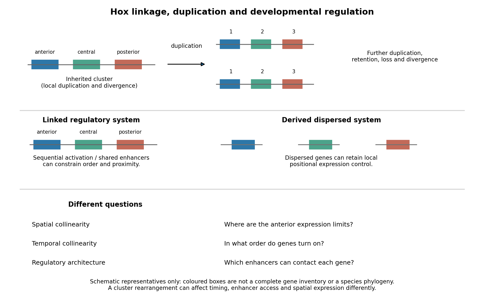

<h1 id="6/solution">Solution</h1>

↑ **Parent:** [6](../6.md)

**Hox genomic organization reflects both the history of duplication and rearrangement and selection on developmental regulation. Shared regulation can preserve a cluster, but positional Hox function does not universally require physical clustering.** The central distinction is between conservation of the [gene](../../../../gene.md) family, conservation of linkage, and conservation of spatial or temporal expression order.

[Hox genes](../../../../hox-gene.md) encode [homeodomain](../../../../homeodomain.md) [transcription factors](../../../../transcription-factor.md) that contribute regional identity along the anterior–posterior axis and have additional tissue-specific deployments. They are a subset of [homeobox](../../../../homeobox.md)-containing [genes](../../../../gene.md): neither the presence of a [homeobox](../../../../homeobox.md) nor a developmental function alone identifies a [gene](../../../../gene.md) as Hox. Related sequences and conserved genomic relationships imply that local duplication and divergence helped generate the ancestral family. Tandem duplication creates linked copies with shared regulatory surroundings; subsequent divergence can partition expression and target specificity. Comparing an anterior, a central and a posterior Hox class across multiple [species](../../../../species.md) is more informative about this history than comparing names alone, because lineage-specific duplication and loss can obscure one-to-one [orthology](../../../../orthology.md).

An ancestral cluster is inferred from the distribution of related [Hox genes](../../../../hox-gene.md) and [synteny](../../../../synteny.md) across [animals](../../../../animal.md), not from a belief that the modern [species](../../../../species.md) with the simplest cluster is the ancestor. Modern [amphioxus](../../../../amphioxus.md) has a single [Hox cluster](../../../../hox-cluster.md) and helps constrain the organization before [vertebrate](../../../../vertebrate.md) cluster multiplication. Comparative mapping established the value of that unduplicated organization for reconstructing [chordate](../../../../chordate.md) history.[1994, pp. 563–566, genomic cluster organization and chordate comparison](../../../../archetypal-organization-of-the-amphioxus-hox-gene-cluster-by-jordi-garcia-fernandez-and-peter-w-h-holland.md) Modern [amphioxus](../../../../amphioxus.md) has also evolved independently; its present complement is not a frozen ancestral [genome](../../../../genome.md).

Early [vertebrate](../../../../vertebrate.md) large-scale duplications contributed to multiple [Hox clusters](../../../../hox-cluster.md), followed by extensive loss and divergence. Both [humans](../../../../human.md) and mice retain four clusters, conventionally HoxA–D, with thirty-nine [genes](../../../../gene.md) distributed among thirteen [paralogy](../../../../paralogy.md) groups, rather than thirteen [genes](../../../../gene.md) retained in every cluster. The idealized arithmetic $1\to2\to4$ explains the opportunity created by two duplication rounds; the extant complement requires [gene loss](../../../../gene-loss.md) and retention as well. A duplicated Hox family alone would not establish [whole-genome duplication](../../../../whole-genome-duplication.md): paralogous flanking regions and [genome](../../../../genome.md)-wide [synteny](../../../../synteny.md) provide independent evidence. Teleost history includes further duplication and lineage-specific cluster/[gene](../../../../gene.md) losses, so a universal “[fish](../../../../fish.md) have eight complete clusters” rule would be wrong. Comparative pufferfish organization and expression show both retained duplicate deployments and divergence among ray-[fin](../../../../fin.md) [fish](../../../../fish.md).[2004, pp. 1–10, duplicated cluster organization, expression and lineage-specific retention](../../../../developmental-roles-of-pufferfish-hox-clusters-and-genome-evolution-in-ray-fin-fish-by-angel-amores-and-others.md)

Duplication can permit [subfunctionalization](../../../../subfunctionalization.md), in which copies divide ancestral expression domains, or [neofunctionalization](../../../../neofunctionalization.md), in which a retained copy acquires a new deployment. Dosage constraints and overlapping functions can instead preserve similar copies. These possibilities predict different changes in [enhancers](../../../../enhancer.md), coding regions and expression. Total [gene](../../../../gene.md) number is consequently not a simple scale of morphological complexity. A lineage can change body organization by altering Hox regulation without increasing its Hox count, or retain many duplicates while losing particular structures.

**Three kinds of collinearity must be kept separate.** In [Hox spatial collinearity](../../../../hox-spatial-collinearity.md), genomic order corresponds to the ordered anterior expression limits of [Hox genes](../../../../hox-gene.md) along the body axis. In [Hox temporal collinearity](../../../../hox-temporal-collinearity.md), [genes](../../../../gene.md) are activated in a sequence corresponding to their order, typically with anterior-class [genes](../../../../gene.md) near the 3′ end activated before more posterior-class [genes](../../../../gene.md) nearer the 5′ end in [vertebrate](../../../../vertebrate.md) axial progenitors. [Hox quantitative collinearity](../../../../hox-quantitative-collinearity.md) concerns expression levels or relative contributions in a domain. None implies that every [Hox gene](../../../../hox-gene.md) is expressed exclusively in one nonoverlapping segment. Overlapping domains and context-dependent [posterior prevalence](../../../../posterior-prevalence.md) can implement regional identity through combinations and regulatory hierarchy.

A compact ordered cluster can facilitate sequential exposure to activating influences and coordinated changes in [chromatin](../../../../chromatin.md). Polycomb-associated repression helps maintain inactive domains, while activation changes accessibility and [chromatin](../../../../chromatin.md) interactions. Signals such as retinoid, Wnt and FGF inputs can be interpreted by local [enhancers](../../../../enhancer.md) and cluster-scale regulation. In an elongating [embryo](../../../../embryo.md), a progenitor's time of activation and time of leaving the posterior zone can be converted into a position in the axis. In chick, manipulating Hoxb activity links activation order to mesodermal [ingression](../../../../ingression.md) behaviour, providing an experimental connection between a genomic schedule and [morphogenesis](../../../../morphogenesis.md).[2006, pp. 568–571, expression timing and altered ingression](../../../../collinear-activation-of-hoxb-genes-during-gastrulation-is-linked-to-mesoderm-cell-ingression-by-tadahiro-iimura-and-olivier-pourquie.md) That connection is a mechanism to test, not a proof that all spatial Hox boundaries are produced by one clock.

Cluster rearrangements are especially informative because an expression correlation alone cannot demonstrate why linkage matters. Mouse HoxD inversions that split the cluster, together with deletion and duplication [alleles](../../../../allele.md), alter early temporal regulation without equivalently determining every later axial expression pattern. These manipulations distinguish controls acting on early onset from subsequent spatial regulation.[2009, e1000398, cluster-splitting inversion and deletion/duplication comparisons](../../../../uncoupling-time-and-space-in-the-collinear-regulation-of-hox-genes-by-patrick-tschopp-and-others.md) They support selection on cluster integrity for particular coordinated regulatory tasks while rejecting the stronger assertion that timing and spatial order are inseparable properties.

**[Figure 3](#6/image-duplication-shared-regulation-and-dispersal-impose-different-constraints-on-hox-genomic-organization). Duplication, shared regulation and dispersal impose different constraints on Hox genomic organization**.

Shared long-range [enhancers](../../../../enhancer.md) can also constrain which [genes](../../../../gene.md) remain together. Mouse HoxD is flanked by distinct regulatory landscapes used in different phases of [limb](../../../../vertebrate-limb.md) development. Contact maps and perturbations show a switch between domains associated with proximal and distal [limb](../../../../vertebrate-limb.md) expression, with centrally located [genes](../../../../gene.md) able to engage different landscapes.[2013, article 1234167, flanking domains and developmental contact switch](../../../../a-switch-between-topological-domains-underlies-hoxd-genes-collinearity-in-mouse-limbs-by-guillaume-andrey-and-others.md) Moving a [gene](../../../../gene.md) or deleting a boundary can therefore change [enhancer](../../../../enhancer.md) access even if its [protein](../../../../protein-split.md)-[coding sequence](../../../../coding-sequence.md) is unaltered. A contact map by itself remains a physical association assay; [enhancer](../../../../enhancer.md) deletions, rearrangements and expression measurements establish regulatory consequences. This provides a plausible source of [purifying selection](../../../../purifying-selection.md) on [gene](../../../../gene.md) order, spacing and flanking noncoding sequence, alongside scope for new tissue-specific [enhancer](../../../../enhancer.md) use.

**[evolution](../../../../evolution.md) also supplies counterexamples to obligatory clustering.** [Drosophila](../../../../drosophila.md)'s [Hox genes](../../../../hox-gene.md) occur in separated Antennapedia and bithorax complexes, showing that splitting an ancestral arrangement need not eliminate axial patterning. More dramatically, the [tunicate](../../../../tunicate.md) [Oikopleura dioica](../../../../oikopleura-dioica.md) has dispersed [Hox genes](../../../../hox-gene.md), while their expression retains aspects of anteroposterior ordering in different tail tissues. Genomic analysis and in situ [hybridization](../../../../hybridization-biology.md) demonstrate the coexistence of dispersal and residual spatial order.[2004, pp. 67–71, linkage and tissue-specific expression](../../../../hox-cluster-disintegration-with-persistent-anteroposterior-order-of-expression-in-oikopleura-dioica-by-hee-chan-seo-and-others.md) This does not mean dispersion was harmless, or that all quantitative and temporal relationships were conserved. Rather, local regulatory modules can retain positional deployment where a shared cluster-wide control is no longer required or has been replaced.

Genomic rearrangements, duplication and loss continually generate alternatives; [developmental integration](../../../../developmental-integration.md) filters their consequences. A lineage relying heavily on coordinated sequential activation and shared [enhancers](../../../../enhancer.md) may tolerate fewer breaks, whereas modularized regulation can relax that constraint. The association of a dispersed cluster with a particular mode of development is still an evolutionary hypothesis, not proof that developmental mode caused the rearrangement. An adequate test would compare independent evolutionary transitions, reconstruct ancestral linkage with outgroups, and assay homologous developmental stages and tissues. Engineering a rearrangement while preserving [coding sequence](../../../../coding-sequence.md), then measuring activation timing, spatial boundaries, [chromatin](../../../../chromatin.md) contacts and [phenotype](../../../../phenotype.md), tests its developmental cost directly. **Conserved clustering is best explained by inherited organization plus context-dependent regulatory constraints; surviving dispersal shows that those constraints can evolve.**

## ↑ Ancestors (12)

1. [6](../6.md)
2. [Paper 2](../../paper-2-split.md)
3. [2024](../../split.md)
4. [Past exam of the genetics course of the University of Cambridge](../../../split.md)
5. [Genetics course of the University of Cambridge](../../../../genetics-course-of-the-university-of-cambridge.md)
6. [Year 3 of the natural sciences course of the University of Cambridge](../../../../year-3-of-the-natural-sciences-course-of-the-university-of-cambridge.md)
7. [Year of the natural sciences course of the University of Cambridge](../../../../year-of-the-natural-sciences-course-of-the-university-of-cambridge.md)
8. [Natural sciences course of the University of Cambridge](../../../../natural-sciences-course-of-the-university-of-cambridge.md)
9. [Course of the University of Cambridge](../../../../course-of-the-university-of-cambridge.md)
10. [University of Cambridge](../../../../university-of-cambridge-split.md)
11. [List of universities](../../../../list-of-universities.md)
12. [Codex Wiki](../../../../split.md)
