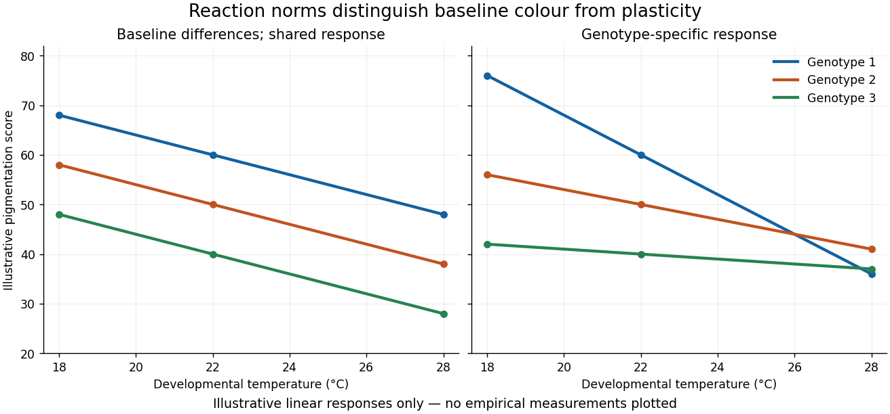

<h1 id="3/solution">Solution</h1>

↑ **Parent:** [3](../3.md)

The target is genetic variation in a [reaction norm](../../../../reaction-norm.md): how pigmentation produced by a [genotype](../../../../genotype.md) changes with developmental temperature. A [gene](../../../../gene.md) affecting pigmentation at every temperature is not necessarily a [gene](../../../../gene.md) affecting plasticity. The design must estimate inherited differences in responsiveness separately from differences in baseline colour.

Raise replicated [genotypes](../../../../genotype.md) or families across several controlled developmental temperatures, distributing members of the same [genetic background](../../../../genetic-background.md) among environments. Standardize sex, age, nutrition, density and the body region scored; female posterior abdominal pigmentation is a useful defined trait. Randomize position and scoring order and quantify colour from calibrated images. Record viability and development time, since selective mortality can change the composition of survivors and imitate a plastic response. A parental common-garden generation and reciprocal crosses can help separate inherited nuclear effects from maternal or carry-over effects.

A simple [mixed-effects model](../../../../mixed-model.md) is

$$
z_{ijk}=\mu+G_i+E_j+(GE)_{ij}+b_k+\epsilon_{ijk},
$$

where [genotype](../../../../genotype.md) and environment effects describe baseline differences and the shared temperature response, their interaction describes genotype-specific responses, and $b_k$ represents an appropriate block effect. Treating temperature as a continuous predictor gives genotype-specific slopes, but a curved response should not be forced into one line. Fit [reaction norms](../../../../reaction-norm.md) with uncertainty and test whether their shapes differ.

**[Figure 1](#3/image-illustrative-pigmentation-reaction-norms-separating-baseline-genetic-differences-from-genotype-by-temperature-interaction). Illustrative pigmentation reaction norms separating baseline genetic differences from genotype-by-temperature interaction**.

[Quantitative trait locus mapping](../../../../quantitative-trait-locus-mapping.md) in segregating crosses can locate loci affecting the temperature interaction. A [genome-wide association study](../../../../genome-wide-association-study.md) in a diverse panel can complement it, with controls for relatedness and population structure. Analyse the joint [phenotype](../../../../phenotype.md) across temperatures, rather than comparing a significant association at one temperature with a nonsignificant association at another and calling the difference an interaction. Mapping resolution, power and multiple-testing correction determine how many candidate regions can be distinguished.

Follow candidates with staged expression measurements, [chromatin](../../../../chromatin.md) assays and functional perturbations. A coding change might alter enzyme temperature sensitivity; a cis-regulatory change might alter where or when the enzyme is produced; a trans-acting [chromatin](../../../../chromatin.md) or hormonal regulator could affect several pathways. Allele-specific expression in a shared trans environment can help distinguish cis from trans effects. Replacing an [allele](../../../../allele.md) or rescuing a perturbation and then measuring the entire [reaction norm](../../../../reaction-norm.md) tests causality more strongly than expression correlation alone.

The expectation is a context-dependent genetic network, potentially including pigmentation enzymes, developmental regulators and [chromatin](../../../../chromatin.md) regulation. [Jean-Michel Gibert](../../../../jean-michel-gibert.md) and colleagues found temperature-sensitive regulation involving [Abdominal-B](../../../../abdominal-b.md), [bric-à-brac](../../../../bric-a-brac.md) and [chromatin](../../../../chromatin.md) regulators in female abdominal pigmentation. That supports a distributed mechanism rather than a universal dedicated plasticity [gene](../../../../gene.md). It does not imply that the same causal variants explain every natural population or all body regions.[Temperature, regional developmental regulation and pigmentation-enzyme expression](../../../../phenotypic-plasticity-in-drosophila-pigmentation-caused-by-temperature-sensitivity-of-a-chromatin-regulator-network-by-jean-michel-gibert-and-others.md)

Thus one may find variants affecting baseline colour, slope or curvature, as well as environment-dependent dominance and [epistasis](../../../../epistasis.md). Some apparent interactions may disappear after controlling development stage or survival. Demonstrating heritable plasticity does not establish that it is adaptive: that further claim requires fitness comparisons in the relevant environments.

## ↑ Ancestors (12)

1. [3](../3.md)
2. [Paper 4](../../paper-4-split.md)
3. [2024](../../split.md)
4. [Past exam of the genetics course of the University of Cambridge](../../../split.md)
5. [Genetics course of the University of Cambridge](../../../../genetics-course-of-the-university-of-cambridge.md)
6. [Year 3 of the natural sciences course of the University of Cambridge](../../../../year-3-of-the-natural-sciences-course-of-the-university-of-cambridge.md)
7. [Year of the natural sciences course of the University of Cambridge](../../../../year-of-the-natural-sciences-course-of-the-university-of-cambridge.md)
8. [Natural sciences course of the University of Cambridge](../../../../natural-sciences-course-of-the-university-of-cambridge.md)
9. [Course of the University of Cambridge](../../../../course-of-the-university-of-cambridge.md)
10. [University of Cambridge](../../../../university-of-cambridge-split.md)
11. [List of universities](../../../../list-of-universities.md)
12. [Codex Wiki](../../../../split.md)
