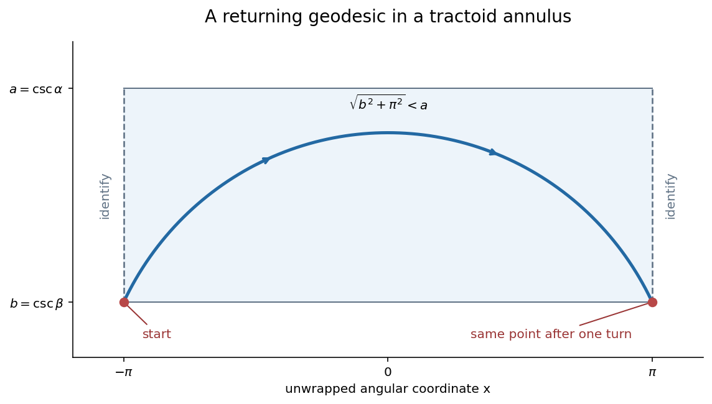

# 2007

↑ **Parent:** [Past exam of the geometry course of the University of Oxford](../past-exam-of-the-geometry-course-of-the-university-of-oxford.md)

**Table of contents**

- [A](#a)
  - [1](#a/1)
    - [Solution](#a/1/solution)
  - [2](#a/2)
    - [Solution](#a/2/solution)
  - [3](#a/3)
    - [Solution](#a/3/solution)
  - [4](#a/4)
    - [Solution](#a/4/solution)
- [B](#b)
  - [5](#b/5)
    - [i](#b/5/i)
      - [Solution](#b/5/i/solution)
    - [ii](#b/5/ii)
      - [Solution](#b/5/ii/solution)
    - [iii](#b/5/iii)
      - [Solution](#b/5/iii/solution)
  - [6](#b/6)
    - [i](#b/6/i)
      - [Solution](#b/6/i/solution)
    - [ii](#b/6/ii)
      - [Solution](#b/6/ii/solution)
    - [iii](#b/6/iii)
      - [Solution](#b/6/iii/solution)
    - [iv](#b/6/iv)
      - [Solution](#b/6/iv/solution)
  - [7](#b/7)
    - [i](#b/7/i)
      - [Solution](#b/7/i/solution)
    - [ii](#b/7/ii)
      - [Solution](#b/7/ii/solution)
    - [iii](#b/7/iii)
      - [Solution](#b/7/iii/solution)
    - [iv](#b/7/iv)
      - [Solution](#b/7/iv/solution)
    - [v](#b/7/v)
      - [Solution](#b/7/v/solution)
    - [vi](#b/7/vi)
      - [Solution](#b/7/vi/solution)
  - [8](#b/8)
    - [i](#b/8/i)
      - [Solution](#b/8/i/solution)
    - [ii](#b/8/ii)
      - [Solution](#b/8/ii/solution)
    - [iii](#b/8/iii)
      - [Solution](#b/8/iii/solution)
    - [iv](#b/8/iv)
      - [Solution](#b/8/iv/solution)
    - [v](#b/8/v)
      - [Solution](#b/8/v/solution)
    - [vi](#b/8/vi)
      - [Solution](#b/8/vi/solution)

## A

↑ **Parent:** [2007](2007.md)

<h3 id="a/1">1</h3>

↑ **Parent:** [A](#a)

<h4 id="a/1/solution">Solution</h4>

↑ **Parent:** [1](#a/1)

An [orientable surface](../differential-geometry.md#orientable-surface) admits local coordinate orientations that are consistent on overlaps. Equivalently a [triangulation](../algebraic-topology.md#triangulation) can be oriented so that adjacent faces induce opposite directions on their common edge. Use a polygon word to record its successive boundary edges, identifying equal letters in their indicated directions; a negative exponent reverses that edge direction.

Square models are **$P:abab$, $K:aba^{-1}b$, and $T:aba^{-1}b^{-1}$**. The first identifies antipodal boundary points of a disk, giving the [real projective plane](../differential-geometry.md#real-projective-plane). Only the [torus](../topological-surface.md#torus) among these three is [orientable](../differential-geometry.md#orientable-surface): its paired sides traverse the boundary oppositely, whereas each other model has a same-direction pair. The projective model has two vertex classes, and the other two one, giving Euler characteristics one and zero respectively.

The other possibility is **the [sphere](../euclidean-geometry.md#sphere)**, for example the word $aa^{-1}bb^{-1}$ with three vertex classes. There are no others: a paired square has one face, two edges and between one and three vertex classes, so its [Euler characteristic](../homology.md#euler-characteristic) is $V-1\in\{0,1,2\}$. The [classification of compact surfaces](../topological-surface.md#classification-of-compact-surfaces) leaves precisely the [sphere](../euclidean-geometry.md#sphere), [real projective plane](../differential-geometry.md#real-projective-plane), [torus](../topological-surface.md#torus) and [Klein bottle](../topological-surface.md#klein-bottle) at those values, with the indicated orientabilities.

For connected sums, remove a disk from each [surface](../topological-surface.md), join the resulting boundary circles, and cut a joining arc to produce a single polygon. Its word concatenates the two original words. The [real projective plane](../differential-geometry.md#real-projective-plane) also has the bigon word $cc$, so

$$
\boxed{T\mathbin{\#}P:\ aba^{-1}b^{-1}cc,\qquad T\mathbin{\#}K:\ aba^{-1}b^{-1}cdc^{-1}d.}
$$

These use respectively six and eight sides, proving the requested hexagon and octagon constructions. Their Euler characteristics are $-1$ and $-2$, also obtained from $\chi(X\#Y)=\chi(X)+\chi(Y)-2$.

<h3 id="a/2">2</h3>

↑ **Parent:** [A](#a)

<h4 id="a/2/solution">Solution</h4>

↑ **Parent:** [2](#a/2)

For a nonconstant [holomorphic map](../riemann-surfaces.md#holomorphic-map) of degree $d$ between compact connected [Riemann surfaces](../riemann-surfaces.md),

$$
\boxed{2g_X-2=d(2g_Y-2)+\sum_{p\in X}(e_p-1),}
$$

where the [analytic ramification index](../riemann-surfaces.md#ramification-index-of-a-holomorphic-map) $e_p$ is the exponent in local coordinates $w\circ f=z^{e_p}$ after coordinate changes. A [meromorphic function](../isolated-singularity.md#meromorphic-function) maps its [poles](../isolated-singularity.md#pole) to infinity; the target coordinate $1/w$ is then holomorphic and vanishes at a [pole](../isolated-singularity.md#pole), so this defines a [holomorphic map](../riemann-surfaces.md#holomorphic-map) to the [Riemann sphere](../riemann-surfaces.md#riemann-sphere). A [pole](../isolated-singularity.md#pole) of order $m$ has local degree $m$.

Let $\Lambda$ be the [period lattice](../complex-analysis.md#period-lattice). The induced function $\wp:T=\mathbb C/\Lambda\to\mathbb{CP}^1$ has just one [pole](../isolated-singularity.md#pole), of order two, so its degree is two. The [Riemann-Hurwitz formula](../riemann-surfaces.md#riemann-hurwitz-formula) gives total ramification four. The [pole](../isolated-singularity.md#pole) contributes one; every [analytic ramification index](../riemann-surfaces.md#ramification-index-of-a-holomorphic-map) is at most two, so there are exactly three further [ramification points](../riemann-surfaces.md#ramification-point-of-a-holomorphic-map), each simple. Evenness of $\wp$, obtained by reindexing its lattice sum, identifies them with the three nonzero half-periods. Their values $e_1,e_2,e_3$ are distinct: two points of local degree two cannot lie in one degree-two fiber.

The functions $\wp'^2$ and $\prod_i(\wp-e_i)$ have double zeros at these same three points and a [pole](../isolated-singularity.md#pole) of order six at zero. Their ratio is a holomorphic nowhere-zero function on the compact [torus](../topological-surface.md#torus), hence constant. From $\wp(z)=z^{-2}+O(z^2)$ and $\wp'(z)=-2z^{-3}+O(z)$ its value is four. Therefore

$$
\boxed{\wp'^2=4(\wp-e_1)(\wp-e_2)(\wp-e_3),\qquad e_i\ne e_j\ (i\ne j).}
$$

**The printed additional assertion that all $e_i$ are nonzero is false.** The [square-lattice Weierstrass function has a zero branch value](../complex-analysis.md#square-lattice-weierstrass-function-has-a-zero-branch-value): for $\mathbb Z+i\mathbb Z$, reindexing gives $\wp(iz)=-\wp(z)$. At the half-period $h=(1+i)/2$, one has $ih=h-1$, so periodicity gives $\wp(h)=-\wp(h)$ and hence $\wp(h)=0$. Thus one branch value is zero, while the three remain distinct.

The [derivative](../calculus.md#derivative) has a single triple [pole](../isolated-singularity.md#pole), so **$\deg\wp'=3$**, and the [Riemann-Hurwitz formula](../riemann-surfaces.md#riemann-hurwitz-formula) gives **total ramification $\sum(e_p-1)=6$**. The number of distinct [ramification points](../riemann-surfaces.md#ramification-point-of-a-holomorphic-map) requires a further distinction. The absent constant term in the [Laurent expansion](../analysis.md#laurent-series) gives $e_1+e_2+e_3=0$, so write $\wp'^2=4\wp^3-g_2\wp-g_3$. Differentiation yields $\wp''=6\wp^2-g_2/2$. If $g_2\ne0$, each of the two values $\pm\sqrt{g_2/12}$ has two distinct preimages under $\wp$ and none is a branch value, since a common zero of the cubic and its [derivative](../calculus.md#derivative) would be a repeated cubic root. Thus there are four simple finite [ramification points](../riemann-surfaces.md#ramification-point-of-a-holomorphic-map) of $\wp'$ and its triple [pole](../isolated-singularity.md#pole), giving **five distinct points**. If $g_2=0$, the nonsingularity of the cubic forces $g_3\ne0$. The two simple zeros of $\wp$ make $\wp''$ vanish to order two, so each has [analytic ramification index](../riemann-surfaces.md#ramification-index-of-a-holomorphic-map) three for $\wp'$. Together with its triple [pole](../isolated-singularity.md#pole) there are **three distinct points**. This second case occurs for a hexagonal lattice: its sixth-root rotational symmetry forces the $z^2$ Laurent coefficient, and hence $g_2$, to vanish. The weighted count is six in both cases.

<h3 id="a/3">3</h3>

↑ **Parent:** [A](#a)

<h4 id="a/3/solution">Solution</h4>

↑ **Parent:** [3](#a/3)

A [critical point](../analysis.md#critical-point) satisfies $df=0$; it is nondegenerate when the [Hessian](../multivariable-calculus.md#hessian-matrix) on its two-dimensional [tangent space](../tangent-vector.md#tangent-space) is nonsingular. For a smooth function with only nondegenerate [critical points](../analysis.md#critical-point) on a compact [surface](../topological-surface.md), the [Morse theory](../differential-geometry.md#morse-theory) formula is

$$
\boxed{\chi(X)=m_0-m_1+m_2,}
$$

where $m_i$ counts the [critical points](../analysis.md#critical-point) whose [Hessian](../multivariable-calculus.md#hessian-matrix) has $i$ negative eigenvalues.

For $f(x)=|x|^2$, differentiation in a tangent direction $v$ gives $df_x(v)=2x\cdot v$. This vanishes for all $v\in T_xX$ exactly when the position vector is perpendicular to that [tangent plane](../tangent-vector.md#tangent-plane), equivalently the [normal line](../differential-geometry.md#normal-line) at $x$ contains the origin. This includes $x=0$, if it is on the [surface](../topological-surface.md). On a [torus](../topological-surface.md#torus) $\chi=0$, while a minimum and a maximum give $m_0,m_2\geq1$. Thus $m_1=m_0+m_2\geq2$ and the total is at least four. Hence **at least four [surface](../topological-surface.md) normals pass through the origin** under the stated nondegeneracy assumption.

Write the generating circle as center $(a,R)$ and radius $r$, with $R>r>0$. A parametrization and [unit normal](../differential-geometry.md#unit-normal) are

$$
X(u,v)=(a+r\cos u,(R+r\sin u)\cos v,(R+r\sin u)\sin v),\quad n(u,v)=(\cos u,\sin u\cos v,\sin u\sin v).
$$

Take **$P=(a,R/2,0)$**. If $P-X=tn$, its first coordinate gives $(r+t)\cos u=0$. The alternative $t=-r$ would force the radial distance of $P$ from the axis to be $R$, contrary to $R/2$. Thus $\cos u=0$. The remaining equations and the nonzero radial distance of $P$ force $v=0$ or $\pi$. Each of the two choices of $u$ and two of $v$ works, giving exactly four distinct points. Take **$Q=(a,0,0)$** instead. All points on each of the circles $u=\pi/2$ and $u=3\pi/2$ have radial normals through $Q$, giving infinitely many.

<h3 id="a/4">4</h3>

↑ **Parent:** [A](#a)

<h4 id="a/4/solution">Solution</h4>

↑ **Parent:** [4](#a/4)

Parametrize a nonconstant [hyperbolic geodesic](../hyperbolic-geometry.md#geodesic-in-the-poincare-half-plane-model) by unit speed. Its energy is $(\dot x^2+\dot y^2)/(2y^2)$, and the [Euler-Lagrange equation](../analysis.md#euler-lagrange-equation) in the [cyclic coordinate](../lagrangian-mechanics.md#cyclic-coordinate) $x$ gives $\dot x/y^2=c$. Unit speed gives $\dot x^2+\dot y^2=y^2$. If $c=0$ the curve is vertical. Otherwise, on either side of a possible highest point,

$$
\frac{dx}{dy}=\frac{\pm cy}{\sqrt{1-c^2y^2}},\qquad (x-a)^2+y^2=c^{-2}.
$$

The two branches join smoothly at the top. Conversely these curves with their unit-speed parametrizations satisfy the energy equations. Thus **the unparametrized complete [geodesics](../riemannian-geometry.md#geodesic) are vertical half-lines and upper semicircles centered on the real axis**.

Let the [tractrix](../topology.md#tractrix) point have positive height $r(\theta)$. Its tangent segment to the axis has length one and makes angle $\theta$, so $r=\sin\theta$. Since its slope is $\tan\theta$, $h'(\theta)=\cos^2\theta/\sin\theta$ for its axial coordinate. Rotating $X(\theta,v)=(h(\theta),\sin\theta\cos v,\sin\theta\sin v)$ gives orthogonal coordinate vectors with squared lengths $\cot^2\theta$ and $\sin^2\theta$. Hence the stated [first fundamental form](../differential-geometry.md#first-fundamental-form) follows.

Now put **$x=v$, $y=\csc\theta$**. Direct substitution gives

$$
\frac{dx^2+dy^2}{y^2}=\sin^2\theta\,dv^2+\cot^2\theta\,d\theta^2.
$$

On the specified intervals this coordinate map is a [diffeomorphism](../geometry-and-topology.md#diffeomorphism) onto the stated rectangle, so is an [isometry](../riemannian-geometry.md#isometry) there and a [local isometry](../differential-geometry.md#local-isometry) on the [tractoid](../differential-geometry.md#tractoid).

Set $b=\csc\beta$, $a=\csc\alpha$. In the unwrapped coordinate, connect $(x_0,b)$ to $(x_0+2\pi,b)$ along the semicircle centered at $(x_0+\pi,0)$ of radius $\sqrt{b^2+\pi^2}$. Its height lies between $b$ and that radius. The hypothesis $a^2-b^2>\pi^2$ puts the whole arc in the closed height strip $b\leq y\leq a$. Projecting the angular coordinate modulo $2\pi$ therefore gives **a [geodesic](../riemannian-geometry.md#geodesic) segment in the closed [tractoid](../differential-geometry.md#tractoid) annulus which winds once and returns to its starting point**. Taking $x_0$ to represent any chosen angular position proves the assertion for every point of its $\theta=\beta$ boundary. The returned tangent need not equal the starting tangent, so this proves the claimed returning segment without asserting a periodically smooth [closed geodesic](../riemannian-geometry.md#closed-geodesic).

**[Figure 1](#a/4/image-a-returning-geodesic-in-an-unwrapped-tractoid-annulus). A returning geodesic in an unwrapped tractoid annulus**.

## B

↑ **Parent:** [2007](2007.md)

<h3 id="b/5">5</h3>

↑ **Parent:** [B](#b)

<h4 id="b/5/i">i</h4>

↑ **Parent:** [5](#b/5)

<h5 id="b/5/i/solution">Solution</h5>

↑ **Parent:** [I](#b/5/i)

Choose representative vectors $x_1,\ldots,x_{n+1}$ of the first $n+1$ points; they form a [basis](../vector-space.md#basis). Write a representative of the last point as $\sum_i a_ix_i$. General position forces each $a_i\ne0$, since otherwise $n+1$ of the points would lie in a hyperplane. Rescale the [basis](../vector-space.md#basis) vectors to $a_ix_i$. The tuple is then projectively equivalent to the standard frame

$$
[e_1],\ldots,[e_{n+1}],[e_1+\cdots+e_{n+1}].
$$

Apply the same normalization to the second tuple and compose the two transformations to obtain existence. An automorphism fixing the coordinate points is represented by a [diagonal matrix](../linear-algebra.md#diagonal-matrix). Fixing their sum forces all its diagonal entries to agree, so its projective action is the identity. This proves **existence and uniqueness**. At $n=1$ it says **the [Möbius group](../group-theory.md#mobius-group) acts sharply triply transitively on the [projective line](../finite-group-theory.md#projective-line)**: any ordered triple of distinct points can be sent to any other in exactly one way.

<h4 id="b/5/ii">ii</h4>

↑ **Parent:** [5](#b/5)

<h5 id="b/5/ii/solution">Solution</h5>

↑ **Parent:** [Ii](#b/5/ii)

By the preceding frame result take the four points to be $[1:0:0],[0:1:0],[0:0:1],[1:1:1]$. The [conics](../euclidean-geometry.md#conic-section) through them have equations

$$
a yz+b zx+c xy=0,\qquad a+b+c=0,\qquad(a,b,c)\ne0.
$$

Coefficient vectors differing by a common nonzero scalar define the same [conic](../euclidean-geometry.md#conic-section). Their parameter space is the projectivization of a two-dimensional [vector space](../vector-space.md), hence **a [projective line](../finite-group-theory.md#projective-line)**.

Each partition of the four points into two unordered pairs gives a reducible [conic](../euclidean-geometry.md#conic-section) formed by the two joining lines. There are three pairings. Conversely a reducible [conic](../euclidean-geometry.md#conic-section) is a union of two lines, possibly repeated. General position prevents any one line from carrying three of the points, so the lines must be distinct and carry exactly one of these pairings. Thus **there are exactly three reducible members**. In these coordinates they are the parameters $[0:1:-1]$, $[1:0:-1]$, $[1:-1:0]$, giving respectively $x(z-y)=0$, $y(z-x)=0$, and $z(y-x)=0$.

<h4 id="b/5/iii">iii</h4>

↑ **Parent:** [5](#b/5)

<h5 id="b/5/iii/solution">Solution</h5>

↑ **Parent:** [Iii](#b/5/iii)

Write $P_5=[u:v:w]$ in the same normalized coordinates. Its coordinates are all nonzero, because the coordinate lines join pairs of the first three points. Evaluation at $P_5$ gives the additional linear equation $avw+bwu+cuv=0$ on the two-dimensional coefficient plane $a+b+c=0$. It is not identically zero there: that would imply $vw=wu=uv$, hence $u=v=w$ and $P_5=P_4$, contradicting the hypothesis. Its [kernel](../kernel-of-a-linear-map.md) is therefore one-dimensional. Thus **there is exactly one [projective conic](../projective-space.md#projective-conic) through all five points**. If it were reducible, $P_5$ would lie on a line joining two of the other points, contrary to no three being collinear. Hence **the unique [conic](../euclidean-geometry.md#conic-section) is irreducible**.

<h3 id="b/6">6</h3>

↑ **Parent:** [B](#b)

<h4 id="b/6/i">i</h4>

↑ **Parent:** [6](#b/6)

<h5 id="b/6/i/solution">Solution</h5>

↑ **Parent:** [I](#b/6/i)

For a plane [affine curve](../algebraic-variety.md#affine-algebraic-curve) given by a reduced equation $f(x,y)=0$, a point is singular when **$f=f_x=f_y=0$** there. For a [projective curve](../projective-space.md#projective-curve) given by a homogeneous equation $F(x,y,z)=0$, a point is singular when **$F=F_x=F_y=F_z=0$** on a nonzero representative. These conditions are invariant under projective rescaling. In characteristic zero, Euler's identity $dF=xF_x+yF_y+zF_z$ makes the equation $F=0$ follow from vanishing of the partials when $d\ne0$ in the field. Over an arbitrary field one should retain the equation itself, particularly if the characteristic divides the degree.

<h4 id="b/6/ii">ii</h4>

↑ **Parent:** [6](#b/6)

<h5 id="b/6/ii/solution">Solution</h5>

↑ **Parent:** [Ii](#b/6/ii)

[Bézout's theorem](../algebraic-geometry.md#bezout-s-theorem) says that two [projective plane](../projective-space.md#projective-plane) curves over $\mathbb C$ of degrees $d,e$ with no common irreducible component have total [intersection multiplicity](../algebraic-geometry.md#intersection-multiplicity) $de$, so at most $de$ distinct intersection points. Let the irreducible curve have reduced homogeneous equation $F$ of positive degree $d$. In characteristic zero some [partial derivative](../multivariable-calculus.md#partial-derivative) is nonzero. For $d>1$ this [derivative](../calculus.md#derivative) has degree $d-1$ and cannot share a component with the irreducible degree-$d$ [polynomial](../polynomial.md) $F$. Every [singular point](../algebraic-geometry.md#singular-point-of-an-algebraic-variety) belongs to their intersection. Bézout bounds their number by $d(d-1)$, proving **there are finitely many [singular points](../algebraic-geometry.md#singular-point-of-an-algebraic-variety)**. For $d=1$ a partial is a nonzero constant and there are none.

<h4 id="b/6/iii">iii</h4>

↑ **Parent:** [6](#b/6)

<h5 id="b/6/iii/solution">Solution</h5>

↑ **Parent:** [Iii](#b/6/iii)

Put $F=y^2z-x^3+3xz^2-2z^3$. Its partials are

$$
F_x=-3x^2+3z^2,\qquad F_y=2yz,\qquad F_z=y^2+6xz-6z^2.
$$

At infinity $z=0$, the curve equation forces $x=0$, giving $[0:1:0]$, where $F_z\ne0$. In the chart $z=1$, the [derivative](../calculus.md#derivative) equations give $y=0$ and $x=\pm1$. Only $x=1$ lies on the curve and also makes $F_z=0$. Thus **the only [singular point](../algebraic-geometry.md#singular-point-of-an-algebraic-variety) is $[1:0:1]$**. As a check, the affine equation factors as $y^2=(x-1)^2(x+2)$, whose quadratic tangent cone there is $y^2-3(x-1)^2$, giving two distinct tangent lines.

<h4 id="b/6/iv">iv</h4>

↑ **Parent:** [6](#b/6)

<h5 id="b/6/iv/solution">Solution</h5>

↑ **Parent:** [Iv](#b/6/iv)

For $f=y^2-x^3-17$, the partials are $f_x=-3x^2$ and $f_y=2y$. If $p\notin\{2,3\}$ their simultaneous vanishing forces $x=y=0$, and that point lies on the curve exactly when $p=17$. In characteristic two, the equations force $x=0$ and then $y^2=1$, so $y=1$. In characteristic three they force $y=0$ and then $x^3=1$, so $x=1$. Consequently

$$
\boxed{p=2:(0,1),\qquad p=3:(1,0),\qquad p=17:(0,0),}
$$

and **there are no [singular points](../algebraic-geometry.md#singular-point-of-an-algebraic-variety) for any other prime**.

<h3 id="b/7">7</h3>

↑ **Parent:** [B](#b)

<h4 id="b/7/i">i</h4>

↑ **Parent:** [7](#b/7)

<h5 id="b/7/i/solution">Solution</h5>

↑ **Parent:** [I](#b/7/i)

With local indices $e_p$, the required specialization is

$$
\boxed{2g(C)-2=-2d+\sum_{p\in C}(e_p-1).}
$$

Only the finitely many points of index greater than one contribute. Their images are the [branch points](../complex-analysis.md#branch-point) on the target.

<h4 id="b/7/ii">ii</h4>

↑ **Parent:** [7](#b/7)

<h5 id="b/7/ii/solution">Solution</h5>

↑ **Parent:** [Ii](#b/7/ii)

For $d>1$, the map $z\mapsto z^d$ has local index $d$ at zero and at infinity; at infinity use coordinates $w=1/z$ in source and target, giving again $w\mapsto w^d$. At every nonzero finite point its [derivative](../calculus.md#derivative) is nonzero, so there are no further [ramification points](../riemann-surfaces.md#ramification-point-of-a-holomorphic-map). Thus the ramification sum is $2(d-1)$ and the formula gives $-2=-2d+2(d-1)$, as required for the [sphere](../euclidean-geometry.md#sphere). For $d=1$ the map is the identity and has no ramification, giving the same equality separately.

<h4 id="b/7/iii">iii</h4>

↑ **Parent:** [7](#b/7)

<h5 id="b/7/iii/solution">Solution</h5>

↑ **Parent:** [Iii](#b/7/iii)

For a **smooth** complex [projective plane](../projective-space.md#projective-plane) curve of degree $d$,

$$
\boxed{g=\frac{(d-1)(d-2)}2.}
$$

Project generically from a point outside the curve to a [projective line](../finite-group-theory.md#projective-line). Its degree is $d$, by intersection with a generic line through the center. Ramification occurs when such a line is tangent. In coordinates for projection $[x:y:z]\mapsto[x:z]$, these points satisfy $F=F_y=0$. The polar has degree $d-1$, and Bézout gives total ramification $d(d-1)$; generic projection makes the ramification simple, or the intersection multiplicities can be read as the corresponding ramification orders. The [Riemann-Hurwitz formula](../riemann-surfaces.md#riemann-hurwitz-formula) yields $2g-2=-2d+d(d-1)$ and hence the formula. The smoothness qualification is essential for [geometric genus](../normalization-of-an-algebraic-curve.md#geometric-genus): singular plane curves have the same arithmetic degree-[genus](../topological-surface.md#genus-of-a-surface) expression, while the [genus](../topological-surface.md#genus-of-a-surface) of their normalization can be smaller.

<h4 id="b/7/iv">iv</h4>

↑ **Parent:** [7](#b/7)

<h5 id="b/7/iv/solution">Solution</h5>

↑ **Parent:** [Iv](#b/7/iv)

The ramification sum equals $2g-2+2d$. Since $g\geq0$ and $d>1$, it is at least $2d-2>0$. Thus **some point has [analytic ramification index](../riemann-surfaces.md#ramification-index-of-a-holomorphic-map) greater than one**.

<h4 id="b/7/v">v</h4>

↑ **Parent:** [7](#b/7)

<h5 id="b/7/v/solution">Solution</h5>

↑ **Parent:** [V](#b/7/v)

For a degree-one map, the sum of local degrees in every fiber is one. Therefore each fiber contains exactly one point and its local degree is one. There is no ramification, and the [Riemann-Hurwitz formula](../riemann-surfaces.md#riemann-hurwitz-formula) gives $2g-2=-2$, so **$g=0$**. The map is a continuous bijection from compact $C$ onto the Hausdorff [sphere](../euclidean-geometry.md#sphere) and hence **a [homeomorphism](../topology.md#homeomorphism)**. In fact its local degree-one coordinate inverses are holomorphic, so it is biholomorphic as well.

<h4 id="b/7/vi">vi</h4>

↑ **Parent:** [7](#b/7)

<h5 id="b/7/vi/solution">Solution</h5>

↑ **Parent:** [Vi](#b/7/vi)

For degree two every [ramification point](../riemann-surfaces.md#ramification-point-of-a-holomorphic-map) has index two, so contributes exactly one. The formula gives **$2g+2$ [ramification points](../riemann-surfaces.md#ramification-point-of-a-holomorphic-map)**. No two can share an image: that would give a fiber of total local degree at least four. Hence **there are also $2g+2$ distinct [branch points](../complex-analysis.md#branch-point)** on the [sphere](../euclidean-geometry.md#sphere).

<h3 id="b/8">8</h3>

↑ **Parent:** [B](#b)

<h4 id="b/8/i">i</h4>

↑ **Parent:** [8](#b/8)

<h5 id="b/8/i/solution">Solution</h5>

↑ **Parent:** [I](#b/8/i)

A [Riemann surface](../riemann-surfaces.md) is a connected Hausdorff second-countable [topological surface](../topological-surface.md) equipped with [coordinate charts](../differential-geometry.md#manifold-chart) to open subsets of $\mathbb C$ whose transition maps are holomorphic. This is a [complex manifold](../complex-geometry.md#complex-manifold) of complex [dimension](../vector-space.md#dimension-vector-space) one. The atlas makes [holomorphic functions](../holomorphic-function.md), [meromorphic functions](../isolated-singularity.md#meromorphic-function) and holomorphic differentials coordinate-independent notions.

<h4 id="b/8/ii">ii</h4>

↑ **Parent:** [8](#b/8)

<h5 id="b/8/ii/solution">Solution</h5>

↑ **Parent:** [Ii](#b/8/ii)

Choose $r>0$ so the closed disk centered at $a$ of radius $r$ lies in $U$. The [Cauchy integral formula](../analysis.md#cauchy-integral-formula) gives

$$
f(a)=\frac1{2\pi i}\int_{|z-a|=r}\frac{f(z)}{z-a}dz.
$$

Parametrize $z=a+re^{i\theta}$; then $dz=ire^{i\theta}d\theta$ and the denominator cancels. Thus

$$
\boxed{f(a)=\frac1{2\pi}\int_0^{2\pi}f(a+re^{i\theta})d\theta.}
$$

<h4 id="b/8/iii">iii</h4>

↑ **Parent:** [8](#b/8)

<h5 id="b/8/iii/solution">Solution</h5>

↑ **Parent:** [Iii](#b/8/iii)

Choose a disk on which $|f(z)|\leq M=|f(a)|$. If $M=0$ the assertion is immediate. Otherwise multiply $f$ by a fixed unit scalar so that its value at $a$ is the positive real number $M$. The mean-value identity shows the average of $\operatorname{Re}f$ on every sufficiently small circle is $M$. Since $\operatorname{Re}f\leq|f|\leq M$ there, continuity forces equality at every point on each circle. Equality of real part to $M$ together with modulus at most $M$ forces the imaginary part to vanish. Varying the radius covers a neighborhood of $a$. Thus **both $|f|$ and $f$ are constant near $a$**, proving the local maximum-modulus assertion.

<h4 id="b/8/iv">iv</h4>

↑ **Parent:** [8](#b/8)

<h5 id="b/8/iv/solution">Solution</h5>

↑ **Parent:** [Iv](#b/8/iv)

Compactness makes the continuous function $|f|$ attain a maximum. Apply the preceding argument in a chart at a maximizing point to make $f$ constant on a neighborhood. The permitted [identity theorem](../complex-analysis.md#identity-theorem) and connectedness then make it constant on all of $S$. Hence **every [holomorphic function](../holomorphic-function.md) from a compact connected [Riemann surface](../riemann-surfaces.md) to $\mathbb C$ is constant**.

<h4 id="b/8/v">v</h4>

↑ **Parent:** [8](#b/8)

<h5 id="b/8/v/solution">Solution</h5>

↑ **Parent:** [V](#b/8/v)

A [divisor on an algebraic curve](../algebraic-geometry.md#divisor-on-an-algebraic-curve) is a finite integer sum $D=\sum_pn_pp$; its degree is $\sum_pn_p$. For a [meromorphic function](../isolated-singularity.md#meromorphic-function) its [principal divisor](../algebraic-geometry.md#principal-divisor-on-an-algebraic-curve) records its zero and [pole](../isolated-singularity.md#pole) orders, and

$$
L(D)=\{0\}\cup\{f\text{ meromorphic}:\operatorname{div}(f)+D\geq0\},\qquad\ell(D)=\dim_{\mathbb C}L(D).
$$

Let $K$ be the divisor of a nonzero meromorphic differential, called a [canonical divisor](../algebraic-geometry.md#canonical-divisor). The [Riemann-Roch theorem](../algebraic-geometry.md#riemann-roch-theorem) states

$$
\boxed{\ell(D)-\ell(K-D)=\deg D+1-g.}
$$

Multiplication by that differential identifies $L(K)$ with the space of holomorphic differentials. By the preceding result $L(0)$ consists exactly of constants, so $\ell(0)=1$. Applying the formula at $D=0$ gives $1-\ell(K)=1-g$, hence **$\ell(K)=g$**.

<h4 id="b/8/vi">vi</h4>

↑ **Parent:** [8](#b/8)

<h5 id="b/8/vi/solution">Solution</h5>

↑ **Parent:** [Vi](#b/8/vi)

Apply Riemann-Roch at $D=K$ and use $\ell(K)=g$ and $\ell(0)=1$:

$$
g-1=\deg K+1-g.
$$

Rearranging gives **$\deg K=2g-2$**. This holds for every [canonical divisor](../algebraic-geometry.md#canonical-divisor), since any two differ by a [principal divisor](../algebraic-geometry.md#principal-divisor-on-an-algebraic-curve) of degree zero.

## ↑ Ancestors (9)

1. [Past exam of the geometry course of the University of Oxford](../past-exam-of-the-geometry-course-of-the-university-of-oxford.md)
2. [Geometry course of the University of Oxford](../university-of-oxford.md#geometry-course-of-the-university-of-oxford)
3. [Year 3 of the mathematics course of the University of Oxford](../university-of-oxford.md#year-3-of-the-mathematics-course-of-the-university-of-oxford)
4. [Mathematics course of the University of Oxford](../university-of-oxford.md#mathematics-course-of-the-university-of-oxford)
5. [Undergraduate course of the University of Oxford](../university-of-oxford.md#undergraduate-course-of-the-university-of-oxford)
6. [Course of the University of Oxford](../university-of-oxford.md#course-of-the-university-of-oxford)
7. [University of Oxford](../university-of-oxford.md)
8. [List of universities](../README.md#list-of-universities)
9. [Codex Wiki](../README.md)
