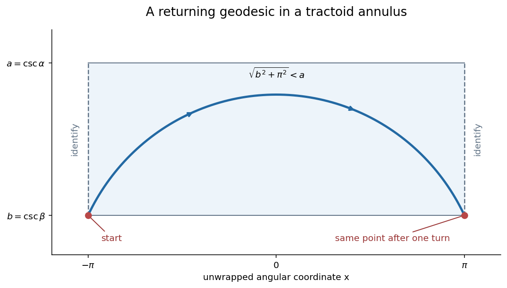

<h1 id="a/4/solution">Solution</h1>

↑ **Parent:** [4](../4.md)

Parametrize a nonconstant [hyperbolic geodesic](../../../../geodesic-in-the-poincare-half-plane-model.md) by unit speed. Its energy is $(\dot x^2+\dot y^2)/(2y^2)$, and the [Euler-Lagrange equation](../../../../euler-lagrange-equation.md) in the [cyclic coordinate](../../../../cyclic-coordinate.md) $x$ gives $\dot x/y^2=c$. Unit speed gives $\dot x^2+\dot y^2=y^2$. If $c=0$ the curve is vertical. Otherwise, on either side of a possible highest point,

$$
\frac{dx}{dy}=\frac{\pm cy}{\sqrt{1-c^2y^2}},\qquad (x-a)^2+y^2=c^{-2}.
$$

The two branches join smoothly at the top. Conversely these curves with their unit-speed parametrizations satisfy the energy equations. Thus **the unparametrized complete [geodesics](../../../../geodesic.md) are vertical half-lines and upper semicircles centered on the real axis**.

Let the [tractrix](../../../../tractrix.md) point have positive height $r(\theta)$. Its tangent segment to the axis has length one and makes angle $\theta$, so $r=\sin\theta$. Since its slope is $\tan\theta$, $h'(\theta)=\cos^2\theta/\sin\theta$ for its axial coordinate. Rotating $X(\theta,v)=(h(\theta),\sin\theta\cos v,\sin\theta\sin v)$ gives orthogonal coordinate vectors with squared lengths $\cot^2\theta$ and $\sin^2\theta$. Hence the stated [first fundamental form](../../../../first-fundamental-form.md) follows.

Now put **$x=v$, $y=\csc\theta$**. Direct substitution gives

$$
\frac{dx^2+dy^2}{y^2}=\sin^2\theta\,dv^2+\cot^2\theta\,d\theta^2.
$$

On the specified intervals this coordinate map is a [diffeomorphism](../../../../diffeomorphism.md) onto the stated rectangle, so is an [isometry](../../../../isometry.md) there and a [local isometry](../../../../local-isometry.md) on the [tractoid](../../../../tractoid.md).

Set $b=\csc\beta$, $a=\csc\alpha$. In the unwrapped coordinate, connect $(x_0,b)$ to $(x_0+2\pi,b)$ along the semicircle centered at $(x_0+\pi,0)$ of radius $\sqrt{b^2+\pi^2}$. Its height lies between $b$ and that radius. The hypothesis $a^2-b^2>\pi^2$ puts the whole arc in the closed height strip $b\leq y\leq a$. Projecting the angular coordinate modulo $2\pi$ therefore gives **a [geodesic](../../../../geodesic.md) segment in the closed [tractoid](../../../../tractoid.md) annulus which winds once and returns to its starting point**. Taking $x_0$ to represent any chosen angular position proves the assertion for every point of its $\theta=\beta$ boundary. The returned tangent need not equal the starting tangent, so this proves the claimed returning segment without asserting a periodically smooth [closed geodesic](../../../../closed-geodesic.md).

**[Figure 1](#a/4/image-a-returning-geodesic-in-an-unwrapped-tractoid-annulus). A returning geodesic in an unwrapped tractoid annulus**.

## ↑ Ancestors (12)

1. [4](../4.md)
2. [A](../../a.md)
3. [2007](../../../2007-split.md)
4. [Past exam of the geometry course of the University of Oxford](../../../split.md)
5. [Geometry course of the University of Oxford](../../../../geometry-course-of-the-university-of-oxford.md)
6. [Year 3 of the mathematics course of the University of Oxford](../../../../year-3-of-the-mathematics-course-of-the-university-of-oxford.md)
7. [Mathematics course of the University of Oxford](../../../../mathematics-course-of-the-university-of-oxford.md)
8. [Undergraduate course of the University of Oxford](../../../../undergraduate-course-of-the-university-of-oxford.md)
9. [Course of the University of Oxford](../../../../course-of-the-university-of-oxford.md)
10. [University of Oxford](../../../../university-of-oxford-split.md)
11. [List of universities](../../../../list-of-universities.md)
12. [Codex Wiki](../../../../split.md)
