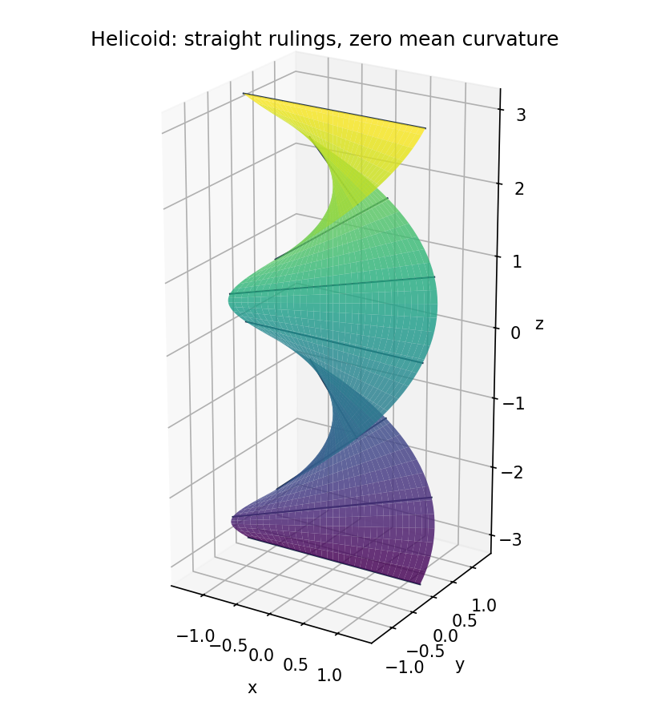

# 2008

↑ **Parent:** [Past exam of the geometry course of the University of Oxford](../past-exam-of-the-geometry-course-of-the-university-of-oxford.md)

**Table of contents**

- [A](#a)
  - [1](#a/1)
    - [i](#a/1/i)
      - [Solution](#a/1/i/solution)
    - [ii](#a/1/ii)
      - [Solution](#a/1/ii/solution)
  - [2](#a/2)
    - [i](#a/2/i)
      - [Solution](#a/2/i/solution)
    - [ii](#a/2/ii)
      - [Solution](#a/2/ii/solution)
    - [iii](#a/2/iii)
      - [a](#a/2/iii/a)
        - [Solution](#a/2/iii/a/solution)
      - [b](#a/2/iii/b)
        - [Solution](#a/2/iii/b/solution)
      - [c](#a/2/iii/c)
        - [Solution](#a/2/iii/c/solution)
  - [3](#a/3)
    - [i](#a/3/i)
      - [Solution](#a/3/i/solution)
    - [ii](#a/3/ii)
      - [Solution](#a/3/ii/solution)
    - [iii](#a/3/iii)
      - [Solution](#a/3/iii/solution)
  - [4](#a/4)
    - [i](#a/4/i)
      - [Solution](#a/4/i/solution)
    - [ii](#a/4/ii)
      - [Solution](#a/4/ii/solution)
    - [iii](#a/4/iii)
      - [Solution](#a/4/iii/solution)
- [B](#b)
  - [5](#b/5)
    - [Solution](#b/5/solution)
  - [6](#b/6)
    - [Solution](#b/6/solution)
  - [7](#b/7)
    - [Solution](#b/7/solution)
  - [8](#b/8)
    - [i](#b/8/i)
      - [Solution](#b/8/i/solution)
    - [ii](#b/8/ii)
      - [Solution](#b/8/ii/solution)
    - [iii](#b/8/iii)
      - [Solution](#b/8/iii/solution)
    - [iv](#b/8/iv)
      - [Solution](#b/8/iv/solution)

## A

↑ **Parent:** [2008](2008.md)

<h3 id="a/1">1</h3>

↑ **Parent:** [A](#a)

<h4 id="a/1/i">i</h4>

↑ **Parent:** [1](#a/1)

<h5 id="a/1/i/solution">Solution</h5>

↑ **Parent:** [I](#a/1/i)

The [classification of compact surfaces](../topological-surface.md#classification-of-compact-surfaces) says that every compact connected [surface](../topological-surface.md) without boundary is homeomorphic either to the [sphere](../euclidean-geometry.md#sphere) with $g\geq0$ handles, with [Euler characteristic](../homology.md#euler-characteristic) $2-2g$, or to a [connected sum](../smooth-manifold.md#connected-sum-of-oriented-manifolds) of $k\geq1$ real projective planes, with [Euler characteristic](../homology.md#euler-characteristic) $2-k$. The first family is [orientable](../differential-geometry.md#orientable-surface) and the second is nonorientable; the displayed invariants uniquely determine the type. With boundary one additionally removes a uniquely determined number of open disks.

Number the vertices of the fourteen-gon $v_0,\ldots,v_{13}$ in boundary order. The printed edge identifications imply

$$
v_0\sim v_5\sim v_2\sim v_3\sim v_4\sim v_1\sim v_6\sim v_{13}\sim v_7\sim v_{12}\sim v_9\sim v_{10}\sim v_{11}\sim v_8\sim v_0.
$$

Thus there is one vertex, seven edges and one face in the quotient. Consequently

$$
\boxed{\chi(S)=1-7+1=-5.}
$$

The two occurrences of $a_1$ have the same sign, as do those of $a_5$, so the [orientation](../algebraic-topology.md#orientation-of-a-simplex) on the polygon cannot extend consistently across those paired edges. Thus **the [surface](../topological-surface.md) is nonorientable**, and classification identifies it as a [connected sum](../smooth-manifold.md#connected-sum-of-oriented-manifolds) of seven projective planes. The inverse on the first occurrence of $a_4$ and the positive second occurrence have been retained in the vertex calculation.

<h4 id="a/1/ii">ii</h4>

↑ **Parent:** [1](#a/1)

<h5 id="a/1/ii/solution">Solution</h5>

↑ **Parent:** [Ii](#a/1/ii)

A [Riemann surface](../riemann-surfaces.md) is a connected Hausdorff second-countable space equipped with complex coordinate charts whose changes of coordinate are holomorphic with holomorphic inverses. Such charts give it the structure of a one-dimensional [complex manifold](../complex-geometry.md#complex-manifold).

A holomorphic change of coordinate has nonzero derivative. In real coordinates its derivative matrix has determinant $|f'(z)|^2>0$ by the [Cauchy-Riemann equations](../analysis.md#cauchy-riemann-equations). Thus every overlap preserves the standard [orientation](../algebraic-topology.md#orientation-of-a-simplex) of the [complex plane](../complex-analysis.md#complex-plane). These chart orientations fit together, proving **every [Riemann surface](../riemann-surfaces.md) is [orientable](../differential-geometry.md#orientable-surface)**.

<h3 id="a/2">2</h3>

↑ **Parent:** [A](#a)

<h4 id="a/2/i">i</h4>

↑ **Parent:** [2](#a/2)

<h5 id="a/2/i/solution">Solution</h5>

↑ **Parent:** [I](#a/2/i)

For a regular parametrization choose the [unit normal](../differential-geometry.md#unit-normal) $n=(r_u\times r_v)/|r_u\times r_v|$. The [first fundamental form](../differential-geometry.md#first-fundamental-form) is the squared length induced on tangent vectors:

$$
I=E\,du^2+2F\,du\,dv+G\,dv^2,\qquad E=r_u\cdot r_u,\quad F=r_u\cdot r_v,\quad G=r_v\cdot r_v.
$$

The [second fundamental form](../second-fundamental-form.md) records their normal bending:

$$
II=L\,du^2+2M\,du\,dv+N\,dv^2,\qquad L=n\cdot r_{uu},\quad M=n\cdot r_{uv},\quad N=n\cdot r_{vv}.
$$

The [Gaussian curvature](../second-fundamental-form.md#gaussian-curvature) is

$$
\boxed{K=\frac{LN-M^2}{EG-F^2}.}
$$

Regularity ensures $EG-F^2>0$.

<h4 id="a/2/ii">ii</h4>

↑ **Parent:** [2](#a/2)

<h5 id="a/2/ii/solution">Solution</h5>

↑ **Parent:** [Ii](#a/2/ii)

Expanding the characteristic determinant gives

$$
(EG-F^2)\kappa^2-(LG+NE-2MF)\kappa+(LN-M^2)=0.
$$

The product and sum of its two roots therefore give

$$
\boxed{\kappa_1\kappa_2=\frac{LN-M^2}{EG-F^2}=K,\qquad H=\frac{\kappa_1+\kappa_2}{2}=\frac{LG+NE-2MF}{2(EG-F^2)}.}
$$

Reversing the normal changes both principal curvatures and the [mean curvature](../second-fundamental-form.md#mean-curvature) in sign, while leaving their product unchanged.

<h4 id="a/2/iii">iii</h4>

↑ **Parent:** [2](#a/2)

<h5 id="a/2/iii/a">a</h5>

↑ **Parent:** [Iii](#a/2/iii)

<h6 id="a/2/iii/a/solution">Solution</h6>

↑ **Parent:** [A](#a/2/iii/a)

Put $b=\gamma'+va'$. Then $r_u=b$ and $r_v=a$, so

$$
\boxed{I=|\gamma'+va'|^2du^2+2(\gamma'+va')\cdot a\,du\,dv+|a|^2dv^2.}
$$

This is the induced metric of the [ruled surface](../differential-geometry.md#ruled-surface) wherever $b\times a\ne0$.

<h5 id="a/2/iii/b">b</h5>

↑ **Parent:** [Iii](#a/2/iii)

<h6 id="a/2/iii/b/solution">Solution</h6>

↑ **Parent:** [B](#a/2/iii/b)

For the [ruled surface](../differential-geometry.md#ruled-surface), $r_{vv}=0$, so $N=0$. Also

$$
M=\frac{(b\times a)\cdot a'}{|b\times a|}=\frac{\gamma'\cdot(a\times a')}{|b\times a|},\qquad EG-F^2=|b\times a|^2.
$$

Thus

$$
\boxed{K=-\frac{[\gamma'\cdot(a\times a')]^2}{|b\times a|^4}.}
$$

The denominator is positive at every regular point, proving that zero [Gaussian curvature](../second-fundamental-form.md#gaussian-curvature) is equivalent to the vanishing of the stated scalar triple product. In particular the [Gaussian curvature](../second-fundamental-form.md#gaussian-curvature) of a regular [ruled surface](../differential-geometry.md#ruled-surface) is always nonpositive.

<h5 id="a/2/iii/c">c</h5>

↑ **Parent:** [Iii](#a/2/iii)

<h6 id="a/2/iii/c/solution">Solution</h6>

↑ **Parent:** [C](#a/2/iii/c)

For the [helicoid](../differential-geometry.md#helicoid),

$$
r_u=(-v\sin u,v\cos u,1),\qquad r_v=(\cos u,\sin u,0),\qquad n=\frac{(-\sin u,\cos u,-v)}{\sqrt{1+v^2}}.
$$

Hence $E=1+v^2$, $F=0$, $G=1$. Since $r_{uu}=(-v\cos u,-v\sin u,0)$ and $r_{vv}=0$, both $L$ and $N$ vanish. The mean-curvature formula therefore gives

$$
\boxed{H=0.}
$$

For comparison, $M=1/\sqrt{1+v^2}$, so $K=-1/(1+v^2)^2$; zero [mean curvature](../second-fundamental-form.md#mean-curvature) does not mean zero [Gaussian curvature](../second-fundamental-form.md#gaussian-curvature).

**[Figure 1](#a/2/iii/c/image-the-helicoid-is-ruled-by-straight-lines-and-has-zero-mean-curvature). The helicoid is ruled by straight lines and has zero mean curvature**.

<h3 id="a/3">3</h3>

↑ **Parent:** [A](#a)

<h4 id="a/3/i">i</h4>

↑ **Parent:** [3](#a/3)

<h5 id="a/3/i/solution">Solution</h5>

↑ **Parent:** [I](#a/3/i)

For the unit-speed curve, the [normal curvature](../second-fundamental-form.md#normal-curvature) is $\kappa_n=t'\cdot n$, and the [geodesic curvature](../differential-geometry.md#geodesic-curvature) is $\kappa_g=t'\cdot(n\times t)$. Differentiating $\gamma=r(u,v)$ twice and taking the normal component kills the terms in $r_u,r_v$, giving

$$
\boxed{\kappa_n=L(u')^2+2Mu'v'+N(v')^2.}
$$

An affinely parametrized [geodesic](../riemannian-geometry.md#geodesic) has zero tangential acceleration, or equivalently its [covariant derivative](../general-relativity.md#covariant-derivative) of velocity is zero. For unit speed, $t'\cdot t=0$, and $t,n\times t,n$ form an [orthonormal frame](../general-relativity.md#orthonormal-frame-in-spacetime). Therefore $t'=\kappa_n n+\kappa_g(n\times t)$, so zero tangential acceleration is exactly **$\kappa_g=0$**.

<h4 id="a/3/ii">ii</h4>

↑ **Parent:** [3](#a/3)

<h5 id="a/3/ii/solution">Solution</h5>

↑ **Parent:** [Ii](#a/3/ii)

Since $Eu'+Fv'=\gamma'\cdot r_u$, differentiation gives

$$
\frac d{ds}(Eu'+Fv')=\gamma''\cdot r_u+\frac12E_u(u')^2+F_uu'v'+\frac12G_u(v')^2.
$$

The corresponding calculation with $\gamma'\cdot r_v=Fu'+Gv'$ gives

$$
\frac d{ds}(Fu'+Gv')=\gamma''\cdot r_v+\frac12E_v(u')^2+F_vu'v'+\frac12G_v(v')^2.
$$

Thus the two requested equations hold exactly when $\gamma''$ is perpendicular to both tangent [basis](../vector-space.md#basis) vectors, which is precisely the [geodesic](../riemannian-geometry.md#geodesic) condition.

On expanding the left sides, the coefficient matrix of $(u'',v'')$ is the positive-definite metric matrix. It is invertible, so the equations form a smooth second-order [ordinary differential equation](../differential-equation.md#ordinary-differential-equation) in local coordinates. The local existence and uniqueness theorem gives a unique solution for each initial point and coordinate velocity. For an arbitrary initial tangent vector $w$ this is an affine parameter of constant speed $|w|$; it is arclength when $|w|=1$. For $w=0$ the solution is the constant curve. This specifies how the arbitrary-velocity statement relates to the preceding unit-speed convention.

<h4 id="a/3/iii">iii</h4>

↑ **Parent:** [3](#a/3)

<h5 id="a/3/iii/solution">Solution</h5>

↑ **Parent:** [Iii](#a/3/iii)

Let $R$ be reflection in the plane. Choose a point of the regular intersection curve and a [unit tangent vector](../tangent-vector.md#unit-tangent-vector) $w$ to it. Both the point and $w$ are fixed by $R$. The unique local [geodesic](../riemannian-geometry.md#geodesic) with these initial data is carried by the [surface](../topological-surface.md) [isometry](../riemannian-geometry.md#isometry) $R$ to another [geodesic](../riemannian-geometry.md#geodesic) with the same initial data. Uniqueness therefore gives $R\gamma=\gamma$. Its image lies in the fixed-point set of the reflection, namely the plane, hence locally in the intersection curve. Thus **the intersection curve is a [geodesic](../riemannian-geometry.md#geodesic)**, when parametrized by arclength.

<h3 id="a/4">4</h3>

↑ **Parent:** [A](#a)

<h4 id="a/4/i">i</h4>

↑ **Parent:** [4](#a/4)

<h5 id="a/4/i/solution">Solution</h5>

↑ **Parent:** [I](#a/4/i)

For a positively oriented curvilinear polygon bounding a disk $D$ in one coordinate patch, with exterior turning angles $\theta_i$, the [Gauss-Bonnet theorem](../differential-geometry.md#gauss-bonnet-theorem) states

$$
\boxed{\int_DK\,dA+\int_{\partial D}\kappa_g\,ds+\sum_i\theta_i=2\pi.}
$$

For a closed compact [surface](../topological-surface.md) the global formula is

$$
\boxed{\int_SK\,dA=2\pi\chi(S).}
$$

Triangulate the [surface](../topological-surface.md) with each triangle contained in a coordinate patch. For each face, writing its exterior angles as $\pi$ minus its interior angles gives $\int K+\int\kappa_g=\sum\text{interior angles}-\pi$. On summing, the two contributions on each internal edge cancel, and all angles at each vertex sum to $2\pi$. Thus $\int_SK=2\pi V-\pi F$. Since $3F=2E$, this equals $2\pi(V-E+F)$, as required. For a [nonorientable surface](../topological-surface.md#non-orientable-surface) apply the [orientable](../differential-geometry.md#orientable-surface) version to its [orientation double cover](../algebraic-topology.md#orientation-double-cover): both the curvature integral and [Euler characteristic](../homology.md#euler-characteristic) double. With boundary, the same summation retains the boundary [geodesic](../riemannian-geometry.md#geodesic)-curvature integral and the exterior angles at boundary corners, giving the corresponding global boundary formula with right side $2\pi\chi(S)$.

<h4 id="a/4/ii">ii</h4>

↑ **Parent:** [4](#a/4)

<h5 id="a/4/ii/solution">Solution</h5>

↑ **Parent:** [Ii](#a/4/ii)

For the [sphere](../euclidean-geometry.md#sphere), choose the inward normal so that the [second fundamental form](../second-fundamental-form.md) is $I/a$. Both principal curvatures are $1/a$, giving **$K=1/a^2$**; the outward choice reverses both signs and gives the same product.

The octant has area $4\pi a^2/8=\pi a^2/2$, so its curvature integral is $\pi/2$. Its sides are great-circle geodesics, hence have zero [geodesic curvature](../differential-geometry.md#geodesic-curvature). Each interior angle is $\pi/2$, so each exterior angle is also $\pi/2$. Therefore

$$
\boxed{\int_DK\,dA+\int_{\partial D}\kappa_g\,ds+\sum_i\theta_i=\frac\pi2+0+\frac{3\pi}2=2\pi,}
$$

verifying the polygon formula directly.

<h4 id="a/4/iii">iii</h4>

↑ **Parent:** [4](#a/4)

<h5 id="a/4/iii/solution">Solution</h5>

↑ **Parent:** [Iii](#a/4/iii)

If two distinct [geodesic](../riemannian-geometry.md#geodesic) arcs enclosed a disk, regard its boundary as a curvilinear two-sided polygon, with interior angles $\alpha,\beta$. These are positive; zero angle would make the arcs tangent and local [geodesic](../riemannian-geometry.md#geodesic) uniqueness would make them coincide. The [geodesic](../riemannian-geometry.md#geodesic)-curvature terms vanish, so Gauss-Bonnet gives

$$
\int_DK\,dA+(\pi-\alpha)+(\pi-\beta)=2\pi,\qquad\int_DK\,dA=\alpha+\beta>0.
$$

This contradicts $K\leq0$. Thus **no such disk-bounding [geodesic](../riemannian-geometry.md#geodesic) bigon exists**. The disk hypothesis matters because it fixes the [Euler characteristic](../homology.md#euler-characteristic) on the right side.

<h2 id="b">B</h2>

↑ **Parent:** [2008](2008.md)

<h3 id="b/5">5</h3>

↑ **Parent:** [B](#b)

<h4 id="b/5/solution">Solution</h4>

↑ **Parent:** [5](#b/5)

For a [projective frame](../projective-space.md#projective-frame), choose representative vectors $v_1,\ldots,v_{n+1}$ forming a [basis](../vector-space.md#basis). Express the final point by $\sum c_iv_i$. Every $c_i$ is nonzero, since otherwise some $n+1$ of the given representatives would be dependent. Rescale the first representatives to $c_iv_i$, so the last point is represented by their sum. Do the same for the target frame, with [basis](../vector-space.md#basis) $w_i$. The [linear map](../vector-space.md#linear-map) taking each rescaled source [basis](../vector-space.md#basis) vector to the corresponding target vector induces the required [projective transformation](../projective-space.md#projective-linear-transformation). For uniqueness, a transformation fixing the first $n+1$ coordinate points is represented by a diagonal matrix. Fixing their sum forces every diagonal entry to agree. It is therefore scalar, giving **a unique [projective transformation](../projective-space.md#projective-linear-transformation)**.

If three intersection points of the conics lay on a line, Bézout's theorem would force that line to be a component of either nonsingular [conic](../euclidean-geometry.md#conic-section), impossible. Thus the four points form a [projective frame](../projective-space.md#projective-frame) and can be moved to the three coordinate points and $[1:1:1]$. Vanishing at the coordinate points removes the square terms from each [conic](../euclidean-geometry.md#conic-section) equation; vanishing at the last point gives $a+b+c=0$.

Substitution gives, by direct expansion,

$$
ayz+bzx+cxy=au^2+bv^2+cw^2+(a+b+c)(uv+uw+vw)=au^2+bv^2+cw^2.
$$

The substitution matrix

$$
S=\begin{pmatrix}0&1&1\\1&0&1\\1&1&0\end{pmatrix}
$$

has determinant two, hence is invertible over $\mathbb C$. If the initial frame transformation is represented in the direction old coordinates equal $Q$ times new coordinates, take $P=QS$. Both quadratic forms then have no mixed terms, proving **$P^TAP$ and $P^TBP$ are simultaneously diagonal**. The same argument applies when an individual [conic](../euclidean-geometry.md#conic-section) is reducible but the intersection consists of exactly four distinct points: a line containing three would be a common component, contradicting finiteness of the intersection.

<h3 id="b/6">6</h3>

↑ **Parent:** [B](#b)

<h4 id="b/6/solution">Solution</h4>

↑ **Parent:** [6](#b/6)

An [inflection point](../topology.md#inflection-point) is a smooth point where the tangent line has [intersection multiplicity](../algebraic-geometry.md#intersection-multiplicity) at least three with the curve. For a nonsingular plane curve of degree $n\geq3$, these are the intersections with its [Hessian curve](../algebraic-geometry.md#hessian-curve-of-a-plane-curve), whose degree is $3(n-2)$. The original curve is not a component of its Hessian: otherwise in each graph chart the tangent direction would have zero derivative identically, making the curve locally a line and hence a line globally. Bézout therefore gives the upper bound **$3n(n-2)$**, counting multiplicity. A nonsingular [conic](../euclidean-geometry.md#conic-section) has no inflection points; lines are excluded from this finite-contact definition.

Take $F=y^2z-x^3+xz^2$. Its Hessian determinant is

$$
\det D^2F=8(3xy^2-3x^2z-z^3).
$$

At infinity the curve has only $O=[0:1:0]$, which is an [inflection point](../topology.md#inflection-point): its tangent is $z=0$ and the restricted equation is $-x^3=0$. In the chart $z=1$, substitute $y^2=x^3-x$ into the Hessian equation to obtain

$$
3x^4-6x^2-1=0,\qquad x^2=1\pm\frac2{\sqrt3}.
$$

Thus the full answer is

$$
\boxed{O=[0:1:0],\qquad [x:y:1]\text{ with }x^2=1\pm2/\sqrt3,\quad y=\pm\sqrt{x^3-x}.}
$$

The four complex values of $x$ are distinct and none is $0,1,-1$, so each gives two distinct nonzero values of $y$. Together with $O$ these are all nine inflection points, exhausting the Bézout bound.

<h3 id="b/7">7</h3>

↑ **Parent:** [B](#b)

<h4 id="b/7/solution">Solution</h4>

↑ **Parent:** [7](#b/7)

For a degree-$d$ nonconstant [holomorphic map](../riemann-surfaces.md#holomorphic-map) from a compact connected [Riemann surface](../riemann-surfaces.md) of [genus](../topological-surface.md#genus-of-a-surface) $g$ to the [projective line](../finite-group-theory.md#projective-line), the [Riemann-Hurwitz formula](../riemann-surfaces.md#riemann-hurwitz-formula) is

$$
\boxed{2g-2=-2d+\sum_{p\in X}(e_p-1),}
$$

where $e_p$ is the [local degree](../homology.md#local-degree-of-a-continuous-map). A [meromorphic function](../isolated-singularity.md#meromorphic-function) defines a map to the [sphere](../euclidean-geometry.md#sphere) by giving its ordinary finite values away from poles and value infinity at each pole. The reciprocal function is holomorphic in a neighborhood of a pole, proving holomorphicity there. For use in Riemann-Hurwitz the function must be nonconstant; a nonzero constant still defines a [holomorphic map](../riemann-surfaces.md#holomorphic-map), but of degree zero.

Let $X=\mathbb C/\Lambda$. The [double pole](../isolated-singularity.md#double-pole) of $\wp$ gives a degree-two map to the [sphere](../euclidean-geometry.md#sphere). The [torus](../topological-surface.md#torus) has [genus](../topological-surface.md#genus-of-a-surface) one, so total ramification is four. One simple [ramification point](../riemann-surfaces.md#ramification-point-of-a-holomorphic-map) is zero, above infinity. At the three nonzero half-period classes $h_i$, evenness and periodicity give $\wp'(h_i)=0$. Each is a [ramification point](../riemann-surfaces.md#ramification-point-of-a-holomorphic-map) of [local degree](../homology.md#local-degree-of-a-continuous-map) two, and these account for all remaining ramification. Put $e_i=\wp(h_i)$. They are distinct, since a degree-two fiber cannot contain two points each of [local degree](../homology.md#local-degree-of-a-continuous-map) two.

At each $h_i$, $\wp-e_i$ has a double zero and $\wp'$ has a simple zero. Consequently the elliptic quotient

$$
R(z)=\frac{\wp'(z)^2}{(\wp(z)-e_1)(\wp(z)-e_2)(\wp(z)-e_3)}
$$

has removable singularities there and no zeros or poles elsewhere except possibly zero. Near zero, $\wp=z^{-2}+O(z^2)$ and $\wp'=-2z^{-3}+O(z)$, so $R\to4$. Thus $R$ is holomorphic on the compact [torus](../topological-surface.md#torus) and constant, proving

$$
\boxed{\wp'^2=4(\wp-e_1)(\wp-e_2)(\wp-e_3).}
$$

**The printed additional requirement that all three $e_i$ be nonzero is false.** For the square lattice $\Lambda=\mathbb Z+i\mathbb Z$, invariance of the defining series under multiplication by $i$ gives $\wp(iz)=-\wp(z)$. At $h=(1+i)/2$, one has $ih=h-1$, so periodicity gives $\wp(h)=\wp(ih)=-\wp(h)$ and hence $\wp(h)=0$. This is one of the three branch values. Distinctness, which is all the cubic construction needs, remains valid.

Define

$$
\Phi(z)=[\wp(z):\wp'(z):1]\quad(z\notin\Lambda),\qquad\Phi(0)=[0:1:0].
$$

The image lies on $Y^2Z=4(X-e_1Z)(X-e_2Z)(X-e_3Z)$. Distinct roots make its affine part smooth, and the point at infinity is smooth because the derivative of its equation with respect to $Z$ is nonzero there. Near zero the projective coordinates $X/Y=\wp/\wp'\sim-z/2$ and $Z/Y=1/\wp'\sim-z^3/2$ extend holomorphically. Every finite $X/Z$ value has two preimages under $\wp$ except at a branch value. Evenness pairs those preimages as $z,-z$, and oddness of $\wp'$ distinguishes them unless they are the same half-period class. Therefore the two coordinates together give injectivity and reach both signs of $Y$, proving surjectivity onto the cubic. Thus **$\Phi$ is a bijective [holomorphic map](../riemann-surfaces.md#holomorphic-map) to a nonsingular cubic**, including when one branch value is zero.

<h3 id="b/8">8</h3>

↑ **Parent:** [B](#b)

<h4 id="b/8/i">i</h4>

↑ **Parent:** [8](#b/8)

<h5 id="b/8/i/solution">Solution</h5>

↑ **Parent:** [I](#b/8/i)

A [divisor on an algebraic curve](../algebraic-geometry.md#divisor-on-an-algebraic-curve) is a finite formal sum $D=\sum n_pp$ with integer coefficients. Its degree is $\deg D=\sum n_p$. The [principal divisor](../algebraic-geometry.md#principal-divisor-on-an-algebraic-curve) of a nonzero [meromorphic function](../isolated-singularity.md#meromorphic-function) is $(f)=\sum\operatorname{ord}_p(f)p$. For a nonconstant $f$, zeros and poles are fibers over zero and infinity of the same map to the [sphere](../euclidean-geometry.md#sphere), each of total multiplicity equal to its degree; hence $\deg(f)=0$. A nonzero constant has zero divisor.

Write $L(D)=\{f:(f)+D\geq0\}\cup\{0\}$ and $\ell(D)=\dim L(D)$. The [Riemann-Roch theorem](../algebraic-geometry.md#riemann-roch-theorem) states

$$
\boxed{\ell(D)-\ell(K_C-D)=\deg D+1-g,}
$$

where $K_C$ is a [canonical divisor](../algebraic-geometry.md#canonical-divisor). Taking $D=p_1+\cdots+p_{g+1}$ gives $\ell(D)=2+\ell(K_C-D)\geq2$. Constants span only one [dimension](../vector-space.md#dimension-vector-space), so there is a nonconstant $f\in L(D)$. It has no poles outside these points and at most a [simple pole](../isolated-singularity.md#simple-pole) at each. Thus **the required nonconstant function exists**, with actual poles at some nonempty subset because a [holomorphic function](../holomorphic-function.md) on a compact connected curve is constant.

<h4 id="b/8/ii">ii</h4>

↑ **Parent:** [8](#b/8)

<h5 id="b/8/ii/solution">Solution</h5>

↑ **Parent:** [Ii](#b/8/ii)

Since every $p_i$ is fixed, $f\circ\varphi$ has poles only among the first $g+1$ points, with order at most one: a biholomorphic change of coordinate preserves pole order. Thus $h=f-f\circ\varphi$ also has at most $g+1$ poles, counted with multiplicity. At every $p_i$ with $i>g+1$, both terms are finite and equal, so $h(p_i)=0$.

If $h$ were not zero, its [principal divisor](../algebraic-geometry.md#principal-divisor-on-an-algebraic-curve) would have degree zero. It would therefore have at most $g+1$ zeros counted with multiplicity. But it has at least $n-(g+1)$ distinct zeros. When $n>2g+2$ this number exceeds $g+1$, a contradiction. Consequently

$$
\boxed{n>2g+2\implies f=f\circ\varphi.}
$$

<h4 id="b/8/iii">iii</h4>

↑ **Parent:** [8](#b/8)

<h5 id="b/8/iii/solution">Solution</h5>

↑ **Parent:** [Iii](#b/8/iii)

Choose an actual pole $p_i$ of $f$; one exists by nonconstancy and compactness. In a local coordinate $z$ centered there, its [simple pole](../isolated-singularity.md#simple-pole) has expansion $f(z)=a_{-1}/z+O(1)$ with $a_{-1}\ne0$. Hence

$$
w(z)=1/f(z)=z/a_{-1}+O(z^2),\qquad w'(0)\ne0.
$$

The [holomorphic inverse function theorem](../geometry-and-topology.md#holomorphic-inverse-function-theorem) makes **$1/f$ a local coordinate**. Here the source notation $f^{-1}$ denotes the reciprocal, rather than an inverse map of the [meromorphic function](../isolated-singularity.md#meromorphic-function).

The chosen pole is among the fixed points, so $\varphi$ maps a sufficiently small neighborhood of it into the coordinate neighborhood. If $f=f\circ\varphi$, then $w=w\circ\varphi$ there. Injectivity of this coordinate forces $\varphi(x)=x$ throughout a nonempty open set. The stated identity principle then gives **$\varphi$ equal to the identity everywhere**.

<h4 id="b/8/iv">iv</h4>

↑ **Parent:** [8](#b/8)

<h5 id="b/8/iv/solution">Solution</h5>

↑ **Parent:** [Iv](#b/8/iv)

If a nonidentity holomorphic [automorphism](../algebra.md#automorphism) had more than $2g+2$ fixed points, choose that many distinct ones and apply the function constructed above. The zero-and-pole count would give $f=f\circ\varphi$, and the local reciprocal coordinate would force $\varphi$ to be the identity, a contradiction. Therefore

$$
\boxed{\#\operatorname{Fix}(\varphi)\leq2g+2\quad\text{for every nonidentity holomorphic automorphism}.}
$$

## ↑ Ancestors (9)

1. [Past exam of the geometry course of the University of Oxford](../past-exam-of-the-geometry-course-of-the-university-of-oxford.md)
2. [Geometry course of the University of Oxford](../university-of-oxford.md#geometry-course-of-the-university-of-oxford)
3. [Year 3 of the mathematics course of the University of Oxford](../university-of-oxford.md#year-3-of-the-mathematics-course-of-the-university-of-oxford)
4. [Mathematics course of the University of Oxford](../university-of-oxford.md#mathematics-course-of-the-university-of-oxford)
5. [Undergraduate course of the University of Oxford](../university-of-oxford.md#undergraduate-course-of-the-university-of-oxford)
6. [Course of the University of Oxford](../university-of-oxford.md#course-of-the-university-of-oxford)
7. [University of Oxford](../university-of-oxford.md)
8. [List of universities](../README.md#list-of-universities)
9. [Codex Wiki](../README.md)
