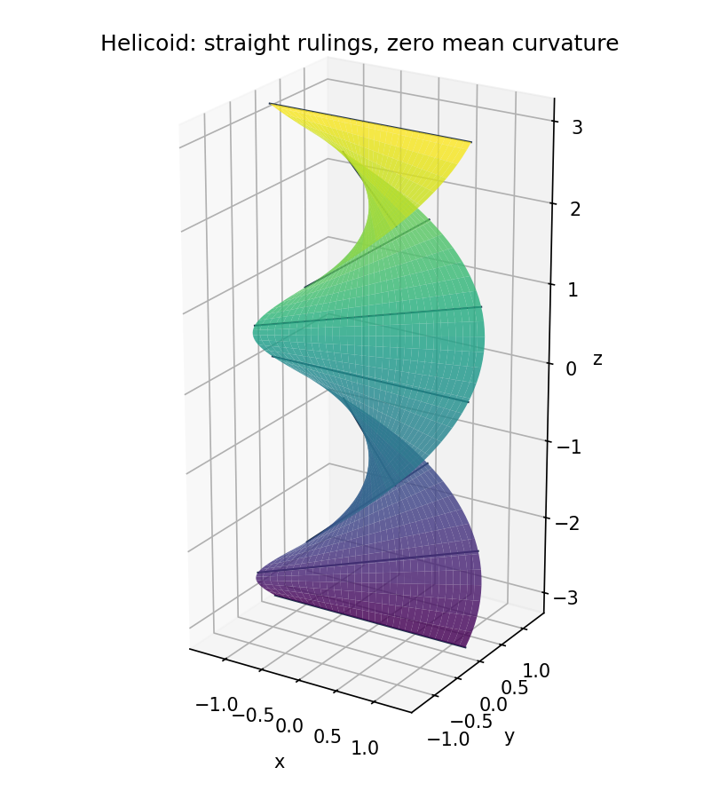

<h1 id="a/2/iii/c/solution">Solution</h1>

↑ **Parent:** [C](../c.md)

For the [helicoid](../../../../../../helicoid.md),

$$
r_u=(-v\sin u,v\cos u,1),\qquad r_v=(\cos u,\sin u,0),\qquad n=\frac{(-\sin u,\cos u,-v)}{\sqrt{1+v^2}}.
$$

Hence $E=1+v^2$, $F=0$, $G=1$. Since $r_{uu}=(-v\cos u,-v\sin u,0)$ and $r_{vv}=0$, both $L$ and $N$ vanish. The mean-curvature formula therefore gives

$$
\boxed{H=0.}
$$

For comparison, $M=1/\sqrt{1+v^2}$, so $K=-1/(1+v^2)^2$; zero [mean curvature](../../../../../../mean-curvature.md) does not mean zero [Gaussian curvature](../../../../../../gaussian-curvature.md).

**[Figure 1](#a/2/iii/c/image-the-helicoid-is-ruled-by-straight-lines-and-has-zero-mean-curvature). The helicoid is ruled by straight lines and has zero mean curvature**.

## ↑ Ancestors (14)

1. [C](../c.md)
2. [Iii](../../iii.md)
3. [2](../../../2.md)
4. [A](../../../../a.md)
5. [2008](../../../../../2008-split.md)
6. [Past exam of the geometry course of the University of Oxford](../../../../../split.md)
7. [Geometry course of the University of Oxford](../../../../../../geometry-course-of-the-university-of-oxford.md)
8. [Year 3 of the mathematics course of the University of Oxford](../../../../../../year-3-of-the-mathematics-course-of-the-university-of-oxford.md)
9. [Mathematics course of the University of Oxford](../../../../../../mathematics-course-of-the-university-of-oxford.md)
10. [Undergraduate course of the University of Oxford](../../../../../../undergraduate-course-of-the-university-of-oxford.md)
11. [Course of the University of Oxford](../../../../../../course-of-the-university-of-oxford.md)
12. [University of Oxford](../../../../../../university-of-oxford-split.md)
13. [List of universities](../../../../../../list-of-universities.md)
14. [Codex Wiki](../../../../../../split.md)
