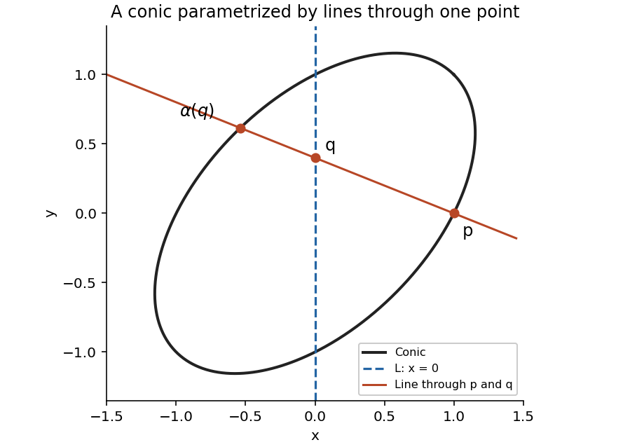

<h1 id="b/4/solution">Solution</h1>

↑ **Parent:** [4](../4.md)

For every $q\in L$, the line $pq$ meets the nonsingular [conic](../../../../conic-section.md) in two points counted with multiplicity by the [Bézout theorem](../../../../bezout-s-theorem.md). One is $p$; define $\alpha(q)$ as the second, using $\alpha(q)=p$ for the unique tangent line at $p$. Conversely, for $r\in C\setminus\{p\}$, intersect the line $pr$ with $L$, and send $p$ itself to the intersection of its tangent with $L$. Since $p\notin L$, each intersection with $L$ is unique. These constructions are inverse, so **$\alpha:L\to C$ is a bijection** preserving the stated collinearity. This is [parametrization of a conic by projection](../../../../parametrization-of-a-conic-by-projection.md).

For the particular [conic](../../../../conic-section.md) take $p=[1:0:1]$ and $L=\{x=0\}$. If $q=[0:s:t]$, points on $pq$ have coordinates $[a:bs:a+bt]$. Substitution into the [conic](../../../../conic-section.md) gives

$$
b\bigl[-a(s+2t)+b(s^2-t^2)\bigr]=0.
$$

Taking the second intersection gives the explicit map

$$
\boxed{\alpha([0:s:t])=[s^2-t^2:s(s+2t):s^2+st+t^2].}
$$

The three coordinates do not vanish simultaneously. If $s+2t=0$, the formula gives $p$, as required for the tangent direction.

For rational points, put $r=s/t$ when $t\ne0$. The full affine list is

$$
\boxed{x=\frac{r^2-1}{r^2+r+1},\qquad y=\frac{r(r+2)}{r^2+r+1},\qquad r\in\mathbb Q,}
$$

together with the parameter $r=\infty$, which gives $(x,y)=(1,1)$. The denominator is $(r+1/2)^2+3/4>0$ for rational $r$. Conversely, every rational point other than $p$ determines a rational joining line and hence a rational point of $L$; the point $p$ is obtained at $r=-2$. Thus this lists **all rational solutions**.

**[Figure 1](#b/4/image-projection-from-a-rational-conic-point-to-a-line). Projection from a rational conic point to a line**.

## ↑ Ancestors (12)

1. [4](../4.md)
2. [B](../../b.md)
3. [2009](../../../2009-split.md)
4. [Past exam of the geometry course of the University of Oxford](../../../split.md)
5. [Geometry course of the University of Oxford](../../../../geometry-course-of-the-university-of-oxford.md)
6. [Year 3 of the mathematics course of the University of Oxford](../../../../year-3-of-the-mathematics-course-of-the-university-of-oxford.md)
7. [Mathematics course of the University of Oxford](../../../../mathematics-course-of-the-university-of-oxford.md)
8. [Undergraduate course of the University of Oxford](../../../../undergraduate-course-of-the-university-of-oxford.md)
9. [Course of the University of Oxford](../../../../course-of-the-university-of-oxford.md)
10. [University of Oxford](../../../../university-of-oxford-split.md)
11. [List of universities](../../../../list-of-universities.md)
12. [Codex Wiki](../../../../split.md)
