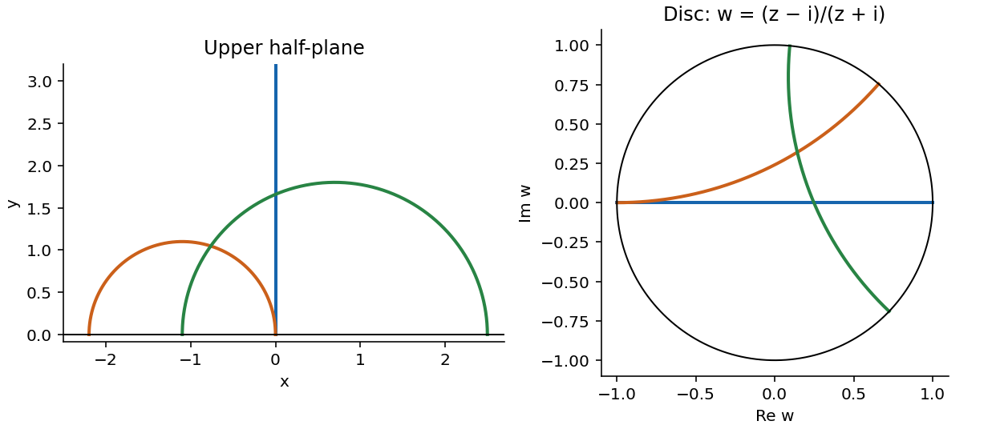

# 2010

↑ **Parent:** [Past exam of the geometry course of the University of Oxford](../past-exam-of-the-geometry-course-of-the-university-of-oxford.md)

**Table of contents**

- [A](#a)
  - [1](#a/1)
    - [i](#a/1/i)
      - [Solution](#a/1/i/solution)
    - [ii](#a/1/ii)
      - [Solution](#a/1/ii/solution)
    - [iii](#a/1/iii)
      - [a](#a/1/iii/a)
        - [Solution](#a/1/iii/a/solution)
      - [b](#a/1/iii/b)
        - [Solution](#a/1/iii/b/solution)
      - [c](#a/1/iii/c)
        - [Solution](#a/1/iii/c/solution)
      - [d](#a/1/iii/d)
        - [Solution](#a/1/iii/d/solution)
    - [iv](#a/1/iv)
      - [Solution](#a/1/iv/solution)
  - [2](#a/2)
    - [i](#a/2/i)
      - [Solution](#a/2/i/solution)
    - [ii](#a/2/ii)
      - [Solution](#a/2/ii/solution)
    - [iii](#a/2/iii)
      - [Solution](#a/2/iii/solution)
    - [iv](#a/2/iv)
      - [Solution](#a/2/iv/solution)
  - [3](#a/3)
    - [i](#a/3/i)
      - [Solution](#a/3/i/solution)
    - [ii](#a/3/ii)
      - [Solution](#a/3/ii/solution)
    - [iii](#a/3/iii)
      - [Solution](#a/3/iii/solution)
- [B](#b)
  - [4](#b/4)
    - [a](#b/4/a)
      - [Solution](#b/4/a/solution)
    - [b](#b/4/b)
      - [Solution](#b/4/b/solution)
    - [c](#b/4/c)
      - [Solution](#b/4/c/solution)
  - [5](#b/5)
    - [a](#b/5/a)
      - [Solution](#b/5/a/solution)
    - [b](#b/5/b)
      - [Solution](#b/5/b/solution)
    - [c](#b/5/c)
      - [Solution](#b/5/c/solution)
    - [d](#b/5/d)
      - [Solution](#b/5/d/solution)
    - [e](#b/5/e)
      - [Solution](#b/5/e/solution)
    - [f](#b/5/f)
      - [Solution](#b/5/f/solution)
  - [6](#b/6)
    - [a](#b/6/a)
      - [Solution](#b/6/a/solution)
    - [b](#b/6/b)
      - [Solution](#b/6/b/solution)
    - [c](#b/6/c)
      - [Solution](#b/6/c/solution)
    - [d](#b/6/d)
      - [Solution](#b/6/d/solution)

## A

↑ **Parent:** [2010](2010.md)

<h3 id="a/1">1</h3>

↑ **Parent:** [A](#a)

<h4 id="a/1/i">i</h4>

↑ **Parent:** [1](#a/1)

<h5 id="a/1/i/solution">Solution</h5>

↑ **Parent:** [I](#a/1/i)

The [classification of compact surfaces](../topological-surface.md#classification-of-compact-surfaces) says that every [compact](../topology.md#compact-space) connected [surface](../topological-surface.md) without boundary is [homeomorphic](../topology.md#homeomorphism) to exactly one of the following: the [sphere](../euclidean-geometry.md#sphere), an [orientable surface](../differential-geometry.md#orientable-surface) obtained as the [connected sum](../smooth-manifold.md#connected-sum-of-oriented-manifolds) of $g\geq1$ [tori](../topological-surface.md#torus), or a [nonorientable surface](../topological-surface.md#non-orientable-surface) obtained as the [connected sum](../smooth-manifold.md#connected-sum-of-oriented-manifolds) of $k\geq1$ real [projective planes](../projective-space.md#projective-plane). The integers $g$ and $k$ are unique, and the orientable and nonorientable families do not overlap. Including $g=0$ makes the [sphere](../euclidean-geometry.md#sphere) the genus-zero member of the orientable family.

Their [Euler characteristics](../homology.md#euler-characteristic) are $2-2g$ and $2-k$, respectively. Thus **[orientability](../topology.md#orientability) and the [Euler characteristic](../homology.md#euler-characteristic) determine the closed connected [surface](../topological-surface.md)**. If boundaries are allowed, one additionally specifies the number of boundary circles and removes that many open discs from a closed model.

<h4 id="a/1/ii">ii</h4>

↑ **Parent:** [1](#a/1)

<h5 id="a/1/ii/solution">Solution</h5>

↑ **Parent:** [Ii](#a/1/ii)

For a finite polygonal [CW complex](../algebraic-topology.md#cw-complex) decomposition of a [compact](../topology.md#compact-space) [surface](../topological-surface.md), with $V$ vertices, $E$ edges and $F$ faces after all identifications,

$$
\boxed{\chi=V-E+F.}
$$

This is the [Euler characteristic](../homology.md#euler-characteristic), independent of the chosen subdivision. In a polygonal presentation, count [equivalence classes](../set-theory.md#equivalence-class) of vertices and paired edges, rather than their number before gluing.

<h4 id="a/1/iii">iii</h4>

↑ **Parent:** [1](#a/1)

<h5 id="a/1/iii/a">a</h5>

↑ **Parent:** [Iii](#a/1/iii)

<h6 id="a/1/iii/a/solution">Solution</h6>

↑ **Parent:** [A](#a/1/iii/a)

Use a square with boundary word $aba^{-1}b^{-1}$, identifying opposite sides with matching labels and arrows. All four vertices become one, the four sides form two edge classes, and there is one face. Therefore the [torus](../topological-surface.md#torus) has

$$
\boxed{\chi(T)=1-2+1=0.}
$$

<h5 id="a/1/iii/b">b</h5>

↑ **Parent:** [Iii](#a/1/iii)

<h6 id="a/1/iii/b/solution">Solution</h6>

↑ **Parent:** [B](#a/1/iii/b)

A polygonal model of the real [projective plane](../projective-space.md#projective-plane) is a bigon with boundary word $aa$, with the equally labelled arrows identified. Its two vertices become one, its sides form one edge, and it has one face. Thus

$$
\boxed{\chi(P)=1-1+1=1.}
$$

Equivalently, glue antipodal boundary points of a disc.

<h5 id="a/1/iii/c">c</h5>

↑ **Parent:** [Iii](#a/1/iii)

<h6 id="a/1/iii/c/solution">Solution</h6>

↑ **Parent:** [C](#a/1/iii/c)

A square with boundary word $aba^{-1}b$ gives the [Klein bottle](../topological-surface.md#klein-bottle). The side identifications produce one vertex, two edges and one face. Consequently

$$
\boxed{\chi(K)=1-2+1=0.}
$$

Unlike the [torus](../topological-surface.md#torus), this [surface](../topological-surface.md) is nonorientable; its equal [Euler characteristic](../homology.md#euler-characteristic) alone does not distinguish them.

<h5 id="a/1/iii/d">d</h5>

↑ **Parent:** [Iii](#a/1/iii)

<h6 id="a/1/iii/d/solution">Solution</h6>

↑ **Parent:** [D](#a/1/iii/d)

Glue two triangular discs along their boundaries to obtain a [sphere](../euclidean-geometry.md#sphere). The resulting [CW complex](../algebraic-topology.md#cw-complex) decomposition has three vertices, three edges and two faces, giving

$$
\boxed{\chi(S^2)=3-3+2=2.}
$$

The two triangles represent the two closed hemispheres, with an equator subdivided into three edges.

<h4 id="a/1/iv">iv</h4>

↑ **Parent:** [1](#a/1)

<h5 id="a/1/iv/solution">Solution</h5>

↑ **Parent:** [Iv](#a/1/iv)

For $g\geq1$, the standard commutator-word polygon has one face, $2g$ paired edge classes and a single vertex class. Thus

$$
\boxed{\chi(X)=1-2g+1=2-2g.}
$$

An [orientable surface](../differential-geometry.md#orientable-surface) admits continuously compatible local orientations; for a smooth [surface](../topological-surface.md), this is equivalently a continuous choice of [unit normal vector](../differential-geometry.md#unit-normal) in an oriented ambient three-dimensional space when such an embedding is available. In a polygonal model, orientability means the faces can be oriented so that induced boundary directions on each glued edge oppose one another. Here each edge label occurs once positively and once negatively. The orientation of the polygon therefore descends consistently across every seam. Hence **$X$ is orientable**, and it is the [closed orientable surface](../topological-surface.md#closed-orientable-surface) of genus $g$.

<h3 id="a/2">2</h3>

↑ **Parent:** [A](#a)

<h4 id="a/2/i">i</h4>

↑ **Parent:** [2](#a/2)

<h5 id="a/2/i/solution">Solution</h5>

↑ **Parent:** [I](#a/2/i)

For a regular [parametric surface](../differential-geometry.md#parametric-surface) $r(u,v)$, set

$$
E=r_u\cdot r_u,\quad F=r_u\cdot r_v,\quad G=r_v\cdot r_v,\qquad N=\frac{r_u\times r_v}{\|r_u\times r_v\|}.
$$

The [first fundamental form](../differential-geometry.md#first-fundamental-form) is the induced [Riemannian metric](../riemannian-metric.md)

$$
\mathrm I=E\,du^2+2F\,du\,dv+G\,dv^2.
$$

The [second fundamental form](../second-fundamental-form.md), for this choice of [unit normal vector](../differential-geometry.md#unit-normal), is

$$
\mathrm{II}=e\,du^2+2f_2\,du\,dv+g_2\,dv^2,\quad e=r_{uu}\cdot N,\quad f_2=r_{uv}\cdot N,\quad g_2=r_{vv}\cdot N.
$$

The [Gaussian curvature](../second-fundamental-form.md#gaussian-curvature) is the product of the [principal curvatures](../second-fundamental-form.md#principal-curvature), equivalently the [determinant](../multilinear-algebra.md#determinant) of the [shape operator](../second-fundamental-form.md#shape-operator):

$$
\boxed{K=\frac{eg_2-f_2^2}{EG-F^2}.}
$$

Reversing the normal reverses the [second fundamental form](../second-fundamental-form.md) and both [principal curvatures](../second-fundamental-form.md#principal-curvature), while leaving $K$ unchanged.

<h4 id="a/2/ii">ii</h4>

↑ **Parent:** [2](#a/2)

<h5 id="a/2/ii/solution">Solution</h5>

↑ **Parent:** [Ii](#a/2/ii)

Work on a regular patch with $f(u)>0$. Differentiating the [surface of revolution](../differential-geometry.md#surface-of-revolution) gives

$$
r_u=(f'\cos v,f'\sin v,h'),\qquad r_v=(-f\sin v,f\cos v,0).
$$

The arc-length condition gives $E=1$, $F=0$, $G=f^2$. Also $\|r_u\times r_v\|=f$, so take

$$
N=(-h'\cos v,-h'\sin v,f').
$$

The second derivatives yield

$$
e=f'h''-f''h',\qquad f_2=0,\qquad g_2=fh'.
$$

Thus the [first fundamental form](../differential-geometry.md#first-fundamental-form) and [second fundamental form](../second-fundamental-form.md) are

$$
\boxed{\mathrm I=du^2+f^2dv^2,\qquad\mathrm{II}=(f'h''-f''h')du^2+fh'\,dv^2.}
$$

The opposite normal reverses the second displayed form. At a smooth pole the revolution coordinates degenerate, so [curvature](../differential-geometry.md#curvature) is understood by a regular local chart or by continuity.

<h4 id="a/2/iii">iii</h4>

↑ **Parent:** [2](#a/2)

<h5 id="a/2/iii/solution">Solution</h5>

↑ **Parent:** [Iii](#a/2/iii)

Differentiating the arc-length identity gives $f'f''+h'h''=0$. Multiply by $f'$ and use $(f')^2+(h')^2=1$ to obtain

$$
(f'h''-f''h')h'=f'h'h''-f''(h')^2=-f''\bigl((f')^2+(h')^2\bigr)=-f''.
$$

This derivation does not divide by $h'$, so it remains valid where $h'=0$. Inserting the [first fundamental form](../differential-geometry.md#first-fundamental-form) and [second fundamental form](../second-fundamental-form.md) computed above gives the [Gaussian curvature of a surface of revolution](../differential-geometry.md#gaussian-curvature-of-a-surface-of-revolution):

$$
\boxed{K=\frac{(f'h''-f''h')fh'}{f^2}=-\frac{f''}{f}.}
$$

<h4 id="a/2/iv">iv</h4>

↑ **Parent:** [2](#a/2)

<h5 id="a/2/iv/solution">Solution</h5>

↑ **Parent:** [Iv](#a/2/iv)

Choose $f(u)=\sin u$ and $h(u)=\cos u$ for $0\leq u\leq\pi$. Adding the smooth poles at the endpoints gives the unit [sphere](../euclidean-geometry.md#sphere). Its meridian is parametrized by [arc length](../riemannian-geometry.md#arc-length), and $-f''/f=1$ away from the poles, hence everywhere by continuity. Thus **the unit [sphere](../euclidean-geometry.md#sphere) has constant [Gaussian curvature](../second-fundamental-form.md#gaussian-curvature) one**.

There is **no [compact](../topology.md#compact-space) smooth [surface of revolution](../differential-geometry.md#surface-of-revolution) without boundary of constant [Gaussian curvature](../second-fundamental-form.md#gaussian-curvature) minus one** in this setting. On a [compact](../topology.md#compact-space) such [surface](../topological-surface.md), the distance $f$ from the rotation axis attains a positive maximum. The maximum lies on a regular revolution patch, where the meridian [arc length](../riemannian-geometry.md#arc-length) coordinate gives $f''\leq0$. Hence $K=-f''/f\geq0$ there, contradicting $K=-1$. Equivalently, constant negative [curvature](../differential-geometry.md#curvature) would require $f''=f>0$, excluding any positive radial maximum. Compact patches with boundary would not be excluded by this argument, but they are not closed surfaces.

<h3 id="a/3">3</h3>

↑ **Parent:** [A](#a)

<h4 id="a/3/i">i</h4>

↑ **Parent:** [3](#a/3)

<h5 id="a/3/i/solution">Solution</h5>

↑ **Parent:** [I](#a/3/i)

For an affinely parametrized [geodesic](../riemannian-geometry.md#geodesic) $s\mapsto(x(s),y(s))$, the energy [Lagrangian](../calculus-of-variations.md#lagrangian) is $L=(\dot x^2+\dot y^2)/(2y^2)$. The coordinate $x$ is cyclic, so the [Euler-Lagrange equation](../analysis.md#euler-lagrange-equation) gives $\dot x/y^2=c$, a constant. Parametrize a nonconstant [geodesic](../riemannian-geometry.md#geodesic) by hyperbolic [arc length](../riemannian-geometry.md#arc-length); then

$$
\dot x=cy^2,\qquad\dot x^2+\dot y^2=y^2.
$$

If $c=0$, $x$ is constant: these are vertical lines. If $c\ne0$, on intervals with $\dot y\ne0$,

$$
\frac{dx}{dy}=\frac{\pm cy}{\sqrt{1-c^2y^2}}.
$$

Integration gives $(x-a)^2+y^2=c^{-2}$. The two branches join smoothly at the highest point. Conversely these curves satisfy the [geodesic equations](../riemannian-geometry.md#geodesic-equation), or are images of vertical lines under half-plane [Möbius transformations](../group-theory.md#mobius-transformation) that are [isometries](../riemannian-geometry.md#isometry). Thus the complete nonconstant [geodesics](../riemannian-geometry.md#geodesic) are

$$
\boxed{x=\text{constant},\qquad(x-a)^2+y^2=R^2\ (y>0),}
$$

namely vertical lines and upper semicircles orthogonal to the real axis. Their subarcs give [geodesic segments](../riemannian-geometry.md#geodesic-segment).

<h4 id="a/3/ii">ii</h4>

↑ **Parent:** [3](#a/3)

<h5 id="a/3/ii/solution">Solution</h5>

↑ **Parent:** [Ii](#a/3/ii)

The [Cayley transform](../group-theory.md#cayley-transform-complex-analysis) $w=(z-i)/(z+i)$ maps the upper half-plane conformally onto the unit disc. Its inverse is $z=i(1+w)/(1-w)$, with

$$
|dz|^2=\frac{4|dw|^2}{|1-w|^4},\qquad\operatorname{Im}z=\frac{1-|w|^2}{|1-w|^2}.
$$

Transporting the given [hyperbolic metric](../hyperbolic-geometry.md#hyperbolic-metric) therefore gives the [Poincare disc model](../hyperbolic-geometry.md#poincare-disk-model)

$$
\boxed{ds_D^2=\frac{4|dw|^2}{(1-|w|^2)^2}.}
$$

The [Cayley transform](../group-theory.md#cayley-transform-complex-analysis) is an [isometry](../riemannian-geometry.md#isometry) for this metric, so it carries the half-plane [geodesics](../riemannian-geometry.md#geodesic) to disc [geodesics](../riemannian-geometry.md#geodesic). A [Möbius transformation](../group-theory.md#mobius-transformation) sends generalized circles to generalized circles and preserves angles. Hence these are exactly **diameters and arcs of circles meeting the unit circle orthogonally**. Multiplying this [Riemannian metric](../riemannian-metric.md) by any positive constant leaves the unparametrized [geodesics](../riemannian-geometry.md#geodesic) unchanged.

**[Figure 1](#a/3/ii/image-half-plane-geodesics-and-their-cayley-images-in-the-disc). Half-plane geodesics and their Cayley images in the disc**.

<h4 id="a/3/iii">iii</h4>

↑ **Parent:** [3](#a/3)

<h5 id="a/3/iii/solution">Solution</h5>

↑ **Parent:** [Iii](#a/3/iii)

For distinct points $a,b$ on a [geodesic](../riemannian-geometry.md#geodesic), the given disc [isometry](../riemannian-geometry.md#isometry) $z\mapsto e^{i\theta}(z-a)/(1-\bar az)$ sends $a$ to zero. Choose $\theta$ so that the image of $b$ is the positive number

$$
x=\left|\frac{b-a}{1-\bar ab}\right|\in(0,1).
$$

An orthogonal-circle [geodesic](../riemannian-geometry.md#geodesic) through zero is a diameter, so this normalizes the [geodesic](../riemannian-geometry.md#geodesic) as required.

There are two [hyperbolic metric](../hyperbolic-geometry.md#hyperbolic-metric) normalizations to distinguish. For the metric transferred from the stated half-plane, the radial length is

$$
d_D(0,x)=\int_0^x\frac{2\,dt}{1-t^2}=2\operatorname{artanh}x.
$$

The diameter is minimizing. Indeed, any path $w(t)$ from zero to $x$ has $|\dot w|\geq|d|w|/dt|$, so its length is at least $2\operatorname{artanh}x$, with equality on the radial segment. Therefore the distance consistent with the given half-plane metric is

$$
\boxed{d_D(a,b)=2\operatorname{artanh}\left|\frac{b-a}{1-\bar ab}\right|.}
$$

For the alternative disc metric $d\widetilde s_D^2=|dw|^2/(1-|w|^2)^2$, every length is halved and the same isometries and [geodesics](../riemannian-geometry.md#geodesic) remain. In that convention,

$$
\boxed{\widetilde d_D(a,b)=\operatorname{artanh}\left|\frac{b-a}{1-\bar ab}\right|.}
$$

**The printed distance corresponds to the latter convention.** It is obtained from one quarter of the given half-plane metric, rather than its direct transfer. The equal-point case gives distance zero in both conventions. This is the [normalization of the Poincare disc metric](../hyperbolic-geometry.md#normalization-of-the-poincare-disc-metric).

<h2 id="b">B</h2>

↑ **Parent:** [2010](2010.md)

<h3 id="b/4">4</h3>

↑ **Parent:** [B](#b)

<h4 id="b/4/a">a</h4>

↑ **Parent:** [4](#b/4)

<h5 id="b/4/a/solution">Solution</h5>

↑ **Parent:** [A](#b/4/a)

First consider the unlettered [projective frame](../projective-space.md#projective-frame) assertion. A list of $n+2$ points in $\mathbb{CP}^n$ is in general position when every $n+1$ of their representative vectors are [linearly independent](../vector-space.md#linear-independence), equivalently no $n+1$ of the points lie in a projective hyperplane. Choose representatives $v_1,\ldots,v_{n+1}$ of the first $n+1$ points as a [basis](../vector-space.md#basis). Write $v_{n+2}=\sum c_iv_i$. Each $c_i$ is nonzero, since otherwise $v_{n+2}$ and the other $n$ basis vectors would be dependent. Rescaling the representatives makes $v_{n+2}=v_1+\cdots+v_{n+1}$.

Do the same for the second frame with representatives $w_i$. The [invertible linear map](../multivariable-calculus.md#invertible-linear-map) $v_i\mapsto w_i$ induces a [projective transformation](../projective-space.md#projective-linear-transformation) carrying all $n+2$ points as required. A transformation fixing a normalized frame is represented by a diagonal matrix, since it fixes the first $n+1$ points. Fixing the sum point forces every diagonal entry to coincide, so the matrix is scalar and the [projective transformation](../projective-space.md#projective-linear-transformation) is the identity. This proves **existence and uniqueness**.

Return to the four chosen points on the two lines. Since the six points are distinct, at most one is $K\cap L$; put its index third if necessary. No three of $p_1,p_2,q_1,q_2$ are collinear: every triple contains two on one line and a point on the other line away from the intersection. Thus they form a [projective frame](../projective-space.md#projective-frame) in $\mathbb{CP}^2$. The four target points also have no collinear triple, as their three-by-three [determinants](../multilinear-algebra.md#determinant) are nonzero. The frame result gives **a unique [projective transformation](../projective-space.md#projective-linear-transformation) with the prescribed four images**.

<h4 id="b/4/b">b</h4>

↑ **Parent:** [4](#b/4)

<h5 id="b/4/b/solution">Solution</h5>

↑ **Parent:** [B](#b/4/b)

The normalized lines are $K=\{z=0\}$ and $L=\{y=0\}$. A point of $K$ with first coordinate zero is $p_1$, so $p_3\ne p_1$ permits unique normalization $p_3=[1,\alpha,0]$. The inequality $p_3\ne p_2$ gives $\alpha\ne1$. Similarly, $q_3=[1,0,\beta]$ uniquely with $\beta\ne1$.

The lines $p_1q_2$ and $p_2q_1$ are $x-z=0$ and $x-y=0$, giving $r_{12}=[1,1,1]$. The lines $p_1q_3$ and $p_3q_1$ are $\beta x-z=0$ and $\alpha x-y=0$, giving $r_{13}=[1,\alpha,\beta]$. Finally, the two lines defining $r_{23}$ have equations

$$
\beta x-\beta y-z=0,\qquad\alpha x-y-\alpha z=0.
$$

Taking the [cross product](../vector-space.md#cross-product) of their coefficient vectors gives

$$
\boxed{r_{12}=[1,1,1],\quad r_{13}=[1,\alpha,\beta],\quad r_{23}=[\alpha\beta-1,\alpha(\beta-1),\beta(\alpha-1)].}
$$

The last vector cannot vanish: if $\alpha\beta=1$, both parameters are nonzero and vanishing of its other coordinates would force $\alpha=\beta=1$, which is excluded.

<h4 id="b/4/c">c</h4>

↑ **Parent:** [4](#b/4)

<h5 id="b/4/c/solution">Solution</h5>

↑ **Parent:** [C](#b/4/c)

Let $u=(1,1,1)$ and $v=(1,\alpha,\beta)$. The vector representing $r_{23}$ satisfies

$$
(\alpha\beta-1,\alpha(\beta-1),\beta(\alpha-1))=\alpha\beta\,u-v.
$$

Consequently the three representative vectors are [linearly dependent](../vector-space.md#linear-dependence), so **$r_{12},r_{13},r_{23}$ are collinear** in the [projective plane](../projective-space.md#projective-plane). Equivalently their three-by-three [determinant](../multilinear-algebra.md#determinant) vanishes. This is the two-line configuration of [Pappus's hexagon theorem](../projective-space.md#pappus-s-hexagon-theorem).

<h3 id="b/5">5</h3>

↑ **Parent:** [B](#b)

<h4 id="b/5/a">a</h4>

↑ **Parent:** [5](#b/5)

<h5 id="b/5/a/solution">Solution</h5>

↑ **Parent:** [A](#b/5/a)

The strong [Bézout theorem](../algebraic-geometry.md#bezout-s-theorem) says that if two projective plane [algebraic curves](../algebraic-variety.md#algebraic-curve) $C,D$ over $\mathbb C$ have degrees $m,n$ and no common irreducible component, their intersection is finite and

$$
\boxed{\sum_{p\in C\cap D}I_p(C,D)=mn.}
$$

Each [intersection multiplicity](../algebraic-geometry.md#intersection-multiplicity) is a positive integer. Scheme-theoretic multiplicities, rather than just distinct intersection points, are essential: tangencies and singularities can make individual terms larger than one.

<h4 id="b/5/b">b</h4>

↑ **Parent:** [5](#b/5)

<h5 id="b/5/b/solution">Solution</h5>

↑ **Parent:** [B](#b/5/b)

For curves with no common local component at $p$,

$$
\boxed{I_p(C,D)=1\iff C,D\text{ are both smooth at }p\text{ and have distinct tangent lines}.}
$$

In local affine coordinates, their defining equations have linearly independent gradients exactly in this case. These independent linear terms form local coordinates, so the local intersection quotient has [dimension](../vector-space.md#dimension-vector-space) one. Conversely, if either equation lacks a nonzero linear term or the two linear terms are dependent, the local intersection quotient cannot have [dimension](../vector-space.md#dimension-vector-space) one. This is [transverse intersection of plane curves](../algebraic-geometry.md#transverse-intersection-of-plane-curves) of two smooth plane curves.

<h4 id="b/5/c">c</h4>

↑ **Parent:** [5](#b/5)

<h5 id="b/5/c/solution">Solution</h5>

↑ **Parent:** [C](#b/5/c)

Write the irreducible curve as $F=0$, with $F$ homogeneous of degree $n$. For $n=1$ there are no singular points. Otherwise choose a nonzero partial derivative, say $F_x$, which has degree $n-1$. Such a derivative exists in [characteristic zero](../algebra.md#characteristic-zero). Irreducibility and its smaller degree show that $F$ and $F_x$ have no common component.

At every [singular point](../algebraic-geometry.md#singular-point-of-an-algebraic-variety) $p$ of $C$, $F_x(p)=0$ and the curve multiplicity of $F$ is at least two. The standard local lower bound for [intersection multiplicity](../algebraic-geometry.md#intersection-multiplicity) gives $I_p(F,F_x)\geq2$. Applying the [Bézout theorem](../algebraic-geometry.md#bezout-s-theorem),

$$
2\#\operatorname{Sing}(C)\leq\sum_{p\in C\cap\{F_x=0\}}I_p(F,F_x)=n(n-1).
$$

Therefore

$$
\boxed{\#\operatorname{Sing}(C)\leq\tfrac12n(n-1).}
$$

This is the [polar bound for singular points of a plane curve](../algebraic-geometry.md#polar-bound-for-singular-points-of-a-plane-curve).

<h4 id="b/5/d">d</h4>

↑ **Parent:** [5](#b/5)

<h5 id="b/5/d/solution">Solution</h5>

↑ **Parent:** [D](#b/5/d)

Take the union of $n$ distinct projective lines in general position, with no three concurrent. Its defining polynomial is the product of their linear equations, so its degree is $n$. Exactly two lines meet at each of the $\binom n2$ pairwise intersections, producing an ordinary double point; elsewhere just one line passes through and the curve is smooth. Hence

$$
\boxed{\#\operatorname{Sing}(C)=\binom n2=\tfrac12n(n-1).}
$$

For $n=1$, the line itself gives zero singular points, as required.

<h4 id="b/5/e">e</h4>

↑ **Parent:** [5](#b/5)

<h5 id="b/5/e/solution">Solution</h5>

↑ **Parent:** [E](#b/5/e)

The curves have no common component, since their intersection is finite. Let $R=0$ define the irreducible degree-$m$ curve $E$. Choose $p\in E$ outside $C\cap D$, and select $(\lambda,\mu)\ne(0,0)$ with $\lambda P(p)+\mu Q(p)=0$. The polynomial $H=\lambda P+\mu Q$ is not identically zero, since $P,Q$ are not proportional.

The degree-$n$ curve $H=0$ meets $E$ at the prescribed $nm$ base points and also at $p$. If $R$ did not divide $H$, irreducibility of $R$ and the [Bézout theorem](../algebraic-geometry.md#bezout-s-theorem) would bound the number of distinct intersections by $nm$, contradicting these $nm+1$ points. Thus

$$
H=RS,\qquad\deg S=n-m.
$$

At every remaining common zero of $P,Q$ lying off $E$, $R$ is nonzero and hence $S=0$. Therefore

$$
\boxed{F=\{S=0\}\text{ contains all remaining }n(n-m)\text{ points},\qquad\deg F\leq n-m.}
$$

This is [residual intersection through a curve pencil](../algebraic-geometry.md#residual-intersection-through-a-curve-pencil). The existence of a point $p$ outside the finite base locus is automatic on the projective curve $E$.

<h4 id="b/5/f">f</h4>

↑ **Parent:** [5](#b/5)

<h5 id="b/5/f/solution">Solution</h5>

↑ **Parent:** [F](#b/5/f)

Let the six distinct [conic](../euclidean-geometry.md#conic-section) points be $p_1,\ldots,p_6$, and write $\ell_{ij}$ for their joining line. Form two reducible cubics

$$
C=\ell_{12}\cup\ell_{34}\cup\ell_{56},\qquad D=\ell_{23}\cup\ell_{45}\cup\ell_{61}.
$$

No three distinct points of an irreducible [conic](../euclidean-geometry.md#conic-section) are collinear, by the [Bézout theorem](../algebraic-geometry.md#bezout-s-theorem) applied to a line and the [conic](../euclidean-geometry.md#conic-section). Thus all six side lines are distinct, the cubics have no common component, and six of their intersections are precisely the vertices. The remaining pairings give

$$
q_1=\ell_{12}\cap\ell_{45},\qquad q_2=\ell_{34}\cap\ell_{61},\qquad q_3=\ell_{56}\cap\ell_{23}.
$$

These three points are off the [conic](../euclidean-geometry.md#conic-section) and distinct. For example, equality of $q_1$ and $q_2$ would put that point on both $\ell_{34}$ and $\ell_{45}$, making it $p_4$ and then placing $p_4$ on $\ell_{12}$, impossible. The other cases are identical. Hence the two cubics meet in nine distinct points.

Apply [residual intersection through a curve pencil](../algebraic-geometry.md#residual-intersection-through-a-curve-pencil) with $n=3$, $m=2$ and $E$ the [conic](../euclidean-geometry.md#conic-section): six intersections lie on $E$, so the other three lie on a curve of degree at most one. Therefore **$q_1,q_2,q_3$ are collinear**, proving [Pascal's theorem](../algebraic-geometry.md#pascal-s-theorem).

<h3 id="b/6">6</h3>

↑ **Parent:** [B](#b)

<h4 id="b/6/a">a</h4>

↑ **Parent:** [6](#b/6)

<h5 id="b/6/a/solution">Solution</h5>

↑ **Parent:** [A](#b/6/a)

First record the unlettered definitions. A [divisor on an algebraic curve](../algebraic-geometry.md#divisor-on-an-algebraic-curve) on a [compact](../topology.md#compact-space) [Riemann surface](../riemann-surfaces.md) is a finite formal sum $D=\sum_p n_p[p]$ with $n_p\in\mathbb Z$. Its degree is $\deg D=\sum_p n_p$. A [principal divisor](../algebraic-geometry.md#principal-divisor-on-an-algebraic-curve) is $(f)=\sum_p\operatorname{ord}_p(f)[p]$ for a nonzero [meromorphic function](../isolated-singularity.md#meromorphic-function), with positive order at a zero and negative order at a pole. Two divisors are [linearly equivalent](../algebraic-geometry.md#linear-equivalence-of-weil-divisors) if their difference is principal. Principal divisors form a subgroup because $(fg)=(f)+(g)$ and $(1/f)=-(f)$.

For the doubly periodic function, put $h=f'/f$. It is periodic with the same [period lattice](../complex-analysis.md#period-lattice), and its [residue](../analysis.md#residue) at $p_i$ equals $n_i$. Opposite sides of the [fundamental parallelogram](../complex-analysis.md#fundamental-parallelogram-of-a-period-lattice) are translates by a period with opposite directions, so their integrals of $h$ cancel. The [residue theorem](../analysis.md#residue-theorem) gives

$$
0=\oint_{\Gamma_a}h(w)\,dw=2\pi i\sum_i n_i.
$$

Thus

$$
\boxed{\sum_i n_i=0.}
$$

In particular an [elliptic function](../complex-analysis.md#elliptic-function) has equally many zeros and poles counted with multiplicity in a period cell.

<h4 id="b/6/b">b</h4>

↑ **Parent:** [6](#b/6)

<h5 id="b/6/b/solution">Solution</h5>

↑ **Parent:** [B](#b/6/b)

Order the [period lattice](../complex-analysis.md#period-lattice) basis so the indicated contour is positively oriented; reversing its orientation only changes the signs of the resulting integers. Set

$$
A=\int_a^{a+\lambda_1}h(w)\,dw,\qquad B=\int_a^{a+\lambda_2}h(w)\,dw,\qquad h=f'/f.
$$

Pairing the translated sides while retaining the factor $w$ gives

$$
\oint_{\Gamma_a}w h(w)\,dw=\lambda_1 B-\lambda_2 A.
$$

For example, the right side is the translate by $\lambda_1$ of the left side with reversed orientation; their combined contribution is $\lambda_1B$. The bottom and top similarly give $-\lambda_2A$.

Along either path there is a continuously continued logarithm of the nonzero finite function $f$. Since its endpoint values agree by periodicity, each logarithmic increment is an integer multiple of $2\pi i$. Therefore $A=2\pi i r$, $B=2\pi i s$ for integers $r,s$. The [residue theorem](../analysis.md#residue-theorem) applied to $wh$ now yields

$$
\boxed{\sum_i n_ip_i=s\lambda_1-r\lambda_2\in\Lambda.}
$$

This is the [elliptic divisor-sum identity](../complex-analysis.md#elliptic-divisor-sum-identity).

<h4 id="b/6/c">c</h4>

↑ **Parent:** [6](#b/6)

<h5 id="b/6/c/solution">Solution</h5>

↑ **Parent:** [C](#b/6/c)

For a [divisor on an algebraic curve](../algebraic-geometry.md#divisor-on-an-algebraic-curve) $D=\sum_jn_j[p_j+\Lambda]$, define

$$
\boxed{\Psi([D])=\left(\sum_jn_j,\ \sum_jn_jp_j+\Lambda\right)\in\mathbb Z\times(\mathbb C/\Lambda).}
$$

Changing the representatives $p_j$ changes the second coordinate only by an element of $\Lambda$. The two preceding contour arguments show that a [principal divisor](../algebraic-geometry.md#principal-divisor-on-an-algebraic-curve) has degree zero and [period lattice](../complex-analysis.md#period-lattice) sum zero. Thus the formula is unchanged by [linear equivalence of divisors](../algebraic-geometry.md#linear-equivalence-of-divisors) and is a well-defined [group homomorphism](../group-theory.md#group-homomorphism) on the quotient.

It is nontrivial, since $[0]$ maps to $(1,0+\Lambda)$. In fact it is [surjective](../algebra.md#surjective-function): for any $d\in\mathbb Z$ and $z+\Lambda\in\mathbb C/\Lambda$, the [divisor on an algebraic curve](../algebraic-geometry.md#divisor-on-an-algebraic-curve) $(d-1)[0]+[z+\Lambda]$ maps to $(d,z+\Lambda)$. Only well-definedness and a nontrivial homomorphism are required here; identifying its entire kernel would be an additional theorem.

<h4 id="b/6/d">d</h4>

↑ **Parent:** [6](#b/6)

<h5 id="b/6/d/solution">Solution</h5>

↑ **Parent:** [D](#b/6/d)

Set $g(w)=a\wp(w)+b\wp'(w)+c$. The [Weierstrass elliptic function](../complex-analysis.md#weierstrass-elliptic-function) is doubly periodic, with a double pole at the origin modulo $\Lambda$ and no other poles. Its derivative has leading term $-2w^{-3}$. Since $b\ne0$, no lower-order term cancels this, so $g$ has a pole of order exactly three at zero and no others.

The point $\Phi(0+\Lambda)=[0,1,0]$ does not lie on the line, because its line equation evaluates to $b\ne0$. At every other point of the image, lying on the line is equivalent to $g(w)=0$. The three distinct image points therefore yield three distinct zeros modulo $\Lambda$. By the zero-pole count, these are all the zeros and each is simple. Hence its [principal divisor](../algebraic-geometry.md#principal-divisor-on-an-algebraic-curve) on the torus is

$$
(g)=[w_1+\Lambda]+[w_2+\Lambda]+[w_3+\Lambda]-3[0+\Lambda].
$$

Applying the [elliptic divisor-sum identity](../complex-analysis.md#elliptic-divisor-sum-identity) gives

$$
\boxed{w_1+w_2+w_3\in\Lambda.}
$$

This is the [period lattice](../complex-analysis.md#period-lattice) form of the [chord-and-tangent group law](../normalization-of-an-algebraic-curve.md#chord-and-tangent-group-law) on an elliptic cubic.

## ↑ Ancestors (9)

1. [Past exam of the geometry course of the University of Oxford](../past-exam-of-the-geometry-course-of-the-university-of-oxford.md)
2. [Geometry course of the University of Oxford](../university-of-oxford.md#geometry-course-of-the-university-of-oxford)
3. [Year 3 of the mathematics course of the University of Oxford](../university-of-oxford.md#year-3-of-the-mathematics-course-of-the-university-of-oxford)
4. [Mathematics course of the University of Oxford](../university-of-oxford.md#mathematics-course-of-the-university-of-oxford)
5. [Undergraduate course of the University of Oxford](../university-of-oxford.md#undergraduate-course-of-the-university-of-oxford)
6. [Course of the University of Oxford](../university-of-oxford.md#course-of-the-university-of-oxford)
7. [University of Oxford](../university-of-oxford.md)
8. [List of universities](../README.md#list-of-universities)
9. [Codex Wiki](../README.md)
