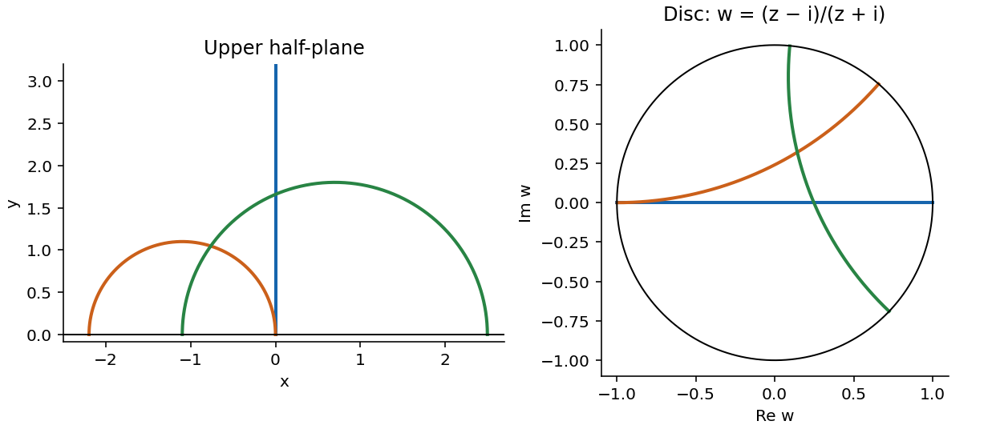

<h1 id="a/3/ii/solution">Solution</h1>

↑ **Parent:** [Ii](../ii.md)

The [Cayley transform](../../../../../cayley-transform-complex-analysis.md) $w=(z-i)/(z+i)$ maps the upper half-plane conformally onto the unit disc. Its inverse is $z=i(1+w)/(1-w)$, with

$$
|dz|^2=\frac{4|dw|^2}{|1-w|^4},\qquad\operatorname{Im}z=\frac{1-|w|^2}{|1-w|^2}.
$$

Transporting the given [hyperbolic metric](../../../../../hyperbolic-metric.md) therefore gives the [Poincare disc model](../../../../../poincare-disk-model.md)

$$
\boxed{ds_D^2=\frac{4|dw|^2}{(1-|w|^2)^2}.}
$$

The [Cayley transform](../../../../../cayley-transform-complex-analysis.md) is an [isometry](../../../../../isometry.md) for this metric, so it carries the half-plane [geodesics](../../../../../geodesic.md) to disc [geodesics](../../../../../geodesic.md). A [Möbius transformation](../../../../../mobius-transformation.md) sends generalized circles to generalized circles and preserves angles. Hence these are exactly **diameters and arcs of circles meeting the unit circle orthogonally**. Multiplying this [Riemannian metric](../../../../../riemannian-metric-split.md) by any positive constant leaves the unparametrized [geodesics](../../../../../geodesic.md) unchanged.

**[Figure 1](#a/3/ii/image-half-plane-geodesics-and-their-cayley-images-in-the-disc). Half-plane geodesics and their Cayley images in the disc**.

## ↑ Ancestors (13)

1. [Ii](../ii.md)
2. [3](../../3.md)
3. [A](../../../a.md)
4. [2010](../../../../2010-split.md)
5. [Past exam of the geometry course of the University of Oxford](../../../../split.md)
6. [Geometry course of the University of Oxford](../../../../../geometry-course-of-the-university-of-oxford.md)
7. [Year 3 of the mathematics course of the University of Oxford](../../../../../year-3-of-the-mathematics-course-of-the-university-of-oxford.md)
8. [Mathematics course of the University of Oxford](../../../../../mathematics-course-of-the-university-of-oxford.md)
9. [Undergraduate course of the University of Oxford](../../../../../undergraduate-course-of-the-university-of-oxford.md)
10. [Course of the University of Oxford](../../../../../course-of-the-university-of-oxford.md)
11. [University of Oxford](../../../../../university-of-oxford-split.md)
12. [List of universities](../../../../../list-of-universities.md)
13. [Codex Wiki](../../../../../split.md)
