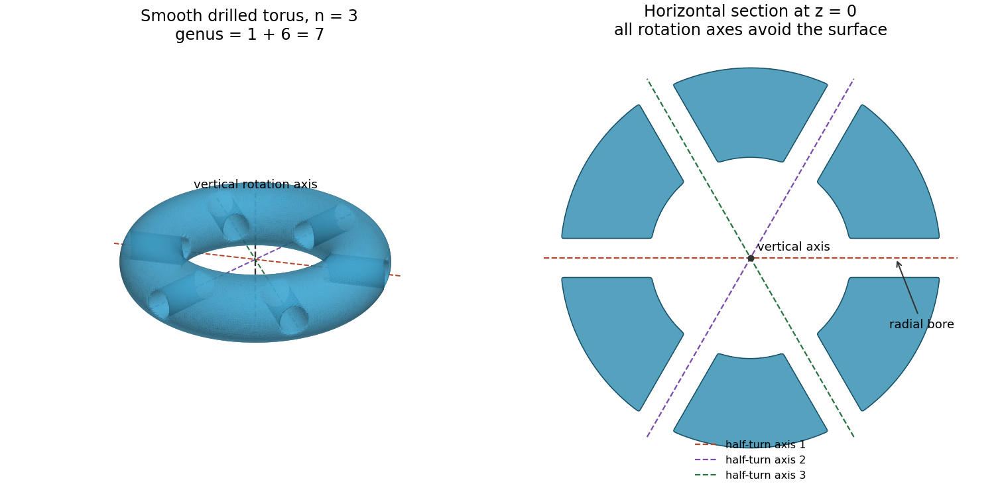

# 2023

↑ **Parent:** [Past exam of the geometry of surfaces course of the University of Oxford](../past-exam-of-the-geometry-of-surfaces-course-of-the-university-of-oxford.md)

Original solutions to all three questions of the [Geometry of surfaces course of the University of Oxford](../university-of-oxford.md#geometry-of-surfaces-course-of-the-university-of-oxford) Part B examination, held on 7 June 2023. Source: [released examination PDF, bundle pages 214–217; paper pages 1–4](https://www.whatdotheyknow.com/request/request_for_mathematics_examinat/response/3129786/attach/3/FOI%20202507%20740%20Data.pdf#page=214). The numbering follows the original paper. In 3(e), the displayed identity requires integration with multiplicity when the parameter interval wraps around the [surface](../topological-surface.md); the solution explains this omission in the native PDF.

**Table of contents**

- [1](#1)
  - [a](#1/a)
    - [Solution](#1/a/solution)
  - [b](#1/b)
    - [Solution](#1/b/solution)
  - [c](#1/c)
    - [Solution](#1/c/solution)
  - [d](#1/d)
    - [Solution](#1/d/solution)
  - [e](#1/e)
    - [Solution](#1/e/solution)
- [2](#2)
  - [a](#2/a)
    - [Solution](#2/a/solution)
  - [b](#2/b)
    - [Solution](#2/b/solution)
  - [c](#2/c)
    - [Solution](#2/c/solution)
  - [d](#2/d)
    - [Solution](#2/d/solution)
  - [e](#2/e)
    - [Solution](#2/e/solution)
- [3](#3)
  - [a](#3/a)
    - [Solution](#3/a/solution)
  - [b](#3/b)
    - [Solution](#3/b/solution)
  - [c](#3/c)
    - [Solution](#3/c/solution)
  - [d](#3/d)
    - [Solution](#3/d/solution)
  - [e](#3/e)
    - [Solution](#3/e/solution)
  - [f](#3/f)
    - [Solution](#3/f/solution)

## 1

↑ **Parent:** [2023](2023.md)

<h3 id="1/a">a</h3>

↑ **Parent:** [1](#1)

<h4 id="1/a/solution">Solution</h4>

↑ **Parent:** [A](#1/a)

The [classification of compact surfaces](../topological-surface.md#classification-of-compact-surfaces) says that every [compact](../topology.md#compact-space), [connected](../geometry-and-topology.md#connected-space) [topological surface](../topological-surface.md) without [boundary](../topology.md#boundary-of-a-set) is [homeomorphic](../topology.md#homeomorphism) to exactly one of the following: the [sphere](../euclidean-geometry.md#sphere) $S^2$; a [connected sum of surfaces](../topological-surface.md#connected-sum-of-surfaces) consisting of $g\geq1$ [tori](../topological-surface.md#torus); or a [connected sum of surfaces](../topological-surface.md#connected-sum-of-surfaces) consisting of $k\geq1$ [real projective planes](../differential-geometry.md#real-projective-plane). The first two cases are [orientable](../differential-geometry.md#orientable-surface); the last case is a [nonorientable surface](../topological-surface.md#non-orientable-surface). Their [Euler characteristics](../homology.md#euler-characteristic) are

$$
\boxed{\chi(S^2)=2,\qquad\chi(\Sigma_g)=2-2g,\qquad\chi(N_k)=2-k.}
$$

Here $\Sigma_g$ has [genus](../topological-surface.md#genus-of-a-surface) $g$, and $N_k$ has $k$ crosscaps; $N_1$ is the [real projective plane](../differential-geometry.md#real-projective-plane) and $N_2$ the [Klein bottle](../topological-surface.md#klein-bottle). Thus [orientability](../topology.md#orientability) together with the [Euler characteristic](../homology.md#euler-characteristic) determines the closed [surface](../topological-surface.md) up to [homeomorphism](../topology.md#homeomorphism).

If the convention permits a [surface with boundary](../topological-surface.md#surface-with-boundary), also remove the interiors of $b\geq0$ disjoint [closed discs](../topology.md#closed-disc) from one of these closed [surfaces](../topological-surface.md). The [Euler characteristic](../homology.md#euler-characteristic) decreases by $b$, giving $2-2g-b$ in the [orientable](../differential-geometry.md#orientable-surface) case and $2-k-b$ in the [nonorientable surface](../topological-surface.md#non-orientable-surface) case. The number of [boundary](../topology.md#boundary-of-a-set) components is then an additional invariant.

<h3 id="1/b">b</h3>

↑ **Parent:** [1](#1)

<h4 id="1/b/solution">Solution</h4>

↑ **Parent:** [B](#1/b)

Number the [polygon vertices](../euclidean-geometry.md#vertex-of-a-polygon) $v_0,\ldots,v_9$ in the order of the given [polygonal schema](../topological-surface.md#polygonal-schema), with its $i$th [polygon edge](../euclidean-geometry.md#side-of-a-polygon) going from $v_i$ to $v_{i+1}$, and subscripts interpreted modulo ten. Equal labels identify equal arrow endpoints. The five pairings give

$$
\begin{array}{c|cc}
\text{label}&\text{first endpoints}&\text{second endpoints}\\
a_1&v_0\sim v_4&v_1\sim v_3\\
a_2&v_2\sim v_7&v_3\sim v_6\\
a_3&v_5\sim v_9&v_6\sim v_8\\
a_4&v_2\sim v_9&v_1\sim v_0\\
a_5&v_5\sim v_7&v_4\sim v_8
\end{array}
$$

Consequently there are two vertex [equivalence classes](../set-theory.md#equivalence-class),

$$
\{v_0,v_1,v_3,v_4,v_6,v_8\},\qquad\{v_2,v_5,v_7,v_9\}.
$$

The [quotient space](../topology.md#quotient-topological-space) has one face, five edges and two vertices, so the [polygonal-schema Euler count](../topological-surface.md#polygonal-schema-euler-count) gives

$$
\boxed{\chi(X)=2-5+1=-2.}
$$

Each label occurs once with each sign. Hence every pairing reverses the direction induced by traversing the [boundary](../topology.md#boundary-of-a-set) of the [polygon](../euclidean-geometry.md#polygon), so an [orientation of a surface](../differential-geometry.md#orientation-of-a-surface) on its interior extends consistently across every glued edge. Thus $X$ is [orientable](../differential-geometry.md#orientable-surface). The [classification of compact surfaces](../topological-surface.md#classification-of-compact-surfaces) now gives $2-2g=-2$, or **a closed [orientable surface](../differential-geometry.md#orientable-surface) of [genus](../topological-surface.md#genus-of-a-surface) two**, equivalently the [connected sum of surfaces](../topological-surface.md#connected-sum-of-surfaces) of two [tori](../topological-surface.md#torus).

<h3 id="1/c">c</h3>

↑ **Parent:** [1](#1)

<h4 id="1/c/solution">Solution</h4>

↑ **Parent:** [C](#1/c)

Write $\theta_i$ for the internal [angle](../geometry-and-topology.md#angle) at $v_i$, using the numbering in part (b), and use the [hyperbolic plane](../hyperbolic-geometry.md#hyperbolic-plane) with [Gaussian curvature](../second-fundamental-form.md#gaussian-curvature) $-1$. The necessary and sufficient conditions are **equal [lengths](../physics.md#length) for each pair of equally labelled [polygon sides](../euclidean-geometry.md#side-of-a-polygon), and total [angle](../geometry-and-topology.md#angle) $2\pi$ at each vertex [equivalence class](../set-theory.md#equivalence-class)**. Explicitly, the two [angle](../geometry-and-topology.md#angle) conditions are

$$
\boxed{\theta_0+\theta_1+\theta_3+\theta_4+\theta_6+\theta_8=2\pi,\qquad
\theta_2+\theta_5+\theta_7+\theta_9=2\pi.}
$$

Necessity follows because the identification must preserve [arc length](../riemannian-geometry.md#arc-length) along each seam, and a smooth interior point of a [Riemannian surface](../riemannian-geometry.md#riemannian-surface) has total [angle](../geometry-and-topology.md#angle) $2\pi$. For sufficiency, equally long [hyperbolic geodesic](../hyperbolic-geometry.md#geodesic-in-the-poincare-half-plane-model) segments can be identified by [isometries](../riemannian-geometry.md#isometry). Across their interiors, two half-disc [neighbourhoods](../topology.md#neighbourhood-mathematics) join to a hyperbolic disc. At an identified vertex, the incident sectors form a cyclic disc with total [angle](../geometry-and-topology.md#angle) $2\pi$, so no [cone singularity of a surface metric](../riemannian-geometry.md#cone-singularity-of-a-surface-metric) remains. These [local isometries](../differential-geometry.md#local-isometry) therefore extend the [Riemannian metric](../riemannian-metric.md) smoothly everywhere. This is the [smooth hyperbolic polygon gluing criterion](../hyperbolic-geometry.md#smooth-hyperbolic-polygon-gluing-criterion).

The ten internal [angles](../geometry-and-topology.md#angle) sum to $4\pi$. The [area of a hyperbolic geodesic polygon](../differential-geometry.md#area-of-a-hyperbolic-geodesic-polygon) consequently gives

$$
\boxed{\operatorname{Area}(X)=(10-2)\pi-4\pi=4\pi.}
$$

Equivalently, the [Gauss-Bonnet theorem](../differential-geometry.md#gauss-bonnet-theorem) gives $-\operatorname{Area}(X)=2\pi\chi(X)=-4\pi$.

<h3 id="1/d">d</h3>

↑ **Parent:** [1](#1)

<h4 id="1/d/solution">Solution</h4>

↑ **Parent:** [D](#1/d)

The [uniformization theorem](../riemann-surfaces.md#uniformization-theorem) says that every [simply connected](../algebraic-topology.md#simply-connected-space) [Riemann surface](../riemann-surfaces.md) is [biholomorphic](../riemann-surfaces.md#biholomorphism) to the [Riemann sphere](../riemann-surfaces.md#riemann-sphere), the [complex plane](../complex-analysis.md#complex-plane), or the [unit disc](../topology.md#unit-disc). Its consequence for a [compact Riemann surface](../riemann-surfaces.md#compact-riemann-surface) of [genus](../topological-surface.md#genus-of-a-surface) at least two is that the [universal cover](../algebraic-topology.md#universal-cover) is the [unit disc](../topology.md#unit-disc), equivalently the [hyperbolic plane](../hyperbolic-geometry.md#hyperbolic-plane).

To explain the restriction, a spherical [universal cover](../algebraic-topology.md#universal-cover) would make the [fundamental group](../algebraic-topology.md#fundamental-group) finite. Since a finite [covering map](../algebraic-topology.md#covering-space) multiplies [Euler characteristic](../homology.md#euler-characteristic), $2=m(2-2g)$ is impossible for $g\geq2$. If the [universal cover](../algebraic-topology.md#universal-cover) were the [complex plane](../complex-analysis.md#complex-plane), its [deck transformations](../algebraic-topology.md#deck-transformation) would be [biholomorphisms](../riemann-surfaces.md#biholomorphism) $z\mapsto az+b$. A nonidentity such map with $a\ne1$ has a fixed point, impossible for a [deck transformation](../algebraic-topology.md#deck-transformation). Thus the [deck transformation group](../algebraic-topology.md#deck-transformation-group) would consist of translations. A [discrete subgroup](../topological-group.md#discrete-subgroup) of translations with [compact](../topology.md#compact-space) [quotient space](../topology.md#quotient-topological-space) is a rank-two [Euclidean lattice](../fourier-analysis.md#euclidean-lattice), whose [quotient space](../topology.md#quotient-topological-space) is a [torus](../topological-surface.md#torus), again incompatible with $g\geq2$.

On the [unit disc](../topology.md#unit-disc), the [Poincare metric on a Riemann surface](../hyperbolic-geometry.md#poincare-metric-on-a-riemann-surface)

$$
ds^2=\frac{4|dz|^2}{(1-|z|^2)^2}
$$

has [Gaussian curvature](../second-fundamental-form.md#gaussian-curvature) $-1$ and is invariant under every [biholomorphism](../riemann-surfaces.md#biholomorphism) of the [unit disc](../topology.md#unit-disc). It therefore descends through the [deck transformation group](../algebraic-topology.md#deck-transformation-group) to a [hyperbolic metric](../hyperbolic-geometry.md#hyperbolic-metric) on $X$. Its local expression is a positive multiple of $|dz|^2$ in every holomorphic [coordinate chart](../differential-geometry.md#manifold-chart), so it is compatible with the given [complex structure](../complex-geometry.md#complex-structure). In fact, this [hyperbolic metric](../hyperbolic-geometry.md#hyperbolic-metric) is unique within that [conformal class](../riemannian-metric.md#conformal-class-of-a-riemannian-metric).

<h3 id="1/e">e</h3>

↑ **Parent:** [1](#1)

<h4 id="1/e/solution">Solution</h4>

↑ **Parent:** [E](#1/e)

Take a hexagonal [polygonal schema](../topological-surface.md#polygonal-schema) with [boundary](../topology.md#boundary-of-a-set) word

$$
\boxed{a\,a\,b\,b\,c\,c.}
$$

Identify equally labelled [polygon edges](../euclidean-geometry.md#side-of-a-polygon) in the indicated directions. The two consecutive occurrences of $a$ identify the first three vertices; the two $b$ edges extend this class to the next two vertices, and the $c$ edges include the remaining vertex. Thus all six [polygon vertices](../euclidean-geometry.md#vertex-of-a-polygon) become one, while the six edges become three and the interior is one face. Its [Euler characteristic](../homology.md#euler-characteristic) is

$$
\boxed{\chi(Y)=1-3+1=-1.}
$$

This is the usual [polygonal schema](../topological-surface.md#polygonal-schema) for the [connected sum of surfaces](../topological-surface.md#connected-sum-of-surfaces) of three [real projective planes](../differential-geometry.md#real-projective-plane). The same-sign edge pairs force a [nonorientable surface](../topological-surface.md#non-orientable-surface), consistently with $\chi(N_3)=2-3=-1$. A closed [orientable surface](../differential-geometry.md#orientable-surface) cannot have odd [Euler characteristic](../homology.md#euler-characteristic).

## 2

↑ **Parent:** [2023](2023.md)

<h3 id="2/a">a</h3>

↑ **Parent:** [2](#2)

<h4 id="2/a/solution">Solution</h4>

↑ **Parent:** [A](#2/a)

Let $x\in X$ and choose holomorphic [coordinate charts](../differential-geometry.md#manifold-chart) centred at $x$ and $f(x)$. A nonconstant [holomorphic map](../riemann-surfaces.md#holomorphic-map) has a local expansion $w\circ f(z)=c z^m+O(z^{m+1})$, where $c\ne0$ and $m\geq1$. Taking a local holomorphic $m$th root of the nonvanishing factor and changing the source coordinate gives the exact local form $w=z^m$. The integer

$$
\boxed{\nu_f(x)=m}
$$

is the [ramification index of a holomorphic map](../riemann-surfaces.md#ramification-index-of-a-holomorphic-map). A [ramification point of a holomorphic map](../riemann-surfaces.md#ramification-point-of-a-holomorphic-map) is a source point with $\nu_f(x)>1$, equivalently where its [derivative](../calculus.md#derivative) vanishes; a [branch value of a holomorphic map](../riemann-surfaces.md#branch-value-of-a-holomorphic-map), also called a branch point here, is the image of such a point in $Y$. These are different sets, one in the source and one in the target.

Every [fiber of a function](../function.md#fiber-of-a-function) is finite: locally it is the zero set of a nonzero [holomorphic function](../holomorphic-function.md), so its points are isolated, and [compactness](../topology.md#compact-space) prevents infinitely many such zeros without an accumulation point. The same argument applied to the local [derivatives](../calculus.md#derivative) makes the set of [ramification points of a holomorphic map](../riemann-surfaces.md#ramification-point-of-a-holomorphic-map) finite. The [open mapping theorem](../functional-analysis.md#open-mapping-theorem-functional-analysis) and [compactness](../topology.md#compact-space) show that $f(X)$ is both open and closed in the [connected](../geometry-and-topology.md#connected-space) target $Y$, hence $f$ is [surjective](../algebra.md#surjective-function).

For any $y\in Y$, the [degree of a holomorphic map](../riemann-surfaces.md#degree-of-a-holomorphic-map) is

$$
\boxed{d=\deg f=\sum_{x\in f^{-1}(y)}\nu_f(x).}
$$

To see independence of $y$, choose disjoint small [coordinate charts](../differential-geometry.md#manifold-chart) about its finitely many preimages. The local form $z\mapsto z^{\nu_f(x)}$ shows that nearby values have $\nu_f(x)$ preimages counted with multiplicity in the corresponding chart. [Compactness](../topology.md#compact-space) excludes additional preimages outside these charts for sufficiently nearby values: a sequence of such preimages would have a limit in $f^{-1}(y)$. The displayed sum is therefore locally constant, hence constant on [connected](../geometry-and-topology.md#connected-space) $Y$. Away from [branch values of a holomorphic map](../riemann-surfaces.md#branch-value-of-a-holomorphic-map) it is the ordinary number of preimages, and $f$ is a $d$-sheeted [covering map](../algebraic-topology.md#covering-space) there.

The [Riemann-Hurwitz formula](../riemann-surfaces.md#riemann-hurwitz-formula) is

$$
\boxed{\chi(X)=d\chi(Y)-\sum_{x\in X}(\nu_f(x)-1),}
$$

or, in terms of the two [genera](../topological-surface.md#genus-of-a-surface),

$$
\boxed{2g_X-2=d(2g_Y-2)+\sum_{x\in X}(\nu_f(x)-1).}
$$

For its proof, choose a [triangulation of a surface](../topology.md#triangulation-of-a-surface) on $Y$ containing every [branch value of a holomorphic map](../riemann-surfaces.md#branch-value-of-a-holomorphic-map) among its vertices. Every open edge and open face has $d$ lifts, since its interior avoids [branch values of a holomorphic map](../riemann-surfaces.md#branch-value-of-a-holomorphic-map). The lifted cells give a finite [CW complex](../algebraic-topology.md#cw-complex) structure on $X$. If $V_Y,E_Y,F_Y$ are the target counts and $R=\sum_x(\nu_f(x)-1)$, the source counts are

$$
E_X=dE_Y,\qquad F_X=dF_Y,\qquad
V_X=\sum_{y\text{ vertex}}\#f^{-1}(y)=dV_Y-R.
$$

Indeed, at a target vertex the deficit from $d$ distinct preimages is precisely $\sum_{x\mapsto y}(\nu_f(x)-1)$, and all nonzero contributions occur over vertices. Taking the alternating sum gives $\chi(X)=d(V_Y-E_Y+F_Y)-R$, as required. This is the [Triangulation proof of the Riemann-Hurwitz formula](../riemann-surfaces.md#triangulation-proof-of-the-riemann-hurwitz-formula).

<h3 id="2/b">b</h3>

↑ **Parent:** [2](#2)

<h4 id="2/b/solution">Solution</h4>

↑ **Parent:** [B](#2/b)

Every nonidentity [biholomorphism](../riemann-surfaces.md#biholomorphism) in the finite [group](../group.md) $G$ has only finitely many fixed points, by the [identity theorem on a Riemann surface](../riemann-surfaces.md#identity-theorem-on-a-riemann-surface) and [compactness](../topology.md#compact-space). Because the [group action](../group-action.md) is a [faithful group action](../group-action.md#faithful-group-action), the union of these finite sets does not exhaust $X$. A point outside this union has trivial [stabilizer subgroup](../group-action.md#stabilizer-subgroup), so its [group orbit](../group-action.md#orbit-group-theory) has $|G|$ points by the [orbit-stabilizer theorem](../group-action.md#orbit-stabilizer-theorem). The generic [fiber of a function](../function.md#fiber-of-a-function) of the projection is such an [group orbit](../group-action.md#orbit-group-theory), giving

$$
\boxed{\deg f=|G|.}
$$

More precisely, put $H=G_x$ and $m=|H|$. Differentiation at $x$ gives a [group homomorphism](../group-theory.md#group-homomorphism) $H\to\mathbb C^\times$. It is [injective](../algebra.md#injective-function): if a nonidentity finite-order germ had the form $h(z)=z+a_kz^k+O(z^{k+1})$ with $k\geq2$ and $a_k\ne0$, then its $q$th iterate would begin $z+qa_kz^k$, so no positive iterate could be the identity. A germ equal to the identity gives the identity on $X$ by the [identity theorem on a Riemann surface](../riemann-surfaces.md#identity-theorem-on-a-riemann-surface). Thus $H$ is a [cyclic group](../group.md#cyclic-group), with derivative image the $m$th [roots of unity](../algebra.md#root-of-unity).

For completeness, an explicit local coordinate linearizing $H$ is

$$
w(p)=\frac1m\sum_{h\in H}h'(x)^{-1}z(hp).
$$

It has $w'(x)=1$, and reindexing the sum gives $w(hp)=h'(x)w(p)$. Therefore a coordinate on the local [quotient space](../topology.md#quotient-topological-space) is $w^m$. Other translates of a sufficiently small [neighbourhood](../topology.md#neighbourhood-mathematics) of $x$ are disjoint unless their translating element lies in $H$, so this local [quotient space](../topology.md#quotient-topological-space) is also a chart for $X/G$. The [local cyclic quotient of a Riemann surface](../riemann-surfaces.md#local-cyclic-quotient-of-a-riemann-surface) consequently gives

$$
\boxed{\nu_f(x)=|G_x|.}
$$

<h3 id="2/c">c</h3>

↑ **Parent:** [2](#2)

<h4 id="2/c/solution">Solution</h4>

↑ **Parent:** [C](#2/c)

In a [cyclic group](../group.md#cyclic-group) of [prime](../prime-number.md) order $p$, a [stabilizer subgroup](../group-action.md#stabilizer-subgroup) has order either one or $p$. The latter case consists exactly of points fixed by all of $G$. Thus the $n$ fixed points each have [ramification index of a holomorphic map](../riemann-surfaces.md#ramification-index-of-a-holomorphic-map) $p$, and every other point has index one. Applying the [Riemann-Hurwitz formula](../riemann-surfaces.md#riemann-hurwitz-formula) with [degree of a holomorphic map](../riemann-surfaces.md#degree-of-a-holomorphic-map) $p$ gives

$$
\boxed{2g-2=p(2h-2)+n(p-1).}
$$

Equivalently,

$$
\boxed{g=ph+\frac{(p-1)(n-2)}2.}
$$

The count $n$ concerns fixed points upstairs. Each is its own [group orbit](../group-action.md#orbit-group-theory), so their images are also $n$ distinct [branch values of a holomorphic map](../riemann-surfaces.md#branch-value-of-a-holomorphic-map).

<h3 id="2/d">d</h3>

↑ **Parent:** [2](#2)

<h4 id="2/d/solution">Solution</h4>

↑ **Parent:** [D](#2/d)

For a [free action of a group](../group-action.md#free-action-of-a-group), every [stabilizer subgroup](../group-action.md#stabilizer-subgroup) is trivial. Hence every [ramification index of a holomorphic map](../riemann-surfaces.md#ramification-index-of-a-holomorphic-map) is one, and the projection is an unramified [covering map](../algebraic-topology.md#covering-space) of [degree of a holomorphic map](../riemann-surfaces.md#degree-of-a-holomorphic-map) $|G|$. The [Riemann-Hurwitz formula](../riemann-surfaces.md#riemann-hurwitz-formula) reduces to

$$
\boxed{2g-2=|G|(2h-2),\qquad g-1=|G|(h-1).}
$$

This is also the multiplicativity of [Euler characteristic under a finite covering](../homology.md#euler-characteristic-under-a-finite-covering).

<h3 id="2/e">e</h3>

↑ **Parent:** [2](#2)

<h4 id="2/e/solution">Solution</h4>

↑ **Parent:** [E](#2/e)

The [dihedral group](../finite-group-theory.md#dihedral-group) here has order $2n$. Substituting $h=2$ into part (d) gives

$$
\boxed{g=2n+1.}
$$

In particular, $n=3$ requires [genus](../topological-surface.md#genus-of-a-surface) seven. A geometric construction is to start with a round [solid torus](../topological-surface.md#solid-torus) about the vertical axis, then drill $2n$ thin radial tunnels through its tube in the horizontal midplane, equally spaced at azimuths $k\pi/n$, $0\leq k<2n$. The tunnels run from the central opening to the exterior; their directions are horizontal and radial. Round all their rims in the same way, preserving the [dihedral symmetry](../finite-group-theory.md#dihedral-symmetry), and let $X$ be the [boundary](../topology.md#boundary-of-a-set) of the resulting solid.

**[Figure 1](#2/e/image-a-genus-seven-surface-with-a-free-dihedral-action-six-radial-bores-contain-the-horizontal-rotation-axes). A genus-seven surface with a free dihedral action: six radial bores contain the horizontal rotation axes**.

Here is why the construction has exactly the required properties. Every nonidentity power of $\beta$ is a [rotation in three dimensions](../linear-algebra.md#rotation-in-three-dimensions) fixing the vertical axis, which lies in the central opening and is disjoint from $X$. Each element $\alpha\beta^j$ is a half-turn about a horizontal line at azimuth $j\pi/n$, modulo $\pi$. The $n$ such lines meet the original [solid torus](../topological-surface.md#solid-torus) in $2n$ short radial segments. Each segment lies strictly inside one drilled tunnel, so these axes are also disjoint from $X$. A nonidentity [rotation in three dimensions](../linear-algebra.md#rotation-in-three-dimensions) fixes only its axis. Thus no nonidentity element fixes a point of $X$, proving a [free action of a group](../group-action.md#free-action-of-a-group).

Rotation by $2\pi/n$ permutes the tunnels, while $\alpha:(x,y,z)\mapsto(x,-y,-z)$ preserves their arrangement and the original [solid torus](../topological-surface.md#solid-torus). Hence $X$ is preserved by the two generators and therefore by $G$. The tunnels can be chosen sufficiently thin to be pairwise disjoint, and the rounding can be made [group](../group.md)-invariant in small disjoint [neighbourhoods](../topology.md#neighbourhood-mathematics) of their rims. It neither changes the [genus](../topological-surface.md#genus-of-a-surface) nor introduces an intersection with any axis.

Each tunnel removes two discs from the existing [boundary](../topology.md#boundary-of-a-set) and inserts the cylindrical wall of the bore. Its contribution to [Euler characteristic](../homology.md#euler-characteristic) is $-2$: the two removed discs contribute $-2$, and the inserted [annulus](../topology.md#annulus-mathematics) and its boundary [circles](../topology.md#circle) have zero [Euler characteristic](../homology.md#euler-characteristic). The [boundary](../topology.md#boundary-of-a-set) remains [connected](../geometry-and-topology.md#connected-space) and [orientable](../differential-geometry.md#orientable-surface), so each tunnel increases [genus](../topological-surface.md#genus-of-a-surface) by one. Starting from a [torus](../topological-surface.md#torus) and drilling $2n$ tunnels therefore gives $g=1+2n$. The construction also supplies a [Riemann surface](../riemann-surfaces.md): use the [complex structure](../complex-geometry.md#complex-structure) associated with the induced oriented [Riemannian metric](../riemannian-metric.md). The ambient generators are [isometries](../riemannian-geometry.md#isometry) preserving the solid and ambient [orientation of a vector space](../multilinear-algebra.md#orientation-of-a-vector-space), so they preserve the induced [boundary orientation](../differential-geometry.md#boundary-orientation) and act by [biholomorphisms](../riemann-surfaces.md#biholomorphism). Part (d) then confirms that the [quotient space](../topology.md#quotient-topological-space) has [genus](../topological-surface.md#genus-of-a-surface) two. This is a [free dihedral action on a drilled torus](../finite-group-theory.md#free-dihedral-action-on-a-drilled-torus).

## 3

↑ **Parent:** [2023](2023.md)

<h3 id="3/a">a</h3>

↑ **Parent:** [3](#3)

<h4 id="3/a/solution">Solution</h4>

↑ **Parent:** [A](#3/a)

For a regular [parametric surface](../differential-geometry.md#parametric-surface) $\mathbf r(u,v)$, its [tangent vectors](../tangent-vector.md) $\mathbf r_u,\mathbf r_v$ are linearly independent. The [first fundamental form](../differential-geometry.md#first-fundamental-form) is the induced [inner product](../inner-product.md) on the [tangent plane](../tangent-vector.md#tangent-plane), written

$$
I=E\,du^2+2F\,du\,dv+G\,dv^2,\qquad
E=\mathbf r_u\cdot\mathbf r_u,\quad F=\mathbf r_u\cdot\mathbf r_v,\quad G=\mathbf r_v\cdot\mathbf r_v.
$$

It measures squared [lengths](../physics.md#length) and [angles](../geometry-and-topology.md#angle); its [determinant](../multilinear-algebra.md#determinant) satisfies $EG-F^2=|\mathbf r_u\times\mathbf r_v|^2>0$. Choose the [unit normal](../differential-geometry.md#unit-normal)

$$
N=\frac{\mathbf r_u\times\mathbf r_v}{\sqrt{EG-F^2}}.
$$

The [second fundamental form](../second-fundamental-form.md), with [shape operator](../second-fundamental-form.md#shape-operator) $S=-dN$, is

$$
II=e\,du^2+2f\,du\,dv+g_2\,dv^2,\qquad
e=\mathbf r_{uu}\cdot N,\quad f=\mathbf r_{uv}\cdot N,\quad g_2=\mathbf r_{vv}\cdot N.
$$

The subscript distinguishes the coefficient $g_2$ from a [genus](../topological-surface.md#genus-of-a-surface) or a [Riemannian metric](../riemannian-metric.md). In these coordinates the [shape operator](../second-fundamental-form.md#shape-operator) has matrix $I^{-1}II$, so the [Gaussian curvature](../second-fundamental-form.md#gaussian-curvature), the product of its two [principal curvatures](../second-fundamental-form.md#principal-curvature), is

$$
\boxed{\kappa=\det S=\frac{eg_2-f^2}{EG-F^2}.}
$$

Reversing $N$ reverses $II$ and both [principal curvatures](../second-fundamental-form.md#principal-curvature), leaving the [Gaussian curvature](../second-fundamental-form.md#gaussian-curvature) unchanged.

<h3 id="3/b">b</h3>

↑ **Parent:** [3](#3)

<h4 id="3/b/solution">Solution</h4>

↑ **Parent:** [B](#3/b)

Let $R_t$ be the horizontal [rotation matrix](../linear-algebra.md#rotation-matrix) through [angle](../geometry-and-topology.md#angle) $t$. Define the [screw motion](../differential-geometry.md#screw-motion)

$$
\boxed{\Phi_t(x,y,z)=(x\cos t-y\sin t,\ x\sin t+y\cos t,\ z+t).}
$$

Its linear part is an orthogonal [matrix](../vector-space.md#matrix) with [determinant](../multilinear-algebra.md#determinant) one, and its remaining part is a translation. Thus it is a [proper Euclidean motion of Euclidean three-space](../differential-geometry.md#proper-euclidean-motion-of-euclidean-three-space), with $\Phi_s\Phi_t=\Phi_{s+t}$.

In horizontal-vector notation the given [parametric surface](../differential-geometry.md#parametric-surface) satisfies $\mathbf r(u,v)=(R_v(1+\cos u,\sin u),v)$. Therefore

$$
\Phi_t(\mathbf r(u,v))=\mathbf r(u,v+t).
$$

The defining circle in each horizontal plane is entirely parametrized by $u$, so $\mathbf r$ covers $X$. The displayed equality and $\Phi_{-t}=\Phi_t^{-1}$ prove $\Phi_t(X)=X$. This [one-parameter subgroup](../lie-theory.md#one-parameter-subgroup) preserves the [dot products](../inner-product.md#dot-product) and [cross products](../vector-space.md#cross-product) defining $I$, $II$ and the chosen [unit normal](../differential-geometry.md#unit-normal). Consequently their coordinate coefficients, and the [Gaussian curvature](../second-fundamental-form.md#gaussian-curvature), depend only on $u$.

<h3 id="3/c">c</h3>

↑ **Parent:** [3](#3)

<h4 id="3/c/solution">Solution</h4>

↑ **Parent:** [C](#3/c)

Set $C=\cos u$, $S=\sin u$, and $D=1+S^2=2-C^2$. At $v=0$, the first [partial derivatives](../multivariable-calculus.md#partial-derivative) are

$$
\mathbf r_u=(-S,C,0),\qquad\mathbf r_v=(-S,1+C,1).
$$

Their [dot products](../inner-product.md#dot-product) give $E=1$, $F=1+C$, $G=3+2C$. Hence

$$
\boxed{I=du^2+2(1+\cos u)\,du\,dv+(3+2\cos u)\,dv^2.}
$$

Since $EG-F^2=3+2C-(1+C)^2=D>0$, the [parametric surface](../differential-geometry.md#parametric-surface) is regular everywhere. Its [cross product](../vector-space.md#cross-product) and [unit normal](../differential-geometry.md#unit-normal) at $v=0$ are

$$
\mathbf r_u\times\mathbf r_v=(C,S,-S),\qquad N=\frac{(C,S,-S)}{\sqrt D}.
$$

The second [partial derivatives](../multivariable-calculus.md#partial-derivative) at $v=0$ are

$$
\mathbf r_{uu}=(-C,-S,0),\qquad
\mathbf r_{uv}=(-C,-S,0),\qquad
\mathbf r_{vv}=(-1-C,-S,0).
$$

Their [dot products](../inner-product.md#dot-product) with $N$ give $e=f=-1/\sqrt D$ and $g_2=-(1+C)/\sqrt D$. Thus

$$
\boxed{II=-\frac{du^2+2\,du\,dv+(1+\cos u)\,dv^2}{\sqrt{1+\sin^2u}}.}
$$

Part (b) transports these [first fundamental form](../differential-geometry.md#first-fundamental-form) and [second fundamental form](../second-fundamental-form.md) coefficients to every $v$. Finally,

$$
\boxed{\kappa(u,v)=\frac{(1+C)/D-1/D}{D}=\frac{\cos u}{(1+\sin^2u)^2},\qquad dA=\sqrt{1+\sin^2u}\,du\,dv.}
$$

The last expression is the [surface area](../differential-geometry.md#surface-area) element from $\sqrt{EG-F^2}$. In particular the [Gaussian curvature](../second-fundamental-form.md#gaussian-curvature) changes sign where $\cos u$ does; it vanishes at $u=\pi/2$ modulo $\pi$.

<h3 id="3/d">d</h3>

↑ **Parent:** [3](#3)

<h4 id="3/d/solution">Solution</h4>

↑ **Parent:** [D](#3/d)

Use the [unit normal](../differential-geometry.md#unit-normal) from part (c), and orient $\gamma_a$ by increasing $v$. Write $T=\gamma_a'/|\gamma_a'|$ for its [unit tangent vector](../tangent-vector.md#unit-tangent-vector). The signed [geodesic curvature](../differential-geometry.md#geodesic-curvature) convention used below is

$$
\kappa_g=\frac{dT}{ds}\cdot(N\times T)
=\frac{N\cdot(\gamma_a'\times\gamma_a'')}{|\gamma_a'|^3},
$$

where $s$ is [arc length](../riemannian-geometry.md#arc-length). The second equality follows by differentiating $T$: the term parallel to $\gamma_a'$ disappears in the [scalar triple product](../multilinear-algebra.md#scalar-triple-product). It makes the correction for a parameter which is not [arc-length parametrization](../differential-geometry.md#arc-length-parametrization) explicit.

Put $C=\cos a$, $S=\sin a$, $D=1+S^2$, and $G=3+2C$. The [speed](../classical-mechanics.md#speed) is the constant $\sqrt G$. At $v=0$,

$$
\gamma_a'=(-S,1+C,1),\qquad \gamma_a''=(-1-C,-S,0),
$$

so

$$
\gamma_a'\times\gamma_a''=(S,-1-C,(1+C)^2+S^2)
=(S,-1-C,2+2C).
$$

Taking its [dot product](../inner-product.md#dot-product) with $N=(C,S,-S)/\sqrt D$ yields $-S(3+2C)/\sqrt D=-SG/\sqrt D$. Therefore

$$
\boxed{\kappa_g(\gamma_a)=-\frac{\sin a}{\sqrt{1+\sin^2a}\sqrt{3+2\cos a}},\qquad ds=\sqrt{3+2\cos a}\,dv.}
$$

The [screw motion](../differential-geometry.md#screw-motion) of part (b) makes this independent of $v$. Thus $\gamma_a$ is a [geodesic](../riemannian-geometry.md#geodesic) precisely when $a$ is an integer multiple of $\pi$. Reversing the direction of traversal or the [unit normal](../differential-geometry.md#unit-normal) changes the sign of signed [geodesic curvature](../differential-geometry.md#geodesic-curvature); its magnitude is the absolute value of the displayed expression. The signed convention is needed in part (e).

<h3 id="3/e">e</h3>

↑ **Parent:** [3](#3)

<h4 id="3/e/solution">Solution</h4>

↑ **Parent:** [E](#3/e)

First interpret the [surface integral](../multivariable-calculus.md#surface-integral) through the given [parametric surface](../differential-geometry.md#parametric-surface), counting multiplicity. Set

$$
J(u)=\frac{\sin u}{\sqrt{1+\sin^2u}}.
$$

Its [derivative](../calculus.md#derivative) is

$$
J'(u)=\frac{\cos u}{\sqrt{1+\sin^2u}}-\frac{\sin^2u\cos u}{(1+\sin^2u)^{3/2}}
=\frac{\cos u}{(1+\sin^2u)^{3/2}}.
$$

Using part (c), the [fundamental theorem of calculus](../calculus.md#fundamental-theorem-of-calculus) gives

$$
\int_c^d\int_a^b\kappa(\mathbf r(u,v))\sqrt{EG-F^2}\,du\,dv
=(d-c)\bigl(J(b)-J(a)\bigr).
$$

On the other hand part (d), including its [arc length](../riemannian-geometry.md#arc-length) factor, gives

$$
\int_{\gamma_a([c,d])}\kappa_g\,ds
=-\int_c^d\frac{\sin a}{\sqrt{1+\sin^2a}}\,dv=-(d-c)J(a),
$$

and the corresponding expression for $b$ is $-(d-c)J(b)$. Subtraction proves

$$
\boxed{\int_c^d\int_a^b\kappa(\mathbf r(u,v))\sqrt{EG-F^2}\,du\,dv
=\int_{\gamma_a([c,d])}\kappa_g\,ds-\int_{\gamma_b([c,d])}\kappa_g\,ds.}
$$

If $0<b-a<2\pi$, the [parametric surface](../differential-geometry.md#parametric-surface) is [injective](../algebra.md#injective-function) on the rectangle, so this is exactly the stated [surface integral](../multivariable-calculus.md#surface-integral) over its image. It also remains the ordinary image integral at $b-a=2\pi$, since the repeated seam has zero [surface area](../differential-geometry.md#surface-area).

**The assertion for arbitrary $a<b$ needs a multiplicity convention or the restriction $b-a\leq2\pi$.** This omission is present in the native PDF. For example, take $a=0$, $b=5\pi/2$, $c=0$, $d=1$. The image is the entire cylindrical band $0\leq z\leq1$, since $u$ already covers a full turn. Its ordinary [surface integral](../multivariable-calculus.md#surface-integral) of [Gaussian curvature](../second-fundamental-form.md#gaussian-curvature) is

$$
\int_0^1\int_0^{2\pi}\frac{\cos u}{(1+\sin^2u)^{3/2}}\,du\,dv=J(2\pi)-J(0)=0.
$$

But the difference of the two signed [geodesic curvature](../differential-geometry.md#geodesic-curvature) integrals is $J(5\pi/2)-J(0)=1/\sqrt2$. Thus ordinary integration over the image set makes the unrestricted assertion false. The boxed parameter integral is valid for all $a<b$ and $c<d$ and is the appropriate corrected statement. This distinction is the [multiplicity of a parametrized surface integral](../multivariable-calculus.md#multiplicity-of-a-parametrized-surface-integral).

<h3 id="3/f">f</h3>

↑ **Parent:** [3](#3)

<h4 id="3/f/solution">Solution</h4>

↑ **Parent:** [F](#3/f)

For $0<b-a<2\pi$, let $D=\mathbf r([a,b]\times[c,d])$ and use the [orientation of a surface](../differential-geometry.md#orientation-of-a-surface) determined by $N=\mathbf r_u\times\mathbf r_v/|\mathbf r_u\times\mathbf r_v|$. Its positive [boundary orientation](../differential-geometry.md#boundary-orientation) follows the bottom side in increasing $u$, the right side in increasing $v$, the top side in decreasing $u$, and the left side in decreasing $v$. The [Gauss-Bonnet theorem](../differential-geometry.md#gauss-bonnet-theorem) for this disc with four corners reads

$$
\int_D\kappa\,dA+\int_{\partial D}\kappa_g\,ds+\sum_{j=1}^4\varepsilon_j=2\pi,
$$

where the $\varepsilon_j$ are the signed exterior [angles](../geometry-and-topology.md#angle).

The bottom and top sides have cancelling [geodesic curvature](../differential-geometry.md#geodesic-curvature) integrals: a [screw motion](../differential-geometry.md#screw-motion) takes one to the other with opposite [boundary orientation](../differential-geometry.md#boundary-orientation). Explicitly, along increasing $u$ at fixed $v$, the [speed](../classical-mechanics.md#speed) is one and the signed [geodesic curvature](../differential-geometry.md#geodesic-curvature) is $-\sin u/\sqrt{1+\sin^2u}$ on both sides. The right and left sides contribute, respectively, the integral along $\gamma_b$ and minus the integral along $\gamma_a$.

Although the coordinate sides are generally not perpendicular, the corner contributions still sum to $2\pi$. Indeed, let $\theta(u)$ be the [angle](../geometry-and-topology.md#angle) between $\mathbf r_u$ and $\mathbf r_v$, so

$$
\cos\theta(u)=\frac{1+\cos u}{\sqrt{3+2\cos u}}.
$$

Starting at the bottom-left corner, the exterior [angles](../geometry-and-topology.md#angle) are $\pi-\theta(a)$, $\theta(b)$, $\pi-\theta(b)$ and $\theta(a)$. Their sum is $2\pi$. Cancelling this from the [Gauss-Bonnet theorem](../differential-geometry.md#gauss-bonnet-theorem) leaves

$$
\int_D\kappa\,dA=\int_{\gamma_a}\kappa_g\,ds-\int_{\gamma_b}\kappa_g\,ds,
$$

which is the identity in part (e). For a rectangle covering more than one turn, apply the same argument on the parameter rectangle with its induced [Riemannian metric](../riemannian-metric.md), or partition it into narrower rectangles and cancel the artificial internal [boundary](../topology.md#boundary-of-a-set) contributions. This gives the version counting multiplicity, as required by the correction in part (e).

## ↑ Ancestors (9)

1. [Past exam of the geometry of surfaces course of the University of Oxford](../past-exam-of-the-geometry-of-surfaces-course-of-the-university-of-oxford.md)
2. [Geometry of surfaces course of the University of Oxford](../university-of-oxford.md#geometry-of-surfaces-course-of-the-university-of-oxford)
3. [Year 3 of the mathematics course of the University of Oxford](../university-of-oxford.md#year-3-of-the-mathematics-course-of-the-university-of-oxford)
4. [Mathematics course of the University of Oxford](../university-of-oxford.md#mathematics-course-of-the-university-of-oxford)
5. [Undergraduate course of the University of Oxford](../university-of-oxford.md#undergraduate-course-of-the-university-of-oxford)
6. [Course of the University of Oxford](../university-of-oxford.md#course-of-the-university-of-oxford)
7. [University of Oxford](../university-of-oxford.md)
8. [List of universities](../README.md#list-of-universities)
9. [Codex Wiki](../README.md)
