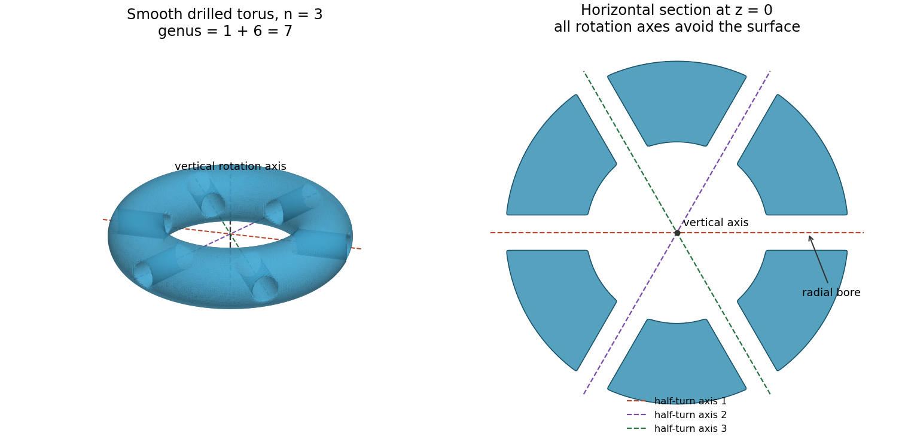

<h1 id="2/e/solution">Solution</h1>

↑ **Parent:** [E](../e.md)

The [dihedral group](../../../../dihedral-group.md) here has order $2n$. Substituting $h=2$ into part (d) gives

$$
\boxed{g=2n+1.}
$$

In particular, $n=3$ requires [genus](../../../../genus-of-a-surface.md) seven. A geometric construction is to start with a round [solid torus](../../../../solid-torus.md) about the vertical axis, then drill $2n$ thin radial tunnels through its tube in the horizontal midplane, equally spaced at azimuths $k\pi/n$, $0\leq k<2n$. The tunnels run from the central opening to the exterior; their directions are horizontal and radial. Round all their rims in the same way, preserving the [dihedral symmetry](../../../../dihedral-symmetry.md), and let $X$ be the [boundary](../../../../boundary-of-a-set.md) of the resulting solid.

**[Figure 1](#2/e/image-a-genus-seven-surface-with-a-free-dihedral-action-six-radial-bores-contain-the-horizontal-rotation-axes). A genus-seven surface with a free dihedral action: six radial bores contain the horizontal rotation axes**.

Here is why the construction has exactly the required properties. Every nonidentity power of $\beta$ is a [rotation in three dimensions](../../../../rotation-in-three-dimensions.md) fixing the vertical axis, which lies in the central opening and is disjoint from $X$. Each element $\alpha\beta^j$ is a half-turn about a horizontal line at azimuth $j\pi/n$, modulo $\pi$. The $n$ such lines meet the original [solid torus](../../../../solid-torus.md) in $2n$ short radial segments. Each segment lies strictly inside one drilled tunnel, so these axes are also disjoint from $X$. A nonidentity [rotation in three dimensions](../../../../rotation-in-three-dimensions.md) fixes only its axis. Thus no nonidentity element fixes a point of $X$, proving a [free action of a group](../../../../free-action-of-a-group.md).

Rotation by $2\pi/n$ permutes the tunnels, while $\alpha:(x,y,z)\mapsto(x,-y,-z)$ preserves their arrangement and the original [solid torus](../../../../solid-torus.md). Hence $X$ is preserved by the two generators and therefore by $G$. The tunnels can be chosen sufficiently thin to be pairwise disjoint, and the rounding can be made [group](../../../../group-split.md)-invariant in small disjoint [neighbourhoods](../../../../neighbourhood-mathematics.md) of their rims. It neither changes the [genus](../../../../genus-of-a-surface.md) nor introduces an intersection with any axis.

Each tunnel removes two discs from the existing [boundary](../../../../boundary-of-a-set.md) and inserts the cylindrical wall of the bore. Its contribution to [Euler characteristic](../../../../euler-characteristic.md) is $-2$: the two removed discs contribute $-2$, and the inserted [annulus](../../../../annulus-mathematics.md) and its boundary [circles](../../../../circle.md) have zero [Euler characteristic](../../../../euler-characteristic.md). The [boundary](../../../../boundary-of-a-set.md) remains [connected](../../../../connected-space.md) and [orientable](../../../../orientable-surface.md), so each tunnel increases [genus](../../../../genus-of-a-surface.md) by one. Starting from a [torus](../../../../torus.md) and drilling $2n$ tunnels therefore gives $g=1+2n$. The construction also supplies a [Riemann surface](../../../../riemann-surfaces-split.md): use the [complex structure](../../../../complex-structure.md) associated with the induced oriented [Riemannian metric](../../../../riemannian-metric-split.md). The ambient generators are [isometries](../../../../isometry.md) preserving the solid and ambient [orientation of a vector space](../../../../orientation-of-a-vector-space.md), so they preserve the induced [boundary orientation](../../../../boundary-orientation.md) and act by [biholomorphisms](../../../../biholomorphism.md). Part (d) then confirms that the [quotient space](../../../../quotient-topological-space.md) has [genus](../../../../genus-of-a-surface.md) two. This is a [free dihedral action on a drilled torus](../../../../free-dihedral-action-on-a-drilled-torus.md).

## ↑ Ancestors (12)

1. [E](../e.md)
2. [2](../../2.md)
3. [2023](../../../2023-split.md)
4. [Past exam of the geometry of surfaces course of the University of Oxford](../../../split.md)
5. [Geometry of surfaces course of the University of Oxford](../../../../geometry-of-surfaces-course-of-the-university-of-oxford.md)
6. [Year 3 of the mathematics course of the University of Oxford](../../../../year-3-of-the-mathematics-course-of-the-university-of-oxford.md)
7. [Mathematics course of the University of Oxford](../../../../mathematics-course-of-the-university-of-oxford.md)
8. [Undergraduate course of the University of Oxford](../../../../undergraduate-course-of-the-university-of-oxford.md)
9. [Course of the University of Oxford](../../../../course-of-the-university-of-oxford.md)
10. [University of Oxford](../../../../university-of-oxford-split.md)
11. [List of universities](../../../../list-of-universities.md)
12. [Codex Wiki](../../../../split.md)
