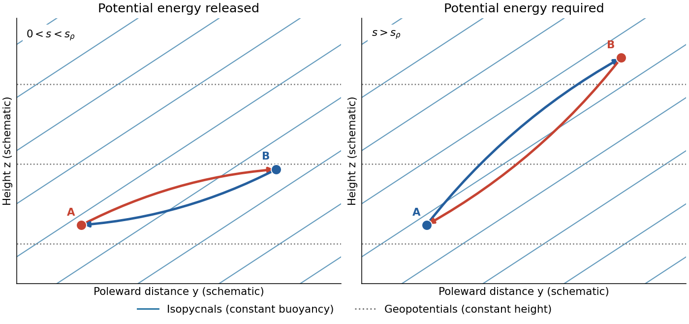
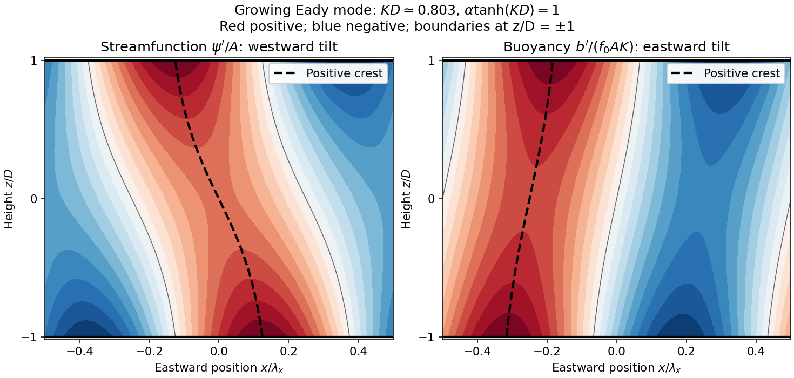

# 2023

↑ **Parent:** [Past exam of the geophysical fluid dynamics course of the University of Oxford](../past-exam-of-the-geophysical-fluid-dynamics-course-of-the-university-of-oxford.md)

Source PDF: [https://mmathphys.web.ox.ac.uk/sitefiles/geophysical-fluid-dynamics.pdf](https://mmathphys.web.ox.ac.uk/sitefiles/geophysical-fluid-dynamics.pdf)

**Table of contents**

- [1](#1)
  - [a](#1/a)
    - [Solution](#1/a/solution)
  - [b](#1/b)
    - [Solution](#1/b/solution)
  - [c](#1/c)
    - [Solution](#1/c/solution)
  - [d](#1/d)
    - [Solution](#1/d/solution)
- [2](#2)
  - [a](#2/a)
    - [Solution](#2/a/solution)
  - [b](#2/b)
    - [Solution](#2/b/solution)
  - [c](#2/c)
    - [Solution](#2/c/solution)

## 1

↑ **Parent:** [2023](2023.md)

<h3 id="1/a">a</h3>

↑ **Parent:** [1](#1)

<h4 id="1/a/solution">Solution</h4>

↑ **Parent:** [A](#1/a)

Choose $y$ northward and $z$ upward in the Northern Hemisphere. In a locally linear [Boussinesq approximation](../geophysical-fluid-dynamics.md#boussinesq-approximation), write the background [buoyancy](../fluid-mechanics.md#buoyancy) as $\bar b=b_*+By+N^2z$, with horizontal [buoyancy gradient](../fluid-mechanics.md#buoyancy-gradient) $B<0$ and positive squared [buoyancy frequency](../gravity-wave.md#buoyancy-frequency) $N^2$. The [stable density stratification](../gravity-wave.md#stable-density-stratification) resists a purely vertical [displacement](../classical-mechanics.md#displacement), but the [isopycnals](../fluid-mechanics.md#isopycnal) slope upward poleward:

$$
s_\rho=\left.\frac{dz}{dy}\right|_{\bar b}=-\frac{B}{N^2}>0.
$$

The [geopotential surfaces](../geophysics.md#geopotential-surface) are horizontal in this local approximation. Their inclination differs from that of the [isopycnals](../fluid-mechanics.md#isopycnal), which is the relevant [baroclinicity](../mathematical-physics.md#baroclinity).

Exchange two equal small [fluid elements](../continuum-mechanics.md#fluid-element), each of volume $V$, between positions separated by $(\delta y,\delta z)$. The [adiabatic parcel exchange](../hydrodynamic-stability.md#adiabatic-parcel-exchange) has no thermal diffusion, so each parcel retains its [buoyancy](../fluid-mechanics.md#buoyancy). The background [buoyancy](../fluid-mechanics.md#buoyancy) difference is $\Delta\bar b=B\delta y+N^2\delta z$. Because the variable-density contribution to [gravitational potential energy](../energy.md#gravitational-energy) is $-\rho_0 Vbz$, the change in the pair's [gravitational potential energy](../energy.md#gravitational-energy) is

$$
\Delta E_p=\rho_0V\,\Delta\bar b\,\delta z
=\rho_0V\,\delta z(B\delta y+N^2\delta z).
$$

For a poleward-rising exchange, set $\delta z=s\delta y$ with $s>0$. Then

$$
\boxed{\Delta E_p<0\quad\Longleftrightarrow\quad 0<s<s_\rho.}
$$

The trajectory lies between a [geopotential surface](../geophysics.md#geopotential-surface) and an [isopycnal](../fluid-mechanics.md#isopycnal). The poleward-rising parcel starts more buoyant than the parcel it replaces, and the equatorward-sinking parcel starts less buoyant: the [buoyancy](../fluid-mechanics.md#buoyancy) does positive work on both. This releases [available potential energy](../energy.md#available-potential-energy) into [kinetic energy](../energy.md#kinetic-energy), allowing [eddies](../fluid-mechanics.md#eddy) to amplify if the full rotating dynamics supports the displacement and dissipation does not remove the gain.

A trajectory steeper than the [isopycnals](../fluid-mechanics.md#isopycnal), $s>s_\rho$, instead costs [gravitational potential energy](../energy.md#gravitational-energy); an equatorward-rising trajectory also costs it. Motion exactly along a [geopotential surface](../geophysics.md#geopotential-surface) or an [isopycnal](../fluid-mechanics.md#isopycnal) gives zero change in this ideal exchange. At fixed $\delta y$, the largest release occurs at $s=s_\rho/2$, since $N^2s(s-s_\rho)$ is minimized there.

**[Figure 1](#1/a/image-two-adiabatic-parcel-exchanges-a-shallow-poleward-rise-releases-potential-energy-whereas-a-rise-steeper-than-the-isopycnals-costs-it-slopes-are-exaggerated). Two adiabatic parcel exchanges: a shallow poleward rise releases potential energy, whereas a rise steeper than the isopycnals costs it. Slopes are exaggerated.**

This is an energetic possibility argument for [baroclinic instability](../hydrodynamic-stability.md#baroclinic-instability), not a sufficient [normal mode](../wave-equation.md#normal-mode) instability criterion. In particular, unrestricted parcel motion must not be assumed in a rotating fluid: [conservation of angular momentum](../momentum.md#conservation-of-angular-momentum) can impose an additional restoring effect. [Symmetric instability](../hydrodynamic-stability.md#symmetric-instability) has a separate [Ertel potential vorticity](../geophysical-fluid-dynamics.md#ertel-potential-vorticity) criterion; ordinary [Eady instability](../hydrodynamic-stability.md#eady-instability) can occur without violating that criterion.

<h3 id="1/b">b</h3>

↑ **Parent:** [1](#1)

<h4 id="1/b/solution">Solution</h4>

↑ **Parent:** [B](#1/b)

Let $\mathbf U_h=\Gamma z\,\mathbf u_h(x,y)$ denote the actual horizontal [velocity field](../fluid-mechanics.md#velocity-field). With constant nonzero [Coriolis parameter](../geophysical-fluid-dynamics.md#coriolis-parameter) $f_0$, [geostrophic balance](../mathematical-physics.md#geostrophic-balance) and [hydrostatic balance](../fluid-mechanics.md#hydrostatic-balance), using [pressure](../pressure.md) per reference [density](../fluid-mechanics.md#density) $\pi$, give

$$
f_0\mathbf e_z\mathbin\times\mathbf U_h=-\nabla_h\pi,
\qquad \pi_z=b.
$$

Differentiate the first equation in $z$ to obtain [thermal-wind balance](../geophysical-fluid-dynamics.md#thermal-wind):

$$
f_0\Gamma\mathbf e_z\mathbin\times\mathbf u_h=-\nabla_h b.
$$

Taking the [dot product](../inner-product.md#dot-product) with $\mathbf U_h$ proves

$$
\boxed{\mathbf U_h\cdot\nabla_h b=0.}
$$

Thus the horizontal [velocity](../classical-mechanics.md#velocity) is tangent to the horizontal [buoyancy](../fluid-mechanics.md#buoyancy) contours at every height. For a fluid whose thermal [equation of state](../pressure.md#equation-of-state) makes horizontal [buoyancy](../fluid-mechanics.md#buoyancy) contours coincide with horizontal [temperature](../temperature.md) contours, there is no horizontal [advection](../fluid-mechanics.md#advection) across those contours. In a dry [terrestrial atmosphere](../planetary-science.md#terrestrial-atmosphere), use [potential temperature](../geophysics.md#potential-temperature) as the materially conserved thermal variable. A salinity contribution to [buoyancy](../fluid-mechanics.md#buoyancy) would require separate treatment before interpreting the result as a statement about [temperature](../temperature.md).

The usual statement about net meridional [heat transport](../heat.md#heat-transport) also follows explicitly. Introduce a horizontal [streamfunction](../fluid-mechanics.md#stream-function) $\Psi$ such that $\mathbf u_h=(-\Psi_y,\Psi_x)$. Integration of [thermal-wind balance](../geophysical-fluid-dynamics.md#thermal-wind) gives

$$
b=f_0\Gamma\Psi+b_0(z),\qquad
v=\Gamma z\Psi_x,
$$

and hence

$$
vb=\partial_x\left[\Gamma z\left(\frac{f_0\Gamma}{2}\Psi^2+b_0\Psi\right)\right].
$$

For a zonally [periodic function](../function.md#periodic-function) $\Psi$, or vanishing endpoint contributions, the zonal integral is zero. Likewise, the anomalous [eddy buoyancy flux](../geophysical-fluid-dynamics.md#eddy-buoyancy-flux) is

$$
\boxed{\overline{v'b'}=f_0\Gamma^2z\,\overline{\Psi'_x\Psi'}=0.}
$$

The required correlation between meridional [velocity](../classical-mechanics.md#velocity) and thermal anomaly is absent. A nonzero vertical [phase](../wave.md#phase-waves) tilt, as in the next part, permits that correlation.

**Qualification of the wording.** The result does not say that the local [heat flux](../heat.md#heat-flux-density) vector $b\mathbf U_h$ vanishes, or that an arbitrary open-domain integral vanishes without [boundary conditions](../differential-equation.md#boundary-condition). For a concrete counterexample to that literal reading, take $\mathbf u_h=(0,1)$ and $b=f_0\Gamma x+N^2z$. These satisfy the displayed [thermal-wind balance](../geophysical-fluid-dynamics.md#thermal-wind), but $vb=\Gamma z(f_0\Gamma x+N^2z)$ is generally nonzero. What the hypotheses alone guarantee is zero transport across horizontal [buoyancy](../fluid-mechanics.md#buoyancy) contours; the vanishing zonally integrated [heat transport](../heat.md#heat-transport) uses the stated endpoint condition.

<h3 id="1/c">c</h3>

↑ **Parent:** [1](#1)

<h4 id="1/c/solution">Solution</h4>

↑ **Parent:** [C](#1/c)

Take eastward $x$, upward $z$, positive [wavenumbers](../wave-equation.md#wavenumber) $k,K$, and a real instantaneous amplitude $A$. A common growing factor does not affect the [phase](../wave.md#phase-waves) geometry. Put $C=\cosh(Kz)$ and $S=\sinh(Kz)$, using the [hyperbolic cosine](../calculus.md#hyperbolic-cosine) and [hyperbolic sine](../calculus.md#hyperbolic-sine). The prescribed [streamfunction](../fluid-mechanics.md#stream-function) is

$$
\psi'=A[C\cos(kx)-\alpha S\sin(kx)]
=AR_\psi\cos[kx+\delta_\psi(z)],
$$

where

$$
R_\psi^2=C^2+\alpha^2S^2,\qquad
\delta_\psi=\arctan[\alpha\tanh(Kz)].
$$

Following a fixed [phase](../wave.md#phase-waves) gives

$$
\frac{dx_\psi}{dz}=-\frac{\delta_{\psi,z}}k
=-\frac{\alpha K}{k(C^2+\alpha^2S^2)}<0.
$$

Therefore the [streamfunction](../fluid-mechanics.md#stream-function) pattern **tilts westward with height**. The lower boundary leads the upper boundary eastward.

In the conventional [quasi-geostrophic streamfunction](../geophysical-fluid-dynamics.md#quasi-geostrophic-streamfunction) normalization, [hydrostatic balance](../fluid-mechanics.md#hydrostatic-balance) gives $b'=f_0\psi'_z$. Therefore

$$
b'=f_0AK[S\cos(kx)-\alpha C\sin(kx)].
$$

For the [phase](../wave.md#phase-waves) calculation, multiplication by the constant $f_0$ is immaterial. Define a continuous [phase](../wave.md#phase-waves) $\delta_b=\operatorname{atan2}(\alpha C,S)$; this avoids a spurious discontinuity at $z=0$. Then

$$
R_b^2=S^2+\alpha^2C^2,\qquad
\delta_{b,z}=-\frac{\alpha K}{S^2+\alpha^2C^2},
\qquad
\boxed{\frac{dx_b}{dz}=\frac{\alpha K}{k(S^2+\alpha^2C^2)}>0.}
$$

The [buoyancy perturbation](../fluid-mechanics.md#buoyancy-perturbation) pattern **tilts eastward with height**, opposite to the [streamfunction](../fluid-mechanics.md#stream-function) pattern. At $z=0$, $\psi'=A\cos(kx)$ while $b'=-f_0AK\alpha\sin(kx)$, so the two fields are a quarter [wavelength](../wave-equation.md#wavelength) apart there.

Both perturbation amplitudes are largest at the boundaries. Indeed,

$$
R_\psi^2=1+(1+\alpha^2)\sinh^2(Kz),\qquad
R_b^2=\alpha^2+(1+\alpha^2)\sinh^2(Kz),
$$

which increase with $|z|$. The physical reason is particularly clear through [stratified quasi-geostrophic inversion](../geophysical-fluid-dynamics.md#stratified-quasi-geostrophic-inversion): the [Eady model](../hydrodynamic-stability.md#eady-model) has no interior background [potential-vorticity gradient](../geophysical-fluid-dynamics.md#potential-vorticity-gradient), and a growing [normal mode](../wave-equation.md#normal-mode) has zero interior [potential vorticity](../geophysical-fluid-dynamics.md#potential-vorticity) anomaly. The independent thermal anomalies reside at the rigid upper and lower boundaries, where meridional motion advects the basic horizontal [buoyancy gradient](../fluid-mechanics.md#buoyancy-gradient). Each [Eady edge wave](../hydrodynamic-stability.md#eady-edge-wave) induces an interior balanced flow that decays away from its boundary on scale $K^{-1}$. Their interacting, phase-locked combination produces the growing [baroclinic instability](../hydrodynamic-stability.md#baroclinic-instability). Boundary confinement of the thermal sources, rather than a rigid-wall requirement $\psi'=0$, explains the amplitude pattern.

For a sketch with a quarter-[wavelength](../wave-equation.md#wavelength) difference between the boundary [streamfunction](../fluid-mechanics.md#stream-function) patterns, choose

$$
2\arctan[\alpha\tanh(KD)]=\frac\pi2,
\qquad \alpha\tanh(KD)=1.
$$

An upper positive [streamfunction](../fluid-mechanics.md#stream-function) crest is then $\lambda_x/4$ west of its lower counterpart, where $\lambda_x=2\pi/k$. The [buoyancy perturbation](../fluid-mechanics.md#buoyancy-perturbation) crests slope the other way. The quarter-[wavelength](../wave-equation.md#wavelength) boundary assumption is used for the [streamfunction](../fluid-mechanics.md#stream-function); differentiating in $z$ fixes the [buoyancy perturbation](../fluid-mechanics.md#buoyancy-perturbation) and does not generally give it the same boundary [phase](../wave.md#phase-waves) separation.

**[Figure 2](#1/c/image-original-eady-model-sketch-streamfunction-crests-tilt-westward-and-buoyancy-perturbation-crests-eastward-dashed-curves-follow-positive-maxima-the-streamfunction-boundary-phase-difference-is-a-quarter-wavelength). Original Eady model sketch: streamfunction crests tilt westward and buoyancy perturbation crests eastward. Dashed curves follow positive maxima; the streamfunction boundary phase difference is a quarter wavelength.**

The connection to poleward [heat transport](../heat.md#heat-transport) can be checked without relying on the sketch. The meridional [geostrophic flow](../geophysical-fluid-dynamics.md#geostrophic-flow) and [buoyancy perturbation](../fluid-mechanics.md#buoyancy-perturbation) are

$$
v'=\psi'_x=-Ak[C\sin(kx)+\alpha S\cos(kx)],
\qquad
b'=f_0AK[S\cos(kx)-\alpha C\sin(kx)].
$$

Average over one zonal [wavelength](../wave-equation.md#wavelength), using equal averages $1/2$ for squared [sine](../geometry-and-topology.md#sine) and [cosine](../geometry-and-topology.md#cosine) and zero for their product:

$$
\boxed{\overline{v'b'}=\frac{f_0A^2kK\alpha}{2}(C^2-S^2)
=\frac{f_0A^2kK\alpha}{2}.}
$$

In the Northern Hemisphere this is positive: warm anomalies preferentially move northward and cold anomalies southward. For the same eastward-increasing basic [thermal wind](../geophysical-fluid-dynamics.md#thermal-wind) in the Southern Hemisphere, $f_0<0$ and the basic [buoyancy gradient](../fluid-mechanics.md#buoyancy-gradient) reverses; the negative northward [eddy buoyancy flux](../geophysical-fluid-dynamics.md#eddy-buoyancy-flux) is again poleward. For [thermal expansion coefficient](../thermodynamics.md#coefficient-of-thermal-expansion) $\alpha_T>0$ and [specific heat capacity at constant pressure](../heat.md#specific-heat-capacity-at-constant-pressure) $c_p$, the corresponding [sensible heat](../heat.md#sensible-heat) flux in a thermal [Boussinesq approximation](../geophysical-fluid-dynamics.md#boussinesq-approximation) is $\rho_0c_p\overline{v'T'}=\rho_0c_p\overline{v'b'}/(g\alpha_T)$. The growing amplitude makes this flux grow as $A^2$. The tilt supplies the correlation absent in an untilted disturbance and reduces the background [available potential energy](../energy.md#available-potential-energy).

<h3 id="1/d">d</h3>

↑ **Parent:** [1](#1)

<h4 id="1/d/solution">Solution</h4>

↑ **Parent:** [D](#1/d)

The low-latitude regions of [Earth](../planetary-science.md#earth) absorb more incoming solar [radiation](../physics.md#radiation) than they emit as outgoing [thermal radiation](../electromagnetic-radiation.md#thermal-radiation), whereas high latitudes have a net annual [radiation](../physics.md#radiation) deficit. The obliquity of solar incidence and the distribution of daylight create a strong latitude dependence of absorbed solar [energy](../energy.md); emitted [thermal radiation](../electromagnetic-radiation.md#thermal-radiation) varies less strongly because terrestrial [temperature](../temperature.md) contrasts are smaller. The [terrestrial atmosphere](../planetary-science.md#terrestrial-atmosphere) and [ocean](../planetary-science.md#ocean) therefore carry [energy](../energy.md) from the tropical surplus toward the polar deficits. Otherwise the low latitudes would keep warming and the high latitudes cooling until a different local [radiative equilibrium](../heat.md#radiative-equilibrium) was reached.

For a steady, zonally averaged [energy balance](../mathematical-physics.md#energy-balance), let $R(\phi)$ be net downward radiation at the top of the [terrestrial atmosphere](../planetary-science.md#terrestrial-atmosphere) and $H(\phi)$ the total northward [energy](../energy.md) transport across latitude $\phi$. A narrow spherical band and [conservation of energy](../mathematical-physics.md#conservation-of-energy) give

$$
\frac{dH}{d\phi}=2\pi a^2\cos\phi\,R(\phi),\qquad
H(\phi)=2\pi a^2\int_{-\pi/2}^{\phi}R(\varphi)\cos\varphi\,d\varphi.
$$

The poleward direction is northward in the Northern Hemisphere and southward in the Southern Hemisphere. Seasonal [internal energy](../internal-energy.md) storage modifies the instantaneous balance, but not the annual need for poleward redistribution.

Several circulation structures contribute in addition to the transient [eddies](../fluid-mechanics.md#eddy) produced by [baroclinic instability](../hydrodynamic-stability.md#baroclinic-instability) of the middle latitudes:

- The [Hadley cells](../geophysics.md#hadley-cell), mainly between the equator and about $30^\circ$ latitude, export [energy](../energy.md) in their upper poleward branches and return air equatorward near the surface. The transported quantity includes [enthalpy](../enthalpy.md), [gravitational potential energy](../energy.md#gravitational-energy) and [latent heat](../thermodynamic-potential.md#latent-heat); the upper and lower branches have different thermal properties. The cross-equatorial [Hadley cell](../geophysics.md#hadley-cell) is especially important in the seasonal cycle.
- Quasi-stationary [Rossby waves](../geophysical-fluid-dynamics.md#rossby-wave), associated with mountains and continental heating contrasts, carry [heat](../heat.md) in the extratropical [terrestrial atmosphere](../planetary-science.md#terrestrial-atmosphere). Their meridional [velocity](../classical-mechanics.md#velocity) and [temperature](../temperature.md) anomalies can have a poleward correlation. These are an additional time-mean contribution alongside travelling weather disturbances.
- The [ocean gyres](../geophysical-fluid-dynamics.md#ocean-gyre) in tropical and subtropical basins redistribute warm water poleward in strong [western boundary currents](../geophysical-fluid-dynamics.md#western-boundary-current) and return cooler water equatorward over broader regions. The thermal difference between the branches produces net [heat transport](../heat.md#heat-transport) despite little net meridional volume transport.
- The [oceanic overturning circulation](../geophysical-fluid-dynamics.md#oceanic-overturning-circulation), including the [Atlantic meridional overturning circulation](../geophysics.md#atlantic-meridional-overturning-circulation), combines warm upper water moving poleward with colder deep return water. It transports substantial [heat](../heat.md) through the tropical and subtropical Atlantic toward the northern high latitudes. Wind forcing, [buoyancy](../fluid-mechanics.md#buoyancy) exchange and mixing all help maintain this global circulation.

The [Brewer-Dobson circulation](../planetary-science.md#brewer-dobson-circulation) additionally redistributes [energy](../energy.md) in the [stratosphere](../planetary-science.md#stratosphere), with tropical ascent and extratropical descent, although most total atmospheric [heat transport](../heat.md#heat-transport) occurs lower down. An [Eulerian mean](../geophysical-fluid-dynamics.md#eulerian-mean-flow) middle-latitude [Ferrel cell](../geophysics.md#ferrel-cell) is thermally indirect and can oppose the poleward transport by [eddies](../fluid-mechanics.md#eddy); listing every meridional circulation as a direct poleward heat carrier would be incorrect.

## 2

↑ **Parent:** [2023](2023.md)

<h3 id="2/a">a</h3>

↑ **Parent:** [2](#2)

<h4 id="2/a/solution">Solution</h4>

↑ **Parent:** [A](#2/a)

Use eastward $x$, northward $y$, [pressure coordinate](../geophysical-fluid-dynamics.md#pressure-coordinate) $p$ increasing downward, and [geopotential](../geophysics.md#geopotential) $\Phi=gz$. Horizontal derivatives are taken on an [isobaric surface](../geophysical-fluid-dynamics.md#isobaric-surface). The horizontal [geostrophic balance](../mathematical-physics.md#geostrophic-balance) and vertical [hydrostatic balance](../fluid-mechanics.md#hydrostatic-balance) are

$$
f u_g=-\Phi_y,\qquad f v_g=\Phi_x,\qquad
\Phi_p=-\frac1\rho=-\frac{RT}{p},
$$

where $R$ is the [specific gas constant](../ideal-gas.md#specific-gas-constant) of dry air and the final equality uses the [ideal gas law](../ideal-gas.md#ideal-gas-law). At fixed latitude $f$ is independent of $p$. Cross-differentiating gives

$$
f\,\partial_pu_g=-\partial_y\Phi_p=\frac R p\,T_y,
\qquad
f\,\partial_pv_g=\partial_x\Phi_p=-\frac R p\,T_x.
$$

Consequently the pressure-coordinate [thermal wind](../geophysical-fluid-dynamics.md#thermal-wind) equations are

$$
\boxed{\frac{\partial u_g}{\partial\ln p}=\frac Rf\frac{\partial T}{\partial y},
\qquad
\frac{\partial v_g}{\partial\ln p}=-\frac Rf\frac{\partial T}{\partial x}.}
$$

Equivalently, $f\mathbf e_z\mathbin\times\partial_{\ln p}\mathbf u_g=R\nabla_pT$. Notice the sign: increasing eastward [velocity](../classical-mechanics.md#velocity) upward means decreasing eastward [velocity](../classical-mechanics.md#velocity) with $\ln p$, and hence poleward-decreasing [temperature](../temperature.md) in the Northern Hemisphere.

For the [stratospheric polar vortex](../planetary-science.md#stratospheric-polar-vortex) estimate, the original diagram must be read on its logarithmic pressure axis. Near $60^\circ$ in the winter hemisphere, adjacent $10\ \mathrm{m\,s^{-1}}$ wind contours suggest an increase of roughly $20\ \mathrm{m\,s^{-1}}$ through a pressure decade surrounding $10\ \mathrm{mb}$: for example, about $10\ \mathrm{m\,s^{-1}}$ near $30\ \mathrm{mb}$ and $30\ \mathrm{m\,s^{-1}}$ near $3\ \mathrm{mb}$. These are coarse graphical readings, not a sounding. Thus

$$
\frac{\partial u_g}{\partial\ln p}\simeq
\frac{30-10}{\ln(3/30)}\ \mathrm{m\,s^{-1}}
\simeq-8.7\ \mathrm{m\,s^{-1}}.
$$

With $|f|=2\Omega\sin60^\circ\simeq1.26\times10^{-4}\ \mathrm{s^{-1}}$ and $R\simeq287\ \mathrm{J\,kg^{-1}\,K^{-1}}$, the poleward [temperature gradient](../heat.md#temperature-gradient) is approximately

$$
\frac{\partial T}{\partial y_{\rm pole}}
\simeq\frac{|f|}{R}\frac{\partial u_g}{\partial\ln p}
\simeq-3.8\times10^{-6}\ \mathrm{K\,m^{-1}}
\simeq-0.42\ \mathrm{K\ per\ degree\ latitude}.
$$

If the vortex edge is taken to span roughly $50^\circ$ to $70^\circ$, its width is $a(20\pi/180)\simeq2.2\times10^6\ \mathrm m$, giving

$$
\boxed{T(70^\circ)-T(50^\circ)\simeq-8.5\ \mathrm K,
\quad\text{a poleward drop of order }10\ \mathrm K.}
$$

The estimate depends on the width assigned to the edge and the graphical [vertical shear](../fluid-mechanics.md#vertical-shear); a range of several to roughly fifteen kelvin is more justified than a precise value. The sign remains a cold winter pole in either hemisphere. The diagram does not by itself prescribe a unique pair of edge latitudes.

At low latitudes, horizontal free-atmospheric [temperature gradients](../heat.md#temperature-gradient) are usually much smaller than at the winter vortex edge. For a comparable finite wind [vertical shear](../fluid-mechanics.md#vertical-shear), the rearranged [thermal-wind balance](../geophysical-fluid-dynamics.md#thermal-wind), $T_y=(f/R)u_{\ln p}$, is consistent with weaker [temperature gradients](../heat.md#temperature-gradient) as $|f|$ decreases. However, [geostrophic balance](../mathematical-physics.md#geostrophic-balance) loses validity near the equator because the [Coriolis parameter](../geophysical-fluid-dynamics.md#coriolis-parameter) vanishes; division by $f$ cannot be used there to derive a prediction. The [weak temperature gradient approximation](../geophysical-fluid-dynamics.md#weak-temperature-gradient-approximation) is better motivated by rapid horizontal [internal gravity wave](../gravity-wave.md#internal-wave) adjustment, together with tropical [convection](../convection.md) and the [Hadley cell](../geophysics.md#hadley-cell). [Thermal-wind balance](../geophysical-fluid-dynamics.md#thermal-wind) describes the balanced extratropical relation and its tendency approaching the tropics; it is not a complete causal explanation of equatorial thermal uniformity.

<h3 id="2/b">b</h3>

↑ **Parent:** [2](#2)

<h4 id="2/b/solution">Solution</h4>

↑ **Parent:** [B](#2/b)

The [quasi-geostrophic potential-vorticity equation](../geophysical-fluid-dynamics.md#quasi-geostrophic-potential-vorticity-equation) is the leading balanced form of [potential-vorticity conservation](../geophysical-fluid-dynamics.md#potential-vorticity-conservation) for an inviscid rotating fluid with [stable density stratification](../gravity-wave.md#stable-density-stratification), small [Rossby number](../geophysical-fluid-dynamics.md#rossby-number) and an [adiabatic process](../first-law-of-thermodynamics.md#adiabatic-process) for each [fluid element](../continuum-mechanics.md#fluid-element). Its parent conservation law is [Ertel potential vorticity](../geophysical-fluid-dynamics.md#ertel-potential-vorticity) conservation. Horizontal [geostrophic balance](../mathematical-physics.md#geostrophic-balance), vertical [hydrostatic balance](../fluid-mechanics.md#hydrostatic-balance), and the [beta-plane approximation](../geophysical-fluid-dynamics.md#beta-plane) reduce it to advection of one scalar by the leading horizontal [geostrophic flow](../geophysical-fluid-dynamics.md#geostrophic-flow).

One can see its origin by combining the vertical [vorticity equation](../mathematical-physics.md#vorticity-equation) with the thermal equation. Set $D_g=\partial_t+\mathbf u_g\cdot\nabla_h$, $\mathbf u_g=(-\psi_y,\psi_x)$, and $\zeta_g=\nabla_h^2\psi$. The [quasi-geostrophic approximation](../geophysical-fluid-dynamics.md#quasi-geostrophic-approximation) gives

$$
D_g(\zeta_g+f_0+\beta y)=f_0w_z,
\qquad
D_gb+N^2w=0,\qquad b=f_0\psi_z.
$$

Here $b$ is the [buoyancy perturbation](../fluid-mechanics.md#buoyancy-perturbation) relative to the reference [stable density stratification](../gravity-wave.md#stable-density-stratification), $N=N(z)$ its [buoyancy frequency](../gravity-wave.md#buoyancy-frequency), and $w$ the small vertical [velocity](../classical-mechanics.md#velocity). The stretching of absolute [vorticity](../vorticity.md) in the first equation is offset by the change of [stratification](../gravity-wave.md#density-stratification) represented by the second. More precisely,

$$
D_g\partial_z\left(\frac{f_0b}{N^2}\right)
=\partial_z\left(\frac{f_0D_gb}{N^2}\right)
-\frac{f_0}{N^2}(\partial_z\mathbf u_g)\cdot\nabla_hb
=-f_0w_z.
$$

The last [dot product](../inner-product.md#dot-product) is zero because [thermal-wind balance](../geophysical-fluid-dynamics.md#thermal-wind) makes $\partial_z\mathbf u_g$ perpendicular to $\nabla_hb$. Adding therefore yields

$$
\boxed{D_gq=0,\qquad
q=\underbrace{\nabla_h^2\psi}_{\text{relative vorticity}}
+\underbrace{f_0+\beta y}_{\text{planetary vorticity}}
+\underbrace{\partial_z\left(\frac{f_0^2}{N^2}\psi_z\right)}_{\text{stratification/stretching contribution}}.}
$$

The constant $f_0$ has no effect on the tendency, but its inclusion makes the connection with absolute [vorticity](../vorticity.md) clear. Vertical [advection](../fluid-mechanics.md#advection) of $q$ is beyond the retained order; the vertical [velocity](../classical-mechanics.md#velocity) has already supplied the stretching and thermodynamic terms.

For a simple balanced weather forecast, the essential cycle is **diagnose, advect, invert**:

- Use observed [pressure](../pressure.md) or [geopotential](../geophysics.md#geopotential) and [temperature](../temperature.md) to construct a balanced initial [quasi-geostrophic streamfunction](../geophysical-fluid-dynamics.md#quasi-geostrophic-streamfunction), its interior [potential vorticity](../geophysical-fluid-dynamics.md#potential-vorticity), and the upper and lower boundary [buoyancy](../fluid-mechanics.md#buoyancy).
- Evolve $q$ with $q_t=-\mathbf u_g\cdot\nabla_hq$ for a small time step. For flat rigid boundaries, also evolve their thermal data with $D_gb=0$ there. Appropriate lateral [boundary conditions](../differential-equation.md#boundary-condition) and any known large-scale circulation must accompany these fields.
- Recover the new [streamfunction](../fluid-mechanics.md#stream-function) by [stratified quasi-geostrophic inversion](../geophysical-fluid-dynamics.md#stratified-quasi-geostrophic-inversion):

$$
\left[\nabla_h^2+\partial_z\left(\frac{f_0^2}{N^2}\partial_z\right)\right]\psi
=q-f_0-\beta y.
$$

This is an [elliptic boundary value problem](../elliptic-boundary-value-problem.md), not a local algebraic diagnosis. Its solution supplies the next [geostrophic flow](../geophysical-fluid-dynamics.md#geostrophic-flow) and, through $b=f_0\psi_z$, the next thermal field. Repeat the cycle to move the balanced weather systems forward.

Interior [potential vorticity](../geophysical-fluid-dynamics.md#potential-vorticity) alone is insufficient: boundary thermal anomalies can induce flow even with zero interior anomaly, as in the [Eady model](../hydrodynamic-stability.md#eady-model). The method filters fast [inertia-gravity waves](../geophysical-fluid-dynamics.md#inertia-gravity-wave) and is useful for large-scale extratropical weather, while tropical dynamics, [convection](../convection.md), moisture, friction and diabatic heating require additional physics. If vertical motion is wanted, the [quasi-geostrophic omega equation](../geophysical-fluid-dynamics.md#quasi-geostrophic-omega-equation) supplies a further diagnostic calculation.

<h3 id="2/c">c</h3>

↑ **Parent:** [2](#2)

<h4 id="2/c/solution">Solution</h4>

↑ **Parent:** [C](#2/c)

For the proposed [plane wave](../wave-function.md#plane-wave), define the positive squared effective [wavenumber](../wave-equation.md#wavenumber)

$$
\mathcal K^2=k^2+l^2+\frac{f_0^2}{N^2}m^2.
$$

The horizontal [Laplacian](../multivariable-calculus.md#laplacian) contributes $-(k^2+l^2)\psi'$ and the vertical stretching operator contributes $-(f_0^2/N^2)m^2\psi'$. Substitution in the [Linear Rossby-wave equation](../geophysical-fluid-dynamics.md#linear-rossby-wave-equation) therefore gives

$$
[-i(\omega-Uk)](-\mathcal K^2)+i\beta k=0,
\qquad
\boxed{\omega=Uk-\frac{\beta k}{k^2+l^2+(f_0^2/N^2)m^2}.}
$$

The intrinsic [phase velocity](../dispersion-relation.md#phase-velocity) is westward for positive $\beta$. A stationary disturbance with $\omega=0$ and $k\ne0$ must have its westward intrinsic [phase velocity](../dispersion-relation.md#phase-velocity) exactly cancelled by the eastward background current. Solving for the squared vertical [wavenumber](../wave-equation.md#wavenumber) yields

$$
m^2=\frac{N^2}{f_0^2}\left(\frac\beta U-k^2-l^2\right).
$$

For [Earth](../planetary-science.md#earth), with northward $y$, $\beta=2\Omega\cos\phi/a>0$ in both hemispheres away from the poles. Thus an oscillatory vertical structure requires

$$
\boxed{0<U<\frac\beta{k^2+l^2},\qquad N^2>0,\quad f_0\ne0,\quad k\ne0.}
$$

The background flow must be eastward but not too strong for the chosen horizontal scale. Long horizontal [wavelengths](../wave-equation.md#wavelength) have the largest allowed speed. An easterly current, $U<0$, gives $m^2<0$ and an [evanescent wave](../elasticity-physics.md#evanescent-wave); so does an eastward current exceeding the upper bound. At equality $m=0$ and the vertical [group velocity](../dispersion-relation.md#group-velocity) vanishes. A zonally uniform disturbance, $k=0$, is a degenerate stationary pattern with no vertical [Rossby wave](../geophysical-fluid-dynamics.md#rossby-wave) energy propagation, so it cannot be obtained by cancelling $k$ in the preceding calculation.

A real $m$ alone does not select _upward_ propagation. Differentiate the [dispersion relation](../dispersion-relation.md) at fixed $k,l$ to obtain the vertical [group velocity](../dispersion-relation.md#group-velocity):

$$
c_{g,z}=\frac{\partial\omega}{\partial m}
=\frac{2\beta k(f_0^2/N^2)m}
{[k^2+l^2+(f_0^2/N^2)m^2]^2}.
$$

The outgoing [radiation condition](../gravity-wave.md#radiation-condition) for a surface source requires

$$
\boxed{c_{g,z}>0\quad\Longleftrightarrow\quad km>0\quad(\beta>0).}
$$

For the convention $k>0$, take $m>0$. The stationary [phase](../wave.md#phase-waves) lines then obey $dx/dz=-m/k<0$: they tilt westward with height while [wave energy](../wave-equation.md#wave-energy) travels upward. The real conjugate component $(-k,-l,-m)$ describes the same physical upward-propagating wave.

The figure suggests a winter extratropical path from the lower [terrestrial atmosphere](../planetary-science.md#terrestrial-atmosphere) into the [stratosphere](../planetary-science.md#stratosphere), where the mean [zonal flow](../geophysical-fluid-dynamics.md#zonal-flow) is eastward. The summer [stratosphere](../planetary-science.md#stratosphere) has westward flow and blocks such stationary [Rossby waves](../geophysical-fluid-dynamics.md#rossby-wave) in this idealization. A zero-wind surface is a stationary-wave [critical layer in a shear flow](../hydrodynamic-stability.md#critical-layer-in-a-shear-flow); it also bounds the winter westerlies aloft near the upper part of the diagram. For a slowly varying real wind profile, local propagation needs $m^2(z)>0$ along the path, sufficient surface forcing, and no intervening absorbing [critical layer in a shear flow](../hydrodynamic-stability.md#critical-layer-in-a-shear-flow). A layer where the eastward wind becomes too strong is a turning barrier for the given horizontal [wavenumbers](../wave-equation.md#wavenumber). The uniform-current result is a local guide, not a complete prediction through a sheared spherical [terrestrial atmosphere](../planetary-science.md#terrestrial-atmosphere).

For scale, at $60^\circ$ latitude $\beta\simeq1.14\times10^{-11}\ \mathrm{m^{-1}\,s^{-1}}$. A planetary [zonal wavenumber](../wave-equation.md#zonal-wavenumber) $s$ has local $k=s/(a\cos\phi)$. Taking $l=0$ gives the most permissive limit

$$
U_{\max}=\frac{\beta a^2\cos^2\phi}{s^2}
\simeq\frac{116}{s^2}\ \mathrm{m\,s^{-1}}.
$$

The resulting limits are approximately $116$, $29$ and $13\ \mathrm{m\,s^{-1}}$ for $s=1,2,3$. Therefore the long planetary waves are favored; the strong core of the winter vortex can exclude shorter ones even though it is westerly. Nonzero meridional [wavenumber](../wave-equation.md#wavenumber) lowers these limits further. A compressible [log-pressure coordinate](../geophysical-fluid-dynamics.md#log-pressure-coordinate) model would also contain a density-scale-height correction; it is absent from the equation supplied here and should not be silently inserted.

Interchanging the Northern and Southern Hemispheres changes the sign of $f_0$, but only $f_0^2$ enters the [dispersion relation](../dispersion-relation.md) and vertical [group velocity](../dispersion-relation.md#group-velocity). With the same eastward $x$ and northward $y$, $\beta$ stays positive. Thus the **propagation criterion is the same in both hemispheres**: it selects the winter westerlies, irrespective of which hemisphere is winter. Actual amplitudes can differ because mountains, land-sea contrasts, forcing spectra and mean winds differ between hemispheres; those source differences do not reverse this propagation criterion.

## ↑ Ancestors (9)

1. [Past exam of the geophysical fluid dynamics course of the University of Oxford](../past-exam-of-the-geophysical-fluid-dynamics-course-of-the-university-of-oxford.md)
2. [Geophysical fluid dynamics course of the University of Oxford](../university-of-oxford.md#geophysical-fluid-dynamics-course-of-the-university-of-oxford)
3. [Year 4 of the mathematical and theoretical physics course of the University of Oxford](../university-of-oxford.md#year-4-of-the-mathematical-and-theoretical-physics-course-of-the-university-of-oxford)
4. [Mathematical and theoretical physics course of the University of Oxford](../university-of-oxford.md#mathematical-and-theoretical-physics-course-of-the-university-of-oxford)
5. [Undergraduate course of the University of Oxford](../university-of-oxford.md#undergraduate-course-of-the-university-of-oxford)
6. [Course of the University of Oxford](../university-of-oxford.md#course-of-the-university-of-oxford)
7. [University of Oxford](../university-of-oxford.md)
8. [List of universities](../README.md#list-of-universities)
9. [Codex Wiki](../README.md)
