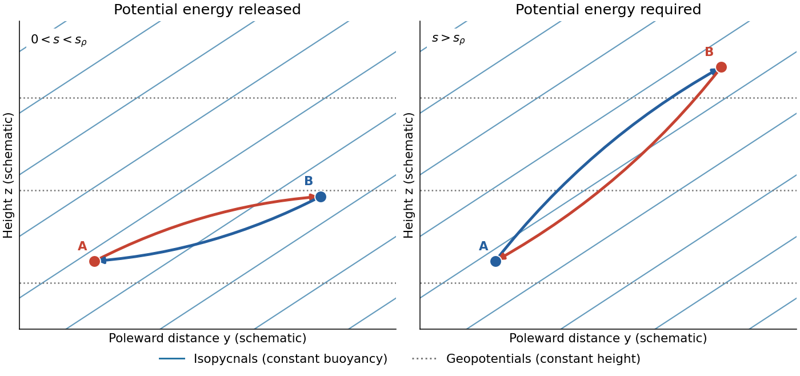

<h1 id="1/a/solution">Solution</h1>

↑ **Parent:** [A](../a.md)

Choose $y$ northward and $z$ upward in the Northern Hemisphere. In a locally linear [Boussinesq approximation](../../../../boussinesq-approximation.md), write the background [buoyancy](../../../../buoyancy.md) as $\bar b=b_*+By+N^2z$, with horizontal [buoyancy gradient](../../../../buoyancy-gradient.md) $B<0$ and positive squared [buoyancy frequency](../../../../buoyancy-frequency.md) $N^2$. The [stable density stratification](../../../../stable-density-stratification.md) resists a purely vertical [displacement](../../../../displacement.md), but the [isopycnals](../../../../isopycnal.md) slope upward poleward:

$$
s_\rho=\left.\frac{dz}{dy}\right|_{\bar b}=-\frac{B}{N^2}>0.
$$

The [geopotential surfaces](../../../../geopotential-surface.md) are horizontal in this local approximation. Their inclination differs from that of the [isopycnals](../../../../isopycnal.md), which is the relevant [baroclinicity](../../../../baroclinity.md).

Exchange two equal small [fluid elements](../../../../fluid-element.md), each of volume $V$, between positions separated by $(\delta y,\delta z)$. The [adiabatic parcel exchange](../../../../adiabatic-parcel-exchange.md) has no thermal diffusion, so each parcel retains its [buoyancy](../../../../buoyancy.md). The background [buoyancy](../../../../buoyancy.md) difference is $\Delta\bar b=B\delta y+N^2\delta z$. Because the variable-density contribution to [gravitational potential energy](../../../../gravitational-energy.md) is $-\rho_0 Vbz$, the change in the pair's [gravitational potential energy](../../../../gravitational-energy.md) is

$$
\Delta E_p=\rho_0V\,\Delta\bar b\,\delta z
=\rho_0V\,\delta z(B\delta y+N^2\delta z).
$$

For a poleward-rising exchange, set $\delta z=s\delta y$ with $s>0$. Then

$$
\boxed{\Delta E_p<0\quad\Longleftrightarrow\quad 0<s<s_\rho.}
$$

The trajectory lies between a [geopotential surface](../../../../geopotential-surface.md) and an [isopycnal](../../../../isopycnal.md). The poleward-rising parcel starts more buoyant than the parcel it replaces, and the equatorward-sinking parcel starts less buoyant: the [buoyancy](../../../../buoyancy.md) does positive work on both. This releases [available potential energy](../../../../available-potential-energy.md) into [kinetic energy](../../../../kinetic-energy.md), allowing [eddies](../../../../eddy.md) to amplify if the full rotating dynamics supports the displacement and dissipation does not remove the gain.

A trajectory steeper than the [isopycnals](../../../../isopycnal.md), $s>s_\rho$, instead costs [gravitational potential energy](../../../../gravitational-energy.md); an equatorward-rising trajectory also costs it. Motion exactly along a [geopotential surface](../../../../geopotential-surface.md) or an [isopycnal](../../../../isopycnal.md) gives zero change in this ideal exchange. At fixed $\delta y$, the largest release occurs at $s=s_\rho/2$, since $N^2s(s-s_\rho)$ is minimized there.

**[Figure 1](#1/a/image-two-adiabatic-parcel-exchanges-a-shallow-poleward-rise-releases-potential-energy-whereas-a-rise-steeper-than-the-isopycnals-costs-it-slopes-are-exaggerated). Two adiabatic parcel exchanges: a shallow poleward rise releases potential energy, whereas a rise steeper than the isopycnals costs it. Slopes are exaggerated.**

This is an energetic possibility argument for [baroclinic instability](../../../../baroclinic-instability.md), not a sufficient [normal mode](../../../../normal-mode.md) instability criterion. In particular, unrestricted parcel motion must not be assumed in a rotating fluid: [conservation of angular momentum](../../../../conservation-of-angular-momentum.md) can impose an additional restoring effect. [Symmetric instability](../../../../symmetric-instability.md) has a separate [Ertel potential vorticity](../../../../ertel-potential-vorticity.md) criterion; ordinary [Eady instability](../../../../eady-instability.md) can occur without violating that criterion.

## ↑ Ancestors (12)

1. [A](../a.md)
2. [1](../../1.md)
3. [2023](../../../2023-split.md)
4. [Past exam of the geophysical fluid dynamics course of the University of Oxford](../../../split.md)
5. [Geophysical fluid dynamics course of the University of Oxford](../../../../geophysical-fluid-dynamics-course-of-the-university-of-oxford.md)
6. [Year 4 of the mathematical and theoretical physics course of the University of Oxford](../../../../year-4-of-the-mathematical-and-theoretical-physics-course-of-the-university-of-oxford.md)
7. [Mathematical and theoretical physics course of the University of Oxford](../../../../mathematical-and-theoretical-physics-course-of-the-university-of-oxford.md)
8. [Undergraduate course of the University of Oxford](../../../../undergraduate-course-of-the-university-of-oxford.md)
9. [Course of the University of Oxford](../../../../course-of-the-university-of-oxford.md)
10. [University of Oxford](../../../../university-of-oxford-split.md)
11. [List of universities](../../../../list-of-universities.md)
12. [Codex Wiki](../../../../split.md)
