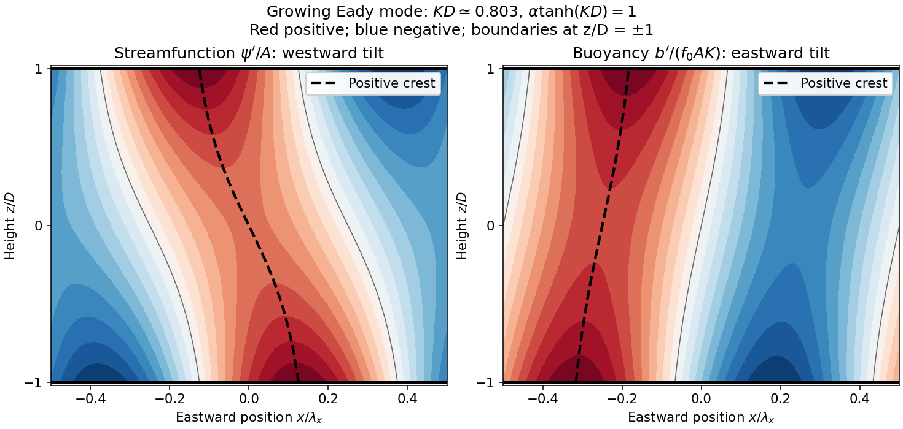

<h1 id="1/c/solution">Solution</h1>

↑ **Parent:** [C](../c.md)

Take eastward $x$, upward $z$, positive [wavenumbers](../../../../wavenumber.md) $k,K$, and a real instantaneous amplitude $A$. A common growing factor does not affect the [phase](../../../../phase-waves.md) geometry. Put $C=\cosh(Kz)$ and $S=\sinh(Kz)$, using the [hyperbolic cosine](../../../../hyperbolic-cosine.md) and [hyperbolic sine](../../../../hyperbolic-sine.md). The prescribed [streamfunction](../../../../stream-function.md) is

$$
\psi'=A[C\cos(kx)-\alpha S\sin(kx)]
=AR_\psi\cos[kx+\delta_\psi(z)],
$$

where

$$
R_\psi^2=C^2+\alpha^2S^2,\qquad
\delta_\psi=\arctan[\alpha\tanh(Kz)].
$$

Following a fixed [phase](../../../../phase-waves.md) gives

$$
\frac{dx_\psi}{dz}=-\frac{\delta_{\psi,z}}k
=-\frac{\alpha K}{k(C^2+\alpha^2S^2)}<0.
$$

Therefore the [streamfunction](../../../../stream-function.md) pattern **tilts westward with height**. The lower boundary leads the upper boundary eastward.

In the conventional [quasi-geostrophic streamfunction](../../../../quasi-geostrophic-streamfunction.md) normalization, [hydrostatic balance](../../../../hydrostatic-balance.md) gives $b'=f_0\psi'_z$. Therefore

$$
b'=f_0AK[S\cos(kx)-\alpha C\sin(kx)].
$$

For the [phase](../../../../phase-waves.md) calculation, multiplication by the constant $f_0$ is immaterial. Define a continuous [phase](../../../../phase-waves.md) $\delta_b=\operatorname{atan2}(\alpha C,S)$; this avoids a spurious discontinuity at $z=0$. Then

$$
R_b^2=S^2+\alpha^2C^2,\qquad
\delta_{b,z}=-\frac{\alpha K}{S^2+\alpha^2C^2},
\qquad
\boxed{\frac{dx_b}{dz}=\frac{\alpha K}{k(S^2+\alpha^2C^2)}>0.}
$$

The [buoyancy perturbation](../../../../buoyancy-perturbation.md) pattern **tilts eastward with height**, opposite to the [streamfunction](../../../../stream-function.md) pattern. At $z=0$, $\psi'=A\cos(kx)$ while $b'=-f_0AK\alpha\sin(kx)$, so the two fields are a quarter [wavelength](../../../../wavelength.md) apart there.

Both perturbation amplitudes are largest at the boundaries. Indeed,

$$
R_\psi^2=1+(1+\alpha^2)\sinh^2(Kz),\qquad
R_b^2=\alpha^2+(1+\alpha^2)\sinh^2(Kz),
$$

which increase with $|z|$. The physical reason is particularly clear through [stratified quasi-geostrophic inversion](../../../../stratified-quasi-geostrophic-inversion.md): the [Eady model](../../../../eady-model.md) has no interior background [potential-vorticity gradient](../../../../potential-vorticity-gradient.md), and a growing [normal mode](../../../../normal-mode.md) has zero interior [potential vorticity](../../../../potential-vorticity.md) anomaly. The independent thermal anomalies reside at the rigid upper and lower boundaries, where meridional motion advects the basic horizontal [buoyancy gradient](../../../../buoyancy-gradient.md). Each [Eady edge wave](../../../../eady-edge-wave.md) induces an interior balanced flow that decays away from its boundary on scale $K^{-1}$. Their interacting, phase-locked combination produces the growing [baroclinic instability](../../../../baroclinic-instability.md). Boundary confinement of the thermal sources, rather than a rigid-wall requirement $\psi'=0$, explains the amplitude pattern.

For a sketch with a quarter-[wavelength](../../../../wavelength.md) difference between the boundary [streamfunction](../../../../stream-function.md) patterns, choose

$$
2\arctan[\alpha\tanh(KD)]=\frac\pi2,
\qquad \alpha\tanh(KD)=1.
$$

An upper positive [streamfunction](../../../../stream-function.md) crest is then $\lambda_x/4$ west of its lower counterpart, where $\lambda_x=2\pi/k$. The [buoyancy perturbation](../../../../buoyancy-perturbation.md) crests slope the other way. The quarter-[wavelength](../../../../wavelength.md) boundary assumption is used for the [streamfunction](../../../../stream-function.md); differentiating in $z$ fixes the [buoyancy perturbation](../../../../buoyancy-perturbation.md) and does not generally give it the same boundary [phase](../../../../phase-waves.md) separation.

**[Figure 2](#1/c/image-original-eady-model-sketch-streamfunction-crests-tilt-westward-and-buoyancy-perturbation-crests-eastward-dashed-curves-follow-positive-maxima-the-streamfunction-boundary-phase-difference-is-a-quarter-wavelength). Original Eady model sketch: streamfunction crests tilt westward and buoyancy perturbation crests eastward. Dashed curves follow positive maxima; the streamfunction boundary phase difference is a quarter wavelength.**

The connection to poleward [heat transport](../../../../heat-transport.md) can be checked without relying on the sketch. The meridional [geostrophic flow](../../../../geostrophic-flow.md) and [buoyancy perturbation](../../../../buoyancy-perturbation.md) are

$$
v'=\psi'_x=-Ak[C\sin(kx)+\alpha S\cos(kx)],
\qquad
b'=f_0AK[S\cos(kx)-\alpha C\sin(kx)].
$$

Average over one zonal [wavelength](../../../../wavelength.md), using equal averages $1/2$ for squared [sine](../../../../sine.md) and [cosine](../../../../cosine.md) and zero for their product:

$$
\boxed{\overline{v'b'}=\frac{f_0A^2kK\alpha}{2}(C^2-S^2)
=\frac{f_0A^2kK\alpha}{2}.}
$$

In the Northern Hemisphere this is positive: warm anomalies preferentially move northward and cold anomalies southward. For the same eastward-increasing basic [thermal wind](../../../../thermal-wind.md) in the Southern Hemisphere, $f_0<0$ and the basic [buoyancy gradient](../../../../buoyancy-gradient.md) reverses; the negative northward [eddy buoyancy flux](../../../../eddy-buoyancy-flux.md) is again poleward. For [thermal expansion coefficient](../../../../coefficient-of-thermal-expansion.md) $\alpha_T>0$ and [specific heat capacity at constant pressure](../../../../specific-heat-capacity-at-constant-pressure.md) $c_p$, the corresponding [sensible heat](../../../../sensible-heat.md) flux in a thermal [Boussinesq approximation](../../../../boussinesq-approximation.md) is $\rho_0c_p\overline{v'T'}=\rho_0c_p\overline{v'b'}/(g\alpha_T)$. The growing amplitude makes this flux grow as $A^2$. The tilt supplies the correlation absent in an untilted disturbance and reduces the background [available potential energy](../../../../available-potential-energy.md).

## ↑ Ancestors (12)

1. [C](../c.md)
2. [1](../../1.md)
3. [2023](../../../2023-split.md)
4. [Past exam of the geophysical fluid dynamics course of the University of Oxford](../../../split.md)
5. [Geophysical fluid dynamics course of the University of Oxford](../../../../geophysical-fluid-dynamics-course-of-the-university-of-oxford.md)
6. [Year 4 of the mathematical and theoretical physics course of the University of Oxford](../../../../year-4-of-the-mathematical-and-theoretical-physics-course-of-the-university-of-oxford.md)
7. [Mathematical and theoretical physics course of the University of Oxford](../../../../mathematical-and-theoretical-physics-course-of-the-university-of-oxford.md)
8. [Undergraduate course of the University of Oxford](../../../../undergraduate-course-of-the-university-of-oxford.md)
9. [Course of the University of Oxford](../../../../course-of-the-university-of-oxford.md)
10. [University of Oxford](../../../../university-of-oxford-split.md)
11. [List of universities](../../../../list-of-universities.md)
12. [Codex Wiki](../../../../split.md)
