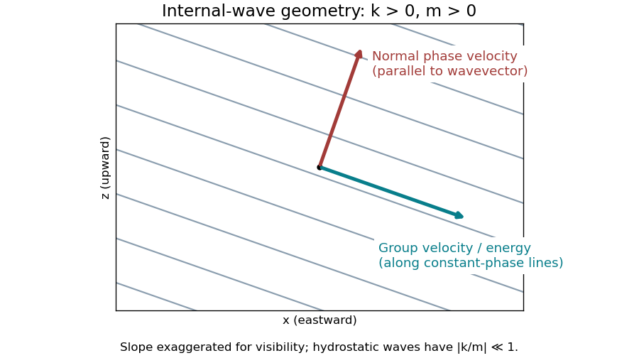
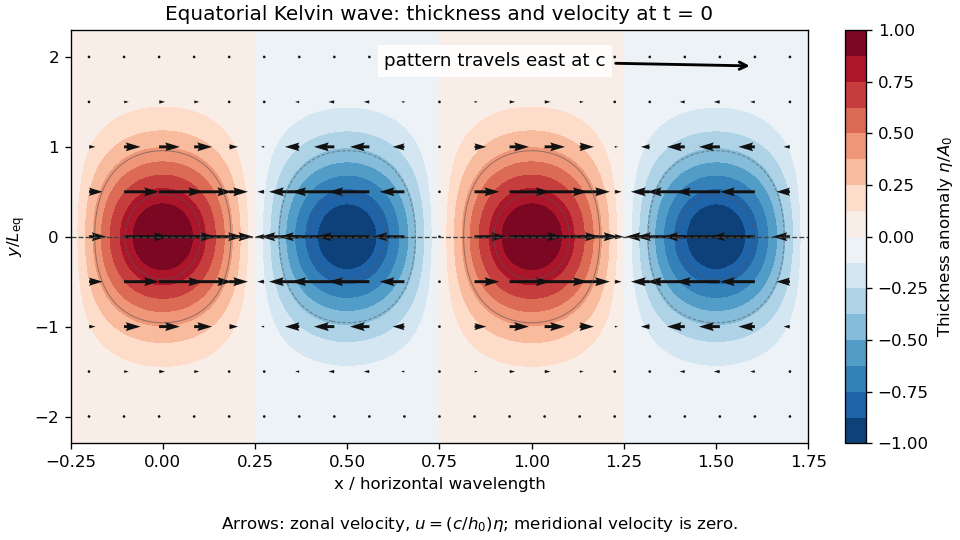
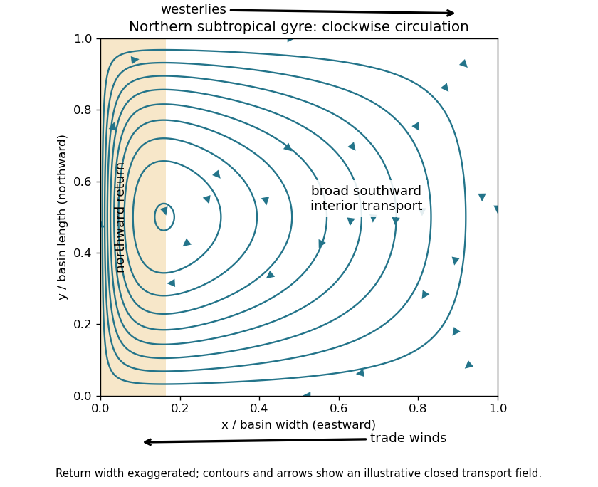

# 2024

↑ **Parent:** [Past exam of the geophysical fluid dynamics course of the University of Oxford](../past-exam-of-the-geophysical-fluid-dynamics-course-of-the-university-of-oxford.md)

Solutions to all eight labelled parts. Source PDF: [Oxford, A15274W1, 5 June 2024](https://mmathphys.physics.ox.ac.uk/sites/g/files/vzsiac2991/files/mmathphys/documents/media/geophysical_fluid_dynamics_0.pdf). The numbered headings preserve the source numbering; question statements are omitted.

**Table of contents**

- [1](#1)
  - [a](#1/a)
    - [Solution](#1/a/solution)
  - [b](#1/b)
    - [Solution](#1/b/solution)
  - [c](#1/c)
    - [Solution](#1/c/solution)
  - [d](#1/d)
    - [Solution](#1/d/solution)
  - [e](#1/e)
    - [Solution](#1/e/solution)
- [2](#2)
  - [a](#2/a)
    - [Solution](#2/a/solution)
  - [b](#2/b)
    - [Solution](#2/b/solution)
  - [c](#2/c)
    - [Solution](#2/c/solution)

## 1

↑ **Parent:** [2024](2024.md)

<h3 id="1/a">a</h3>

↑ **Parent:** [1](#1)

<h4 id="1/a/solution">Solution</h4>

↑ **Parent:** [A](#1/a)

Take $x$ eastward, $y$ northward and $z$ upward. In a [rotating reference frame](../mathematical-physics.md#rotating-reference-frame), the horizontal [Cauchy momentum equation](../continuum-mechanics.md#cauchy-momentum-equation) is

$$
\frac{D\mathbf u_h}{Dt}+f\widehat{\mathbf z}\times\mathbf u_h=-\frac1\rho\nabla_h p+\mathbf F_h,
\qquad f=2\Omega\sin\phi.
$$

Here $\mathbf F_h$ represents other accelerations, such as [friction](../newtonian-mechanics.md#friction), and $f$ is the [Coriolis parameter](../geophysical-fluid-dynamics.md#coriolis-parameter). When the [Rossby number](../geophysical-fluid-dynamics.md#rossby-number) $U/(|f|L)$ and the ratio $1/(|f|\tau)$ are small, and [friction](../newtonian-mechanics.md#friction) is weak, both advective and local [acceleration](../classical-mechanics.md#acceleration) can be neglected. The [Coriolis force](../mathematical-physics.md#coriolis-force) then balances the [pressure gradient force](../fluid-mechanics.md#pressure-gradient-force): this is [geostrophic balance](../mathematical-physics.md#geostrophic-balance), with $fv=p_x/\rho$ and $fu=-p_y/\rho$. The [geostrophic wind](../mathematical-physics.md#geostrophic-wind) runs along [atmospheric isobars](../mathematical-physics.md#atmospheric-isobar), with low [pressure](../pressure.md) on its left in the northern hemisphere.

A rapid change of [pressure](../pressure.md) need not bring the corresponding [geostrophic wind](../mathematical-physics.md#geostrophic-wind) into existence at once. An initially weak wind therefore leaves an inward [pressure gradient force](../fluid-mechanics.md#pressure-gradient-force) around the new low. For a smoothed anomaly of horizontal scale $L=5\times10^5\ \mathrm m$, [geostrophic balance](../mathematical-physics.md#geostrophic-balance) would require

$$
U_g\sim\frac{|p\prime|}{\rho |f|L}
\simeq33\ \mathrm{m\,s^{-1}}
\left(\frac{1.2\ \mathrm{kg\,m^{-3}}}{\rho}\right)
\left(\frac{10^{-4}\ \mathrm{s^{-1}}}{|f|}\right).
$$

For the illustrative midlatitude value $|f|=10^{-4}\ \mathrm{s^{-1}}$, the implied [Rossby number](../geophysical-fluid-dynamics.md#rossby-number) is already about $0.67$, so curved-flow [acceleration](../classical-mechanics.md#acceleration) matters. With a small tropical value $|f|=10^{-5}\ \mathrm{s^{-1}}$, the inferred speed is $333\ \mathrm{m\,s^{-1}}$ and the [Rossby number](../geophysical-fluid-dynamics.md#rossby-number) about $67$: the assumed [geostrophic balance](../mathematical-physics.md#geostrophic-balance) is untenable. [Geostrophic adjustment](../geophysical-fluid-dynamics.md#geostrophic-adjustment) redistributes the anomaly and emits [internal gravity waves](../gravity-wave.md#internal-wave), leaving a weaker balanced component.

For a target speed $U_*=10\ \mathrm{m\,s^{-1}}$ on the same scale, the required scale estimate is

$$
\boxed{|p\prime_{\rm adj}|\sim\rho |f|LU_*
=6\ \mathrm{hPa}\left(\frac{\rho}{1.2\ \mathrm{kg\,m^{-3}}}\right)
\left(\frac{|f|}{10^{-4}\ \mathrm{s^{-1}}}\right).}
$$

Thus $6\ \mathrm{hPa}$, or $0.30$ of the initial magnitude, is the midlatitude estimate; at the illustrative tropical $|f|=10^{-5}\ \mathrm{s^{-1}}$ it is $0.6\ \mathrm{hPa}$, or $0.030$ of the initial magnitude. **The paper gives no latitude, so there is no unique numerical reduction.** At the equator itself one must use equatorial dynamics rather than divide by $f=0$. Even the tropical $10\ \mathrm{m\,s^{-1}}$ estimate has [Rossby number](../geophysical-fluid-dynamics.md#rossby-number) $2$, so it describes the scale permitted by the stated balance, rather than a controlled tropical [geostrophic balance](../mathematical-physics.md#geostrophic-balance).

There are two qualifications to “unstable”. A literal top-hat [pressure](../pressure.md) anomaly has a discontinuous edge, where no finite classical [geostrophic wind](../mathematical-physics.md#geostrophic-wind) can balance its distributional [pressure gradient](../fluid-mechanics.md#pressure-gradient). The $500\ \mathrm{km}$ estimate assumes a smoothed edge; a thinner edge requires stronger winds. More generally a large low is not, by its amplitude alone, proved to have an exponentially growing instability. For a concrete counterexample to the claim that such an amplitude cannot be stationary, set $p\prime(s)=-P\exp(-s^2/a^2)$, with cylindrical radius $s$, constant $\rho$ and $f>0$. The cyclonic [gradient wind](../mathematical-physics.md#gradient-wind)

$$
v_\theta(s)=\frac{-fs+\sqrt{f^2s^2+4s p_s/\rho}}2
$$

is real and satisfies $v_\theta^2/s+fv_\theta=p_s/\rho$ for every $P>0$, with a regular limit at the centre. This is a stationary [axisymmetric flow](../fluid-mechanics.md#axisymmetric-flow); no claim about its perturbation stability is needed. Here the physically justified conclusion is that a rapidly imposed anomaly without its balancing wind is **unbalanced**.

Small tropical [Coriolis parameter](../geophysical-fluid-dynamics.md#coriolis-parameter) allows only weak horizontal [pressure gradients](../fluid-mechanics.md#pressure-gradient) to coexist with ordinary large-scale winds. [Hydrostatic balance](../fluid-mechanics.md#hydrostatic-balance) connects the vertical variation of these [pressure gradients](../fluid-mechanics.md#pressure-gradient) to horizontal [temperature gradients](../heat.md#temperature-gradient); equivalently the approximate [thermal wind](../geophysical-fluid-dynamics.md#thermal-wind) relation gives $f u_z\simeq-(g/T)T_y$. For comparable vertical wind shear, small $|f|$ means smaller $|T_y|$. [Internal gravity waves](../gravity-wave.md#internal-wave) can spread heating-induced [buoyancy](../fluid-mechanics.md#buoyancy) anomalies efficiently before rotation arrests the adjustment. This motivates the [weak temperature gradient approximation](../geophysical-fluid-dynamics.md#weak-temperature-gradient-approximation) for the tropical free troposphere; it does not require the land surface or atmospheric boundary layer to have uniform [temperature](../temperature.md).

<h3 id="1/b">b</h3>

↑ **Parent:** [1](#1)

<h4 id="1/b/solution">Solution</h4>

↑ **Parent:** [B](#1/b)

Use a [plane wave](../wave-function.md#plane-wave) with phase $kx+mz-\omega t$, and take $N>0$, $k,m\ne0$. The positive-[frequency](../wave.md#frequency) branch of the given hydrostatic [dispersion relation](../dispersion-relation.md) is $\omega=N|k|/|m|$. The [wavevector](../elasticity-physics.md#wavevector) is $\mathbf K=(k,m)$. Differentiating with respect to its components gives the [group velocity](../dispersion-relation.md#group-velocity), which carries the [wave packet](../dispersion-relation.md#wave-packet) and its [energy](../energy.md):

$$
\boxed{\mathbf c_g=\nabla_{\mathbf K}\omega
=\left(\frac\omega k,-\frac\omega m\right).}
$$

The normal [phase velocity](../dispersion-relation.md#phase-velocity), which follows a crest in its normal direction, is

$$
\boxed{\mathbf c_p=\frac\omega{k^2+m^2}(k,m).}
$$

Consequently,

$$
\mathbf K\cdot\mathbf c_g=0,\qquad
\mathbf c_p\cdot\mathbf c_g=0,\qquad
\frac{c_{g,z}}{c_{g,x}}=-\frac{k}{m}.
$$

Thus the [group velocity](../dispersion-relation.md#group-velocity) lies along the constant-phase lines $z=-(k/m)x+\mathrm{constant}$, perpendicular to the [phase velocity](../dispersion-relation.md#phase-velocity). For $k,m>0$, crests move upward and rightward, whereas [energy](../energy.md) moves downward and rightward. Choosing $m<0$ gives upward and rightward [energy](../energy.md) propagation and downward and rightward normal phase propagation. Conjugate or oppositely directed components supply the other outgoing directions from a localized source.

**[Figure 1](#1/b/image-internal-wave-crests-normal-phase-propagation-and-perpendicular-energy-propagation-for-positive-horizontal-and-vertical-wavenumbers). Internal-wave crests, normal phase propagation, and perpendicular energy propagation for positive horizontal and vertical wavenumbers**.

The speeds are

$$
\boxed{|\mathbf c_g|=\frac N{|m|}\sqrt{1+\frac{k^2}{m^2}},\qquad
|\mathbf c_p|=\frac{N|k|}{|m|\sqrt{k^2+m^2}}.}
$$

The hydrostatic limit is $|k/m|\ll1$. In that limit [energy](../energy.md) propagates almost horizontally, with $|c_{g,x}|=N/|m|$ and $|c_{g,z}|=N|k|/m^2$, while normal phase propagation is almost vertical and has speed approximately $N|k|/m^2$. The horizontal speed at which a crest intersects a fixed height is $\omega/k=c_{g,x}$; this is not the horizontal component of the normal [phase velocity](../dispersion-relation.md#phase-velocity) vector. For example, $N=10^{-2}\ \mathrm{s^{-1}}$, vertical [wavelength](../wave-equation.md#wavelength) $2\pi/|m|=10\ \mathrm{km}$ and horizontal [wavelength](../wave-equation.md#wavelength) $2\pi/|k|=1000\ \mathrm{km}$ give $|c_{g,x}|\simeq15.9\ \mathrm{m\,s^{-1}}$ and $|c_{g,z}|\simeq0.159\ \mathrm{m\,s^{-1}}$.

These are local speeds in a uniform medium, without a background current. The non-rotating approximation requires $|f|\ll\omega$, while the [hydrostatic approximation](../fluid-mechanics.md#hydrostatic-approximation) requires $\omega\ll N$. At lower [frequencies](../wave.md#frequency), rotation changes the [dispersion relation](../dispersion-relation.md) to that of [inertia-gravity waves](../geophysical-fluid-dynamics.md#inertia-gravity-wave).

<h3 id="1/c">c</h3>

↑ **Parent:** [1](#1)

<h4 id="1/c/solution">Solution</h4>

↑ **Parent:** [C](#1/c)

The equations describe the linear [reduced gravity](../reduced-gravity.md) [shallow water equations](../mathematical-physics.md#shallow-water-equations) for a uniform upper layer over a deep, resting lower layer, or equivalently one separated internal vertical mode. The layer is shallow compared with its horizontal scales, permitting [hydrostatic balance](../fluid-mechanics.md#hydrostatic-balance), and its horizontal [velocity](../classical-mechanics.md#velocity) is independent of depth. The [Boussinesq approximation](../geophysical-fluid-dynamics.md#boussinesq-approximation) retains the small [density](../fluid-mechanics.md#density) contrast through $g\prime=g(\rho_2-\rho_1)/\rho_0>0$. We neglect [friction](../newtonian-mechanics.md#friction), external forcing, background currents, and quadratic perturbation terms. On an equatorial [beta plane](../geophysical-fluid-dynamics.md#beta-plane), $f=\beta y$ with $\beta>0$, and the [equatorial Kelvin wave](../geophysical-fluid-dynamics.md#equatorial-kelvin-wave) branch imposes $v=0$. The meridional [Cauchy momentum equation](../continuum-mechanics.md#cauchy-momentum-equation) then reduces exactly within this linear model to a balance between the [Coriolis force](../mathematical-physics.md#coriolis-force) and [pressure gradient force](../fluid-mechanics.md#pressure-gradient-force).

Strictly, the printed $h$ must denote the **thickness perturbation** $\eta$, with total thickness $h_0+\eta$ and $|\eta|\ll h_0$. A signed oscillation around zero cannot represent the total positive layer thickness. Define $c=\sqrt{g\prime h_0}$. For a nonzero zonal [wavenumber](../wave-equation.md#wavenumber) $k$, the zonal [Cauchy momentum equation](../continuum-mechanics.md#cauchy-momentum-equation) and [conservation of mass](../continuum-mechanics.md#mass-conservation) give

$$
\omega\widehat u=kg\prime\widehat\eta,\qquad
\omega\widehat\eta=kh_0\widehat u,
\qquad \omega^2=c^2k^2.
$$

On the eastward branch $\omega=ck$, the [wave polarization](../wave.md#polarization-waves) is $u=(c/h_0)\eta$. Meridional [geostrophic balance](../mathematical-physics.md#geostrophic-balance) gives

$$
g\prime\eta_y=-\beta y\frac c{h_0}\eta,
\qquad \frac{\eta_y}{\eta}=-\frac{\beta y}{c},
\qquad \eta\propto\exp\left(-\frac{\beta y^2}{2c}\right).
$$

The branch $\omega=-ck$ instead grows as $\exp(+\beta y^2/(2c))$ and is excluded by decay away from the equator. Matching the paper's [Gaussian function](../calculus.md#gaussian-function) therefore gives

$$
\boxed{L_{\rm eq}^2=\frac{2c}{\beta},\qquad
\eta=A_0e^{-y^2/L_{\rm eq}^2}\cos(kx-ckt),\qquad
u=\frac c{h_0}\eta,\quad v=0.}
$$

The usual [equatorial deformation radius](../geophysical-fluid-dynamics.md#equatorial-deformation-radius) is $R_{\rm eq}=\sqrt{c/\beta}$, with the envelope written $e^{-y^2/(2R_{\rm eq}^2)}$. Thus the printed exponent uses $L_{\rm eq}=\sqrt2R_{\rm eq}$. Calling that width a [deformation radius](../geophysical-fluid-dynamics.md#deformation-radius) is a convention; using the standard radius without the factor $1/2$ would fail the printed meridional equation.

**[Figure 2](#1/c/image-equatorial-kelvin-wave-thickness-anomaly-and-zonal-velocity-at-one-instant-using-the-paper-s-gaussian-width-convention). Equatorial Kelvin-wave thickness anomaly and zonal velocity at one instant, using the paper's Gaussian-width convention**.

At an instant, alternating positive and negative thickness anomalies have their largest magnitudes on the equator and decay symmetrically away from it. Eastward arrows occupy the positive anomalies, westward arrows the negative anomalies; the [velocity](../classical-mechanics.md#velocity) vanishes at the nodes and weakens away from the equator. The whole pattern travels eastward at speed $c$. **Meridionally**, $fu=-g\prime\eta_y$ is [geostrophic balance](../mathematical-physics.md#geostrophic-balance). For a positive anomaly north of the equator, the northward [pressure gradient force](../fluid-mechanics.md#pressure-gradient-force) balances the southward [Coriolis force](../mathematical-physics.md#coriolis-force); both directions reverse south of the equator. **Zonally**, $fv=0$ and $u_t=-g\prime\eta_x$: the zonal [pressure gradient force](../fluid-mechanics.md#pressure-gradient-force) accelerates the flow, so it is not in zonal [geostrophic balance](../mathematical-physics.md#geostrophic-balance). On the equator the meridional terms both vanish smoothly.

<h3 id="1/d">d</h3>

↑ **Parent:** [1](#1)

<h4 id="1/d/solution">Solution</h4>

↑ **Parent:** [D](#1/d)

Hold $l,m,f_0,N$ fixed when differentiating the [dispersion relation](../dispersion-relation.md) of [Rossby waves](../geophysical-fluid-dynamics.md#rossby-wave), so that $\alpha^2\geq0$ is independent of $k$. For $k\ne0$, stationary zonal phase requires

$$
0=\frac\omega k=U-\frac\beta{k^2+\alpha^2},
\qquad U=\frac\beta{k^2+\alpha^2}.
$$

The zonal [group velocity](../dispersion-relation.md#group-velocity) measured relative to the ground is

$$
c_{g,x}=\frac{\partial\omega}{\partial k}
=U+\frac{\beta(k^2-\alpha^2)}{(k^2+\alpha^2)^2}.
$$

Using the stationarity condition,

$$
\boxed{c_{g,x}=\frac{2\beta k^2}{(k^2+\alpha^2)^2}
=\frac{2Uk^2}{k^2+\alpha^2}>0.}
$$

Here $\beta=2\Omega\cos\phi/a>0$ on the ordinary midlatitude [beta plane](../geophysical-fluid-dynamics.md#beta-plane), so the stationary [Rossby wave](../geophysical-fluid-dynamics.md#rossby-wave) requires an eastward background current and carries its [wave packet](../dispersion-relation.md#wave-packet) eastward. If $\alpha>0$, a real nonzero stationary $k$ exists only for $0<U<\beta/\alpha^2$. The restriction $k\ne0$ matters: a zonally uniform disturbance with $k=0$ has $\omega=0$ identically, but its zonal [phase velocity](../dispersion-relation.md#phase-velocity) is undefined, so it is not a counterexample within the stated meaning of stationary waves.

<h3 id="1/e">e</h3>

↑ **Parent:** [1](#1)

<h4 id="1/e/solution">Solution</h4>

↑ **Parent:** [E](#1/e)

**Kelvin waves:** weakened [trade winds](../planetary-science.md#trade-winds), or a westerly wind burst, excite a downwelling [equatorial Kelvin wave](../geophysical-fluid-dynamics.md#equatorial-kelvin-wave). Its positive upper-layer thickness anomaly travels eastward and deepens the eastern Pacific [thermocline](../physics.md#thermocline). [Upwelling](../geophysical-fluid-dynamics.md#upwelling) then entrains warmer water, favouring eastern Pacific surface warming and the development of [El Niño](../physics.md#el-nino). This is a propagating adjustment of the [thermocline](../physics.md#thermocline), rather than transport of an unchanged parcel of warm water across the entire basin.[Box 2, “Equatorial Waves”, and the adjoining discussion of eastern thermocline depression, printed page 358](../physics-bibliography.md#el-nino-and-la-nina-causes-and-global-consequences-by-michael-j-mcphaden)

**Gravity waves:** changed tropical [convection](../convection.md) and its [latent heat](../thermodynamic-potential.md#latent-heat) release force atmospheric [internal gravity waves](../gravity-wave.md#internal-wave). Their rapid propagation spreads the associated [pressure](../pressure.md) and [buoyancy](../fluid-mechanics.md#buoyancy) disturbances, allowing the tropical [terrestrial atmosphere](../planetary-science.md#terrestrial-atmosphere) to adjust to the shifted heating and contributing to the divergent circulation and surface wind response coupled to the ocean. This is one atmospheric adjustment mechanism; it does not assert that all wind variability during a particular [El Niño](../physics.md#el-nino) is caused by this wave family.

**Rossby waves:** wind forcing during [El Niño](../physics.md#el-nino) also launches westward [equatorial Rossby waves](../geophysical-fluid-dynamics.md#equatorial-rossby-wave) with a shoaling [thermocline](../physics.md#thermocline) signal. Reflection at the western Pacific boundary can produce an eastward upwelling [equatorial Kelvin wave](../geophysical-fluid-dynamics.md#equatorial-kelvin-wave), which shoals the eastern [thermocline](../physics.md#thermocline) and promotes cooling. This supplies a delayed negative feedback that can help terminate the event.[Printed pages 358–359, reflection of the western thermocline-elevation signal and the return of surface cooling](../physics-bibliography.md#el-nino-and-la-nina-causes-and-global-consequences-by-michael-j-mcphaden) These examples describe mechanisms relevant to events such as 2023/24, rather than claiming an event-specific attribution from the exam data.

## 2

↑ **Parent:** [2024](2024.md)

<h3 id="2/a">a</h3>

↑ **Parent:** [2](#2)

<h4 id="2/a/solution">Solution</h4>

↑ **Parent:** [A](#2/a)

Use eastward $x$, northward $y$, constant layer depth $H$, constant reference [density](../fluid-mechanics.md#density) $\rho_0$, and a depth-independent horizontal [velocity field](../fluid-mechanics.md#velocity-field) $(u,v)$. Assume a flat bottom and a rigid upper boundary, giving the two-dimensional [incompressibility condition](../fluid-mechanics.md#incompressible-flow) $u_x+v_y=0$. The [traditional approximation](../geophysical-fluid-dynamics.md#traditional-approximation-geophysical-fluid-dynamics) retains only the vertical component of planetary rotation in the horizontal equations. Take the [Coriolis parameter](../geophysical-fluid-dynamics.md#coriolis-parameter) $f=f(y)$, a constant [linear drag](../fluid-mechanics.md#linear-drag) rate $r$, and no other torques. The component [Cauchy momentum equations](../continuum-mechanics.md#cauchy-momentum-equation) are

$$
Du-fv=-\frac{p_x}{\rho_0}+\frac{\tau_s}{\rho_0H}-ru,
\qquad Dv+fu=-\frac{p_y}{\rho_0}-rv,
\qquad D=\partial_t+u\partial_x+v\partial_y.
$$

Define [relative vorticity](../vorticity.md#relative-vorticity) $\xi=v_x-u_y$. Apply $\partial_x$ to the second equation and subtract $\partial_y$ of the first. The [pressure gradient force](../fluid-mechanics.md#pressure-gradient-force) has zero [curl](../multivariable-calculus.md#curl) because $\rho_0$ is constant and mixed [partial derivatives](../multivariable-calculus.md#partial-derivative) commute. Direct expansion of the material-acceleration terms gives

$$
\partial_x(Dv)-\partial_y(Du)
=D\xi+(u_x+v_y)\xi=D\xi.
$$

The [curl](../multivariable-calculus.md#curl) of the rotation terms is

$$
\partial_x(fu)+\partial_y(fv)
=f(u_x+v_y)+vf_y=vf_y.
$$

The imposed zonal [wind stress](../geophysical-fluid-dynamics.md#wind-stress) contributes $-\tau_{s,y}/(\rho_0H)$, and constant [linear drag](../fluid-mechanics.md#linear-drag) contributes $-r\xi$. Hence

$$
D\xi+vf_y=-\frac{\tau_{s,y}}{\rho_0H}-r\xi.
$$

Since $Df=vf_y$, defining [absolute vorticity](../vorticity.md#absolute-vorticity) $\zeta=\xi+f$ gives

$$
\boxed{\left(\partial_t+u\partial_x+v\partial_y\right)\zeta
=-\frac1{\rho_0H}\frac{\partial\tau_s}{\partial y}-r\xi.}
$$

Without the [incompressibility condition](../fluid-mechanics.md#incompressible-flow), the left-hand side would contain the stretching term $\zeta\nabla_h\cdot\mathbf u$. Variable layer depth, variable [density](../fluid-mechanics.md#density) or spatially varying [linear drag](../fluid-mechanics.md#linear-drag) would introduce further terms. No small-[Rossby number](../geophysical-fluid-dynamics.md#rossby-number) assumption was needed to obtain this constant-depth [vorticity equation](../mathematical-physics.md#vorticity-equation).

<h3 id="2/b">b</h3>

↑ **Parent:** [2](#2)

<h4 id="2/b/solution">Solution</h4>

↑ **Parent:** [B](#2/b)

On a [beta plane](../geophysical-fluid-dynamics.md#beta-plane), $f=f_0+\beta y$, the preceding [vorticity equation](../mathematical-physics.md#vorticity-equation) is

$$
\xi_t+u\xi_x+v\xi_y+\beta v
=-\frac{\tau_{s,y}}{\rho_0H}-r\xi.
$$

In the broad ocean interior, assume a statistically steady flow, weak [advection](../fluid-mechanics.md#advection) of [relative vorticity](../vorticity.md#relative-vorticity), and negligible [friction](../newtonian-mechanics.md#friction) compared with planetary-[vorticity](../vorticity.md) advection. The constant-depth, constant-[density](../fluid-mechanics.md#density) assumptions of 2(a) exclude topographic and [baroclinic vorticity generation](../mathematical-physics.md#baroclinic-vorticity-generation) contributions. More precisely, require $|\xi_t|,|\mathbf u\cdot\nabla\xi|,|r\xi|\ll|\beta v|$. Then [Sverdrup balance](../geophysical-fluid-dynamics.md#sverdrup-balance) is

$$
\boxed{\beta v=\frac{(\nabla_h\times\boldsymbol\tau)_z}{\rho_0H}
=-\frac1{\rho_0H}\frac{d\tau_s}{dy}.}
$$

Small [Rossby number](../geophysical-fluid-dynamics.md#rossby-number) and slow forcing help justify these conditions in the interior; they do not justify them inside an intense [western boundary current](../geophysical-fluid-dynamics.md#western-boundary-current). For fluctuations, the mean [eddy](../fluid-mechanics.md#eddy) contribution to relative-[vorticity](../vorticity.md) advection must also be negligible.

The depth-integrated northward [volume flux](../fluid-mechanics.md#volumetric-flow-rate) per unit zonal distance is $V=Hv$. For a basin $0<x<L$ and [wind stress](../geophysical-fluid-dynamics.md#wind-stress) independent of $x$, the northward **interior** [volume flux](../fluid-mechanics.md#volumetric-flow-rate) is

$$
\boxed{T(y)=\int_0^L Hv\,dx=-\frac{L}{\beta\rho_0}\frac{d\tau_s}{dy}.}
$$

A negative value denotes southward transport. The cancellation of $H$ is why this interior [volume flux](../fluid-mechanics.md#volumetric-flow-rate) is insensitive to the chosen constant depth. In a closed, steady basin the net [volume flux](../fluid-mechanics.md#volumetric-flow-rate) across a full latitude section is zero: a boundary return must compensate $T$. Thus the displayed formula cannot represent the total closed-basin transport including that return.

For a concrete circulation sketch, use a northern-hemisphere subtropical basin $0<y<B$ and

$$
\tau_s(y)=-\tau_0\cos(\pi y/B),\qquad
V(y)=-\frac{\pi\tau_0}{\beta\rho_0B}\sin(\pi y/B).
$$

This represents westward [trade winds](../planetary-science.md#trade-winds) at the southern edge and eastward westerlies at the northern edge. The negative [wind stress curl](../geophysical-fluid-dynamics.md#wind-stress-curl) drives southward interior flow. Define an [ocean transport streamfunction](../geophysical-fluid-dynamics.md#ocean-transport-streamfunction) by $Hu=-\Psi_y$, $Hv=\Psi_x$ and impose no normal flow at the eastern wall through $\Psi(L,y)=0$. Integrating [Sverdrup balance](../geophysical-fluid-dynamics.md#sverdrup-balance) westward gives

$$
\Psi_I=(x-L)V(y),\qquad
Hu_I=(L-x)V_y(y),\qquad Hv_I=V(y).
$$

Since $V=0$ at $y=0,B$, this also gives no normal flow at the north and south walls. Interior water moves westward in the southern part, southward across the basin, and eastward in the northern part. A northward [western boundary current](../geophysical-fluid-dynamics.md#western-boundary-current) completes the clockwise [ocean gyre](../geophysical-fluid-dynamics.md#ocean-gyre).

**[Figure 3](#2/b/image-northern-hemisphere-subtropical-sverdrup-interior-and-a-schematic-western-return-with-arrows-indicating-volume-transport). Northern-hemisphere subtropical Sverdrup interior and a schematic western return, with arrows indicating volume transport**.

Pure [Sverdrup balance](../geophysical-fluid-dynamics.md#sverdrup-balance) cannot satisfy the western impermeability condition as well: $\Psi_I(0,y)=-LV(y)$ varies along that wall. Indeed imposing no normal flow on both east and west walls would require their constant [streamfunction](../fluid-mechanics.md#stream-function) values to agree in this simply connected closed basin, whereas their difference here is the nonzero $T(y)$. The shaded return in the sketch represents a boundary region where the interior approximation breaks down. It is supplied by [friction](../newtonian-mechanics.md#friction) in 2(c), rather than inferred from [Sverdrup balance](../geophysical-fluid-dynamics.md#sverdrup-balance) alone. A southern-hemisphere subtropical [ocean gyre](../geophysical-fluid-dynamics.md#ocean-gyre) has the reflected, anticlockwise circulation.

For an order-of-magnitude estimate, use $\tau_0=0.1\ \mathrm{N\,m^{-2}}$, $\rho_0=10^3\ \mathrm{kg\,m^{-3}}$, $\beta=2\times10^{-11}\ \mathrm{m^{-1}\,s^{-1}}$, $L=5\times10^6\ \mathrm m$ and a [wind stress](../geophysical-fluid-dynamics.md#wind-stress) variation scale $\ell_\tau=10^6\ \mathrm m$. Then

$$
\boxed{|T|\sim\frac{L\tau_0}{\beta\rho_0\ell_\tau}
=2.5\times10^7\ \mathrm{m^3\,s^{-1}}=25\ \mathrm{Sv}.}
$$

Here $1\ \mathrm{Sv}=10^6\ \mathrm{m^3\,s^{-1}}$ is a [Sverdrup](../fluid-mechanics.md#sverdrup). The sinusoidal example has maximum $|\tau_{s,y}|=\pi\tau_0/B$; taking $B=\pi\times10^6\ \mathrm m$ makes it agree with the chosen variation scale. Other reasonable basin widths and wind profiles change the coefficient, but retain a transport of order tens of [Sverdrups](../fluid-mechanics.md#sverdrup).

<h3 id="2/c">c</h3>

↑ **Parent:** [2](#2)

<h4 id="2/c/solution">Solution</h4>

↑ **Parent:** [C](#2/c)

Let $V_b$ be the northward speed in the [western boundary current](../geophysical-fluid-dynamics.md#western-boundary-current), whose zonal width $\delta$ is much less than its meridional scale. Its dominant [relative vorticity](../vorticity.md#relative-vorticity) is $\xi\simeq v_x\sim V_b/\delta$. Neglecting local [wind stress curl](../geophysical-fluid-dynamics.md#wind-stress-curl) and relative-[vorticity](../vorticity.md) advection in the narrow return region, the linear stationary [vorticity equation](../mathematical-physics.md#vorticity-equation) becomes

$$
\beta v\simeq-r\xi\simeq-rv_x.
$$

Consequently

$$
\boxed{\delta\sim\frac r\beta,\qquad v(x,y)\propto e^{-x/\delta}.}
$$

This decay into the interior from the western wall explains why the [Stommel boundary layer](../geophysical-fluid-dynamics.md#stommel-boundary-layer) lies on the west. The sign also matters: a northward return has $v_x<0$, so its negative [relative vorticity](../vorticity.md#relative-vorticity) supplies a positive drag contribution $-r\xi$ to balance $\beta v$. Here $r$ has units $\mathrm{s^{-1}}$; no extra factor of $f_0$ belongs in $r/\beta$ with the paper's definition of [linear drag](../fluid-mechanics.md#linear-drag).

For example, at fixed $y$ the leading correction to the interior [ocean transport streamfunction](../geophysical-fluid-dynamics.md#ocean-transport-streamfunction) is

$$
\Psi_B=LV(y)e^{-x/\delta},\qquad
Hv_B=\partial_x\Psi_B=-\frac{LV(y)}\delta e^{-x/\delta}.
$$

It cancels the western value of $\Psi_I$ and carries $\int_0^\infty Hv_B\,dx=-LV=-T$. Exponentially small eastern-wall corrections and the turning regions near the northern and southern walls do not affect the leading width estimate.

Using one year $=3.156\times10^7\ \mathrm s$, the representative $\beta$ of 2(b), and $H=10^3\ \mathrm m$ gives

$$
r=3.17\times10^{-8}\ \mathrm{s^{-1}},\qquad
\boxed{\delta\simeq1.58\times10^3\ \mathrm m=1.6\ \mathrm{km}.}
$$

To return the $25\ \mathrm{Sv}$ interior [volume flux](../fluid-mechanics.md#volumetric-flow-rate), [conservation of mass](../continuum-mechanics.md#mass-conservation) requires

$$
\boxed{V_b\sim\frac{|T|}{H\delta}
\simeq15.8\ \mathrm{m\,s^{-1}}.}
$$

For the exponential profile this is the boundary speed associated with its effective transport width $\delta$. It is much narrower and faster than the familiar large-scale [western boundary currents](../geophysical-fluid-dynamics.md#western-boundary-current), whose energetic cores span tens of kilometres and have speeds of order $1\ \mathrm{m\,s^{-1}}$. The simplified constant-depth [linear drag](../fluid-mechanics.md#linear-drag) model with a one-year decay time therefore does not give a realistic quantitative boundary structure. [Lateral viscosity](../dynamic-viscosity.md#lateral-viscosity), [eddies](../fluid-mechanics.md#eddy), [stratification](../gravity-wave.md#density-stratification) and inertia can all affect a real current.

The corresponding [relative vorticity](../vorticity.md#relative-vorticity) scale is

$$
\boxed{|\xi|\sim\frac{V_b}\delta\simeq9.96\times10^{-3}\ \mathrm{s^{-1}},\qquad
\frac{|\xi|}{|f_0|}\sim100\quad\text{for }|f_0|\sim10^{-4}\ \mathrm{s^{-1}}.}
$$

Thus [relative vorticity](../vorticity.md#relative-vorticity) cannot be discarded relative to [planetary vorticity](../vorticity.md#planetary-vorticity) in this predicted return. Even a more realistic $1\ \mathrm{m\,s^{-1}}$ across $50\ \mathrm{km}$ gives $|\xi|\sim2\times10^{-5}\ \mathrm{s^{-1}}$, an appreciable fraction of $|f_0|$.

Magnitude alone does not prove that its material [advection](../fluid-mechanics.md#advection) is large: a perfectly parallel current $v=v(x)$, $u=0$ has $\mathbf u\cdot\nabla\xi=0$ exactly. For a gyre return varying over meridional scale $B$, however, [incompressibility](../fluid-mechanics.md#incompressible-flow) gives $u\sim\delta V_b/B$, and both generic contributions to $\mathbf u\cdot\nabla\xi$ scale as $V_b^2/(B\delta)$. Relative to $\beta V_b$, this is

$$
\frac{|\mathbf u\cdot\nabla\xi|}{\beta V_b}
\sim\frac{V_b}{\beta B\delta}
\simeq1.6\times10^2\qquad(B=\pi\times10^6\ \mathrm m).
$$

Absent special cancellations, the assumed neglect of relative-[vorticity](../vorticity.md) advection is therefore not self-consistent for these parameters. Its natural inertial width is instead $\delta_I\sim\sqrt{V_I/\beta}$, where $V_I=|T|/(HL)\simeq5\times10^{-3}\ \mathrm{m\,s^{-1}}$; this gives about $16\ \mathrm{km}$. That comparison diagnoses the missing inertia rather than supplying a complete nonlinear boundary-current solution.

## ↑ Ancestors (9)

1. [Past exam of the geophysical fluid dynamics course of the University of Oxford](../past-exam-of-the-geophysical-fluid-dynamics-course-of-the-university-of-oxford.md)
2. [Geophysical fluid dynamics course of the University of Oxford](../university-of-oxford.md#geophysical-fluid-dynamics-course-of-the-university-of-oxford)
3. [Year 4 of the mathematical and theoretical physics course of the University of Oxford](../university-of-oxford.md#year-4-of-the-mathematical-and-theoretical-physics-course-of-the-university-of-oxford)
4. [Mathematical and theoretical physics course of the University of Oxford](../university-of-oxford.md#mathematical-and-theoretical-physics-course-of-the-university-of-oxford)
5. [Undergraduate course of the University of Oxford](../university-of-oxford.md#undergraduate-course-of-the-university-of-oxford)
6. [Course of the University of Oxford](../university-of-oxford.md#course-of-the-university-of-oxford)
7. [University of Oxford](../university-of-oxford.md)
8. [List of universities](../README.md#list-of-universities)
9. [Codex Wiki](../README.md)
