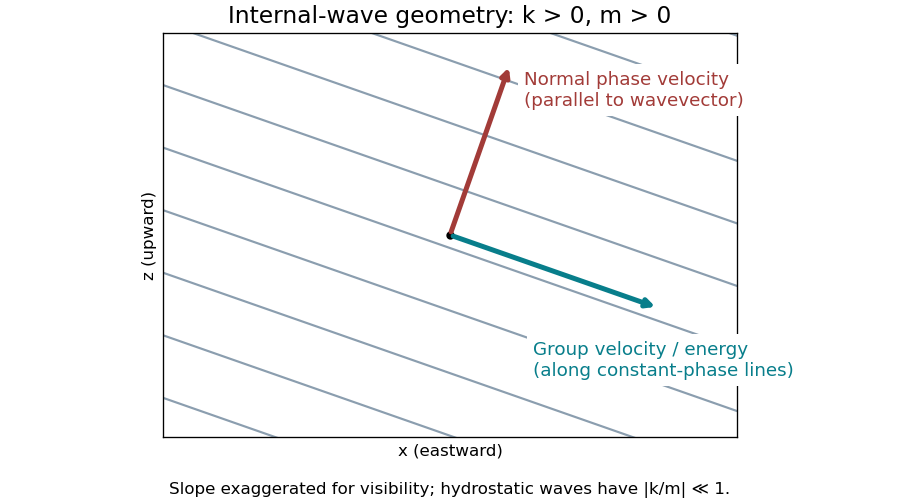

<h1 id="1/b/solution">Solution</h1>

↑ **Parent:** [B](../b.md)

Use a [plane wave](../../../../plane-wave.md) with phase $kx+mz-\omega t$, and take $N>0$, $k,m\ne0$. The positive-[frequency](../../../../frequency.md) branch of the given hydrostatic [dispersion relation](../../../../dispersion-relation-split.md) is $\omega=N|k|/|m|$. The [wavevector](../../../../wavevector.md) is $\mathbf K=(k,m)$. Differentiating with respect to its components gives the [group velocity](../../../../group-velocity.md), which carries the [wave packet](../../../../wave-packet.md) and its [energy](../../../../energy-split.md):

$$
\boxed{\mathbf c_g=\nabla_{\mathbf K}\omega
=\left(\frac\omega k,-\frac\omega m\right).}
$$

The normal [phase velocity](../../../../phase-velocity.md), which follows a crest in its normal direction, is

$$
\boxed{\mathbf c_p=\frac\omega{k^2+m^2}(k,m).}
$$

Consequently,

$$
\mathbf K\cdot\mathbf c_g=0,\qquad
\mathbf c_p\cdot\mathbf c_g=0,\qquad
\frac{c_{g,z}}{c_{g,x}}=-\frac{k}{m}.
$$

Thus the [group velocity](../../../../group-velocity.md) lies along the constant-phase lines $z=-(k/m)x+\mathrm{constant}$, perpendicular to the [phase velocity](../../../../phase-velocity.md). For $k,m>0$, crests move upward and rightward, whereas [energy](../../../../energy-split.md) moves downward and rightward. Choosing $m<0$ gives upward and rightward [energy](../../../../energy-split.md) propagation and downward and rightward normal phase propagation. Conjugate or oppositely directed components supply the other outgoing directions from a localized source.

**[Figure 1](#1/b/image-internal-wave-crests-normal-phase-propagation-and-perpendicular-energy-propagation-for-positive-horizontal-and-vertical-wavenumbers). Internal-wave crests, normal phase propagation, and perpendicular energy propagation for positive horizontal and vertical wavenumbers**.

The speeds are

$$
\boxed{|\mathbf c_g|=\frac N{|m|}\sqrt{1+\frac{k^2}{m^2}},\qquad
|\mathbf c_p|=\frac{N|k|}{|m|\sqrt{k^2+m^2}}.}
$$

The hydrostatic limit is $|k/m|\ll1$. In that limit [energy](../../../../energy-split.md) propagates almost horizontally, with $|c_{g,x}|=N/|m|$ and $|c_{g,z}|=N|k|/m^2$, while normal phase propagation is almost vertical and has speed approximately $N|k|/m^2$. The horizontal speed at which a crest intersects a fixed height is $\omega/k=c_{g,x}$; this is not the horizontal component of the normal [phase velocity](../../../../phase-velocity.md) vector. For example, $N=10^{-2}\ \mathrm{s^{-1}}$, vertical [wavelength](../../../../wavelength.md) $2\pi/|m|=10\ \mathrm{km}$ and horizontal [wavelength](../../../../wavelength.md) $2\pi/|k|=1000\ \mathrm{km}$ give $|c_{g,x}|\simeq15.9\ \mathrm{m\,s^{-1}}$ and $|c_{g,z}|\simeq0.159\ \mathrm{m\,s^{-1}}$.

These are local speeds in a uniform medium, without a background current. The non-rotating approximation requires $|f|\ll\omega$, while the [hydrostatic approximation](../../../../hydrostatic-approximation.md) requires $\omega\ll N$. At lower [frequencies](../../../../frequency.md), rotation changes the [dispersion relation](../../../../dispersion-relation-split.md) to that of [inertia-gravity waves](../../../../inertia-gravity-wave.md).

## ↑ Ancestors (12)

1. [B](../b.md)
2. [1](../../1.md)
3. [2024](../../../2024-split.md)
4. [Past exam of the geophysical fluid dynamics course of the University of Oxford](../../../split.md)
5. [Geophysical fluid dynamics course of the University of Oxford](../../../../geophysical-fluid-dynamics-course-of-the-university-of-oxford.md)
6. [Year 4 of the mathematical and theoretical physics course of the University of Oxford](../../../../year-4-of-the-mathematical-and-theoretical-physics-course-of-the-university-of-oxford.md)
7. [Mathematical and theoretical physics course of the University of Oxford](../../../../mathematical-and-theoretical-physics-course-of-the-university-of-oxford.md)
8. [Undergraduate course of the University of Oxford](../../../../undergraduate-course-of-the-university-of-oxford.md)
9. [Course of the University of Oxford](../../../../course-of-the-university-of-oxford.md)
10. [University of Oxford](../../../../university-of-oxford-split.md)
11. [List of universities](../../../../list-of-universities.md)
12. [Codex Wiki](../../../../split.md)
