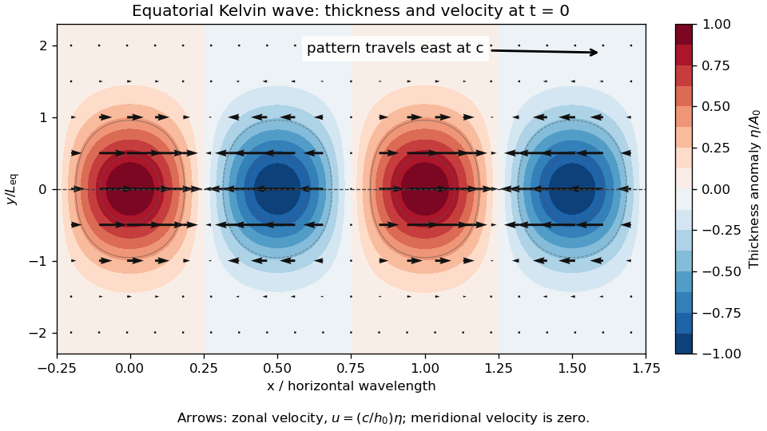

<h1 id="1/c/solution">Solution</h1>

↑ **Parent:** [C](../c.md)

The equations describe the linear [reduced gravity](../../../../reduced-gravity-split.md) [shallow water equations](../../../../shallow-water-equations.md) for a uniform upper layer over a deep, resting lower layer, or equivalently one separated internal vertical mode. The layer is shallow compared with its horizontal scales, permitting [hydrostatic balance](../../../../hydrostatic-balance.md), and its horizontal [velocity](../../../../velocity.md) is independent of depth. The [Boussinesq approximation](../../../../boussinesq-approximation.md) retains the small [density](../../../../density.md) contrast through $g\prime=g(\rho_2-\rho_1)/\rho_0>0$. We neglect [friction](../../../../friction.md), external forcing, background currents, and quadratic perturbation terms. On an equatorial [beta plane](../../../../beta-plane.md), $f=\beta y$ with $\beta>0$, and the [equatorial Kelvin wave](../../../../equatorial-kelvin-wave.md) branch imposes $v=0$. The meridional [Cauchy momentum equation](../../../../cauchy-momentum-equation.md) then reduces exactly within this linear model to a balance between the [Coriolis force](../../../../coriolis-force.md) and [pressure gradient force](../../../../pressure-gradient-force.md).

Strictly, the printed $h$ must denote the **thickness perturbation** $\eta$, with total thickness $h_0+\eta$ and $|\eta|\ll h_0$. A signed oscillation around zero cannot represent the total positive layer thickness. Define $c=\sqrt{g\prime h_0}$. For a nonzero zonal [wavenumber](../../../../wavenumber.md) $k$, the zonal [Cauchy momentum equation](../../../../cauchy-momentum-equation.md) and [conservation of mass](../../../../mass-conservation.md) give

$$
\omega\widehat u=kg\prime\widehat\eta,\qquad
\omega\widehat\eta=kh_0\widehat u,
\qquad \omega^2=c^2k^2.
$$

On the eastward branch $\omega=ck$, the [wave polarization](../../../../polarization-waves.md) is $u=(c/h_0)\eta$. Meridional [geostrophic balance](../../../../geostrophic-balance.md) gives

$$
g\prime\eta_y=-\beta y\frac c{h_0}\eta,
\qquad \frac{\eta_y}{\eta}=-\frac{\beta y}{c},
\qquad \eta\propto\exp\left(-\frac{\beta y^2}{2c}\right).
$$

The branch $\omega=-ck$ instead grows as $\exp(+\beta y^2/(2c))$ and is excluded by decay away from the equator. Matching the paper's [Gaussian function](../../../../gaussian-function.md) therefore gives

$$
\boxed{L_{\rm eq}^2=\frac{2c}{\beta},\qquad
\eta=A_0e^{-y^2/L_{\rm eq}^2}\cos(kx-ckt),\qquad
u=\frac c{h_0}\eta,\quad v=0.}
$$

The usual [equatorial deformation radius](../../../../equatorial-deformation-radius.md) is $R_{\rm eq}=\sqrt{c/\beta}$, with the envelope written $e^{-y^2/(2R_{\rm eq}^2)}$. Thus the printed exponent uses $L_{\rm eq}=\sqrt2R_{\rm eq}$. Calling that width a [deformation radius](../../../../deformation-radius.md) is a convention; using the standard radius without the factor $1/2$ would fail the printed meridional equation.

**[Figure 2](#1/c/image-equatorial-kelvin-wave-thickness-anomaly-and-zonal-velocity-at-one-instant-using-the-paper-s-gaussian-width-convention). Equatorial Kelvin-wave thickness anomaly and zonal velocity at one instant, using the paper's Gaussian-width convention**.

At an instant, alternating positive and negative thickness anomalies have their largest magnitudes on the equator and decay symmetrically away from it. Eastward arrows occupy the positive anomalies, westward arrows the negative anomalies; the [velocity](../../../../velocity.md) vanishes at the nodes and weakens away from the equator. The whole pattern travels eastward at speed $c$. **Meridionally**, $fu=-g\prime\eta_y$ is [geostrophic balance](../../../../geostrophic-balance.md). For a positive anomaly north of the equator, the northward [pressure gradient force](../../../../pressure-gradient-force.md) balances the southward [Coriolis force](../../../../coriolis-force.md); both directions reverse south of the equator. **Zonally**, $fv=0$ and $u_t=-g\prime\eta_x$: the zonal [pressure gradient force](../../../../pressure-gradient-force.md) accelerates the flow, so it is not in zonal [geostrophic balance](../../../../geostrophic-balance.md). On the equator the meridional terms both vanish smoothly.

## ↑ Ancestors (12)

1. [C](../c.md)
2. [1](../../1.md)
3. [2024](../../../2024-split.md)
4. [Past exam of the geophysical fluid dynamics course of the University of Oxford](../../../split.md)
5. [Geophysical fluid dynamics course of the University of Oxford](../../../../geophysical-fluid-dynamics-course-of-the-university-of-oxford.md)
6. [Year 4 of the mathematical and theoretical physics course of the University of Oxford](../../../../year-4-of-the-mathematical-and-theoretical-physics-course-of-the-university-of-oxford.md)
7. [Mathematical and theoretical physics course of the University of Oxford](../../../../mathematical-and-theoretical-physics-course-of-the-university-of-oxford.md)
8. [Undergraduate course of the University of Oxford](../../../../undergraduate-course-of-the-university-of-oxford.md)
9. [Course of the University of Oxford](../../../../course-of-the-university-of-oxford.md)
10. [University of Oxford](../../../../university-of-oxford-split.md)
11. [List of universities](../../../../list-of-universities.md)
12. [Codex Wiki](../../../../split.md)
