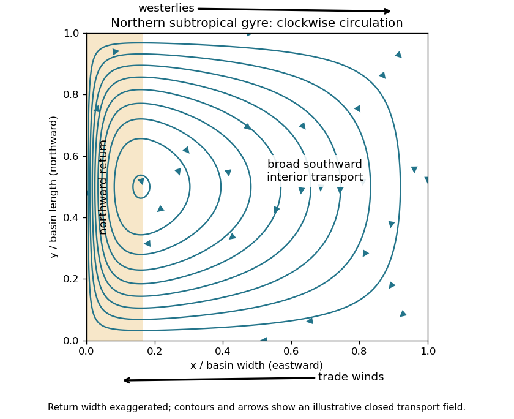

<h1 id="2/b/solution">Solution</h1>

↑ **Parent:** [B](../b.md)

On a [beta plane](../../../../beta-plane.md), $f=f_0+\beta y$, the preceding [vorticity equation](../../../../vorticity-equation.md) is

$$
\xi_t+u\xi_x+v\xi_y+\beta v
=-\frac{\tau_{s,y}}{\rho_0H}-r\xi.
$$

In the broad ocean interior, assume a statistically steady flow, weak [advection](../../../../advection.md) of [relative vorticity](../../../../relative-vorticity.md), and negligible [friction](../../../../friction.md) compared with planetary-[vorticity](../../../../vorticity-split.md) advection. The constant-depth, constant-[density](../../../../density.md) assumptions of 2(a) exclude topographic and [baroclinic vorticity generation](../../../../baroclinic-vorticity-generation.md) contributions. More precisely, require $|\xi_t|,|\mathbf u\cdot\nabla\xi|,|r\xi|\ll|\beta v|$. Then [Sverdrup balance](../../../../sverdrup-balance.md) is

$$
\boxed{\beta v=\frac{(\nabla_h\times\boldsymbol\tau)_z}{\rho_0H}
=-\frac1{\rho_0H}\frac{d\tau_s}{dy}.}
$$

Small [Rossby number](../../../../rossby-number.md) and slow forcing help justify these conditions in the interior; they do not justify them inside an intense [western boundary current](../../../../western-boundary-current.md). For fluctuations, the mean [eddy](../../../../eddy.md) contribution to relative-[vorticity](../../../../vorticity-split.md) advection must also be negligible.

The depth-integrated northward [volume flux](../../../../volumetric-flow-rate.md) per unit zonal distance is $V=Hv$. For a basin $0<x<L$ and [wind stress](../../../../wind-stress.md) independent of $x$, the northward **interior** [volume flux](../../../../volumetric-flow-rate.md) is

$$
\boxed{T(y)=\int_0^L Hv\,dx=-\frac{L}{\beta\rho_0}\frac{d\tau_s}{dy}.}
$$

A negative value denotes southward transport. The cancellation of $H$ is why this interior [volume flux](../../../../volumetric-flow-rate.md) is insensitive to the chosen constant depth. In a closed, steady basin the net [volume flux](../../../../volumetric-flow-rate.md) across a full latitude section is zero: a boundary return must compensate $T$. Thus the displayed formula cannot represent the total closed-basin transport including that return.

For a concrete circulation sketch, use a northern-hemisphere subtropical basin $0<y<B$ and

$$
\tau_s(y)=-\tau_0\cos(\pi y/B),\qquad
V(y)=-\frac{\pi\tau_0}{\beta\rho_0B}\sin(\pi y/B).
$$

This represents westward [trade winds](../../../../trade-winds.md) at the southern edge and eastward westerlies at the northern edge. The negative [wind stress curl](../../../../wind-stress-curl.md) drives southward interior flow. Define an [ocean transport streamfunction](../../../../ocean-transport-streamfunction.md) by $Hu=-\Psi_y$, $Hv=\Psi_x$ and impose no normal flow at the eastern wall through $\Psi(L,y)=0$. Integrating [Sverdrup balance](../../../../sverdrup-balance.md) westward gives

$$
\Psi_I=(x-L)V(y),\qquad
Hu_I=(L-x)V_y(y),\qquad Hv_I=V(y).
$$

Since $V=0$ at $y=0,B$, this also gives no normal flow at the north and south walls. Interior water moves westward in the southern part, southward across the basin, and eastward in the northern part. A northward [western boundary current](../../../../western-boundary-current.md) completes the clockwise [ocean gyre](../../../../ocean-gyre.md).

**[Figure 3](#2/b/image-northern-hemisphere-subtropical-sverdrup-interior-and-a-schematic-western-return-with-arrows-indicating-volume-transport). Northern-hemisphere subtropical Sverdrup interior and a schematic western return, with arrows indicating volume transport**.

Pure [Sverdrup balance](../../../../sverdrup-balance.md) cannot satisfy the western impermeability condition as well: $\Psi_I(0,y)=-LV(y)$ varies along that wall. Indeed imposing no normal flow on both east and west walls would require their constant [streamfunction](../../../../stream-function.md) values to agree in this simply connected closed basin, whereas their difference here is the nonzero $T(y)$. The shaded return in the sketch represents a boundary region where the interior approximation breaks down. It is supplied by [friction](../../../../friction.md) in 2(c), rather than inferred from [Sverdrup balance](../../../../sverdrup-balance.md) alone. A southern-hemisphere subtropical [ocean gyre](../../../../ocean-gyre.md) has the reflected, anticlockwise circulation.

For an order-of-magnitude estimate, use $\tau_0=0.1\ \mathrm{N\,m^{-2}}$, $\rho_0=10^3\ \mathrm{kg\,m^{-3}}$, $\beta=2\times10^{-11}\ \mathrm{m^{-1}\,s^{-1}}$, $L=5\times10^6\ \mathrm m$ and a [wind stress](../../../../wind-stress.md) variation scale $\ell_\tau=10^6\ \mathrm m$. Then

$$
\boxed{|T|\sim\frac{L\tau_0}{\beta\rho_0\ell_\tau}
=2.5\times10^7\ \mathrm{m^3\,s^{-1}}=25\ \mathrm{Sv}.}
$$

Here $1\ \mathrm{Sv}=10^6\ \mathrm{m^3\,s^{-1}}$ is a [Sverdrup](../../../../sverdrup.md). The sinusoidal example has maximum $|\tau_{s,y}|=\pi\tau_0/B$; taking $B=\pi\times10^6\ \mathrm m$ makes it agree with the chosen variation scale. Other reasonable basin widths and wind profiles change the coefficient, but retain a transport of order tens of [Sverdrups](../../../../sverdrup.md).

## ↑ Ancestors (12)

1. [B](../b.md)
2. [2](../../2.md)
3. [2024](../../../2024-split.md)
4. [Past exam of the geophysical fluid dynamics course of the University of Oxford](../../../split.md)
5. [Geophysical fluid dynamics course of the University of Oxford](../../../../geophysical-fluid-dynamics-course-of-the-university-of-oxford.md)
6. [Year 4 of the mathematical and theoretical physics course of the University of Oxford](../../../../year-4-of-the-mathematical-and-theoretical-physics-course-of-the-university-of-oxford.md)
7. [Mathematical and theoretical physics course of the University of Oxford](../../../../mathematical-and-theoretical-physics-course-of-the-university-of-oxford.md)
8. [Undergraduate course of the University of Oxford](../../../../undergraduate-course-of-the-university-of-oxford.md)
9. [Course of the University of Oxford](../../../../course-of-the-university-of-oxford.md)
10. [University of Oxford](../../../../university-of-oxford-split.md)
11. [List of universities](../../../../list-of-universities.md)
12. [Codex Wiki](../../../../split.md)
