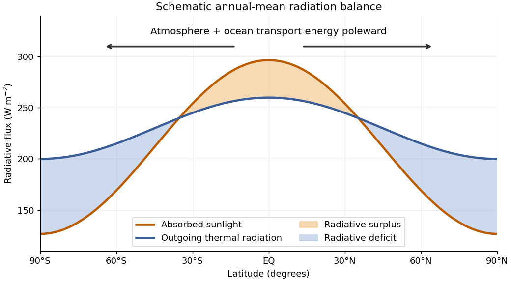
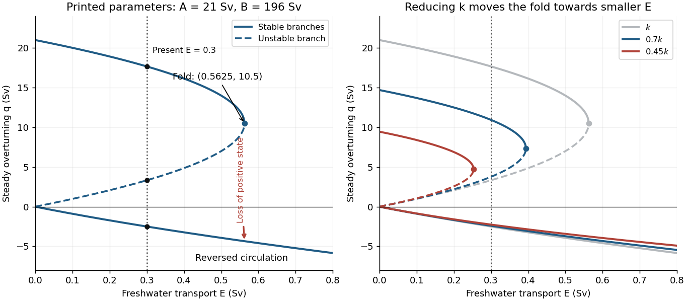

# 2025

↑ **Parent:** [Past exam of the geophysical fluid dynamics course of the University of Oxford](../past-exam-of-the-geophysical-fluid-dynamics-course-of-the-university-of-oxford.md)

Solutions to all parts of the held paper, including the four inline Roman parts of 2(c). Source PDF: [Oxford, A15274H1, 9 June 2025](https://mmathphys.physics.ox.ac.uk/sites/g/files/vzsiac2991/files/mmathphys/documents/media/a15274h1.pdf). Numbered headings retain the source numbering; question statements are omitted.

**Table of contents**

- [1](#1)
  - [a](#1/a)
    - [Solution](#1/a/solution)
  - [b](#1/b)
    - [Solution](#1/b/solution)
  - [c](#1/c)
    - [Solution](#1/c/solution)
  - [d](#1/d)
    - [Solution](#1/d/solution)
- [2](#2)
  - [a](#2/a)
    - [Solution](#2/a/solution)
  - [b](#2/b)
    - [Solution](#2/b/solution)
  - [c](#2/c)
    - [i](#2/c/i)
      - [Solution](#2/c/i/solution)
    - [ii](#2/c/ii)
      - [Solution](#2/c/ii/solution)
    - [iii](#2/c/iii)
      - [Solution](#2/c/iii/solution)
    - [iv](#2/c/iv)
      - [Solution](#2/c/iv/solution)
  - [d](#2/d)
    - [Solution](#2/d/solution)

## 1

↑ **Parent:** [2025](2025.md)

<h3 id="1/a">a</h3>

↑ **Parent:** [1](#1)

<h4 id="1/a/solution">Solution</h4>

↑ **Parent:** [A](#1/a)

The annual, zonal-mean absorbed sunlight falls from the tropics towards the poles much more strongly than outgoing [thermal radiation](../electromagnetic-radiation.md#thermal-radiation). Thus [Earth](../planetary-science.md#earth)'s top-of-atmosphere [radiation budget](../geophysics.md#radiation-budget) has a tropical surplus and a polar deficit, with changes of sign around $35^\circ$ latitude in a basic sketch. The curves below are illustrative, rather than measured data; their area-weighted global means agree.

**[Figure 1](#1/a/image-an-illustrative-latitude-dependent-radiation-budget-and-the-required-poleward-energy-transport). An illustrative latitude-dependent radiation budget and the required poleward energy transport**.

In a statistically stationary [climate](../geophysics.md#climate), local [conservation of energy](../mathematical-physics.md#conservation-of-energy) requires the surplus to be exported. If $R(\phi)$ is the net downward radiative [heat flux](../heat.md#heat-flux-density) and $\mathcal H(\phi)$ the northward total [power](../energy.md#power) carried across the latitude circle, then

$$
\frac{d\mathcal H}{d\phi}=2\pi a^2R(\phi)\cos\phi,\qquad
\mathcal H(\phi)=2\pi a^2\int_{-\pi/2}^{\phi}R(\theta)\cos\theta\,d\theta.
$$

Here $a$ is [Earth](../planetary-science.md#earth)'s radius. The [terrestrial atmosphere](../planetary-science.md#terrestrial-atmosphere) and [ocean circulation](../geophysical-fluid-dynamics.md#ocean-circulation) carry this [energy](../energy.md) poleward by moving warm and cold fluid, including atmospheric transport of [latent heat](../thermodynamic-potential.md#latent-heat). Without this transport the assumed steady [radiation budget](../geophysics.md#radiation-budget) could not persist: the tropics would warm and polar regions cool until the budget changed. The tropical atmospheric contribution includes the [Hadley cell](../geophysics.md#hadley-cell): rising warm air near the equator, poleward flow aloft, subtropical descent, and an equatorward lower return.

For a parcel moving without an axial [torque](../momentum.md#torque), [conservation of angular momentum](../momentum.md#conservation-of-angular-momentum) applies in an inertial frame. The specific axial [angular momentum](../momentum.md#angular-momentum) at latitude $\phi$ is

$$
M=(\Omega a\cos\phi+u)a\cos\phi.
$$

“Initially at rest” means $u=0$ relative to the rotating surface at the equator, so $M=\Omega a^2$. Neglecting atmospheric height compared with $a$ gives

$$
\boxed{u(\phi)=\Omega a\left(\frac1{\cos\phi}-\cos\phi\right)
=\frac{\Omega a\sin^2\phi}{\cos\phi}.}
$$

With $\Omega=7.292\times10^{-5}\ \mathrm{s^{-1}}$ and $a=6.371\times10^6\ \mathrm m$, the eastward [velocity](../classical-mechanics.md#velocity) at $30^\circ\mathrm N$ is

$$
\boxed{u(30^\circ)=134\ \mathrm{m\,s^{-1}}.}
$$

This is the ideal angular-momentum-conserving upper branch of the [Hadley cell](../geophysics.md#hadley-cell). Real [jet streams](../geophysics.md#jet-stream) exchange [angular momentum](../momentum.md#angular-momentum) through [eddies](../fluid-mechanics.md#eddy) and [friction](../newtonian-mechanics.md#friction), so this estimate is not an observational claim about the actual wind speed.

<h3 id="1/b">b</h3>

↑ **Parent:** [1](#1)

<h4 id="1/b/solution">Solution</h4>

↑ **Parent:** [B](#1/b)

Take $x$ eastward, $y$ northward and $z$ upward, and let $u$ be the eastward [geostrophic wind](../mathematical-physics.md#geostrophic-wind). With [Coriolis parameter](../geophysical-fluid-dynamics.md#coriolis-parameter) $f$ independent of $z$, [geostrophic balance](../mathematical-physics.md#geostrophic-balance), [hydrostatic balance](../fluid-mechanics.md#hydrostatic-balance), and the [ideal gas law](../ideal-gas.md#ideal-gas-law) give

$$
fu=-\frac{p_y}{\rho},\qquad p_z=-\rho g,\qquad p=\rho R_dT.
$$

Here $R_d$ is the specific gas constant for dry air. Taking a vertical [derivative](../calculus.md#derivative) of the first equation and interchanging mixed [partial derivatives](../multivariable-calculus.md#partial-derivative) gives

$$
f u_z=g\frac{\rho_y}{\rho}-fu\frac{\rho_z}{\rho}.
$$

It matters that $\rho$ is not constant in the [pressure gradient force](../fluid-mechanics.md#pressure-gradient-force). Substituting

$$
\frac{\rho_y}{\rho}=-\frac{fu}{R_dT}-\frac{T_y}{T},\qquad
\frac{\rho_z}{\rho}=-\frac g{R_dT}-\frac{T_z}{T}
$$

cancels the two terms proportional to $gfu/(R_dT)$ and yields the height-coordinate [thermal wind](../geophysical-fluid-dynamics.md#thermal-wind) relation

$$
f u_z=-\frac gT T_y+\frac{fu}{T}T_z.
$$

If $|uT_z|\ll|Tu_z|$, this reduces to

$$
\boxed{f\frac{\partial u}{\partial z}\simeq-\frac gT\frac{\partial T}{\partial y}.}
$$

The discarded term has relative scale $H|T_z|/T$ when $u_z\sim u/H$. Taking $H=10\ \mathrm{km}$, $T=250\ \mathrm K$ and a [atmospheric lapse rate](../exoplanet.md#lapse-rate-atmosphere) of $6.5\ \mathrm{K\,km^{-1}}$ gives about $0.26$. Thus this height-coordinate formula is a useful estimate, with potentially tens-of-percent compressibility-related correction through the vertical [temperature gradient](../heat.md#temperature-gradient); it is not an exact consequence of the two balances. If the [temperature gradient](../heat.md#temperature-gradient) vanishes vertically, the displayed approximation is exact within those balances.

The [hydrostatic approximation](../fluid-mechanics.md#hydrostatic-approximation) is very good on the broad, shallow atmospheric scales considered. The [geostrophic balance](../mathematical-physics.md#geostrophic-balance) is normally justified by a small [Rossby number](../geophysical-fluid-dynamics.md#rossby-number) and fails as a general approximation near the equator. At $30^\circ\mathrm N$, $f=7.292\times10^{-5}\ \mathrm{s^{-1}}$. With the ideal $134\ \mathrm{m\,s^{-1}}$ wind and a $1000$--$2000\ \mathrm{km}$ horizontal scale, $\mathrm{Ro}=U/(fL)\simeq0.9$--$1.8$: quantitative accuracy is limited for this especially strong ideal jet. Small vertical aspect ratio alone does not ensure [geostrophic balance](../mathematical-physics.md#geostrophic-balance), although a straight, steady zonal flow can satisfy it even when this scale estimate of the [Rossby number](../geophysical-fluid-dynamics.md#rossby-number) is not small.

For the requested estimate, suppose the upper [jet stream](../geophysics.md#jet-stream) is $H=10\ \mathrm{km}$ above a weak surface wind, has [temperature](../temperature.md) $T\simeq250\ \mathrm K$, and spans a meridional width $L$. Integrating the approximate [thermal wind](../geophysical-fluid-dynamics.md#thermal-wind) relation in scale form gives

$$
\boxed{T_{\rm south}-T_{\rm north}\simeq\frac{fTUL}{gH}
\simeq25\ \mathrm K\left(\frac{L}{1000\ \mathrm{km}}\right)
\left(\frac{10\ \mathrm{km}}H\right)
\left(\frac{T}{250\ \mathrm K}\right).}
$$

The northward [temperature gradient](../heat.md#temperature-gradient) is negative because the eastward wind strengthens upward. A $1000$--$2000\ \mathrm{km}$ jet width gives roughly $25$--$50\ \mathrm K$. No unique numerical difference follows without specifying the jet width, height and representative [temperature](../temperature.md); these are explicitly estimated quantities.

<h3 id="1/c">c</h3>

↑ **Parent:** [1](#1)

<h4 id="1/c/solution">Solution</h4>

↑ **Parent:** [C](#1/c)

Write the [velocity field](../fluid-mechanics.md#velocity-field) as $u=U+u\prime$, $v=v\prime$. The uniform background has zero [relative vorticity](../vorticity.md#relative-vorticity), and the perturbation has $\xi\prime=v\prime_x-u\prime_y$. Keeping only terms linear in the perturbations gives

$$
\boxed{(\partial_t+U\partial_x)\xi\prime+\beta v\prime=0.}
$$

The [incompressibility condition](../fluid-mechanics.md#incompressible-flow) permits a [streamfunction](../fluid-mechanics.md#stream-function) $\psi$ with $u\prime=-\psi_y$, $v\prime=\psi_x$, hence $\xi\prime=\nabla_h^2\psi$. Thus the [Linear Rossby-wave equation](../geophysical-fluid-dynamics.md#linear-rossby-wave-equation) here is

$$
(\partial_t+U\partial_x)\nabla_h^2\psi+\beta\psi_x=0.
$$

Choose a [plane wave](../wave-function.md#plane-wave) $\psi=\operatorname{Re}\{\widehat\psi e^{i(kx+ly-\omega t)}\}$, with $K^2=k^2+l^2>0$. Substitution gives

$$
i(\omega-Uk)K^2\widehat\psi+i\beta k\widehat\psi=0,
$$

and therefore the [local Rossby-wave dispersion relation in a zonal jet](../geophysical-fluid-dynamics.md#local-rossby-wave-dispersion-relation-in-a-zonal-jet)

$$
\boxed{\omega=Uk-\frac{\beta k}{k^2+l^2}.}
$$

The $Uk$ term is the background [Doppler shift](../wave.md#doppler-effect); the intrinsic [phase velocity](../dispersion-relation.md#phase-velocity) is westward. A real physical [wave](../wave.md) can always be represented using the conjugate [wavevector](../elasticity-physics.md#wavevector) if necessary to choose $\omega\geq0$.

The relevant ground-frame zonal [phase velocity](../dispersion-relation.md#phase-velocity) and [group velocity](../dispersion-relation.md#group-velocity) are

$$
c_{p,x}=\frac\omega k=U-\frac\beta{K^2},\qquad
c_{g,x}=\frac{\partial\omega}{\partial k}
=U+\frac{\beta(k^2-l^2)}{K^4},\qquad
c_{g,y}=\frac{\partial\omega}{\partial l}=\frac{2\beta kl}{K^4}.
$$

**Time increases downward in the source diagram.** The individual phase contours lean towards increasing longitude as time increases, so their [phase velocity](../dispersion-relation.md#phase-velocity) is eastward. The envelope moves eastward faster: successive crests grow at the downstream edge and decay upstream. This illustrates [Rossby-wave downstream development](../geophysical-fluid-dynamics.md#rossby-wave-downstream-development).

For the intended purely zonal [wave packet](../dispersion-relation.md#wave-packet), $l=0$, and

$$
c_p=U-\frac\beta{k^2}>0,\qquad c_g=U+\frac\beta{k^2}>U.
$$

Consequently, with $U,\beta>0$ and the positive-frequency choice $k>0$,

$$
\boxed{k>\sqrt{\beta/U}.}
$$

There is a small interpretation qualification: if “zonally propagating” specified only the plotted direction while allowing an unknown nonzero meridional [wavenumber](../wave-equation.md#wavenumber), eastward [phase velocity](../dispersion-relation.md#phase-velocity) alone would imply $k^2+l^2>\beta/U$, not the stronger bound on $k$ alone. In this uniform model a strictly zonal [group velocity](../dispersion-relation.md#group-velocity) with $\beta k\ne0$ does imply $l=0$, which supplies the intended interpretation.

<h3 id="1/d">d</h3>

↑ **Parent:** [1](#1)

<h4 id="1/d/solution">Solution</h4>

↑ **Parent:** [D](#1/d)

For a zonal background $U(y)$, its [relative vorticity](../vorticity.md#relative-vorticity) is $\overline\xi=-U_y$. The meridional [absolute vorticity](../vorticity.md#absolute-vorticity) gradient is therefore

$$
Q_y=\beta-U_{yy},\qquad
\beta=\frac{2\Omega\cos\phi}{a}.
$$

At $30^\circ\mathrm N$,

$$
\boxed{\beta\simeq1.98\times10^{-11}\ \mathrm{m^{-1}\,s^{-1}}.}
$$

A localized [jet stream](../geophysics.md#jet-stream) of [velocity](../classical-mechanics.md#velocity) scale $U=134\ \mathrm{m\,s^{-1}}$ and width $L$ has

$$
\boxed{|\overline\xi_y|=|U_{yy}|\sim\frac U{L^2}
=1.34\times10^{-10}\left(\frac{1000\ \mathrm{km}}L\right)^2
\mathrm{m^{-1}\,s^{-1}}.}
$$

For $L=1000$--$2000\ \mathrm{km}$ this is about $1.7$--$6.8$ times the planetary contribution, so wind curvature cannot generally be neglected. The coefficient in this scaling depends on the chosen jet profile and width convention.

Linearizing the [vorticity equation](../mathematical-physics.md#vorticity-equation) now gives the [Rossby-wave equation for a sheared zonal current](../geophysical-fluid-dynamics.md#rossby-wave-equation-for-a-sheared-zonal-current)

$$
(\partial_t+U(y)\partial_x)\nabla_h^2\psi+(\beta-U_{yy})\psi_x=0.
$$

For a qualitative estimate at the jet core, freeze the local coefficients. At a smooth maximum $U_{yy}<0$, so $Q_y>\beta$: the restoring [absolute vorticity](../vorticity.md#absolute-vorticity) gradient is stronger. The [local Rossby-wave dispersion relation in a zonal jet](../geophysical-fluid-dynamics.md#local-rossby-wave-dispersion-relation-in-a-zonal-jet) gives, for the same local $U$ and zonal [wavenumber](../wave-equation.md#wavenumber) $k$ with $l=0$,

$$
c_p=U-\frac{Q_y}{k^2},\qquad c_g=U+\frac{Q_y}{k^2},
$$

so

$$
\boxed{\Delta c_p=\frac{U_{yy}}{k^2}<0,\qquad
\Delta c_g=-\frac{U_{yy}}{k^2}>0.}
$$

The envelope in the diagram would advance eastward faster, while individual phase contours would advance more slowly eastward, become stationary if $Q_y=Uk^2$, or move westward if $Q_y>Uk^2$. The separation between envelope and phase speeds increases. On a plot with time downward, compare horizontal displacement at fixed time: the envelope moves farther right, while a given phase moves less far right, or left after reversal. If the [frequency](../wave.md#frequency) changes sign for a fixed signed $k$, conjugate the mode to restore the convention $\omega\geq0$; the physical propagation is unchanged.

This conclusion concerns the concave-down jet core. On a flank with $U_{yy}>0$ the correction has the opposite sign; the value at the edge of the [Hadley cell](../geophysics.md#hadley-cell) alone does not specify the curvature everywhere. Indeed the angular-momentum-conserving profile in 1(a) is a rising inner branch, not a complete smooth jet maximum. A global sheared-current [normal mode](../wave-equation.md#normal-mode) requires its meridional structure and boundary conditions; the local calculation is the qualitative estimate requested.

## 2

↑ **Parent:** [2025](2025.md)

<h3 id="2/a">a</h3>

↑ **Parent:** [2](#2)

<h4 id="2/a/solution">Solution</h4>

↑ **Parent:** [A](#2/a)

Define the [salinity](../mathematical-physics.md#salinity) contrast $\Delta S=S_1-S_2$, positive when the warm box is saltier. The linear [equation of state](../pressure.md#equation-of-state) gives the cold-minus-warm [density](../fluid-mechanics.md#density) contrast and signed [volume flux](../fluid-mechanics.md#volumetric-flow-rate)

$$
\frac{\rho_2-\rho_1}{\rho_0}=\alpha\Delta T-\beta\Delta S,\qquad
q=k(\alpha\Delta T-\beta\Delta S).
$$

Here $q>0$ represents warm upper water travelling poleward and cold deep water returning equatorward. The $\beta$ in this question is the haline [density](../fluid-mechanics.md#density) coefficient, unrelated to the planetary [vorticity](../vorticity.md) gradient in Question 1. The imposed heating and cooling are taken to maintain $\Delta T$.

For the positive circulation shown in the source diagram, the exact stationary [salt budget](../mathematical-physics.md#salt-budget) of the cold box is

$$
qS_1-(q+E)S_2=0,
\qquad q\Delta S=ES_2.
$$

The precipitation adds no salt. Replacing the salinity multiplying the small compensating [volume flux](../fluid-mechanics.md#volumetric-flow-rate) by a reference $S_0$ gives $q\Delta S\simeq ES_0$. When circulation reverses, the upstream box for the exchange reverses too: the homogenizing exchange is $|q|$, not $q$. In the same reference-salinity approximation the two stationary [salt budgets](../mathematical-physics.md#salt-budget) reduce to

$$
\boxed{|q|\Delta S=ES_0.}
$$

For example, when $q=-r<0$ and $r>E$, the exact cold-box balance is $(r-E)S_1-rS_2=0$, giving $r\Delta S=ES_1$ and the same leading approximation.

Substitute $\Delta S=ES_0/|q|$ into the [density](../fluid-mechanics.md#density)-driven [volume flux](../fluid-mechanics.md#volumetric-flow-rate) and multiply by $|q|$:

$$
\boxed{q|q|-A|q|+BE=0,\qquad
A=k\alpha\Delta T,\qquad B=k\beta S_0.}
$$

Both $A$ and $B$ have the units of [volume flux](../fluid-mechanics.md#volumetric-flow-rate), so every term has units of squared [volume flux](../fluid-mechanics.md#volumetric-flow-rate). The absolute value expresses the fact that transport in either direction reduces the [salinity](../mathematical-physics.md#salinity) contrast, while the [density](../fluid-mechanics.md#density) contrast sets its direction.

The requested equation is thus the reference-salinity, or [virtual salt flux](../mathematical-physics.md#virtual-salt-flux), version of the [two-box overturning model](../geophysics.md#two-box-overturning-model). If the finite compensating flow is retained exactly with unequal $S_1,S_2$, one has the appropriate upstream salinity on the right-hand side instead of exactly $S_0$. The approximation assumes $|\Delta S|/S_0\ll1$ and $E/|q|\ll1$. Also, for $E>0$, $q=0$ cannot be a steady solution: the imposed freshwater transport would build an uncompensated [salinity](../mathematical-physics.md#salinity) contrast.

<h3 id="2/b">b</h3>

↑ **Parent:** [2](#2)

<h4 id="2/b/solution">Solution</h4>

↑ **Parent:** [B](#2/b)

Using the constants **as printed**, with [volume flux](../fluid-mechanics.md#volumetric-flow-rate) measured in [Sverdrups](../fluid-mechanics.md#sverdrup), gives

$$
\boxed{A=(7\times10^6)(2\times10^{-7})(15)=21\ \mathrm{Sv},\qquad
B=(7\times10^6)(8\times10^{-7})(35)=196\ \mathrm{Sv}.}
$$

In particular the two small expansion coefficients should not be silently replaced by different oceanographic values.

For a positive steady [volume flux](../fluid-mechanics.md#volumetric-flow-rate), the equation in 2(a) is $q^2-Aq+BE=0$. For a negative steady [volume flux](../fluid-mechanics.md#volumetric-flow-rate), it is $q^2-Aq-BE=0$, with only its negative root admissible. Therefore for $E>0$ the branches are

$$
\boxed{q_\pm(E)=\frac{A\pm\sqrt{A^2-4BE}}2
\quad\left(0<E\leq\frac{A^2}{4B}\right),\qquad
q_{\rm rev}(E)=\frac{A-\sqrt{A^2+4BE}}2<0.}
$$

The upper positive branch $q_+$ is stable, the lower positive branch $q_-$ is unstable, and the reversed branch $q_{\rm rev}$ is stable under the usual [salt budget](../mathematical-physics.md#salt-budget) dynamics with fixed $\Delta T$. Thus there is [bistability](../dynamical-systems.md#bistability) below the positive-branch fold. At the fold the two positive [equilibria](../dynamical-systems.md#equilibrium-point-of-a-dynamical-system) merge with a zero restoring rate; the point is not an ordinary asymptotically stable interior point of either branch. The negative algebraic root of the positive-$q$ quadratic, or positive root of the negative-$q$ quadratic, must never be added as extra solutions.

**[Figure 2](#2/b/image-steady-overturning-branches-their-stability-and-the-effect-of-reducing-the-density-to-transport-coefficient). Steady overturning branches, their stability, and the effect of reducing the density-to-transport coefficient**.

At $E=0.3\ \mathrm{Sv}$, the three steady [volume fluxes](../fluid-mechanics.md#volumetric-flow-rate) are

$$
\boxed{q_+=17.67\ \mathrm{Sv},\qquad q_-=3.327\ \mathrm{Sv},\qquad
q_{\rm rev}=-2.502\ \mathrm{Sv}.}
$$

The present thermally dominated, northward-upper-flow [Atlantic meridional overturning circulation](../geophysics.md#atlantic-meridional-overturning-circulation) corresponds to $q_+\simeq17.7\ \mathrm{Sv}$. These algebraic data alone also allow a stable reversed state, so selecting the present branch uses the stated circulation direction. On the large positive branch, the predicted [salinity](../mathematical-physics.md#salinity) contrast is $\Delta S=ES_0/q_+\simeq0.594\ \mathrm{g\,kg^{-1}}$, consistent with the reference-salinity approximation. The weaker branches give larger contrasts, approximately $3.16$ and $4.20\ \mathrm{g\,kg^{-1}}$, so the approximation is less accurate there.

The [saddle-node bifurcation](../bifurcation-theory.md#saddle-node-bifurcation) occurs at

$$
\boxed{E_c=\frac{A^2}{4B}=0.5625\ \mathrm{Sv},\qquad q_c=\frac A2=10.5\ \mathrm{Sv}.}
$$

For $E>E_c$, only the reversed steady [volume flux](../fluid-mechanics.md#volumetric-flow-rate) remains. At $E=E_c$ there are still two distinct values, the double positive root and the negative root; “single-valued” holds strictly above this threshold.

Slowly increasing $E$ from the present value causes the stable positive [volume flux](../fluid-mechanics.md#volumetric-flow-rate) to weaken. Its [salinity](../mathematical-physics.md#salinity) contrast then increases because salt exchange is weaker, reducing the cold-box [density](../fluid-mechanics.md#density) advantage further: this is the [salt-advection feedback](../geophysics.md#salt-advection-feedback). At the fold the positive steady state disappears, producing an abrupt transition to the reversed branch in the quasistatic limit. At the same $E_c$ that branch has

$$
q_{\rm rev}(E_c)=\frac A2(1-\sqrt2)\simeq-4.35\ \mathrm{Sv}.
$$

For a finite slow ramp there can be a small dynamical delay near the fold. In this model subsequently reducing $E$ while keeping it positive follows the stable reversed branch instead of automatically restoring the positive branch, an example of [hysteresis](../critical-phenomenon.md#hysteresis). The two small branches approach $q=0$ as $E\to0^+$. At $E=0$ this is an equal-density, no-exchange equilibrium with $\Delta S=\alpha\Delta T/\beta=3.75\ \mathrm{g\,kg^{-1}}$, whereas the positive branch tends to $q=A$ with $\Delta S=0$. One must use the original [density](../fluid-mechanics.md#density) relation at this endpoint, rather than divide by $|q|=0$.

The reversal is thermally opposed but salinity driven: freshwater makes the cold box sufficiently fresh that the warm, salty box becomes denser. A real weakening would reduce the northward [ocean heat flux](../geophysics.md#ocean-heat-flux) and alter regional [climate](../geophysics.md#climate) and ocean ventilation. The fold and full reversal here describe the ideal [two-box overturning model](../geophysics.md#two-box-overturning-model); its numerical threshold is not a forecast for the real ocean, whose other controls appear in 2(c).

<h3 id="2/c">c</h3>

↑ **Parent:** [2](#2)

<h4 id="2/c/i">i</h4>

↑ **Parent:** [C](#2/c)

<h5 id="2/c/i/solution">Solution</h5>

↑ **Parent:** [I](#2/c/i)

Northern high-latitude cooling removes [heat](../heat.md) from surface water and raises its [density](../fluid-mechanics.md#density). If the surface water becomes denser than the water below, [convection](../convection.md) mixes it downward and forms dense water that can be exported in the deep southward branch of the [Atlantic meridional overturning circulation](../geophysics.md#atlantic-meridional-overturning-circulation). This [water-mass transformation](../geophysical-fluid-dynamics.md#water-mass-transformation) helps maintain the contrast represented by $\alpha\Delta T$ in 2(a). Freshening can oppose it by reducing [density](../fluid-mechanics.md#density) and increasing stable [stratification](../gravity-wave.md#density-stratification). Local [convection](../convection.md) and the basin-integrated sinking [volume flux](../fluid-mechanics.md#volumetric-flow-rate) are related but are not the same process: export and the return path also depend on the large-scale dynamics.

<h4 id="2/c/ii">ii</h4>

↑ **Parent:** [C](#2/c)

<h5 id="2/c/ii/solution">Solution</h5>

↑ **Parent:** [Ii](#2/c/ii)

Dense water formed in marginal seas spills over sills and descends the continental slope as a [marginal-sea overflow](../geophysical-fluid-dynamics.md#marginal-sea-overflow). Strong [shear flow](../fluid-mechanics.md#shear-flow) generates [turbulent mixing](../turbulence.md#turbulent-mixing) and [entrainment](../fluid-mechanics.md#fluid-entrainment) of surrounding, lighter water. The descending current's [volume flux](../fluid-mechanics.md#volumetric-flow-rate) grows while its [density](../fluid-mechanics.md#density) anomaly is diluted, modifying the depth at which it joins the deep circulation and the [temperature](../temperature.md) and [salinity](../mathematical-physics.md#salinity) of the exported water. Thus the deep [volume flux](../fluid-mechanics.md#volumetric-flow-rate) can substantially exceed the source overflow [volume flux](../fluid-mechanics.md#volumetric-flow-rate); it cannot be inferred from northern surface cooling alone.[Anatomy of an overflow, section 2.11: observed downstream entrainment and dilution of the Faroe Bank Channel overflow](https://www2.whoi.edu/staff/lpratt/wp-content/uploads/sites/120/2019/07/PrattSec2.11_11823.pdf)

<h4 id="2/c/iii">iii</h4>

↑ **Parent:** [C](#2/c)

<h5 id="2/c/iii/solution">Solution</h5>

↑ **Parent:** [Iii](#2/c/iii)

Southern Ocean westerly [wind stress](../geophysical-fluid-dynamics.md#wind-stress) drives northward surface [Ekman transport](../geophysical-fluid-dynamics.md#ekman-transport) in the Southern Hemisphere. Its divergence and the circumpolar geometry allow deep water to rise towards the surface along tilted [isopycnals](../fluid-mechanics.md#isopycnal), providing an important return route for the deep branch of the [Atlantic meridional overturning circulation](../geophysics.md#atlantic-meridional-overturning-circulation). Surface [heat fluxes](../heat.md#heat-flux-density) and freshwater fluxes then transform the upwelled water before it enters shallower return pathways. The winds supply mechanical [energy](../energy.md); the overturning cannot be represented entirely by a local northern [density](../fluid-mechanics.md#density) difference. [Eddy-induced overturning](../geophysical-fluid-dynamics.md#eddy-induced-overturning) opposes part of the wind-driven contribution, so the net [water-mass transformation](../geophysical-fluid-dynamics.md#water-mass-transformation) and transport need not increase in direct proportion to the [wind stress](../geophysical-fluid-dynamics.md#wind-stress).[Alfred Wegener Institute, Southern Ocean overturning circulation: wind-driven upwelling and its opposition by mesoscale eddies](https://www.awi.de/en/science/climate-sciences/physical-oceanography/main-research-focus/southern-ocean-overturning-circulation.html)

<h4 id="2/c/iv">iv</h4>

↑ **Parent:** [C](#2/c)

<h5 id="2/c/iv/solution">Solution</h5>

↑ **Parent:** [Iv](#2/c/iv)

Deep currents and [tides](../newton-s-law-of-universal-gravitation.md#tide) moving across rough topography, including the Mid-Atlantic Ridge, generate [internal waves](../gravity-wave.md#internal-wave). Their breaking produces [turbulent mixing](../turbulence.md#turbulent-mixing) across [isopycnals](../fluid-mechanics.md#isopycnal), called [diapycnal mixing](../turbulence.md#diapycnal-mixing). This transfers [buoyancy](../fluid-mechanics.md#buoyancy) between deep and overlying waters, transforms dense water into lighter water, and contributes to the upward return needed to close the overturning. The required mechanical [energy](../energy.md) ultimately comes from winds and [tides](../newton-s-law-of-universal-gravitation.md#tide); roughness is a mechanism for converting this input into mixing, rather than an independent source of [energy](../energy.md). Mixing is spatially concentrated, and local vertical motion depends on the divergence of the turbulent [buoyancy flux](../turbulent-plume.md#buoyancy-flux), so enhanced mixing does not imply uniform local upwelling everywhere over a ridge.[The Impact of Abyssal Mixing Parameterizations in an Ocean General Circulation Model, abstract and introduction: tidal internal-wave generation over rough topography and its role in overturning](https://www.whoi.edu/cms/files/vmix_38943.pdf)

<h3 id="2/d">d</h3>

↑ **Parent:** [2](#2)

<h4 id="2/d/solution">Solution</h4>

↑ **Parent:** [D](#2/d)

With the same prescribed $\Delta T$, $S_0$, $\alpha$ and $\beta$, replacing $k$ by $\lambda k$ changes both transport coefficients:

$$
A_\lambda=\lambda A,\qquad B_\lambda=\lambda B.
$$

Hence the positive steady [volume fluxes](../fluid-mechanics.md#volumetric-flow-rate) become

$$
q_{\pm,\lambda}(E)=\frac{\lambda A\pm\sqrt{\lambda^2A^2-4\lambda BE}}2,
$$

and the negative steady [volume flux](../fluid-mechanics.md#volumetric-flow-rate) is

$$
q_{{\rm rev},\lambda}(E)=\frac{\lambda A-\sqrt{\lambda^2A^2+4\lambda BE}}2.
$$

The [bifurcation diagram](../bifurcation-theory.md#bifurcation-diagram) undergoes a particularly simple rescaling:

$$
\boxed{q_\lambda(E)=\lambda q_1(E/\lambda),\qquad
E_{c,\lambda}=\lambda E_c,\qquad q_{c,\lambda}=\lambda q_c.}
$$

Thus it contracts horizontally and vertically by the same factor. Its branch stability and [saddle-node bifurcation](../bifurcation-theory.md#saddle-node-bifurcation) structure persist, but the range of freshwater forcing that admits the stable positive circulation shrinks. At a fixed subcritical $E$, the upper stable positive branch weakens, the lower unstable positive branch moves upward, and the reversed branch decreases in magnitude. These changes reduce the separation of the positive [equilibria](../dynamical-systems.md#equilibrium-point-of-a-dynamical-system) and the margin against an overturning transition. The right panel of the figure in 2(b) shows this for $\lambda=0.7$ and $0.45$.

For the present $E=0.3\ \mathrm{Sv}$, a positive steady state exists only if

$$
0.3\leq0.5625\lambda,
\qquad\text{or}\qquad
\boxed{\lambda\geq\frac8{15}\simeq0.5333.}
$$

At equality the positive branches merge at $q=\lambda A/2=5.6\ \mathrm{Sv}$; below it only the reversed steady state remains. If a discovery merely revises our estimate of $k$, it revises the inferred branch strengths and threshold, rather than itself causing an instantaneous physical transition. If the real effective $k$ were to decrease slowly through the critical value while $E$ stayed fixed, this model predicts loss of the positive steady circulation and transition to the reversed branch. Uncertainty in $k$ therefore translates directly into uncertainty in the model's freshwater threshold and its inferred proximity to a transition.

## ↑ Ancestors (9)

1. [Past exam of the geophysical fluid dynamics course of the University of Oxford](../past-exam-of-the-geophysical-fluid-dynamics-course-of-the-university-of-oxford.md)
2. [Geophysical fluid dynamics course of the University of Oxford](../university-of-oxford.md#geophysical-fluid-dynamics-course-of-the-university-of-oxford)
3. [Year 4 of the mathematical and theoretical physics course of the University of Oxford](../university-of-oxford.md#year-4-of-the-mathematical-and-theoretical-physics-course-of-the-university-of-oxford)
4. [Mathematical and theoretical physics course of the University of Oxford](../university-of-oxford.md#mathematical-and-theoretical-physics-course-of-the-university-of-oxford)
5. [Undergraduate course of the University of Oxford](../university-of-oxford.md#undergraduate-course-of-the-university-of-oxford)
6. [Course of the University of Oxford](../university-of-oxford.md#course-of-the-university-of-oxford)
7. [University of Oxford](../university-of-oxford.md)
8. [List of universities](../README.md#list-of-universities)
9. [Codex Wiki](../README.md)
