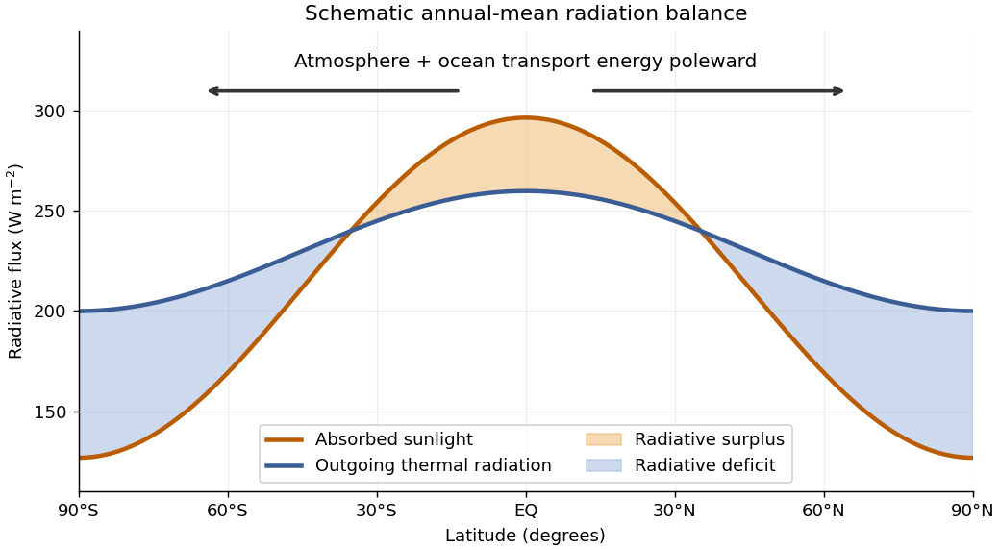

<h1 id="1/a/solution">Solution</h1>

↑ **Parent:** [A](../a.md)

The annual, zonal-mean absorbed sunlight falls from the tropics towards the poles much more strongly than outgoing [thermal radiation](../../../../thermal-radiation.md). Thus [Earth](../../../../earth.md)'s top-of-atmosphere [radiation budget](../../../../radiation-budget.md) has a tropical surplus and a polar deficit, with changes of sign around $35^\circ$ latitude in a basic sketch. The curves below are illustrative, rather than measured data; their area-weighted global means agree.

**[Figure 1](#1/a/image-an-illustrative-latitude-dependent-radiation-budget-and-the-required-poleward-energy-transport). An illustrative latitude-dependent radiation budget and the required poleward energy transport**.

In a statistically stationary [climate](../../../../climate.md), local [conservation of energy](../../../../conservation-of-energy.md) requires the surplus to be exported. If $R(\phi)$ is the net downward radiative [heat flux](../../../../heat-flux-density.md) and $\mathcal H(\phi)$ the northward total [power](../../../../power.md) carried across the latitude circle, then

$$
\frac{d\mathcal H}{d\phi}=2\pi a^2R(\phi)\cos\phi,\qquad
\mathcal H(\phi)=2\pi a^2\int_{-\pi/2}^{\phi}R(\theta)\cos\theta\,d\theta.
$$

Here $a$ is [Earth](../../../../earth.md)'s radius. The [terrestrial atmosphere](../../../../terrestrial-atmosphere.md) and [ocean circulation](../../../../ocean-circulation.md) carry this [energy](../../../../energy-split.md) poleward by moving warm and cold fluid, including atmospheric transport of [latent heat](../../../../latent-heat.md). Without this transport the assumed steady [radiation budget](../../../../radiation-budget.md) could not persist: the tropics would warm and polar regions cool until the budget changed. The tropical atmospheric contribution includes the [Hadley cell](../../../../hadley-cell.md): rising warm air near the equator, poleward flow aloft, subtropical descent, and an equatorward lower return.

For a parcel moving without an axial [torque](../../../../torque.md), [conservation of angular momentum](../../../../conservation-of-angular-momentum.md) applies in an inertial frame. The specific axial [angular momentum](../../../../angular-momentum.md) at latitude $\phi$ is

$$
M=(\Omega a\cos\phi+u)a\cos\phi.
$$

“Initially at rest” means $u=0$ relative to the rotating surface at the equator, so $M=\Omega a^2$. Neglecting atmospheric height compared with $a$ gives

$$
\boxed{u(\phi)=\Omega a\left(\frac1{\cos\phi}-\cos\phi\right)
=\frac{\Omega a\sin^2\phi}{\cos\phi}.}
$$

With $\Omega=7.292\times10^{-5}\ \mathrm{s^{-1}}$ and $a=6.371\times10^6\ \mathrm m$, the eastward [velocity](../../../../velocity.md) at $30^\circ\mathrm N$ is

$$
\boxed{u(30^\circ)=134\ \mathrm{m\,s^{-1}}.}
$$

This is the ideal angular-momentum-conserving upper branch of the [Hadley cell](../../../../hadley-cell.md). Real [jet streams](../../../../jet-stream.md) exchange [angular momentum](../../../../angular-momentum.md) through [eddies](../../../../eddy.md) and [friction](../../../../friction.md), so this estimate is not an observational claim about the actual wind speed.

## ↑ Ancestors (12)

1. [A](../a.md)
2. [1](../../1.md)
3. [2025](../../../2025-split.md)
4. [Past exam of the geophysical fluid dynamics course of the University of Oxford](../../../split.md)
5. [Geophysical fluid dynamics course of the University of Oxford](../../../../geophysical-fluid-dynamics-course-of-the-university-of-oxford.md)
6. [Year 4 of the mathematical and theoretical physics course of the University of Oxford](../../../../year-4-of-the-mathematical-and-theoretical-physics-course-of-the-university-of-oxford.md)
7. [Mathematical and theoretical physics course of the University of Oxford](../../../../mathematical-and-theoretical-physics-course-of-the-university-of-oxford.md)
8. [Undergraduate course of the University of Oxford](../../../../undergraduate-course-of-the-university-of-oxford.md)
9. [Course of the University of Oxford](../../../../course-of-the-university-of-oxford.md)
10. [University of Oxford](../../../../university-of-oxford-split.md)
11. [List of universities](../../../../list-of-universities.md)
12. [Codex Wiki](../../../../split.md)
