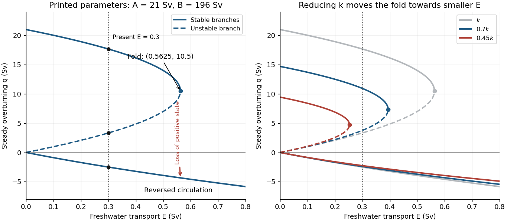

<h1 id="2/b/solution">Solution</h1>

↑ **Parent:** [B](../b.md)

Using the constants **as printed**, with [volume flux](../../../../volumetric-flow-rate.md) measured in [Sverdrups](../../../../sverdrup.md), gives

$$
\boxed{A=(7\times10^6)(2\times10^{-7})(15)=21\ \mathrm{Sv},\qquad
B=(7\times10^6)(8\times10^{-7})(35)=196\ \mathrm{Sv}.}
$$

In particular the two small expansion coefficients should not be silently replaced by different oceanographic values.

For a positive steady [volume flux](../../../../volumetric-flow-rate.md), the equation in 2(a) is $q^2-Aq+BE=0$. For a negative steady [volume flux](../../../../volumetric-flow-rate.md), it is $q^2-Aq-BE=0$, with only its negative root admissible. Therefore for $E>0$ the branches are

$$
\boxed{q_\pm(E)=\frac{A\pm\sqrt{A^2-4BE}}2
\quad\left(0<E\leq\frac{A^2}{4B}\right),\qquad
q_{\rm rev}(E)=\frac{A-\sqrt{A^2+4BE}}2<0.}
$$

The upper positive branch $q_+$ is stable, the lower positive branch $q_-$ is unstable, and the reversed branch $q_{\rm rev}$ is stable under the usual [salt budget](../../../../salt-budget.md) dynamics with fixed $\Delta T$. Thus there is [bistability](../../../../bistability.md) below the positive-branch fold. At the fold the two positive [equilibria](../../../../equilibrium-point-of-a-dynamical-system.md) merge with a zero restoring rate; the point is not an ordinary asymptotically stable interior point of either branch. The negative algebraic root of the positive-$q$ quadratic, or positive root of the negative-$q$ quadratic, must never be added as extra solutions.

**[Figure 2](#2/b/image-steady-overturning-branches-their-stability-and-the-effect-of-reducing-the-density-to-transport-coefficient). Steady overturning branches, their stability, and the effect of reducing the density-to-transport coefficient**.

At $E=0.3\ \mathrm{Sv}$, the three steady [volume fluxes](../../../../volumetric-flow-rate.md) are

$$
\boxed{q_+=17.67\ \mathrm{Sv},\qquad q_-=3.327\ \mathrm{Sv},\qquad
q_{\rm rev}=-2.502\ \mathrm{Sv}.}
$$

The present thermally dominated, northward-upper-flow [Atlantic meridional overturning circulation](../../../../atlantic-meridional-overturning-circulation.md) corresponds to $q_+\simeq17.7\ \mathrm{Sv}$. These algebraic data alone also allow a stable reversed state, so selecting the present branch uses the stated circulation direction. On the large positive branch, the predicted [salinity](../../../../salinity.md) contrast is $\Delta S=ES_0/q_+\simeq0.594\ \mathrm{g\,kg^{-1}}$, consistent with the reference-salinity approximation. The weaker branches give larger contrasts, approximately $3.16$ and $4.20\ \mathrm{g\,kg^{-1}}$, so the approximation is less accurate there.

The [saddle-node bifurcation](../../../../saddle-node-bifurcation.md) occurs at

$$
\boxed{E_c=\frac{A^2}{4B}=0.5625\ \mathrm{Sv},\qquad q_c=\frac A2=10.5\ \mathrm{Sv}.}
$$

For $E>E_c$, only the reversed steady [volume flux](../../../../volumetric-flow-rate.md) remains. At $E=E_c$ there are still two distinct values, the double positive root and the negative root; “single-valued” holds strictly above this threshold.

Slowly increasing $E$ from the present value causes the stable positive [volume flux](../../../../volumetric-flow-rate.md) to weaken. Its [salinity](../../../../salinity.md) contrast then increases because salt exchange is weaker, reducing the cold-box [density](../../../../density.md) advantage further: this is the [salt-advection feedback](../../../../salt-advection-feedback.md). At the fold the positive steady state disappears, producing an abrupt transition to the reversed branch in the quasistatic limit. At the same $E_c$ that branch has

$$
q_{\rm rev}(E_c)=\frac A2(1-\sqrt2)\simeq-4.35\ \mathrm{Sv}.
$$

For a finite slow ramp there can be a small dynamical delay near the fold. In this model subsequently reducing $E$ while keeping it positive follows the stable reversed branch instead of automatically restoring the positive branch, an example of [hysteresis](../../../../hysteresis.md). The two small branches approach $q=0$ as $E\to0^+$. At $E=0$ this is an equal-density, no-exchange equilibrium with $\Delta S=\alpha\Delta T/\beta=3.75\ \mathrm{g\,kg^{-1}}$, whereas the positive branch tends to $q=A$ with $\Delta S=0$. One must use the original [density](../../../../density.md) relation at this endpoint, rather than divide by $|q|=0$.

The reversal is thermally opposed but salinity driven: freshwater makes the cold box sufficiently fresh that the warm, salty box becomes denser. A real weakening would reduce the northward [ocean heat flux](../../../../ocean-heat-flux.md) and alter regional [climate](../../../../climate.md) and ocean ventilation. The fold and full reversal here describe the ideal [two-box overturning model](../../../../two-box-overturning-model.md); its numerical threshold is not a forecast for the real ocean, whose other controls appear in 2(c).

## ↑ Ancestors (12)

1. [B](../b.md)
2. [2](../../2.md)
3. [2025](../../../2025-split.md)
4. [Past exam of the geophysical fluid dynamics course of the University of Oxford](../../../split.md)
5. [Geophysical fluid dynamics course of the University of Oxford](../../../../geophysical-fluid-dynamics-course-of-the-university-of-oxford.md)
6. [Year 4 of the mathematical and theoretical physics course of the University of Oxford](../../../../year-4-of-the-mathematical-and-theoretical-physics-course-of-the-university-of-oxford.md)
7. [Mathematical and theoretical physics course of the University of Oxford](../../../../mathematical-and-theoretical-physics-course-of-the-university-of-oxford.md)
8. [Undergraduate course of the University of Oxford](../../../../undergraduate-course-of-the-university-of-oxford.md)
9. [Course of the University of Oxford](../../../../course-of-the-university-of-oxford.md)
10. [University of Oxford](../../../../university-of-oxford-split.md)
11. [List of universities](../../../../list-of-universities.md)
12. [Codex Wiki](../../../../split.md)
