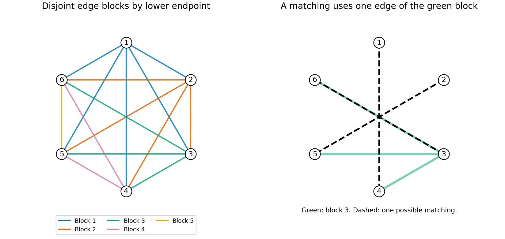

# 2007

↑ **Parent:** [Past exam of the graph Theory and Probabilistic Combinatorics course of the University of Oxford](../past-exam-of-the-graph-theory-and-probabilistic-combinatorics-course-of-the-university-of-oxford.md)

Graph Theory and Probabilistic Combinatorics, Mathematics Part C and Mathematics and Statistics Part C; Friday 1 June 2007, 9.30am–12.30pm. The full five-page source and both sections are privately transcribed from original Part C bundle pages 81–85, supplied through [the past-papers disclosure](https://www.whatdotheyknow.com/request/maths_past_papers_3). No exact worked-answer advertisement was found in the bounded availability check.

**Table of contents**

- [A](#a)
  - [1](#a/1)
    - [a](#a/1/a)
      - [Solution](#a/1/a/solution)
    - [b](#a/1/b)
      - [Solution](#a/1/b/solution)
    - [c](#a/1/c)
      - [Solution](#a/1/c/solution)
  - [2](#a/2)
    - [a](#a/2/a)
      - [Solution](#a/2/a/solution)
    - [b](#a/2/b)
      - [Solution](#a/2/b/solution)
    - [c](#a/2/c)
      - [Solution](#a/2/c/solution)
    - [d](#a/2/d)
      - [Solution](#a/2/d/solution)
  - [3](#a/3)
    - [a](#a/3/a)
      - [Solution](#a/3/a/solution)
    - [b](#a/3/b)
      - [Solution](#a/3/b/solution)
    - [c](#a/3/c)
      - [Solution](#a/3/c/solution)
    - [d](#a/3/d)
      - [Solution](#a/3/d/solution)
  - [4](#a/4)
    - [a](#a/4/a)
      - [Solution](#a/4/a/solution)
    - [b](#a/4/b)
      - [Solution](#a/4/b/solution)
    - [c](#a/4/c)
      - [Solution](#a/4/c/solution)
    - [d](#a/4/d)
      - [Solution](#a/4/d/solution)
    - [e](#a/4/e)
      - [Solution](#a/4/e/solution)
- [B](#b)
  - [5](#b/5)
    - [a](#b/5/a)
      - [Solution](#b/5/a/solution)
    - [b](#b/5/b)
      - [Solution](#b/5/b/solution)
    - [c](#b/5/c)
      - [Solution](#b/5/c/solution)
  - [6](#b/6)
    - [a](#b/6/a)
      - [Solution](#b/6/a/solution)
    - [b](#b/6/b)
      - [Solution](#b/6/b/solution)
    - [c](#b/6/c)
      - [Solution](#b/6/c/solution)
    - [d](#b/6/d)
      - [Solution](#b/6/d/solution)
  - [7](#b/7)
    - [a](#b/7/a)
      - [Solution](#b/7/a/solution)
    - [b](#b/7/b)
      - [Solution](#b/7/b/solution)
  - [8](#b/8)
    - [a](#b/8/a)
      - [Solution](#b/8/a/solution)
    - [b](#b/8/b)
      - [Solution](#b/8/b/solution)
    - [c](#b/8/c)
      - [Solution](#b/8/c/solution)
    - [d](#b/8/d)
      - [Solution](#b/8/d/solution)

## A

↑ **Parent:** [2007](2007.md)

<h3 id="a/1">1</h3>

↑ **Parent:** [A](#a)

<h4 id="a/1/a">a</h4>

↑ **Parent:** [1](#a/1)

<h5 id="a/1/a/solution">Solution</h5>

↑ **Parent:** [A](#a/1/a)

Hall's theorem states that a finite [bipartite graph](../bipartite-graph.md) with classes $L,R$ has a [matching](../matching-graph-theory.md) covering $L$ exactly when $|N(S)|\ge|S|$ for every $S\subseteq L$. Necessity follows because the distinct matched partners of $S$ belong to $N(S)$.

For sufficiency take a maximum [matching](../matching-graph-theory.md). If it leaves $x\in L$ unmatched, explore alternating paths starting at $x$, traversing unmatched edges from left to right and matched edges back to the left. No reached right vertex can be unmatched, since flipping the edges of such an alternating path would augment the [matching](../matching-graph-theory.md). Let $S,T$ be the reached left and right sets. Every neighbour of $S$ lies in $T$: unmatched edges are explored, and a matched edge from a reached left vertex leads to its already reached predecessor. Conversely every member of $T$ is a neighbour of $S$. Their matched partners are exactly $S\setminus\{x\}$, so $|N(S)|=|T|=|S|-1$, contradicting the hypothesis. Thus a [matching](../matching-graph-theory.md) covering $L$ exists.

<h4 id="a/1/b">b</h4>

↑ **Parent:** [1](#a/1)

<h5 id="a/1/b/solution">Solution</h5>

↑ **Parent:** [B](#a/1/b)

If no complete [matching](../matching-graph-theory.md) exists, Hall's theorem gives a nonempty $S\subseteq V_1$, of size $k$, with $|N(S)|\le k-1$. The pairs between $S$ and $V_2\setminus N(S)$ must be nonedges, so there are at least

$$
k(n-k+1)=n+(k-1)(n-k)\ge n
$$

missing edges. Hence $e(G)\le n^2-n$, contradicting the strict edge bound. Therefore **a complete [matching](../matching-graph-theory.md) exists**.

The strictness is necessary: isolate one vertex of $V_1$ and put all edges between the remaining $n-1$ left vertices and all $n$ right vertices. There are exactly $n(n-1)$ edges and no [matching](../matching-graph-theory.md) can cover the isolated vertex. This also handles $n=1$.

<h4 id="a/1/c">c</h4>

↑ **Parent:** [1](#a/1)

<h5 id="a/1/c/solution">Solution</h5>

↑ **Parent:** [C](#a/1/c)

First the [graph](../graph.md) is [connected](../geometry-and-topology.md#connected-space): every component has at least $\delta(G)+1>n/2$ vertices, so two components cannot fit. Take a [longest path](../graph-theory.md#longest-path) $v_1,\ldots,v_k$. Every neighbour of either endpoint lies on that path. In the index set $\{1,\ldots,k-1\}$ define

$$
I=\{i:v_1v_{i+1}\in E\},\qquad J=\{i:v_iv_k\in E\}.
$$

Their sizes sum to $d(v_1)+d(v_k)\ge n>k-1$, so they share an index $i$. The edges at that index give the cycle

$$
v_1,v_2,\ldots,v_i,v_k,v_{k-1},\ldots,v_{i+1},v_1,
$$

containing every vertex of the path. The minimum-[degree](../polynomial.md#degree-of-a-polynomial) assumption and $n\ge3$ ensure the resulting cycle is nondegenerate. If it omitted any [graph](../graph.md) vertex, [connectedness](../geometry-and-topology.md#connected-space) would supply an edge from outside it to the cycle. Starting with that outside vertex and then following the cycle without closing it gives a path with $k+1$ vertices, contradicting maximality. Thus **the cycle is [Hamiltonian](../hamiltonian-mechanics.md#hamiltonian)**. This proves [Dirac's theorem](../graph-theory.md#dirac-s-theorem) in the required case.

<h3 id="a/2">2</h3>

↑ **Parent:** [A](#a)

<h4 id="a/2/a">a</h4>

↑ **Parent:** [2](#a/2)

<h5 id="a/2/a/solution">Solution</h5>

↑ **Parent:** [A](#a/2/a)

For a positive integer $x$, the [chromatic polynomial](../graph-coloring.md#chromatic-polynomial) $p_G(x)$ counts proper vertex colorings from a palette of $x$ labelled colors, where adjacent vertices must have different colors. The counting function agrees with a polynomial, as proved by deletion-contraction in the next part.

<h4 id="a/2/b">b</h4>

↑ **Parent:** [2](#a/2)

<h5 id="a/2/b/solution">Solution</h5>

↑ **Parent:** [B](#a/2/b)

For an edge $e=uv$, colorings of $G-e$ divide into those giving $u,v$ different colors, counted by $p_G$, and those giving them the same color, counted by $p_{G/e}$. Parallel edges produced by contraction may be suppressed. Thus

$$
p_G(x)=p_{G-e}(x)-p_{G/e}(x).
$$

For an edgeless [graph](../graph.md) on $n\ge1$ vertices, $p_G=x^n$. Induct on the number of edges, allowing smaller vertex counts for contractions. If both smaller expansions have alternating nonnegative coefficients, the contraction's leading [degree](../polynomial.md#degree-of-a-polynomial) is one lower, so subtracting it gives

$$
a_i(G)=a_i(G-e)+a_{i-1}(G/e),
$$

with absent coefficients interpreted as zero. Each coefficient remains nonnegative. Both terms have zero constant coefficient for nonempty graphs, so the resulting expansion is

$$
\boxed{p_G(x)=\sum_{i=0}^{n-1}(-1)^ia_ix^{n-i},\qquad a_i\ge0}.
$$

This induction simultaneously proves the counting function is a polynomial.

<h4 id="a/2/c">c</h4>

↑ **Parent:** [2](#a/2)

<h5 id="a/2/c/solution">Solution</h5>

↑ **Parent:** [C](#a/2/c)

For a triangle, $p_{C_3}=x(x-1)(x-2)=(x-1)^3-(x-1)$. For $n\ge4$, deleting an edge leaves a path with polynomial $x(x-1)^{n-1}$, and contracting it leaves $C_{n-1}$. Deletion-contraction and induction give

$$
p_{C_n}=x(x-1)^{n-1}-\{(x-1)^{n-1}+(-1)^{n-1}(x-1)\}
=\boxed{(x-1)^n+(-1)^n(x-1)}.
$$

The path formula chooses its first color freely and each succeeding color in $x-1$ ways.

<h4 id="a/2/d">d</h4>

↑ **Parent:** [2](#a/2)

<h5 id="a/2/d/solution">Solution</h5>

↑ **Parent:** [D](#a/2/d)

Choose the central vertex's color in $x$ ways. Every rim vertex must avoid that color, so the rim is a cycle colored using the remaining $x-1$ colors. Hence

$$
\boxed{p_{W_{n+1}}(x)=x\bigl((x-2)^n+(-1)^n(x-2)\bigr)}.
$$

<h3 id="a/3">3</h3>

↑ **Parent:** [A](#a)

<h4 id="a/3/a">a</h4>

↑ **Parent:** [3](#a/3)

<h5 id="a/3/a/solution">Solution</h5>

↑ **Parent:** [A](#a/3/a)

The [Ramsey number](../ramsey-theory.md#ramsey-number) $R(k,l)$ is the least $N$ such that every [graph](../graph.md) on $N$ vertices has a $k$-[clique](../graph-theory.md#clique-graph-theory) or an [independent set](../graph-theory.md#independent-set-graph-theory) of size $l$. Choose a vertex in a [graph](../graph.md) of order $R(k-1,l)+R(k,l-1)$. It has either at least $R(k-1,l)$ neighbours or at least $R(k,l-1)$ nonneighbours. In the first set, a $(k-1)$-[clique](../graph-theory.md#clique-graph-theory) extends with the vertex to a $k$-[clique](../graph-theory.md#clique-graph-theory), while an independent $l$-set already suffices. The complementary argument handles the second set. Thus

$$
R(k,l)\le R(k-1,l)+R(k,l-1).
$$

The boundary values are $R(k,2)=k$ and $R(2,l)=l$. Induction on $k+l$, using Pascal's identity, therefore gives

$$
\boxed{R(k,l)\le\binom{k+l-3}{k-2}+\binom{k+l-3}{k-1}=\binom{k+l-2}{k-1}}.
$$

<h4 id="a/3/b">b</h4>

↑ **Parent:** [3](#a/3)

<h5 id="a/3/b/solution">Solution</h5>

↑ **Parent:** [B](#a/3/b)

The [graph Ramsey number](../graph-theory.md#graph-ramsey-number) $R(G,H)$ is the smallest $N$ such that every red-blue coloring of the edges of $K_N$ has a red copy of $G$ or a blue copy of $H$. These copies are subgraphs, not necessarily induced. Equivalently every [graph](../graph.md) on $N$ vertices contains $G$ or its complement contains $H$.

<h4 id="a/3/c">c</h4>

↑ **Parent:** [3](#a/3)

<h5 id="a/3/c/solution">Solution</h5>

↑ **Parent:** [C](#a/3/c)

For $s,t\ge2$, split $(s-1)(t-1)$ vertices into $s-1$ classes of size $t-1$, coloring edges between classes red and edges inside classes blue. The red [graph](../graph.md) has no $K_s$, and every blue component is too small for the [connected](../geometry-and-topology.md#connected-space) [tree](../tree-graph-theory.md). This proves the lower bound.

For the upper bound let $N=(s-1)(t-1)+1$ and suppose the blue [graph](../graph.md) contains no copy of the [tree](../tree-graph-theory.md). By the permitted chromatic-number statement, its [chromatic number](../graph-coloring.md#chromatic-number) is at most $t-1$. A [graph](../graph.md) of larger [chromatic number](../graph-coloring.md#chromatic-number) would have a subgraph of [chromatic number](../graph-coloring.md#chromatic-number) exactly $t$, obtained by deleting vertices until that number is reached. A proper blue coloring with at most $t-1$ classes puts no blue edges within any class, so each class is a red [clique](../graph-theory.md#clique-graph-theory). If there is no red $K_s$, each class has at most $s-1$ vertices, contradicting $N>(s-1)(t-1)$. Therefore

$$
\boxed{R(K_s,T)=(s-1)(t-1)+1}.
$$

The one-vertex boundary cases give one directly.

<h4 id="a/3/d">d</h4>

↑ **Parent:** [3](#a/3)

<h5 id="a/3/d/solution">Solution</h5>

↑ **Parent:** [D](#a/3/d)

A vertex with at least $R(t,t)$ neighbours has either a $t$-[clique](../graph-theory.md#clique-graph-theory) among them, producing $K_{t+1}$ with the vertex, or an independent $t$-set among them, producing an induced star with that centre.

For the second assertion put $D=R(t,t)-1$. If either of those two outcomes is absent, the preceding result forces [maximum degree](../graph-theory.md#maximum-degree) at most $D$. In a [connected](../geometry-and-topology.md#connected-space) [graph](../graph.md) of this [maximum degree](../graph-theory.md#maximum-degree), a ball of radius $t-1$ has at most $1+D+\cdots+D^{t-1}$ vertices, using the rough bound on walks at each distance. If the [graph](../graph.md) has more vertices, some vertex lies at distance at least $t$ from a chosen root. A shortest path to it is induced, since a chord would shorten it; its first $t$ edges give an induced path of the required length. Thus a sufficiently large [connected](../geometry-and-topology.md#connected-space) [graph](../graph.md) has **one of the three listed configurations**.

<h3 id="a/4">4</h3>

↑ **Parent:** [A](#a)

<h4 id="a/4/a">a</h4>

↑ **Parent:** [4](#a/4)

<h5 id="a/4/a/solution">Solution</h5>

↑ **Parent:** [A](#a/4/a)

The [extremal number](../extremal-graph-theory.md#extremal-number) $\operatorname{ex}(n;H)$ is the maximum number of edges in a simple [graph](../graph.md) on $n$ vertices containing no subgraph isomorphic to $H$. For a fixed [graph](../graph.md) with $\chi(H)=r\ge2$, the [Erdős-Stone theorem](../extremal-graph-theory.md#erdos-stone-theorem) gives

$$
\boxed{\operatorname{ex}(n;H)=\left(1-\frac1{r-1}+o(1)\right)\frac{n^2}{2}}.
$$

Equivalently, the ratio to $\binom n2$ tends to $1-1/(r-1)$. The bipartite case has limiting density zero.

<h4 id="a/4/b">b</h4>

↑ **Parent:** [4](#a/4)

<h5 id="a/4/b/solution">Solution</h5>

↑ **Parent:** [B](#a/4/b)

An even cycle is bipartite and has [chromatic number](../graph-coloring.md#chromatic-number) two. An odd cycle has [chromatic number](../graph-coloring.md#chromatic-number) three. The extremal-density theorem therefore gives

$$
\boxed{\lim_{n\to\infty}\frac{\operatorname{ex}(n;C_k)}{\binom n2}=\begin{cases}0,&k\text{ even},\\1/2,&k\text{ odd}.\end{cases}}
$$

For odd cycles the complete balanced [bipartite graph](../bipartite-graph.md) also exhibits the [matching](../matching-graph-theory.md) asymptotic lower density one half.

<h4 id="a/4/c">c</h4>

↑ **Parent:** [4](#a/4)

<h5 id="a/4/c/solution">Solution</h5>

↑ **Parent:** [C](#a/4/c)

For nonempty disjoint vertex sets define $d(X,Y)=e(X,Y)/(|X||Y|)$. The pair is $\epsilon$-uniform, also called regular, if whenever $X'\subseteq X$ and $Y'\subseteq Y$ have sizes at least $\epsilon|X|$ and $\epsilon|Y|$,

$$
|d(X',Y')-d(X,Y)|<\epsilon.
$$

Thus reasonably large relative subsets retain almost the same edge density.

<h4 id="a/4/d">d</h4>

↑ **Parent:** [4](#a/4)

<h5 id="a/4/d/solution">Solution</h5>

↑ **Parent:** [D](#a/4/d)

Let $S$ be the vertices of $X$ with fewer than $d|Y|/2$ neighbours in $Y$. If $|S|>\epsilon n$, it is a permissible subset in the regularity test, and averaging those degrees gives $d(S,Y)<d/2$. But $d(X,Y)\ge d$, so

$$
|d(S,Y)-d(X,Y)|>d/2>\epsilon,
$$

contradicting regularity. Therefore **there are at most $\epsilon n$ such vertices**. The same argument in fact rules out $|S|\ge\epsilon n$ when that threshold is integral and nonzero.

<h4 id="a/4/e">e</h4>

↑ **Parent:** [4](#a/4)

<h5 id="a/4/e/solution">Solution</h5>

↑ **Parent:** [E](#a/4/e)

Retain $0<\epsilon<d/2$ from the preceding part. In $X_1$, at most $\epsilon n$ vertices have too few neighbours in $X_2$, and at most $\epsilon n$ have too few in $X_3$. Since $d\le1$, $2\epsilon<1$, so some $x\in X_1$ is good for both. Put $Y_2=N(x)\cap X_2$ and $Y_3=N(x)\cap X_3$. Their sizes are at least $dn/2>\epsilon n$. Regularity of $(X_2,X_3)$ therefore gives

$$
d(Y_2,Y_3)>d(X_2,X_3)-\epsilon\ge d-\epsilon>0.
$$

There is an edge joining a vertex of $Y_2$ to a vertex of $Y_3$. Its two endpoints and $x$ form **a triangle**. The nonempty equal classes ensure this counting argument also covers small integer sizes.

<h2 id="b">B</h2>

↑ **Parent:** [2007](2007.md)

<h3 id="b/5">5</h3>

↑ **Parent:** [B](#b)

<h4 id="b/5/a">a</h4>

↑ **Parent:** [5](#b/5)

<h5 id="b/5/a/solution">Solution</h5>

↑ **Parent:** [A](#b/5/a)

For events $A_i$ with a dependency [graph](../graph.md), assume each event is independent of the [sigma-algebra](../measure-theory.md#sigma-algebra) generated by its nonneighbours. If numbers $x_i\in[0,1)$ satisfy $P(A_i)\le x_i\prod_{j\in\Gamma(i)}(1-x_j)$, the general [Lovász local lemma](../probabilistic-combinatorics.md#lovasz-local-lemma) gives

$$
P\left(\bigcap_iA_i^c\right)\ge\prod_i(1-x_i)>0.
$$

The symmetric version says that if every event has probability at most $q$, the dependency [graph](../graph.md) has [maximum degree](../graph-theory.md#maximum-degree) at most $d$, and $eq(d+1)\le1$, then none occurs with positive probability. For $d\ge1$, set $x_i=1/(d+1)$. Since $(1-1/(d+1))^d\ge e^{-1}$, the general condition follows from the symmetric numerical hypothesis. The logarithmic inequality $\log(1+1/d)\le1/d$ proves that estimate. When $d=0$, the events are mutually independent and each has probability below one, so the conclusion is immediate. This is the intended implication from the general to the symmetric form; the source repeats the word symmetric in its final clause.

<h4 id="b/5/b">b</h4>

↑ **Parent:** [5](#b/5)

<h5 id="b/5/b/solution">Solution</h5>

↑ **Parent:** [B](#b/5/b)

Assign each vertex a color independently and uniformly from the five available residues. Let $A_v$ be the event that none of its neighbours has the successor color. Conditional on the color of $v$, its $r$ neighbours all avoid that color with probability $(4/5)^r$, so $P(A_v)=(4/5)^r$.

The event only uses colors in the closed neighbourhood of $v$. Events based on disjoint such sets are jointly independent. A closed neighbourhood can intersect another only when the two centres are at distance at most two, giving dependency [degree](../polynomial.md#degree-of-a-polynomial) at most $r+r(r-1)=r^2$. For sufficiently large $r$,

$$
e(r^2+1)(4/5)^r\le1.
$$

The symmetric local lemma therefore supplies a color assignment with no bad event, proving **every vertex has a neighbour of the successor color**. As defined in the question, this is a five-color assignment; it is not required to be a [proper vertex coloring](../graph-coloring.md#proper-vertex-coloring) of every edge, which would be impossible for some large regular graphs.

The construction generalizes to [cyclic successor colorings of regular graphs](../probabilistic-combinatorics.md#cyclic-successor-colorings-of-regular-graphs).

<h4 id="b/5/c">c</h4>

↑ **Parent:** [5](#b/5)

<h5 id="b/5/c/solution">Solution</h5>

↑ **Parent:** [C](#b/5/c)

From every vertex choose one neighbour of the successor color and follow these choices. The finite directed [graph](../graph.md) with one chosen outgoing edge per vertex contains a directed cycle. Its vertices are distinct until the first repeated vertex. Each step increases the color by one modulo five, so returning to the starting vertex requires the cycle length to be divisible by five. It therefore has length at least five and is also a cycle in the underlying [graph](../graph.md). This proves **a cycle of length a positive multiple of five exists**.

<h3 id="b/6">6</h3>

↑ **Parent:** [B](#b)

<h4 id="b/6/a">a</h4>

↑ **Parent:** [6](#b/6)

<h5 id="b/6/a/solution">Solution</h5>

↑ **Parent:** [A](#b/6/a)

For a variable $Z$ of finite [variance](../variance.md) and $t>0$, [Chebyshev's inequality](../probability-inequality.md#chebyshev-s-inequality) is

$$
P(|Z-EZ|\ge t)\le\frac{\operatorname{Var}Z}{t^2}.
$$

On that event, $(Z-EZ)^2\ge t^2$. Thus $t^2P(|Z-EZ|\ge t)\le E[(Z-EZ)^2]$, proving the assertion. Equivalently apply [Markov's inequality](../probability-inequality.md#markov-s-inequality) to the squared deviation.

<h4 id="b/6/b">b</h4>

↑ **Parent:** [6](#b/6)

<h5 id="b/6/b/solution">Solution</h5>

↑ **Parent:** [B](#b/6/b)

Assume $EX>0$, as required by the denominators. Since each indicator has [variance](../variance.md) at most its expectation, and independent event pairs have zero [covariance](../variance.md#covariance),

$$
\operatorname{Var}X=\sum_i\operatorname{Var}X_i+\sum_{i\ne j}\operatorname{Cov}(X_i,X_j)
\le EX+\sum_{i\sim j}P(A_i\cap A_j)=EX+D.
$$

The sum uses ordered pairs, [matching](../matching-graph-theory.md) the [covariance](../variance.md#covariance) expansion. [Chebyshev's inequality](../probability-inequality.md#chebyshev-s-inequality) now gives

$$
\boxed{P(X=0)\le\frac{\operatorname{Var}X}{(EX)^2}\le\frac1{EX}+\frac D{(EX)^2}}.
$$

If $EX=0$, $X=0$ almost surely and the divided expression is not the useful form of the bound.

<h4 id="b/6/c">c</h4>

↑ **Parent:** [6](#b/6)

<h5 id="b/6/c/solution">Solution</h5>

↑ **Parent:** [C](#b/6/c)

Let $X$ count the four-vertex sets spanning a [clique](../graph-theory.md#clique-graph-theory). Its expectation is $\mu=\binom n4p^6$. If $p\ll n^{-2/3}$, then $\mu\to0$ and [Markov's inequality](../probability-inequality.md#markov-s-inequality) gives $P(X>0)\to0$.

Now suppose $p\gg n^{-2/3}$. Then $\mu\to\infty$. Two distinct [clique](../graph-theory.md#clique-graph-theory) indicators are independent unless their vertex sets share at least two vertices. An overlap of two vertices gives $O(n^6)$ ordered pairs requiring eleven distinct edges; an overlap of three gives $O(n^5)$ pairs requiring nine edges. Consequently

$$
D=O(n^6p^{11}+n^5p^9),\qquad
\frac D{\mu^2}=O(n^{-2}p^{-1}+n^{-3}p^{-3})\longrightarrow0.
$$

The preceding second-moment bound therefore gives $P(X=0)\to0$. Thus

$$
\boxed{p_*(n)=n^{-2/3}}
$$

is a threshold for the appearance of a four-[clique](../graph-theory.md#clique-graph-theory). Sharing just one vertex creates no dependence because the two edge sets are disjoint.

<h4 id="b/6/d">d</h4>

↑ **Parent:** [6](#b/6)

<h5 id="b/6/d/solution">Solution</h5>

↑ **Parent:** [D](#b/6/d)

Realize the random [graph](../graph.md) process by giving every edge an independent uniform arrival time. For a fixed four-set $S$, only its six internal edges and its $4(n-4)$ outgoing edges affect whether it is an isolated [clique](../graph-theory.md#clique-graph-theory). It is an isolated [clique](../graph-theory.md#clique-graph-theory) at some time exactly when all six internal edges arrive before every outgoing edge.

The relative ordering of these $4n-10$ edges is uniform. The chance that the first six are exactly the six internal edges is $\binom{4n-10}{6}^{-1}$. A [union bound](../probability-inequality.md#boole-s-inequality) over the possible vertex sets gives

$$
\boxed{P(\text{an isolated four-clique ever appears})\le\frac{\binom n4}{\binom{4n-10}{6}}=O(n^{-2})\longrightarrow0}.
$$

Edges entirely outside $S$ are irrelevant. Counting the whole arrival-order event avoids an invalid union over continuously many times.

This is an example of [isolated clique appearance in a uniform random graph process](../random-graph.md#isolated-clique-appearance-in-a-uniform-random-graph-process).

<h3 id="b/7">7</h3>

↑ **Parent:** [B](#b)

<h4 id="b/7/a">a</h4>

↑ **Parent:** [7](#b/7)

<h5 id="b/7/a/solution">Solution</h5>

↑ **Parent:** [A](#b/7/a)

Explore the component of one vertex by processing discovered vertices in order. At each step, the number of newly discovered neighbours is a binomial variable with at most $n$ trials and success probability $1/(2n)$, on previously unexposed independent edges. Pad each step with independent dummy trials. This couples the exploration below independent offspring variables $\xi_i\sim\operatorname{Bin}(n,1/(2n))$, each of mean one half.

If the component has at least $k\ge2$ vertices, after $k-1$ vertices have been processed at least $k-1$ offspring must have been found. Hence

$$
P(|C(v)|\ge k)\le P\left(\sum_{i=1}^{k-1}\xi_i\ge k-1\right).
$$

The sum is binomial with mean $\mu=(k-1)/2$. The multiplicative Chernoff inequality $P(B\ge2\mu)\le(e/4)^\mu$ therefore gives

$$
P(|C(v)|\ge k)\le e^{-c(k-1)},\qquad c=\tfrac12(\log_e4-1)>0.
$$

A [union bound](../probability-inequality.md#boole-s-inequality) over all vertices bounds the probability of any component of size at least $k$ by $ne^{-c(k-1)}$. Taking $k=\lceil\alpha\log_e n\rceil$ with any $\alpha>1/c$, for example ten, makes this tend to zero. Thus **the largest component is at most a constant times $\log n$ with high probability**.

<h4 id="b/7/b">b</h4>

↑ **Parent:** [7](#b/7)

<h5 id="b/7/b/solution">Solution</h5>

↑ **Parent:** [B](#b/7/b)

Every vertex in the component can be reached from $v$ by a simple path. The number of potential length-$\ell$ simple paths beginning at $v$ is at most $n^\ell$, and each has probability $(1/(2n))^\ell$ of being present. Counting such paths may count a vertex more than once, so it gives an upper bound on the expected number of reached vertices:

$$
E|C(v)|\le\sum_{\ell=0}^{n-1}n^\ell(1/(2n))^\ell\le\sum_{\ell\ge0}2^{-\ell}=2.
$$

Thus $\boxed{K=2}$ works for every $n$. Equivalently the dominating [branching process](../stochastic-process.md#branching-process) has mean offspring one half and expected [total progeny](../galton-watson-process.md#total-progeny-of-a-branching-process) two.

<h3 id="b/8">8</h3>

↑ **Parent:** [B](#b)

<h4 id="b/8/a">a</h4>

↑ **Parent:** [8](#b/8)

<h5 id="b/8/a/solution">Solution</h5>

↑ **Parent:** [A](#b/8/a)

On this product, use the Hamming metric $d(x,y)=|\{i:x_i\ne y_i\}|$. The relevant Lipschitz condition is $|f(x)-f(y)|\le d(x,y)$, equivalently changing any one coordinate changes the function by at most one. More generally an $L$-[Lipschitz function](../real-analysis.md#lipschitz-continuity) has bound $L\,d(x,y)$. The unit version is the bounded-differences condition used below.

<h4 id="b/8/b">b</h4>

↑ **Parent:** [8](#b/8)

<h5 id="b/8/b/solution">Solution</h5>

↑ **Parent:** [B](#b/8/b)

[Azuma's inequality](../martingale.md#azuma-s-inequality) states that if $(M_i)_{i=0}^m$ is a [martingale](../martingale.md) with $|M_i-M_{i-1}|\le1$ almost surely, then for $t\ge0$,

$$
P(|M_m-M_0|\ge t)\le2\exp(-t^2/(2m)).
$$

For independent product coordinates $Z_1,\ldots,Z_m$, expose them successively and set $M_i=E[f(Z)\mid Z_1,\ldots,Z_i]$. If changing one coordinate changes $f$ by at most one, the possible conditional means at that exposure have [diameter](../topological-analysis.md#diameter) at most one, by averaging the same remaining independent coordinates. Therefore the [martingale](../martingale.md) increments have absolute value at most one. It follows that

$$
\boxed{P(|f(Z)-Ef(Z)|\ge t)\le2\exp(-t^2/(2m))}.
$$

For coordinate bounds $c_i$, the same argument gives denominator $2\sum_i c_i^2$. The argument extends to arbitrary independent measurable coordinates for an [integrable function](../measure-theory.md#lebesgue-integrable-function) with these bounds, rather than requiring finite state sets.

<h4 id="b/8/c">c</h4>

↑ **Parent:** [8](#b/8)

<h5 id="b/8/c/solution">Solution</h5>

↑ **Parent:** [C](#b/8/c)

The union area is a bounded measurable function of the centres, with $0\le X\le n\pi$. Fix all centres except one, and let $B$ be the union of the fixed disks. Replacing the remaining disk $D$ changes the area to $|B|+|D\setminus B|$. The second term always lies in $[0,\pi]$, so the area changes by at most $\pi$, not merely by the weaker bound $2\pi$.

Thus $X/\pi$ has coordinate differences at most one for the $n$ independent centres. The preceding [martingale](../martingale.md) bound gives

$$
\boxed{P(|X-EX|\ge t)\le2\exp\left(-\frac{t^2}{2\pi^2n}\right)}.
$$

One may take $c=1/(2\pi^2)$, independently of all centre distributions. Boundedness of the area ensures the conditional expectations exist even when the centre locations have no finite moments.

<h4 id="b/8/d">d</h4>

↑ **Parent:** [8](#b/8)

<h5 id="b/8/d/solution">Solution</h5>

↑ **Parent:** [D](#b/8/d)

For $i=1,\ldots,n-1$, make one block from the edge weights $\{X_{ij}:j>i\}$. These $n-1$ blocks are independent because they contain disjoint edges. Changing one whole block only changes weights of edges incident with vertex $i$. Every [matching](../matching-graph-theory.md) contains at most one such edge, so its total weight changes by at most one. Comparing an old optimal [matching](../matching-graph-theory.md) in the new weights and a new optimal [matching](../matching-graph-theory.md) in the old weights proves that **the maximum [matching](../matching-graph-theory.md) weight also changes by at most one**.

Apply the bounded-differences [martingale](../martingale.md) argument to these $n-1$ blocks, giving

$$
\boxed{P(|W-EW|\ge t)\le2\exp\left(-\frac{t^2}{2(n-1)}\right)}.
$$

Exposing each edge separately would give a weaker quadratic-in-$n$ denominator. The grouped exposure is what supplies the requested linear denominator. The proof needs only independent weights in $[0,1]$, not identical uniform laws. For $n=1$, the [matching](../matching-graph-theory.md) weight is deterministically zero; the divided formula is intended for $n\ge2$.

**[Figure 1](#b/8/d/image-independent-blocks-for-revealing-matching-weights). Independent blocks for revealing matching weights**. Each edge is assigned to its lower-numbered endpoint. Edges in one block share a vertex, so any matching uses at most one of them.

The general grouping argument is [vertex-block concentration of maximum matching weight](../probability-inequality.md#vertex-block-concentration-of-maximum-matching-weight).

## ↑ Ancestors (9)

1. [Past exam of the graph Theory and Probabilistic Combinatorics course of the University of Oxford](../past-exam-of-the-graph-theory-and-probabilistic-combinatorics-course-of-the-university-of-oxford.md)
2. [Graph Theory and Probabilistic Combinatorics course of the University of Oxford](../university-of-oxford.md#graph-theory-and-probabilistic-combinatorics-course-of-the-university-of-oxford)
3. [Year 4 of the mathematics course of the University of Oxford](../university-of-oxford.md#year-4-of-the-mathematics-course-of-the-university-of-oxford)
4. [Mathematics course of the University of Oxford](../university-of-oxford.md#mathematics-course-of-the-university-of-oxford)
5. [Undergraduate course of the University of Oxford](../university-of-oxford.md#undergraduate-course-of-the-university-of-oxford)
6. [Course of the University of Oxford](../university-of-oxford.md#course-of-the-university-of-oxford)
7. [University of Oxford](../university-of-oxford.md)
8. [List of universities](../README.md#list-of-universities)
9. [Codex Wiki](../README.md)
