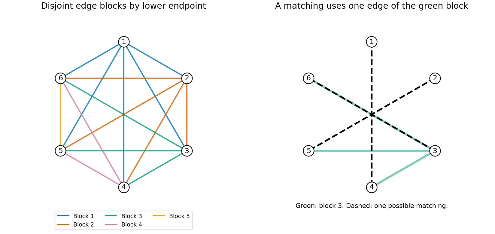

<h1 id="b/8/d/solution">Solution</h1>

↑ **Parent:** [D](../d.md)

For $i=1,\ldots,n-1$, make one block from the edge weights $\{X_{ij}:j>i\}$. These $n-1$ blocks are independent because they contain disjoint edges. Changing one whole block only changes weights of edges incident with vertex $i$. Every [matching](../../../../../matching-graph-theory-split.md) contains at most one such edge, so its total weight changes by at most one. Comparing an old optimal [matching](../../../../../matching-graph-theory-split.md) in the new weights and a new optimal [matching](../../../../../matching-graph-theory-split.md) in the old weights proves that **the maximum [matching](../../../../../matching-graph-theory-split.md) weight also changes by at most one**.

Apply the bounded-differences [martingale](../../../../../martingale-split.md) argument to these $n-1$ blocks, giving

$$
\boxed{P(|W-EW|\ge t)\le2\exp\left(-\frac{t^2}{2(n-1)}\right)}.
$$

Exposing each edge separately would give a weaker quadratic-in-$n$ denominator. The grouped exposure is what supplies the requested linear denominator. The proof needs only independent weights in $[0,1]$, not identical uniform laws. For $n=1$, the [matching](../../../../../matching-graph-theory-split.md) weight is deterministically zero; the divided formula is intended for $n\ge2$.

**[Figure 1](#b/8/d/image-independent-blocks-for-revealing-matching-weights). Independent blocks for revealing matching weights**. Each edge is assigned to its lower-numbered endpoint. Edges in one block share a vertex, so any matching uses at most one of them.

The general grouping argument is [vertex-block concentration of maximum matching weight](../../../../../vertex-block-concentration-of-maximum-matching-weight.md).

## ↑ Ancestors (13)

1. [D](../d.md)
2. [8](../../8.md)
3. [B](../../../b.md)
4. [2007](../../../../2007-split.md)
5. [Past exam of the graph Theory and Probabilistic Combinatorics course of the University of Oxford](../../../../split.md)
6. [Graph Theory and Probabilistic Combinatorics course of the University of Oxford](../../../../../graph-theory-and-probabilistic-combinatorics-course-of-the-university-of-oxford.md)
7. [Year 4 of the mathematics course of the University of Oxford](../../../../../year-4-of-the-mathematics-course-of-the-university-of-oxford.md)
8. [Mathematics course of the University of Oxford](../../../../../mathematics-course-of-the-university-of-oxford.md)
9. [Undergraduate course of the University of Oxford](../../../../../undergraduate-course-of-the-university-of-oxford.md)
10. [Course of the University of Oxford](../../../../../course-of-the-university-of-oxford.md)
11. [University of Oxford](../../../../../university-of-oxford-split.md)
12. [List of universities](../../../../../list-of-universities.md)
13. [Codex Wiki](../../../../../split.md)
