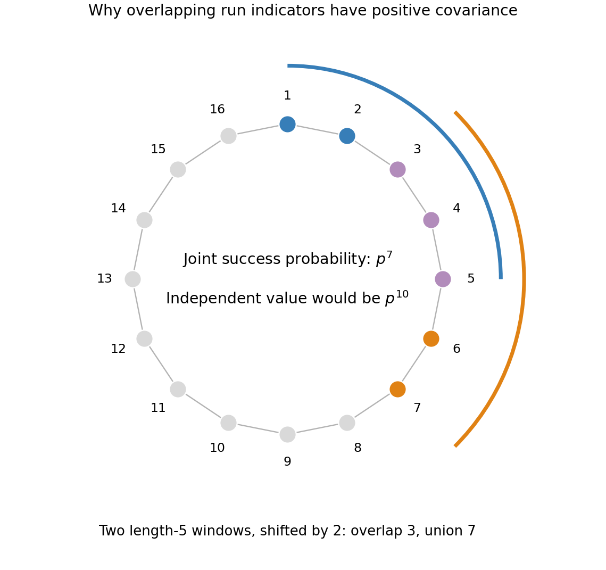

<h1 id="b/8/b/i/solution">Solution</h1>

↑ **Parent:** [I](../i.md)

For each cyclic starting position $i$, let $I_i$ indicate that the next $k$ entries are all one. Then $X=\sum_iI_i$ and $\mathbb EI_i=p^k$, hence $\mathbb EX=np^k$.

For two starts separated by $j\in\{1,\ldots,k-1\}$ along either direction, their runs overlap in $k-j$ positions, so $\mathbb E(I_iI_{i+j})=p^{k+j}$. All other distinct starts use disjoint entries and are independent. Since $k\le n/2$, the two directions' overlap ranges do not intersect. Summing the variances and covariances gives

$$
\boxed{\operatorname{Var}X=np^k(1-p^k)+2n\sum_{j=1}^{k-1}(p^{k+j}-p^{2k})}.
$$

In particular, dropping negative terms and summing a [geometric series](../../../../../../geometric-series.md) yields

$$
\operatorname{Var}X\le np^k\left(1+2\sum_{j\ge1}p^j\right)=\mathbb EX\left(1+\frac{2p}{1-p}\right)\le3\mathbb EX
$$

when $p\le1/2$. The formula also covers $k=1$ with an empty [covariance](../../../../../../covariance.md) sum.

**[Figure 1](#b/8/b/i/image-overlap-controls-the-joint-success-probability). Overlap controls the joint success probability**. An original illustrative pair of length-five windows shifted by two on a sixteen-position circle. Their union has seven positions, so both succeed with probability p to the seventh power.

## ↑ Ancestors (14)

1. [I](../i.md)
2. [B](../../b.md)
3. [8](../../../8.md)
4. [B](../../../../b.md)
5. [2008](../../../../../2008-split.md)
6. [Past exam of the graph Theory and Probabilistic Combinatorics course of the University of Oxford](../../../../../split.md)
7. [Graph Theory and Probabilistic Combinatorics course of the University of Oxford](../../../../../../graph-theory-and-probabilistic-combinatorics-course-of-the-university-of-oxford.md)
8. [Year 4 of the mathematics course of the University of Oxford](../../../../../../year-4-of-the-mathematics-course-of-the-university-of-oxford.md)
9. [Mathematics course of the University of Oxford](../../../../../../mathematics-course-of-the-university-of-oxford.md)
10. [Undergraduate course of the University of Oxford](../../../../../../undergraduate-course-of-the-university-of-oxford.md)
11. [Course of the University of Oxford](../../../../../../course-of-the-university-of-oxford.md)
12. [University of Oxford](../../../../../../university-of-oxford-split.md)
13. [List of universities](../../../../../../list-of-universities.md)
14. [Codex Wiki](../../../../../../split.md)
