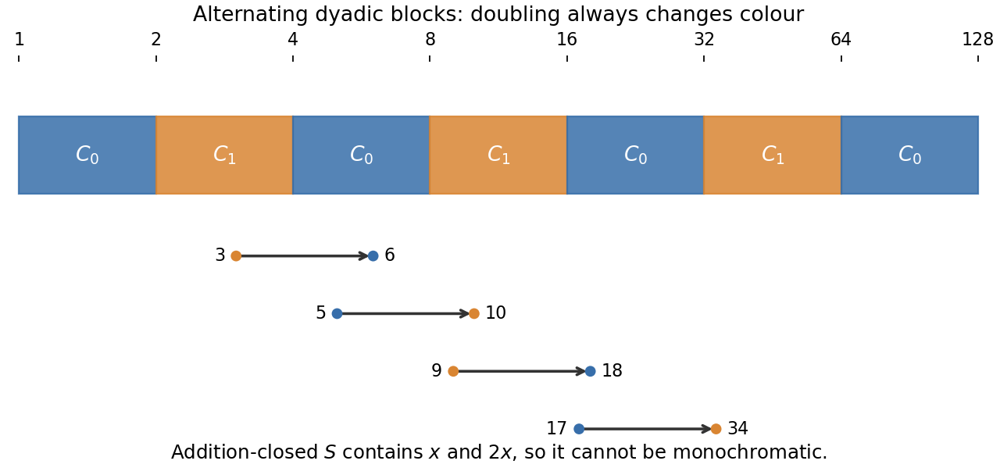

# 2010

↑ **Parent:** [Past exam of the graph Theory and Probabilistic Combinatorics course of the University of Oxford](../past-exam-of-the-graph-theory-and-probabilistic-combinatorics-course-of-the-university-of-oxford.md)

Graph Theory and Probabilistic Combinatorics, Friday 4 June 2010, 9.30am–12.30pm. This combined Part C paper was supplied through [the past-papers disclosure](https://www.whatdotheyknow.com/request/maths_past_papers_3), in original Part C bundle pages 378–381. Both printed sections are covered here; the private editable transcription retains all four pages and the complete cover. No exact worked-answer advertisement was found in the bounded availability check.

**Table of contents**

- [A](#a)
  - [1](#a/1)
    - [a](#a/1/a)
      - [Solution](#a/1/a/solution)
    - [b](#a/1/b)
      - [Solution](#a/1/b/solution)
    - [c](#a/1/c)
      - [Solution](#a/1/c/solution)
  - [2](#a/2)
    - [a](#a/2/a)
      - [Solution](#a/2/a/solution)
    - [b](#a/2/b)
      - [Solution](#a/2/b/solution)
    - [c](#a/2/c)
      - [Solution](#a/2/c/solution)
  - [3](#a/3)
    - [a](#a/3/a)
      - [Solution](#a/3/a/solution)
    - [b](#a/3/b)
      - [Solution](#a/3/b/solution)
    - [c](#a/3/c)
      - [Solution](#a/3/c/solution)
- [B](#b)
  - [4](#b/4)
    - [a](#b/4/a)
      - [Solution](#b/4/a/solution)
    - [b](#b/4/b)
      - [Solution](#b/4/b/solution)
    - [c](#b/4/c)
      - [Solution](#b/4/c/solution)
  - [5](#b/5)
    - [Solution](#b/5/solution)
  - [6](#b/6)
    - [a](#b/6/a)
      - [Solution](#b/6/a/solution)
    - [b](#b/6/b)
      - [Solution](#b/6/b/solution)
    - [c](#b/6/c)
      - [Solution](#b/6/c/solution)

## A

↑ **Parent:** [2010](2010.md)

<h3 id="a/1">1</h3>

↑ **Parent:** [A](#a)

<h4 id="a/1/a">a</h4>

↑ **Parent:** [1](#a/1)

<h5 id="a/1/a/solution">Solution</h5>

↑ **Parent:** [A](#a/1/a)

For a nonnegative integer $q$, the [chromatic polynomial](../graph-coloring.md#chromatic-polynomial) $p_G(q)$ counts the proper [vertex](../graph.md#vertex-graph-theory) colourings of $G$ using a fixed set of $q$ colours. In a proper colouring, the endpoints of every [edge](../graph-theory.md#edge-of-a-graph) have different colours. The counting function extends uniquely to a [polynomial](../polynomial.md), as follows either from the recurrence below with the edgeless base case $p_G(x)=x^{|V(G)|}$ or from [inclusion-exclusion](../graph-coloring.md#chromatic-polynomial-inclusion-exclusion-formula).

Let $e=uv$. Every proper colouring of $G-e$ falls into exactly one of two classes. If $u$ and $v$ have different colours, it is a proper colouring of $G$. If they have the same colour, identifying $u$ and $v$ gives a proper colouring of the contracted [graph](../graph.md) $G/e$, and this correspondence is bijective. Parallel edges produced by contraction impose identical conditions and can be suppressed. Hence, at every nonnegative integer $q$,

$$
p_{G-e}(q)=p_G(q)+p_{G/e}(q).
$$

Since polynomials agreeing at infinitely many values agree identically, the [deletion-contraction recurrence for the chromatic polynomial](../graph-coloring.md#deletion-contraction-recurrence-for-the-chromatic-polynomial) is

$$
\boxed{p_G(x)=p_{G-e}(x)-p_{G/e}(x).}
$$

Throughout, the graphs are finite and simple, as in the usual convention for these statements.

<h4 id="a/1/b">b</h4>

↑ **Parent:** [1](#a/1)

<h5 id="a/1/b/solution">Solution</h5>

↑ **Parent:** [B](#a/1/b)

Induct on the number of edges, allowing coefficients outside the displayed degree range to be zero. An edgeless [graph](../graph.md) has $p_G(x)=x^n$, so its leading coefficient is $1$ and all others are zero. For an [edge](../graph-theory.md#edge-of-a-graph) $e$, write the alternating coefficients of $G-e$ as $b_i$ and those of the simplified contraction $G/e$ as $c_i$. The [deletion-contraction recurrence for the chromatic polynomial](../graph-coloring.md#deletion-contraction-recurrence-for-the-chromatic-polynomial) gives

$$
p_G(x)=\sum_i(-1)^ib_i x^{n-i}-\sum_j(-1)^jc_j x^{n-1-j}
=\sum_i(-1)^i(b_i+c_{i-1})x^{n-i},
$$

with $c_{-1}=0$. Both smaller graphs have fewer edges, so [induction](../foundations-of-mathematics.md#mathematical-induction) gives nonnegative coefficients $b_i,c_i$. Thus $a_i=b_i+c_{i-1}\geq0$. Moreover $a_0=b_0=1$ and

$$
a_1=b_1+c_0=(m-1)+1=m.
$$

For a [graph](../graph.md) with at least one [vertex](../graph.md#vertex-graph-theory), $p_G(0)=0$, so the constant term vanishes. Therefore

$$
\boxed{p_G(x)=\sum_{i=0}^{n-1}(-1)^ia_i x^{n-i},\quad a_0=1,\quad a_1=m,\quad a_i\geq0.}
$$

In the one-[vertex](../graph.md#vertex-graph-theory) case, the coefficient of $x^{n-1}$ is simply zero; this is the same $a_1=m=0$ convention beyond the written summation range.

<h4 id="a/1/c">c</h4>

↑ **Parent:** [1](#a/1)

<h5 id="a/1/c/solution">Solution</h5>

↑ **Parent:** [C](#a/1/c)

An [inclusion-exclusion](../combinatorics.md#inclusion-exclusion-principle) proof gives the coefficients directly. For an [edge](../graph-theory.md#edge-of-a-graph) set $F\subseteq E(G)$, let $c(F)$ be the number of connected components of the spanning [graph](../graph.md) $(V(G),F)$, including isolated vertices. Requiring the two endpoints of every [edge](../graph-theory.md#edge-of-a-graph) of $F$ to have the same colour leaves exactly $x^{c(F)}$ colourings. Thus the [chromatic polynomial inclusion-exclusion formula](../graph-coloring.md#chromatic-polynomial-inclusion-exclusion-formula) is

$$
p_G(x)=\sum_{F\subseteq E(G)}(-1)^{|F|}x^{c(F)}.
$$

Consider a term with $n-c(F)=i\leq k-2$. If $(V(G),F)$ contained a [cycle](../finite-group-theory.md#permutation-cycle), that [cycle](../finite-group-theory.md#permutation-cycle) would have length at least $k$. The component containing it would have at least $k$ vertices and hence contribute at least $k-1$ to $n-c(F)$, a contradiction. Therefore $F$ is a [forest](../tree-graph-theory.md#forest). For a [forest](../tree-graph-theory.md#forest), $n-c(F)=|F|$, so necessarily $|F|=i$.

Conversely, every $i$-element [edge](../graph-theory.md#edge-of-a-graph) set with $i\leq k-2$ is a [forest](../tree-graph-theory.md#forest), since a [cycle](../finite-group-theory.md#permutation-cycle) would require at least $k$ edges. Thus exactly $\binom mi$ [edge](../graph-theory.md#edge-of-a-graph) sets contribute to the coefficient of $x^{n-i}$, and they all have sign $(-1)^i$. Consequently

$$
\boxed{a_i=\binom mi\qquad(0\leq i\leq\min(k-2,n-1)).}
$$

This proves [girth determines initial chromatic coefficients](../graph-coloring.md#girth-determines-initial-chromatic-coefficients) without requiring the suggested double [induction](../foundations-of-mathematics.md#mathematical-induction).

<h3 id="a/2">2</h3>

↑ **Parent:** [A](#a)

<h4 id="a/2/a">a</h4>

↑ **Parent:** [2](#a/2)

<h5 id="a/2/a/solution">Solution</h5>

↑ **Parent:** [A](#a/2/a)

The [Ramsey number](../ramsey-theory.md#ramsey-number) $R(s,t)$ is the smallest integer $N$ such that every red-blue colouring of the edges of $K_N$ has a red $K_s$ or a blue $K_t$. Equivalently, every [graph](../graph.md) on $N$ vertices contains a [clique](../graph-theory.md#clique-graph-theory) of size $s$ or an [independent set](../graph-theory.md#independent-set-graph-theory) of size $t$.

Set $R(1,t)=R(s,1)=1$. For $s,t\geq2$, let $N=R(s-1,t)+R(s,t-1)$ and fix a [vertex](../graph.md#vertex-graph-theory) $v$ in a red-blue colouring of $K_N$. Among the remaining $N-1$ vertices, either at least $R(s-1,t)$ are red neighbors of $v$, or at least $R(s,t-1)$ are blue neighbors. In the first case their induced colouring gives a red $K_{s-1}$, which extends with $v$ to a red $K_s$, or a blue $K_t$. The second case is symmetric. This proves the [Ramsey number recursion](../ramsey-theory.md#ramsey-number-recursion)

$$
R(s,t)\leq R(s-1,t)+R(s,t-1).
$$

[Induction](../foundations-of-mathematics.md#mathematical-induction) on $s+t$, using the boundary values and Pascal's identity, now gives the [binomial upper bound for a Ramsey number](../graph-theory.md#binomial-upper-bound-for-a-ramsey-number):

$$
\begin{aligned}
R(s,t)&\leq\binom{s+t-3}{t-1}+\binom{s+t-3}{t-2}\\
&=\boxed{\binom{s+t-2}{t-1}}.
\end{aligned}
$$

In particular this [induction](../foundations-of-mathematics.md#mathematical-induction) proves that the required [Ramsey number](../ramsey-theory.md#ramsey-number) exists.

<h4 id="a/2/b">b</h4>

↑ **Parent:** [2](#a/2)

<h5 id="a/2/b/solution">Solution</h5>

↑ **Parent:** [B](#a/2/b)

Colour the [edge](../graph-theory.md#edge-of-a-graph) $ij$ of the [complete graph](../graph-theory.md#complete-graph) on $\{1,\ldots,6\}$ by the class containing $|j-i|$. Part (a) gives $R(3,3)\leq6$, so there is a monochromatic triangle with vertices $i<j<k$. Its three [edge](../graph-theory.md#edge-of-a-graph) differences are

$$
x=j-i,\qquad y=k-j,\qquad z=k-i=x+y.
$$

They are positive integers in one class. Hence **every two-colouring of the positive integers has a monochromatic solution of $x+y=z$**. This is the [two-colour Schur theorem](../ramsey-theory.md#two-colour-schur-theorem). The two summands need not be distinct.

<h4 id="a/2/c">c</h4>

↑ **Parent:** [2](#a/2)

<h5 id="a/2/c/solution">Solution</h5>

↑ **Parent:** [C](#a/2/c)

**No.** Colour the positive integers by alternating dyadic blocks:

$$
C_0=\bigcup_{j\geq0}\big([2^{2j},2^{2j+1})\cap\mathbb N\big),
\qquad
C_1=\bigcup_{j\geq0}\big([2^{2j+1},2^{2j+2})\cap\mathbb N\big).
$$

Every positive integer $x$ and its double $2x$ have opposite colours. A nonempty set closed under addition contains both $x$ and $x+x=2x$, so no such set can lie in one class. In particular there is no infinite monochromatic additive subsemigroup.

The suggested arithmetic-progression argument gives another way to see the obstruction. If $a\in S$ and $S$ is closed under addition, then $a,2a,3a,\ldots$ all lie in $S$. But every infinite [arithmetic progression](../arithmetic.md#arithmetic-progression) of positive step $d$ meets every sufficiently long dyadic block, because a block of at least $d$ consecutive integers contains a representative of the progression's residue class. Both colours contain arbitrarily long blocks, so neither colour contains an infinite [arithmetic progression](../arithmetic.md#arithmetic-progression).

**[Figure 1](#a/2/c/image-alternating-dyadic-colouring-and-the-doubling-obstruction). Alternating dyadic colouring and the doubling obstruction**. Every positive integer and its double lie in opposite coloured blocks.

<h3 id="a/3">3</h3>

↑ **Parent:** [A](#a)

<h4 id="a/3/a">a</h4>

↑ **Parent:** [3](#a/3)

<h5 id="a/3/a/solution">Solution</h5>

↑ **Parent:** [A](#a/3/a)

[Hall's marriage theorem](../matching-graph-theory.md#hall-s-marriage-theorem) states that a finite [bipartite graph](../bipartite-graph.md) with [vertex](../graph.md#vertex-graph-theory) classes $X,Y$ has a [matching](../matching-graph-theory.md) covering $X$ if and only if

$$
|N(S)|\geq|S|\quad\text{for every }S\subseteq X.
$$

Necessity follows because the matched neighbors of the vertices in $S$ are distinct members of $N(S)$.

For sufficiency, induct on $|X|$. The empty case is immediate. First suppose there is a nonempty proper subset $S\subset X$ with $|N(S)|=|S|$. The induced [graph](../graph.md) between $S$ and $N(S)$ satisfies Hall's condition, so [induction](../foundations-of-mathematics.md#mathematical-induction) matches $S$. In the remaining [graph](../graph.md) between $X\setminus S$ and $Y\setminus N(S)$, every $T\subseteq X\setminus S$ satisfies

$$
|N(T)\setminus N(S)|=|N(T\cup S)|-|N(S)|\geq|T|.
$$

[Induction](../foundations-of-mathematics.md#mathematical-induction) matches the rest, and the two matchings are disjoint.

Otherwise every nonempty proper $S\subset X$ has $|N(S)|\geq|S|+1$. Choose any [edge](../graph-theory.md#edge-of-a-graph) $xy$, which exists by Hall's condition if $X$ is nonempty. Delete $x$ and $y$. Every nonempty subset of $X\setminus\{x\}$ loses at most one neighbor and therefore still satisfies Hall's condition. [Induction](../foundations-of-mathematics.md#mathematical-induction) provides a [matching](../matching-graph-theory.md) of this smaller [graph](../graph.md); append $xy$. If $|X|=1$, choosing its neighbor already completes the argument. This proves the theorem.

<h4 id="a/3/b">b</h4>

↑ **Parent:** [3](#a/3)

<h5 id="a/3/b/solution">Solution</h5>

↑ **Parent:** [B](#a/3/b)

For disjoint nonempty [vertex](../graph.md#vertex-graph-theory) sets $X,Y$, let $e(X,Y)$ count edges with one endpoint in each. Their [density](../probabilistic-combinatorics.md#edge-density-of-a-bipartite-graph) is

$$
\boxed{d(X,Y)=\frac{e(X,Y)}{|X||Y|}.}
$$

For $0<\epsilon<1$, the pair is a [regular pair of vertex sets](../probabilistic-combinatorics.md#regular-pair-of-vertex-sets) if all $X'\subseteq X$ and $Y'\subseteq Y$ with $|X'|\geq\epsilon|X|$ and $|Y'|\geq\epsilon|Y|$ satisfy

$$
\boxed{|d(X',Y')-d(X,Y)|\leq\epsilon.}
$$

Using the convention with a strict bound less than $\epsilon$ instead gives the same argument below; the assumed density is strictly larger than $\epsilon$.

<h4 id="a/3/c">c</h4>

↑ **Parent:** [3](#a/3)

<h5 id="a/3/c/solution">Solution</h5>

↑ **Parent:** [C](#a/3/c)

Verify [Hall's marriage theorem](../matching-graph-theory.md#hall-s-marriage-theorem). Let $S\subseteq X$; the empty case is immediate. If $0<|S|\leq\epsilon n$, any $x\in S$ has at least $\epsilon n$ neighbors in $Y$, so $|N(S)|\geq|S|$.

Next suppose $\epsilon n<|S|\leq(1-\epsilon)n$. If $|N(S)|<|S|$, then $T=Y\setminus N(S)$ has $|T|>n-|S|\geq\epsilon n$. There are no edges between $S$ and $T$, so $d(S,T)=0$. But the [regularity](../probabilistic-combinatorics.md#regular-pair-of-vertex-sets) assumption implies

$$
d(S,T)\geq d(X,Y)-\epsilon>0,
$$

a contradiction.

Finally, if $|S|>(1-\epsilon)n$, then $|X\setminus S|<\epsilon n$. Every $y\in Y$ has at least $\epsilon n$ neighbors in $X$, so at least one of them lies in $S$. Thus $N(S)=Y$ and $|N(S)|=n\geq|S|$.

All possible sizes of $S$ are covered, even if the middle range is empty. Hall's condition holds, so **there is a [perfect matching](../matching-graph-theory.md#perfect-matching) between $X$ and $Y$**. This is the [perfect matching criterion for a regular pair with minimum degree](../probabilistic-combinatorics.md#perfect-matching-criterion-for-a-regular-pair-with-minimum-degree).

<h2 id="b">B</h2>

↑ **Parent:** [2010](2010.md)

<h3 id="b/4">4</h3>

↑ **Parent:** [B](#b)

<h4 id="b/4/a">a</h4>

↑ **Parent:** [4](#b/4)

<h5 id="b/4/a/solution">Solution</h5>

↑ **Parent:** [A](#b/4/a)

For a nonnegative [random variable](../random-variable.md) $Y$ and $a>0$, [Markov inequality](../probability-inequality.md#markov-s-inequality) states

$$
P(Y\geq a)\leq\frac{\mathbb EY}{a}.
$$

For a [random variable](../random-variable.md) $X$ of finite mean $\mu$ and [variance](../variance.md) $\sigma^2$, [Chebyshev inequality](../probability-inequality.md#chebyshev-s-inequality) states that for every $t>0$,

$$
\boxed{P(|X-\mu|\geq t)\leq\frac{\sigma^2}{t^2}.}
$$

To prove it, apply [Markov inequality](../probability-inequality.md#markov-s-inequality) to the nonnegative variable $(X-\mu)^2$ at threshold $t^2$:

$$
P(|X-\mu|\geq t)=P((X-\mu)^2\geq t^2)
\leq\frac{\mathbb E[(X-\mu)^2]}{t^2}.
$$

<h4 id="b/4/b">b</h4>

↑ **Parent:** [4](#b/4)

<h5 id="b/4/b/solution">Solution</h5>

↑ **Parent:** [B](#b/4/b)

For an indicator $I_i$, $\operatorname{Var}(I_i)=P(A_i)(1-P(A_i))\leq P(A_i)$. Covariances vanish for independent pairs. For dependent distinct pairs,

$$
\operatorname{Cov}(I_i,I_j)=P(A_i\cap A_j)-P(A_i)P(A_j)
\leq P(A_i\cap A_j).
$$

Expanding the [variance](../variance.md), with ordered pairs as in the definition of $\Delta$, gives

$$
\boxed{\operatorname{Var}(X)=\sum_i\operatorname{Var}(I_i)+
\sum_i\sum_{j\sim i}\operatorname{Cov}(I_i,I_j)
\leq\mathbb EX+\Delta.}
$$

For sufficiently large $n$, $\mu_n>0$. By [Chebyshev inequality](../probability-inequality.md#chebyshev-s-inequality),

$$
P(X_n=0)\leq P(|X_n-\mu_n|\geq\mu_n)
\leq\frac{\operatorname{Var}(X_n)}{\mu_n^2}
\leq\frac1{\mu_n}+\frac{\Delta_n}{\mu_n^2}\longrightarrow0.
$$

This is the [second moment method](../probability-inequality.md#second-moment-method): a vanishing relative [variance](../variance.md) makes a zero count unlikely.

<h4 id="b/4/c">c</h4>

↑ **Parent:** [4](#b/4)

<h5 id="b/4/c/solution">Solution</h5>

↑ **Parent:** [C](#b/4/c)

A [threshold function](../random-graph.md#threshold-function-for-a-monotone-graph-property) $p^*(n)$ has the following meaning: if $p/p^*\to0$, the [probability](../probability-theory.md#probability) of a $K_5$ tends to zero; if $p/p^*\to\infty$, that [probability](../probability-theory.md#probability) tends to one. Behavior at a fixed constant multiple is not specified by this definition.

Let $X$ count the five-[vertex](../graph.md#vertex-graph-theory) subsets spanning $K_5$ in the [Erdős-Rényi model](../random-graph.md#erdos-renyi-model) $G(n,p)$. Then

$$
\mu=\mathbb EX=\binom n5p^{10}.
$$

If $p\ll n^{-1/2}$, then $\mu\to0$, so [Markov inequality](../probability-inequality.md#markov-s-inequality) gives $P(X>0)\leq\mu\to0$.

Now let $p=n^{-1/2}w$ with $w\to\infty$. Then $\mu\sim w^{10}/120\to\infty$. Distinct copies have dependent indicators only if their [vertex](../graph.md#vertex-graph-theory) sets share at least two vertices. If they share $j\in\{2,3,4\}$ vertices, they share $\binom j2$ edges; there are $O(n^{10-j})$ ordered such pairs, and their joint [probability](../probability-theory.md#probability) is $p^{20-\binom j2}$. Consequently

$$
\frac\Delta{\mu^2}
=O\left(\frac1{n^2p}+\frac1{n^3p^3}+\frac1{n^4p^6}\right)
=O\left(\frac1{n^{3/2}w}+\frac1{n^{3/2}w^3}+\frac1{nw^6}\right)\longrightarrow0.
$$

Part (b) gives $P(X=0)\to0$. Therefore

$$
\boxed{p^*(n)=n^{-1/2}.}
$$

This is the five-[vertex](../graph.md#vertex-graph-theory) instance of the [fixed-size clique appearance threshold](../graph-theory.md#fixed-size-clique-appearance-threshold).

<h3 id="b/5">5</h3>

↑ **Parent:** [B](#b)

<h4 id="b/5/solution">Solution</h4>

↑ **Parent:** [5](#b/5)

Start the [Galton-Watson process](../galton-watson-process.md) with one ancestor, $Z_0=1$, and let every individual independently have a number of offspring distributed as $Z$. With independent copies $Z_{t,j}$,

$$
Z_{t+1}=\sum_{j=1}^{Z_t}Z_{t,j},
$$

where an empty sum is zero. Extinction is the event that some generation is empty; zero is then absorbing. Write $q$ for its [probability](../probability-theory.md#probability) and $1-q$ for the survival [probability](../probability-theory.md#probability).

Set $q_t=P(Z_t=0)$, with $q_0=0$. Conditional on the ancestor's number of children, extinction by generation $t+1$ requires independent extinction by generation $t$ in every child subtree. Thus

$$
q_{t+1}=f_Z(q_t),\qquad f_Z(s)=\mathbb E(s^Z).
$$

The events $\{Z_t=0\}$ increase, so $q_t\uparrow q$. The [probability generating function](../probability-distribution.md#probability-generating-function) is continuous on $[0,1]$, by domination of $s^Z$ by $1$, giving $q=f_Z(q)$. If $r\in[0,1]$ is any [fixed point](../function.md#fixed-point), then $q_0=0\leq r$ and monotonicity of $f_Z$ inductively gives $q_t\leq r$. Taking limits proves the [Galton-Watson extinction fixed point](../galton-watson-process.md#galton-watson-extinction-fixed-point) characterization:

$$
\boxed{q=\min\{s\in[0,1]:f_Z(s)=s\}.}
$$

In particular it is the smallest nonnegative [fixed point](../function.md#fixed-point) wherever the generating series is defined, since it already lies in $[0,1]$.

Let $m=\mathbb EZ=f_Z'(1-)$, allowing $m=\infty$. The [probability generating function](../probability-distribution.md#probability-generating-function) is increasing and convex, with $f_Z(1)=1$. If $m<1$, its tangent inequality gives $f_Z(s)\geq1+m(s-1)>s$ for $s<1$, so $q=1$. If $m=1$ and $P(Z=1)\neq1$, there is positive mass at both zero and some integer at least two; strict convexity gives $f_Z(s)>s$ for $s<1$, again $q=1$. The exceptional case $Z=1$ almost surely has one individual forever, so $q=0$ despite $m=1$.

If $m>1$, the left [derivative](../calculus.md#derivative) at $1$ gives $f_Z(s)-s<0$ for $s<1$ sufficiently close to $1$. Since $f_Z(0)\geq0$, [continuity](../calculus.md#continuous-function) supplies a [fixed point](../function.md#fixed-point) below $1$, possibly $0$. Thus **survival has positive [probability](../probability-theory.md#probability) precisely when $m>1$, apart from deterministic one-child reproduction**.

For the random [bipartite graph](../bipartite-graph.md), early exploration of a component alternates between the two [vertex](../graph.md#vertex-graph-theory) classes. Before many vertices are exposed, each discovered [vertex](../graph.md#vertex-graph-theory) has approximately $\operatorname{Poisson}(c)$ new neighbors in the other class, since $\operatorname{Bin}(n-O(1),c/n)$ tends to that distribution. The two-type mean offspring matrix is

$$
M=\begin{pmatrix}0&c\\c&0\end{pmatrix},
$$

with [spectral radius](../analysis.md#spectral-radius) $c$; equivalently, the mean growth over two generations is $c^2$. The branching-process comparison therefore predicts a [giant component](../random-graph.md#giant-component) exactly when

$$
\boxed{c>1.}
$$

For $c\leq1$, the local process dies out almost surely, so no linear-sized component is expected; $c=1$ is the critical case, not a positive-survival exception. For $c>1$, the symmetric survival [probability](../probability-theory.md#probability) is $1-q>0$, where $q=e^{c(q-1)}$, predicting approximately $2n(1-q)$ vertices in the giant. This last passage from local survival to a unique giant is the usual random-[graph](../graph.md) exploration argument; the branching-process reasoning here supplies the requested threshold explanation rather than a proof of that global theorem.

<h3 id="b/6">6</h3>

↑ **Parent:** [B](#b)

<h4 id="b/6/a">a</h4>

↑ **Parent:** [6](#b/6)

<h5 id="b/6/a/solution">Solution</h5>

↑ **Parent:** [A](#b/6/a)

First take $0<p<1$. For $X\sim\operatorname{Bin}(n,p)$, [independence](../random-variable.md#independent-random-variables) of the Bernoulli trials gives

$$
\mathbb E(e^{tX})=(1-p+pe^t)^n.
$$

For $x\geq p$ and $t>0$, [Markov inequality](../probability-inequality.md#markov-s-inequality) yields

$$
P(X\geq nx)\leq e^{-tnx}(1-p+pe^t)^n.
$$

Differentiate the logarithm of the right-hand side to minimize it. The stationary point satisfies

$$
e^{t_*}=\frac{x(1-p)}{p(1-x)},
$$

which is at least $1$ when $x\geq p$. Substitution gives

$$
\boxed{P(X\geq nx)\leq
\left[\left(\frac px\right)^x\left(\frac{1-p}{1-x}\right)^{1-x}\right]^n.}
$$

When $x=p$, use the limit $t_*\to0$, giving the trivial bound $1$.

For $x\leq p$, take $t<0$. On $\{X\leq nx\}$ we have $e^{tX}\geq e^{tnx}$, so the same [Markov inequality](../probability-inequality.md#markov-s-inequality) gives the same expression. Its minimizing $t_*$ is now nonpositive, yielding the stated lower-tail bound. No rounding of $nx$ is needed, because the exponential event inclusion holds for real thresholds. The cases $p=0$ and $p=1$ are deterministic and follow directly, or by the corresponding limits.

<h4 id="b/6/b">b</h4>

↑ **Parent:** [6](#b/6)

<h5 id="b/6/b/solution">Solution</h5>

↑ **Parent:** [B](#b/6/b)

Write the bound in part (a) as $e^{-nD(x\Vert p)}$, where the Bernoulli [Kullback-Leibler divergence](../f-divergence.md#kullback-leibler-divergence) with natural logarithms is

$$
D(x\Vert p)=x\log\frac xp+(1-x)\log\frac{1-x}{1-p}.
$$

For fixed $p\in(0,1)$, $D(p\Vert p)=0$, its first [derivative](../calculus.md#derivative) with respect to $x$ vanishes at $p$, and

$$
\frac{d^2}{dx^2}D(x\Vert p)=\frac1{x(1-x)}\geq4.
$$

Integrating this lower bound twice, on either side of $p$, gives the [Bernoulli relative entropy lower bound](../f-divergence.md#bernoulli-relative-entropy-lower-bound) $D(x\Vert p)\geq2(x-p)^2$. Apply the two tails from part (a) at $x=p+h$ and $x=p-h$ and use the [union bound](../probability-inequality.md#boole-s-inequality):

$$
\boxed{P(|X-np|\geq nh)\leq2e^{-2nh^2}.}
$$

A tail with threshold outside $[0,1]$ is empty; thresholds at the endpoints follow by [continuity](../calculus.md#continuous-function) of the bound. For $h=0$ the right-hand side is $2$, so the assertion is immediate. This is the binomial form of [Hoeffding inequality](../probability-inequality.md#hoeffding-inequality).

<h4 id="b/6/c">c</h4>

↑ **Parent:** [6](#b/6)

<h5 id="b/6/c/solution">Solution</h5>

↑ **Parent:** [C](#b/6/c)

The sum of the first $n/2$ variables has distribution $\operatorname{Bin}(n/2,1/2)$. For any fixed half-circle interval $I$, put

$$
D_I=\sum_{i\in I}X_i-\sum_{i\notin I}X_i,
\qquad
Z_I=\sum_{i\in I}X_i+\sum_{i\notin I}(1-X_i).
$$

The $n$ terms defining $Z_I$ are independent Bernoulli variables of parameter $1/2$, so $Z_I\sim\operatorname{Bin}(n,1/2)$ and $D_I=Z_I-n/2$. Part (b), with $h=w/n$, gives

$$
P(|D_I|\geq w)\leq2e^{-2w^2/n}.
$$

There are at most $n$ cyclic intervals of length $n/2$; this also covers the non-wrapping interpretation in the question. They need not be independent, since the [union bound](../probability-inequality.md#boole-s-inequality) always applies. Hence

$$
P(\text{some half-circle has imbalance at least }w)
\leq2n e^{-2w^2/n}.
$$

With $w=c\sqrt{n\log n}$ and natural logarithms, this becomes $2n^{1-2c^2}$, which tends to zero for every $c>1/\sqrt2$. In particular,

$$
\boxed{c=1\text{ suffices}.}
$$

The argument proves [uniform half-circle balance for independent Bernoulli variables](../probability-inequality.md#uniform-half-circle-balance-for-independent-bernoulli-variables). It improves on separately bounding the two half sums by recognizing the difference as one centered binomial variable.

## ↑ Ancestors (9)

1. [Past exam of the graph Theory and Probabilistic Combinatorics course of the University of Oxford](../past-exam-of-the-graph-theory-and-probabilistic-combinatorics-course-of-the-university-of-oxford.md)
2. [Graph Theory and Probabilistic Combinatorics course of the University of Oxford](../university-of-oxford.md#graph-theory-and-probabilistic-combinatorics-course-of-the-university-of-oxford)
3. [Year 4 of the mathematics course of the University of Oxford](../university-of-oxford.md#year-4-of-the-mathematics-course-of-the-university-of-oxford)
4. [Mathematics course of the University of Oxford](../university-of-oxford.md#mathematics-course-of-the-university-of-oxford)
5. [Undergraduate course of the University of Oxford](../university-of-oxford.md#undergraduate-course-of-the-university-of-oxford)
6. [Course of the University of Oxford](../university-of-oxford.md#course-of-the-university-of-oxford)
7. [University of Oxford](../university-of-oxford.md)
8. [List of universities](../README.md#list-of-universities)
9. [Codex Wiki](../README.md)
