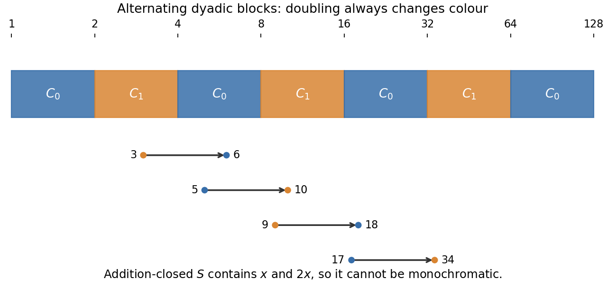

<h1 id="a/2/c/solution">Solution</h1>

↑ **Parent:** [C](../c.md)

**No.** Colour the positive integers by alternating dyadic blocks:

$$
C_0=\bigcup_{j\geq0}\big([2^{2j},2^{2j+1})\cap\mathbb N\big),
\qquad
C_1=\bigcup_{j\geq0}\big([2^{2j+1},2^{2j+2})\cap\mathbb N\big).
$$

Every positive integer $x$ and its double $2x$ have opposite colours. A nonempty set closed under addition contains both $x$ and $x+x=2x$, so no such set can lie in one class. In particular there is no infinite monochromatic additive subsemigroup.

The suggested arithmetic-progression argument gives another way to see the obstruction. If $a\in S$ and $S$ is closed under addition, then $a,2a,3a,\ldots$ all lie in $S$. But every infinite [arithmetic progression](../../../../../arithmetic-progression.md) of positive step $d$ meets every sufficiently long dyadic block, because a block of at least $d$ consecutive integers contains a representative of the progression's residue class. Both colours contain arbitrarily long blocks, so neither colour contains an infinite [arithmetic progression](../../../../../arithmetic-progression.md).

**[Figure 1](#a/2/c/image-alternating-dyadic-colouring-and-the-doubling-obstruction). Alternating dyadic colouring and the doubling obstruction**. Every positive integer and its double lie in opposite coloured blocks.

## ↑ Ancestors (13)

1. [C](../c.md)
2. [2](../../2.md)
3. [A](../../../a.md)
4. [2010](../../../../2010-split.md)
5. [Past exam of the graph Theory and Probabilistic Combinatorics course of the University of Oxford](../../../../split.md)
6. [Graph Theory and Probabilistic Combinatorics course of the University of Oxford](../../../../../graph-theory-and-probabilistic-combinatorics-course-of-the-university-of-oxford.md)
7. [Year 4 of the mathematics course of the University of Oxford](../../../../../year-4-of-the-mathematics-course-of-the-university-of-oxford.md)
8. [Mathematics course of the University of Oxford](../../../../../mathematics-course-of-the-university-of-oxford.md)
9. [Undergraduate course of the University of Oxford](../../../../../undergraduate-course-of-the-university-of-oxford.md)
10. [Course of the University of Oxford](../../../../../course-of-the-university-of-oxford.md)
11. [University of Oxford](../../../../../university-of-oxford-split.md)
12. [List of universities](../../../../../list-of-universities.md)
13. [Codex Wiki](../../../../../split.md)
