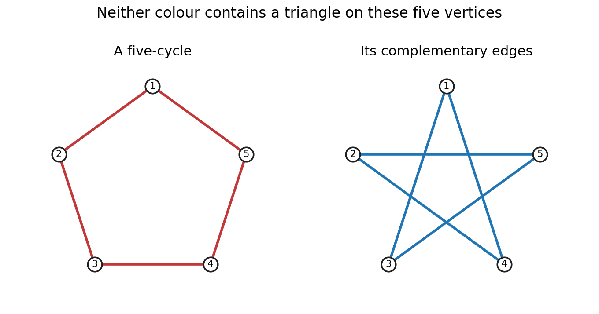

# 2011

↑ **Parent:** [Past exam of the graph Theory and Probabilistic Combinatorics course of the University of Oxford](../past-exam-of-the-graph-theory-and-probabilistic-combinatorics-course-of-the-university-of-oxford.md)

Source paper: [FOI request thread](https://www.whatdotheyknow.com/request/maths_past_papers_3). The intact cover identifies Graph Theory and Probabilistic Combinatorics, C11.1, Friday 10 June 2011, 9.30am to 12.30pm. The private bundle contains this five-page paper at original pages 461–465. Its Graph Theory questions are also issued separately as C11.1a, with a distinct cover and formal identifiers.

**Table of contents**

- [A](#a)
  - [1](#a/1)
    - [a](#a/1/a)
      - [Solution](#a/1/a/solution)
    - [b](#a/1/b)
      - [i](#a/1/b/i)
        - [Solution](#a/1/b/i/solution)
      - [ii](#a/1/b/ii)
        - [Solution](#a/1/b/ii/solution)
      - [iii](#a/1/b/iii)
        - [Solution](#a/1/b/iii/solution)
  - [2](#a/2)
    - [a](#a/2/a)
      - [i](#a/2/a/i)
        - [Solution](#a/2/a/i/solution)
      - [ii](#a/2/a/ii)
        - [Solution](#a/2/a/ii/solution)
    - [b](#a/2/b)
      - [i](#a/2/b/i)
        - [Solution](#a/2/b/i/solution)
      - [ii](#a/2/b/ii)
        - [Solution](#a/2/b/ii/solution)
      - [iii](#a/2/b/iii)
        - [Solution](#a/2/b/iii/solution)
    - [c](#a/2/c)
      - [Solution](#a/2/c/solution)
  - [3](#a/3)
    - [a](#a/3/a)
      - [Solution](#a/3/a/solution)
    - [b](#a/3/b)
      - [Solution](#a/3/b/solution)
    - [c](#a/3/c)
      - [Solution](#a/3/c/solution)
    - [d](#a/3/d)
      - [Solution](#a/3/d/solution)
- [B](#b)
  - [4](#b/4)
    - [a](#b/4/a)
      - [Solution](#b/4/a/solution)
    - [b](#b/4/b)
      - [Solution](#b/4/b/solution)
    - [c](#b/4/c)
      - [Solution](#b/4/c/solution)
  - [5](#b/5)
    - [a](#b/5/a)
      - [Solution](#b/5/a/solution)
    - [b](#b/5/b)
      - [Solution](#b/5/b/solution)
    - [c](#b/5/c)
      - [Solution](#b/5/c/solution)
  - [6](#b/6)
    - [a](#b/6/a)
      - [Solution](#b/6/a/solution)
    - [b](#b/6/b)
      - [Solution](#b/6/b/solution)
    - [c](#b/6/c)
      - [Solution](#b/6/c/solution)

## A

↑ **Parent:** [2011](2011.md)

<h3 id="a/1">1</h3>

↑ **Parent:** [A](#a)

<h4 id="a/1/a">a</h4>

↑ **Parent:** [1](#a/1)

<h5 id="a/1/a/solution">Solution</h5>

↑ **Parent:** [A](#a/1/a)

The [Ramsey number](../ramsey-theory.md#ramsey-number) $R(s,t)$ is the least [integer](../integer.md) $N$ such that every [graph](../graph.md) on $N$ [vertices](../graph.md#vertex-graph-theory) contains either a [clique](../graph-theory.md#clique-graph-theory) of size $s$ or an [independent set](../graph-theory.md#independent-set-graph-theory) of size $t$. Equivalently, every red-blue [colouring](../set.md#colouring-of-a-set) of the [edges](../graph-theory.md#edge-of-a-graph) of $K_N$ contains a red $K_s$ or a blue $K_t$.

Put $a=R(s-1,t)$, $b=R(s,t-1)$ and consider a [graph](../graph.md) on $a+b$ [vertices](../graph.md#vertex-graph-theory). Fix a [vertex](../graph.md#vertex-graph-theory) $v$. If it has at least $a$ [neighbours](../graph-theory.md#neighbour-of-a-vertex), their induced [graph](../graph.md) contains either a [clique](../graph-theory.md#clique-graph-theory) of size $s-1$, which together with $v$ gives a [clique](../graph-theory.md#clique-graph-theory) of size $s$, or an [independent set](../graph-theory.md#independent-set-graph-theory) of size $t$. Otherwise $v$ has at least $b$ nonneighbours. Their induced [graph](../graph.md) contains either a [clique](../graph-theory.md#clique-graph-theory) of size $s$, or an [independent set](../graph-theory.md#independent-set-graph-theory) of size $t-1$, which can be enlarged by $v$. Thus

$$
\boxed{R(s,t)\leq R(s-1,t)+R(s,t-1).}
$$

Since $R(2,3)=R(3,2)=3$, this gives $R(3,3)\leq6$. For the reverse bound, the [five-cycle](../graph-theory.md#cycle-graph) has no [triangle](../graph.md#triangle-in-a-graph) and no [independent set](../graph-theory.md#independent-set-graph-theory) of size three: its [complement](../set.md#complement-of-a-set) is again a [five-cycle](../graph-theory.md#cycle-graph), so it too is triangle-free. Hence the property fails on five [vertices](../graph.md#vertex-graph-theory) and

$$
\boxed{R(3,3)=6.}
$$

**[Figure 1](#a/1/a/image-the-five-cycle-and-its-complement-witness-the-lower-bound-for-r-3-3). The five-cycle and its complement witness the lower bound for R(3,3)** Both panels use the same five labelled vertices. The red cycle and the blue complementary edges are each triangle-free; crossings in the right panel are not vertices.

<h4 id="a/1/b">b</h4>

↑ **Parent:** [1](#a/1)

<h5 id="a/1/b/i">i</h5>

↑ **Parent:** [B](#a/1/b)

<h6 id="a/1/b/i/solution">Solution</h6>

↑ **Parent:** [I](#a/1/b/i)

The [vertex](../graph.md#vertex-graph-theory) version of [Menger's theorem](../graph-theory.md#menger-theorem) states that for two distinct nonadjacent [vertices](../graph.md#vertex-graph-theory) $s,t$ of a finite [graph](../graph.md), the [maximum](../set.md#maximum-of-a-subset-of-a-total-order) number of internally vertex-disjoint $s$-$t$ [graph paths](../graph-theory.md#path-in-a-graph) equals the [minimum](../set.md#minimum-of-a-subset-of-a-total-order) size of a [set](../set.md) $S\subseteq V\setminus\{s,t\}$ whose deletion separates $s$ from $t$.

$$
\boxed{\max\{\text{internally disjoint }s\text{-}t\text{ paths}\}=\min\{|S|:s,t\text{ disconnected in }G-S\}.}
$$

Internally disjoint [graph paths](../graph-theory.md#path-in-a-graph) may share their endpoints but no other [vertex](../graph.md#vertex-graph-theory). The nonadjacency hypothesis is needed in this separator formulation, since an [edge](../graph-theory.md#edge-of-a-graph) $st$ cannot be destroyed by deleting other [vertices](../graph.md#vertex-graph-theory).

<h5 id="a/1/b/ii">ii</h5>

↑ **Parent:** [B](#a/1/b)

<h6 id="a/1/b/ii/solution">Solution</h6>

↑ **Parent:** [Ii](#a/1/b/ii)

Let the [bipartition](../bipartite-graph.md#bipartition-of-a-graph) be $L\cup R$. Form an auxiliary [graph](../graph.md) by adding a new [vertex](../graph.md#vertex-graph-theory) $s$ adjacent to every [vertex](../graph.md#vertex-graph-theory) of $L$ and a new [vertex](../graph.md#vertex-graph-theory) $t$ adjacent to every [vertex](../graph.md#vertex-graph-theory) of $R$. The [vertices](../graph.md#vertex-graph-theory) $s,t$ are nonadjacent, so [Menger's theorem](../graph-theory.md#menger-theorem) applies.

A [matching](../matching-graph-theory.md) of size $m$ gives $m$ internally disjoint [graph paths](../graph-theory.md#path-in-a-graph) $s\ell rt$, one for each [matching](../matching-graph-theory.md) [edge](../graph-theory.md#edge-of-a-graph) $\ell r$. Conversely, every $s$-$t$ [graph path](../graph-theory.md#path-in-a-graph) must use an [edge](../graph-theory.md#edge-of-a-graph) of the original [bipartite graph](../bipartite-graph.md). Choose one such [edge](../graph-theory.md#edge-of-a-graph) from each member of an internally disjoint family. Their endpoints are all distinct, so the chosen [edges](../graph-theory.md#edge-of-a-graph) form a [matching](../matching-graph-theory.md). Thus the [maximum](../set.md#maximum-of-a-subset-of-a-total-order) number of those [graph paths](../graph-theory.md#path-in-a-graph) is the [maximum matching](../matching-graph-theory.md#maximum-cardinality-matching) size.

An $s$-$t$ separator contained in $L\cup R$ is exactly a [vertex cover](../graph-theory.md#vertex-cover) of the original [graph](../graph.md). Indeed, an uncovered [edge](../graph-theory.md#edge-of-a-graph) $\ell r$ would leave the [graph path](../graph-theory.md#path-in-a-graph) $s\ell rt$, while removing a [vertex cover](../graph-theory.md#vertex-cover) removes every [edge](../graph-theory.md#edge-of-a-graph) between $L$ and $R$ and hence every $s$-$t$ [graph path](../graph-theory.md#path-in-a-graph). The [minimum](../set.md#minimum-of-a-subset-of-a-total-order) separator size is therefore the [minimum](../set.md#minimum-of-a-subset-of-a-total-order) [vertex cover](../graph-theory.md#vertex-cover) size. Menger gives

$$
\boxed{\nu(G)=\tau(G)\quad\text{for bipartite }G.}
$$

This is [Kőnig's theorem for bipartite matching](../flow-network.md#konig-s-theorem-graph-theory). The auxiliary construction gives the required deduction from [vertex-disjoint paths](../graph-theory.md#vertex-disjoint-paths) rather than assuming a [matching](../matching-graph-theory.md) theorem in advance.

<h5 id="a/1/b/iii">iii</h5>

↑ **Parent:** [B](#a/1/b)

<h6 id="a/1/b/iii/solution">Solution</h6>

↑ **Parent:** [Iii](#a/1/b/iii)

[Hall's marriage theorem](../matching-graph-theory.md#hall-s-marriage-theorem) says that a [bipartite graph](../bipartite-graph.md) with parts $L,R$ has a [matching](../matching-graph-theory.md) saturating $L$ if and only if

$$
\boxed{|N(S)|\geq|S|\qquad\text{for every }S\subseteq L.}
$$

Necessity follows because the matched [neighbours](../graph-theory.md#neighbour-of-a-vertex) of [vertices](../graph.md#vertex-graph-theory) of $S$ are distinct and belong to $N(S)$.

For sufficiency, assume these [inequalities](../arithmetic.md#inequality-mathematics). Let $K=U\cup W$ be any [vertex cover](../graph-theory.md#vertex-cover), with $U\subseteq L$ and $W\subseteq R$. Every [neighbour](../graph-theory.md#neighbour-of-a-vertex) of $S=L\setminus U$ must belong to $W$, since otherwise its [edge](../graph-theory.md#edge-of-a-graph) from $S$ is uncovered. Therefore $|W|\geq|N(S)|\geq|S|$, and $|K|\geq|U|+|S|=|L|$. The whole part $L$ is itself a [vertex cover](../graph-theory.md#vertex-cover) of size $|L|$. Part (ii) now gives a [matching](../matching-graph-theory.md) of size exactly $|L|$, so it saturates $L$.

<h3 id="a/2">2</h3>

↑ **Parent:** [A](#a)

<h4 id="a/2/a">a</h4>

↑ **Parent:** [2](#a/2)

<h5 id="a/2/a/i">i</h5>

↑ **Parent:** [A](#a/2/a)

<h6 id="a/2/a/i/solution">Solution</h6>

↑ **Parent:** [I](#a/2/a/i)

Choose a [spanning tree](../tree-graph-theory.md#spanning-tree) of the [connected](../graph.md#connectivity-graph-theory) [graph](../graph.md) and [root](../semisimple-lie-algebra.md#root-of-a-root-system) it at $x$. List [vertices](../graph.md#vertex-graph-theory) in nonincreasing order of their [distance](../geometry-and-topology.md#distance) from $x$ in this [tree](../tree-graph-theory.md), breaking ties arbitrarily. The [root](../semisimple-lie-algebra.md#root-of-a-root-system) has [distance](../geometry-and-topology.md#distance) zero and is last, so $v_n=x$.

Every other [vertex](../graph.md#vertex-graph-theory) has a parent one step closer to the [root](../semisimple-lie-algebra.md#root-of-a-root-system). That parent is adjacent to it and appears later in the ordering. Hence

$$
\boxed{\forall i<n\ \exists j>i:\ v_iv_j\in E(H).}
$$

For a [graph](../graph.md) of one [vertex](../graph.md#vertex-graph-theory) the condition is vacuous and the same ordering works.

<h5 id="a/2/a/ii">ii</h5>

↑ **Parent:** [A](#a/2/a)

<h6 id="a/2/a/ii/solution">Solution</h6>

↑ **Parent:** [Ii](#a/2/a/ii)

Write $\Delta=\Delta(G)$, which is at least two because $x$ has the two specified [neighbours](../graph-theory.md#neighbour-of-a-vertex). Give $y$ and $z$ the same colour, say colour one; this is proper because they are nonadjacent.

Apply part (i) to the [connected](../graph.md#connectivity-graph-theory) [graph](../graph.md) $G\setminus\{y,z\}$, with $x$ last. Colour its [vertices](../graph.md#vertex-graph-theory) greedily in the resulting order using a palette of $\Delta$ colours. Every [vertex](../graph.md#vertex-graph-theory) before $x$ has a [neighbour](../graph-theory.md#neighbour-of-a-vertex) later in this order, so at most $\deg(v)-1\leq\Delta-1$ of its [neighbours](../graph-theory.md#neighbour-of-a-vertex) have already received colours. At least one palette colour is available.

When $x$ is reached, all its [neighbours](../graph-theory.md#neighbour-of-a-vertex) are coloured, but the two [neighbours](../graph-theory.md#neighbour-of-a-vertex) $y,z$ have the same colour. Thus there are at most $\deg(x)-1\leq\Delta-1$ distinct forbidden colours. Colour $x$ with a remaining one. This constructs a proper [colouring](../set.md#colouring-of-a-set) with

$$
\boxed{\chi(G)\leq\Delta(G).}
$$

The common colour on the two initial [vertices](../graph.md#vertex-graph-theory) replaces the usual need for an uncoloured [neighbour](../graph-theory.md#neighbour-of-a-vertex) at the last greedy step.

This is [greedy colouring with two precoloured neighbours](../graph-coloring.md#greedy-colouring-with-two-precoloured-neighbours).

<h4 id="a/2/b">b</h4>

↑ **Parent:** [2](#a/2)

<h5 id="a/2/b/i">i</h5>

↑ **Parent:** [B](#a/2/b)

<h6 id="a/2/b/i/solution">Solution</h6>

↑ **Parent:** [I](#a/2/b/i)

Take a proper [colouring](../set.md#colouring-of-a-set) $c:V(G)\to\{1,\ldots,k\}$ and orient every [edge](../graph-theory.md#edge-of-a-graph) from its lower-coloured endpoint towards its higher-coloured endpoint. Along a [directed path](../graph-theory.md#directed-path) the colour strictly increases, so such a [graph path](../graph-theory.md#path-in-a-graph) has at most $k$ [vertices](../graph.md#vertex-graph-theory). A [directed cycle](../graph-theory.md#directed-cycle) is impossible for the same reason. Thus

$$
\boxed{D\text{ is acyclic and }\lambda(D)\leq k.}
$$

<h5 id="a/2/b/ii">ii</h5>

↑ **Parent:** [B](#a/2/b)

<h6 id="a/2/b/ii/solution">Solution</h6>

↑ **Parent:** [Ii](#a/2/b/ii)

For each [vertex](../graph.md#vertex-graph-theory) $v$, let $c(v)$ be the [maximum](../set.md#maximum-of-a-subset-of-a-total-order) number of [vertices](../graph.md#vertex-graph-theory) in a [directed path](../graph-theory.md#directed-path) ending at $v$. These numbers lie between one and $\ell$.

If $u\to v$ is an [edge](../graph-theory.md#edge-of-a-graph), a longest [graph path](../graph-theory.md#path-in-a-graph) ending at $u$ cannot already contain $v$, since that would give a [directed cycle](../graph-theory.md#directed-cycle) on appending $u\to v$. Appending it therefore creates a [graph path](../graph-theory.md#path-in-a-graph) ending at $v$, so $c(v)\geq c(u)+1$. Adjacent [vertices](../graph.md#vertex-graph-theory) consequently receive different colours. Hence

$$
\boxed{c\text{ is a proper colouring using at most }\ell\text{ colours}.}
$$

Acyclicity is exactly what justifies extending the [graph path](../graph-theory.md#path-in-a-graph) without repeating a [vertex](../graph.md#vertex-graph-theory).

<h5 id="a/2/b/iii">iii</h5>

↑ **Parent:** [B](#a/2/b)

<h6 id="a/2/b/iii/solution">Solution</h6>

↑ **Parent:** [Iii](#a/2/b/iii)

Part (ii) shows that $\chi(G)\leq\lambda(D)$ for every [acyclic orientation](../graph-theory.md#acyclic-orientation) $D$, so $\chi(G)$ is at most their [minimum](../set.md#minimum-of-a-subset-of-a-total-order). Part (i), applied to an optimal [colouring](../set.md#colouring-of-a-set), supplies an [acyclic orientation](../graph-theory.md#acyclic-orientation) with $\lambda(D)\leq\chi(G)$. Combining the [inequalities](../arithmetic.md#inequality-mathematics) gives

$$
\boxed{\chi(G)=\min_{D\text{ acyclic orientation of }G}\lambda(D).}
$$

The parameter counts [vertices](../graph.md#vertex-graph-theory) on a [graph path](../graph-theory.md#path-in-a-graph); if [graph path](../graph-theory.md#path-in-a-graph) length were instead counted in [edges](../graph-theory.md#edge-of-a-graph), the corresponding [minimum](../set.md#minimum-of-a-subset-of-a-total-order) would be $\chi(G)-1$.

These constructions prove [chromatic number from acyclic longest paths](../graph-theory.md#chromatic-number-from-acyclic-longest-paths).

<h4 id="a/2/c">c</h4>

↑ **Parent:** [2](#a/2)

<h5 id="a/2/c/solution">Solution</h5>

↑ **Parent:** [C](#a/2/c)

Fix a proper [colouring](../set.md#colouring-of-a-set) with exactly $k$ nonempty [colour classes](../ramsey-theory.md#colour-class). For any class $C_i$, suppose every [vertex](../graph.md#vertex-graph-theory) in it misses at least one of the other $k-1$ colours in its [neighbourhood](../topology.md#neighbourhood-mathematics). Recolour each of these [vertices](../graph.md#vertex-graph-theory) by one of its missing colours. No [edge](../graph-theory.md#edge-of-a-graph) joins two [vertices](../graph.md#vertex-graph-theory) of $C_i$, so these simultaneous recolourings cannot conflict with one another, and the chosen colours do not conflict with [vertices](../graph.md#vertex-graph-theory) outside $C_i$.

This would eliminate colour $i$ and produce a $(k-1)$-colouring, contradicting optimality. Therefore each [colour class](../ramsey-theory.md#colour-class) contains a [vertex](../graph.md#vertex-graph-theory) adjacent to at least one [vertex](../graph.md#vertex-graph-theory) of every other colour. That [vertex](../graph.md#vertex-graph-theory) has degree at least $k-1$. Choosing one from each class gives $k$ distinct [vertices](../graph.md#vertex-graph-theory), proving

$$
\boxed{\bigl|\{v:\deg(v)\geq k-1\}\bigr|\geq k.}
$$

For $k=1$, a nonempty [graph](../graph.md) already has a [vertex](../graph.md#vertex-graph-theory) of degree at least zero, so the conclusion holds as well.

<h3 id="a/3">3</h3>

↑ **Parent:** [A](#a)

<h4 id="a/3/a">a</h4>

↑ **Parent:** [3](#a/3)

<h5 id="a/3/a/solution">Solution</h5>

↑ **Parent:** [A](#a/3/a)

For disjoint nonempty [sets](../set.md) $X,Y$, let $e(X,Y)$ count [edges](../graph-theory.md#edge-of-a-graph) between them. Their [edge](../graph-theory.md#edge-of-a-graph) density is

$$
\boxed{d(X,Y)=\frac{e(X,Y)}{|X||Y|}.}
$$

The pair is $\varepsilon$-regular if every $A\subseteq X$ and $B\subseteq Y$ with $|A|\geq\varepsilon|X|$, $|B|\geq\varepsilon|Y|$ satisfies $|d(A,B)-d(X,Y)|\leq\varepsilon$.

An $\varepsilon$-regular partition has disjoint classes $V_0,V_1,\ldots,V_k$ covering $V(G)$, with $|V_0|\leq\varepsilon|V(G)|$, equal positive sizes $|V_1|=\cdots=|V_k|$, and at most $\varepsilon k^2$ unordered pairs $(V_i,V_j)$ with $1\leq i<j\leq k$ that are not $\varepsilon$-regular. The [set](../set.md) $V_0$ is exceptional and its pairs need not satisfy regularity.

[Szemerédi regularity lemma](../probabilistic-combinatorics.md#szemeredi-regularity-lemma) states that for every $\varepsilon>0$ and [integer](../integer.md) $m_0\geq1$, there are [integers](../integer.md) $M,n_0$ such that every [graph](../graph.md) with $n\geq n_0$ [vertices](../graph.md#vertex-graph-theory) has such a partition with

$$
\boxed{m_0\leq k\leq M.}
$$

The bounds depend on $\varepsilon,m_0$, not on the [graph](../graph.md) order. Using a strict regularity [inequality](../arithmetic.md#inequality-mathematics) or a slightly different [constant](../mathematics.md#constant-mathematics) in the allowed pair count gives an equivalent conventional version; the displayed convention will be used below.

<h4 id="a/3/b">b</h4>

↑ **Parent:** [3](#a/3)

<h5 id="a/3/b/solution">Solution</h5>

↑ **Parent:** [B](#a/3/b)

Let $B\subseteq X$ be the [vertices](../graph.md#vertex-graph-theory) with fewer than $(d/2)|Y|$ [neighbours](../graph-theory.md#neighbour-of-a-vertex) in $Y$. If $|B|\geq\varepsilon|X|$, regularity applies to the pair $(B,Y)$ and gives

$$
d(B,Y)\geq d(X,Y)-\varepsilon\geq d-\varepsilon\geq d/2.
$$

But averaging the defining strict degree [inequality](../arithmetic.md#inequality-mathematics) over $B$ gives $d(B,Y)<d/2$, a contradiction. Therefore

$$
\boxed{|B|<\varepsilon|X|.}
$$

Regularity controls the [neighbourhood](../topology.md#neighbourhood-mathematics) of almost every [vertex](../graph.md#vertex-graph-theory) because a large [set](../set.md) of exceptional low-degree [vertices](../graph.md#vertex-graph-theory) would itself witness an irregular density.

<h4 id="a/3/c">c</h4>

↑ **Parent:** [3](#a/3)

<h5 id="a/3/c/solution">Solution</h5>

↑ **Parent:** [C](#a/3/c)

Apply part (b) to $(X_1,X_2)$ and $(X_1,X_3)$. Fewer than $2\varepsilon|X_1|$ [vertices](../graph.md#vertex-graph-theory) fail at least one of the degree bounds. For any remaining [vertex](../graph.md#vertex-graph-theory) $v$, put $N_2=N(v)\cap X_2$ and $N_3=N(v)\cap X_3$. Then

$$
|N_2|\geq\frac d2|X_2|\geq\varepsilon|X_2|,\qquad
|N_3|\geq\frac d2|X_3|\geq\varepsilon|X_3|.
$$

Regularity of $(X_2,X_3)$ gives $d(N_2,N_3)\geq d-\varepsilon\geq d/2$. Every [edge](../graph-theory.md#edge-of-a-graph) between $N_2$ and $N_3$ makes a distinct [triangle](../graph.md#triangle-in-a-graph) containing $v$. Hence $v$ belongs to at least

$$
\frac d2|N_2||N_3|\geq\frac{d^3}8|X_2||X_3|
$$

such [triangles](../graph.md#triangle-in-a-graph). This proves the asserted bound on exceptional [vertices](../graph.md#vertex-graph-theory).

There are at least $(1-2\varepsilon)|X_1|\geq|X_1|/2$ good [vertices](../graph.md#vertex-graph-theory). Summing their [triangle](../graph.md#triangle-in-a-graph) counts counts each [triangle](../graph.md#triangle-in-a-graph) with one [vertex](../graph.md#vertex-graph-theory) in each cluster exactly once, at its $X_1$ [vertex](../graph.md#vertex-graph-theory). Therefore

$$
\boxed{\#\{\text{triangles in }G\}\geq\frac{d^3}{16}|X_1||X_2||X_3|.}
$$

There is no factor of three to divide out in this cross-cluster count.

This is the [regular triangle counting lemma](../probabilistic-combinatorics.md#regular-triangle-counting-lemma) with explicit coarse constants.

<h4 id="a/3/d">d</h4>

↑ **Parent:** [3](#a/3)

<h5 id="a/3/d/solution">Solution</h5>

↑ **Parent:** [D](#a/3/d)

Choose a small density threshold $d>0$, then $\varepsilon\leq\min(d/2,1/4)$ sufficiently small and a lower partition bound $m_0$ sufficiently large that

$$
2\varepsilon+\frac1{2m_0}+\frac d2<\eta.
$$

Apply the regularity lemma. Delete all [edges](../graph-theory.md#edge-of-a-graph) incident with $V_0$, all [edges](../graph-theory.md#edge-of-a-graph) within a class $V_i$, all [edges](../graph-theory.md#edge-of-a-graph) between [irregular pairs](../probabilistic-combinatorics.md#irregular-pair-of-vertex-sets), and all [edges](../graph-theory.md#edge-of-a-graph) between [regular pairs](../probabilistic-combinatorics.md#regular-pair-of-vertex-sets) of density below $d$. Their total is at most

$$
\varepsilon n^2+\frac{n^2}{2k}+\varepsilon n^2+\frac d2 n^2<\eta n^2.
$$

If a [triangle](../graph.md#triangle-in-a-graph) remains, its [vertices](../graph.md#vertex-graph-theory) lie in three distinct nonexceptional classes, all whose pairs were regular with original density at least $d$. Part (c) then forces at least $(d^3/16)t^3$ [triangles](../graph.md#triangle-in-a-graph) in the original [graph](../graph.md), where $t$ is the common class size. Since $k\leq M$ and $\varepsilon\leq1/4$, we have $t\geq n/(2M)$, so this is at least $d^3n^3/(128M^3)$.

Choose $c=d^3/(256M^3)$ and take $n_0$ large enough for the regularity lemma. An original [graph](../graph.md) with at most $cn^3$ [triangles](../graph.md#triangle-in-a-graph) cannot leave any [triangle](../graph.md#triangle-in-a-graph) after these deletions. Thus **deleting at most $\eta n^2$ [edges](../graph-theory.md#edge-of-a-graph) makes the [graph](../graph.md) triangle-free**. This is the [triangle removal lemma](../probabilistic-combinatorics.md#triangle-removal-lemma); boundedly many large regular clusters turn any surviving [triangle](../graph.md#triangle-in-a-graph) into a positive-density family of original [triangles](../graph.md#triangle-in-a-graph).

<h2 id="b">B</h2>

↑ **Parent:** [2011](2011.md)

<h3 id="b/4">4</h3>

↑ **Parent:** [B](#b)

<h4 id="b/4/a">a</h4>

↑ **Parent:** [4](#b/4)

<h5 id="b/4/a/solution">Solution</h5>

↑ **Parent:** [A](#b/4/a)

[Markov's inequality](../probability-inequality.md#markov-s-inequality) states that for $Y\geq0$ and $t>0$, $\mathbb P(Y\geq t)\leq\mathbb E Y/t$. It follows by taking expectations in $Y\geq t\mathbf1_{\{Y\geq t\}}$.

If $X$ has finite [mean](../expected-value.md) $\mu$ and [variance](../variance.md) $\sigma^2$, apply Markov to $(X-\mu)^2$ to obtain [Chebyshev's inequality](../probability-inequality.md#chebyshev-s-inequality):

$$
\boxed{\mathbb P(|X-\mu|\geq t)\leq\frac{\sigma^2}{t^2}\qquad(t>0).}
$$

For the [first moment method](../probability-inequality.md#first-moment-method), assume $\mu_n=\mathbb E X_n\to0$. Nonnegative [integer](../integer.md) values give $\{X_n>0\}=\{X_n\geq1\}$, so

$$
\boxed{\mathbb P(X_n>0)\leq\mathbb E X_n\longrightarrow0.}
$$

For a standard [second moment method](../probability-inequality.md#second-moment-method), suppose $\mu_n>0$ eventually, the [second moments](../expected-value.md#second-moment) are finite, and $\mathbb E X_n^2/\mu_n^2\to1$. Equivalently, $\operatorname{Var}(X_n)/\mu_n^2\to0$. The zero [event](../probability-space.md#event) is contained in $\{|X_n-\mu_n|\geq\mu_n\}$, so

$$
\mathbb P(X_n=0)\leq\frac{\operatorname{Var}(X_n)}{\mu_n^2}\longrightarrow0.
$$

Hence $\boxed{\mathbb P(X_n>0)\to1}$. The second-moment condition controls the fluctuations relative to the [mean](../expected-value.md); a large [mean](../expected-value.md) alone is insufficient.

<h4 id="b/4/b">b</h4>

↑ **Parent:** [4](#b/4)

<h5 id="b/4/b/solution">Solution</h5>

↑ **Parent:** [B](#b/4/b)

Let $X$ count the four-vertex [sets](../set.md) spanning all four of their possible triples. For each such [set](../set.md) $S$, write $I_S$ for its [indicator](../measure-theory.md#indicator-function). [Independence](../random-variable.md#independent-random-variables) of the four [hyperedges](../hypergraph.md#hyperedge) gives

$$
\mu=\mathbb E X=\binom n4p^4.
$$

If $np\to0$, then $\mu\leq (np)^4/24\to0$, and the [first moment method](../probability-inequality.md#first-moment-method) shows that the [probability](../probability-theory.md#probability) of a four-clique tends to zero.

For the other direction, consider two distinct four-sets. If they meet in at most two [vertices](../graph.md#vertex-graph-theory), they have no possible triple in common, so their indicators are [independent](../random-variable.md#independent-random-variables). If they meet in three [vertices](../graph.md#vertex-graph-theory), they share exactly one triple, so $\mathbb E(I_SI_T)=p^7$ and their [covariance](../variance.md#covariance) is at most $p^7$. There are $O(n^5)$ ordered pairs of this latter type. The diagonal variances sum to at most $\mu$, hence

$$
\operatorname{Var}(X)\leq\mu+O(n^5p^7).
$$

For large $n$, $\mu$ is a [constant](../mathematics.md#constant-mathematics) multiple of $n^4p^4$, and consequently

$$
\frac{\operatorname{Var}(X)}{\mu^2}
=O\left(\frac1{n^4p^4}+\frac1{n^3p}\right).
$$

If $np\to\infty$, the first term tends to zero, and so does the second since $n^3p=n^2(np)\to\infty$. The [second moment method](../probability-inequality.md#second-moment-method) proves that a four-clique exists with [probability](../probability-theory.md#probability) tending to one. Therefore a [threshold function](../theoretical-computer-science.md#threshold-function) is

$$
\boxed{p^*(n)=n^{-1}.}
$$

The shared-triple overlap, rather than overlaps in one or two [vertices](../graph.md#vertex-graph-theory), is the only off-diagonal dependence that affects this computation.

This is the [four-clique threshold in a binomial 3-uniform hypergraph](../hypergraph.md#four-clique-threshold-in-a-binomial-3-uniform-hypergraph).

<h4 id="b/4/c">c</h4>

↑ **Parent:** [4](#b/4)

<h5 id="b/4/c/solution">Solution</h5>

↑ **Parent:** [C](#b/4/c)

The requested scale is $\boxed{k=\Theta(\sqrt{\log n})}$. To see its first-moment origin, the number $X_k$ of $k$-cliques has [expectation](../expected-value.md)

$$
\mathbb E X_k=\binom nk2^{-\binom k3}.
$$

For $k$ on the proposed scale, taking base-two [logarithms](../calculus.md#logarithm) gives

$$
\log_2\mathbb E X_k=k\log_2 n-\frac{k^3}6+O(k^2+k\log k).
$$

The leading terms balance at $k\approx\sqrt{6\log_2 n}$. In particular, for any fixed $c>\sqrt6$, taking $k$ near $c\sqrt{\log_2 n}$ makes the [expectation](../expected-value.md) tend to zero, so such [cliques](../graph-theory.md#clique-graph-theory) are absent with [probability](../probability-theory.md#probability) tending to one.

Thus the first-moment estimate places the largest-clique scale at a [constant](../mathematics.md#constant-mathematics) multiple of $\sqrt{\log n}$, as requested. A diverging [expectation](../expected-value.md) below that balance does not itself prove existence; a corresponding probabilistic lower-bound proof would require an additional argument and is not part of the requested first-moment estimate.

<h3 id="b/5">5</h3>

↑ **Parent:** [B](#b)

<h4 id="b/5/a">a</h4>

↑ **Parent:** [5](#b/5)

<h5 id="b/5/a/solution">Solution</h5>

↑ **Parent:** [A](#b/5/a)

A [dependency digraph](../probabilistic-combinatorics.md#independence-digraph-of-events) has [vertices](../graph.md#vertex-graph-theory) $1,\ldots,n$ and no loops. For each $i$, the [event](../probability-space.md#event) $A_i$ must be [independent](../random-variable.md#independent-random-variables) of the [sigma-algebra](../measure-theory.md#sigma-algebra) generated jointly by all $A_j$ with $j\neq i$ for which there is no [edge](../graph-theory.md#edge-of-a-graph) $i\to j$. Joint [independence](../random-variable.md#independent-random-variables) from that collection is required; [pairwise independence](../probability-theory.md#pairwise-independent-events) alone does not suffice.

Write $\Gamma^+(i)$ for the outneighbours of $i$, and $B_S=\bigcap_{j\in S}A_j^c$. We prove by [induction](../foundations-of-mathematics.md#mathematical-induction) on $|S|$ that $B_S$ has positive [probability](../probability-theory.md#probability) and, when $i\notin S$,

$$
\mathbb P(A_i\mid B_S)\leq x_i.
$$

For $S=\varnothing$, the asserted conditional bound follows from the hypothesis, since its product factors are at most one. For the [induction](../foundations-of-mathematics.md#mathematical-induction) step, positivity for a [set](../set.md) of size $r$ follows by writing its avoidance [probability](../probability-theory.md#probability) as a chain product: all preceding conditioning [sets](../set.md) have size below $r$, so each factor is at least $1-x_j>0$.

Now take $|S|=r$, split $S_1=S\cap\Gamma^+(i)$ and $S_2=S\setminus\Gamma^+(i)$, and condition first on $B_{S_2}$. [Independence](../random-variable.md#independent-random-variables) gives $\mathbb P(A_i\mid B_{S_2})=\mathbb P(A_i)$. Moreover, order the elements of $S_1$ and use the inductive conditional bounds on the successive avoidance factors. Their conditioning [sets](../set.md) have size at most $r-1$, so

$$
\mathbb P(B_{S_1}\mid B_{S_2})\geq\prod_{j\in S_1}(1-x_j).
$$

This remains true when $S_1$ is empty, with both sides one. Therefore

$$
\begin{aligned}
\mathbb P(A_i\mid B_S)
&=\frac{\mathbb P(A_i\cap B_{S_1}\mid B_{S_2})}{\mathbb P(B_{S_1}\mid B_{S_2})}\\
&\leq\frac{\mathbb P(A_i)}{\prod_{j\in S_1}(1-x_j)}\\
&\leq x_i\prod_{j\in\Gamma^+(i)\setminus S_1}(1-x_j)\leq x_i.
\end{aligned}
$$

The [induction](../foundations-of-mathematics.md#mathematical-induction) is complete. Finally expand the [probability](../probability-theory.md#probability) of avoiding all [events](../probability-space.md#event) in the order $1,\ldots,n$:

$$
\boxed{\mathbb P\left(\bigcap_{i=1}^nA_i^c\right)
=\prod_{i=1}^n\left(1-\mathbb P\left(A_i\,\middle|\,\bigcap_{j<i}A_j^c\right)\right)
\geq\prod_{i=1}^n(1-x_i)>0.}
$$

This proves the asymmetric [Lovász local lemma](../probabilistic-combinatorics.md#lovasz-local-lemma), including the positivity needed to make every conditioning step legitimate.

<h4 id="b/5/b">b</h4>

↑ **Parent:** [5](#b/5)

<h5 id="b/5/b/solution">Solution</h5>

↑ **Parent:** [B](#b/5/b)

The symmetric [Lovász local lemma](../probabilistic-combinatorics.md#lovasz-local-lemma) states: if each bad [event](../probability-space.md#event) has [probability](../probability-theory.md#probability) at most $p$, each [event](../probability-space.md#event) is [independent](../random-variable.md#independent-random-variables) of the collection of all but at most $d$ other [events](../probability-space.md#event), and

$$
\boxed{ep(d+1)\leq1,}
$$

then the [probability](../probability-theory.md#probability) that none of the bad [events](../probability-space.md#event) occurs is positive. [Independence](../random-variable.md#independent-random-variables) is from the [sigma-algebra](../measure-theory.md#sigma-algebra) generated by the indicated nonneighbours, as in part (a). A sufficient sharper parameter condition is $p\leq x(1-x)^d$ for some $x\in(0,1)$; taking $x=1/(d+1)$ gives the displayed standard bound when $d\geq1$. When $d=0$, mutual [independence](../random-variable.md#independent-random-variables) directly gives the conclusion under the displayed bound.

<h4 id="b/5/c">c</h4>

↑ **Parent:** [5](#b/5)

<h5 id="b/5/c/solution">Solution</h5>

↑ **Parent:** [C](#b/5/c)

If there are no [triangles](../graph.md#triangle-in-a-graph), any [edge colouring](../graph-coloring.md#edge-coloring) works. Otherwise $\Delta\geq2$. Put $q=\lceil3\sqrt\Delta\rceil$ and colour each [edge](../graph-theory.md#edge-of-a-graph) independently and uniformly from $q$ colours. For each [triangle](../graph.md#triangle-in-a-graph) $T$, let $A_T$ be the [event](../probability-space.md#event) that its three [edges](../graph-theory.md#edge-of-a-graph) have one colour. Then

$$
\mathbb P(A_T)=q\left(\frac1q\right)^3=\frac1{q^2}.
$$

[Events](../probability-space.md#event) for [triangles](../graph.md#triangle-in-a-graph) sharing no [edge](../graph-theory.md#edge-of-a-graph) depend on disjoint edge-colour variables, so each [event](../probability-space.md#event) is jointly [independent](../random-variable.md#independent-random-variables) of the collection of all such nonneighbours. Each [edge](../graph-theory.md#edge-of-a-graph) of a [triangle](../graph.md#triangle-in-a-graph) lies in at most $\Delta-2$ other [triangles](../graph.md#triangle-in-a-graph): a common [neighbour](../graph-theory.md#neighbour-of-a-vertex) of its endpoints must be one of at most $\Delta-1$ [neighbours](../graph-theory.md#neighbour-of-a-vertex) besides the other endpoint, and one of these is the third [vertex](../graph.md#vertex-graph-theory) of $T$ itself. Thus the dependency degree is at most $d=3(\Delta-2)$.

Because $q^2\geq9\Delta$,

$$
e\,\frac1{q^2}(d+1)\leq\frac{e(3\Delta-5)}{9\Delta}<\frac e3<1.
$$

The symmetric local lemma gives positive [probability](../probability-theory.md#probability) of avoiding every monochromatic [triangle](../graph.md#triangle-in-a-graph). Hence

$$
\boxed{\lceil3\sqrt\Delta\rceil\text{ colours suffice}.}
$$

For an edgeless [graph](../graph.md) the empty [colouring](../set.md#colouring-of-a-set) handles even the zero-colour case $\Delta=0$.

<h3 id="b/6">6</h3>

↑ **Parent:** [B](#b)

<h4 id="b/6/a">a</h4>

↑ **Parent:** [6](#b/6)

<h5 id="b/6/a/solution">Solution</h5>

↑ **Parent:** [A](#b/6/a)

A [Galton-Watson process](../galton-watson-process.md) starts with one ancestor, $X_0=1$. Given generation size $X_r$, define

$$
X_{r+1}=\sum_{j=1}^{X_r}Z_{r,j},
$$

where all offspring variables are [independent](../random-variable.md#independent-random-variables) with common distribution $Z$. The empty sum is zero, so zero is absorbing. Its [extinction](../ecology.md#extinction) [probability](../probability-theory.md#probability) is

$$
\eta=\mathbb P(\exists r:X_r=0)=\lim_{r\to\infty}\mathbb P(X_r=0).
$$

For the [probability generating function](../probability-distribution.md#probability-generating-function) $f(s)=\mathbb E[s^Z]$, the allowed fixed-point characterization is

$$
\boxed{\eta\text{ is the smallest solution in }[0,1]\text{ of }f(s)=s.}
$$

For binomial offspring, $f(s)=(1-p+ps)^k$, with $f(1)=1$, $f'(1)=kp$, and $f$ [convex](../real-analysis.md#convex-function) on $[0,1]$.

First assume $0<p<1$. If $k=0$, [extinction](../ecology.md#extinction) occurs immediately. For $k=1$, $f(s)-s=(1-p)(1-s)>0$ for $s<1$, so the only [fixed point](../function.md#fixed-point) is one. For $k\geq2$, [strict convexity](../real-analysis.md#strictly-convex-function) gives

$$
f(s)>f(1)+f'(1)(s-1)=1+kp(s-1)\qquad(0\leq s<1).
$$

If $kp\leq1$, the right-hand side is at least $s$, so no [fixed point](../function.md#fixed-point) below one exists and $\eta=1$. If $kp>1$, $f(s)-s<0$ for $s$ just below one, whereas $f(0)>0$. [Continuity](../calculus.md#continuous-function) supplies a [fixed point](../function.md#fixed-point) in $(0,1)$; hence $\eta<1$. Thus in the nondegenerate parameter range,

$$
\boxed{0<p<1:\quad\eta<1\iff kp>1.}
$$

For completeness, if binomial endpoint parameters are allowed, $p=0$ or $k=0$ gives $\eta=1$, while $p=1$ and $k\geq1$ gives deterministic positive offspring and $\eta=0$. In particular $(k,p)=(1,1)$ survives forever despite [mean](../expected-value.md) one. Over $k\in\{0,1,\ldots\}$ and $p\in[0,1]$, the full condition is

$$
\boxed{\eta<1\iff kp>1\text{ or }(k,p)=(1,1).}
$$

<h4 id="b/6/b">b</h4>

↑ **Parent:** [6](#b/6)

<h5 id="b/6/b/solution">Solution</h5>

↑ **Parent:** [B](#b/6/b)

Explore the family [tree](../tree-graph-theory.md) one individual at a time, maintaining a [queue](../queueing-theory.md#queue-queueing-theory) of individuals not yet explored. Initially its size is $Y_0=1$. Exploring individual $t$ removes it and adds its [independent](../random-variable.md#independent-random-variables) offspring $Z_t$, so before the [queue](../queueing-theory.md#queue-queueing-theory) empties,

$$
Y_t=1+\sum_{j=1}^t(Z_j-1).
$$

One may define the [independent increments](../stochastic-process.md#independent-increments) indefinitely, but the [tree](../tree-graph-theory.md) exploration stops at $T=\inf\{t:Y_t=0\}$. This [hitting time](../markov-chain.md#first-passage-time) is the [total progeny](../galton-watson-process.md#total-progeny-of-a-branching-process), including the ancestor. Since each increment is at least $-1$, a [queue](../queueing-theory.md#queue-queueing-theory) cannot jump below zero before hitting zero. If it never hits zero, the family has infinitely many individuals.

Suppose $kp<1$. A [Chernoff bound](../probability-inequality.md#chernoff-bound) in moment-generating-function form says that for [independent](../random-variable.md#independent-random-variables) $W_j$ and $\theta>0$,

$$
\mathbb P\left(\sum_{j=1}^nW_j\geq0\right)\leq\prod_{j=1}^n\mathbb E e^{\theta W_j}.
$$

Here take $W_j=Z_j-1$, with

$$
M(\theta)=\mathbb E e^{\theta(Z-1)}=e^{-\theta}(1-p+pe^\theta)^k.
$$

We have $M(0)=1$ and $M'(0)=kp-1<0$, so some $\theta>0$ has $M(\theta)<1$. Let $c=-\log M(\theta)>0$. If $T>n$, the [queue](../queueing-theory.md#queue-queueing-theory) is still positive after $n$ explorations; its [integer](../integer.md) value is at least one, giving $\sum_{j=1}^n(Z_j-1)\geq0$. Therefore

$$
\boxed{\mathbb P(T>n)\leq M(\theta)^n=e^{-cn},\qquad n\geq1.}
$$

This proves the claimed bound without appealing to a general branching-process tail theorem.

The argument proves the more general [exponential total progeny tail for bounded subcritical offspring](../galton-watson-process.md#exponential-total-progeny-tail-for-bounded-subcritical-offspring).

<h4 id="b/6/c">c</h4>

↑ **Parent:** [6](#b/6)

<h5 id="b/6/c/solution">Solution</h5>

↑ **Parent:** [C](#b/6/c)

First take $0<p<1$ and $kp>1$. Part (a) gives an [extinction](../ecology.md#extinction) [probability](../probability-theory.md#probability) $\eta\in(0,1)$. Write $p_j=\mathbb P(Z=j)$. Conditional on the ancestor having $j$ children, [extinction](../ecology.md#extinction) requires [extinction](../ecology.md#extinction) of all $j$ [independent](../random-variable.md#independent-random-variables) descendant trees and has [probability](../probability-theory.md#probability) $\eta^j$. Bayes' rule therefore gives the conditional offspring law

$$
\widetilde p_j=\mathbb P(Z=j\mid\text{extinction})=p_j\eta^{j-1}.
$$

Its sum is $f(\eta)/\eta=1$. Conditional on [extinction](../ecology.md#extinction) of all descendant trees, those trees remain [independent](../random-variable.md#independent-random-variables), each with its own extinction-conditioned law. Thus the entire conditioned process is a Galton–Watson process with offspring generating function

$$
\widetilde f(s)=\frac{f(\eta s)}\eta.
$$

For binomial offspring, using $\eta=(1-p+p\eta)^k$ gives

$$
\boxed{\widetilde Z\sim\operatorname{Bi}(k,\widetilde p),\qquad
\widetilde p=\frac{p\eta}{1-p+p\eta}.}
$$

Its [mean](../expected-value.md) is $k\widetilde p=f'(\eta)<1$. Indeed, $f(s)-s$ is [strictly convex](../real-analysis.md#strictly-convex-function) and has its two zeros at $\eta$ and one, so its [derivative](../calculus.md#derivative) at the first zero is strictly negative. This proves subcriticality directly from the generating function.

Let $T$ be [total progeny](../galton-watson-process.md#total-progeny-of-a-branching-process), taking value infinity on survival. Apply part (b) to the conditioned process. For some $c>0$,

$$
\boxed{1-\eta\leq\mathbb P(T>n)
=(1-\eta)+\eta\,\mathbb P(\widetilde T>n)
\leq1-\eta+\eta e^{-cn}.}
$$

Thus the unconditional tail tends to the positive survival [probability](../probability-theory.md#probability) $1-\eta$, with an exponentially small finite-extinction contribution. It does not decay to zero.

If $p=1$ and $kp>1$, [extinction](../ecology.md#extinction) has [probability](../probability-theory.md#probability) zero and conditioning on it does not specify a [probability](../probability-theory.md#probability) law. In that deterministic case [total progeny](../galton-watson-process.md#total-progeny-of-a-branching-process) is infinite and $\mathbb P(T>n)=1$ for every finite $n$.

The nondegenerate law above is the [binomial branching process conditioned on extinction](../galton-watson-process.md#binomial-branching-process-conditioned-on-extinction).

## ↑ Ancestors (9)

1. [Past exam of the graph Theory and Probabilistic Combinatorics course of the University of Oxford](../past-exam-of-the-graph-theory-and-probabilistic-combinatorics-course-of-the-university-of-oxford.md)
2. [Graph Theory and Probabilistic Combinatorics course of the University of Oxford](../university-of-oxford.md#graph-theory-and-probabilistic-combinatorics-course-of-the-university-of-oxford)
3. [Year 4 of the mathematics course of the University of Oxford](../university-of-oxford.md#year-4-of-the-mathematics-course-of-the-university-of-oxford)
4. [Mathematics course of the University of Oxford](../university-of-oxford.md#mathematics-course-of-the-university-of-oxford)
5. [Undergraduate course of the University of Oxford](../university-of-oxford.md#undergraduate-course-of-the-university-of-oxford)
6. [Course of the University of Oxford](../university-of-oxford.md#course-of-the-university-of-oxford)
7. [University of Oxford](../university-of-oxford.md)
8. [List of universities](../README.md#list-of-universities)
9. [Codex Wiki](../README.md)
