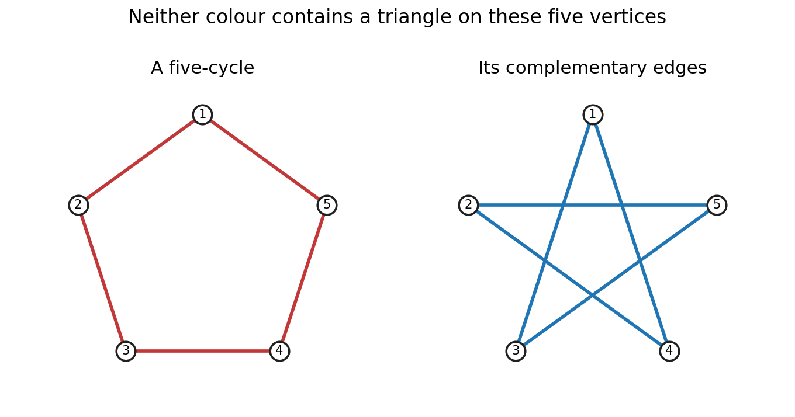

# 2011

↑ **Parent:** [Past exam of the graph theory course of the University of Oxford](../past-exam-of-the-graph-theory-course-of-the-university-of-oxford.md)

Source paper: [FOI request thread](https://www.whatdotheyknow.com/request/maths_past_papers_3). The intact cover identifies Graph Theory, C11.1a, Friday 10 June 2011, 9.30am to 11.00am. This three-page paper occupies original private-bundle pages 466–468. Its three questions match Section A of the separately issued combined Graph Theory and Probabilistic Combinatorics paper, C11.1; the same solution bodies are reused here under this paper's own question tree.

**Table of contents**

- [1](#1)
  - [a](#1/a)
    - [Solution](#1/a/solution)
  - [b](#1/b)
    - [i](#1/b/i)
      - [Solution](#1/b/i/solution)
    - [ii](#1/b/ii)
      - [Solution](#1/b/ii/solution)
    - [iii](#1/b/iii)
      - [Solution](#1/b/iii/solution)
- [2](#2)
  - [a](#2/a)
    - [i](#2/a/i)
      - [Solution](#2/a/i/solution)
    - [ii](#2/a/ii)
      - [Solution](#2/a/ii/solution)
  - [b](#2/b)
    - [i](#2/b/i)
      - [Solution](#2/b/i/solution)
    - [ii](#2/b/ii)
      - [Solution](#2/b/ii/solution)
    - [iii](#2/b/iii)
      - [Solution](#2/b/iii/solution)
  - [c](#2/c)
    - [Solution](#2/c/solution)
- [3](#3)
  - [a](#3/a)
    - [Solution](#3/a/solution)
  - [b](#3/b)
    - [Solution](#3/b/solution)
  - [c](#3/c)
    - [Solution](#3/c/solution)
  - [d](#3/d)
    - [Solution](#3/d/solution)

## 1

↑ **Parent:** [2011](2011.md)

<h3 id="1/a">a</h3>

↑ **Parent:** [1](#1)

<h4 id="1/a/solution">Solution</h4>

↑ **Parent:** [A](#1/a)

The [Ramsey number](../ramsey-theory.md#ramsey-number) $R(s,t)$ is the least [integer](../integer.md) $N$ such that every [graph](../graph.md) on $N$ [vertices](../graph.md#vertex-graph-theory) contains either a [clique](../graph-theory.md#clique-graph-theory) of size $s$ or an [independent set](../graph-theory.md#independent-set-graph-theory) of size $t$. Equivalently, every red-blue [colouring](../set.md#colouring-of-a-set) of the [edges](../graph-theory.md#edge-of-a-graph) of $K_N$ contains a red $K_s$ or a blue $K_t$.

Put $a=R(s-1,t)$, $b=R(s,t-1)$ and consider a [graph](../graph.md) on $a+b$ [vertices](../graph.md#vertex-graph-theory). Fix a [vertex](../graph.md#vertex-graph-theory) $v$. If it has at least $a$ [neighbours](../graph-theory.md#neighbour-of-a-vertex), their induced [graph](../graph.md) contains either a [clique](../graph-theory.md#clique-graph-theory) of size $s-1$, which together with $v$ gives a [clique](../graph-theory.md#clique-graph-theory) of size $s$, or an [independent set](../graph-theory.md#independent-set-graph-theory) of size $t$. Otherwise $v$ has at least $b$ nonneighbours. Their induced [graph](../graph.md) contains either a [clique](../graph-theory.md#clique-graph-theory) of size $s$, or an [independent set](../graph-theory.md#independent-set-graph-theory) of size $t-1$, which can be enlarged by $v$. Thus

$$
\boxed{R(s,t)\leq R(s-1,t)+R(s,t-1).}
$$

Since $R(2,3)=R(3,2)=3$, this gives $R(3,3)\leq6$. For the reverse bound, the [five-cycle](../graph-theory.md#cycle-graph) has no [triangle](../graph.md#triangle-in-a-graph) and no [independent set](../graph-theory.md#independent-set-graph-theory) of size three: its [complement](../set.md#complement-of-a-set) is again a [five-cycle](../graph-theory.md#cycle-graph), so it too is triangle-free. Hence the property fails on five [vertices](../graph.md#vertex-graph-theory) and

$$
\boxed{R(3,3)=6.}
$$

**[Figure 1](#1/a/image-the-five-cycle-and-its-complement-witness-the-lower-bound-for-r-3-3). The five-cycle and its complement witness the lower bound for R(3,3)** Both panels use the same five labelled vertices. The red cycle and the blue complementary edges are each triangle-free; crossings in the right panel are not vertices.

<h3 id="1/b">b</h3>

↑ **Parent:** [1](#1)

<h4 id="1/b/i">i</h4>

↑ **Parent:** [B](#1/b)

<h5 id="1/b/i/solution">Solution</h5>

↑ **Parent:** [I](#1/b/i)

The [vertex](../graph.md#vertex-graph-theory) version of [Menger's theorem](../graph-theory.md#menger-theorem) states that for two distinct nonadjacent [vertices](../graph.md#vertex-graph-theory) $s,t$ of a finite [graph](../graph.md), the [maximum](../set.md#maximum-of-a-subset-of-a-total-order) number of internally vertex-disjoint $s$-$t$ [graph paths](../graph-theory.md#path-in-a-graph) equals the [minimum](../set.md#minimum-of-a-subset-of-a-total-order) size of a [set](../set.md) $S\subseteq V\setminus\{s,t\}$ whose deletion separates $s$ from $t$.

$$
\boxed{\max\{\text{internally disjoint }s\text{-}t\text{ paths}\}=\min\{|S|:s,t\text{ disconnected in }G-S\}.}
$$

Internally disjoint [graph paths](../graph-theory.md#path-in-a-graph) may share their endpoints but no other [vertex](../graph.md#vertex-graph-theory). The nonadjacency hypothesis is needed in this separator formulation, since an [edge](../graph-theory.md#edge-of-a-graph) $st$ cannot be destroyed by deleting other [vertices](../graph.md#vertex-graph-theory).

<h4 id="1/b/ii">ii</h4>

↑ **Parent:** [B](#1/b)

<h5 id="1/b/ii/solution">Solution</h5>

↑ **Parent:** [Ii](#1/b/ii)

Let the [bipartition](../bipartite-graph.md#bipartition-of-a-graph) be $L\cup R$. Form an auxiliary [graph](../graph.md) by adding a new [vertex](../graph.md#vertex-graph-theory) $s$ adjacent to every [vertex](../graph.md#vertex-graph-theory) of $L$ and a new [vertex](../graph.md#vertex-graph-theory) $t$ adjacent to every [vertex](../graph.md#vertex-graph-theory) of $R$. The [vertices](../graph.md#vertex-graph-theory) $s,t$ are nonadjacent, so [Menger's theorem](../graph-theory.md#menger-theorem) applies.

A [matching](../matching-graph-theory.md) of size $m$ gives $m$ internally disjoint [graph paths](../graph-theory.md#path-in-a-graph) $s\ell rt$, one for each [matching](../matching-graph-theory.md) [edge](../graph-theory.md#edge-of-a-graph) $\ell r$. Conversely, every $s$-$t$ [graph path](../graph-theory.md#path-in-a-graph) must use an [edge](../graph-theory.md#edge-of-a-graph) of the original [bipartite graph](../bipartite-graph.md). Choose one such [edge](../graph-theory.md#edge-of-a-graph) from each member of an internally disjoint family. Their endpoints are all distinct, so the chosen [edges](../graph-theory.md#edge-of-a-graph) form a [matching](../matching-graph-theory.md). Thus the [maximum](../set.md#maximum-of-a-subset-of-a-total-order) number of those [graph paths](../graph-theory.md#path-in-a-graph) is the [maximum matching](../matching-graph-theory.md#maximum-cardinality-matching) size.

An $s$-$t$ separator contained in $L\cup R$ is exactly a [vertex cover](../graph-theory.md#vertex-cover) of the original [graph](../graph.md). Indeed, an uncovered [edge](../graph-theory.md#edge-of-a-graph) $\ell r$ would leave the [graph path](../graph-theory.md#path-in-a-graph) $s\ell rt$, while removing a [vertex cover](../graph-theory.md#vertex-cover) removes every [edge](../graph-theory.md#edge-of-a-graph) between $L$ and $R$ and hence every $s$-$t$ [graph path](../graph-theory.md#path-in-a-graph). The [minimum](../set.md#minimum-of-a-subset-of-a-total-order) separator size is therefore the [minimum](../set.md#minimum-of-a-subset-of-a-total-order) [vertex cover](../graph-theory.md#vertex-cover) size. Menger gives

$$
\boxed{\nu(G)=\tau(G)\quad\text{for bipartite }G.}
$$

This is [Kőnig's theorem for bipartite matching](../flow-network.md#konig-s-theorem-graph-theory). The auxiliary construction gives the required deduction from [vertex-disjoint paths](../graph-theory.md#vertex-disjoint-paths) rather than assuming a [matching](../matching-graph-theory.md) theorem in advance.

<h4 id="1/b/iii">iii</h4>

↑ **Parent:** [B](#1/b)

<h5 id="1/b/iii/solution">Solution</h5>

↑ **Parent:** [Iii](#1/b/iii)

[Hall's marriage theorem](../matching-graph-theory.md#hall-s-marriage-theorem) says that a [bipartite graph](../bipartite-graph.md) with parts $L,R$ has a [matching](../matching-graph-theory.md) saturating $L$ if and only if

$$
\boxed{|N(S)|\geq|S|\qquad\text{for every }S\subseteq L.}
$$

Necessity follows because the matched [neighbours](../graph-theory.md#neighbour-of-a-vertex) of [vertices](../graph.md#vertex-graph-theory) of $S$ are distinct and belong to $N(S)$.

For sufficiency, assume these [inequalities](../arithmetic.md#inequality-mathematics). Let $K=U\cup W$ be any [vertex cover](../graph-theory.md#vertex-cover), with $U\subseteq L$ and $W\subseteq R$. Every [neighbour](../graph-theory.md#neighbour-of-a-vertex) of $S=L\setminus U$ must belong to $W$, since otherwise its [edge](../graph-theory.md#edge-of-a-graph) from $S$ is uncovered. Therefore $|W|\geq|N(S)|\geq|S|$, and $|K|\geq|U|+|S|=|L|$. The whole part $L$ is itself a [vertex cover](../graph-theory.md#vertex-cover) of size $|L|$. Part (ii) now gives a [matching](../matching-graph-theory.md) of size exactly $|L|$, so it saturates $L$.

## 2

↑ **Parent:** [2011](2011.md)

<h3 id="2/a">a</h3>

↑ **Parent:** [2](#2)

<h4 id="2/a/i">i</h4>

↑ **Parent:** [A](#2/a)

<h5 id="2/a/i/solution">Solution</h5>

↑ **Parent:** [I](#2/a/i)

Choose a [spanning tree](../tree-graph-theory.md#spanning-tree) of the [connected](../graph.md#connectivity-graph-theory) [graph](../graph.md) and [root](../semisimple-lie-algebra.md#root-of-a-root-system) it at $x$. List [vertices](../graph.md#vertex-graph-theory) in nonincreasing order of their [distance](../geometry-and-topology.md#distance) from $x$ in this [tree](../tree-graph-theory.md), breaking ties arbitrarily. The [root](../semisimple-lie-algebra.md#root-of-a-root-system) has [distance](../geometry-and-topology.md#distance) zero and is last, so $v_n=x$.

Every other [vertex](../graph.md#vertex-graph-theory) has a parent one step closer to the [root](../semisimple-lie-algebra.md#root-of-a-root-system). That parent is adjacent to it and appears later in the ordering. Hence

$$
\boxed{\forall i<n\ \exists j>i:\ v_iv_j\in E(H).}
$$

For a [graph](../graph.md) of one [vertex](../graph.md#vertex-graph-theory) the condition is vacuous and the same ordering works.

<h4 id="2/a/ii">ii</h4>

↑ **Parent:** [A](#2/a)

<h5 id="2/a/ii/solution">Solution</h5>

↑ **Parent:** [Ii](#2/a/ii)

Write $\Delta=\Delta(G)$, which is at least two because $x$ has the two specified [neighbours](../graph-theory.md#neighbour-of-a-vertex). Give $y$ and $z$ the same colour, say colour one; this is proper because they are nonadjacent.

Apply part (i) to the [connected](../graph.md#connectivity-graph-theory) [graph](../graph.md) $G\setminus\{y,z\}$, with $x$ last. Colour its [vertices](../graph.md#vertex-graph-theory) greedily in the resulting order using a palette of $\Delta$ colours. Every [vertex](../graph.md#vertex-graph-theory) before $x$ has a [neighbour](../graph-theory.md#neighbour-of-a-vertex) later in this order, so at most $\deg(v)-1\leq\Delta-1$ of its [neighbours](../graph-theory.md#neighbour-of-a-vertex) have already received colours. At least one palette colour is available.

When $x$ is reached, all its [neighbours](../graph-theory.md#neighbour-of-a-vertex) are coloured, but the two [neighbours](../graph-theory.md#neighbour-of-a-vertex) $y,z$ have the same colour. Thus there are at most $\deg(x)-1\leq\Delta-1$ distinct forbidden colours. Colour $x$ with a remaining one. This constructs a proper [colouring](../set.md#colouring-of-a-set) with

$$
\boxed{\chi(G)\leq\Delta(G).}
$$

The common colour on the two initial [vertices](../graph.md#vertex-graph-theory) replaces the usual need for an uncoloured [neighbour](../graph-theory.md#neighbour-of-a-vertex) at the last greedy step.

This is [greedy colouring with two precoloured neighbours](../graph-coloring.md#greedy-colouring-with-two-precoloured-neighbours).

<h3 id="2/b">b</h3>

↑ **Parent:** [2](#2)

<h4 id="2/b/i">i</h4>

↑ **Parent:** [B](#2/b)

<h5 id="2/b/i/solution">Solution</h5>

↑ **Parent:** [I](#2/b/i)

Take a proper [colouring](../set.md#colouring-of-a-set) $c:V(G)\to\{1,\ldots,k\}$ and orient every [edge](../graph-theory.md#edge-of-a-graph) from its lower-coloured endpoint towards its higher-coloured endpoint. Along a [directed path](../graph-theory.md#directed-path) the colour strictly increases, so such a [graph path](../graph-theory.md#path-in-a-graph) has at most $k$ [vertices](../graph.md#vertex-graph-theory). A [directed cycle](../graph-theory.md#directed-cycle) is impossible for the same reason. Thus

$$
\boxed{D\text{ is acyclic and }\lambda(D)\leq k.}
$$

<h4 id="2/b/ii">ii</h4>

↑ **Parent:** [B](#2/b)

<h5 id="2/b/ii/solution">Solution</h5>

↑ **Parent:** [Ii](#2/b/ii)

For each [vertex](../graph.md#vertex-graph-theory) $v$, let $c(v)$ be the [maximum](../set.md#maximum-of-a-subset-of-a-total-order) number of [vertices](../graph.md#vertex-graph-theory) in a [directed path](../graph-theory.md#directed-path) ending at $v$. These numbers lie between one and $\ell$.

If $u\to v$ is an [edge](../graph-theory.md#edge-of-a-graph), a longest [graph path](../graph-theory.md#path-in-a-graph) ending at $u$ cannot already contain $v$, since that would give a [directed cycle](../graph-theory.md#directed-cycle) on appending $u\to v$. Appending it therefore creates a [graph path](../graph-theory.md#path-in-a-graph) ending at $v$, so $c(v)\geq c(u)+1$. Adjacent [vertices](../graph.md#vertex-graph-theory) consequently receive different colours. Hence

$$
\boxed{c\text{ is a proper colouring using at most }\ell\text{ colours}.}
$$

Acyclicity is exactly what justifies extending the [graph path](../graph-theory.md#path-in-a-graph) without repeating a [vertex](../graph.md#vertex-graph-theory).

<h4 id="2/b/iii">iii</h4>

↑ **Parent:** [B](#2/b)

<h5 id="2/b/iii/solution">Solution</h5>

↑ **Parent:** [Iii](#2/b/iii)

Part (ii) shows that $\chi(G)\leq\lambda(D)$ for every [acyclic orientation](../graph-theory.md#acyclic-orientation) $D$, so $\chi(G)$ is at most their [minimum](../set.md#minimum-of-a-subset-of-a-total-order). Part (i), applied to an optimal [colouring](../set.md#colouring-of-a-set), supplies an [acyclic orientation](../graph-theory.md#acyclic-orientation) with $\lambda(D)\leq\chi(G)$. Combining the [inequalities](../arithmetic.md#inequality-mathematics) gives

$$
\boxed{\chi(G)=\min_{D\text{ acyclic orientation of }G}\lambda(D).}
$$

The parameter counts [vertices](../graph.md#vertex-graph-theory) on a [graph path](../graph-theory.md#path-in-a-graph); if [graph path](../graph-theory.md#path-in-a-graph) length were instead counted in [edges](../graph-theory.md#edge-of-a-graph), the corresponding [minimum](../set.md#minimum-of-a-subset-of-a-total-order) would be $\chi(G)-1$.

These constructions prove [chromatic number from acyclic longest paths](../graph-theory.md#chromatic-number-from-acyclic-longest-paths).

<h3 id="2/c">c</h3>

↑ **Parent:** [2](#2)

<h4 id="2/c/solution">Solution</h4>

↑ **Parent:** [C](#2/c)

Fix a proper [colouring](../set.md#colouring-of-a-set) with exactly $k$ nonempty [colour classes](../ramsey-theory.md#colour-class). For any class $C_i$, suppose every [vertex](../graph.md#vertex-graph-theory) in it misses at least one of the other $k-1$ colours in its [neighbourhood](../topology.md#neighbourhood-mathematics). Recolour each of these [vertices](../graph.md#vertex-graph-theory) by one of its missing colours. No [edge](../graph-theory.md#edge-of-a-graph) joins two [vertices](../graph.md#vertex-graph-theory) of $C_i$, so these simultaneous recolourings cannot conflict with one another, and the chosen colours do not conflict with [vertices](../graph.md#vertex-graph-theory) outside $C_i$.

This would eliminate colour $i$ and produce a $(k-1)$-colouring, contradicting optimality. Therefore each [colour class](../ramsey-theory.md#colour-class) contains a [vertex](../graph.md#vertex-graph-theory) adjacent to at least one [vertex](../graph.md#vertex-graph-theory) of every other colour. That [vertex](../graph.md#vertex-graph-theory) has degree at least $k-1$. Choosing one from each class gives $k$ distinct [vertices](../graph.md#vertex-graph-theory), proving

$$
\boxed{\bigl|\{v:\deg(v)\geq k-1\}\bigr|\geq k.}
$$

For $k=1$, a nonempty [graph](../graph.md) already has a [vertex](../graph.md#vertex-graph-theory) of degree at least zero, so the conclusion holds as well.

## 3

↑ **Parent:** [2011](2011.md)

<h3 id="3/a">a</h3>

↑ **Parent:** [3](#3)

<h4 id="3/a/solution">Solution</h4>

↑ **Parent:** [A](#3/a)

For disjoint nonempty [sets](../set.md) $X,Y$, let $e(X,Y)$ count [edges](../graph-theory.md#edge-of-a-graph) between them. Their [edge](../graph-theory.md#edge-of-a-graph) density is

$$
\boxed{d(X,Y)=\frac{e(X,Y)}{|X||Y|}.}
$$

The pair is $\varepsilon$-regular if every $A\subseteq X$ and $B\subseteq Y$ with $|A|\geq\varepsilon|X|$, $|B|\geq\varepsilon|Y|$ satisfies $|d(A,B)-d(X,Y)|\leq\varepsilon$.

An $\varepsilon$-regular partition has disjoint classes $V_0,V_1,\ldots,V_k$ covering $V(G)$, with $|V_0|\leq\varepsilon|V(G)|$, equal positive sizes $|V_1|=\cdots=|V_k|$, and at most $\varepsilon k^2$ unordered pairs $(V_i,V_j)$ with $1\leq i<j\leq k$ that are not $\varepsilon$-regular. The [set](../set.md) $V_0$ is exceptional and its pairs need not satisfy regularity.

[Szemerédi regularity lemma](../probabilistic-combinatorics.md#szemeredi-regularity-lemma) states that for every $\varepsilon>0$ and [integer](../integer.md) $m_0\geq1$, there are [integers](../integer.md) $M,n_0$ such that every [graph](../graph.md) with $n\geq n_0$ [vertices](../graph.md#vertex-graph-theory) has such a partition with

$$
\boxed{m_0\leq k\leq M.}
$$

The bounds depend on $\varepsilon,m_0$, not on the [graph](../graph.md) order. Using a strict regularity [inequality](../arithmetic.md#inequality-mathematics) or a slightly different [constant](../mathematics.md#constant-mathematics) in the allowed pair count gives an equivalent conventional version; the displayed convention will be used below.

<h3 id="3/b">b</h3>

↑ **Parent:** [3](#3)

<h4 id="3/b/solution">Solution</h4>

↑ **Parent:** [B](#3/b)

Let $B\subseteq X$ be the [vertices](../graph.md#vertex-graph-theory) with fewer than $(d/2)|Y|$ [neighbours](../graph-theory.md#neighbour-of-a-vertex) in $Y$. If $|B|\geq\varepsilon|X|$, regularity applies to the pair $(B,Y)$ and gives

$$
d(B,Y)\geq d(X,Y)-\varepsilon\geq d-\varepsilon\geq d/2.
$$

But averaging the defining strict degree [inequality](../arithmetic.md#inequality-mathematics) over $B$ gives $d(B,Y)<d/2$, a contradiction. Therefore

$$
\boxed{|B|<\varepsilon|X|.}
$$

Regularity controls the [neighbourhood](../topology.md#neighbourhood-mathematics) of almost every [vertex](../graph.md#vertex-graph-theory) because a large [set](../set.md) of exceptional low-degree [vertices](../graph.md#vertex-graph-theory) would itself witness an irregular density.

<h3 id="3/c">c</h3>

↑ **Parent:** [3](#3)

<h4 id="3/c/solution">Solution</h4>

↑ **Parent:** [C](#3/c)

Apply part (b) to $(X_1,X_2)$ and $(X_1,X_3)$. Fewer than $2\varepsilon|X_1|$ [vertices](../graph.md#vertex-graph-theory) fail at least one of the degree bounds. For any remaining [vertex](../graph.md#vertex-graph-theory) $v$, put $N_2=N(v)\cap X_2$ and $N_3=N(v)\cap X_3$. Then

$$
|N_2|\geq\frac d2|X_2|\geq\varepsilon|X_2|,\qquad
|N_3|\geq\frac d2|X_3|\geq\varepsilon|X_3|.
$$

Regularity of $(X_2,X_3)$ gives $d(N_2,N_3)\geq d-\varepsilon\geq d/2$. Every [edge](../graph-theory.md#edge-of-a-graph) between $N_2$ and $N_3$ makes a distinct [triangle](../graph.md#triangle-in-a-graph) containing $v$. Hence $v$ belongs to at least

$$
\frac d2|N_2||N_3|\geq\frac{d^3}8|X_2||X_3|
$$

such [triangles](../graph.md#triangle-in-a-graph). This proves the asserted bound on exceptional [vertices](../graph.md#vertex-graph-theory).

There are at least $(1-2\varepsilon)|X_1|\geq|X_1|/2$ good [vertices](../graph.md#vertex-graph-theory). Summing their [triangle](../graph.md#triangle-in-a-graph) counts counts each [triangle](../graph.md#triangle-in-a-graph) with one [vertex](../graph.md#vertex-graph-theory) in each cluster exactly once, at its $X_1$ [vertex](../graph.md#vertex-graph-theory). Therefore

$$
\boxed{\#\{\text{triangles in }G\}\geq\frac{d^3}{16}|X_1||X_2||X_3|.}
$$

There is no factor of three to divide out in this cross-cluster count.

This is the [regular triangle counting lemma](../probabilistic-combinatorics.md#regular-triangle-counting-lemma) with explicit coarse constants.

<h3 id="3/d">d</h3>

↑ **Parent:** [3](#3)

<h4 id="3/d/solution">Solution</h4>

↑ **Parent:** [D](#3/d)

Choose a small density threshold $d>0$, then $\varepsilon\leq\min(d/2,1/4)$ sufficiently small and a lower partition bound $m_0$ sufficiently large that

$$
2\varepsilon+\frac1{2m_0}+\frac d2<\eta.
$$

Apply the regularity lemma. Delete all [edges](../graph-theory.md#edge-of-a-graph) incident with $V_0$, all [edges](../graph-theory.md#edge-of-a-graph) within a class $V_i$, all [edges](../graph-theory.md#edge-of-a-graph) between [irregular pairs](../probabilistic-combinatorics.md#irregular-pair-of-vertex-sets), and all [edges](../graph-theory.md#edge-of-a-graph) between [regular pairs](../probabilistic-combinatorics.md#regular-pair-of-vertex-sets) of density below $d$. Their total is at most

$$
\varepsilon n^2+\frac{n^2}{2k}+\varepsilon n^2+\frac d2 n^2<\eta n^2.
$$

If a [triangle](../graph.md#triangle-in-a-graph) remains, its [vertices](../graph.md#vertex-graph-theory) lie in three distinct nonexceptional classes, all whose pairs were regular with original density at least $d$. Part (c) then forces at least $(d^3/16)t^3$ [triangles](../graph.md#triangle-in-a-graph) in the original [graph](../graph.md), where $t$ is the common class size. Since $k\leq M$ and $\varepsilon\leq1/4$, we have $t\geq n/(2M)$, so this is at least $d^3n^3/(128M^3)$.

Choose $c=d^3/(256M^3)$ and take $n_0$ large enough for the regularity lemma. An original [graph](../graph.md) with at most $cn^3$ [triangles](../graph.md#triangle-in-a-graph) cannot leave any [triangle](../graph.md#triangle-in-a-graph) after these deletions. Thus **deleting at most $\eta n^2$ [edges](../graph-theory.md#edge-of-a-graph) makes the [graph](../graph.md) triangle-free**. This is the [triangle removal lemma](../probabilistic-combinatorics.md#triangle-removal-lemma); boundedly many large regular clusters turn any surviving [triangle](../graph.md#triangle-in-a-graph) into a positive-density family of original [triangles](../graph.md#triangle-in-a-graph).

## ↑ Ancestors (9)

1. [Past exam of the graph theory course of the University of Oxford](../past-exam-of-the-graph-theory-course-of-the-university-of-oxford.md)
2. [Graph theory course of the University of Oxford](../university-of-oxford.md#graph-theory-course-of-the-university-of-oxford)
3. [Year 3 of the mathematics course of the University of Oxford](../university-of-oxford.md#year-3-of-the-mathematics-course-of-the-university-of-oxford)
4. [Mathematics course of the University of Oxford](../university-of-oxford.md#mathematics-course-of-the-university-of-oxford)
5. [Undergraduate course of the University of Oxford](../university-of-oxford.md#undergraduate-course-of-the-university-of-oxford)
6. [Course of the University of Oxford](../university-of-oxford.md#course-of-the-university-of-oxford)
7. [University of Oxford](../university-of-oxford.md)
8. [List of universities](../README.md#list-of-universities)
9. [Codex Wiki](../README.md)
