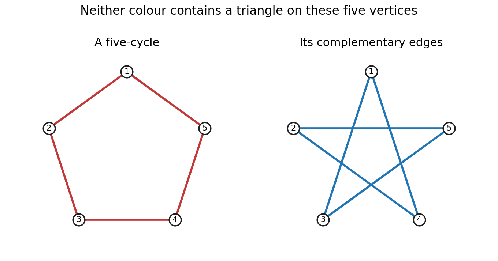

<h1 id="1/a/solution">Solution</h1>

↑ **Parent:** [A](../a.md)

The [Ramsey number](../../../../ramsey-number.md) $R(s,t)$ is the least [integer](../../../../integer-split.md) $N$ such that every [graph](../../../../graph-split.md) on $N$ [vertices](../../../../vertex-graph-theory.md) contains either a [clique](../../../../clique-graph-theory.md) of size $s$ or an [independent set](../../../../independent-set-graph-theory.md) of size $t$. Equivalently, every red-blue [colouring](../../../../colouring-of-a-set.md) of the [edges](../../../../edge-of-a-graph.md) of $K_N$ contains a red $K_s$ or a blue $K_t$.

Put $a=R(s-1,t)$, $b=R(s,t-1)$ and consider a [graph](../../../../graph-split.md) on $a+b$ [vertices](../../../../vertex-graph-theory.md). Fix a [vertex](../../../../vertex-graph-theory.md) $v$. If it has at least $a$ [neighbours](../../../../neighbour-of-a-vertex.md), their induced [graph](../../../../graph-split.md) contains either a [clique](../../../../clique-graph-theory.md) of size $s-1$, which together with $v$ gives a [clique](../../../../clique-graph-theory.md) of size $s$, or an [independent set](../../../../independent-set-graph-theory.md) of size $t$. Otherwise $v$ has at least $b$ nonneighbours. Their induced [graph](../../../../graph-split.md) contains either a [clique](../../../../clique-graph-theory.md) of size $s$, or an [independent set](../../../../independent-set-graph-theory.md) of size $t-1$, which can be enlarged by $v$. Thus

$$
\boxed{R(s,t)\leq R(s-1,t)+R(s,t-1).}
$$

Since $R(2,3)=R(3,2)=3$, this gives $R(3,3)\leq6$. For the reverse bound, the [five-cycle](../../../../cycle-graph.md) has no [triangle](../../../../triangle-in-a-graph.md) and no [independent set](../../../../independent-set-graph-theory.md) of size three: its [complement](../../../../complement-of-a-set.md) is again a [five-cycle](../../../../cycle-graph.md), so it too is triangle-free. Hence the property fails on five [vertices](../../../../vertex-graph-theory.md) and

$$
\boxed{R(3,3)=6.}
$$

**[Figure 1](#1/a/image-the-five-cycle-and-its-complement-witness-the-lower-bound-for-r-3-3). The five-cycle and its complement witness the lower bound for R(3,3)** Both panels use the same five labelled vertices. The red cycle and the blue complementary edges are each triangle-free; crossings in the right panel are not vertices.

## ↑ Ancestors (12)

1. [A](../a.md)
2. [1](../../1.md)
3. [2011](../../../2011-split.md)
4. [Past exam of the graph theory course of the University of Oxford](../../../split.md)
5. [Graph theory course of the University of Oxford](../../../../graph-theory-course-of-the-university-of-oxford.md)
6. [Year 3 of the mathematics course of the University of Oxford](../../../../year-3-of-the-mathematics-course-of-the-university-of-oxford.md)
7. [Mathematics course of the University of Oxford](../../../../mathematics-course-of-the-university-of-oxford.md)
8. [Undergraduate course of the University of Oxford](../../../../undergraduate-course-of-the-university-of-oxford.md)
9. [Course of the University of Oxford](../../../../course-of-the-university-of-oxford.md)
10. [University of Oxford](../../../../university-of-oxford-split.md)
11. [List of universities](../../../../list-of-universities.md)
12. [Codex Wiki](../../../../split.md)
