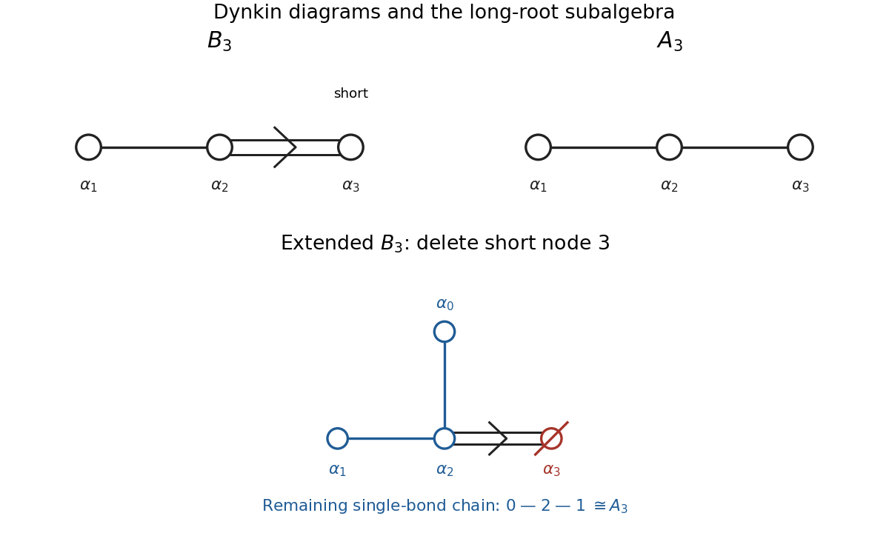
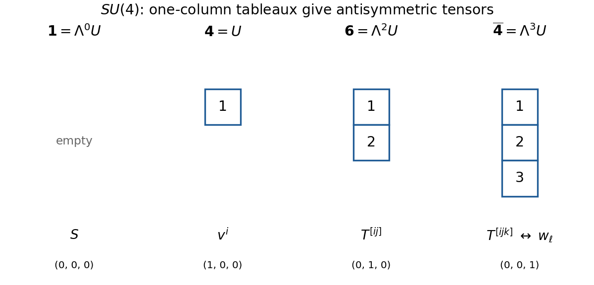

# 2018

↑ **Parent:** [Past exam of the groups and representations course of the University of Oxford](../past-exam-of-the-groups-and-representations-course-of-the-university-of-oxford.md)

Source paper: [Public Oxford source bundle, pages 104–106](https://www.whatdotheyknow.com/request/oxford_physics_past_papers_2/response/2340696/attach/6/Physics%20Papers%202017.pdf?cookie_passthrough=1). The bundle filename says 2017, but this paper's cover is dated 12 January 2018. The year follows the cover. All four questions are solved, including the optional choice.

**Table of contents**

- [1](#1)
  - [a](#1/a)
    - [Solution](#1/a/solution)
  - [b](#1/b)
    - [Solution](#1/b/solution)
  - [c](#1/c)
    - [Solution](#1/c/solution)
  - [d](#1/d)
    - [Solution](#1/d/solution)
  - [e](#1/e)
    - [Solution](#1/e/solution)
- [2](#2)
  - [a](#2/a)
    - [Solution](#2/a/solution)
  - [b](#2/b)
    - [Solution](#2/b/solution)
  - [c](#2/c)
    - [Solution](#2/c/solution)
  - [d](#2/d)
    - [Solution](#2/d/solution)
- [3](#3)
  - [a](#3/a)
    - [Solution](#3/a/solution)
  - [b](#3/b)
    - [Solution](#3/b/solution)
  - [c](#3/c)
    - [Solution](#3/c/solution)
  - [d](#3/d)
    - [Solution](#3/d/solution)
  - [e](#3/e)
    - [Solution](#3/e/solution)
- [4](#4)
  - [a](#4/a)
    - [Solution](#4/a/solution)
  - [b](#4/b)
    - [Solution](#4/b/solution)
  - [c](#4/c)
    - [Solution](#4/c/solution)
  - [d](#4/d)
    - [Solution](#4/d/solution)

## 1

↑ **Parent:** [2018](2018.md)

<h3 id="1/a">a</h3>

↑ **Parent:** [1](#1)

<h4 id="1/a/solution">Solution</h4>

↑ **Parent:** [A](#1/a)

A [group](../group.md) is a nonempty set $G$ with an operation $G\times G\to G$, $(g,h)\mapsto gh$, satisfying [associativity](../algebraic-operation.md#associative-property), an [identity element](../algebraic-operation.md#identity-element) $e$ with $eg=ge=g$, and an [inverse element](../algebraic-operation.md#inverse-element) $g^{-1}$ with $gg^{-1}=g^{-1}g=e$ for every $g$. These are the [group axioms](../group.md#group-axioms). An [Abelian group](../group.md#abelian-group) additionally satisfies $gh=hg$ for every pair. A [subgroup](../group.md#subgroup) is a subset that is itself a [group](../group.md) under the restricted operation; equivalently, it is nonempty and closed under $hk^{-1}$.

Let $R:G\to\operatorname{GL}(V)$ be a nonzero, finite-dimensional complex [irreducible representation](../representation-theory.md#irreducible-representation) of an [Abelian group](../group.md#abelian-group). For each fixed $g$, commutativity gives

$$
R(g)R(h)=R(h)R(g)\qquad(h\in G).
$$

Thus $R(g)$ is an [intertwining operator](../representation-theory.md#intertwining-operator) from $R$ to itself. By [Schur's lemma](../representation-theory.md#schur-s-lemma) over the [complex numbers](../complex-analysis.md#complex-number), $R(g)=\lambda_g I_V$. Every line in $V$ is therefore an [invariant subspace](../representation-theory.md#invariant-subspace). Since $R$ is [irreducible](../representation-theory.md#irreducible-representation), this forces

$$
\boxed{\dim_{\mathbb C}V=1.}
$$

This is the finite-dimensional convention used throughout the paper. Without it, the literal assertion for arbitrary [Abelian groups](../group.md#abelian-group) needs qualification. A concrete counterexample is $G=\mathbb C(t)^\times$ acting by multiplication on the complex [vector space](../vector-space.md) $V=\mathbb C(t)$ of [rational functions](../isolated-singularity.md#rational-function). Any nonzero invariant complex [vector subspace](../vector-space.md#vector-subspace) containing $f$ contains $gf$ for every nonzero rational $g$, hence contains every rational function. This is an infinite-dimensional [irreducible representation](../representation-theory.md#irreducible-representation). The scalar conclusion of [Schur's lemma](../representation-theory.md#schur-s-lemma) used above depends on finite dimensionality.

<h3 id="1/b">b</h3>

↑ **Parent:** [1](#1)

<h4 id="1/b/solution">Solution</h4>

↑ **Parent:** [B](#1/b)

The additive [cyclic group](../group.md#cyclic-group) $\mathbb Z_n$ is generated by $1$, with $n\cdot1=0$. Every complex [irreducible representation](../representation-theory.md#irreducible-representation) is one-dimensional by [a](#1/a). If $R(1)=z$, the defining relation requires $z^n=1$. Conversely each such [root of unity](../algebra.md#root-of-unity) defines a [group homomorphism](../group-theory.md#group-homomorphism). Hence the complete list is

$$
\boxed{\rho_k(g)=\exp\!\left(\frac{2\pi i kg}{n}\right),\qquad k=0,\ldots,n-1,\quad g\in\mathbb Z_n.}
$$

Changing the representative of $g$ changes the exponent by an integer multiple of $2\pi i$, so the formula is well-defined. These [representations](../representation-theory.md#group-representation) are pairwise inequivalent because their values on the generator differ. The case $k=0$ is the [trivial representation](../representation-theory.md#trivial-representation).

<h3 id="1/c">c</h3>

↑ **Parent:** [1](#1)

<h4 id="1/c/solution">Solution</h4>

↑ **Parent:** [C](#1/c)

Put $\alpha=e^{2\pi i/3}$, so $\alpha^3=1$ and $1+\alpha+\alpha^2=0$. Since the [group](../group.md) is [Abelian](../group.md#abelian-group), every [conjugacy class](../group-action.md#conjugacy-class) is a singleton. The [character table](../representation-theory.md#character-table) is

$$
\boxed{\begin{array}{c|ccc}
 &0&1&2\\\hline
\chi_0&1&1&1\\
\chi_1&1&\alpha&\alpha^2\\
\chi_2&1&\alpha^2&\alpha
\end{array}.}
$$

For the [character inner product](../representation-theory.md#character-inner-product), complex conjugation gives

$$
\langle\chi_j,\chi_k\rangle
=\frac13\sum_{g=0}^2\overline{\chi_j(g)}\chi_k(g)
=\frac13\left(1+\alpha^{k-j}+\alpha^{2(k-j)}\right).
$$

For $j=k$, all three summands are one, giving unit norm. For $k-j\equiv1\pmod3$ the sum is $1+\alpha+\alpha^2=0$; for $k-j\equiv2\pmod3$ it is $1+\alpha^2+\alpha=0$. This checks every distinct pair, proving

$$
\boxed{\langle\chi_j,\chi_k\rangle=\delta_{jk}.}
$$

<h3 id="1/d">d</h3>

↑ **Parent:** [1](#1)

<h4 id="1/d/solution">Solution</h4>

↑ **Parent:** [D](#1/d)

Use the two complementary [projection operators](../vector-space.md#projection-linear-algebra)

$$
P_+=\frac12\begin{pmatrix}1&1\\1&1\end{pmatrix},\qquad
P_-=\frac12\begin{pmatrix}1&-1\\-1&1\end{pmatrix}.
$$

They obey $P_++P_-=I_2$, $P_+P_-=0$ and $P_\pm^2=P_\pm$. The given [matrix](../vector-space.md#matrix) is $A=P_++\alpha P_-$, and consequently

$$
A^g=P_++\alpha^gP_-,\qquad A^3=I_2.
$$

It follows that multiplication of these [matrices](../vector-space.md#matrix) respects addition modulo three:

$$
R(g)R(h)=A^{g+h}=R(g+h\bmod3),\qquad R(0)=I_2.
$$

Thus this is a [group representation](../representation-theory.md#group-representation). The [eigenvectors](../linear-operator-theory.md#eigenvector) $(1,1)^T$ and $(1,-1)^T$ have [eigenvalues](../linear-operator-theory.md#eigenvalue) $1$ and $\alpha$, respectively. They span invariant lines carrying $\chi_0$ and $\chi_1$ in the convention of [c](#1/c), so

$$
\boxed{R\cong\rho_0\oplus\rho_1,\qquad \chi_R=(2,1+\alpha,1+\alpha^2).}
$$

The other nontrivial [irreducible representation](../representation-theory.md#irreducible-representation), $\rho_2$, is absent.

<h3 id="1/e">e</h3>

↑ **Parent:** [1](#1)

<h4 id="1/e/solution">Solution</h4>

↑ **Parent:** [E](#1/e)

The stated coordinate substitution splits the polynomial [basis](../vector-space.md#basis) into two three-cycles:

$$
x^2\longmapsto y^2\longmapsto z^2\longmapsto x^2,\qquad
xy\longmapsto yz\longmapsto xz\longmapsto xy.
$$

The identity fixes all six [basis vectors](../vector-space.md#basis-vector); neither nonidentity element fixes any. A [permutation representation](../representation-theory.md#permutation-representation) has [character](../representation-theory.md#character-of-a-representation) equal to the number of fixed [basis vectors](../vector-space.md#basis-vector), hence

$$
\boxed{\chi_{\widetilde R}(0)=6,\qquad
\chi_{\widetilde R}(1)=\chi_{\widetilde R}(2)=0.}
$$

The [representation multiplicity](../representation-theory.md#multiplicity-of-an-irreducible-representation) of each [irreducible character](../representation-theory.md#irreducible-character) is therefore

$$
m_k=\langle\chi_k,\chi_{\widetilde R}\rangle=\frac13\cdot6=2,
\qquad
\boxed{\widetilde R\cong2\rho_0\oplus2\rho_1\oplus2\rho_2.}
$$

An explicit [eigenbasis](../linear-operator-theory.md#eigenbasis) confirms the result. For $k=0,1,2$, put

$$
f_k=x^2+\alpha^{-k}y^2+\alpha^{-2k}z^2,\qquad
h_k=xy+\alpha^{-k}yz+\alpha^{-2k}xz.
$$

Then $\widetilde R(1)f_k=\alpha^kf_k$ and $\widetilde R(1)h_k=\alpha^kh_k$. Thus each three-cycle carries one copy of every [irreducible representation](../representation-theory.md#irreducible-representation). These signs use precisely the source's substitution action; taking an inverse substitution would interchange $\rho_1$ and $\rho_2$, leaving the total decomposition unchanged.

## 2

↑ **Parent:** [2018](2018.md)

<h3 id="2/a">a</h3>

↑ **Parent:** [2](#2)

<h4 id="2/a/solution">Solution</h4>

↑ **Parent:** [A](#2/a)

Write $s=g_1$ and $r=g_2$. Direct [matrix multiplication](../vector-space.md#matrix-multiplication) gives

$$
r^4=s^2=I_3,\qquad srs=r^{-1}.
$$

Every product reduces to $r^ks^\ell$, with $0\leq k<4$ and $0\leq\ell<2$. These eight [matrices](../vector-space.md#matrix) are distinct and are precisely the listed elements:

$$
g_3=r^2,\quad g_4=sr=r^{-1}s,\quad g_5=rs,\quad
 g_6=srs=r^{-1},\quad g_7=r^2s.
$$

This is the [dihedral group](../finite-group-theory.md#dihedral-group) of [group order](../group.md#order-of-a-finite-group) eight. Its element $r^2$ commutes with both generators. Conjugation by $s$ interchanges $r$ and $r^{-1}$, while conjugation by $r$ sends $s$ to $r^2s$. It also interchanges $rs$ and $r^{-1}s$. The resulting [conjugacy classes](../group-action.md#conjugacy-class) are

$$
\boxed{\{e\},\quad\{r^2\},\quad\{s,r^2s\},\quad
\{r,r^{-1}\},\quad\{sr,rs\}.}
$$

These are the stated $C_0,\ldots,C_4$ in order. To see that the last two reflection classes do not merge, conjugation changes the exponent in $r^ks$ by an even integer or changes its sign, preserving its parity. The five sets exhaust all eight elements.

Both generators are real [orthogonal matrices](../linear-algebra.md#orthogonal-matrix) with [determinant](../multilinear-algebra.md#determinant) $+1$. Hence every element obeys $g^\dagger g=I_3$ and $\det g=1$. The normal-form calculation establishes closure and inverses, so

$$
\boxed{G\leq SO(3)\leq SU(3).}
$$

In particular the embedding in the [special unitary group](../topological-group.md#special-unitary-group) uses the given real [matrices](../vector-space.md#matrix) viewed as complex ones.

<h3 id="2/b">b</h3>

↑ **Parent:** [2](#2)

<h4 id="2/b/solution">Solution</h4>

↑ **Parent:** [B](#2/b)

In a one-dimensional [representation](../representation-theory.md#group-representation), the relation $srs=r^{-1}$ implies $\rho(r)=\rho(r)^{-1}$, so $\rho(r)=\delta\in\{\pm1\}$. Independently $\rho(s)=\epsilon\in\{\pm1\}$. These give four [irreducible representations](../representation-theory.md#irreducible-representation)

$$
\chi_{\epsilon,\delta}(r^ks^\ell)=\delta^k\epsilon^\ell.
$$

A two-dimensional [representation](../representation-theory.md#group-representation) $E$ is obtained by restricting the given [matrices](../vector-space.md#matrix) to the $yz$ plane:

$$
E(r)=\begin{pmatrix}0&1\\-1&0\end{pmatrix},\qquad
E(s)=\begin{pmatrix}1&0\\0&-1\end{pmatrix}.
$$

The [eigenvalues](../linear-operator-theory.md#eigenvalue) of $E(r)$ are $i$ and $-i$. Its two [eigenlines](../linear-operator-theory.md#eigenline) are interchanged by $E(s)$, so neither is invariant under the whole [group](../group.md). Thus $E$ is a complex [irreducible representation](../representation-theory.md#irreducible-representation).

Taking [traces](../linear-algebra.md#matrix-trace) gives the [character table](../representation-theory.md#character-table), with class sizes included for the [character inner product](../representation-theory.md#character-inner-product):

$$
\boxed{\begin{array}{c|rrrrr}
 &C_0&C_1&C_2&C_3&C_4\\
|C_j|&1&1&2&2&2\\\hline
\chi_{+,+}&1&1&1&1&1\\
\chi_{+,-}&1&1&1&-1&-1\\
\chi_{-,+}&1&1&-1&1&-1\\
\chi_{-,-}&1&1&-1&-1&1\\
\chi_E&2&-2&0&0&0
\end{array}.}
$$

For example $\langle\chi_E,\chi_E\rangle=(4+4)/8=1$, and its inner product with each one-dimensional row is $(2-2)/8=0$. The four one-dimensional rows are mutually orthonormal by direct weighted summation. Their squared [dimensions](../vector-space.md#dimension-vector-space) sum to $4\cdot1^2+2^2=8=|G|$, and there are five rows for five [conjugacy classes](../group-action.md#conjugacy-class). This proves completeness of the list.

<h3 id="2/c">c</h3>

↑ **Parent:** [2](#2)

<h4 id="2/c/solution">Solution</h4>

↑ **Parent:** [C](#2/c)

The $x$ axis is an [invariant subspace](../representation-theory.md#invariant-subspace) on which $r$ acts as $+1$ and $s$ as $-1$. The $yz$ plane carries the [irreducible representation](../representation-theory.md#irreducible-representation) $E$ from [b](#2/b). Thus

$$
\boxed{R\cong\chi_{-,+}\oplus E,\qquad\chi_R=(3,-1,-1,1,-1).}
$$

The [character of a tensor product](../representation-theory.md#character-of-a-tensor-product) is the product of the [characters](../representation-theory.md#character-of-a-representation), so $\chi_{R\otimes R}=(9,1,1,1,1)$. Weighted [character inner products](../representation-theory.md#character-inner-product) give

$$
\boxed{R\otimes R\cong
2\chi_{+,+}\oplus\chi_{+,-}\oplus\chi_{-,+}\oplus\chi_{-,-}\oplus2E.}
$$

For the trivial [character](../representation-theory.md#character-of-a-representation), the multiplicity is $(9+1+2+2+2)/8=2$. For any other one-dimensional [character](../representation-theory.md#character-of-a-representation), the weighted sum over the nonidentity classes is $-1$, giving $(9-1)/8=1$. For $E$, it is $(9\cdot2-2)/8=2$.

Equivalently, $E\otimes E$ is the sum of all four one-dimensional [representations](../representation-theory.md#group-representation), and tensoring $E$ by $\chi_{-,+}$ gives the same two-dimensional [irreducible representation](../representation-theory.md#irreducible-representation). The [dimensions](../vector-space.md#dimension-vector-space) in the boxed decomposition sum to nine, as required.

<h3 id="2/d">d</h3>

↑ **Parent:** [2](#2)

<h4 id="2/d/solution">Solution</h4>

↑ **Parent:** [D](#2/d)

The defining [SU(3)](../topological-group.md#su-3-group) [representation](../representation-theory.md#group-representation) restricts to the given [matrix representation](../representation-theory.md#matrix-representation). All its restricted [matrices](../vector-space.md#matrix) are real, so the [conjugate representation](../representation-theory.md#conjugate-representation) restricts identically. Hence the first two [branchings](../lie-algebra.md#branching-rule) are

$$
\boxed{\mathbf3\downarrow_G=\chi_{-,+}\oplus E,\qquad
\overline{\mathbf3}\downarrow_G=\chi_{-,+}\oplus E.}
$$

For the [adjoint representation of SU(3)](../lie-algebra.md#adjoint-representation-of-su-3), use $\mathbf3\otimes\overline{\mathbf3}=\mathbf1\oplus\mathbf8$. This follows by splitting endomorphisms into scalar and traceless [matrices](../vector-space.md#matrix). Subtracting one trivial constituent from [c](#2/c) gives

$$
\boxed{\mathbf8\downarrow_G=
\chi_{+,+}\oplus\chi_{+,-}\oplus\chi_{-,+}\oplus\chi_{-,-}\oplus2E.}
$$

As an independent check, its restricted [character](../representation-theory.md#character-of-a-representation) is $|\chi_R|^2-1=(8,0,0,0,0)$, the [regular character](../representation-theory.md#regular-character) of $G$. Thus this is precisely the [regular representation](../representation-theory.md#regular-representation), whose [representation multiplicities](../representation-theory.md#multiplicity-of-an-irreducible-representation) equal the corresponding [dimensions](../vector-space.md#dimension-vector-space).

## 3

↑ **Parent:** [2018](2018.md)

<h3 id="3/a">a</h3>

↑ **Parent:** [3](#3)

<h4 id="3/a/solution">Solution</h4>

↑ **Parent:** [A](#3/a)

Differentiate the defining relation at $\Lambda=I+tX+O(t^2)$. The linear term gives the [Lie algebra](../lie-algebra.md)

$$
\mathfrak g=\{X\in M_3(\mathbb R):X^T\eta+\eta X=0\}.
$$

Solving this equation between [matrices](../vector-space.md#matrix) yields

$$
X=\begin{pmatrix}0&a&b\\a&0&-c\\b&c&0\end{pmatrix}
=aK_1+bK_2+cJ,
$$

where a convenient [basis](../vector-space.md#basis) is

$$
K_1=\begin{pmatrix}0&1&0\\1&0&0\\0&0&0\end{pmatrix},\qquad
K_2=\begin{pmatrix}0&0&1\\0&0&0\\1&0&0\end{pmatrix},\qquad
J=\begin{pmatrix}0&0&0\\0&0&-1\\0&1&0\end{pmatrix}.
$$

The first two generate [Lorentz boosts](../special-relativity.md#lorentz-boost) and the last a spatial [rotation](../riemannian-geometry.md#rotation-mathematics). Direct [commutators](../lie-algebra.md#commutator) give

$$
\boxed{[J,K_1]=K_2,\qquad[J,K_2]=-K_1,\qquad[K_1,K_2]=-J.}
$$

There are three independent real coefficients, so $\dim_{\mathbb R}\mathfrak g=3$. A [Cartan subalgebra](../semisimple-lie-algebra.md#cartan-subalgebra) is $\mathbb RJ$, and the [rank of a semisimple Lie algebra](../semisimple-lie-algebra.md#rank-of-a-semisimple-lie-algebra) is one. Explicitly, if $X=aK_1+bK_2+cJ$ and $Y=a'K_1+b'K_2+c'J$, their [commutator](../lie-algebra.md#commutator) vanishes exactly when

$$
bc'-cb'=ca'-ac'=ba'-ab'=0.
$$

For nonzero $X$, these equations force $Y$ to be proportional to $X$, so there is no two-dimensional commuting [subalgebra](../algebra-over-a-field.md#subalgebra). The split real rank is also one, realized by the semisimple [Lorentz boost](../special-relativity.md#lorentz-boost) generator $K_1$. Thus

$$
\boxed{\mathfrak g=\mathfrak{so}(1,2),\qquad\dim\mathfrak g=3,\qquad\operatorname{rank}\mathfrak g=1.}
$$

For this [Lorentz algebra in three spacetime dimensions](../special-relativity.md#lorentz-algebra-in-three-spacetime-dimensions), disconnected components of the full [Lorentz group](../special-relativity.md#lorentz-group) do not change its tangent [Lie algebra](../lie-algebra.md) at the identity.

<h3 id="3/b">b</h3>

↑ **Parent:** [3](#3)

<h4 id="3/b/solution">Solution</h4>

↑ **Parent:** [B](#3/b)

In the [complexification of a Lie algebra](../lie-algebra.md#complexification-of-a-lie-algebra), define

$$
L_1=iK_1,\qquad L_2=iK_2,\qquad L_3=J.
$$

The relations in [a](#3/a) become

$$
[L_1,L_2]=L_3,\qquad[L_2,L_3]=L_1,\qquad[L_3,L_1]=L_2.
$$

The [special unitary Lie algebra](../lie-algebra.md#special-unitary-lie-algebra) $\mathfrak{su}(2)$ has real [basis](../vector-space.md#basis) $S_i=-i\sigma_i/2$, where the [Pauli matrices](../algebra.md#pauli-matrices) satisfy $[\sigma_i,\sigma_j]=2i\epsilon_{ijk}\sigma_k$. Its [commutators](../lie-algebra.md#commutator) are the same: $[S_i,S_j]=\epsilon_{ijk}S_k$. The complex-linear map $L_i\mapsto S_i$ therefore preserves the bracket and maps a [basis](../vector-space.md#basis) to a [basis](../vector-space.md#basis). Consequently

$$
\boxed{\mathfrak{so}(1,2)_{\mathbb C}\cong\mathfrak{su}(2)_{\mathbb C}
\cong\mathfrak{sl}_2(\mathbb C).}
$$

The real [Lie algebras](../lie-algebra.md) are not isomorphic: multiplying the boosts by $i$ changes their real form. For example, the [Adjoint representation of a Lie algebra](../lie-algebra.md#adjoint-representation-of-a-lie-algebra) evaluated at $K_1$ has real [eigenvalues](../linear-operator-theory.md#eigenvalue) $0,1,-1$, whereas the corresponding nonzero compact [SU(2)](../topological-group.md#su-2-group) generators have purely imaginary adjoint [eigenvalues](../linear-operator-theory.md#eigenvalue).

Every complex [Lie algebra representation](../lie-algebra.md#lie-algebra-representation) of the real algebra extends uniquely by complex linearity to its [complexification of a Lie algebra](../lie-algebra.md#complexification-of-a-lie-algebra). The finite-dimensional complex [irreducible representations](../representation-theory.md#irreducible-representation) are therefore classified by a nonnegative integer [highest weight](../semisimple-lie-algebra.md#highest-weight-of-a-representation) $m$, just as for [SU(2)](../topological-group.md#su-2-group). There is one equivalence class for each

$$
\boxed{m=0,1,2,\ldots,\qquad \dim V_m=m+1=2j+1,\quad j=m/2.}
$$

These are statements about [Lie algebra representations](../lie-algebra.md#lie-algebra-representation). They do not assert positive-definite [unitarity](../vector-space.md#unitary-operator) for the noncompact real form, or automatic descent to the full [Lorentz group](../special-relativity.md#lorentz-group). In particular, half-integer $j$ gives a sign under a $2\pi$ spatial [rotation](../riemannian-geometry.md#rotation-mathematics), so its integration needs a covering [group](../group.md).

<h3 id="3/c">c</h3>

↑ **Parent:** [3](#3)

<h4 id="3/c/solution">Solution</h4>

↑ **Parent:** [C](#3/c)

Choose the following [Pauli matrix](../algebra.md#pauli-matrices) realization, with its spinor [basis](../vector-space.md#basis) fixed for the later [Dirac adjoint](../relativistic-quantum-field.md#dirac-adjoint):

$$
\boxed{r(K_1)=\frac{\sigma_3}{2}=\frac12\begin{pmatrix}1&0\\0&-1\end{pmatrix},\quad
r(K_2)=-\frac{\sigma_2}{2}=\frac12\begin{pmatrix}0&i\\-i&0\end{pmatrix},\quad
r(J)=-\frac{i\sigma_1}{2}=\frac12\begin{pmatrix}0&-i\\-i&0\end{pmatrix}.}
$$

The [Pauli matrix](../algebra.md#pauli-matrices) multiplication rule verifies

$$
[r(J),r(K_1)]=r(K_2),\qquad
[r(J),r(K_2)]=-r(K_1),\qquad
[r(K_1),r(K_2)]=-r(J).
$$

Extending linearly therefore gives a two-dimensional [Lie algebra representation](../lie-algebra.md#lie-algebra-representation). For an [irreducible representation](../representation-theory.md#irreducible-representation), it suffices to rule out an invariant line. Any such line would have to be an [eigenline](../linear-operator-theory.md#eigenline) of $r(K_1)$, whose two [eigenvalues](../linear-operator-theory.md#eigenvalue) are distinct. Those two coordinate lines are interchanged by $r(K_2)$, so neither is invariant. There is no proper nonzero [invariant subspace](../representation-theory.md#invariant-subspace).

This is a spinorial [representation](../representation-theory.md#group-representation) rather than a single-valued two-dimensional [representation](../representation-theory.md#group-representation) of the identity component of the specified orthogonal [group](../group.md):

$$
 e^{2\pi J}=I_3,\qquad e^{2\pi r(J)}=-I_2.
$$

The mismatch explicitly exhibits the need for the spin double cover. It causes no obstruction to the requested infinitesimal construction.

<h3 id="3/d">d</h3>

↑ **Parent:** [3](#3)

<h4 id="3/d/solution">Solution</h4>

↑ **Parent:** [D](#3/d)

The [Clifford algebra](../algebra-over-a-field.md#clifford-algebra) condition for signature $(-,+,+)$ is

$$
\{\gamma_\mu,\gamma_\nu\}=2\eta_{\mu\nu}I_2.
$$

Each [Pauli matrix](../algebra.md#pauli-matrices) squares to $I_2$, and distinct [Pauli matrices](../algebra.md#pauli-matrices) anticommute. Therefore the given choice obeys

$$
\gamma_0^2=(-i\sigma_1)^2=-I_2,\qquad
\gamma_1^2=\gamma_2^2=I_2,\qquad
\gamma_\mu\gamma_\nu+\gamma_\nu\gamma_\mu=0\quad(\mu\ne\nu).
$$

These check all diagonal and off-diagonal [anticommutators](../vector-space.md#anticommutator), proving

$$
\boxed{\{\gamma_\mu,\gamma_\nu\}=2\operatorname{diag}(-1,1,1)_{\mu\nu}I_2.}
$$

Thus they are viable three-dimensional [gamma matrices](../algebra-over-a-field.md#gamma-matrices). Their [Hermitian adjoints](../hilbert-space.md#adjoint-operator) satisfy $\gamma_0^\dagger=-\gamma_0$ and $\gamma_a^\dagger=\gamma_a$ for $a=1,2$. Two components are minimal: one-dimensional nonzero scalar [matrices](../vector-space.md#matrix) cannot anticommute while all having nonzero squares.

<h3 id="3/e">e</h3>

↑ **Parent:** [3](#3)

<h4 id="3/e/solution">Solution</h4>

↑ **Parent:** [E](#3/e)

The spinor [basis](../vector-space.md#basis) in [c](#3/c) is compatible with the supplied [gamma matrices](../algebra-over-a-field.md#gamma-matrices). The rotation generator $r(J)$ is anti-Hermitian and commutes with $\gamma_0=-i\sigma_1$. The two boost generators are [Hermitian matrices](../hilbert-space.md#hermitian-operator) and anticommute with $\gamma_0$. It follows separately for all three generators, and hence for every real $T\in\mathfrak{so}(1,2)$, that

$$
\boxed{r(T)^\dagger\gamma_0+\gamma_0r(T)=0.}
$$

For the infinitesimal [Lorentz transformation](../special-relativity.md#lorentz-transformation), $\delta\psi=r(T)\psi$ and $\delta\psi^\dagger=\psi^\dagger r(T)^\dagger$. Hence the [Dirac adjoint](../relativistic-quantum-field.md#dirac-adjoint) transforms contragrediently:

$$
\delta\overline\psi=\psi^\dagger r(T)^\dagger\gamma_0
=-\psi^\dagger\gamma_0r(T)=-\overline\psi\,r(T).
$$

The two contributions to the scalar variation cancel:

$$
\boxed{\delta(\overline\psi\psi)
=(\delta\overline\psi)\psi+\overline\psi\,\delta\psi=0.}
$$

This proves the [spinor invariant in three spacetime dimensions](../relativistic-quantum-field.md#spinor-invariant-in-three-spacetime-dimensions) has infinitesimal [Lorentz invariance](../special-relativity.md#lorentz-invariance). Real transformation parameters matter because the [Hermitian adjoint](../hilbert-space.md#adjoint-operator) conjugates coefficients; this is not an invariance under arbitrary complexified parameters. For ordinary commuting spinor components, the bilinear is purely imaginary in this mostly-plus convention, and multiplying it by $i$ gives a real invariant. Its reality is separate from its invariance.

## 4

↑ **Parent:** [2018](2018.md)

<h3 id="4/a">a</h3>

↑ **Parent:** [4](#4)

<h4 id="4/a/solution">Solution</h4>

↑ **Parent:** [A](#4/a)

Choose an orthonormal [basis](../vector-space.md#basis) $e_1,e_2,e_3$ in the real [Euclidean space](../normed-vector-space.md#euclidean-norm) containing the [root system](../semisimple-lie-algebra.md#root-system), and take [simple roots](../semisimple-lie-algebra.md#simple-root)

$$
\alpha_1=e_1-e_2,\qquad\alpha_2=e_2-e_3,\qquad\alpha_3=e_3.
$$

Their squared lengths are $2,2,1$. Use the [Cartan matrix](../semisimple-lie-algebra.md#cartan-matrix) convention $A_{ij}=2(\alpha_i,\alpha_j)/(\alpha_j,\alpha_j)$, with the denominator indexed by the column. Direct [inner products](../inner-product.md) give

$$
\boxed{A(B_3)=\begin{pmatrix}2&-1&0\\-1&2&-2\\0&-1&2\end{pmatrix},\qquad
A(A_3)=\begin{pmatrix}2&-1&0\\-1&2&-1\\0&-1&2\end{pmatrix}.}
$$

The [Dynkin diagram](../semisimple-lie-algebra.md#dynkin-diagram) of the [B3 root system](../semisimple-lie-algebra.md#b3-root-system) is a three-node chain with a single bond from node 1 to node 2 and a double bond from node 2 to the short node 3; the arrow points toward node 3. The [A3 root system](../semisimple-lie-algebra.md#a3-root-system) has a chain of three nodes joined by single bonds. A convention putting the row length in the denominator transposes the first displayed [Cartan matrix](../semisimple-lie-algebra.md#cartan-matrix).

For the [Extended Dynkin diagram](../semisimple-lie-algebra.md#extended-dynkin-diagram), the [highest root](../semisimple-lie-algebra.md#highest-root) is $\theta=e_1+e_2=\alpha_1+2\alpha_2+2\alpha_3$. Add $\alpha_0=-\theta$. Its only nonzero off-diagonal [inner product](../inner-product.md) among these [simple roots](../semisimple-lie-algebra.md#simple-root) is $(\alpha_0,\alpha_2)=-1$. Deleting the short node 3 leaves the chain $0-2-1$, with three equal-length [roots](../semisimple-lie-algebra.md#root-of-a-root-system), which is $A_3$.

**[Figure 1](#4/a/image-finite-dynkin-diagrams-and-the-long-root-subalgebra-of-the-extended-b3-diagram). Finite Dynkin diagrams and the long-root subalgebra of the extended B3 diagram**. Double-bond arrows point toward the short [root](../semisimple-lie-algebra.md#root-of-a-root-system). The extended [Dynkin diagram](../semisimple-lie-algebra.md#dynkin-diagram) adds $\alpha_0=-\theta$. Deleting node 3 leaves the blue chain $0-2-1$, of type $A_3$.

More concretely, the long [roots](../semisimple-lie-algebra.md#root-of-a-root-system) $\pm e_i\pm e_j$ form the [D3 root system](../semisimple-lie-algebra.md#d3-root-system), which is isomorphic to the [A3 root system](../semisimple-lie-algebra.md#a3-root-system). The corresponding [root spaces](../semisimple-lie-algebra.md#root-space) and [Cartan subalgebra](../semisimple-lie-algebra.md#cartan-subalgebra) generate

$$
\boxed{\mathfrak{su}(4)\cong\mathfrak{so}(6)\subset\mathfrak{so}(7)}
$$

for the compact real forms. At the matrix level the inclusion fixes one coordinate in seven-dimensional space. This establishes the required [Lie subalgebra](../lie-algebra.md#lie-subalgebra) inclusion; the associated global groups require the distinction explained in [d](#4/d).

<h3 id="4/b">b</h3>

↑ **Parent:** [4](#4)

<h4 id="4/b/solution">Solution</h4>

↑ **Parent:** [B](#4/b)

In the convention of [a](#4/a), the [fundamental weights](../semisimple-lie-algebra.md#fundamental-weight) are

$$
\omega_1=e_1,\qquad\omega_2=e_1+e_2,\qquad
\omega_3=\tfrac12(e_1+e_2+e_3).
$$

For a [weight](../semisimple-lie-algebra.md#weight-representation-theory) $w=(w_1,w_2,w_3)$ in this orthonormal coordinate system, its [Dynkin labels](../semisimple-lie-algebra.md#dynkin-label) are

$$
\boxed{a=(a_1,a_2,a_3)=(w_1-w_2,\ w_2-w_3,\ 2w_3).}
$$

These labels, rather than the orthonormal coordinates, are used below and in the projection in [c](#4/c).

The [highest weight](../semisimple-lie-algebra.md#highest-weight-of-a-representation) $(1,0,0)$ is $e_1$. Successive subtraction of the [simple roots](../semisimple-lie-algebra.md#simple-root) gives the complete string

$$
e_1\xrightarrow{-\alpha_1}e_2\xrightarrow{-\alpha_2}e_3
\xrightarrow{-\alpha_3}0\xrightarrow{-\alpha_3}-e_3
\xrightarrow{-\alpha_2}-e_2\xrightarrow{-\alpha_1}-e_1.
$$

The two consecutive short-root steps are allowed because $e_3$ has coroot pairing two with $\alpha_3$. The [weight system](../semisimple-lie-algebra.md#weight-system) of this seven-dimensional vector [representation](../representation-theory.md#group-representation) is therefore

$$
\boxed{\begin{array}{c|r}
w& (a_1,a_2,a_3)\\\hline
e_1&(1,0,0)\\
e_2&(-1,1,0)\\
e_3&(0,-1,2)\\
0&(0,0,0)\\
-e_3&(0,1,-2)\\
-e_2&(1,-1,0)\\
-e_1&(-1,0,0)
\end{array}.}
$$

All seven [weight multiplicities](../semisimple-lie-algebra.md#weight-multiplicity) are one, including the zero [weight](../semisimple-lie-algebra.md#weight-representation-theory).

The [highest weight](../semisimple-lie-algebra.md#highest-weight-of-a-representation) $(0,0,1)$ is $\omega_3$. The [Weyl group](../semisimple-lie-algebra.md#weyl-group) of the [B3 root system](../semisimple-lie-algebra.md#b3-root-system) acts by signed coordinate permutations. Its orbit is the eight cube vertices $w=(s_1e_1+s_2e_2+s_3e_3)/2$, with independent $s_i=\pm1$. Starting from $(+,+,+)$, lowering by $\alpha_3$, then $\alpha_2$, and then either $\alpha_1$ or $\alpha_3$ generates the middle branches; further lowering reaches all remaining sign choices. Thus the eight-dimensional [spin representation](../semisimple-lie-algebra.md#spin-representation) has

$$
\boxed{\begin{array}{c|r}
(s_1,s_2,s_3)&(a_1,a_2,a_3)\\\hline
(+,+,+)&(0,0,1)\\
(+,+,-)&(0,1,-1)\\
(+,-,+)&(1,-1,1)\\
(+,-,-)&(1,0,-1)\\
(-,+,+)&(-1,0,1)\\
(-,+,-)&(-1,1,-1)\\
(-,-,+)&(0,-1,1)\\
(-,-,-)&(0,0,-1)
\end{array}.}
$$

The stipulated unit [weight multiplicities](../semisimple-lie-algebra.md#weight-multiplicity) give dimensions seven and eight by counting these lists.

<h3 id="4/c">c</h3>

↑ **Parent:** [4](#4)

<h4 id="4/c/solution">Solution</h4>

↑ **Parent:** [C](#4/c)

For the [branching from B3 to A3](../lie-algebra.md#branching-from-b3-to-a3), apply the supplied [weight projection matrix](../lie-algebra.md#weight-projection-matrix) to column [vectors](../vector-space.md#vector) of [Dynkin labels](../semisimple-lie-algebra.md#dynkin-label). It sends

$$
\boxed{(a_1,a_2,a_3)^T\longmapsto(a_2,a_1,a_2+a_3)^T.}
$$

It is consistent with choosing the $A_3$ [simple roots](../semisimple-lie-algebra.md#simple-root) in the order $\beta_1=e_2-e_3$, $\beta_2=e_1-e_2$, $\beta_3=e_2+e_3$. Their [Dynkin diagram](../semisimple-lie-algebra.md#dynkin-diagram) is the chain $\beta_1-\beta_2-\beta_3$. Their coroot pairings are respectively $a_2,a_1,a_2+a_3$, explaining the projection without confusing labels and Euclidean coordinates.

The seven [weights](../semisimple-lie-algebra.md#weight-representation-theory) in [b](#4/b) project as

$$
\begin{array}{c|c}
B_3&A_3\\\hline
(1,0,0)&(0,1,0)\\
(-1,1,0)&(1,-1,1)\\
(0,-1,2)&(-1,0,1)\\
(0,0,0)&(0,0,0)\\
(0,1,-2)&(1,0,-1)\\
(1,-1,0)&(-1,1,-1)\\
(-1,0,0)&(0,-1,0)
\end{array}.
$$

The six nonzero [weights](../semisimple-lie-algebra.md#weight-representation-theory) form the [weight system](../semisimple-lie-algebra.md#weight-system) of the [SU(4)](../topological-group.md#su-4-group) [two-index antisymmetric representation](../semisimple-lie-algebra.md#two-index-antisymmetric-representation) of [highest weight](../semisimple-lie-algebra.md#highest-weight-of-a-representation) $(0,1,0)$. The zero [weight](../semisimple-lie-algebra.md#weight-representation-theory) is the remaining [singlet representation](../representation-theory.md#singlet-representation). Consequently

$$
\boxed{\mathbf7\downarrow_{A_3}=\mathbf6\oplus\mathbf1.}
$$

The eight spinor [weights](../semisimple-lie-algebra.md#weight-representation-theory) project as

$$
\begin{array}{c|c}
B_3&A_3\\\hline
(0,0,1)&(0,0,1)\\
(0,1,-1)&(1,0,0)\\
(1,-1,1)&(-1,1,0)\\
(1,0,-1)&(0,1,-1)\\
(-1,0,1)&(0,-1,1)\\
(-1,1,-1)&(1,-1,0)\\
(0,-1,1)&(-1,0,0)\\
(0,0,-1)&(0,0,-1)
\end{array}.
$$

The four [weights](../semisimple-lie-algebra.md#weight-representation-theory) $(1,0,0),(-1,1,0),(0,-1,1),(0,0,-1)$ constitute the defining [fundamental representation](../semisimple-lie-algebra.md#fundamental-representation) $\mathbf4$. The other four are their negatives, forming the [dual representation](../representation-theory.md#dual-representation) $\overline{\mathbf4}$ of [highest weight](../semisimple-lie-algebra.md#highest-weight-of-a-representation) $(0,0,1)$. Hence

$$
\boxed{\mathbf8\downarrow_{A_3}=\mathbf4\oplus\overline{\mathbf4}.}
$$

For the [Young tableaux](../representation-theory-of-the-symmetric-group.md#young-tableau) and [tensors](../multilinear-algebra.md#tensor), let $U=\mathbb C^4$ be the defining [SU(4)](../topological-group.md#su-4-group) [representation](../representation-theory.md#group-representation). The [singlet representation](../representation-theory.md#singlet-representation) is $\Lambda^0U$, with the empty [Young diagram](../representation-theory-of-the-symmetric-group.md#young-diagram) and a scalar. The other three [Young diagrams](../representation-theory-of-the-symmetric-group.md#young-diagram) are columns of one, two and three boxes, representing $U$, $\Lambda^2U$ and $\Lambda^3U$:

$$
\begin{array}{c|c|c|c}
\text{highest weight}&\text{representation}&\text{tensor}&\text{dimension}\\\hline
(0,0,0)&\mathbf1&S&1\\
(1,0,0)&\mathbf4&v^i&4\\
(0,1,0)&\mathbf6&T^{[ij]}&\binom42=6\\
(0,0,1)&\overline{\mathbf4}&T^{[ijk]}&\binom43=4
\end{array}.
$$

The square brackets indicate [tensor index antisymmetrization](../multilinear-algebra.md#tensor-index-antisymmetrization), with indices from 1 to 4. The invariant [Levi-Civita symbol](../multivariable-calculus.md#levi-civita-symbol) identifies the three-index [antisymmetric tensor](../multilinear-algebra.md#antisymmetric-tensor) with a covector, $w_\ell=\epsilon_{\ell ijk}T^{ijk}/3!$, explaining $\Lambda^3U\cong U^*$.

**[Figure 2](#4/c/image-young-tableaux-for-the-su4-representations-in-the-two-branchings). Young tableaux for the SU4 representations in the two branchings**. The empty [Young diagram](../representation-theory-of-the-symmetric-group.md#young-diagram) gives the [singlet representation](../representation-theory.md#singlet-representation); columns of one, two and three boxes give $\mathbf4$, $\mathbf6$ and $\overline{\mathbf4}$. Increasing entries down each column display a standard [Young tableau](../representation-theory-of-the-symmetric-group.md#young-tableau). The column determines complete [tensor index antisymmetrization](../multilinear-algebra.md#tensor-index-antisymmetrization).

<h3 id="4/d">d</h3>

↑ **Parent:** [4](#4)

<h4 id="4/d/solution">Solution</h4>

↑ **Parent:** [D](#4/d)

For the usual colour [SU(3)](../topological-group.md#su-3-group) fixing the fourth coordinate of the [SU(4)](../topological-group.md#su-4-group) defining [representation](../representation-theory.md#group-representation),

$$
\mathbf4\downarrow_{SU(3)}=\mathbf3\oplus\mathbf1,\qquad
\overline{\mathbf4}\downarrow_{SU(3)}=\overline{\mathbf3}\oplus\mathbf1.
$$

Taking the [exterior square](../multilinear-algebra.md#exterior-square) gives

$$
\Lambda^2(\mathbf3\oplus\mathbf1)=\Lambda^2\mathbf3\oplus\mathbf3
=\overline{\mathbf3}\oplus\mathbf3.
$$

The identification $\Lambda^2\mathbf3\cong\overline{\mathbf3}$ follows by contracting an [antisymmetric tensor](../multilinear-algebra.md#antisymmetric-tensor) with the invariant three-index [Levi-Civita symbol](../multivariable-calculus.md#levi-civita-symbol). Combining this with [c](#4/c) gives all colour [multiplets](../representation-theory.md#multiplet):

$$
\boxed{\mathbf7\downarrow_{SU(3)}=\mathbf3\oplus\overline{\mathbf3}\oplus\mathbf1,\qquad
\mathbf8\downarrow_{SU(3)}=\mathbf3\oplus\overline{\mathbf3}\oplus2\mathbf1.}
$$

A colour triplet has the [color charge](../standard-model.md#color-charge) transformation law of a [quark](../standard-model.md#quark), an antitriplet that of an [antiquark](../standard-model.md#antiquark), and a [colour singlet](../standard-model.md#colour-singlet) is colour-neutral, as a [lepton](../standard-model.md#lepton) is. Thus both parent [representations](../representation-theory.md#group-representation) permit quark-like and antiquark-like colour sectors; the vector has one neutral sector and the spinor two. These are colour assignments only. They do not determine particle [spin](../angular-momentum-operator.md#spin), statistics, [electric charge](../electric-charge.md), weak quantum numbers or a full generation of the [Standard Model](../standard-model.md). In a real parent field the conjugate colour sectors may describe one complex colour field and its conjugate, rather than independent particle species.

**Global group qualification.** The printed chain is correct at the [Lie algebra](../lie-algebra.md) level, $\mathfrak{su}(3)\subset\mathfrak{su}(4)\cong\mathfrak{so}(6)\subset\mathfrak{so}(7)$. Globally its simply connected form is $SU(3)\subset SU(4)\cong\operatorname{Spin}(6)\subset\operatorname{Spin}(7)$. The standard map of [SU(4)](../topological-group.md#su-4-group) into $SO(7)$ through $\mathbf6\oplus\mathbf1$ has a nontrivial [kernel](../kernel-of-a-linear-map.md): the concrete central element $-I_4$ acts as $+I_6$ on $\Lambda^2\mathbf4$ and trivially on the [singlet representation](../representation-theory.md#singlet-representation). Its image is $SO(6)\cong SU(4)/\{\pm I_4\}$, rather than an injective copy of [SU(4)](../topological-group.md#su-4-group) under this map.

The [global form obstruction for the Spin7 spinor](../semisimple-lie-algebra.md#global-form-obstruction-for-the-spin7-spinor) is explicit: the central element $-1$ of the [Spin group](../semisimple-lie-algebra.md#spin-group) $\operatorname{Spin}(7)$ maps to the identity in $SO(7)$ but acts as $-I_8$ on the eight-dimensional [spin representation](../semisimple-lie-algebra.md#spin-representation). Equivalently $-I_4$ acts as $-I$ on both $\mathbf4$ and $\overline{\mathbf4}$ in its restriction. Therefore the spinor does not descend to a genuine [SO(7)](../linear-algebra.md#so-7-group) [group representation](../representation-theory.md#group-representation). A theory containing that spinor needs the [Spin group](../semisimple-lie-algebra.md#spin-group) global form, or must understand the source's notation as specifying only its [Lie algebra](../lie-algebra.md). The displayed colour [branchings](../lie-algebra.md#branching-rule) remain valid with this correction.

## ↑ Ancestors (9)

1. [Past exam of the groups and representations course of the University of Oxford](../past-exam-of-the-groups-and-representations-course-of-the-university-of-oxford.md)
2. [Groups and representations course of the University of Oxford](../university-of-oxford.md#groups-and-representations-course-of-the-university-of-oxford)
3. [Year 4 of the mathematical and theoretical physics course of the University of Oxford](../university-of-oxford.md#year-4-of-the-mathematical-and-theoretical-physics-course-of-the-university-of-oxford)
4. [Mathematical and theoretical physics course of the University of Oxford](../university-of-oxford.md#mathematical-and-theoretical-physics-course-of-the-university-of-oxford)
5. [Undergraduate course of the University of Oxford](../university-of-oxford.md#undergraduate-course-of-the-university-of-oxford)
6. [Course of the University of Oxford](../university-of-oxford.md#course-of-the-university-of-oxford)
7. [University of Oxford](../university-of-oxford.md)
8. [List of universities](../README.md#list-of-universities)
9. [Codex Wiki](../README.md)
