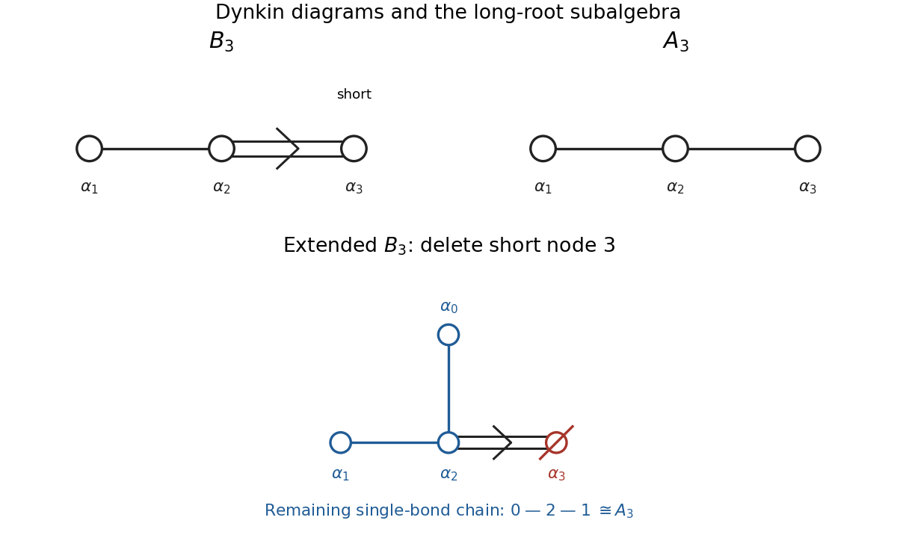

<h1 id="4/a/solution">Solution</h1>

↑ **Parent:** [A](../a.md)

Choose an orthonormal [basis](../../../../basis.md) $e_1,e_2,e_3$ in the real [Euclidean space](../../../../euclidean-norm.md) containing the [root system](../../../../root-system.md), and take [simple roots](../../../../simple-root.md)

$$
\alpha_1=e_1-e_2,\qquad\alpha_2=e_2-e_3,\qquad\alpha_3=e_3.
$$

Their squared lengths are $2,2,1$. Use the [Cartan matrix](../../../../cartan-matrix.md) convention $A_{ij}=2(\alpha_i,\alpha_j)/(\alpha_j,\alpha_j)$, with the denominator indexed by the column. Direct [inner products](../../../../inner-product-split.md) give

$$
\boxed{A(B_3)=\begin{pmatrix}2&-1&0\\-1&2&-2\\0&-1&2\end{pmatrix},\qquad
A(A_3)=\begin{pmatrix}2&-1&0\\-1&2&-1\\0&-1&2\end{pmatrix}.}
$$

The [Dynkin diagram](../../../../dynkin-diagram.md) of the [B3 root system](../../../../b3-root-system.md) is a three-node chain with a single bond from node 1 to node 2 and a double bond from node 2 to the short node 3; the arrow points toward node 3. The [A3 root system](../../../../a3-root-system.md) has a chain of three nodes joined by single bonds. A convention putting the row length in the denominator transposes the first displayed [Cartan matrix](../../../../cartan-matrix.md).

For the [Extended Dynkin diagram](../../../../extended-dynkin-diagram.md), the [highest root](../../../../highest-root.md) is $\theta=e_1+e_2=\alpha_1+2\alpha_2+2\alpha_3$. Add $\alpha_0=-\theta$. Its only nonzero off-diagonal [inner product](../../../../inner-product-split.md) among these [simple roots](../../../../simple-root.md) is $(\alpha_0,\alpha_2)=-1$. Deleting the short node 3 leaves the chain $0-2-1$, with three equal-length [roots](../../../../root-of-a-root-system.md), which is $A_3$.

**[Figure 1](#4/a/image-finite-dynkin-diagrams-and-the-long-root-subalgebra-of-the-extended-b3-diagram). Finite Dynkin diagrams and the long-root subalgebra of the extended B3 diagram**. Double-bond arrows point toward the short [root](../../../../root-of-a-root-system.md). The extended [Dynkin diagram](../../../../dynkin-diagram.md) adds $\alpha_0=-\theta$. Deleting node 3 leaves the blue chain $0-2-1$, of type $A_3$.

More concretely, the long [roots](../../../../root-of-a-root-system.md) $\pm e_i\pm e_j$ form the [D3 root system](../../../../d3-root-system.md), which is isomorphic to the [A3 root system](../../../../a3-root-system.md). The corresponding [root spaces](../../../../root-space.md) and [Cartan subalgebra](../../../../cartan-subalgebra.md) generate

$$
\boxed{\mathfrak{su}(4)\cong\mathfrak{so}(6)\subset\mathfrak{so}(7)}
$$

for the compact real forms. At the matrix level the inclusion fixes one coordinate in seven-dimensional space. This establishes the required [Lie subalgebra](../../../../lie-subalgebra.md) inclusion; the associated global groups require the distinction explained in [d](../d.md).

## ↑ Ancestors (12)

1. [A](../a.md)
2. [4](../../4.md)
3. [2018](../../../2018-split.md)
4. [Past exam of the groups and representations course of the University of Oxford](../../../split.md)
5. [Groups and representations course of the University of Oxford](../../../../groups-and-representations-course-of-the-university-of-oxford.md)
6. [Year 4 of the mathematical and theoretical physics course of the University of Oxford](../../../../year-4-of-the-mathematical-and-theoretical-physics-course-of-the-university-of-oxford.md)
7. [Mathematical and theoretical physics course of the University of Oxford](../../../../mathematical-and-theoretical-physics-course-of-the-university-of-oxford.md)
8. [Undergraduate course of the University of Oxford](../../../../undergraduate-course-of-the-university-of-oxford.md)
9. [Course of the University of Oxford](../../../../course-of-the-university-of-oxford.md)
10. [University of Oxford](../../../../university-of-oxford-split.md)
11. [List of universities](../../../../list-of-universities.md)
12. [Codex Wiki](../../../../split.md)
