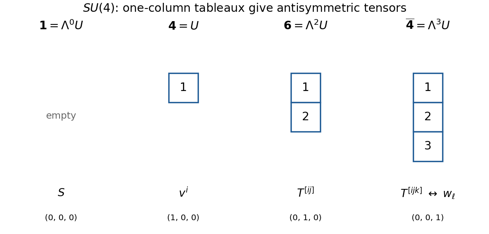

<h1 id="4/c/solution">Solution</h1>

↑ **Parent:** [C](../c.md)

For the [branching from B3 to A3](../../../../branching-from-b3-to-a3.md), apply the supplied [weight projection matrix](../../../../weight-projection-matrix.md) to column [vectors](../../../../vector.md) of [Dynkin labels](../../../../dynkin-label.md). It sends

$$
\boxed{(a_1,a_2,a_3)^T\longmapsto(a_2,a_1,a_2+a_3)^T.}
$$

It is consistent with choosing the $A_3$ [simple roots](../../../../simple-root.md) in the order $\beta_1=e_2-e_3$, $\beta_2=e_1-e_2$, $\beta_3=e_2+e_3$. Their [Dynkin diagram](../../../../dynkin-diagram.md) is the chain $\beta_1-\beta_2-\beta_3$. Their coroot pairings are respectively $a_2,a_1,a_2+a_3$, explaining the projection without confusing labels and Euclidean coordinates.

The seven [weights](../../../../weight-representation-theory.md) in [b](../b.md) project as

$$
\begin{array}{c|c}
B_3&A_3\\\hline
(1,0,0)&(0,1,0)\\
(-1,1,0)&(1,-1,1)\\
(0,-1,2)&(-1,0,1)\\
(0,0,0)&(0,0,0)\\
(0,1,-2)&(1,0,-1)\\
(1,-1,0)&(-1,1,-1)\\
(-1,0,0)&(0,-1,0)
\end{array}.
$$

The six nonzero [weights](../../../../weight-representation-theory.md) form the [weight system](../../../../weight-system.md) of the [SU(4)](../../../../su-4-group.md) [two-index antisymmetric representation](../../../../two-index-antisymmetric-representation.md) of [highest weight](../../../../highest-weight-of-a-representation.md) $(0,1,0)$. The zero [weight](../../../../weight-representation-theory.md) is the remaining [singlet representation](../../../../singlet-representation.md). Consequently

$$
\boxed{\mathbf7\downarrow_{A_3}=\mathbf6\oplus\mathbf1.}
$$

The eight spinor [weights](../../../../weight-representation-theory.md) project as

$$
\begin{array}{c|c}
B_3&A_3\\\hline
(0,0,1)&(0,0,1)\\
(0,1,-1)&(1,0,0)\\
(1,-1,1)&(-1,1,0)\\
(1,0,-1)&(0,1,-1)\\
(-1,0,1)&(0,-1,1)\\
(-1,1,-1)&(1,-1,0)\\
(0,-1,1)&(-1,0,0)\\
(0,0,-1)&(0,0,-1)
\end{array}.
$$

The four [weights](../../../../weight-representation-theory.md) $(1,0,0),(-1,1,0),(0,-1,1),(0,0,-1)$ constitute the defining [fundamental representation](../../../../fundamental-representation.md) $\mathbf4$. The other four are their negatives, forming the [dual representation](../../../../dual-representation.md) $\overline{\mathbf4}$ of [highest weight](../../../../highest-weight-of-a-representation.md) $(0,0,1)$. Hence

$$
\boxed{\mathbf8\downarrow_{A_3}=\mathbf4\oplus\overline{\mathbf4}.}
$$

For the [Young tableaux](../../../../young-tableau.md) and [tensors](../../../../tensor.md), let $U=\mathbb C^4$ be the defining [SU(4)](../../../../su-4-group.md) [representation](../../../../group-representation.md). The [singlet representation](../../../../singlet-representation.md) is $\Lambda^0U$, with the empty [Young diagram](../../../../young-diagram.md) and a scalar. The other three [Young diagrams](../../../../young-diagram.md) are columns of one, two and three boxes, representing $U$, $\Lambda^2U$ and $\Lambda^3U$:

$$
\begin{array}{c|c|c|c}
\text{highest weight}&\text{representation}&\text{tensor}&\text{dimension}\\\hline
(0,0,0)&\mathbf1&S&1\\
(1,0,0)&\mathbf4&v^i&4\\
(0,1,0)&\mathbf6&T^{[ij]}&\binom42=6\\
(0,0,1)&\overline{\mathbf4}&T^{[ijk]}&\binom43=4
\end{array}.
$$

The square brackets indicate [tensor index antisymmetrization](../../../../tensor-index-antisymmetrization.md), with indices from 1 to 4. The invariant [Levi-Civita symbol](../../../../levi-civita-symbol.md) identifies the three-index [antisymmetric tensor](../../../../antisymmetric-tensor.md) with a covector, $w_\ell=\epsilon_{\ell ijk}T^{ijk}/3!$, explaining $\Lambda^3U\cong U^*$.

**[Figure 2](#4/c/image-young-tableaux-for-the-su4-representations-in-the-two-branchings). Young tableaux for the SU4 representations in the two branchings**. The empty [Young diagram](../../../../young-diagram.md) gives the [singlet representation](../../../../singlet-representation.md); columns of one, two and three boxes give $\mathbf4$, $\mathbf6$ and $\overline{\mathbf4}$. Increasing entries down each column display a standard [Young tableau](../../../../young-tableau.md). The column determines complete [tensor index antisymmetrization](../../../../tensor-index-antisymmetrization.md).

## ↑ Ancestors (12)

1. [C](../c.md)
2. [4](../../4.md)
3. [2018](../../../2018-split.md)
4. [Past exam of the groups and representations course of the University of Oxford](../../../split.md)
5. [Groups and representations course of the University of Oxford](../../../../groups-and-representations-course-of-the-university-of-oxford.md)
6. [Year 4 of the mathematical and theoretical physics course of the University of Oxford](../../../../year-4-of-the-mathematical-and-theoretical-physics-course-of-the-university-of-oxford.md)
7. [Mathematical and theoretical physics course of the University of Oxford](../../../../mathematical-and-theoretical-physics-course-of-the-university-of-oxford.md)
8. [Undergraduate course of the University of Oxford](../../../../undergraduate-course-of-the-university-of-oxford.md)
9. [Course of the University of Oxford](../../../../course-of-the-university-of-oxford.md)
10. [University of Oxford](../../../../university-of-oxford-split.md)
11. [List of universities](../../../../list-of-universities.md)
12. [Codex Wiki](../../../../split.md)
