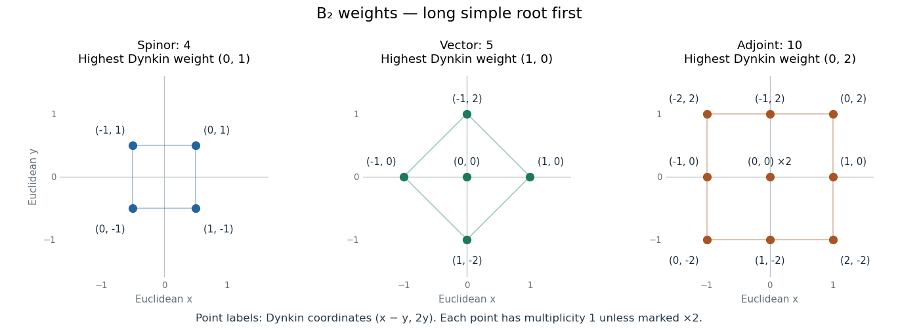

# 2019

↑ **Parent:** [Past exam of the groups and representations course of the University of Oxford](../past-exam-of-the-groups-and-representations-course-of-the-university-of-oxford.md)

Source paper: [https://www.whatdotheyknow.com/request/oxford_physics_past_papers_2/response/2340696/attach/7/Physics%20Papers%202018.pdf?cookie_passthrough=1](https://www.whatdotheyknow.com/request/oxford_physics_past_papers_2/response/2340696/attach/7/Physics%20Papers%202018.pdf?cookie_passthrough=1)

The annual bundle is named “Physics Papers 2018”, but this paper's cover is dated 11 January 2019. The year here follows the cover. All four questions are solved, although only three were required.

**Table of contents**

- [1](#1)
  - [a](#1/a)
    - [Solution](#1/a/solution)
  - [b](#1/b)
    - [Solution](#1/b/solution)
  - [c](#1/c)
    - [Solution](#1/c/solution)
  - [d](#1/d)
    - [Solution](#1/d/solution)
- [2](#2)
  - [a](#2/a)
    - [Solution](#2/a/solution)
  - [b](#2/b)
    - [Solution](#2/b/solution)
  - [c](#2/c)
    - [Solution](#2/c/solution)
  - [d](#2/d)
    - [Solution](#2/d/solution)
- [3](#3)
  - [a](#3/a)
    - [Solution](#3/a/solution)
  - [b](#3/b)
    - [Solution](#3/b/solution)
  - [c](#3/c)
    - [Solution](#3/c/solution)
  - [d](#3/d)
    - [Solution](#3/d/solution)
  - [e](#3/e)
    - [Solution](#3/e/solution)
- [4](#4)
  - [a](#4/a)
    - [Solution](#4/a/solution)
  - [b](#4/b)
    - [Solution](#4/b/solution)
  - [c](#4/c)
    - [Solution](#4/c/solution)
  - [d](#4/d)
    - [Solution](#4/d/solution)

## 1

↑ **Parent:** [2019](2019.md)

<h3 id="1/a">a</h3>

↑ **Parent:** [1](#1)

<h4 id="1/a/solution">Solution</h4>

↑ **Parent:** [A](#1/a)

A [subgroup](../group.md#subgroup) $N\leq G$ is a [normal subgroup](../group-theory.md#normal-subgroup) if $gNg^{-1}=N$ for every $g\in G$. A [group homomorphism](../group-theory.md#group-homomorphism) $f:G\to\widetilde G$ satisfies $f(gh)=f(g)f(h)$ for every $g,h\in G$. In particular $f(e)=\widetilde e$ and $f(g^{-1})=f(g)^{-1}$. A [group representation](../representation-theory.md#group-representation) on a [vector space](../vector-space.md) $V$ is a [group homomorphism](../group-theory.md#group-homomorphism) $R:G\to\operatorname{GL}(V)$ into the [general linear group](../group-theory.md#general-linear-group) of invertible [linear maps](../vector-space.md#linear-map) on $V$.

For the [kernel of a group homomorphism](../group-theory.md#kernel-of-a-group-homomorphism), put $K=\ker f=\{g:f(g)=\widetilde e\}$. It contains $e$, and if $k,\ell\in K$ then $f(k\ell^{-1})=f(k)f(\ell)^{-1}=\widetilde e$, so $K$ is a [subgroup](../group.md#subgroup). For $g\in G$ and $k\in K$,

$$
f(gkg^{-1})=f(g)f(k)f(g)^{-1}=\widetilde e.
$$

Thus $gKg^{-1}\subseteq K$. Applying this inclusion with $g^{-1}$ gives the reverse inclusion, proving that $\ker f$ is a [normal subgroup](../group-theory.md#normal-subgroup).

For a [normal subgroup](../group-theory.md#normal-subgroup) $N$, define multiplication of left [cosets](../group-theory.md#coset) by

$$
\boxed{(gN)(hN)=(gh)N.}
$$

To check independence of representatives, replace $g,h$ by $gn,hm$, with $n,m\in N$. Then

$$
(gn)(hm)=gh(h^{-1}nh)m\in ghN,
$$

because normality gives $h^{-1}nh\in N$. Hence the operation is well-defined. Associativity follows from $(gh)k=g(hk)$ in $G$; the identity is $N=eN$; and the inverse of $gN$ is $g^{-1}N$. These verify the [group axioms](../group.md#group-axioms), giving the [quotient group](../group-theory.md#quotient-group) $G/N$. The map $g\mapsto gN$ is a surjective [group homomorphism](../group-theory.md#group-homomorphism) with [kernel of a group homomorphism](../group-theory.md#kernel-of-a-group-homomorphism) equal to $N$.

<h3 id="1/b">b</h3>

↑ **Parent:** [1](#1)

<h4 id="1/b/solution">Solution</h4>

↑ **Parent:** [B](#1/b)

Nonzero scalar [matrices](../vector-space.md#matrix) form a [subgroup](../group.md#subgroup) $N$ of the [general linear group](../group-theory.md#general-linear-group), since products and inverses remain nonzero scalar [matrices](../vector-space.md#matrix). Moreover, for every invertible $g$,

$$
g(\lambda I_n)g^{-1}=\lambda I_n.
$$

Thus $N$ lies in the [center of a group](../group-theory.md#center-of-a-group) and is a [normal subgroup](../group-theory.md#normal-subgroup). The [quotient group](../group-theory.md#quotient-group) is the complex [projective linear group](../group-theory.md#projective-linear-group) $\operatorname{PGL}_n(\mathbb C)$, whose elements identify invertible [matrices](../vector-space.md#matrix) differing by a nonzero scalar.

The canonical [group homomorphism](../group-theory.md#group-homomorphism) $\pi:g\mapsto[g]$ obeys $[g][h]=[gh]$. Composing it with the given [group representation](../representation-theory.md#group-representation) gives

$$
\widetilde R(gh)=[R(gh)]=[R(g)R(h)]=[R(g)][R(h)]=\widetilde R(g)\widetilde R(h).
$$

Consequently

$$
\boxed{\widetilde R=\pi\circ R:G\longrightarrow\operatorname{PGL}_n(\mathbb C)\text{ is a group homomorphism}.}
$$

This is the [projective representation](../representation-theory.md#projective-representation) associated with $R$: a nonzero scalar acts trivially on each line in the [projective space](../projective-space.md) of $V$. Its [kernel of a group homomorphism](../group-theory.md#kernel-of-a-group-homomorphism) consists of those $g$ for which $R(g)$ is scalar, which can be larger than the [kernel of a group homomorphism](../group-theory.md#kernel-of-a-group-homomorphism) of $R$ itself.

<h3 id="1/c">c</h3>

↑ **Parent:** [1](#1)

<h4 id="1/c/solution">Solution</h4>

↑ **Parent:** [C](#1/c)

Write $A=g_1$, $B=g_2$ and $C=AB$. Direct multiplication gives

$$
A^2=B^2=I_2,\qquad BA=-AB,\qquad
C=\begin{pmatrix}0&1\\-1&0\end{pmatrix},\qquad C^2=-I_2.
$$

The relation $BA=-AB$ moves all occurrences of $A$ to the left of all occurrences of $B$. Removing even powers reduces every product of the generators to $\pm A^aB^b$ with $a,b\in\{0,1\}$. The resulting eight [matrices](../vector-space.md#matrix) are distinct, so

$$
\boxed{G=\{\pm I_2,\ \pm A,\ \pm B,\ \pm C\},\qquad |G|=8.}
$$

Explicitly, the four pairs are

$$
\pm\begin{pmatrix}1&0\\0&1\end{pmatrix},\quad
\pm\begin{pmatrix}1&0\\0&-1\end{pmatrix},\quad
\pm\begin{pmatrix}0&1\\1&0\end{pmatrix},\quad
\pm\begin{pmatrix}0&1\\-1&0\end{pmatrix}.
$$

Since $AB=-BA$ and $AB\ne0$, the [group](../group.md) is noncommutative. More precisely, $C$ has order four, $A$ has order two and $ACA=C^{-1}$, identifying $G$ with the [dihedral group](../finite-group-theory.md#dihedral-group) of a square. This fixes the convention unambiguously: it is the [dihedral group](../finite-group-theory.md#dihedral-group) of [group order](../group.md#order-of-a-finite-group) eight, irrespective of whether it is denoted $D_4$ or $D_8$.

<h3 id="1/d">d</h3>

↑ **Parent:** [1](#1)

<h4 id="1/d/solution">Solution</h4>

↑ **Parent:** [D](#1/d)

Use the [matrices](../vector-space.md#matrix) of [solution](#1/c/solution). Their projective classes satisfy $[-M]=[M]$, since $-I_2\in N$. The [group homomorphism](../group-theory.md#group-homomorphism) is therefore explicitly

$$
\boxed{\widetilde R(\pm I_2)=[I_2],\quad
\widetilde R(\pm A)=[A],\quad
\widetilde R(\pm B)=[B],\quad
\widetilde R(\pm C)=[C].}
$$

These four classes are distinct: the two diagonal representatives are not scalar multiples of one another, the two off-diagonal representatives are not scalar multiples of one another, and a diagonal representative cannot be a nonzero scalar multiple of an off-diagonal one.

Although $A$ and $B$ anticommute as [matrices](../vector-space.md#matrix), their projective classes commute:

$$
[A][B]=[AB]=[-BA]=[BA]=[B][A].
$$

Furthermore $[A]^2=[B]^2=[I_2]$ and $[C]^2=[-I_2]=[I_2]$. Thus every nonidentity element of the image has order two. An explicit [group isomorphism](../algebra.md#group-isomorphism) to the [Klein four-group](../finite-group-theory.md#klein-four-group) is

$$
\boxed{\operatorname{Im}\widetilde R\longrightarrow\mathbb Z_2\times\mathbb Z_2,
\qquad [A^aB^b]\longmapsto(a,b),\qquad a,b\in\{0,1\}.}
$$

Indeed reordering products introduces only a sign, which disappears in the [projective linear group](../group-theory.md#projective-linear-group), so this map turns multiplication into addition modulo two in each coordinate. Equivalently, $\ker\widetilde R=G\cap N=\{\pm I_2\}$ and the [first isomorphism theorem](../group-theory.md#first-isomorphism-theorem) gives

$$
G/\{\pm I_2\}\cong\operatorname{Im}\widetilde R\cong\mathbb Z_2\times\mathbb Z_2.
$$

This [projective image of the square symmetry group](../representation-theory.md#projective-image-of-the-square-symmetry-group) illustrates how a noncommutative [group](../group.md) can have an [Abelian](../group.md#abelian-group) projective image: its scalar commutator becomes the identity class.

## 2

↑ **Parent:** [2019](2019.md)

<h3 id="2/a">a</h3>

↑ **Parent:** [2](#2)

<h4 id="2/a/solution">Solution</h4>

↑ **Parent:** [A](#2/a)

Put $r=g_1=\operatorname{diag}(\alpha,\alpha^2)$ and $s=g_2$, using $\alpha^*=\alpha^{-1}=\alpha^2$. Then

$$
r^3=s^2=I_2,\qquad srs=r^{-1}.
$$

Every word can therefore be put in the form $r^k$ or $r^ks$, with $k=0,1,2$. These give six distinct [matrices](../vector-space.md#matrix):

$$
\boxed{\begin{aligned}
G=\bigg\{&\begin{pmatrix}1&0\\0&1\end{pmatrix},
\begin{pmatrix}\alpha&0\\0&\alpha^2\end{pmatrix},
\begin{pmatrix}\alpha^2&0\\0&\alpha\end{pmatrix},\\
&\begin{pmatrix}0&1\\1&0\end{pmatrix},
\begin{pmatrix}0&\alpha\\\alpha^2&0\end{pmatrix},
\begin{pmatrix}0&\alpha^2\\\alpha&0\end{pmatrix}\bigg\}.
\end{aligned}}
$$

The [group isomorphism](../algebra.md#group-isomorphism) $r\mapsto(123)$, $s\mapsto(12)$ identifies this [group](../group.md) with the [symmetric group](../finite-group-theory.md#symmetric-group) $S_3$, with [permutations](../combinatorics.md#permutation) composed from right to left.

Conjugation by $s$ exchanges $r,r^2$. Conjugation by $r$ cycles $s,rs,r^2s$, because $r(r^ks)r^{-1}=r^{k+2}s$. Their [conjugacy classes](../group-action.md#conjugacy-class) are

$$
\boxed{\{I_2\},\qquad\{r,r^2\},\qquad\{s,rs,r^2s\},}
$$

with sizes $1,2,3$. There is no mixing between them: their elements have orders one, three and two, respectively.

<h3 id="2/b">b</h3>

↑ **Parent:** [2](#2)

<h4 id="2/b/solution">Solution</h4>

↑ **Parent:** [B](#2/b)

The [matrix](../vector-space.md#matrix) $r$ has distinct [eigenvalues](../linear-operator-theory.md#eigenvalue) $\alpha,\alpha^2$. Any one-dimensional [invariant subspace](../representation-theory.md#invariant-subspace) for the defining [representation](../representation-theory.md#group-representation) would therefore have to be one of its two coordinate [eigenspaces](../linear-operator-theory.md#eigenspace). But $s$ exchanges those lines, so neither is invariant under the whole [group](../group.md). Hence $R_2$ is an [irreducible representation](../representation-theory.md#irreducible-representation) over the [complex numbers](../complex-analysis.md#complex-number).

There are three complex [irreducible representations](../representation-theory.md#irreducible-representation) up to [equivalence of group representations](../representation-theory.md#equivalence-of-group-representations), because there are three [conjugacy classes](../group-action.md#conjugacy-class). The [trivial representation](../representation-theory.md#trivial-representation) and the [sign representation](../representation-theory-of-the-symmetric-group.md#sign-representation) already give two inequivalent [one-dimensional representations](../representation-theory.md#one-dimensional-representation). Together with $R_2$, their [dimensions](../vector-space.md#dimension-vector-space) satisfy the [sum of squares of irreducible representation dimensions](../representation-theory.md#sum-of-squares-of-irreducible-representation-dimensions):

$$
\boxed{1^2+1^2+2^2=6=|G|,\qquad\text{dimensions }1,1,2.}
$$

Thus there are no further [irreducible representations](../representation-theory.md#irreducible-representation). Alternatively the [character](../representation-theory.md#character-of-a-representation) of $R_2$ is $(2,-1,0)$, and its [character inner product](../representation-theory.md#character-inner-product) with itself is $(4+2)/6=1$, independently confirming irreducibility.

<h3 id="2/c">c</h3>

↑ **Parent:** [2](#2)

<h4 id="2/c/solution">Solution</h4>

↑ **Parent:** [C](#2/c)

The [irreducible representations](../representation-theory.md#irreducible-representation) can all be specified on the generators:

$$
\boxed{\begin{array}{c|cc}
&R(r)&R(s)\\\hline
\mathbf1&1&1\\
\varepsilon&1&-1\\
R_2&\begin{pmatrix}\alpha&0\\0&\alpha^2\end{pmatrix}&\begin{pmatrix}0&1\\1&0\end{pmatrix}
\end{array}}
$$

The first is the [trivial representation](../representation-theory.md#trivial-representation) and the second is the [sign representation](../representation-theory-of-the-symmetric-group.md#sign-representation). To see directly that these exhaust the [one-dimensional representations](../representation-theory.md#one-dimensional-representation), their scalar images commute, so the relation $srs=r^{-1}$ forces $r=r^{-1}$. Combining $r^2=1$ with $r^3=1$ gives $r=1$, and then $s$ may be either sign.

Taking [traces](../linear-algebra.md#matrix-trace) gives the [character table](../representation-theory.md#character-table), in the [conjugacy class](../group-action.md#conjugacy-class) order of [solution](#2/a/solution):

$$
\boxed{\begin{array}{c|rrr}
&I_2&r&s\\\hline
\text{class size}&1&2&3\\\hline
\mathbf1&1&1&1\\
\varepsilon&1&1&-1\\
R_2&2&-1&0
\end{array}}
$$

Here $\alpha+\alpha^2=-1$ gives the middle entry in the last row. The weighted [character inner products](../representation-theory.md#character-inner-product) of distinct rows vanish, and the norm of each row is one. Together with [solution](#2/b/solution), this proves completeness of the table.

<h3 id="2/d">d</h3>

↑ **Parent:** [2](#2)

<h4 id="2/d/solution">Solution</h4>

↑ **Parent:** [D](#2/d)

Let $S=s=\begin{pmatrix}0&1\\1&0\end{pmatrix}$. Entrywise [complex conjugation](../complex-analysis.md#complex-conjugation) interchanges the diagonal entries of $r$ and fixes $s$, so

$$
SR_2(r)^*S^{-1}=R_2(r),\qquad SR_2(s)^*S^{-1}=R_2(s).
$$

Since $r,s$ generate the [group](../group.md), these identities hold for every element. Thus $S$ is an invertible [intertwiner](../representation-theory.md#intertwiner), proving

$$
\boxed{R_2^*\cong R_2.}
$$

The [character](../representation-theory.md#character-of-a-representation) of a [tensor product representation](../representation-theory.md#tensor-product-of-group-representations) is the product of the factor [characters](../representation-theory.md#character-of-a-representation). Hence $\chi_{R_2\otimes R_2}=(4,1,0)$. Its [character inner products](../representation-theory.md#character-inner-product) with the three rows of [solution](#2/c/solution) give multiplicities $(1,1,1)$, so

$$
\boxed{R_2\otimes R_2\cong\mathbf1\oplus\varepsilon\oplus R_2.}
$$

For explicit [Clebsch-Gordan decomposition of group representations](../representation-theory.md#clebsch-gordan-decomposition-of-group-representations) [bases](../vector-space.md#basis), let $e_+,e_-$ be the coordinate [basis](../vector-space.md#basis). The [symmetric tensor](../multilinear-algebra.md#symmetric-tensor) $e_+\otimes e_-+e_-\otimes e_+$ spans $\mathbf1$; the [antisymmetric tensor](../multilinear-algebra.md#antisymmetric-tensor) $e_+\otimes e_--e_-\otimes e_+$ spans $\varepsilon$; and the ordered pair $e_-\otimes e_-,e_+\otimes e_+$ carries $R_2$, since $r$ acts by $\operatorname{diag}(\alpha,\alpha^2)$ and $s$ exchanges them. In particular $S^2R_2=\mathbf1\oplus R_2$ and $\Lambda^2R_2=\varepsilon$.

Multiplying by the [sign representation](../representation-theory-of-the-symmetric-group.md#sign-representation) preserves the [character](../representation-theory.md#character-of-a-representation) of $R_2$, because its [character](../representation-theory.md#character-of-a-representation) is zero on all three reflections. Thus $\varepsilon\otimes R_2\cong R_2$, and associativity gives

$$
\begin{aligned}
R_2^{\otimes3}
&\cong(\mathbf1\oplus\varepsilon\oplus R_2)\otimes R_2\\
&\cong R_2\oplus R_2\oplus(\mathbf1\oplus\varepsilon\oplus R_2).
\end{aligned}
$$

Therefore

$$
\boxed{R_2\otimes R_2\otimes R_2\cong\mathbf1\oplus\varepsilon\oplus3R_2.}
$$

The [dimensions](../vector-space.md#dimension-vector-space) give $8=1+1+3\cdot2$. Its two one-dimensional summands can also be seen directly: $e_+^{\otimes3}+e_-^{\otimes3}$ and $e_+^{\otimes3}-e_-^{\otimes3}$ transform as $\mathbf1$ and $\varepsilon$, respectively.

## 3

↑ **Parent:** [2019](2019.md)

<h3 id="3/a">a</h3>

↑ **Parent:** [3](#3)

<h4 id="3/a/solution">Solution</h4>

↑ **Parent:** [A](#3/a)

For $z\in U(1)$ and $U\in SU(n)$, the [matrix](../vector-space.md#matrix) $zU$ is unitary, since $(zU)^\dagger(zU)=|z|^2U^\dagger U=I_n$. Thus the map has its image in the [unitary group](../topological-group.md#unitary-group) $U(n)$. Scalar [matrices](../vector-space.md#matrix) commute with all [matrices](../vector-space.md#matrix), so the [direct product of groups](../group-theory.md#direct-product-of-groups) multiplication gives

$$
f((z,U)(w,V))=f(zw,UV)=zwUV=(zU)(wV)=f(z,U)f(w,V).
$$

Also $f(1,I_n)=I_n$. Hence

$$
\boxed{f:U(1)\times SU(n)\longrightarrow U(n),\quad(z,U)\longmapsto zU\text{ is a group homomorphism}.}
$$

The [special unitary group](../topological-group.md#special-unitary-group) condition $\det U=1$ imposes no requirement that $zU$ itself have unit [determinant](../multilinear-algebra.md#determinant); its [determinant](../multilinear-algebra.md#determinant) is $z^n$, as expected for a general element of the [unitary group](../topological-group.md#unitary-group).

<h3 id="3/b">b</h3>

↑ **Parent:** [3](#3)

<h4 id="3/b/solution">Solution</h4>

↑ **Parent:** [B](#3/b)

First the [group homomorphism](../group-theory.md#group-homomorphism) is surjective. For any $W\in U(n)$, choose $z\in U(1)$ with $z^n=\det W$ and set $U=z^{-1}W$. Then $U$ is unitary and $\det U=z^{-n}\det W=1$, so $W=f(z,U)$.

Next $f(z,U)=I_n$ is equivalent to $U=z^{-1}I_n$, and the [special unitary group](../topological-group.md#special-unitary-group) condition becomes $z^n=1$. With $\zeta=e^{2\pi i/n}$, the [kernel of a group homomorphism](../group-theory.md#kernel-of-a-group-homomorphism) is therefore

$$
\boxed{K=\{(\zeta^k,\zeta^{-k}I_n):k=0,1,\ldots,n-1\}\cong\mathbb Z_n.}
$$

It is the cyclic central [subgroup](../group.md#subgroup) generated by $(\zeta,\zeta^{-1}I_n)$; the scalar and [special unitary group](../topological-group.md#special-unitary-group) factors are paired with inverse phases. The [first isomorphism theorem](../group-theory.md#first-isomorphism-theorem) now gives

$$
\boxed{U(n)\cong\big(U(1)\times SU(n)\big)/K.}
$$

Explicitly the isomorphism sends the [coset](../group-theory.md#coset) $[(z,U)]$ to $zU$. The $n$ possible choices of the root $z$ differ precisely by multiplication by elements of $K$, which explains why the product before quotienting is not a unique factorization.

<h3 id="3/c">c</h3>

↑ **Parent:** [3](#3)

<h4 id="3/c/solution">Solution</h4>

↑ **Parent:** [C](#3/c)

Use upper indices for the defining [representation](../representation-theory.md#group-representation) of [SU(6)](../topological-group.md#su-6) and lower indices for its [dual representation](../representation-theory.md#dual-representation). The [Young tableaux](../representation-theory-of-the-symmetric-group.md#young-tableau) below display tensor-slot labels; their shapes determine the [Young diagrams](../representation-theory-of-the-symmetric-group.md#young-diagram). Full columns of height six are [determinant representations](../representation-theory.md#determinant-representation) and can be removed for [SU(6)](../topological-group.md#su-6).

$$
\begin{array}{c|c|c|c|c}
\text{representation}&\text{Dynkin labels}&\text{tableau}&\text{tensor}&\dim\\\hline
\mathbf6&(1,0,0,0,0)&\boxed{1}&v^a&6\\[3pt]
\overline{\mathbf6}&(0,0,0,0,1)&\begin{array}{l}\boxed{1}\\[-3pt]\boxed{2}\\[-3pt]\boxed{3}\\[-3pt]\boxed{4}\\[-3pt]\boxed{5}\end{array}&w_a&6\\[3pt]
\mathbf{21}&(2,0,0,0,0)&\boxed{1}\boxed{2}&S^{(ab)}&21\\[3pt]
\mathbf{15}&(0,1,0,0,0)&\begin{array}{l}\boxed{1}\\[-3pt]\boxed{2}\end{array}&A^{[ab]}&15\\[3pt]
\mathbf{35}&(1,0,0,0,1)&\begin{array}{l}\boxed{1}\boxed{2}\\[-3pt]\boxed{3}\\[-3pt]\boxed{4}\\[-3pt]\boxed{5}\\[-3pt]\boxed{6}\end{array}&T^a{}_b,\ T^a{}_a=0&35
\end{array}
$$

Here all indices run from one to six. The [highest weight](../semisimple-lie-algebra.md#highest-weight-of-a-representation) [Dynkin labels](../semisimple-lie-algebra.md#dynkin-label) follow from the differences of successive row lengths. In the same order the row lengths are $(1)$, $(1,1,1,1,1)$, $(2)$, $(1,1)$ and $(2,1,1,1,1)$.

The defining [vector](../vector-space.md#vector) transforms as $v^a\mapsto U^a{}_bv^b$. For a [unitary representation](../representation-theory.md#unitary-representation), the [conjugate representation](../representation-theory.md#conjugate-representation) is equivalent to the [dual representation](../representation-theory.md#dual-representation), so $\overline{\mathbf6}$ can be written as a [covector](../dual-space.md#covector) with $w_a\mapsto w_b(U^{-1})^b{}_a$. Its five-box column is equivalently a totally [antisymmetric tensor](../multilinear-algebra.md#antisymmetric-tensor) $A^{a_1\cdots a_5}$, related by the invariant alternating [tensor](../multilinear-algebra.md#tensor) $w_a=\epsilon_{aa_1\cdots a_5}A^{a_1\cdots a_5}/5!$.

The [symmetric tensor](../multilinear-algebra.md#symmetric-tensor) transforms as $S^{ab}\mapsto U^a{}_cU^b{}_dS^{cd}$, with $6(6+1)/2=21$ independent components. The [antisymmetric tensor](../multilinear-algebra.md#antisymmetric-tensor) has the same transformation law but obeys $A^{ab}=-A^{ba}$, giving $6(6-1)/2=15$ independent components. For the [Adjoint representation](../lie-algebra.md#adjoint-representation-of-a-lie-algebra), $T\mapsto UTU^{-1}$; the [trace](../linear-algebra.md#matrix-trace) constraint removes one component from the $36$ entries of a mixed [tensor](../multilinear-algebra.md#tensor), leaving $35$. Its six-box [Young diagram](../representation-theory-of-the-symmetric-group.md#young-diagram) is obtained by converting the five-index column to a lower index and selecting the traceless mixed [tensor](../multilinear-algebra.md#tensor).

Thus the requested [dimensions](../vector-space.md#dimension-vector-space), in the order above, are

$$
\boxed{6,\quad6,\quad21,\quad15,\quad35.}
$$

<h3 id="3/d">d</h3>

↑ **Parent:** [3](#3)

<h4 id="3/d/solution">Solution</h4>

↑ **Parent:** [D](#3/d)

In this part the earlier variable $n$ specializes to six. A [group representation](../representation-theory.md#group-representation) of $U(1)\times SU(6)$ factors through the [quotient group](../group-theory.md#quotient-group) $U(6)$ exactly when the central [subgroup](../group.md#subgroup) $K$ in [solution](#3/b/solution) acts trivially. For an irreducible [SU(6)](../topological-group.md#su-6) [tensor](../multilinear-algebra.md#tensor) [representation](../representation-theory.md#group-representation) represented by a [Young diagram](../representation-theory-of-the-symmetric-group.md#young-diagram) with $b$ boxes, the scalar [matrix](../vector-space.md#matrix) $\zeta^{-1}I_6$ acts as $\zeta^{-b}$, where $\zeta=e^{2\pi i/6}$.

The prescribed [representation](../representation-theory.md#group-representation) $\widetilde R(z,U)=R(U)$ gives no compensating phase from the first factor. Its value on the generator of $K$ is therefore $R(\zeta^{-1}I_6)=\zeta^{-b}I$. The box counts in [solution](#3/c/solution) give

$$
\begin{array}{c|ccccc}
R&\mathbf6&\overline{\mathbf6}&\mathbf{21}&\mathbf{15}&\mathbf{35}\\\hline
b\pmod6&1&5&2&2&0\\
\widetilde R(\zeta,\zeta^{-1}I_6)&\zeta^{-1}I&\zeta I&\zeta^{-2}I&\zeta^{-2}I&I
\end{array}
$$

Consequently

$$
\boxed{\text{Among these prescribed lifts, only the adjoint }\mathbf{35}\text{ descends to }U(6).}
$$

Concretely, conjugation $T\mapsto WTW^{-1}$ defines it for every $W\in U(6)$, and the scalar phase cancels.

The qualification “prescribed lifts” matters. The defining [representation](../representation-theory.md#group-representation) of $U(6)$ certainly exists, but its pullback is $(z,U)\mapsto zU$, not $(z,U)\mapsto U$. For instance $(\zeta,\zeta^{-1}I_6)$ and $(1,I_6)$ represent the same quotient element, while the latter prescription assigns them different [matrices](../vector-space.md#matrix) in the defining [representation](../representation-theory.md#group-representation). More generally, for an integer $q$, a lift $z^qR(U)$ descends precisely when

$$
\boxed{q\equiv b\pmod6.}
$$

This [descent criterion for representations of U(n)](../representation-theory.md#descent-criterion-for-representations-of-u-n) explains how all the listed [SU(6)](../topological-group.md#su-6) [representations](../representation-theory.md#group-representation) can be extended after choosing a suitable first-factor [U(1) charge](../representation-theory.md#u-1-charge), even though only one descends with that charge fixed to zero.

<h3 id="3/e">e</h3>

↑ **Parent:** [3](#3)

<h4 id="3/e/solution">Solution</h4>

↑ **Parent:** [E](#3/e)

The first coordinate is fixed by the embedded [SU(5)](../topological-group.md#su-5), while the last five transform in its defining [representation](../representation-theory.md#group-representation). Therefore $\mathbf6\downarrow_{SU(5)}=\mathbf1\oplus\mathbf5$, and taking the [dual representation](../representation-theory.md#dual-representation) gives $\overline{\mathbf6}\downarrow_{SU(5)}=\mathbf1\oplus\overline{\mathbf5}$.

For the [symmetric square](../multilinear-algebra.md#symmetric-square), the fixed-fixed component is one [trivial representation](../representation-theory.md#trivial-representation), the fixed-five mixed components give $\mathbf5$, and the symmetric five-five block is $\mathbf{15}$. For the [exterior square](../multilinear-algebra.md#exterior-square), the fixed-fixed component vanishes, the mixed components give $\mathbf5$, and the antisymmetric five-five block is $\mathbf{10}$. Finally restrict $\mathbf{35}=\mathbf6\otimes\overline{\mathbf6}-\mathbf1$, using $\mathbf5\otimes\overline{\mathbf5}=\mathbf{24}\oplus\mathbf1$.

The five [SU6 tensor branchings to SU5](../representation-theory.md#su6-tensor-branchings-to-su5) are thus

$$
\boxed{\begin{aligned}
\mathbf6&\downarrow=\mathbf5\oplus\mathbf1,\\
\overline{\mathbf6}&\downarrow=\overline{\mathbf5}\oplus\mathbf1,\\
\mathbf{21}&\downarrow=\mathbf{15}\oplus\mathbf5\oplus\mathbf1,\\
\mathbf{15}&\downarrow=\mathbf{10}\oplus\mathbf5,\\
\mathbf{35}&\downarrow=\mathbf{24}\oplus\mathbf5\oplus\overline{\mathbf5}\oplus\mathbf1.
\end{aligned}}
$$

The symbols $\mathbf{15}$ on the left and right refer to different [groups](../group.md): the left-hand one is the [SU(6)](../topological-group.md#su-6) [exterior square](../multilinear-algebra.md#exterior-square), whereas the right-hand one is the [SU(5)](../topological-group.md#su-5) [symmetric square](../multilinear-algebra.md#symmetric-square). The [dimension](../vector-space.md#dimension-vector-space) checks are $6=5+1$, $21=15+5+1$, $15=10+5$ and $35=24+5+5+1$.

Explicitly, in the [Adjoint representation](../lie-algebra.md#adjoint-representation-of-a-lie-algebra) the lower-right traceless five-by-five block gives $\mathbf{24}$; the lower-left column and upper-right row give $\mathbf5$ and $\overline{\mathbf5}$; and the diagonal direction $\operatorname{diag}(-5,1,1,1,1,1)$ gives the remaining [trivial representation](../representation-theory.md#trivial-representation).

## 4

↑ **Parent:** [2019](2019.md)

<h3 id="4/a">a</h3>

↑ **Parent:** [4](#4)

<h4 id="4/a/solution">Solution</h4>

↑ **Parent:** [A](#4/a)

For a differentiable curve $Q(t)\in SO(5)$ with $Q(0)=I_5$, differentiate $Q(t)^TQ(t)=I_5$. Its tangent [matrix](../vector-space.md#matrix) $X=Q'(0)$ is real and satisfies $X^T+X=0$. Conversely the [matrix exponential](../linear-operator-theory.md#matrix-exponential) of any real [antisymmetric matrix](../linear-algebra.md#skew-symmetric-matrix) is orthogonal, and $\det e^{tX}=e^{t\operatorname{tr}X}=1$ because $\operatorname{tr}X=0$. Hence the real [Special orthogonal Lie algebra](../semisimple-lie-algebra.md#special-orthogonal-lie-algebra) is

$$
\boxed{\mathfrak{so}(5)=\{X\in M_5(\mathbb R):X^T=-X\},\qquad [X,Y]=XY-YX.}
$$

Let $E_{ab}$ denote a [matrix unit](../vector-space.md#matrix-unit). A simple real [basis](../vector-space.md#basis) is

$$
\boxed{M_{ab}=E_{ab}-E_{ba},\qquad 1\leq a<b\leq5.}
$$

Each independent entry above the diagonal supplies one real parameter, giving $\binom52=10$ parameters. The [commutator](../lie-algebra.md#commutator) of two [basis](../vector-space.md#basis) [matrices](../vector-space.md#matrix) is

$$
[M_{ab},M_{cd}]=\delta_{bc}M_{ad}-\delta_{ac}M_{bd}-\delta_{bd}M_{ac}+\delta_{ad}M_{bc},
$$

where $M_{ba}=-M_{ab}$ and $M_{aa}=0$.

A [Cartan subalgebra](../semisimple-lie-algebra.md#cartan-subalgebra) is spanned by the commuting [matrices](../vector-space.md#matrix) $M_{12},M_{34}$, which generate independent rotations in two orthogonal planes. A generic $h=aM_{12}+bM_{34}$, with $ab(a^2-b^2)\ne0$, has distinct complex [eigenvalues](../linear-operator-theory.md#eigenvalue) $ia,-ia,ib,-ib,0$. A real [antisymmetric matrix](../linear-algebra.md#skew-symmetric-matrix) commuting with it preserves those two planes and the remaining line; it is a multiple of the rotation in each plane and is zero on the line. Thus the commuting [Lie subalgebra](../lie-algebra.md#lie-subalgebra) has [dimension](../vector-space.md#dimension-vector-space) two and is maximal toral. Therefore

$$
\boxed{\dim_{\mathbb R}\mathfrak{so}(5)=10,\qquad\operatorname{rank}\mathfrak{so}(5)=2.}
$$

<h3 id="4/b">b</h3>

↑ **Parent:** [4](#4)

<h4 id="4/b/solution">Solution</h4>

↑ **Parent:** [B](#4/b)

Use the convention $A_{ij}=\langle\alpha_i,\alpha_j^\vee\rangle$, so the rows of the supplied [Cartan matrix](../semisimple-lie-algebra.md#cartan-matrix) are the [simple roots](../semisimple-lie-algebra.md#simple-root) in [Dynkin label](../semisimple-lie-algebra.md#dynkin-label) coordinates. Realize the [B2 root system](../semisimple-lie-algebra.md#b2-root-system) in an orthonormal plane by

$$
\alpha_1=e_1-e_2,\qquad\alpha_2=e_2,\qquad
\alpha_1^\vee=e_1-e_2,\qquad\alpha_2^\vee=2e_2.
$$

Thus the first [simple root](../semisimple-lie-algebra.md#simple-root) is long and the second is short. The [Dynkin diagram](../semisimple-lie-algebra.md#dynkin-diagram) has two nodes joined by a double bond, with its arrow pointing to the short node:

$$
\boxed{\underset{\alpha_1\ \mathrm{long}}{\circ}\;\Longrightarrow\;\underset{\alpha_2\ \mathrm{short}}{\circ}.}
$$

A Euclidean [weight](../semisimple-lie-algebra.md#weight-representation-theory) $w=xe_1+ye_2$ has [Dynkin labels](../semisimple-lie-algebra.md#dynkin-label)

$$
(a,b)=(x-y,2y),\qquad (x,y)=(a+b/2,b/2).
$$

In particular the [fundamental weights](../semisimple-lie-algebra.md#fundamental-weight) are $\omega_1=e_1$ and $\omega_2=(e_1+e_2)/2$. This long-first ordering is essential: sources that put the short [simple root](../semisimple-lie-algebra.md#simple-root) first interchange the two [Dynkin labels](../semisimple-lie-algebra.md#dynkin-label).

The [highest weight](../semisimple-lie-algebra.md#highest-weight-of-a-representation) $(0,1)$ is the [spinor representation](../semisimple-lie-algebra.md#spin-representation). Its Euclidean [weights](../semisimple-lie-algebra.md#weight-representation-theory) are $(\pm\tfrac12,\pm\tfrac12)$, whose [Dynkin labels](../semisimple-lie-algebra.md#dynkin-label) are

$$
\boxed{\mathbf4=(0,1):\quad(0,1),\ (1,-1),\ (-1,1),\ (0,-1).}
$$

A lowering chain subtracts $\alpha_2=(-1,2)$, then $\alpha_1=(2,-2)$, then $\alpha_2$ again, passing through these four [weights](../semisimple-lie-algebra.md#weight-representation-theory) in the displayed order. All [weight multiplicities](../semisimple-lie-algebra.md#weight-multiplicity) are one.

The [highest weight](../semisimple-lie-algebra.md#highest-weight-of-a-representation) $(1,0)$ is the defining [vector representation](../representation-theory.md#vector-representation), with Euclidean [weights](../semisimple-lie-algebra.md#weight-representation-theory) $e_1,e_2,0,-e_2,-e_1$. Thus

$$
\boxed{\mathbf5=(1,0):\quad(1,0),\ (-1,2),\ (0,0),\ (1,-2),\ (-1,0).}
$$

Here a lowering chain subtracts $\alpha_1,\alpha_2,\alpha_2,\alpha_1$. Each [weight multiplicity](../semisimple-lie-algebra.md#weight-multiplicity) is again one.

Finally $(0,2)$ is the [highest root](../semisimple-lie-algebra.md#highest-root) $e_1+e_2=\alpha_1+2\alpha_2$, giving the [Adjoint representation](../lie-algebra.md#adjoint-representation-of-a-lie-algebra). Its nonzero [weights](../semisimple-lie-algebra.md#weight-representation-theory) are the eight [roots](../semisimple-lie-algebra.md#root-of-a-root-system) $\pm e_1,\pm e_2,\pm(e_1-e_2),\pm(e_1+e_2)$. The [Cartan subalgebra](../semisimple-lie-algebra.md#cartan-subalgebra) supplies zero with [weight multiplicity](../semisimple-lie-algebra.md#weight-multiplicity) two, so

$$
\boxed{\mathbf{10}=(0,2):\quad
\pm(1,0),\quad\pm(-1,2),\quad\pm(2,-2),\quad\pm(0,2),\quad(0,0)^{[2]}.}
$$

The [dimensions](../vector-space.md#dimension-vector-space) are $4,5,10$. Independently the long-first [Weyl dimension formula](../semisimple-lie-algebra.md#weyl-dimension-formula) is

$$
\dim V(a,b)=\frac{(a+1)(b+1)(a+b+2)(2a+b+3)}6,
$$

which gives those same values. These are [Lie algebra](../lie-algebra.md) [representations](../representation-theory.md#group-representation); the four-dimensional [spinor representation](../semisimple-lie-algebra.md#spin-representation) integrates to the [Spin group](../semisimple-lie-algebra.md#spin-group) $\operatorname{Spin}(5)$, and does not descend to the [special orthogonal group](../linear-algebra.md#special-orthogonal-group) $SO(5)$. A concrete obstruction is a $2\pi$ rotation: it is the identity in $SO(5)$ but acts as $-I_4$ on the [spinor representation](../semisimple-lie-algebra.md#spin-representation), as verified in [solution](#4/d/solution).

**[Figure 1](#4/b/image-three-b2-weight-systems-in-the-long-first-convention-point-labels-are-dynkin-coordinates-and-geometric-positions-are-euclidean-weight-coordinates-the-adjoint-zero-weight-has-multiplicity-two). Three B2 weight systems in the long-first convention; point labels are Dynkin coordinates, and geometric positions are Euclidean weight coordinates. The adjoint zero weight has multiplicity two.**

<h3 id="4/c">c</h3>

↑ **Parent:** [4](#4)

<h4 id="4/c/solution">Solution</h4>

↑ **Parent:** [C](#4/c)

Let $r=V(0,1)$ be the four-dimensional [spinor representation](../semisimple-lie-algebra.md#spin-representation). The [tensor product representation](../representation-theory.md#tensor-product-of-group-representations) splits into its [symmetric square](../multilinear-algebra.md#symmetric-square) and [exterior square](../multilinear-algebra.md#exterior-square), with [dimensions](../vector-space.md#dimension-vector-space) ten and six. If $v$ is a [highest-weight vector](../semisimple-lie-algebra.md#highest-weight-vector) of $r$, then $v\otimes v$ is a [highest-weight vector](../semisimple-lie-algebra.md#highest-weight-vector) of [weight](../semisimple-lie-algebra.md#weight-representation-theory) $(0,2)$ in the [symmetric square](../multilinear-algebra.md#symmetric-square). The [irreducible representation](../representation-theory.md#irreducible-representation) with that [highest weight](../semisimple-lie-algebra.md#highest-weight-of-a-representation) has [dimension](../vector-space.md#dimension-vector-space) ten by [solution](#4/b/solution), exhausting the [symmetric square](../multilinear-algebra.md#symmetric-square):

$$
S^2r\cong V(0,2)=\mathbf{10}.
$$

For the [exterior square](../multilinear-algebra.md#exterior-square), add each pair of distinct [weights](../semisimple-lie-algebra.md#weight-representation-theory) from [solution](#4/b/solution). The resulting [multiset](../set.md#multiset) of [weights](../semisimple-lie-algebra.md#weight-representation-theory) is

$$
(1,0),\quad(-1,2),\quad(1,-2),\quad(-1,0),\quad(0,0)^{[2]}.
$$

Its maximal [weight](../semisimple-lie-algebra.md#weight-representation-theory) $(1,0)$ is the [highest weight](../semisimple-lie-algebra.md#highest-weight-of-a-representation) of a five-dimensional [irreducible representation](../representation-theory.md#irreducible-representation). It accounts for the four nonzero [weights](../semisimple-lie-algebra.md#weight-representation-theory) and one zero [weight](../semisimple-lie-algebra.md#weight-representation-theory), leaving a single zero [weight](../semisimple-lie-algebra.md#weight-representation-theory). By [complete reducibility of semisimple Lie algebra representations](../semisimple-lie-algebra.md#weyl-s-theorem-on-complete-reducibility), that remaining one-dimensional summand is the [trivial representation](../representation-theory.md#trivial-representation). Thus $\Lambda^2r\cong\mathbf5\oplus\mathbf1$, and the [spinor tensor square for so5](../semisimple-lie-algebra.md#spinor-tensor-square-for-so5) is

$$
\boxed{r\otimes r\cong V(0,0)\oplus V(1,0)\oplus V(0,2)
=\mathbf1\oplus\mathbf5\oplus\mathbf{10}.}
$$

The [dimension](../vector-space.md#dimension-vector-space) check is $16=1+5+10$. The [trivial representation](../representation-theory.md#trivial-representation) lies in the [exterior square](../multilinear-algebra.md#exterior-square), reflecting the invariant nondegenerate alternating [bilinear form](../bilinear-form.md) of this [pseudoreal representation](../representation-theory.md#pseudoreal-representation). Although $r$ itself does not descend to $SO(5)$, its [tensor square](../multilinear-algebra.md#tensor-square) does: the central element $-1\in\operatorname{Spin}(5)$ acts as $(-I_4)\otimes(-I_4)=I_{16}$.

<h3 id="4/d">d</h3>

↑ **Parent:** [4](#4)

<h4 id="4/d/solution">Solution</h4>

↑ **Parent:** [D](#4/d)

Use the [basis](../vector-space.md#basis) [matrices](../vector-space.md#matrix) $M_{ab}=E_{ab}-E_{ba}$ from [solution](#4/a/solution). Define the [Pauli matrices](../algebra.md#pauli-matrices) and the two-by-two identity by

$$
\sigma_1=\begin{pmatrix}0&1\\1&0\end{pmatrix},\qquad
\sigma_2=\begin{pmatrix}0&-i\\i&0\end{pmatrix},\qquad
\sigma_3=\begin{pmatrix}1&0\\0&-1\end{pmatrix},\qquad I=I_2.
$$

The following five [Hermitian](../hilbert-space.md#hermitian-operator) four-by-four [matrices](../vector-space.md#matrix), written as [Kronecker products](../vector-space.md#kronecker-product), realize a Euclidean [Clifford algebra](../algebra-over-a-field.md#clifford-algebra):

$$
\gamma_1=\sigma_1\otimes I,\quad
\gamma_2=\sigma_2\otimes I,\quad
\gamma_3=\sigma_3\otimes\sigma_1,\quad
\gamma_4=\sigma_3\otimes\sigma_2,\quad
\gamma_5=\sigma_3\otimes\sigma_3,
\qquad \gamma_a\gamma_b+\gamma_b\gamma_a=2\delta_{ab}I_4.
$$

Define the [Lie algebra representation](../lie-algebra.md#lie-algebra-representation) on $\mathbb C^4$ by

$$
\boxed{\rho(M_{ab})=\frac14[\gamma_a,\gamma_b]=\frac12\gamma_a\gamma_b\qquad(a<b).}
$$

These are [anti-Hermitian matrices](../linear-operator-theory.md#skew-hermitian-matrix), appropriate to the real compact [Lie algebra](../lie-algebra.md). For complete explicitness, all ten [representation](../representation-theory.md#group-representation) [matrices](../vector-space.md#matrix) are

$$
\boxed{\begin{array}{c|c||c|c}
M_{12}&\tfrac i2\sigma_3\otimes I&M_{13}&-\tfrac i2\sigma_2\otimes\sigma_1\\
M_{14}&-\tfrac i2\sigma_2\otimes\sigma_2&M_{15}&-\tfrac i2\sigma_2\otimes\sigma_3\\
M_{23}&\tfrac i2\sigma_1\otimes\sigma_1&M_{24}&\tfrac i2\sigma_1\otimes\sigma_2\\
M_{25}&\tfrac i2\sigma_1\otimes\sigma_3&M_{34}&\tfrac i2 I\otimes\sigma_3\\
M_{35}&-\tfrac i2 I\otimes\sigma_2&M_{45}&\tfrac i2 I\otimes\sigma_1
\end{array}}
$$

Each table entry is the image under $\rho$ of the [basis](../vector-space.md#basis) [matrix](../vector-space.md#matrix) immediately to its left. Since the two-by-two factors are specified above, these [Kronecker products](../vector-space.md#kronecker-product) specify every entry of each four-by-four [matrix](../vector-space.md#matrix).

To verify the [representation](../representation-theory.md#group-representation) law, the [Clifford algebra](../algebra-over-a-field.md#clifford-algebra) relations imply

$$
[\rho(M_{ab}),\gamma_c]=\delta_{bc}\gamma_a-\delta_{ac}\gamma_b.
$$

Apply this identity to $\rho(M_{cd})=\tfrac14[\gamma_c,\gamma_d]$ and use the [commutator product rule](../lie-algebra.md#commutator-product-rule). The result is

$$
[\rho(M_{ab}),\rho(M_{cd})]
=\delta_{bc}\rho(M_{ad})-\delta_{ac}\rho(M_{bd})
-\delta_{bd}\rho(M_{ac})+\delta_{ad}\rho(M_{bc}),
$$

exactly the [Lie bracket](../lie-algebra.md#lie-bracket) relation in [solution](#4/a/solution). Thus $\rho$ is a [Lie algebra representation](../lie-algebra.md#lie-algebra-representation).

It remains to identify its [highest weight](../semisimple-lie-algebra.md#highest-weight-of-a-representation), rather than just its [dimension](../vector-space.md#dimension-vector-space). The commuting [Hermitian](../hilbert-space.md#hermitian-operator) [Cartan subalgebra](../semisimple-lie-algebra.md#cartan-subalgebra) operators are

$$
-i\rho(M_{12})=\tfrac12\sigma_3\otimes I,\qquad
-i\rho(M_{34})=\tfrac12I\otimes\sigma_3.
$$

Their simultaneous [eigenvalues](../linear-operator-theory.md#eigenvalue) are $(x,y)=(\pm\tfrac12,\pm\tfrac12)$. Converting with $(a,b)=(x-y,2y)$ gives exactly the four [weights](../semisimple-lie-algebra.md#weight-representation-theory) of $V(0,1)$ in [solution](#4/b/solution). A state with $(x,y)=(\tfrac12,\tfrac12)$ has [highest weight](../semisimple-lie-algebra.md#highest-weight-of-a-representation) $(0,1)$, so this [Clifford realization of the so5 spin representation](../semisimple-lie-algebra.md#clifford-realization-of-the-so5-spin-representation) is the requested $r$.

Finally, $\rho(M_{12})^2=-I_4/4$, so

$$
\boxed{e^{2\pi\rho(M_{12})}=-I_4,\qquad e^{2\pi M_{12}}=I_5.}
$$

This explicitly exhibits the distinction between the [spinor representation](../semisimple-lie-algebra.md#spin-representation) of $\mathfrak{so}(5)$, or of $\operatorname{Spin}(5)$, and a single-valued [group representation](../representation-theory.md#group-representation) of $SO(5)$.

## ↑ Ancestors (9)

1. [Past exam of the groups and representations course of the University of Oxford](../past-exam-of-the-groups-and-representations-course-of-the-university-of-oxford.md)
2. [Groups and representations course of the University of Oxford](../university-of-oxford.md#groups-and-representations-course-of-the-university-of-oxford)
3. [Year 4 of the mathematical and theoretical physics course of the University of Oxford](../university-of-oxford.md#year-4-of-the-mathematical-and-theoretical-physics-course-of-the-university-of-oxford)
4. [Mathematical and theoretical physics course of the University of Oxford](../university-of-oxford.md#mathematical-and-theoretical-physics-course-of-the-university-of-oxford)
5. [Undergraduate course of the University of Oxford](../university-of-oxford.md#undergraduate-course-of-the-university-of-oxford)
6. [Course of the University of Oxford](../university-of-oxford.md#course-of-the-university-of-oxford)
7. [University of Oxford](../university-of-oxford.md)
8. [List of universities](../README.md#list-of-universities)
9. [Codex Wiki](../README.md)
