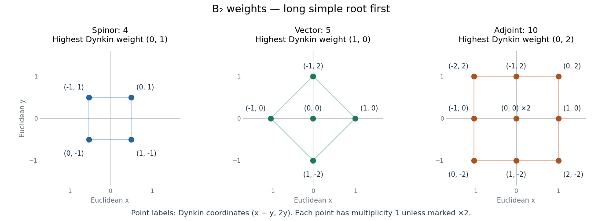

<h1 id="4/b/solution">Solution</h1>

↑ **Parent:** [B](../b.md)

Use the convention $A_{ij}=\langle\alpha_i,\alpha_j^\vee\rangle$, so the rows of the supplied [Cartan matrix](../../../../cartan-matrix.md) are the [simple roots](../../../../simple-root.md) in [Dynkin label](../../../../dynkin-label.md) coordinates. Realize the [B2 root system](../../../../b2-root-system.md) in an orthonormal plane by

$$
\alpha_1=e_1-e_2,\qquad\alpha_2=e_2,\qquad
\alpha_1^\vee=e_1-e_2,\qquad\alpha_2^\vee=2e_2.
$$

Thus the first [simple root](../../../../simple-root.md) is long and the second is short. The [Dynkin diagram](../../../../dynkin-diagram.md) has two nodes joined by a double bond, with its arrow pointing to the short node:

$$
\boxed{\underset{\alpha_1\ \mathrm{long}}{\circ}\;\Longrightarrow\;\underset{\alpha_2\ \mathrm{short}}{\circ}.}
$$

A Euclidean [weight](../../../../weight-representation-theory.md) $w=xe_1+ye_2$ has [Dynkin labels](../../../../dynkin-label.md)

$$
(a,b)=(x-y,2y),\qquad (x,y)=(a+b/2,b/2).
$$

In particular the [fundamental weights](../../../../fundamental-weight.md) are $\omega_1=e_1$ and $\omega_2=(e_1+e_2)/2$. This long-first ordering is essential: sources that put the short [simple root](../../../../simple-root.md) first interchange the two [Dynkin labels](../../../../dynkin-label.md).

The [highest weight](../../../../highest-weight-of-a-representation.md) $(0,1)$ is the [spinor representation](../../../../spin-representation.md). Its Euclidean [weights](../../../../weight-representation-theory.md) are $(\pm\tfrac12,\pm\tfrac12)$, whose [Dynkin labels](../../../../dynkin-label.md) are

$$
\boxed{\mathbf4=(0,1):\quad(0,1),\ (1,-1),\ (-1,1),\ (0,-1).}
$$

A lowering chain subtracts $\alpha_2=(-1,2)$, then $\alpha_1=(2,-2)$, then $\alpha_2$ again, passing through these four [weights](../../../../weight-representation-theory.md) in the displayed order. All [weight multiplicities](../../../../weight-multiplicity.md) are one.

The [highest weight](../../../../highest-weight-of-a-representation.md) $(1,0)$ is the defining [vector representation](../../../../vector-representation.md), with Euclidean [weights](../../../../weight-representation-theory.md) $e_1,e_2,0,-e_2,-e_1$. Thus

$$
\boxed{\mathbf5=(1,0):\quad(1,0),\ (-1,2),\ (0,0),\ (1,-2),\ (-1,0).}
$$

Here a lowering chain subtracts $\alpha_1,\alpha_2,\alpha_2,\alpha_1$. Each [weight multiplicity](../../../../weight-multiplicity.md) is again one.

Finally $(0,2)$ is the [highest root](../../../../highest-root.md) $e_1+e_2=\alpha_1+2\alpha_2$, giving the [Adjoint representation](../../../../adjoint-representation-of-a-lie-algebra.md). Its nonzero [weights](../../../../weight-representation-theory.md) are the eight [roots](../../../../root-of-a-root-system.md) $\pm e_1,\pm e_2,\pm(e_1-e_2),\pm(e_1+e_2)$. The [Cartan subalgebra](../../../../cartan-subalgebra.md) supplies zero with [weight multiplicity](../../../../weight-multiplicity.md) two, so

$$
\boxed{\mathbf{10}=(0,2):\quad
\pm(1,0),\quad\pm(-1,2),\quad\pm(2,-2),\quad\pm(0,2),\quad(0,0)^{[2]}.}
$$

The [dimensions](../../../../dimension-vector-space.md) are $4,5,10$. Independently the long-first [Weyl dimension formula](../../../../weyl-dimension-formula.md) is

$$
\dim V(a,b)=\frac{(a+1)(b+1)(a+b+2)(2a+b+3)}6,
$$

which gives those same values. These are [Lie algebra](../../../../lie-algebra-split.md) [representations](../../../../group-representation.md); the four-dimensional [spinor representation](../../../../spin-representation.md) integrates to the [Spin group](../../../../spin-group.md) $\operatorname{Spin}(5)$, and does not descend to the [special orthogonal group](../../../../special-orthogonal-group.md) $SO(5)$. A concrete obstruction is a $2\pi$ rotation: it is the identity in $SO(5)$ but acts as $-I_4$ on the [spinor representation](../../../../spin-representation.md), as verified in [solution](../d/solution.md).

**[Figure 1](#4/b/image-three-b2-weight-systems-in-the-long-first-convention-point-labels-are-dynkin-coordinates-and-geometric-positions-are-euclidean-weight-coordinates-the-adjoint-zero-weight-has-multiplicity-two). Three B2 weight systems in the long-first convention; point labels are Dynkin coordinates, and geometric positions are Euclidean weight coordinates. The adjoint zero weight has multiplicity two.**

## ↑ Ancestors (12)

1. [B](../b.md)
2. [4](../../4.md)
3. [2019](../../../2019-split.md)
4. [Past exam of the groups and representations course of the University of Oxford](../../../split.md)
5. [Groups and representations course of the University of Oxford](../../../../groups-and-representations-course-of-the-university-of-oxford.md)
6. [Year 4 of the mathematical and theoretical physics course of the University of Oxford](../../../../year-4-of-the-mathematical-and-theoretical-physics-course-of-the-university-of-oxford.md)
7. [Mathematical and theoretical physics course of the University of Oxford](../../../../mathematical-and-theoretical-physics-course-of-the-university-of-oxford.md)
8. [Undergraduate course of the University of Oxford](../../../../undergraduate-course-of-the-university-of-oxford.md)
9. [Course of the University of Oxford](../../../../course-of-the-university-of-oxford.md)
10. [University of Oxford](../../../../university-of-oxford-split.md)
11. [List of universities](../../../../list-of-universities.md)
12. [Codex Wiki](../../../../split.md)

## ← Incoming links (2)

- [Solution](../c/solution.md)
- [Solution](../d/solution.md)
