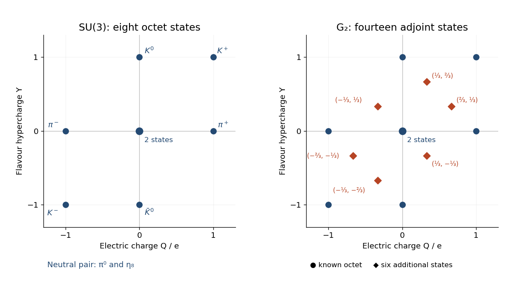

# 2021

↑ **Parent:** [Past exam of the groups and representations course of the University of Oxford](../past-exam-of-the-groups-and-representations-course-of-the-university-of-oxford.md)

Source paper: [https://www.whatdotheyknow.com/request/oxford_physics_past_papers_2/response/2340696/attach/9/Physics%20Papers%202020.pdf?cookie_passthrough=1](https://www.whatdotheyknow.com/request/oxford_physics_past_papers_2/response/2340696/attach/9/Physics%20Papers%202020.pdf?cookie_passthrough=1)

Standalone paper: [https://mmathphys.web.ox.ac.uk/sites/default/files/mmathphys/documents/media/gr_2021.pdf](https://mmathphys.web.ox.ac.uk/sites/default/files/mmathphys/documents/media/gr_2021.pdf)

The cover identifies Hilary Term 2021 but its date line says January 2020. The year here follows the term and the archived paper identity. Solutions cover all four questions.

**Table of contents**

- [1](#1)
  - [a](#1/a)
    - [Solution](#1/a/solution)
  - [b](#1/b)
    - [Solution](#1/b/solution)
  - [c](#1/c)
    - [Solution](#1/c/solution)
  - [d](#1/d)
    - [Solution](#1/d/solution)
  - [e](#1/e)
    - [Solution](#1/e/solution)
- [2](#2)
  - [a](#2/a)
    - [Solution](#2/a/solution)
  - [b](#2/b)
    - [Solution](#2/b/solution)
  - [c](#2/c)
    - [Solution](#2/c/solution)
  - [d](#2/d)
    - [Solution](#2/d/solution)
  - [e](#2/e)
    - [Solution](#2/e/solution)
- [3](#3)
  - [a](#3/a)
    - [Solution](#3/a/solution)
  - [b](#3/b)
    - [Solution](#3/b/solution)
  - [c](#3/c)
    - [Solution](#3/c/solution)
  - [d](#3/d)
    - [Solution](#3/d/solution)
  - [e](#3/e)
    - [Solution](#3/e/solution)
- [4](#4)
  - [a](#4/a)
    - [Solution](#4/a/solution)
  - [b](#4/b)
    - [Solution](#4/b/solution)
  - [c](#4/c)
    - [Solution](#4/c/solution)
  - [d](#4/d)
    - [Solution](#4/d/solution)

## 1

↑ **Parent:** [2021](2021.md)

<h3 id="1/a">a</h3>

↑ **Parent:** [1](#1)

<h4 id="1/a/solution">Solution</h4>

↑ **Parent:** [A](#1/a)

Let $T(v\otimes w)=w\otimes v$ on the [tensor product](../multilinear-algebra.md#tensor-product) $V\otimes V$. The [linear map](../vector-space.md#linear-map) $R(g)\otimes R(g)$ commutes with $T$, so preserves its $+1$ and $-1$ [eigenspaces](../linear-operator-theory.md#eigenspace), namely the [symmetric square](../multilinear-algebra.md#symmetric-square) $S^2V$ and the [exterior square](../multilinear-algebra.md#exterior-square) $\wedge^2V$. Restricting the [tensor product representation](../representation-theory.md#tensor-product-of-group-representations) to these [invariant subspaces](../representation-theory.md#invariant-subspace) defines $S^2R$ and $\wedge^2R$. The [representation](../representation-theory.md#group-representation) identity follows by restricting $(R(g)\otimes R(g))(R(h)\otimes R(h))=R(gh)\otimes R(gh)$.

For a [finite group](../group.md#finite-group), $g$ has finite order $m$, so $R(g)^m=I$. Over the [complex numbers](../complex-analysis.md#complex-number), the [polynomial](../polynomial.md) $t^m-1$ has distinct roots; hence $R(g)$ is [diagonalizable](../linear-operator-theory.md#diagonalizable-matrix). Choose an [eigenbasis](../linear-operator-theory.md#eigenbasis) $v_1,\ldots,v_n$ with [eigenvalues](../linear-operator-theory.md#eigenvalue) $\lambda_1,\ldots,\lambda_n$. A [basis](../vector-space.md#basis) of the [symmetric square](../multilinear-algebra.md#symmetric-square) consists of $v_i\otimes v_i$ and $v_i\otimes v_j+v_j\otimes v_i$ for $i<j$. A [basis](../vector-space.md#basis) of the [exterior square](../multilinear-algebra.md#exterior-square) consists of $v_i\otimes v_j-v_j\otimes v_i$ for $i<j$. Their [eigenvalues](../linear-operator-theory.md#eigenvalue) are respectively $\lambda_i^2,\lambda_i\lambda_j$ and $\lambda_i\lambda_j$. Taking [traces](../linear-algebra.md#matrix-trace),

$$
\chi_{S^2R}(g)=\sum_i\lambda_i^2+\sum_{i<j}\lambda_i\lambda_j,
\qquad \chi_{\wedge^2R}(g)=\sum_{i<j}\lambda_i\lambda_j.
$$

But $\chi(g)^2=\sum_i\lambda_i^2+2\sum_{i<j}\lambda_i\lambda_j$ and $\chi(g^2)=\sum_i\lambda_i^2$. Thus the [characters](../representation-theory.md#character-of-a-representation) are

$$
\boxed{\chi_{S^2R}(g)=\tfrac12[\chi(g)^2+\chi(g^2)],\qquad
\chi_{\wedge^2R}(g)=\tfrac12[\chi(g)^2-\chi(g^2)].}
$$

At $g=e$, these also give the [dimensions](../vector-space.md#dimension-vector-space) $n(n+1)/2$ and $n(n-1)/2$.

<h3 id="1/b">b</h3>

↑ **Parent:** [1](#1)

<h4 id="1/b/solution">Solution</h4>

↑ **Parent:** [B](#1/b)

Write the two [Pauli matrices](../algebra.md#pauli-matrices) as

$$
A=\begin{pmatrix}0&1\\1&0\end{pmatrix},\qquad
B=\begin{pmatrix}1&0\\0&-1\end{pmatrix},\qquad
C=AB=\begin{pmatrix}0&-1\\1&0\end{pmatrix}.
$$

They satisfy $A^2=B^2=I$, $BA=-AB$ and $C^2=-I$. Moving every $A$ to the left of every $B$ reduces each word to one of eight distinct [matrices](../vector-space.md#matrix). Consequently

$$
\boxed{G=\{I,-I,A,-A,B,-B,C,-C\},\qquad |G|=8.}
$$

Taking $r=C$, $s=A$ gives $r^4=s^2=I$ and $srs=r^{-1}$, identifying the [group](../group.md) with the [dihedral group](../finite-group-theory.md#dihedral-group) of a square.

The elements $\pm I$ are central. Conjugating $A$ by $B$ changes its sign, and similarly for $B$ and $C$. No conjugation mixes these pairs: modulo the central [subgroup](../group.md#subgroup) $\{\pm I\}$ the [quotient group](../group-theory.md#quotient-group) is the [Klein four-group](../finite-group-theory.md#klein-four-group) and hence [Abelian](../group.md#abelian-group). Thus the [conjugacy classes](../group-action.md#conjugacy-class) are precisely

$$
\boxed{\{I\},\quad\{-I\},\quad\{A,-A\},\quad\{B,-B\},\quad\{C,-C\}.}
$$

There are five complex [irreducible representations](../representation-theory.md#irreducible-representation), one for each [conjugacy class](../group-action.md#conjugacy-class). In a [one-dimensional representation](../representation-theory.md#one-dimensional-representation), the images of $A,B$ are signs $s,t\in\{1,-1\}$. Since they commute, $-I$ maps to $1$, and all four choices of $s,t$ satisfy the relations. These are four inequivalent [one-dimensional representations](../representation-theory.md#one-dimensional-representation). The [sum of squares of irreducible representation dimensions](../representation-theory.md#sum-of-squares-of-irreducible-representation-dimensions) leaves $8-4=4$ for the fifth, so the [dimensions](../vector-space.md#dimension-vector-space) are

$$
\boxed{1,1,1,1,2.}
$$

<h3 id="1/c">c</h3>

↑ **Parent:** [1](#1)

<h4 id="1/c/solution">Solution</h4>

↑ **Parent:** [C](#1/c)

Use the [conjugacy class](../group-action.md#conjugacy-class) order of [solution](#1/b/solution). The defining [representation](../representation-theory.md#group-representation) has [character](../representation-theory.md#character-of-a-representation)

$$
\boxed{\chi_\rho=(2,-2,0,0,0).}
$$

Its [character inner product](../representation-theory.md#character-inner-product) with itself is $(4+4)/8=1$, proving that it is an [irreducible representation](../representation-theory.md#irreducible-representation). There is also a direct [invariant subspace](../representation-theory.md#invariant-subspace) argument: $B$ has two distinct coordinate [eigenspaces](../linear-operator-theory.md#eigenspace), and $A$ exchanges them, so no line is invariant under both.

Let $L_{st}$ denote the [one-dimensional representation](../representation-theory.md#one-dimensional-representation) with $L_{st}(A)=s$ and $L_{st}(B)=t$. Then $L_{st}(-I)=1$ and $L_{st}(C)=st$. The complete [character table](../representation-theory.md#character-table) is

$$
\boxed{\begin{array}{c|rrrrr}
&I&-I&\pm A&\pm B&\pm C\\\hline
\text{class size}&1&1&2&2&2\\\hline
L_{++}&1&1&1&1&1\\
L_{+-}&1&1&1&-1&-1\\
L_{-+}&1&1&-1&1&-1\\
L_{--}&1&1&-1&-1&1\\
\rho&2&-2&0&0&0
\end{array}}
$$

The four scalar rows obey [character orthogonality](../representation-theory.md#character-orthogonality), and the [dimensions](../vector-space.md#dimension-vector-space) exhaust the [group order](../group.md#order-of-a-finite-group) as established in [solution](#1/b/solution).

<h3 id="1/d">d</h3>

↑ **Parent:** [1](#1)

<h4 id="1/d/solution">Solution</h4>

↑ **Parent:** [D](#1/d)

The squares of $I,-I,\pm A,\pm B$ are $I$, whereas $(\pm C)^2=-I$. Therefore $\chi_\rho(g^2)=(2,2,2,2,-2)$. The [symmetric square](../multilinear-algebra.md#symmetric-square) and [exterior square](../multilinear-algebra.md#exterior-square) formulas from [solution](#1/a/solution) give

$$
\boxed{\chi_{S^2\rho}=(3,3,1,1,-1),\qquad
\chi_{\wedge^2\rho}=(1,1,-1,-1,1).}
$$

Comparison with the [character table](../representation-theory.md#character-table) gives the [Clebsch-Gordan decomposition of group representations](../representation-theory.md#clebsch-gordan-decomposition-of-group-representations)

$$
\boxed{S^2\rho=L_{++}\oplus L_{+-}\oplus L_{-+},\qquad
\wedge^2\rho=L_{--}.}
$$

For explicit [bases](../vector-space.md#basis), put $e_1=(1,0)^T,e_2=(0,1)^T$. The [symmetric tensors](../multilinear-algebra.md#symmetric-tensor) $e_1\otimes e_1+e_2\otimes e_2$, $e_1\otimes e_2+e_2\otimes e_1$, and $e_1\otimes e_1-e_2\otimes e_2$ transform as $L_{++},L_{+-},L_{-+}$ respectively. The [antisymmetric tensor](../multilinear-algebra.md#antisymmetric-tensor) $e_1\otimes e_2-e_2\otimes e_1$ transforms as $L_{--}$, also the [determinant representation](../representation-theory.md#determinant-representation) of $\rho$. Adding these [direct sums](../vector-space.md#direct-sum) recovers $\rho\otimes\rho=\bigoplus_{s,t}L_{st}$.

<h3 id="1/e">e</h3>

↑ **Parent:** [1](#1)

<h4 id="1/e/solution">Solution</h4>

↑ **Parent:** [E](#1/e)

Write a homogeneous [quadratic polynomial](../polynomial.md#quadratic-polynomial) as $p(x,y)=ax^2+bxy+cy^2$. Invariance under $B:(x,y)\mapsto(x,-y)$ forces $b=0$. Invariance under $A:(x,y)\mapsto(y,x)$ then forces $a=c$. Since $A,B$ generate the [group](../group.md), this proves that all homogeneous quadratic [polynomial invariants](../representation-theory.md#polynomial-invariant) are

$$
\boxed{p(x,y)=a(x^2+y^2),\qquad a\in\mathbb C.}
$$

This agrees with the single [trivial representation](../representation-theory.md#trivial-representation) in the [symmetric square](../multilinear-algebra.md#symmetric-square) in [solution](#1/d/solution); more precisely, coordinate [polynomials](../polynomial.md) lie in the [symmetric square](../multilinear-algebra.md#symmetric-square) of the [dual representation](../representation-theory.md#dual-representation), which here is equivalent to $\rho$. If “quadratic” permits terms of smaller degree, arbitrary constants can be added. There are no invariant linear terms because $-I\in G$ negates every linear [polynomial](../polynomial.md).

## 2

↑ **Parent:** [2021](2021.md)

<h3 id="2/a">a</h3>

↑ **Parent:** [2](#2)

<h4 id="2/a/solution">Solution</h4>

↑ **Parent:** [A](#2/a)

The [symmetric group](../finite-group-theory.md#symmetric-group) $S_3$ has three [conjugacy classes](../group-action.md#conjugacy-class), determined by cycle type: the identity, three [transpositions](../combinatorics.md#transposition-permutation), and two three-cycles. Hence it has three complex [irreducible representations](../representation-theory.md#irreducible-representation). Two are the [trivial representation](../representation-theory.md#trivial-representation) $\mathbf1$ and the [sign representation](../representation-theory-of-the-symmetric-group.md#sign-representation) $\varepsilon$. Their [dimensions](../vector-space.md#dimension-vector-space) are one, so the [sum of squares of irreducible representation dimensions](../representation-theory.md#sum-of-squares-of-irreducible-representation-dimensions) gives $1+1+d^2=6$, whence $d=2$ for the remaining [representation](../representation-theory.md#group-representation) $D$.

Write $\chi_D=(2,a,b)$ on these classes. Orthogonality to $\mathbf1$ and $\varepsilon$ gives $2+3a+2b=0$ and $2-3a+2b=0$. Thus $a=0,b=-1$, and the [character table](../representation-theory.md#character-table) is

$$
\boxed{\begin{array}{c|rrr}
&e&(12)&(123)\\\hline
\text{class size}&1&3&2\\\hline
\mathbf1&1&1&1\\
\varepsilon&1&-1&1\\
D&2&0&-1
\end{array}}
$$

The [character](../representation-theory.md#character-of-a-representation) of a [tensor product representation](../representation-theory.md#tensor-product-of-group-representations) is the product of the factor [characters](../representation-theory.md#character-of-a-representation). Thus $\varepsilon^2=\mathbf1$, $\varepsilon\otimes D=D$, and $\chi_{D\otimes D}=(4,0,1)=\chi_{\mathbf1}+\chi_\varepsilon+\chi_D$. These determine all the [Clebsch-Gordan decomposition of group representations](../representation-theory.md#clebsch-gordan-decomposition-of-group-representations):

$$
\boxed{\begin{array}{c|ccc}
\otimes&\mathbf1&\varepsilon&D\\\hline
\mathbf1&\mathbf1&\varepsilon&D\\
\varepsilon&\varepsilon&\mathbf1&D\\
D&D&D&\mathbf1\oplus\varepsilon\oplus D
\end{array}}
$$

<h3 id="2/b">b</h3>

↑ **Parent:** [2](#2)

<h4 id="2/b/solution">Solution</h4>

↑ **Parent:** [B](#2/b)

For [permutations](../combinatorics.md#permutation) $\sigma,\tau$, the prescribed [linear maps](../vector-space.md#linear-map) satisfy

$$
R(\sigma)R(\tau)e_k=R(\sigma)e_{\tau(k)}=e_{\sigma(\tau(k))}=R(\sigma\tau)e_k.
$$

Since this holds on a [basis](../vector-space.md#basis), $R(\sigma)R(\tau)=R(\sigma\tau)$. Also $R(e)=I$ and $R(\sigma)^{-1}=R(\sigma^{-1})$. Hence $R$ is a [representation](../representation-theory.md#group-representation).

The [trace](../linear-algebra.md#matrix-trace) of a [permutation matrix](../vector-space.md#permutation-matrix) counts its fixed coordinate [basis vectors](../vector-space.md#basis-vector). There are respectively $3,1,0$ fixed vectors on the three [conjugacy classes](../group-action.md#conjugacy-class), so $\chi_R=(3,1,0)=\chi_{\mathbf1}+\chi_D$. Consequently

$$
\boxed{R=\mathbf1\oplus D.}
$$

In particular the [sign representation](../representation-theory-of-the-symmetric-group.md#sign-representation) is absent.

<h3 id="2/c">c</h3>

↑ **Parent:** [2](#2)

<h4 id="2/c/solution">Solution</h4>

↑ **Parent:** [C](#2/c)

The two [invariant subspaces](../representation-theory.md#invariant-subspace) are

$$
U_0=\mathbb C(1,1,1)^T,\qquad
U_2=\{(z_1,z_2,z_3)^T:z_1+z_2+z_3=0\}.
$$

Coordinate [permutations](../combinatorics.md#permutation) preserve both equal coordinates and the coordinate sum. Their [dimensions](../vector-space.md#dimension-vector-space) add to three and their intersection is zero, so $\mathbb C^3=U_0\oplus U_2$. On $U_0$, the [basis](../vector-space.md#basis) $u_0=(1,1,1)^T$ gives $R_{U_0}(\tau)=(1)$ for every [transposition](../combinatorics.md#transposition-permutation).

On $U_2$ choose the [basis](../vector-space.md#basis) $u=e_1-e_3$, $v=e_2-e_3$. Directly permuting their entries gives

$$
\begin{array}{c|cc}
\tau&R(\tau)u&R(\tau)v\\\hline
(12)&v&u\\
(13)&-u&v-u\\
(23)&u-v&-v
\end{array}
$$

Thus, taking images as columns, the [matrices](../vector-space.md#matrix) of the [matrix representation](../representation-theory.md#matrix-representation) are

$$
\boxed{D(12)=\begin{pmatrix}0&1\\1&0\end{pmatrix},\quad
D(13)=\begin{pmatrix}-1&-1\\0&1\end{pmatrix},\quad
D(23)=\begin{pmatrix}1&0\\-1&-1\end{pmatrix}.}
$$

Each has [trace](../linear-algebra.md#matrix-trace) zero and squares to $I$. Their three-cycle products have [trace](../linear-algebra.md#matrix-trace) $-1$, so this is exactly the two-dimensional [irreducible representation](../representation-theory.md#irreducible-representation) of [solution](#2/a/solution). These are all nonzero [invariant subspaces](../representation-theory.md#invariant-subspace) affording individual [irreducible representations](../representation-theory.md#irreducible-representation), since each occurs once in [solution](#2/b/solution).

<h3 id="2/d">d</h3>

↑ **Parent:** [2](#2)

<h4 id="2/d/solution">Solution</h4>

↑ **Parent:** [D](#2/d)

First choose the same orthonormal [basis](../vector-space.md#basis) for the left and right copies of the two-dimensional [unitary representation](../representation-theory.md#unitary-representation) $D$. Then the family [representation](../representation-theory.md#group-representation) is $F=D\oplus\varepsilon$. Because the barred [fermion](../tensor-product-of-quantum-systems.md#fermion) transforms with $F(g)^\dagger$ and the [scalar field](../classical-field-theory.md#scalar-field) $H$ is a [trivial representation](../representation-theory.md#trivial-representation), invariance of the [Yukawa interaction](../standard-model.md#yukawa-interaction) requires

$$
F(g)^\dagger\lambda F(g)=\lambda,
\quad\text{equivalently}\quad \lambda F(g)=F(g)\lambda
\qquad(g\in S_3).
$$

Write $\lambda$ in a $2+1$ block form. The off-diagonal blocks would be [intertwiners](../representation-theory.md#intertwiner) between inequivalent [irreducible representations](../representation-theory.md#irreducible-representation) $D$ and $\varepsilon$, so the [Schur lemma](../representation-theory.md#schur-s-lemma) makes them zero. The doublet block must be a scalar [matrix](../vector-space.md#matrix), while the singlet block is arbitrary. Therefore

$$
\boxed{\lambda=\begin{pmatrix}a&0&0\\0&a&0\\0&0&b\end{pmatrix},\qquad a,b\in\mathbb C.}
$$

Equivalently, the allowed [Yukawa interaction](../standard-model.md#yukawa-interaction) is $H[a(\bar\psi_L^1\psi_R^1+\bar\psi_L^2\psi_R^2)+b\bar\psi_L^3\psi_R^3]$, together with its [Hermitian conjugate](../hilbert-space.md#hermitian-conjugation) when constructing a real [Lagrangian](../calculus-of-variations.md#lagrangian). The [tensor product](../multilinear-algebra.md#tensor-product) rules explain the two free parameters: both $D^*\otimes D$ and $\varepsilon^*\otimes\varepsilon$ contain one [trivial representation](../representation-theory.md#trivial-representation), while the mixed products contain none.

There is a useful [basis](../vector-space.md#basis) qualification. The [basis](../vector-space.md#basis) used in [solution](#2/c/solution) is not orthonormal: its [Gram matrix](../inner-product.md#gram-matrix) is $K=\begin{pmatrix}2&1\\1&2\end{pmatrix}$, and $D(g)^\dagger KD(g)=K$. If the fields are expressed in exactly those coordinates, with the barred components defined by ordinary conjugate transpose, the invariant doublet coefficient is $aK$, rather than $aI_2$. Canonically normalizing the [kinetic term](../classical-field-theory.md#kinetic-term) returns the boxed form. Independently chosen left and right orthonormal [bases](../vector-space.md#basis) replace $aI_2$ by $aS$, where $S$ is their fixed unitary [intertwiner](../representation-theory.md#intertwiner); the physical degeneracy is unchanged.

<h3 id="2/e">e</h3>

↑ **Parent:** [2](#2)

<h4 id="2/e/solution">Solution</h4>

↑ **Parent:** [E](#2/e)

After the [scalar field](../classical-field-theory.md#scalar-field) obtains a [vacuum expectation value](../quantum-field-theory.md#vacuum-expectation-value) $h$, the [fermion mass matrix](../standard-model.md#fermion-mass-matrix) in a canonically normalized [basis](../vector-space.md#basis) is $M=h\lambda$. Physical [masses](../classical-mechanics.md#mass) are its [singular values](../linear-algebra.md#singular-value), not arbitrary entries or signed [eigenvalues](../linear-operator-theory.md#eigenvalue). Thus

$$
\boxed{m_e=m_\mu=|ha|,\qquad m_\tau=|hb|.}
$$

The independent [Yukawa coupling](../standard-model.md#yukawa-interaction) $b$ can fit the [tau lepton](../standard-model.md#tau-particle) [mass](../classical-mechanics.md#mass) relative to the doublet scale, but the [electron](../physics.md#electron) and [muon](../standard-model.md#muon) are predicted to have equal [masses](../classical-mechanics.md#mass). The values supplied by the paper instead give $m_\mu/m_e\simeq105.7/0.511\simeq207$. Consequently exact unbroken $S_3$ with this [representation](../representation-theory.md#group-representation) assignment cannot reproduce all three [masses](../classical-mechanics.md#mass). Complex phases of $a,b$, or changes of [basis](../vector-space.md#basis), cannot split the two equal [singular values](../linear-algebra.md#singular-value). Additional breaking of the [symmetry](../physics.md#symmetry-physics) or a different field content would be needed; the discrepancy cannot be removed merely by choosing different invariant [Yukawa couplings](../standard-model.md#yukawa-interaction).

## 3

↑ **Parent:** [2021](2021.md)

<h3 id="3/a">a</h3>

↑ **Parent:** [3](#3)

<h4 id="3/a/solution">Solution</h4>

↑ **Parent:** [A](#3/a)

Use [Dynkin labels](../semisimple-lie-algebra.md#dynkin-label) $w_i=\langle w,\alpha_i^\vee\rangle$, so the rows of the [Cartan matrix](../semisimple-lie-algebra.md#cartan-matrix) are the [simple roots](../semisimple-lie-algebra.md#simple-root) expressed in [fundamental weight](../semisimple-lie-algebra.md#fundamental-weight) coordinates. For the [A2 root system](../semisimple-lie-algebra.md#a2-root-system),

$$
\boxed{A_{A_2}=\begin{pmatrix}2&-1\\-1&2\end{pmatrix},\qquad
\alpha_1=(2,-1),\quad\alpha_2=(-1,2).}
$$

Starting at the [highest weight](../semisimple-lie-algebra.md#highest-weight-of-a-representation) $(1,0)$ and subtracting successive allowed [simple roots](../semisimple-lie-algebra.md#simple-root) gives $(1,0)\to(-1,1)\to(0,-1)$. Negating these [weights](../semisimple-lie-algebra.md#weight-representation-theory) gives the [dual representation](../representation-theory.md#dual-representation). Hence the two fundamental [weight systems](../semisimple-lie-algebra.md#weight-system) are

$$
\boxed{\begin{aligned}
\mathbf3=(1,0):&\quad (1,0),\ (-1,1),\ (0,-1),\\
\overline{\mathbf3}=(0,1):&\quad (0,1),\ (1,-1),\ (-1,0).
\end{aligned}}
$$

Each listed [weight](../semisimple-lie-algebra.md#weight-representation-theory) has [weight multiplicity](../semisimple-lie-algebra.md#weight-multiplicity) one. The [highest weight](../semisimple-lie-algebra.md#highest-weight-of-a-representation) $(1,1)=\alpha_1+\alpha_2$ is the [highest root](../semisimple-lie-algebra.md#highest-root), so its [representation](../representation-theory.md#group-representation) is the [Adjoint representation](../lie-algebra.md#adjoint-representation-of-a-lie-algebra). Its nonzero [weights](../semisimple-lie-algebra.md#weight-representation-theory) are the six [roots](../semisimple-lie-algebra.md#root-of-a-root-system), while the [Cartan subalgebra](../semisimple-lie-algebra.md#cartan-subalgebra) supplies the zero [weight](../semisimple-lie-algebra.md#weight-representation-theory) twice:

$$
\boxed{\mathbf8=(1,1):\quad
\pm(2,-1),\quad\pm(-1,2),\quad\pm(1,1),\quad(0,0)^{[2]}.}
$$

The superscript $[2]$ indicates [weight multiplicity](../semisimple-lie-algebra.md#weight-multiplicity). This also follows from $\mathbf3\otimes\overline{\mathbf3}=\mathbf8\oplus\mathbf1$: the nine [tensor product](../multilinear-algebra.md#tensor-product) [weights](../semisimple-lie-algebra.md#weight-representation-theory) comprise six differences of distinct fundamental [weights](../semisimple-lie-algebra.md#weight-representation-theory) and three zeros, one zero belonging to the [trivial representation](../representation-theory.md#trivial-representation).

<h3 id="3/b">b</h3>

↑ **Parent:** [3](#3)

<h4 id="3/b/solution">Solution</h4>

↑ **Parent:** [B](#3/b)

For an [A2 root system](../semisimple-lie-algebra.md#a2-root-system) [weight](../semisimple-lie-algebra.md#weight-representation-theory) $w=(w_1,w_2)^T$, the specified [electric charge](../electric-charge.md) and [flavour hypercharge](../standard-model.md#flavor-hypercharge) are the linear functionals

$$
q(w)=\frac{2w_1+w_2}{3},\qquad y(w)=\frac{w_1+2w_2}{3}.
$$

Apply these to the [meson octet](../standard-model.md#meson-octet) [weights](../semisimple-lie-algebra.md#weight-representation-theory) in [solution](#3/a/solution). The results, with [electric charges](../electric-charge.md) measured in units of the positive elementary [electric charge](../electric-charge.md), are

$$
\boxed{\begin{array}{c|rr|c}
w&q&y&\text{pseudoscalar octet member}\\\hline
(2,-1)&1&0&\pi^+\\
(-2,1)&-1&0&\pi^-\\
(1,1)&1&1&K^+\\
(-1,2)&0&1&K^0\\
(-1,-1)&-1&-1&K^-\\
(1,-2)&0&-1&\bar K^0\\
(0,0)\text{ twice}&0&0&\pi^0,\eta_8
\end{array}}
$$

The table illustrates the [meson octet](../standard-model.md#meson-octet) of [pseudoscalar mesons](../physics.md#pseudoscalar-meson); the same [weight](../semisimple-lie-algebra.md#weight-representation-theory) calculation applies to another [meson](../physics.md#meson) species arranged in the same [representation](../representation-theory.md#group-representation). Here [flavour hypercharge](../standard-model.md#flavor-hypercharge) is $Y=B+S$, with $B$ the [baryon number](../standard-model.md#baryon-number) and $S$ the [strangeness](../standard-model.md#strangeness), rather than [weak hypercharge](../standard-model.md#hypercharge). If the full [quark model](../physics.md#quark-model) [tensor product](../multilinear-algebra.md#tensor-product) $\mathbf3\otimes\overline{\mathbf3}$ is retained, its additional [trivial representation](../representation-theory.md#trivial-representation) is a ninth [meson](../physics.md#meson) with $(q,y)=(0,0)$. This singlet is separate from the octet and need not share its [mass](../classical-mechanics.md#mass).

<h3 id="3/c">c</h3>

↑ **Parent:** [3](#3)

<h4 id="3/c/solution">Solution</h4>

↑ **Parent:** [C](#3/c)

Order the [simple roots](../semisimple-lie-algebra.md#simple-root) of the [G2 root system](../semisimple-lie-algebra.md#g2-root-system) with $\alpha_1$ long and $\alpha_2$ short. This ordering is consistent with the supplied projection in [solution](#3/d/solution); reversing the nodes would interchange the two fundamental [Dynkin labels](../semisimple-lie-algebra.md#dynkin-label). Choose $(\alpha_1,\alpha_1)=2$, $(\alpha_2,\alpha_2)=2/3$, and $(\alpha_1,\alpha_2)=-1$. With the same row convention for the [Cartan matrix](../semisimple-lie-algebra.md#cartan-matrix) as in [solution](#3/a/solution),

$$
\boxed{A_{G_2}=\begin{pmatrix}2&-3\\-1&2\end{pmatrix},\qquad
\alpha_1=(2,-3),\quad\alpha_2=(-1,2).}
$$

The [positive roots](../semisimple-lie-algebra.md#positive-root), with their [Dynkin labels](../semisimple-lie-algebra.md#dynkin-label), are

$$
\begin{array}{c|c|c}
\text{root}&\text{Dynkin labels}&\text{length type}\\\hline
\alpha_2&(-1,2)&\text{short}\\
\alpha_1+\alpha_2&(1,-1)&\text{short}\\
\alpha_1+2\alpha_2&(0,1)&\text{short}\\
\alpha_1&(2,-3)&\text{long}\\
\alpha_1+3\alpha_2&(-1,3)&\text{long}\\
2\alpha_1+3\alpha_2&(1,0)&\text{long}
\end{array}
$$

For the [highest weight](../semisimple-lie-algebra.md#highest-weight-of-a-representation) $(0,1)$, a lowering chain is

$$
(0,1)\xrightarrow{-\alpha_2}(1,-1)
\xrightarrow{-\alpha_1}(-1,2)
\xrightarrow{-\alpha_2}(0,0)
\xrightarrow{-\alpha_2}(1,-2)
\xrightarrow{-\alpha_1}(-1,1)
\xrightarrow{-\alpha_2}(0,-1).
$$

The middle three terms form the length-three [weight string](../semisimple-lie-algebra.md#weight-string) for the short [simple root](../semisimple-lie-algebra.md#simple-root). The [Weyl dimension formula](../semisimple-lie-algebra.md#weyl-dimension-formula), with this long-first convention, is

$$
\dim V(a,b)=\frac{(a+1)(b+1)(a+b+2)(2a+b+3)(3a+b+4)(3a+2b+5)}{120}.
$$

It gives seven for $(0,1)$, so the chain exhausts the [weight system](../semisimple-lie-algebra.md#weight-system), with every [weight multiplicity](../semisimple-lie-algebra.md#weight-multiplicity) equal to one:

$$
\boxed{\mathbf7=(0,1):\quad(0,0),\quad
\pm(0,1),\quad\pm(1,-1),\quad\pm(-1,2).}
$$

For $(1,0)$, observe that $2\alpha_1+3\alpha_2=(1,0)$ is the [highest root](../semisimple-lie-algebra.md#highest-root). Thus this is the [Adjoint representation](../lie-algebra.md#adjoint-representation-of-a-lie-algebra); the twelve [root spaces](../semisimple-lie-algebra.md#root-space) contribute the twelve nonzero [weights](../semisimple-lie-algebra.md#weight-representation-theory) once, and the rank-two [Cartan subalgebra](../semisimple-lie-algebra.md#cartan-subalgebra) contributes two zero [weights](../semisimple-lie-algebra.md#weight-representation-theory). Therefore

$$
\boxed{\mathbf{14}=(1,0):\quad
\pm(2,-3),\ \pm(-1,3),\ \pm(1,0),\
\pm(-1,2),\ \pm(1,-1),\ \pm(0,1),\ (0,0)^{[2]}.}
$$

The same [Weyl dimension formula](../semisimple-lie-algebra.md#weyl-dimension-formula) gives fourteen, confirming the count.

<h3 id="3/d">d</h3>

↑ **Parent:** [3](#3)

<h4 id="3/d/solution">Solution</h4>

↑ **Parent:** [D](#3/d)

The [highest root](../semisimple-lie-algebra.md#highest-root) is $\theta=2\alpha_1+3\alpha_2$. In the [Extended Dynkin diagram](../semisimple-lie-algebra.md#extended-dynkin-diagram), the extra node $-\theta$ is long and is joined by a single bond to the long node $\alpha_1$; it is orthogonal to the short node $\alpha_2$. Deleting the short node therefore leaves the [A2 root system](../semisimple-lie-algebra.md#a2-root-system) [Dynkin diagram](../semisimple-lie-algebra.md#dynkin-diagram). Equivalently, the six long [roots](../semisimple-lie-algebra.md#root-of-a-root-system) are a closed [root subsystem](../semisimple-lie-algebra.md#root-subsystem), so their [root spaces](../semisimple-lie-algebra.md#root-space) together with the [Cartan subalgebra](../semisimple-lie-algebra.md#cartan-subalgebra) form an [A2 root system](../semisimple-lie-algebra.md#a2-root-system) [Lie subalgebra](../lie-algebra.md#lie-subalgebra). The corresponding compact [subgroup](../group.md#subgroup) is $SU(3)\subset G_2$.

For the particular projection in the paper, choose the [A2 root system](../semisimple-lie-algebra.md#a2-root-system) [simple roots](../semisimple-lie-algebra.md#simple-root) as $\beta_1=\alpha_1+3\alpha_2$ and $\beta_2=\alpha_1$. Since these are long, $\beta_1^\vee=\alpha_1^\vee+\alpha_2^\vee$ and $\beta_2^\vee=\alpha_1^\vee$. Consequently the [Dynkin labels](../semisimple-lie-algebra.md#dynkin-label) restrict as

$$
\boxed{(a,b)^T\longmapsto P(a,b)^T=(a+b,a)^T,\qquad
P=\begin{pmatrix}1&1\\1&0\end{pmatrix}.}
$$

Projecting the six short [roots](../semisimple-lie-algebra.md#root-of-a-root-system) gives $\pm(1,0),\pm(0,1),\pm(1,-1)$. Group these into the three [weights](../semisimple-lie-algebra.md#weight-representation-theory) of $\mathbf3$ and the three of $\overline{\mathbf3}$ listed in [solution](#3/a/solution). The zero [weight](../semisimple-lie-algebra.md#weight-representation-theory) of $\mathbf7$ is left over, so

$$
\boxed{\mathbf7\downarrow_{SU(3)}=\mathbf3\oplus\overline{\mathbf3}\oplus\mathbf1.}
$$

The three positive long [roots](../semisimple-lie-algebra.md#root-of-a-root-system) project as $(2,-3)\mapsto(-1,2)$, $(-1,3)\mapsto(2,-1)$ and $(1,0)\mapsto(1,1)$. Together with their negatives and the two zero [weights](../semisimple-lie-algebra.md#weight-representation-theory), these are exactly the [Adjoint representation](../lie-algebra.md#adjoint-representation-of-a-lie-algebra) $\mathbf8$. The remaining six short [roots](../semisimple-lie-algebra.md#root-of-a-root-system) again give $\mathbf3\oplus\overline{\mathbf3}$. Hence the [branching of a representation](../representation-theory.md#branching-of-a-representation) is

$$
\boxed{\mathbf{14}\downarrow_{SU(3)}=\mathbf8\oplus\mathbf3\oplus\overline{\mathbf3}.}
$$

<h3 id="3/e">e</h3>

↑ **Parent:** [3](#3)

<h4 id="3/e/solution">Solution</h4>

↑ **Parent:** [E](#3/e)

A [G2](../lie-theory.md#g2-mathematics) [multiplet](../representation-theory.md#multiplet) containing the known [meson octet](../standard-model.md#meson-octet) must restrict to a [representation](../representation-theory.md#group-representation) containing $\mathbf8$. Among the two fundamental [representations](../representation-theory.md#group-representation) just computed, $\mathbf7$ fails this test, while the [Adjoint representation](../lie-algebra.md#adjoint-representation-of-a-lie-algebra) $\mathbf{14}$ contains the required octet. Thus the minimal such choice is

$$
\boxed{\text{meson octet}\subset\mathbf{14}=(1,0).}
$$

Larger [representations](../representation-theory.md#group-representation) containing an octet would be other model choices; the octet alone does not force a unique arbitrarily large [representation](../representation-theory.md#group-representation).

A dual [vector](../vector-space.md#vector) must be pulled back by $P^T$, since $q_A^TPw=(P^Tq_A)^Tw$. Applying this to the [electric charge](../electric-charge.md) and [flavour hypercharge](../standard-model.md#flavor-hypercharge) [vectors](../vector-space.md#vector) gives

$$
\boxed{Q_{G_2}=P^T\frac13\begin{pmatrix}2\\1\end{pmatrix}
=\begin{pmatrix}1\\2/3\end{pmatrix},\qquad
Y_{G_2}=P^T\frac13\begin{pmatrix}1\\2\end{pmatrix}
=\begin{pmatrix}1\\1/3\end{pmatrix}.}
$$

Thus a [G2 root system](../semisimple-lie-algebra.md#g2-root-system) [weight](../semisimple-lie-algebra.md#weight-representation-theory) $(a,b)$ has $(q,y)=(a+2b/3,a+b/3)$. This pullback ensures that every known octet [meson](../physics.md#meson) retains its values from [solution](#3/b/solution). The extra $\mathbf3\oplus\overline{\mathbf3}$ gives six additional [mesons](../physics.md#meson), one at each of

$$
\boxed{(q,y)=\left(\tfrac23,\tfrac13\right),\
\left(-\tfrac13,\tfrac13\right),\
\left(-\tfrac13,-\tfrac23\right),\
\left(-\tfrac23,-\tfrac13\right),\
\left(\tfrac13,-\tfrac13\right),\
\left(\tfrac13,\tfrac23\right).}
$$

For instance the first three come from the [G2 root system](../semisimple-lie-algebra.md#g2-root-system) [weights](../semisimple-lie-algebra.md#weight-representation-theory) $(0,1)$, $(1,-2)$ and $(-1,1)$; the other three come from their negatives. The [weight diagram](../semisimple-lie-algebra.md#weight-diagram) displays the preserved octet and the new states.

**[Figure 1](#3/e/image-the-meson-octet-and-its-minimal-g2-extension-in-electric-charge-and-flavour-hypercharge-coordinates). The meson octet and its minimal G2 extension in electric charge and flavour hypercharge coordinates**.

The fractional [electric charges](../electric-charge.md) make these additional states qualitatively different from ordinary [quark](../standard-model.md#quark)-[antiquark](../standard-model.md#antiquark) [mesons](../physics.md#meson), whose [electric charges](../electric-charge.md) are integers. This is a consequence of the proposed [symmetry](../physics.md#symmetry-physics) extension, not evidence for such particles. If “known mesons” also includes a flavour singlet from $\mathbf3\otimes\overline{\mathbf3}$, that singlet can be accommodated by a separate [G2](../lie-theory.md#g2-mathematics) [trivial representation](../representation-theory.md#trivial-representation): the minimal octet-plus-singlet construction is then $\mathbf{14}\oplus\mathbf1$, still with six new states. A demand for one irreducible [G2](../lie-theory.md#g2-mathematics) [multiplet](../representation-theory.md#multiplet) containing the entire nonet is a different extra assumption; $\mathbf{14}$ alone does not contain that singlet.

## 4

↑ **Parent:** [2021](2021.md)

<h3 id="4/a">a</h3>

↑ **Parent:** [4](#4)

<h4 id="4/a/solution">Solution</h4>

↑ **Parent:** [A](#4/a)

For $SU(4)$, [Dynkin labels](../semisimple-lie-algebra.md#dynkin-label) $(a,b,c)$ correspond to a [Young diagram](../representation-theory-of-the-symmetric-group.md#young-diagram) with row lengths $(a+b+c,b+c,c)$. Numbered boxes below give representative [Young tableaux](../representation-theory-of-the-symmetric-group.md#young-tableau); they specify the shapes, not additional component values:

$$
\begin{array}{c|c|c|c}
\text{Dynkin labels}&\text{tableau}&\text{dimension}&\text{tensor realization}\\\hline
(1,0,0)&\boxed{1}&4&v^i\\[5pt]
(0,1,0)&\begin{array}{l}\boxed{1}\\[-3pt]\boxed{2}\end{array}&6&A^{ij}=-A^{ji}\\[8pt]
(0,0,1)&\begin{array}{l}\boxed{1}\\[-3pt]\boxed{2}\\[-3pt]\boxed{3}\end{array}&4&B^{ijk}=B^{[ijk]}\ \leftrightarrow\ b_i\\[11pt]
(1,0,1)&\begin{array}{l}\boxed{1}\,\boxed{2}\\[-3pt]\boxed{3}\\[-3pt]\boxed{4}\end{array}&15&X^i{}_j,\quad X^i{}_i=0
\end{array}
$$

Here the [dimensions](../vector-space.md#dimension-vector-space) are $4$, $\binom42=6$, $\binom43=4$, and $4^2-1=15$. The third is the [dual representation](../representation-theory.md#dual-representation) $\overline{\mathbf4}$: the invariant volume [tensor](../multilinear-algebra.md#tensor) identifies $b_l=\epsilon_{lijk}B^{ijk}/3!$. The last is the [Adjoint representation](../lie-algebra.md#adjoint-representation-of-a-lie-algebra), equivalent to the shape $(2,1,1)$ [Young symmetrizer](../representation-theory-of-the-symmetric-group.md#young-symmetrizer) construction after converting its three-box column to one lower index and removing the [trace](../linear-algebra.md#matrix-trace).

For $U\in SU(4)$, the [tensor](../multilinear-algebra.md#tensor) transformation laws are

$$
\boxed{\begin{aligned}
v'^i&=U^i{}_jv^j,\\
A'^{ij}&=U^i{}_kU^j{}_lA^{kl},\\
B'^{ijk}&=U^i{}_lU^j{}_mU^k{}_nB^{lmn},\\
b'_i&=b_j(U^{-1})^j{}_i,\\
X'^i{}_j&=U^i{}_kX^k{}_l(U^{-1})^l{}_j.
\end{aligned}}
$$

These preserve antisymmetry and tracelessness. The [Adjoint representation](../lie-algebra.md#adjoint-representation-of-a-lie-algebra) can be treated as complex traceless [matrices](../vector-space.md#matrix); a real adjoint [scalar field](../classical-field-theory.md#scalar-field) is conventionally represented by Hermitian traceless [matrices](../vector-space.md#matrix) with the same conjugation action.

Adding one box to the one-box [Young diagram](../representation-theory-of-the-symmetric-group.md#young-diagram) gives row shapes $(2)$ and $(1,1)$. Thus the first [tensor product](../multilinear-algebra.md#tensor-product) splits into the [symmetric square](../multilinear-algebra.md#symmetric-square) and [exterior square](../multilinear-algebra.md#exterior-square):

$$
\boxed{(1,0,0)\otimes(1,0,0)=(2,0,0)\oplus(0,1,0),\qquad
\mathbf4\otimes\mathbf4=\mathbf{10}\oplus\mathbf6.}
$$

Their [tensors](../multilinear-algebra.md#tensor) are respectively $S^{ij}=S^{ji}$ and $A^{ij}=-A^{ji}$. Adding one box to the three-box column gives shapes $(2,1,1)$ and $(1,1,1,1)$. The full four-box column is the [determinant representation](../representation-theory.md#determinant-representation), trivial because $\det U=1$. Consequently

$$
\boxed{(1,0,0)\otimes(0,0,1)=(1,0,1)\oplus(0,0,0),\qquad
\mathbf4\otimes\overline{\mathbf4}=\mathbf{15}\oplus\mathbf1.}
$$

For a mixed [tensor](../multilinear-algebra.md#tensor) $T^i{}_j$, the corresponding pieces are $T^i{}_j-\tfrac14\delta^i{}_jT^k{}_k$ and $\tfrac14\delta^i{}_jT^k{}_k$.

<h3 id="4/b">b</h3>

↑ **Parent:** [4](#4)

<h4 id="4/b/solution">Solution</h4>

↑ **Parent:** [B](#4/b)

Under the two-block [subgroup](../group.md#subgroup) $H_2$, the defining [vector space](../vector-space.md) splits into its first and last two coordinates. Therefore

$$
\boxed{\begin{aligned}
\mathbf4\downarrow_{H_2}&=(\mathbf2,\mathbf1)\oplus(\mathbf1,\mathbf2),\\
\mathbf6\downarrow_{H_2}&=(\mathbf1,\mathbf1)^{\oplus2}\oplus(\mathbf2,\mathbf2),\\
\mathbf{15}\downarrow_{H_2}&=(\mathbf3,\mathbf1)\oplus(\mathbf1,\mathbf3)
\oplus(\mathbf2,\mathbf2)^{\oplus2}\oplus(\mathbf1,\mathbf1).
\end{aligned}}
$$

For the [exterior square](../multilinear-algebra.md#exterior-square), the [exterior square of a direct sum](../multilinear-algebra.md#exterior-square-of-a-direct-sum) identity gives two within-block [determinant representations](../representation-theory.md#determinant-representation), each trivial for $SU(2)$, and the cross-block [tensor product](../multilinear-algebra.md#tensor-product) $(\mathbf2,\mathbf2)$. For the [Adjoint representation](../lie-algebra.md#adjoint-representation-of-a-lie-algebra), use $\operatorname{End}(\mathbb C^4)-\mathbf1$: each diagonal two-by-two block contributes a scalar and a traceless triplet, while each off-diagonal block gives $(\mathbf2,\mathbf2)$ because the [SU(2)](../topological-group.md#su-2-group) doublet is self-dual. Removing the overall [trace](../linear-algebra.md#matrix-trace) leaves one scalar. The [dimension](../vector-space.md#dimension-vector-space) counts are $2+2=4$, $1+1+4=6$, and $3+3+4+4+1=15$.

Under $H_3$, the first three coordinates carry the defining [SU(3)](../topological-group.md#su-3-group) [representation](../representation-theory.md#group-representation) and the fourth is fixed. Hence

$$
\boxed{\begin{aligned}
\mathbf4\downarrow_{H_3}&=\mathbf3\oplus\mathbf1,\\
\mathbf6\downarrow_{H_3}&=\overline{\mathbf3}\oplus\mathbf3,\\
\mathbf{15}\downarrow_{H_3}&=\mathbf8\oplus\mathbf3\oplus\overline{\mathbf3}\oplus\mathbf1.
\end{aligned}}
$$

Indeed $\wedge^2(\mathbf3\oplus\mathbf1)=\wedge^2\mathbf3\oplus\mathbf3=\overline{\mathbf3}\oplus\mathbf3$. The upper three-by-three block of a traceless [matrix](../vector-space.md#matrix) supplies the [Adjoint representation](../lie-algebra.md#adjoint-representation-of-a-lie-algebra) $\mathbf8$ and one scalar, while the upper-right and lower-left blocks give $\mathbf3$ and $\overline{\mathbf3}$. This establishes the [branching of a representation](../representation-theory.md#branching-of-a-representation) in each case without a dimension-only guess.

<h3 id="4/c">c</h3>

↑ **Parent:** [4](#4)

<h4 id="4/c/solution">Solution</h4>

↑ **Parent:** [C](#4/c)

An unbroken [subgroup](../group.md#subgroup) $H$ must fix the [vacuum expectation value](../quantum-field-theory.md#vacuum-expectation-value) itself. Thus a nonzero $H$-invariant [vacuum expectation value](../quantum-field-theory.md#vacuum-expectation-value) can exist only if the [restriction of a representation](../representation-theory.md#restriction-of-a-representation) to $H$ contains a [trivial representation](../representation-theory.md#trivial-representation). Applying the [singlet criterion for an unbroken subgroup](../quantum-field-theory.md#singlet-criterion-for-an-unbroken-subgroup) to [solution](#4/b/solution) gives

$$
\boxed{\begin{array}{c|cc}
R&\text{can preserve }H_2&\text{can preserve }H_3\\\hline
\mathbf4&\text{no}&\text{yes}\\
\mathbf6&\text{yes}&\text{no}\\
\mathbf{15}&\text{yes}&\text{yes}
\end{array}}
$$

The two “no” entries are forbidden for every nonzero [vacuum expectation value](../quantum-field-theory.md#vacuum-expectation-value). Each “yes” means that the indicated [subgroup](../group.md#subgroup) can remain unbroken, subject to the [scalar potential](../classical-field-theory.md#scalar-potential) choosing such a vacuum. It does **not** by itself prove that the indicated [subgroup](../group.md#subgroup) is the entire [stabilizer](../group-action.md#stabilizer-subgroup).

For exact [spontaneous symmetry breaking](../quantum-field-theory.md#spontaneous-symmetry-breaking) to the stated [subgroup](../group.md#subgroup), the distinction matters. A complex $\mathbf4$ admits an exact $H_3$ [stabilizer](../group-action.md#stabilizer-subgroup); a complex $\mathbf6$ admits an exact $H_2$ [stabilizer](../group-action.md#stabilizer-subgroup). A single $\mathbf{15}$ preserving $H_2$ or $H_3$ necessarily preserves an additional continuous $U(1)$, as computed in [solution](#4/d/solution), so neither exact endpoint is possible with that single field. Also, if the $\mathbf6$ [scalar field](../classical-field-theory.md#scalar-field) is constrained to the [real structure of the SU4 exterior square](../semisimple-lie-algebra.md#real-structure-of-the-su4-exterior-square), its nonzero [stabilizer](../group-action.md#stabilizer-subgroup) is larger than $H_2$. The paper does not specify whether this reality constraint is imposed, so both cases are distinguished below.

<h3 id="4/d">d</h3>

↑ **Parent:** [4](#4)

<h4 id="4/d/solution">Solution</h4>

↑ **Parent:** [D](#4/d)

**The fundamental case.** Set $\langle\phi\rangle=v e_4$, where $v\ne0$. Fixing this [vector](../vector-space.md#vector) forces the fourth column of a [unitary matrix](../linear-operator-theory.md#unitary-matrix) to be $e_4$, and hence also fixes its fourth row. The remaining three-by-three block has [determinant](../multilinear-algebra.md#determinant) one. Therefore

$$
\boxed{\operatorname{Stab}(ve_4)=\{\operatorname{diag}(W,1):W\in SU(3)\}=H_3.}
$$

Every nonzero complex [vector](../vector-space.md#vector) can be brought to this form by an [SU(4)](../topological-group.md#su-4-group) transformation: complete its normalized direction to a unitary [basis](../vector-space.md#basis) and adjust the phase of a complementary [basis vector](../vector-space.md#basis-vector) to obtain [determinant](../multilinear-algebra.md#determinant) one. Thus a generic nonzero fundamental [vacuum expectation value](../quantum-field-theory.md#vacuum-expectation-value) has a conjugate of $H_3$ as its exact unbroken [subgroup](../group.md#subgroup). The particular embedded $H_3$ of the question is fixed only when the [vacuum expectation value](../quantum-field-theory.md#vacuum-expectation-value) lies along $e_4$.

**The antisymmetric case.** With $\epsilon=\begin{pmatrix}0&1\\-1&0\end{pmatrix}$, take

$$
\langle A\rangle=\begin{pmatrix}a\epsilon&0\\0&b\epsilon\end{pmatrix}.
$$

Since $V\epsilon V^T=\epsilon$ for $V\in SU(2)$, this [antisymmetric tensor](../multilinear-algebra.md#antisymmetric-tensor) is fixed by $H_2$ for every $a,b$. Its transformation is $A\mapsto UAU^T$, so any stabilizing $U$ also preserves

$$
AA^\dagger=\operatorname{diag}(|a|^2I_2,|b|^2I_2).
$$

If $|a|\ne|b|$, its two [eigenspaces](../linear-operator-theory.md#eigenspace) force $U=\operatorname{diag}(V,\widetilde V)$ with unitary two-by-two blocks. For each nonzero block, $V\epsilon V^T=(\det V)\epsilon$ forces the block [determinant](../multilinear-algebra.md#determinant) to be one. If one block is zero, the [SU(4)](../topological-group.md#su-4-group) [determinant](../multilinear-algebra.md#determinant) condition forces the other block [determinant](../multilinear-algebra.md#determinant) to be one as well. Hence

$$
\boxed{|a|\ne|b|\quad\Longrightarrow\quad\operatorname{Stab}(\langle A\rangle)=H_2.}
$$

The [unitary skew-diagonalization of an antisymmetric matrix](../linear-algebra.md#unitary-skew-diagonalization-of-an-antisymmetric-matrix) shows that a generic complex $\mathbf6$ has two distinct paired [singular values](../linear-algebra.md#singular-value); choosing an [SU(4)](../topological-group.md#su-4-group) rather than a $U(4)$ [basis](../vector-space.md#basis) merely leaves an allowed overall phase in $a,b$. Thus its generic [stabilizer](../group-action.md#stabilizer-subgroup) is conjugate to $H_2$.

If instead $|a|=|b|\ne0$, the form is proportional, up to unitary coordinates and phases, to a nondegenerate standard symplectic form. Its [stabilizer](../group-action.md#stabilizer-subgroup) is the [compact symplectic group](../topological-group.md#compact-symplectic-group) $USp(4)$, of [dimension](../vector-space.md#dimension-vector-space) ten, containing $H_2$ properly. The explicit choice $a=b=1$ is a concrete counterexample to inferring an exact $H_2$ [stabilizer](../group-action.md#stabilizer-subgroup) from the existence of two singlets alone. For a real $\mathbf6$, the [real structure of the SU4 exterior square](../semisimple-lie-algebra.md#real-structure-of-the-su4-exterior-square) imposes $b=\bar a$ in this form, so these equal magnitudes are compulsory. Every nonzero real $\mathbf6$ therefore has the larger [compact symplectic group](../topological-group.md#compact-symplectic-group) [stabilizer](../group-action.md#stabilizer-subgroup). The zero [vacuum expectation value](../quantum-field-theory.md#vacuum-expectation-value) preserves all of $SU(4)$.

**The adjoint cases.** The $H_2$-fixed and $H_3$-fixed traceless [matrices](../vector-space.md#matrix) have respectively the forms

$$
X_2=a\operatorname{diag}(1,1,-1,-1),\qquad
X_3=a\operatorname{diag}(1,1,1,-3),\qquad a\ne0.
$$

For a Hermitian adjoint [scalar field](../classical-field-theory.md#scalar-field), choose $a$ real. More generally a complex $a$ gives the same [stabilizers](../group-action.md#stabilizer-subgroup). The repeated [eigenvalues](../linear-operator-theory.md#eigenvalue) imply

$$
\boxed{\operatorname{Stab}(X_2)=S(U(2)\times U(2)),\qquad
\operatorname{Stab}(X_3)=S(U(3)\times U(1)).}
$$

Here $S$ means that the product of the block [determinants](../multilinear-algebra.md#determinant) is one. These [groups](../group.md) contain respectively $H_2$ and $H_3$, together with an additional continuous $U(1)$. Explicit extra transformations are $\operatorname{diag}(e^{it}I_2,e^{-it}I_2)$ and $\operatorname{diag}(e^{it}I_3,e^{-3it})$. They commute with $X_2$ and $X_3$ for every $t$, proving that neither exact endpoint $H_2$ or $H_3$ occurs for a single adjoint [vacuum expectation value](../quantum-field-theory.md#vacuum-expectation-value).

Nor do these larger [subgroups](../group.md#subgroup) survive for a generic Hermitian traceless [matrix](../vector-space.md#matrix): four distinct [eigenvalues](../linear-operator-theory.md#eigenvalue) leave only the [maximal torus](../lie-theory.md#maximal-torus) $U(1)^3$. For a generic complex adjoint [matrix](../vector-space.md#matrix), there need not even be a continuous [stabilizer](../group-action.md#stabilizer-subgroup); generically its unitary [centralizer](../group-action.md#centralizer) is just the [centre of a group](../group-theory.md#center-of-a-group) $\mathbb Z_4$. Thus the displayed degenerate adjoint directions are special. All these statements concern the [stabilizer](../group-action.md#stabilizer-subgroup) of a possible [vacuum expectation value](../quantum-field-theory.md#vacuum-expectation-value); no unspecified [scalar potential](../classical-field-theory.md#scalar-potential) can be assumed to select a particular direction or a particular reality condition.

## ↑ Ancestors (9)

1. [Past exam of the groups and representations course of the University of Oxford](../past-exam-of-the-groups-and-representations-course-of-the-university-of-oxford.md)
2. [Groups and representations course of the University of Oxford](../university-of-oxford.md#groups-and-representations-course-of-the-university-of-oxford)
3. [Year 4 of the mathematical and theoretical physics course of the University of Oxford](../university-of-oxford.md#year-4-of-the-mathematical-and-theoretical-physics-course-of-the-university-of-oxford)
4. [Mathematical and theoretical physics course of the University of Oxford](../university-of-oxford.md#mathematical-and-theoretical-physics-course-of-the-university-of-oxford)
5. [Undergraduate course of the University of Oxford](../university-of-oxford.md#undergraduate-course-of-the-university-of-oxford)
6. [Course of the University of Oxford](../university-of-oxford.md#course-of-the-university-of-oxford)
7. [University of Oxford](../university-of-oxford.md)
8. [List of universities](../README.md#list-of-universities)
9. [Codex Wiki](../README.md)
