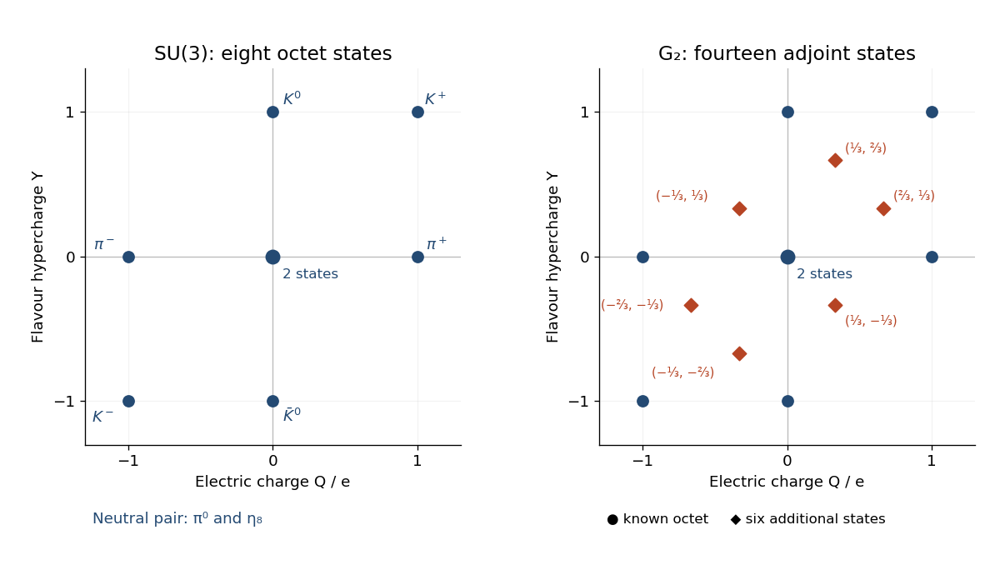

<h1 id="3/e/solution">Solution</h1>

↑ **Parent:** [E](../e.md)

A [G2](../../../../g2-mathematics.md) [multiplet](../../../../multiplet.md) containing the known [meson octet](../../../../meson-octet.md) must restrict to a [representation](../../../../group-representation.md) containing $\mathbf8$. Among the two fundamental [representations](../../../../group-representation.md) just computed, $\mathbf7$ fails this test, while the [Adjoint representation](../../../../adjoint-representation-of-a-lie-algebra.md) $\mathbf{14}$ contains the required octet. Thus the minimal such choice is

$$
\boxed{\text{meson octet}\subset\mathbf{14}=(1,0).}
$$

Larger [representations](../../../../group-representation.md) containing an octet would be other model choices; the octet alone does not force a unique arbitrarily large [representation](../../../../group-representation.md).

A dual [vector](../../../../vector.md) must be pulled back by $P^T$, since $q_A^TPw=(P^Tq_A)^Tw$. Applying this to the [electric charge](../../../../electric-charge-split.md) and [flavour hypercharge](../../../../flavor-hypercharge.md) [vectors](../../../../vector.md) gives

$$
\boxed{Q_{G_2}=P^T\frac13\begin{pmatrix}2\\1\end{pmatrix}
=\begin{pmatrix}1\\2/3\end{pmatrix},\qquad
Y_{G_2}=P^T\frac13\begin{pmatrix}1\\2\end{pmatrix}
=\begin{pmatrix}1\\1/3\end{pmatrix}.}
$$

Thus a [G2 root system](../../../../g2-root-system.md) [weight](../../../../weight-representation-theory.md) $(a,b)$ has $(q,y)=(a+2b/3,a+b/3)$. This pullback ensures that every known octet [meson](../../../../meson.md) retains its values from [solution](../b/solution.md). The extra $\mathbf3\oplus\overline{\mathbf3}$ gives six additional [mesons](../../../../meson.md), one at each of

$$
\boxed{(q,y)=\left(\tfrac23,\tfrac13\right),\
\left(-\tfrac13,\tfrac13\right),\
\left(-\tfrac13,-\tfrac23\right),\
\left(-\tfrac23,-\tfrac13\right),\
\left(\tfrac13,-\tfrac13\right),\
\left(\tfrac13,\tfrac23\right).}
$$

For instance the first three come from the [G2 root system](../../../../g2-root-system.md) [weights](../../../../weight-representation-theory.md) $(0,1)$, $(1,-2)$ and $(-1,1)$; the other three come from their negatives. The [weight diagram](../../../../weight-diagram.md) displays the preserved octet and the new states.

**[Figure 1](#3/e/image-the-meson-octet-and-its-minimal-g2-extension-in-electric-charge-and-flavour-hypercharge-coordinates). The meson octet and its minimal G2 extension in electric charge and flavour hypercharge coordinates**.

The fractional [electric charges](../../../../electric-charge-split.md) make these additional states qualitatively different from ordinary [quark](../../../../quark.md)-[antiquark](../../../../antiquark.md) [mesons](../../../../meson.md), whose [electric charges](../../../../electric-charge-split.md) are integers. This is a consequence of the proposed [symmetry](../../../../symmetry-physics.md) extension, not evidence for such particles. If “known mesons” also includes a flavour singlet from $\mathbf3\otimes\overline{\mathbf3}$, that singlet can be accommodated by a separate [G2](../../../../g2-mathematics.md) [trivial representation](../../../../trivial-representation.md): the minimal octet-plus-singlet construction is then $\mathbf{14}\oplus\mathbf1$, still with six new states. A demand for one irreducible [G2](../../../../g2-mathematics.md) [multiplet](../../../../multiplet.md) containing the entire nonet is a different extra assumption; $\mathbf{14}$ alone does not contain that singlet.

## ↑ Ancestors (12)

1. [E](../e.md)
2. [3](../../3.md)
3. [2021](../../../2021-split.md)
4. [Past exam of the groups and representations course of the University of Oxford](../../../split.md)
5. [Groups and representations course of the University of Oxford](../../../../groups-and-representations-course-of-the-university-of-oxford.md)
6. [Year 4 of the mathematical and theoretical physics course of the University of Oxford](../../../../year-4-of-the-mathematical-and-theoretical-physics-course-of-the-university-of-oxford.md)
7. [Mathematical and theoretical physics course of the University of Oxford](../../../../mathematical-and-theoretical-physics-course-of-the-university-of-oxford.md)
8. [Undergraduate course of the University of Oxford](../../../../undergraduate-course-of-the-university-of-oxford.md)
9. [Course of the University of Oxford](../../../../course-of-the-university-of-oxford.md)
10. [University of Oxford](../../../../university-of-oxford-split.md)
11. [List of universities](../../../../list-of-universities.md)
12. [Codex Wiki](../../../../split.md)
